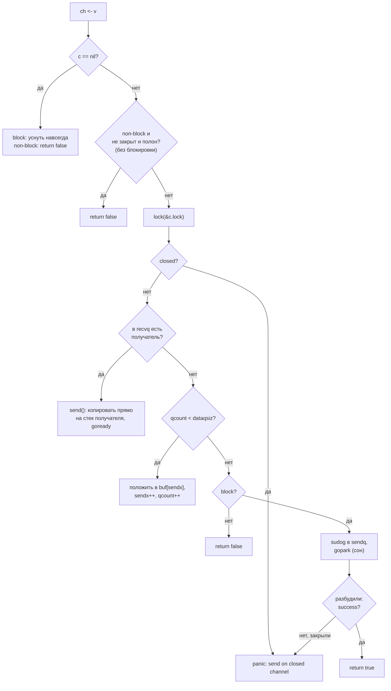
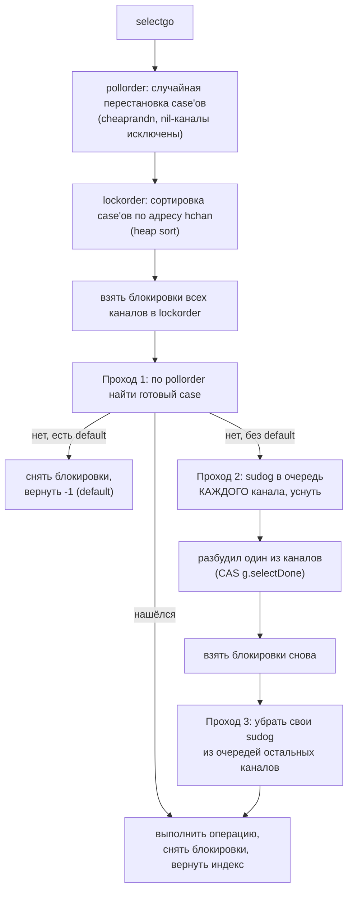
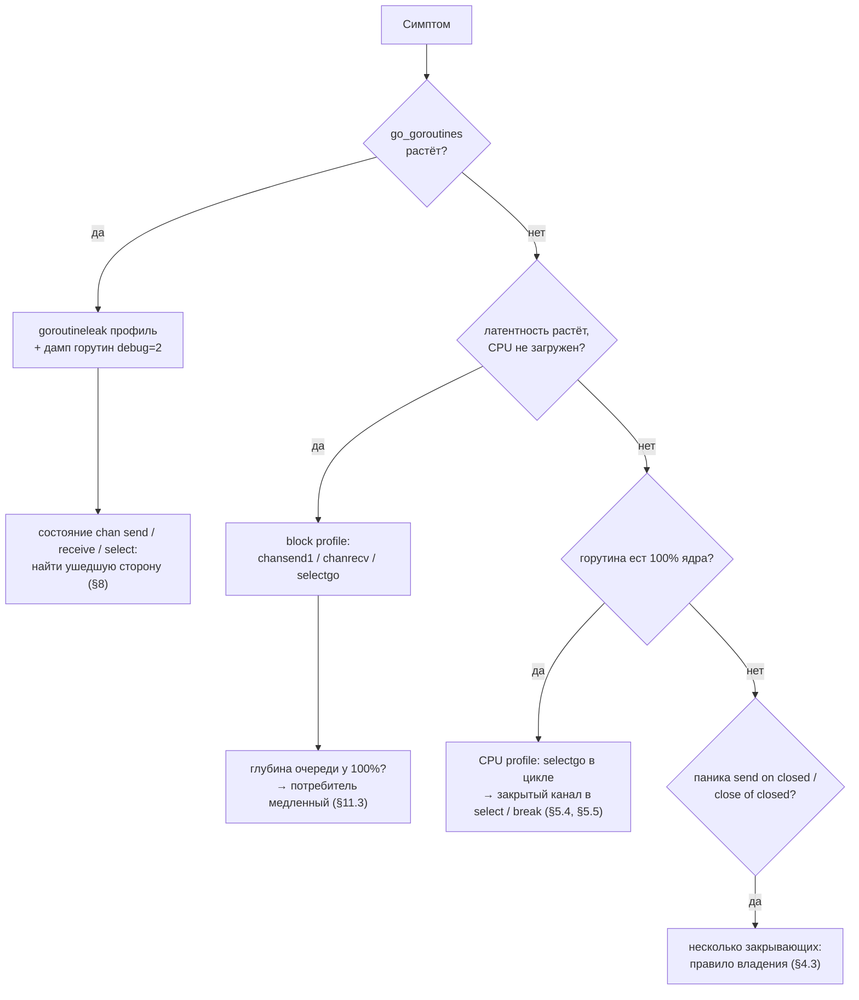

# Go Channels: Deep Dive для Senior Go-разработчика

> Актуально для **Go 1.27** (go1.27.0 выпущен в августе 2026; последний патч на момент написания — go1.27.2).
> Факты о рантайме сверены с исходниками тега `go1.27.0` (`src/runtime/chan.go`, `select.go`, `runtime2.go`, `proc.go`, `time.go`; `src/cmd/compile/internal/walk/select.go`, `range.go`; `src/time/sleep.go`), спецификацией (`doc/go_spec.html`), моделью памяти (`doc/go_mem.html`) и `doc/godebug.md`.
> Все бенчмарки и выводы команд — **реальные одиночные прогоны** на `go1.27.2 darwin/arm64, Apple M3 Pro, GOMAXPROCS=11` (где указано иное — в тексте). На вашем железе абсолютные числа будут другими, соотношения — примерно те же.
> Места, где факт не удалось проверить по первоисточнику, помечены **⚠️ не проверено**.
> В выводах команд длинные пути сокращены: `./` — каталог временного модуля, `GOROOT` — каталог тулчейна.
> Документ самодостаточен: всё нужное о горутинах, планировщике и сборщике мусора кратко объяснено там, где это требуется.

> **Если вы только начинаете разбираться во внутренностях Go:** сначала прочитайте [словарь терминов](#словарь-терминов). Перед плотными местами стоят блоки **«Простыми словами»**: их достаточно для общего понимания, детали под ними можно читать позже. Разделы 1, 4, 5, 8 и 9 полезны всем; разделы 2–3 — про то, как канал устроен внутри.

---

## Оглавление

- [Словарь терминов](#словарь-терминов)
- [TL;DR](#tldr)
- [1. Модель: что такое канал](#1-модель-что-такое-канал)
- [2. Устройство: hchan, буфер и очереди ожидания](#2-устройство-hchan-буфер-и-очереди-ожидания)
- [3. Отправка и получение по шагам](#3-отправка-и-получение-по-шагам)
- [4. Закрытие канала](#4-закрытие-канала)
- [5. select](#5-select)
- [6. Модель памяти и гонки данных](#6-модель-памяти-и-гонки-данных)
- [7. Таймеры и каналы](#7-таймеры-и-каналы)
- [8. Дедлоки и утечки](#8-дедлоки-и-утечки)
- [9. Паттерны и выбор между каналом и мьютексом](#9-паттерны-и-выбор-между-каналом-и-мьютексом)
- [10. Настройки и параметры](#10-настройки-и-параметры)
- [11. Production: сервисы и Kubernetes](#11-production-сервисы-и-kubernetes)
- [12. Наблюдаемость и диагностика](#12-наблюдаемость-и-диагностика)
- [13. Оптимизация](#13-оптимизация)
- [14. Грабли, заблуждения и советы: сводка](#14-грабли-заблуждения-и-советы-сводка)
- [15. Сравнение с другими платформами](#15-сравнение-с-другими-платформами)
- [16. Вопросы для собеседования](#16-вопросы-для-собеседования)
- [17. Чеклист и шпаргалка](#17-чеклист-и-шпаргалка)

---

## Словарь терминов

Термины встречаются по всему документу. Имена функций и структур рантайма даны как справка: их не нужно запоминать, достаточно понимать, что за ними стоит.

**Язык и модель**

| Термин | Простыми словами |
|---|---|
| Канал (channel) | Труба между горутинами: одна кладёт значение, другая забирает. Одновременно это очередь и средство синхронизации. |
| Небуферизованный канал | Канал без места для хранения (`make(chan T)`). Отправитель ждёт, пока получатель не заберёт значение «из рук в руки». |
| Буферизованный канал | Канал с очередью на N мест (`make(chan T, N)`). Отправитель ждёт, только когда очередь заполнена. |
| Направление канала | `chan<- T` — только отправка, `<-chan T` — только получение. Ограничение проверяет компилятор. |
| nil-канал | Объявленный, но не созданный канал (`var ch chan int`). Любая отправка и получение на нём блокируются навсегда. |
| Закрытие (`close`) | Сигнал «больше значений не будет». Получатели дочитывают остаток, затем получают нулевое значение и `ok == false`. |
| `select` | Оператор, который ждёт сразу несколько операций с каналами и выполняет ту, что готова первой. |
| Блокировка | Горутина не может продолжить работу и «засыпает», пока её не разбудят. Поток ОС при этом не занят. |
| Дедлок (deadlock) | Все горутины ждут друг друга, и никто не может продолжить. |
| Утечка горутины | Горутина заблокирована навсегда (например, на канале, в который никто не напишет), но программа продолжает работать. Горутина и всё, на что она ссылается, занимают память. |
| happens-before / «синхронизировано до» | Гарантия модели памяти: если событие A синхронизировано до B, то всё, что записано до A, гарантированно видно после B. |
| Гонка данных (data race) | Две горутины обращаются к одной переменной без синхронизации, и хотя бы одна пишет. Результат непредсказуем. |

**Рантайм**

| Термин | Простыми словами |
|---|---|
| Рантайм (runtime) | Код, который Go добавляет в каждую программу: планировщик, сборщик мусора, реализация каналов. |
| G, M, P | G — горутина, M — поток ОС, P — «разрешение» исполнять Go-код (их `GOMAXPROCS` штук). Чтобы исполнять горутину, поток должен держать P. Когда горутина засыпает на канале, планировщик снимает её с потока и даёт этому потоку другую горутину, поток при этом не простаивает. |
| `hchan` | Структура рантайма, которая и есть канал. Переменная типа `chan T` — это указатель на неё. |
| Кольцевой буфер | Массив фиксированного размера, в котором индексы записи и чтения «заворачиваются» с конца в начало. Так устроена очередь буферизованного канала. |
| `sudog` | «Карточка ожидания»: запись о том, что горутина G ждёт на канале C и куда положить (или откуда взять) значение. |
| `waitq` (`sendq`, `recvq`) | Очереди карточек `sudog`: кто ждёт возможности отправить и кто ждёт получения. |
| Парковка (park, `gopark`) | Горутина засыпает: планировщик снимает её с потока и запускает другую. |
| Пробуждение (`goready`) | Горутину снова ставят в очередь на исполнение. |
| Быстрый путь (fast path) | Короткая проверка без захвата блокировки: если операция заведомо не может пройти, вернуть результат сразу. |
| Write barrier | Несколько команд, которые сообщают сборщику мусора о записи указателя. Нужны потому, что GC работает одновременно с программой: без них программа могла бы «спрятать» нужный объект от GC, перезаписав указатель, и объект был бы удалён. Пока GC не работает, они почти ничего не стоят. |
| Корни GC (roots) | Места, с которых GC начинает поиск живых объектов: переменные на стеках горутин и глобальные переменные. Объект жив, если до него можно дойти по указателям от корня. |
| Пузырь synctest (bubble) | Изолированная группа горутин в тесте `testing/synctest` со своим поддельным временем. |

**Инструменты**

| Термин | Простыми словами |
|---|---|
| `-race` | Детектор гонок: компилирует программу с проверками и сообщает о гонке данных во время запуска. |
| Block profile | Профиль `pprof`: где и сколько суммарно горутины ждали на каналах, мьютексах и `select`. |
| `goroutineleak` | Профиль `pprof` (Go 1.26 — эксперимент, с Go 1.27 по умолчанию): находит горутины, которые заблокированы навсегда. |
| Дамп горутин | Список всех горутин со стеками и состоянием (`chan send`, `chan receive`, `select`…). |

---

## TL;DR

1. **Канал — это указатель на структуру `hchan`** в куче: мьютекс, кольцевой буфер и две очереди ожидающих горутин (`sendq`, `recvq`). Копирование переменной канала копирует указатель (§2.1).
2. **`make(chan T, N)` всегда выделяет память в куче:** 112 байт заголовка плюс буфер. Без указателей в `T` — одна аллокация, с указателями — две (замер в §2.2).
3. **Операции под одним мьютексом**, lock-free реализации в рантайме нет. Для неблокирующих операций (`select` с `default`) есть быстрый путь без блокировки (§3.2).
4. **Отправка спящему получателю идёт напрямую на его стек**, минуя буфер (`sendDirect`). Это единственное место в Go, где одна горутина пишет в стек другой (§3.3).
5. **Ожидающие обслуживаются по FIFO:** первая уснувшая горутина первой получит значение (§3.5).
6. **Шесть правил поведения** (nil / закрытый / открытый × send / recv / close) нужно знать наизусть: две паники при `close`, паника при отправке в закрытый канал, вечная блокировка на nil-канале (§1.3, реальный вывод).
7. **Закрывает канал только отправитель, и только один.** Несколько отправителей → отдельная горутина-«закрывальщик» после `WaitGroup.Wait()` (§4.3).
8. **`select` выбирает среди готовых case'ов случайно и равномерно** (замер: 499 663 / 500 337 из миллиона). Приоритета нет; его делают вложенным `select` с `default` (§5.3).
9. **nil-канал в `select` отключает case** — основной приём для динамического набора событий (§5.4).
10. **`break` внутри `select` выходит только из `select`**, не из `for`. `go vet` молчит, `staticcheck` ловит (SA4011) (§5.5).
11. **Модель памяти:** отправка синхронизирована до завершения соответствующего получения; закрытие — до получения нулевого значения; k-е получение — до завершения (k+C)-й отправки (это делает буферизованный канал семафором) (§6.1).
12. **С Go 1.23 каналы таймеров синхронные**, `Stop`/`Reset` не требуют «осушения» канала, а неиспользуемые таймеры собирает GC. **В Go 1.27 настройку `asynctimerchan` удалили** — старое поведение вернуть нельзя (§7).
13. **Самая частая утечка:** горутина пишет результат в небуферизованный канал, а читатель ушёл по таймауту. Лечится буфером на 1. С Go 1.27 такие утечки находит профиль `goroutineleak` (§8.3).
14. **Канал дорог для мелкой работы:** ≈ 110 нс на значение через небуферизованный канал, ≈ 30 нс через буфер 128, ≈ 2,8 нс на значение при передаче пачками по 64. Итератор `iter.Seq` вместо канала-генератора — 0,28 нс (§13).
15. **Каналы — для передачи владения данными и сигналов; мьютекс — для защиты состояния.** Счётчик на канале медленнее atomic и не проще мьютекса (§9.7).

---

## 1. Модель: что такое канал

> **Простыми словами.** Канал — это труба с защёлкой между горутинами. Одна горутина кладёт значение (`ch <- v`), другая забирает (`v := <-ch`). Если трубе некуда положить или нечего отдать, горутина засыпает и ждёт напарника. Поэтому канал одновременно передаёт данные и согласует горутины по времени: «я продолжу только тогда, когда ты заберёшь».

### 1.1 Определение и типы

Спецификация (`doc/go_spec.html`, раздел Channel types): канал — механизм, через который конкурентно выполняющиеся функции общаются, отправляя и получая значения заданного типа.

```go
var orders chan Order          // nil: не создан, операции блокируются навсегда
orders = make(chan Order)      // небуферизованный: cap == 0
events := make(chan Event, 256) // буферизованный: очередь на 256 элементов

func produce(out chan<- Event) {} // только отправка
func consume(in <-chan Event)  {} // только получение
```

| Свойство | Что значит на практике |
|---|---|
| Ссылочный тип | `chan T` — указатель на `hchan`. Передача в функцию, копирование в структуру, захват в замыкание дают ту же очередь. |
| Типизирован | Элемент строго одного типа. Максимальный размер элемента — меньше 64 KiB: компилятор выдаёт `channel element type too large (>64kB)` (`cmd/compile/internal/types/size.go`), рантайм дополнительно проверяет `elem.Size_ >= 1<<16` в `makechan`. |
| Направленный | `chan T` неявно приводится к `chan<- T` и `<-chan T`, обратно — нельзя. Это документирует владение: кто пишет, кто читает. |
| Сравним | `ch1 == ch2` — сравнение указателей. Канал можно использовать как ключ map. |
| `len`, `cap` | `len` — сколько элементов лежит в буфере сейчас, `cap` — размер буфера. Для nil-канала оба 0. |

### 1.2 Небуферизованный и буферизованный

```text
Небуферизованный (cap = 0): встреча «из рук в руки»

  отправитель ──── ждёт ────┐
                            ├── передача ──► оба продолжают
  получатель  ──── ждёт ────┘

Буферизованный (cap = 3): почтовый ящик

  отправитель ─► [ v1 | v2 | __ ] ─► получатель
                 ждёт, только если ящик полон;
                 получатель ждёт, только если ящик пуст
```

| | Небуферизованный | Буферизованный |
|---|---|---|
| Когда блокируется отправка | пока нет получателя | когда буфер полон |
| Когда блокируется получение | пока нет отправителя | когда буфер пуст |
| Гарантия при отправке | значение уже **получено** | значение лежит в буфере, получатель мог его ещё не видеть |
| Основное применение | синхронизация, передача «из рук в руки», сигналы | сглаживание всплесков, семафор, ограничение очереди |

> **Заблуждение:** «буферизованный канал — асинхронный, он не синхронизирует горутины». На самом деле синхронизация есть всегда, но другая: отправка синхронизирована до завершения соответствующего получения, а k-е получение — до завершения (k+cap)-й отправки (§6.1). Буфер лишь разрешает отправителю «уйти вперёд» не более чем на `cap` элементов. Заблуждение идёт от аналогии с асинхронными очередями сообщений, где отправитель вообще не ждёт.

> **Заблуждение:** «больший буфер ускоряет программу». Буфер сглаживает **кратковременные** всплески. Если потребитель в среднем медленнее производителя, любой буфер заполнится, и дальше скорость равна скорости потребителя, а задержка каждого элемента вырастет на время ожидания в очереди. Буфер не лечит медленного потребителя, он прячет проблему до заполнения (§12.3).

### 1.3 Шесть правил: nil, открытый, закрытый

Это таблица, которую нужно знать наизусть. Источник — спецификация и код `chansend`, `chanrecv`, `closechan` (`runtime/chan.go`).

| Операция | nil-канал | Открытый | Закрытый |
|---|---|---|---|
| `ch <- v` | блокировка навсегда | отправка или ожидание | **panic: send on closed channel** |
| `<-ch` | блокировка навсегда | получение или ожидание | остаток буфера, затем нулевое значение и `ok == false` сразу |
| `close(ch)` | **panic: close of nil channel** | закрывает | **panic: close of closed channel** |
| `len`, `cap` | 0, 0 | текущие | `len` — остаток буфера, `cap` — как был |

Проверка запуском. Каждая операция выполняется в отдельной горутине, паника перехватывается, вечная блокировка определяется по таймауту 100 мс:

```go
var nilCh chan int
closed := make(chan int, 2)
closed <- 42
close(closed)

try("send в nil", func() { nilCh <- 1 })
try("recv из nil", func() { <-nilCh })
try("close(nil)", func() { close(nilCh) })
try("recv из закрытого (есть данные)", func() { v, ok := <-closed; fmt.Print(v, " ", ok, "  ") })
try("recv из закрытого (пустого)", func() { v, ok := <-closed; fmt.Print(v, " ", ok, "  ") })
try("send в закрытый", func() { closed <- 1 })
try("close(закрытого)", func() { close(closed) })
fmt.Println("len/cap закрытого:", len(closed), cap(closed))
```

```text
send в nil                       блокировка навсегда
recv из nil                      блокировка навсегда
close(nil)                       panic: close of nil channel
42 true  recv из закрытого (есть данные)  ok
0 false  recv из закрытого (пустого)      ok
send в закрытый                  panic: send on closed channel
close(закрытого)                 panic: close of closed channel
len/cap закрытого: 0 2
```

Из вывода видно главное: закрытие **не выбрасывает** данные из буфера (сначала пришло `42 true`), и после опустошения получение больше не блокируется.

**Почему nil-канал блокирует, а не паникует.** Это сознательное решение: nil-канал в `select` означает «этот case сейчас выключен» (§5.4). Если бы операция паниковала, такой приём был бы невозможен. В рантайме это одна ветка: `if c == nil { gopark(...) }` с причиной `chan send (nil chan)` / `chan receive (nil chan)` — эти строки потом видны в дампе горутин (§12.1).

**Почему `close` второй раз — паника, а не no-op.** Двойное закрытие почти всегда означает, что в программе нет ясного владельца канала. Паника заставляет это исправить, а не прятать (§4.3).

### 1.4 Как получить признак закрытия

```go
v, ok := <-ch       // ok == false: канал закрыт И буфер пуст
for v := range ch { // цикл завершается после close и опустошения буфера
	handle(v)
}
```

Цикл `for range ch` компилятор превращает в цикл с `v, ok := <-ch` (`cmd/compile/internal/walk/range.go`, ветка `TCHAN`). После каждой итерации временная переменная элемента обнуляется, чтобы она не удерживала от сборщика мусора последний полученный объект, пока цикл ждёт следующего (комментарий ссылается на issue 15281).

> **Совет.** Если канал никогда не закрывается, не пишите `for v := range ch` в коде, который должен завершаться: цикл не закончится. Используйте `for { select { case v := <-ch: ...; case <-ctx.Done(): return } }`. Не нужно, если горутина живёт всё время работы процесса.

### Что важно для Senior

- Канал — ссылочный тип; nil-канал — валидное значение с особой семантикой (вечная блокировка), используемой в `select`.
- Таблица «nil / открытый / закрытый × send / recv / close» — основа для разбора любого инцидента с каналами: три паники и две вечные блокировки.
- Буферизованный канал тоже синхронизирует, но по правилу «k-е получение до (k+C)-й отправки», а не «отправка до получения завершилась».
- Буфер сглаживает всплески и ограничивает очередь; он не ускоряет систему, если потребитель медленнее.

---

## 2. Устройство: hchan, буфер и очереди ожидания

> **Простыми словами.** Внутри канал — это небольшая структура в памяти. В ней есть: замок (чтобы две горутины не меняли канал одновременно), кольцевая очередь на `cap` мест с двумя указателями «куда писать» и «откуда читать», и два списка ожидающих: «кто хочет отправить, но некуда» и «кто хочет получить, но нечего». Когда горутина засыпает на канале, она оставляет в списке карточку `sudog` с адресом, куда положить значение.

### 2.1 Структура `hchan`

`runtime/chan.go:34` (go1.27.0):

```go
type hchan struct {
	qcount   uint           // сколько элементов сейчас в буфере
	dataqsiz uint           // размер буфера (cap), не меняется после make
	buf      unsafe.Pointer // массив из dataqsiz элементов
	elemsize uint16
	closed   uint32
	timer    *timer         // таймер, который пишет в этот канал (time.Timer)
	elemtype *_type
	sendx    uint           // индекс следующей записи в буфер
	recvx    uint           // индекс следующего чтения из буфера
	recvq    waitq          // очередь ждущих получателей
	sendq    waitq          // очередь ждущих отправителей
	bubble   *synctestBubble // пузырь testing/synctest, если канал создан в нём

	// lock защищает все поля hchan и некоторые поля sudog,
	// заблокированных на этом канале.
	lock mutex
}

type waitq struct {
	first *sudog
	last  *sudog
}
```

```text
 ch (chan int) ──► hchan
                   ┌────────────────────────────────────────────┐
                   │ lock      mutex                            │
                   │ qcount=2  dataqsiz=4  elemsize=8  closed=0 │
                   │ recvx=1   sendx=3                          │
                   │ buf ──────► [ __ | v1 | v2 | __ ]          │
                   │                   ▲recvx     ▲sendx        │
                   │ recvq: first ─► nil                        │
                   │ sendq: first ─► nil                        │
                   │ timer: nil   bubble: nil                   │
                   └────────────────────────────────────────────┘
```

Инварианты из шапки `chan.go`:

- хотя бы одна из очередей `sendq`, `recvq` пуста (исключение — одна горутина в `select` одновременно отправляет и получает на одном небуферизованном канале);
- для буферизованного канала: `qcount > 0` ⇒ `recvq` пуста (если есть данные, никто не ждёт получения); `qcount < dataqsiz` ⇒ `sendq` пуста (если есть место, никто не ждёт отправки).

Эти инварианты объясняют порядок проверок в `chansend`/`chanrecv` (§3): например, отправитель сначала смотрит `recvq`, потому что при наличии ждущего получателя буфер гарантированно пуст.

**Поля по версиям.** `timer` появился вместе с переделкой таймеров в Go 1.23 (§7). `bubble` — с `testing/synctest` (эксперимент в Go 1.24, стабильный `synctest.Test` с Go 1.25). Нарушение границ пузыря — `fatal("send on synctest channel from outside bubble")`; все такие нарушения стали фатальными в Go 1.26 (коммит «runtime: make all synctest bubble violations fatal panics», тег go1.26rc1).

### 2.2 Создание: `makechan` и сколько стоит канал

`makechan` (`chan.go:75`) проверяет размер элемента и переполнение `elemsize × size`, затем выбирает один из трёх способов выделения памяти:

| Случай | Как выделяется | Почему |
|---|---|---|
| `size == 0` или элемент нулевого размера (`chan struct{}`) | только `hchan` | буфер не нужен; `buf` указывает внутрь `hchan` (адрес нужен детектору гонок) |
| элемент без указателей (`int`, `[64]byte`, `struct{id int64}`) | `hchan` и буфер **одним блоком** без указателей | одна аллокация; GC не сканирует блок |
| элемент с указателями (`*T`, `string`, `[]byte`, структуры с ними) | `hchan` и буфер **отдельно**, буфер — с типом элемента | GC должен сканировать буфер по типу |

Замер: 1000 вызовов `make`, разница `runtime.MemStats` до и после.

```go
type event struct{ id int64; payload *byte }

measure("make(chan int)", func() any { return make(chan int) })
measure("make(chan struct{}, 100)", func() any { return make(chan struct{}, 100) })
measure("make(chan int, 10)", func() any { return make(chan int, 10) })
measure("make(chan event, 10)", func() any { return make(chan event, 10) })
measure("make(chan [64]byte, 1000)", func() any { return make(chan [64]byte, 1000) })
```

```text
make(chan int)                112 B/chan  1 allocs/chan
make(chan struct{}, 100)      112 B/chan  1 allocs/chan
make(chan int, 10)            192 B/chan  1 allocs/chan
make(chan event, 10)          272 B/chan  2 allocs/chan
make(chan [64]byte, 1000)    65541 B/chan  1 allocs/chan
```

Что видно:

- Заголовок `hchan` на 64-битной платформе — 112 байт (сумма полей: девять 8-байтовых слов, две очереди по 16 байт, `elemsize`+`closed` с выравниванием).
- `chan struct{}` с буфером 100 стоит столько же, сколько небуферизованный: элементы нулевого размера места не занимают. Это причина, по которой сигнальные каналы делают `chan struct{}`.
- `chan int, 10`: 112 + 80 = 192 байта, одна аллокация.
- `chan event, 10` (есть указатель): 112 + 160 — две аллокации.
- `chan [64]byte, 1000`: ≈ 64 KiB, большой объект округлён до целых страниц.

Канал **всегда** выделяется в куче: `make(chan ...)` компилируется в вызов `runtime.makechan`, который вызывает `mallocgc`. Escape analysis для каналов не работает — даже канал, который не покидает функцию, в выводе `-gcflags=-m` не значится как «does not escape», а в ассемблере остаётся вызов `runtime.makechan`:

```go
func local() int {
	ch := make(chan int, 1) // канал не покидает функцию
	ch <- 42
	return <-ch
}
```

```text
$ go build -gcflags=-m ./esc
esc/main.go:3:6: can inline local
esc/main.go:9:6: can inline main
esc/main.go:9:28: inlining call to local

$ go build -gcflags=-S ./esc | grep -o 'runtime\.\(makechan\|chansend1\|chanrecv1\)' | sort | uniq -c
   4 runtime.makechan
   4 runtime.chansend1
   4 runtime.chanrecv1
```

> **Совет.** Не создавайте канал на каждый вызов горячей функции, если без него можно обойтись: это минимум 112 байт в куче и работа для GC. Например, для «вернуть результат из горутины» в цикле на миллион итераций лучше пул воркеров с долгоживущими каналами (§9.3). Не нужно, если канал создаётся на запрос к БД или HTTP-вызов: там 112 байт незаметны на фоне остального.

### 2.3 Кольцевой буфер

Буфер — массив из `dataqsiz` слотов. `sendx` показывает, куда писать, `recvx` — откуда читать; оба «заворачиваются» в 0 после последнего слота (`if c.sendx == c.dataqsiz { c.sendx = 0 }`). `qcount` отличает пустой буфер от полного (при обоих `sendx == recvx`).

```text
cap = 4

после 3 отправок:       [ v1 | v2 | v3 | __ ]   recvx=0 sendx=3 qcount=3
после 2 получений:      [ __ | __ | v3 | __ ]   recvx=2 sendx=3 qcount=1
после 3 отправок:       [ v5 | v6 | v3 | v4 ]   recvx=2 sendx=2 qcount=4  (полон)
                                ▲ sendx «завернулся» через конец массива
```

Почему кольцо, а не связный список: память выделяется один раз в `make`, отправка и получение — `memmove` в известный слот без аллокаций. Цена: размер буфера фиксирован навсегда, «растущего» канала в Go нет.

После чтения слот обнуляется (`typedmemclr` в `chanrecv`), чтобы буфер не удерживал от GC уже прочитанные объекты.

### 2.4 `sudog`: карточка ожидания

Когда операция не может выполниться сразу, горутина ставит в очередь канала `sudog` (`runtime2.go:404`):

```go
type sudog struct {
	g    *g                // кто ждёт
	next *sudog            // соседи в очереди канала
	prev *sudog
	elem maybeTraceablePtr // куда положить / откуда взять значение (часто — стек ждущего)
	...
	isSelect bool          // горутина ждёт в select: будить надо через CAS
	success  bool          // true — значение передано, false — разбудили закрытием
	...
	waitlink *sudog        // список всех sudog этой горутины (для select)
	c        maybeTraceableChan // на каком канале ждём
}
```

Почему отдельная структура, а не поле в `g`: связь «горутина — канал» — многие ко многим. Одна горутина в `select` ждёт на нескольких каналах сразу (по `sudog` на каждый case), и на одном канале ждут много горутин. Комментарий в `runtime2.go` говорит именно это.

`sudog` берутся из кэша на каждом P (`acquireSudog` в `proc.go`: локальный срез на 128 элементов, затем общий кэш `sched.sudogcache`, затем `new(sudog)`). Поэтому блокирующая операция в установившемся режиме не аллоцирует — это видно в бенчмарках (§13): `0 allocs/op` даже при постоянной парковке.

**Поля `elem` и `c` имеют тип `maybeTraceablePtr`** (Go 1.26, коммит «runtime,net/http/pprof: goroutine leak detection by using the garbage collector», тег go1.26rc1). Указатель хранится дважды: как `uintptr` (источник истины) и как обычный указатель (для GC). Детектор утечек может «спрятать» указатель на канал от GC, обнулив только вторую копию, — так он выясняет, достижим ли канал из работающих горутин (§8.4).

### 2.5 Почему мьютекс, а не lock-free

Все изменяющие операции идут под `c.lock` — внутренним мьютексом рантайма (не `sync.Mutex`; на Linux он основан на futex). Lock-free реализация каналов обсуждалась (Дмитрий Вьюков, документ «Go channels on steroids», 2014), но в рантайм не вошла **⚠️ не проверено** (точная судьба предложения по первоисточнику не сверялась; проверено только, что в go1.27.0 все операции идут под `c.lock`).

Аргументы за мьютекс, которые видны из кода:

- канал должен поддерживать `select` по многим каналам атомарно: `selectgo` берёт **все** блокировки каналов в порядке их адресов (§5.2). С lock-free очередями такую многоканальную атомарность сделать гораздо сложнее;
- критические секции очень короткие (несколько сравнений и `memmove`), поэтому при умеренной конкуренции мьютекс почти не ждёт;
- для частого неблокирующего случая есть быстрый путь без блокировки (§3.2).

Цена: при сильной конкуренции многих горутин за один канал он становится точкой сериализации. Замер в §13.3: 11 производителей на одном канале — 47–71 нс на отправку против 21 нс при одном.

### Что важно для Senior

- `hchan` = мьютекс + кольцевой буфер + `sendq`/`recvq`; инварианты «данные есть ⇒ нет ждущих получателей» и «место есть ⇒ нет ждущих отправителей» определяют порядок проверок.
- Канал всегда в куче: 112 байт + буфер; с указателями в элементе — две аллокации, без — одна.
- `chan struct{}` с любым буфером стоит как небуферизованный канал: элементов нулевого размера в буфере нет.
- `sudog` переиспользуются из кэша на P — блокировка на канале не аллоцирует.
- Один канал под высокой конкуренцией — точка сериализации: при десятках производителей шардируйте (канал на воркера) или передавайте пачками.

---

## 3. Отправка и получение по шагам

> **Простыми словами.** У отправки три возможных исхода. Если кто-то уже ждёт значения — отдаём ему прямо в руки и будим. Если в буфере есть место — кладём в буфер. Если ни того, ни другого — записываемся в очередь ожидающих и засыпаем, пока получатель не заберёт значение сам. Получение устроено зеркально. Всё это делается под замком канала, поэтому две горутины не могут одновременно испортить очередь.

### 3.1 Алгоритм `chansend`

`chansend` (`chan.go:176`) вызывается для `ch <- v` (через `chansend1`, `block = true`) и для `select` с одним case и `default` (через `selectnbsend`, `block = false`).



Порядок важен: ждущий получатель проверяется **до** буфера. По инварианту при ждущем получателе буфер пуст, и прямая передача экономит одну копию через буфер.

### 3.2 Быстрый путь без блокировки

Для неблокирующих операций рантайм сначала проверяет состояние канала без захвата мьютекса:

```go
// chansend:
if !block && c.closed == 0 && full(c) {
	return false
}
```

Комментарий в коде объясняет, почему два несинхронизированных чтения корректны: закрытый канал не может перейти из состояния «готов к отправке» в «не готов». Значит, если мы увидели «не закрыт» и «полон», существовал момент, когда канал был одновременно открыт и полон, и мы вправе вести себя так, будто наблюдали его в этот момент.

Для получения (`chanrecv`) порядок обратный и чтения атомарные: сначала `empty(c)`, затем `atomic.Load(&c.closed)`, и при «закрыт» — повторная проверка `empty`, потому что между проверками могли прийти данные.

Практическое следствие: `select { case v := <-ch: ...; default: }` на пустом канале стоит ≈ 3,3 нс (§13.6) — это два атомарных чтения, без мьютекса.

### 3.3 Прямая передача на стек другой горутины

Если получатель уже спит, `send` копирует значение **прямо в переменную на стеке получателя**, адрес которой лежит в `sg.elem` (`sendDirect`, `chan.go:392`). Буфер не используется, даже если он есть.

```text
горутина A (отправитель)            горутина B (спит в recvq)
стек A:  v = Order{...}             стек B:  var o Order   ◄── sg.elem
           │                                     ▲
           └──── memmove(sg.elem, &v) ───────────┘
                 + write barrier по типу элемента
```

Комментарий в `chan.go` (перед `sendDirect`): это **единственная** ситуация, когда одна работающая горутина пишет в стек другой. GC предполагает, что в стек пишет только его владелец, поэтому рантайм вызывает `typeBitsBulkBarrier` — write barrier для каждого указателя в копируемом значении — и затем `memmove`. Обычный `typedmemmove` здесь не подходит: его барьеры работают только для памяти в куче.

Отсюда же два механизма, связанных со стеком:

- **сжатие стека:** пока горутина спит на канале, другие горутины держат указатели на её стек (`sg.elem`). Поэтому перед сном рантайм ставит `gp.parkingOnChan`, а после постановки в очередь — `gp.activeStackChans`; при копировании стека такой горутины рантайм берёт блокировки каналов и поправляет указатели в её `sudog` (`syncadjustsudogs` в `stack.go`);
- **`KeepAlive(ep)`** после `gopark` в `chansend`: значение, которое отправляем, должно жить, пока получатель его не скопирует, а `sudog` не являются корнями для GC.

Почему так сделано: прямая передача экономит копирование через буфер и, главное, не требует, чтобы проснувшийся получатель снова брал блокировку канала, — данные уже у него.

### 3.4 Получение из полного буфера, когда ждёт отправитель

Интересный случай в `recv` (`chan.go:702`): буфер полон, и в `sendq` спит отправитель. Получатель должен взять **самый старый** элемент (из головы буфера), а значение спящего отправителя — поставить в хвост. При полном буфере голова и хвост — это один и тот же слот:

```text
до:     buf = [ v1 | v2 | v3 ]  recvx=0 sendx=0 (полон)   sendq: A(v4)
шаг 1:  получатель забирает buf[0] = v1
шаг 2:  в тот же слот кладётся v4 из sudog A
после:  buf = [ v4 | v2 | v3 ]  recvx=1 sendx=1           A разбужен
```

Порядок FIFO сохраняется (следующим прочитают v2), отправитель разбужен, всё за одну операцию под блокировкой.

### 3.5 Порядок пробуждения: FIFO

`waitq.enqueue` добавляет в конец, `dequeue` берёт из начала. Значит, ждущие отправители и получатели обслуживаются в порядке прихода. Исключение — горутины в `select`: если `select` уже разбужен другим каналом, `dequeue` проверяет флаг `g.selectDone` через CAS, пропускает такую карточку и берёт следующую (§5.2).

> **Заблуждение:** «если несколько горутин ждут на канале, значение получит случайная». Среди ждущих на **одном** канале порядок FIFO. Случайность есть только в `select` — при выборе между **разными** готовыми case'ами (§5.3). Но FIFO относится к моменту постановки в очередь: какая горутина успела уснуть первой, зависит от планировщика, поэтому полагаться на порядок «я запустил горутины 1, 2, 3 — они получат значения 1, 2, 3» нельзя.

### 3.6 Что видно на практике

| Где | Что |
|---|---|
| Дамп горутин | состояние `[chan send]`, `[chan receive]`, `[chan send (nil chan)]`, `[select]` и время ожидания (§12.1) |
| Block profile | функции `runtime.chansend1`, `runtime.chanrecv1`, `runtime.chanrecv2`, `runtime.selectgo` (§12.2) |
| `go tool trace` | события блокировки `chan send` / `chan receive` / `select` (`traceBlockChanSend` и др. в `gopark`) |
| Бенчмарк | передача «из рук в руки» с парковкой ≈ 110 нс; без парковки (буфер, одна горутина) ≈ 18 нс (§13) |

### Что важно для Senior

- Порядок в `chansend`: nil → быстрый путь → lock → closed → ждущий получатель → буфер → сон. `chanrecv` зеркален, но закрытый канал с данными сначала отдаёт данные.
- Ждущему получателю значение пишется прямо в его стек; это требует write barrier по типу элемента и особой обработки при сжатии стека.
- Неблокирующие операции (`select` с `default`) проверяют канал без мьютекса — это дёшево (единицы наносекунд).
- Ждущие на одном канале обслуживаются по FIFO, но порядок засыпания определяет планировщик.

---

## 4. Закрытие канала

> **Простыми словами.** `close(ch)` — это объявление «больше ничего не пришлю». Всех, кто ждал получения, будят одним махом, и они получают нулевое значение. Всех, кто ждал отправки, тоже будят — и у них случается паника, потому что слать в закрытый канал нельзя. Поэтому закрывать должен тот, кто отправляет, и только когда он точно последний.

### 4.1 Что делает `closechan`

`closechan` (`chan.go:414`):

1. nil → `panic: close of nil channel`; уже закрыт → `panic: close of closed channel` (проверка под блокировкой).
2. `c.closed = 1`.
3. Все `sudog` из `recvq`: в их `elem` пишется нулевое значение, `success = false`.
4. Все `sudog` из `sendq`: `success = false` — после пробуждения они паникуют `send on closed channel`.
5. Блокировка снимается, **затем** все собранные горутины будятся (`goready`).

Шаг 5 сделан после снятия блокировки сознательно: комментарий у поля `lock` запрещает менять статус другой горутины, держа блокировку канала, — иначе возможен дедлок со сжатием стека.

### 4.2 Закрытие как широковещательный сигнал

Отправка будит одного получателя, закрытие — **всех сразу**, и все будущие получения тоже сразу возвращаются. Поэтому закрытие — стандартный способ сказать «стоп» любому числу горутин. На этом построен `context.Context`: `ctx.Done()` возвращает канал, который закрывается при отмене.

```go
type Consumer struct {
	stop chan struct{}
}

func (c *Consumer) Run(msgs <-chan kafka.Message) {
	for {
		select {
		case m := <-msgs:
			c.handle(m)
		case <-c.stop: // сработает у всех воркеров одновременно
			return
		}
	}
}

func (c *Consumer) Stop() { close(c.stop) }
```

> **Совет.** Для сигнала «стоп» используйте `chan struct{}` и `close`, а не отправку значения: отправка разбудит только одного из N воркеров, остальные останутся висеть. Ещё лучше — `context.Context`: та же механика, плюс причина отмены и дедлайны. Не нужно, если получатель гарантированно один и канал несёт данные.

> **Заблуждение:** «канал нужно закрывать, иначе он утечёт». Канал — обычный объект в куче; когда на него не осталось ссылок, GC его соберёт, закрыт он или нет. Закрывать нужно, только чтобы **сообщить получателям** о конце данных (например, чтобы завершился `for range`). Утекают не каналы, а **горутины**, которые на них ждут (§8).

### 4.3 Кто закрывает: правило и способы

Правило: **канал закрывает отправитель, и только один**. Получатель не может знать, не идёт ли сейчас отправка, а отправка в закрытый канал — паника.

**Грабли: каждый из нескольких отправителей закрывает канал «когда закончил»**

```go
func main() {
	results := make(chan int, 16)
	var wg sync.WaitGroup
	for w := range 3 {
		wg.Go(func() {
			for i := range 5 {
				results <- w*100 + i
			}
			close(results) // ошибка: закрывает не единственный отправитель
		})
	}
	go func() { wg.Wait() }()
	n := 0
	for range results {
		n++
	}
	fmt.Println("получено:", n)
}
```

```text
$ go vet ./multiclose && echo "go vet: ok"
go vet: ok
$ go run ./multiclose
получено: 5
panic: send on closed channel [recovered, repanicked]

goroutine 21 [running]:
sync.(*WaitGroup).Go.func1.1()
	GOROOT/src/sync/waitgroup.go:251 +0x48
panic({0x100bc9f08?, 0x100bb4330?})
	GOROOT/src/runtime/panic.go:859 +0x120
main.main.func1()
	./multiclose/main.go:15 +0x44
```

Почему так: первый закончивший воркер закрыл канал, читатель дочитал 5 значений и вышел из цикла (данные потеряны), а следующая отправка другого воркера упала. В трёх прогонах подряд паника была каждый раз, но в реальном сервисе с другими таймингами такой код может месяцами работать и падать редко. Пометка `[recovered, repanicked]` — от `WaitGroup.Go`, который перехватывает панику и бросает её снова. Как заметить: `go vet` и `-race` не помогают, это логическая ошибка; симптом — паника `send on closed channel` или `close of closed channel` в логах. Как исправить: закрывать в отдельной горутине после завершения всех отправителей:

```go
var wg sync.WaitGroup
for w := range 3 {
	wg.Go(func() {
		for i := range 5 {
			results <- w*100 + i
		}
	})
}
go func() {
	wg.Wait()
	close(results) // единственный владелец закрытия
}()
for v := range results { ... }
```

Способы закрыть безопасно, по сценариям:

| Сценарий | Как закрывать |
|---|---|
| Один отправитель | `defer close(out)` в самом отправителе |
| N отправителей, один получатель | горутина `wg.Wait(); close(out)` (как выше) |
| N отправителей, получатель хочет остановить их раньше | **не закрывать канал данных**; отдельный сигнал отмены (`ctx` или `close(done)`), отправители выходят по нему; канал данных собирает GC |
| Закрытие может прийти из нескольких мест (`Stop()` вызывают дважды) | `sync.Once` вокруг `close`, или `context.WithCancel` (cancel идемпотентен) |

> **Заблуждение:** «перед отправкой можно проверить, закрыт ли канал». Встроенной проверки нет, а `v, ok := <-ch` для этого не годится: он **забирает** значение. Даже если бы проверка была, между ней и отправкой канал могут закрыть. Решение — архитектурное: у канала должен быть один владелец закрытия.

> **Совет.** В сигнатуре функции-производителя возвращайте `<-chan T`: тогда вызывающий код не сможет ни отправить, ни закрыть канал — компилятор выдаст ошибку `invalid operation: cannot close receive-only channel`. Это самый дешёвый способ закрепить правило «закрывает только отправитель». Не нужно, если канал внутренний и не выходит за пределы одной функции.

### Что важно для Senior

- `close` будит всех ждущих: получателей — с нулевым значением, отправителей — с паникой.
- Закрытие — широковещательный сигнал; на нём построен `ctx.Done()`.
- Закрывает один отправитель. При N отправителях — горутина-«закрывальщик» после `WaitGroup.Wait`, при ранней остановке — отдельный канал отмены, а канал данных не закрывается вовсе.
- Каналы не утекают, утекают горутины; закрывать «для GC» не нужно.

---

## 5. `select`

> **Простыми словами.** `select` — это «жду, что случится первым»: пришло сообщение, истёк таймер или отменили запрос. Если готовы сразу несколько вариантов, Go выбирает случайно, чтобы ни один не «голодал». Если есть `default`, `select` не ждёт вовсе: нет готовых вариантов — выполняется `default`.

### 5.1 Что делает компилятор

`walkSelectCases` (`cmd/compile/internal/walk/select.go`) упрощает частые формы ещё при компиляции:

| Форма | Во что компилируется |
|---|---|
| `select {}` | `runtime.block()` — вечный сон с причиной `select (no cases)` |
| один case без `default` | обычная операция `ch <- v` или `<-ch` |
| один case + `default` | `if selectnbsend(c, v) {...} else {...}` или `selectnbrecv` — неблокирующая операция с быстрым путём (§3.2) |
| всё остальное | массив `scase` на стеке + вызов `runtime.selectgo` |

Поэтому `select { case ch <- v: default: }` — это не «дорогой select», а один неблокирующий вызов `chansend`.

### 5.2 Алгоритм `selectgo`

`selectgo` (`select.go:122`) работает в три прохода:



Ключевые решения и зачем они:

- **Случайный порядок опроса** (`pollorder`) — чтобы при нескольких готовых каналах ни один не «голодал». Спецификация требует именно этого: «a single one that can proceed is chosen via a uniform pseudo-random selection» (`go_spec.html`, Select statements).
- **Блокировки в порядке адресов каналов** (`lockorder`, `sortkey()` возвращает адрес `hchan`). Две горутины, делающие `select` по одним и тем же каналам в разном порядке, всегда берут блокировки в одном и том же порядке — значит, не могут взаимно заблокироваться. Сортировка — heap sort: гарантированное `O(n log n)` и постоянный объём стека.
- **Гонка пробуждения.** Горутина в `select` стоит в очередях нескольких каналов. Два канала могут попытаться разбудить её одновременно. Победитель определяется CAS по `g.selectDone`; проигравший пропускает этот `sudog` в `dequeue` и берёт следующего ждущего (`chan.go`, `waitq.dequeue`).
- **Проход 3** нужен, чтобы `sudog` не накапливались в очередях «тихих» каналов (комментарий в коде: «otherwise they stack up on quiet channels»).

Цена: каждый `select`, который засыпает, берёт блокировки **всех** своих каналов дважды и ставит `sudog` в каждый. `select` на 10 каналов дороже, чем на 2. Предел — 65 536 case'ов (массивы `scase` и порядков на стеке; `cas1 := (*[1 << 16]scase)`).

### 5.3 Справедливость и приоритеты

Проверка: два буферизованных канала, в обоих всегда есть значение, миллион `select`:

```go
high := make(chan int, 1)
low := make(chan int, 1)
for range 1_000_000 {
	high <- 1 // обе очереди всегда непусты
	low <- 1
	select {
	case <-high:
		gotHigh++
		<-low
	case <-low:
		gotLow++
		<-high
	}
}
```

```text
high выбран 499663 раз, low — 500337 раз
```

Порядок case'ов в тексте программы на выбор не влияет. Если нужен приоритет (например, сначала команды управления, потом данные), его делают явно — неблокирующей проверкой перед общим `select`:

```go
for {
	select {
	case <-high: // сначала только high, без ожидания
		handleHigh()
		continue
	default:
	}
	select { // ни одного high: ждём любое
	case <-high:
		handleHigh()
	case <-low:
		handleLow()
	}
}
```

```text
с приоритетом: high 1000000, low 0
```

> **Заблуждение:** «`select` проверяет case'ы сверху вниз, первый готовый выигрывает». Так работает `switch`, а `select` выбирает случайно среди готовых. Это частая причина «плавающих» тестов: тест рассчитывает, что `case <-done` сработает раньше `case v := <-data`, когда готовы оба.

> **Совет.** Если воркер читает поток (Kafka, очередь задач) и в том же `select` слушает `ctx.Done()`, то после отмены при непрерывном потоке данных каждая итерация выбирает данные с вероятностью 1/2 (это следует из замера выше): воркер обработает ещё несколько сообщений. Когда это недопустимо (после отмены нельзя коммитить offset), проверяйте `ctx.Err() != nil` в начале обработки каждого сообщения. Не нужно, если лишние сообщения после отмены безвредны.

### 5.4 nil-канал выключает case

Операции с nil-каналом никогда не готовы, `selectgo` исключает такие case'ы из опроса (`if cas.c == nil { continue }`). Это позволяет включать и выключать ветки `select` на ходу.

Слияние двух источников с корректным завершением:

```go
func merge(a, b <-chan Event) <-chan Event {
	out := make(chan Event)
	go func() {
		defer close(out)
		for a != nil || b != nil {
			select {
			case e, ok := <-a:
				if !ok {
					a = nil // a закрыт: больше не опрашиваем, иначе вечный цикл по закрытому каналу
					continue
				}
				out <- e
			case e, ok := <-b:
				if !ok {
					b = nil
					continue
				}
				out <- e
			}
		}
	}()
	return out
}
```

Без `a = nil` закрытый `a` был бы готов **всегда**, и `select` крутился бы вхолостую, сжигая CPU. Тот же приём используется в пачечнике (§9.6): таймер-case равен `nil`, пока пачка пуста.

### 5.5 Грабли: `break` внутри `select`

**Грабли: `break` выходит из `select`, а не из `for`**

```go
func consume(ctx context.Context, msgs <-chan string) (handled, spins int) {
	for {
		select {
		case <-ctx.Done():
			break // выходит только из select, не из for
		case <-msgs:
			handled++
		}
		spins++
		if spins == 5_000_000 {
			return // страховка, чтобы демонстрация завершилась
		}
	}
}
```

```text
$ go vet ./brk && echo "go vet: ok"
go vet: ok
$ go run ./brk
обработано: 0 холостых итераций: 5000000 время: 205ms
$ staticcheck ./brk
brk/main.go:13:4: ineffective break statement. Did you mean to break out of the outer loop? (SA4011)
```

Почему так: `break` в Go относится к ближайшему `for`, `switch` или `select`. После отмены `ctx.Done()` закрыт и готов всегда, поэтому цикл крутится, загружая ядро на 100%. Как заметить: `staticcheck` (SA4011, входит в `golangci-lint` по умолчанию), `go vet` — нет; в production — горутина, съедающая целое ядро после отмены. Как исправить: `return`, или метка на цикле и `break loop`.

### 5.6 Время в `select`

```go
select {
case res := <-results:
	return res, nil
case <-ctx.Done(): // предпочтительно: дедлайн приходит сверху
	return nil, ctx.Err()
case <-time.After(2 * time.Second): // локальный таймаут
	return nil, ErrTimeout
}
```

`time.After` в `select` внутри цикла раньше был источником утечек памяти (таймер жил до срабатывания). С Go 1.23 это не так — подробно в §7.

### Что важно для Senior

- Компилятор превращает `select` с одним case и `default` в неблокирующую операцию; полный `selectgo` — только для двух и более каналов.
- `selectgo`: случайный порядок опроса (справедливость), блокировки в порядке адресов (нет дедлоков между `select`'ами), CAS `selectDone` (одно пробуждение).
- Приоритета в `select` нет — только вложенный `select` с `default`.
- nil-канал выключает case; закрытый канал включает его «навсегда» — источник холостых циклов.
- `break` в `select` не выходит из `for`; ловит только `staticcheck` SA4011.

---

## 6. Модель памяти и гонки данных

> **Простыми словами.** Процессор и компилятор могут переставлять операции с памятью, поэтому одна горутина не обязательно сразу видит, что записала другая. Канал даёт гарантию: всё, что отправитель записал **до** отправки, получатель увидит **после** получения. Поэтому через канал можно безопасно «передать» структуру или слайс. Но только если отправитель после отправки к ним больше не прикасается.

### 6.1 Четыре правила

`doc/go_mem.html`, раздел Channel communication (дословно):

| # | Правило | Что даёт на практике |
|---|---|---|
| 1 | «A send on a channel is synchronized before the completion of the corresponding receive from that channel.» | данные, записанные до `ch <- v`, видны после `<-ch` |
| 2 | «The closing of a channel is synchronized before a receive that returns a zero value because the channel is closed.» | запись до `close(done)` видна всем, кто дождался `<-done` |
| 3 | «A receive from an unbuffered channel is synchronized before the completion of the corresponding send on that channel.» | после `ch <- v` на небуферизованном канале отправитель знает, что получатель уже **начал** работу с значением |
| 4 | «The kth receive from a channel with capacity C is synchronized before the completion of the k+Cth send on that channel.» | буферизованный канал — счётный семафор: не более C горутин внутри |

Правило 4 — формальное основание для семафора на канале:

```go
sem := make(chan struct{}, 10) // не более 10 одновременных запросов к PostgreSQL
for _, q := range queries {
	go func() {
		sem <- struct{}{}        // захват
		defer func() { <-sem }() // освобождение
		run(q)
	}()
}
```

Детектор гонок (`-race`) знает все четыре правила: в `chan.go` вызовы `racerelease`/`raceacquire`/`racenotify` стоят на каждой операции. Поэтому передача данных через канал не даёт ложных срабатываний.

### 6.2 Передача владения

Идиома «не общайтесь через общую память; делитесь памятью через общение» (Effective Go, «Share by communicating») на практике означает: **после отправки указателя, слайса или map отправитель больше их не трогает**. Канал синхронизирует момент передачи, но не защищает данные после неё.

**Грабли: переиспользование буфера после отправки**

```go
// Читаем строки и отправляем пачки по 3 на запись в Kafka.
lines := strings.Fields("a b c d e f g h i")
batches := make(chan []string, 4)
done := make(chan struct{})
go func() {
	for b := range batches {
		fmt.Println(strings.Join(b, ","))
	}
	close(done)
}()

buf := make([]string, 0, 3)
for _, l := range lines {
	buf = append(buf, l)
	if len(buf) == 3 {
		batches <- buf
		buf = buf[:0] // ошибка: тот же массив уже у получателя
	}
}
close(batches)
<-done
```

```text
$ go vet ./reuse && echo "go vet: ok"
go vet: ok
$ go run ./reuse
g,h,i
g,h,i
g,h,i
$ go run -race ./reuse
==================
WARNING: DATA RACE
Read at 0x00c00008c0f0 by goroutine 7:
  strings.Join()
      GOROOT/src/strings/strings.go:483 +0x110
  main.main.func1()
      ./reuse/main.go:15 +0x54

Previous write at 0x00c00008c0f0 by main goroutine:
  main.main()
      ./reuse/main.go:22 +0x1d0
...
Found 1 data race(s)
exit status 66
```

Почему так: через канал передаётся **заголовок слайса** (указатель, длина, ёмкость), а не элементы. `buf[:0]` оставляет тот же массив, и следующая `append` перезаписывает данные, которые получатель ещё не обработал. Буфер на 4 пачки позволил отправителю уйти вперёд, и все три пачки показывают последние данные. Как заметить: `-race` (ловит), `go vet` — нет; в production — дубли или «перемешанные» сообщения в Kafka. Как исправить: после отправки создавать новый буфер (`buf = make([]string, 0, 3)`) или отправлять копию (`slices.Clone(buf)`).

> **Совет.** Если хочется переиспользовать буферы ради меньшего числа аллокаций, сделайте возврат явным: получатель после обработки отправляет буфер обратно по второму каналу (или кладёт в `sync.Pool`). Тогда владение снова передаётся через синхронизацию. Не нужно, пока профиль не показал, что аллокации пачек заметны.

### 6.3 `len(ch)` не для синхронизации

`chanlen` читает `c.qcount` **без блокировки** (`chan.go:818`). Значение верно в момент чтения и может устареть до следующей строки.

```go
if len(jobs) < cap(jobs) { // между проверкой и отправкой место могут занять
	jobs <- j              // может заблокироваться
}
```

Правильно — неблокирующая отправка, которая проверяет и отправляет атомарно под блокировкой канала:

```go
select {
case jobs <- j:
default:
	return ErrQueueFull // отдать 429/503, а не висеть
}
```

`len(ch)` годится для метрик («глубина очереди», §12.3), но не для решений.

### Что важно для Senior

- Четыре правила модели памяти для каналов; правило «k-е получение до (k+C)-й отправки» делает канал семафором.
- Канал синхронизирует момент передачи, а не данные после неё: отправил указатель/слайс/map — больше не трогай.
- `-race` понимает синхронизацию через каналы и ловит нарушения владения; `go vet` — нет.
- `len(ch)` — только для метрик; для «положить, если есть место» — `select` с `default`.

---

## 7. Таймеры и каналы

> **Простыми словами.** `time.Timer`, `time.Ticker` и `time.After` отдают канал, в который «прилетает» время. До Go 1.23 это был обычный буферизованный канал на одно значение, и в нём мог остаться устаревший сигнал, а таймеры, которые никто не остановил, занимали память до срабатывания. С Go 1.23 канал таймера ведёт себя как небуферизованный, а ненужные таймеры собирает сборщик мусора. В Go 1.27 старое поведение убрали окончательно.

### 7.1 Что изменилось и когда

| Версия | Изменение | Источник |
|---|---|---|
| до 1.23 | канал таймера буферизован (cap 1); после `Stop`/`Reset` в нём могло лежать «старое» время; неостановленный таймер не собирался GC до срабатывания | документация `time.NewTimer` |
| 1.23 | канал **синхронный** (unbuffered, cap 0): после `Stop`/`Reset` старое значение не придёт; GC собирает таймеры, на которые нет ссылок, даже без `Stop`. Старое поведение — `GODEBUG=asynctimerchan=1` | `doc/godebug.md`, комментарии `time/sleep.go` |
| 1.27 | **настройка `asynctimerchan` удалена**: «Go 1.27 removed the `asynctimerchan` setting» | `doc/godebug.md`; `internal/godebugs/table.go`: `{Name: "asynctimerchan", Removed: 27, ...}`; коммит «runtime: remove asynctimerchan GODEBUG setting», тег go1.27rc1 |

Новое поведение включается по версии в `go.mod` основного модуля (`go 1.23` и выше). С Go 1.27 его включают всегда, независимо от `go.mod`.

### 7.2 Как это устроено внутри

Внутри канал таймера по-прежнему буферизованный — `time.NewTimer` делает `make(chan Time, 1)` (`time/sleep.go`). «Синхронность» обеспечивает рантайм:

- у такого канала заполнено поле `hchan.timer`;
- `len` и `cap` для него возвращают 0 (`chanlen`, `chancap`: «timer channels have a buffered implementation but present to users as unbuffered, so that we can undo sends without users noticing»);
- при получении и в `select` рантайм вызывает `t.maybeRunChan(c)` — «догоняет» таймер, если срок наступил;
- таймер попадает в кучу таймеров P только пока на его канале кто-то **заблокирован** (`blockTimerChan` / `unblockTimerChan` в `runtime/time.go`); когда ждущих нет, таймер помечается к удалению из кучи. Поэтому на таймер без ожидающих не остаётся ссылок из рантайма, и GC его собирает;
- `Stop`/`Reset` вызывают `timerchandrain` — убирают из буфера значение, которое пользователь «не должен был увидеть».

### 7.3 Что это значит для кода

```go
// До Go 1.23 требовалось:
if !t.Stop() {
	<-t.C // осушить, иначе Reset мог отдать старое значение
}
t.Reset(d)

// С Go 1.23:
t.Reset(d) // после Reset старое значение гарантированно не придёт
```

> **Совет (устаревший до Go 1.23).** «Не используйте `time.After` в цикле `select`, создавайте один `Timer` и вызывайте `Stop`». С Go 1.23 документация `time.After` прямо говорит: «There is no reason to prefer NewTimer when After will do». Неиспользуемые таймеры собирает GC. Один переиспользуемый `Timer` всё ещё экономит аллокацию на итерацию — имеет смысл в горячем цикле с миллионами итераций в секунду, но не ради предотвращения утечки.

> **Заблуждение:** «`defer t.Stop()` обязателен, иначе таймер утечёт». Было верно до Go 1.23. Сейчас `Stop` нужен, только если таймер должен **не сработать** (например, `time.AfterFunc` с побочным эффектом), а не ради памяти.

Для `time.AfterFunc` канала нет вовсе: функция запускается в новой горутине, и правила про каналы к нему не относятся.

### Что важно для Senior

- С Go 1.23 канал таймера ведёт себя как небуферизованный: `len`/`cap` = 0, после `Stop`/`Reset` старого значения не будет.
- В Go 1.27 `asynctimerchan` удалён — код, рассчитанный на старое поведение (например, проверка `len(t.C)`), надо переписать.
- Неостановленные таймеры собирает GC; советы «всегда `defer Stop()`» и «не используйте `time.After` в цикле» устарели как средство против утечек.
- Таймер живёт в куче таймеров P, только пока кто-то ждёт на его канале.

---

## 8. Дедлоки и утечки

> **Простыми словами.** Дедлок — все горутины ждут друг друга. Если ждут **все** горутины программы, рантайм это замечает и аварийно завершает процесс. Но в сервисе почти всегда есть живые горутины (HTTP-сервер, таймеры), поэтому зависшие горутины рантайм не видит: они просто копятся. Это и есть утечка. С Go 1.27 найти такие горутины помогает профиль `goroutineleak`.

### 8.1 Глобальный дедлок: что рантайм находит сам

**Грабли: `for range` по каналу, который никто не закрывает**

```go
func main() {
	results := make(chan int)
	for i := range 3 {
		go func() { results <- i * i }()
	}
	sum := 0
	for v := range results { // никто не закрывает results
		sum += v
	}
	fmt.Println(sum)
}
```

```text
$ go vet ./dead   # молчит
$ go run ./dead
fatal error: all goroutines are asleep - deadlock!

goroutine 1 [chan receive]:
main.main()
	./dead/main.go:11 +0xc8
exit status 2
```

Почему так: три отправки прошли, четвёртое получение ждёт вечно. Других горутин нет, `checkdead` (`proc.go`) видит, что ни один поток не исполняет Go-код, и завершает процесс. Это `fatal error`, а не паника: `recover` его не ловит. Как исправить: закрыть канал после всех отправителей (§4.3) или читать ровно столько значений, сколько отправлено.

**Когда именно срабатывает `checkdead`** (`proc.go`, go1.27.0). Функция вызывается, когда очередной поток уходит в простой, и сообщает о дедлоке, только если выполнены **все** условия:

- нет ни одного потока, исполняющего Go-код (`mcount() - sched.nmidle - sched.nmidlelocked - sched.nmsys` равно 0);
- все пользовательские горутины в состоянии ожидания (системные горутины рантайма не считаются);
- ни в одной куче таймеров P нет таймеров. Значит, горутина, которая спит в `time.Sleep` или ждёт `time.After`, «спасает» процесс от этой проверки, даже если остальные зависли навсегда.

Если все горутины завершились, а `main` вызвала `runtime.Goexit()`, сообщение другое: `no goroutines (main called runtime.Goexit) - deadlock!`.

**Грабли: частичный дедлок в работающем сервисе.** Два «сервиса» ждут ответа друг от друга, прежде чем ответить сами:

```go
func startPair() {
	reqA, reqB := make(chan int), make(chan int)
	go func() { // сервис A: сначала ждёт B, потом отвечает
		<-reqB
		reqA <- 1
	}()
	go func() { // сервис B: сначала ждёт A, потом отвечает
		<-reqA
		reqB <- 1
	}()
}

func main() {
	startPair()
	// main жив (как HTTP-сервер в реальном сервисе), поэтому checkdead не сработает.
	time.Sleep(200 * time.Millisecond)
	fmt.Println("процесс работает, deadlock рантаймом не обнаружен")
	pprof.Lookup("goroutineleak").WriteTo(os.Stdout, 1)
}
```

```text
процесс работает, deadlock рантаймом не обнаружен
goroutineleak profile: total 2
1 @ 0x100973f28 0x10090f0b0 0x10090ec34 0x1009c77f8 0x10097a034
#	0x1009c77f7	main.startPair.func2+0x27	./partial/main.go:18

1 @ 0x100973f28 0x10090f0b0 0x10090ec34 0x1009c7848 0x10097a034
#	0x1009c7847	main.startPair.func1+0x27	./partial/main.go:14
```

Почему так: `all goroutines are asleep` означает буквально «все». Пока жива хоть одна горутина или есть таймер, рантайм молчит, а две горутины, ждущие друг друга, для него — обычное ожидание. Как заметить: профиль `goroutineleak` нашёл обе (§8.4); в дампе — две горутины в `[chan receive]`, время ожидания растёт. `go vet` молчит. Как исправить: убрать цикл ожидания (одна сторона отвечает, не дожидаясь другой) или добавить таймаут через `ctx`.

> **Заблуждение:** «Go сам обнаруживает дедлоки». Рантайм обнаруживает только полную остановку программы. В сервисе с сетевым listener'ом, тикером метрик или обработчиком сигналов этого практически не бывает. Частичные дедлоки находят профилем `goroutineleak` и дампом горутин.

### 8.2 Причины, по которым горутина висит на канале

| Состояние в дампе | Значит | Типичная причина |
|---|---|---|
| `chan send` | ждёт получателя / места в буфере | читатель ушёл (таймаут, ошибка, ранний `return`) |
| `chan receive` | ждёт значения | отправитель не закрыл канал; отправитель упал |
| `chan send (nil chan)` / `chan receive (nil chan)` | операция на nil-канале | забыли `make`; поле структуры не инициализировано |
| `select` | ждёт любой из case'ов | ни один case не может сработать, нет `ctx.Done()` |
| `select (no cases)` | `select {}` | намеренный вечный сон |

Реальный дамп (`pprof.Lookup("goroutine").WriteTo(os.Stdout, 2)`):

```go
var nilCh chan int
orders := make(chan int)
acks := make(chan int)
go func() { <-nilCh }()
go func() { orders <- 1 }()
go func() { select {} }()
go func() {
	select {
	case <-acks:
	case <-time.After(time.Hour):
	}
}()
```

```text
goroutine 35 [chan receive (nil chan)]:
main.main.func1()
	./dump/main.go:13 +0x24
--
goroutine 36 [chan send]:
main.main.func2()
	./dump/main.go:14 +0x28
--
goroutine 37 [select (no cases)]:
main.main.func3()
	./dump/main.go:15 +0x1c
--
goroutine 38 [select]:
main.main.func4()
	./dump/main.go:17 +0x68
```

### 8.3 Самая частая утечка: результат после таймаута

**Грабли: небуферизованный канал для результата + таймаут**

```go
func getWithTimeout(ctx context.Context, key string) (string, error) {
	ch := make(chan string) // небуферизованный
	go func() { ch <- queryRedis(key) }()
	select {
	case v := <-ch:
		return v, nil
	case <-ctx.Done():
		return "", ctx.Err() // читатель ушёл, отправитель висит навсегда
	}
}
```

500 вызовов с таймаутом 1 мс к «Redis», который отвечает за 20 мс; через 100 мс все запросы к Redis давно завершились:

```text
буфер=0: таймаутов 500, NumGoroutine=501
goroutineleak profile: total 500
500 @ 0x1007f19b8 0x10078a854 0x10078a468 0x100848314 0x1007f7c84
#	0x100848313	main.getWithTimeout.func1+0x63	./tleak/main.go:21
```

Исправление — буфер на одно значение: отправка проходит всегда, горутина завершается, канал собирает GC.

```go
ch := make(chan string, 1)
```

```text
буфер=1: таймаутов 500, NumGoroutine=1
goroutineleak profile: total 0
```

Почему так: на небуферизованном канале отправка ждёт получателя, а получатель вернулся по таймауту. Как заметить: `go vet` и `-race` — нет; растёт `go_goroutines` (§12.3), профиль `goroutineleak` показывает строку. Правило: **если получатель может уйти раньше, у канала для одного результата должен быть буфер 1** — или отправитель должен сам слушать `ctx.Done()`.

### 8.4 Как работает профиль `goroutineleak`

> **Простыми словами.** Чтобы в канал кто-то написал, у этого «кого-то» должна быть ссылка на канал. Если канал, на котором спит горутина, не видит ни одна работающая горутина, ждать бесполезно — горутина зависла навсегда. Проверить «видит или нет» умеет сборщик мусора: он и так ищет, до каких объектов можно дойти по указателям. Профиль запускает особый цикл GC, который отвечает на этот вопрос.

**Алгоритм** (`runtime/mgc.go`: `goroutineLeakGC`, `isMaybeRunnable`, `findMaybeRunnableGoroutines`, `findGoroutineLeaks`):

1. Запрос профиля вызывает `goroutineLeakGC()` — отдельный полный цикл GC.
2. Мир останавливается, и рантайм прячет от GC ссылки из карточек ожидания на каналы (`setSyncObjectsUntraceable`: для каждого `sudog` заблокированной горутины обнуляется «видимая» копия указателя `sudog.c`, §2.4). Иначе канал всегда был бы достижим — через карточку той самой горутины, которая на нём ждёт.
3. Стеки **заблокированных** горутин сначала не считаются корнями. Маркировка идёт от работающих и готовых к работе горутин и от глобальных переменных.
4. Горутина, ждущая на канале (`chan send`, `chan receive`, `select`), считается «возможно, проснётся», если **хотя бы один** из её каналов уже помечен как достижимый. Её стек добавляется в корни, маркировка продолжается — и так до тех пор, пока новые такие горутины находятся.
5. Оставшиеся заблокированные горутины получают статус `_Gleaked` и попадают в профиль. После анализа указатели в `sudog` восстанавливаются (`gcRestoreSyncObjects`).

Особые случаи из `isMaybeRunnable`:

- ожидание на **nil-канале** (`chan send (nil chan)`, `chan receive (nil chan)`) и `select {}` — утечка «по определению», достижимость не проверяется;
- исключение: главная горутина (`goid == 1`), стоящая в `select {}`, в профиль не попадает — это обычный способ «уснуть навсегда» в `main`.

| | |
|---|---|
| Статус | эксперимент `GOEXPERIMENT=goroutineleakprofile` в Go 1.26 (коммит «runtime,net/http/pprof: goroutine leak detection by using the garbage collector», тег go1.26rc1); **включён по умолчанию с Go 1.27** (коммит «internal/goexperiment: actually delete goroutineleakprofile experiment», тег go1.27rc1) |
| Как получить | `pprof.Lookup("goroutineleak").WriteTo(w, 1)`; по HTTP — `/debug/pprof/goroutineleak` из `net/http/pprof`; `?debug=2` выводит стеки в формате необработанной паники |
| Цена | полный цикл GC на каждый запрос; пока профиль не запрашивают, рантайм за него не платит |
| Ложные срабатывания | нет по построению: найденная горутина действительно не может проснуться |
| Пропуски | есть: канал, достижимый из глобальной переменной или из живой горутины |

**Ограничение — достижимость.** Утечка на глобальном канале профилем не находится: канал всегда достижим, и рантайм не может доказать, что в него никто не напишет.

```go
var events = make(chan int) // глобальный канал: достижим всегда

func main() {
	for range 100 {
		go func() { events <- 1 }() // читателя нет и не будет
	}
	time.Sleep(50 * time.Millisecond)
	fmt.Println("NumGoroutine:", runtime.NumGoroutine())
	pprof.Lookup("goroutineleak").WriteTo(os.Stdout, 1)
}
```

```text
NumGoroutine: 101
goroutineleak profile: total 0
```

100 горутин зависли, профиль пуст. То же происходит с каналом в поле долгоживущей структуры (пул, клиент Kafka, кэш): структура достижима — значит, достижим и канал. Для таких случаев остаются дамп горутин и рост `go_goroutines` (§12).

**А nil-канал находится даже через глобальную переменную**, потому что ожидание на nil-канале — утечка по определению:

```go
type Service struct {
	updates chan int // забыли make в конструкторе
}

var svc = &Service{} // глобальная переменная — но канал nil

func main() {
	for range 10 {
		go func() { svc.updates <- 1 }()
	}
	time.Sleep(50 * time.Millisecond)
	fmt.Println("NumGoroutine:", runtime.NumGoroutine())
	pprof.Lookup("goroutineleak").WriteTo(os.Stdout, 1)
}
```

```text
NumGoroutine: 11
goroutineleak profile: total 10
10 @ 0x100ed3f28 0x100e6df68 0x100e6de38 0x100f277b0 0x100eda034
#	0x100f277af	main.main.func1+0x2f	./nilch/main.go:19
```

> **Совет.** Держите каналы локальными (создаются в функции и передаются параметрами), а не в глобальных переменных: тогда утечки на них находит `goroutineleak`. Не нужно для каналов, которые по замыслу живут весь срок процесса (сигналы ОС, глобальная шина событий) — там утечкой считается рост числа горутин, а не их наличие.

### 8.5 Другие частые утечки на каналах

| Код | Почему висит | Исправление |
|---|---|---|
| Генератор `func gen() <-chan T`, потребитель вышел из `range` по `break` | генератор ждёт на отправке | генератору — `ctx`; или заменить на `iter.Seq` (§13.5) |
| Пул воркеров: `jobs` никто не закрывает при остановке | воркеры ждут в `range jobs` | `close(jobs)` в владельце; или `ctx.Done()` в `select` |
| Fan-in: получатель вернул первую ошибку и ушёл | остальные производители ждут на отправке | буфер `len(tasks)` или `errgroup` + `ctx` |
| Подписчик pub/sub отписался, но издатель всё ещё шлёт в его канал | издатель висит на отправке | `select` с `default` (дроп) или с `ctx.Done()` у издателя |

### Что важно для Senior

- `fatal error: all goroutines are asleep - deadlock!` бывает, только если спят все горутины; в сервисе дедлок выглядит как рост горутин, а не падение.
- Состояние в дампе (`chan send` / `chan receive` / `select` / `nil chan`) сразу указывает на сторону, которая «пропала».
- Канал для одного результата при возможном раннем уходе получателя — с буфером 1.
- `checkdead` молчит, пока жива хоть одна горутина или есть таймер; частичные дедлоки на каналах находит только `goroutineleak` или дамп.
- `goroutineleak` (Go 1.27) находит утечки на недостижимых каналах и любые ожидания на nil-канале; утечки на глобальных каналах и каналах в долгоживущих структурах — только по дампу и росту `go_goroutines`.

---

## 9. Паттерны и выбор между каналом и мьютексом

> **Простыми словами.** Почти все программы с каналами собираются из нескольких «кубиков»: конвейер (данные проходят стадии одна за другой), пул воркеров (N горутин разбирают общую очередь), семафор (не больше N одновременно), сигнал остановки. У каждого кубика одно правило: ясно, кто пишет в канал и кто его закрывает.

### 9.1 Правило владения

У каждого канала один **владелец**: он создаёт канал, пишет в него и закрывает его. Остальным он отдаёт канал только на чтение (`<-chan T`). Если это правило соблюдено, три паники из §1.3 невозможны по построению.

```go
// Владелец: создаёт, пишет, закрывает. Наружу — только чтение.
func source(ctx context.Context, n int) <-chan Job {
	out := make(chan Job)
	go func() {
		defer close(out)
		for i := range n {
			select {
			case out <- Job{ID: i}:
			case <-ctx.Done(): // потребитель ушёл — не висим на отправке
				return
			}
		}
	}()
	return out
}
```

Каждая отправка, которая может ждать, должна иметь путь выхода (`ctx.Done()`), иначе при уходе потребителя горутина утечёт (§8.5).

### 9.2 Pipeline и fan-out / fan-in

```text
source ──► [jobs] ──┬─► worker 1 ──┐
                    ├─► worker 2 ──┼──► [results] ──► потребитель
                    └─► worker N ──┘
          fan-out: N читателей       fan-in: N писателей,
          одного канала              закрывает отдельная горутина
```

### 9.3 Пул воркеров

```go
func pool(ctx context.Context, jobs <-chan Job, workers int, handle func(context.Context, Job) error) <-chan Result {
	results := make(chan Result)
	var wg sync.WaitGroup
	for range workers {
		wg.Go(func() {
			for j := range jobs { // завершится, когда владелец jobs закроет канал
				err := handle(ctx, j)
				select {
				case results <- Result{j.ID, err}:
				case <-ctx.Done():
					return
				}
			}
		})
	}
	go func() {
		wg.Wait()
		close(results) // fan-in: закрывает тот, кто знает, что писателей больше нет
	}()
	return results
}

// использование
for r := range pool(ctx, source(ctx, 200), 8, handle) { ... }
```

```text
pool: обработано 200 за 29ms
```

200 задач по 1 мс на 8 воркерах: 200 / 8 × 1 мс = 25 мс плюс накладные расходы.

### 9.4 Семафор и `errgroup`

Буферизованный `chan struct{}` — счётный семафор (правило 4, §6.1). Но для «запустить N задач, не больше K одновременно, отменить всё при первой ошибке» вручную каналы писать не нужно — это делает `golang.org/x/sync/errgroup`:

```go
g, gctx := errgroup.WithContext(ctx)
g.SetLimit(8) // внутри — тот же семафор на канале
for i := range 200 {
	g.Go(func() error { return handle(gctx, Job{ID: i}) })
}
err := g.Wait()
```

```text
errgroup: err = <nil> за 29ms
```

(`golang.org/x/sync v0.24.0`.) Результат тот же, кода в несколько раз меньше, а отмена при ошибке и ожидание встроены.

> **Совет.** Для «выполнить пачку задач с ограничением параллелизма» используйте `errgroup.SetLimit` или `semaphore.Weighted`, а не пул воркеров на каналах. Пул на каналах нужен, когда воркеры долгоживущие (читают поток Kafka весь срок жизни процесса) или у каждого есть дорогое состояние (соединение, буфер).

### 9.5 Генератор: канал или итератор

До Go 1.23 «ленивую последовательность» часто делали каналом: горутина пишет значения, потребитель читает `for v := range gen()`. С Go 1.23 для этого есть итераторы (`iter.Seq`, range over func). Разница огромная (бенчмарк в §13.5): ≈ 110 нс против ≈ 0,3 нс на элемент, и у итератора нет горутины, которая может утечь, если потребитель вышел по `break`.

> **Совет (устаревший до Go 1.23).** «Генератор — это функция, возвращающая канал». С Go 1.23 используйте `iter.Seq[T]`. Канал-генератор оправдан, только если производитель действительно должен работать **параллельно** с потребителем (например, читает с диска, пока потребитель считает).

### 9.6 Пачечник (batcher) с проверкой через `testing/synctest`

Собирает события в пачки: отправляет, когда набралось `max` или прошло `flushEvery` после первого события. Показывает сразу три приёма: nil-канал выключает case таймера, `Reset` без «осушения» (Go 1.23+), выход по `ctx` и по закрытию входа.

```go
func Run(ctx context.Context, in <-chan string, out chan<- []string, max int, flushEvery time.Duration) {
	var (
		batch []string
		timer *time.Timer
		tick  <-chan time.Time // nil, пока пачка пуста: case отключён
	)
	flush := func() {
		if len(batch) > 0 {
			out <- batch
			batch = nil // новая пачка — новый массив (владение передано, §6.2)
		}
		tick = nil
	}
	for {
		select {
		case <-ctx.Done():
			flush()
			return
		case ev, ok := <-in:
			if !ok {
				flush()
				close(out)
				return
			}
			batch = append(batch, ev)
			if len(batch) == 1 {
				if timer == nil {
					timer = time.NewTimer(flushEvery)
				} else {
					timer.Reset(flushEvery) // с Go 1.23 без Stop+drain
				}
				tick = timer.C
			}
			if len(batch) == max {
				flush()
			}
		case <-tick:
			flush()
		}
	}
}
```

Тест с поддельным временем (`testing/synctest`, стабилен с Go 1.25): секунда проходит мгновенно, а `synctest.Wait()` ждёт, пока все горутины «пузыря» заблокируются, — гонок между тестом и кодом нет.

```go
func TestFlushByTime(t *testing.T) {
	synctest.Test(t, func(t *testing.T) {
		in := make(chan string)
		out := make(chan []string, 10)
		go Run(t.Context(), in, out, 100, time.Second)

		in <- "a"
		in <- "b"
		time.Sleep(999 * time.Millisecond)
		synctest.Wait() // все горутины пузыря заблокированы
		if len(out) != 0 {
			t.Fatalf("пачка отправлена раньше срока")
		}
		time.Sleep(time.Millisecond)
		synctest.Wait()
		if got := <-out; len(got) != 2 {
			t.Fatalf("got %v", got)
		}
	})
}
```

```text
=== RUN   TestFlushByTime
--- PASS: TestFlushByTime (0.00s)
=== RUN   TestFlushBySize
--- PASS: TestFlushBySize (0.00s)
PASS
```

Каналы, созданные внутри пузыря, к нему привязаны (`hchan.bubble`): операция с ними из горутины вне пузыря — фатальная ошибка (§2.1). Время блокировки на таких каналах рантайм учитывает отдельно (`waitReasonSynctestChanReceive` и др.), чтобы `synctest.Wait` понимал, что горутина «простаивает».

> **Совет.** Тесты кода с таймерами и каналами пишите через `synctest.Test`, а не через `time.Sleep` с запасом. Они детерминированы и быстрые (тест выше с секундной задержкой прошёл за 0.00s). Не подходит, если код ждёт реального ввода-вывода (сеть, файлы): такие блокировки пузырь не считает «простоем».

### 9.7 Канал или мьютекс

| Задача | Инструмент | Почему |
|---|---|---|
| Передать данные (и владение ими) другой горутине | канал | синхронизация + передача одной операцией |
| Сигнал «стоп» / «готово» многим горутинам | `close(chan struct{})` или `context` | широковещательность |
| Ограничить параллелизм | `errgroup.SetLimit`, `semaphore`, буферизованный канал | — |
| Защитить map / структуру с состоянием | `sync.Mutex` / `RWMutex` | короче, быстрее, проще читать |
| Счётчик, флаг | `sync/atomic` | на порядок быстрее канала |
| Однократная инициализация | `sync.Once`, `sync.OnceValue` | — |
| Ждать завершения N горутин | `sync.WaitGroup` (`wg.Go`, Go 1.25) | — |
| Таймаут / отмена через границы API | `context.Context` | стандартный интерфейс |

Замер счётчика (§13.3) при `GOMAXPROCS=1`: atomic 2,0 нс, мьютекс 2,8 нс, канал с горутиной-владельцем 21 нс. Под конкуренцией 11 горутин картина меняется, но atomic остаётся быстрее всех.

> **Заблуждение:** «в Go принято всё делать через каналы, мьютекс — не идиоматично». Go wiki (страница MutexOrChannel) и стандартная библиотека говорят обратное: используйте то, что проще для задачи. В самой стандартной библиотеке мьютексы используются не реже каналов: грубый подсчёт `grep` по `src` go1.27.0 без тестов даёт 288 упоминаний `sync.Mutex`/`sync.RWMutex` против 248 вызовов `make(chan ...)`. Пословица «делитесь памятью через общение» про **передачу владения**, а не про запрет мьютексов.

### Что важно для Senior

- Один владелец на канал: создаёт, пишет, закрывает; наружу — `<-chan T`. Каждая блокирующая отправка — с выходом по `ctx.Done()`.
- Пакетные задачи с лимитом — `errgroup.SetLimit`; пул на каналах — для долгоживущих воркеров с состоянием.
- Генераторы на каналах после Go 1.23 почти всегда заменяются `iter.Seq`.
- `testing/synctest` (Go 1.25) делает тесты кода с каналами и таймерами детерминированными.
- Состояние защищают мьютексом, счётчики — atomic; канал — для потока данных и сигналов.

---

## 10. Настройки и параметры

У каналов нет параметров рантайма: ни GODEBUG, ни переменных окружения, которые меняли бы их поведение (единственная настройка, `asynctimerchan`, удалена в Go 1.27). Всё, что настраивается, — в коде и в инструментах наблюдения.

### 10.1 Таблица параметров

| Параметр | Значения | Версия | Эффект |
|---|---|---|---|
| ёмкость `make(chan T, N)` | 0…(предел памяти) | все | 0 — встреча; N — до N элементов «вперёд» |
| размер элемента | < 64 KiB | все | больше — ошибка компиляции; большие элементы копируются при каждой операции (§13.4) |
| число case'ов в `select` | ≤ 65 536 | все | ограничение `selectgo` |
| `runtime.SetBlockProfileRate(rate)` | 0 (выкл.), 1 (все события), N нс | все | включает block profile с блокировками на каналах (§12.2) |
| `GODEBUG=asynctimerchan=1` | — | 1.23–1.26 | старое поведение каналов таймеров; **удалено в 1.27** |
| `GOEXPERIMENT=goroutineleakprofile` | — | 1.26 | профиль `goroutineleak`; в 1.27 — по умолчанию, эксперимент удалён |
| `GOMAXPROCS` | число P | все | влияет на конкуренцию за блокировку канала и на стоимость передачи между потоками (§13.1) |

### 10.2 Как выбрать размер буфера

| Сценарий | Буфер | Обоснование |
|---|---|---|
| Сигнал (`done`, `stop`, `ready`) | 0, закрывать через `close` | значение не нужно |
| Результат одной горутины, получатель может уйти по таймауту | **1** | отправка не блокируется, нет утечки (§8.3) |
| N горутин отправляют по одному результату, получатель может уйти | N | то же для fan-in |
| Семафор на K | K | правило 4 модели памяти |
| Очередь между стадиями с неравномерной скоростью | по измеренной длительности всплеска: «скорость входа × длительность всплеска» | буфер гасит всплеск, не среднюю разницу скоростей |
| Очередь от HTTP-обработчиков к фоновому воркеру | ограниченный + `select` с `default` → 503 | явный отказ лучше растущей задержки |
| «Чтобы не блокировалось» без расчёта | — | буфер прячет медленного потребителя; сначала измерьте |

### Что важно для Senior

- Настроек рантайма для каналов нет; всё решается ёмкостью, размером элемента и архитектурой.
- Буфер 1 — стандарт для канала одного результата; буфер N — для семафора; остальное — по измерениям.
- `asynctimerchan` удалён в Go 1.27; код, опиравшийся на него, надо переписать.

---

## 11. Production: сервисы и Kubernetes

> **Простыми словами.** В Kubernetes под останавливают сигналом SIGTERM и дают ему время (по умолчанию 30 секунд) завершиться. За это время сервис должен перестать брать новую работу, доделать то, что уже взял, и выйти. Каналы здесь — основной инструмент: закрытие канала говорит воркерам «новых задач не будет, дочитайте и выходите».

### 11.1 Graceful shutdown

Порядок остановки — по владению: сначала останавливается источник (он единственный отправитель и закрывает канал), потом воркеры дочитывают буфер и выходят, потом процесс.

```go
func main() {
	ctx, stop := signal.NotifyContext(context.Background(), syscall.SIGTERM, os.Interrupt)
	defer stop()

	msgs := make(chan Message, 64)
	var wg sync.WaitGroup
	for i := range 4 {
		wg.Add(1)
		go consumer(i, msgs, &wg) // for m := range msgs { ... }
	}

	// Поллер Kafka — единственный отправитель, он же закрывает msgs.
	var offset int64
poll:
	for {
		select {
		case <-ctx.Done():
			break poll // метка: обычный break вышел бы только из select (§5.5)
		case msgs <- Message{Offset: offset}:
			offset++
		}
	}
	close(msgs)
	slog.Info("получен сигнал, дочитываем буфер", "в буфере", len(msgs))

	done := make(chan struct{})
	go func() { wg.Wait(); close(done) }()
	select {
	case <-done:
		slog.Info("все consumer'ы завершились", "отправлено", offset)
	case <-time.After(20 * time.Second): // меньше terminationGracePeriodSeconds
		slog.Error("не успели завершиться")
		os.Exit(1)
	}
}
```

Запуск с SIGTERM через 50 мс после старта (имитация Kubernetes):

```text
INFO получен сигнал, дочитываем буфер "в буфере"=64
INFO consumer остановлен id=1
INFO consumer остановлен id=2
INFO consumer остановлен id=3
INFO consumer остановлен id=0
INFO все consumer'ы завершились отправлено=104
```

64 сообщения из буфера были дообработаны после сигнала. Чем больше буфер, тем дольше дочитывание: буфер на 10 000 сообщений по 5 мс на 4 воркерах — 12,5 секунды, и это нужно уложить в `terminationGracePeriodSeconds`.

> **Совет.** Ограничивайте время дочитывания явно (`select` с таймером, как выше) и делайте его меньше `terminationGracePeriodSeconds` минус время `preStop`. Иначе kubelet пришлёт SIGKILL посреди записи в БД. Если потерять буфер допустимо (offset в Kafka не закоммичен, сообщения придут повторно), дочитывать не обязательно — достаточно остановить воркеры по `ctx`.

### 11.2 Фрагмент манифеста

```yaml
spec:
  terminationGracePeriodSeconds: 30   # SIGTERM -> (до 30 с) -> SIGKILL
  containers:
    - name: order-consumer
      resources:
        limits:
          cpu: "2"        # с Go 1.25 GOMAXPROCS = 2 автоматически (учитывается limit, не request)
          memory: 512Mi   # буферы каналов с указателями + то, на что они указывают, — живая куча
      lifecycle:
        preStop:
          exec:
            command: ["sleep", "5"]  # дать Service убрать под из балансировки до SIGTERM
```

Связь с каналами:

- **CPU limit → `GOMAXPROCS`** → сколько горутин реально одновременно конкурируют за блокировку канала. При `GOMAXPROCS=1` передача через канал не требует межъядерной синхронизации и дешевле (§13.1).

**Как Go выбирает `GOMAXPROCS` в контейнере** (Go 1.25+, `runtime/cgroup_linux.go`, функция `defaultGOMAXPROCS`; только Linux):

- значение — минимум из числа логических CPU, доступных процессу (`sched_getaffinity`), и CPU limit контейнера (`quota/period` cgroup), округлённого вверх, но не меньше 2;
- учитывается только **limit**, request не влияет;
- рантайм периодически пересчитывает значение, если лимит меняется на ходу;
- явная установка (`GOMAXPROCS=N` в окружении или вызов `runtime.GOMAXPROCS(n)`) отключает автоматику;
- старое поведение (все CPU ноды) возвращают `GODEBUG=containermaxprocs=0` и `updatemaxprocs=0` (`internal/godebugs/table.go`, `Changed: 25`). Новое поведение включается по версии `go 1.25` и выше в `go.mod`.

До Go 1.25 сервис с `limits.cpu: 2` на ноде с 64 CPU получал `GOMAXPROCS=64`: до 64 потоков одновременно бились за блокировку популярного канала, а квота CPU сгорала за доли периода, и ядро «замораживало» процесс (CFS throttling) — отсюда хвосты латентности. Тогда для этого подключали `go.uber.org/automaxprocs`.

> **Совет (устаревший до Go 1.25).** «Подключайте `automaxprocs`». С Go 1.25 он не нужен и мешает: библиотека вызывает `runtime.GOMAXPROCS(n)`, а явный вызов отключает автоматическое обновление при изменении лимита. Достаточно `go 1.25` или новее в `go.mod`.

> Проверить выбор `GOMAXPROCS` запуском в этой сессии было нельзя: машина — macOS, логика cgroup есть только в Linux-сборке. Факты выше — из исходников go1.27.0.
- **Memory limit** → буфер канала `chan *Order` на 10 000 элементов — это 80 КБ указателей плюс до 10 000 живых заказов. Большие буферы — частая причина OOMKilled при всплеске.

### 11.3 Backpressure: что делать, когда очередь полна

| Стратегия | Код | Когда |
|---|---|---|
| Блокировать отправителя | `ch <- v` | внутренний конвейер; замедление источника допустимо (Kafka-консьюмер просто реже опрашивает) |
| Отказать | `select { case ch <- v: default: return 503 }` | HTTP-обработчики: клиент повторит, задержка не растёт |
| Отказать по таймауту | `select { case ch <- v: case <-ctx.Done(): }` | запрос с дедлайном |
| Выбросить старое / новое | `select` с `default` + счётчик потерь | метрики, логи, телеметрия |

### Что важно для Senior

- Остановка по владению: источник закрывает канал → воркеры дочитывают → `WaitGroup` → выход; время дочитывания ограничено и меньше grace period.
- Размер буфера влияет на время graceful shutdown и на пиковую память.
- Для HTTP-входа полная очередь — повод отказать (503/429), а не блокировать обработчик.

---

## 12. Наблюдаемость и диагностика

### 12.1 Дамп горутин

`/debug/pprof/goroutine?debug=2` (или `kill -QUIT`, или `pprof.Lookup("goroutine").WriteTo(w, 2)`). В квадратных скобках — состояние и, если горутина ждёт дольше минуты, время: `[chan send, 12 minutes]`. Таблица состояний — в §8.2.

Что искать: много горутин с одинаковым стеком в `chan send` или `chan receive` — утечка в этом месте; количество растёт от дампа к дампу.

### 12.2 Block profile

Block profile показывает, **где и сколько суммарно** горутины ждали на каналах. Включается `runtime.SetBlockProfileRate(rate)`: 1 — записывать каждое событие; в production обычно десятки–сотни микросекунд, чтобы не платить за каждое короткое ожидание.

Пример: 2000 «HTTP-обработчиков» кладут заказы в канал с буфером 8, «писатель в БД» обрабатывает по 200 мкс:

```go
func handler(queue chan<- order, id int) {
	queue <- order{id} // здесь HTTP-обработчики ждут писателя
}
```

```text
$ go tool pprof -top -nodecount=8 bp block.pb.gz
Type: delay
Showing nodes accounting for 487.81s, 99.90% of 488.29s total
      flat  flat%   sum%        cum   cum%
   487.81s 99.90% 99.90%    487.81s 99.90%  runtime.chansend1
         0     0% 99.90%    487.81s 99.90%  main.handler (inline)
         0     0% 99.90%    487.81s 99.90%  main.main.func1
         0     0% 99.90%    487.81s 99.90%  sync.(*WaitGroup).Go.func1
```

488 секунд — **суммарное** ожидание всех 2000 горутин (в среднем ≈ 0,24 с каждая), а не время работы программы. `runtime.chansend1` указывает на отправку, `main.handler` — на место в коде. Для получения ищите `runtime.chanrecv1` / `chanrecv2`, для `select` — `runtime.selectgo`.

### 12.3 Метрики: глубина очереди

Встроенных метрик по каналам в `runtime/metrics` нет. Глубину очереди экспортируют сами — `len`/`cap` годятся для метрик (§6.3):

```go
reg.MustRegister(
	prometheus.NewGaugeFunc(prometheus.GaugeOpts{
		Name: "worker_queue_length",
		Help: "Элементов в очереди задач (len канала).",
	}, func() float64 { return float64(len(jobs)) }),
	prometheus.NewGaugeFunc(prometheus.GaugeOpts{
		Name: "worker_queue_capacity",
		Help: "Ёмкость очереди задач (cap канала).",
	}, func() float64 { return float64(cap(jobs)) }),
)
```

```text
# HELP worker_queue_capacity Ёмкость очереди задач (cap канала).
# TYPE worker_queue_capacity gauge
worker_queue_capacity 1000
# HELP worker_queue_length Элементов в очереди задач (len канала).
# TYPE worker_queue_length gauge
worker_queue_length 730
```

(`github.com/prometheus/client_golang v1.25.0`.) Панели Grafana (PromQL):

```promql
# Заполненность очереди, %: держится у 100% — потребитель не успевает
100 * worker_queue_length / worker_queue_capacity

# Утечка горутин: устойчивый рост за час (метрика из стандартного GoCollector)
deriv(go_goroutines[1h]) > 0
```

`GaugeFunc` вызывается при каждом scrape, `len(ch)` — одно чтение без блокировки, так что метрика бесплатна.

### 12.4 `go tool trace`

Трасса (`runtime/trace` или `/debug/pprof/trace?seconds=5`) показывает каждое событие блокировки на канале с горутиной, которая её потом разбудила. Полезно, когда block profile показывает суммарное ожидание, а нужно понять **цепочку**: кто кого ждал и почему так долго.

### 12.5 Пошаговые алгоритмы расследования



**Растут горутины.**
1. Сравнить два дампа горутин с интервалом в несколько минут; найти стек, число которого растёт.
2. Посмотреть состояние: `chan send` — пропал получатель; `chan receive` — не закрыт канал или пропал отправитель.
3. Запросить `/debug/pprof/goroutineleak` (Go 1.27) — подтверждение и точная строка.
4. Исправить: буфер 1, выход по `ctx.Done()`, `close` у владельца.

**Растёт латентность при свободном CPU.**
1. Включить block profile, найти функцию с наибольшим ожиданием на канале.
2. Проверить метрику глубины очереди: у 100% — медленный потребитель; около 0 — медленный производитель.
3. Увеличивать буфер — только если всплески короткие; иначе ускорять потребителя или добавлять воркеров.

**Горутина съедает ядро.**
1. CPU profile: `runtime.selectgo` или `runtime.chanrecv` в горячем цикле.
2. Искать `select` по закрытому каналу без выключения case (`ch = nil`) или `break` вместо `return` (§5.5).

### Что важно для Senior

- Дамп горутин и `goroutineleak` — для утечек; block profile — для «кто кого ждёт и сколько»; trace — для цепочек.
- Глубину очереди экспортируйте как `GaugeFunc(len(ch))`: это бесплатно и сразу показывает, кто узкое место.
- В block profile время суммируется по всем горутинам, его нельзя сравнивать с длительностью работы.

---

## 13. Оптимизация

Все бенчмарки — один файл, одиночный прогон: `go test -bench=. -benchmem`, go1.27.2, Apple M3 Pro, `GOMAXPROCS=11` (если не указано иное).

### 13.1 Буфер между двумя горутинами

Одна горутина отправляет b.N чисел, другая читает:

```go
func pipe(b *testing.B, size int) {
	ch := make(chan int, size)
	go func() {
		for i := range b.N {
			ch <- i
		}
		close(ch)
	}()
	for range ch {
	}
}
```

```text
BenchmarkPipeUnbuffered-11          	10103522	       110.4 ns/op	       0 B/op	       0 allocs/op
BenchmarkPipeBuf1-11                	14216977	        83.05 ns/op	       0 B/op	       0 allocs/op
BenchmarkPipeBuf128-11              	40640884	        29.90 ns/op	       0 B/op	       0 allocs/op
```

С разным `GOMAXPROCS` (`-cpu=1,4,11`):

```text
BenchmarkPipeUnbuffered       	12111806	        96.21 ns/op
BenchmarkPipeUnbuffered-4     	10846366	       109.0 ns/op
BenchmarkPipeUnbuffered-11    	10869346	       110.0 ns/op
BenchmarkPipeBuf128           	55831806	        21.86 ns/op
BenchmarkPipeBuf128-4         	40359988	        29.67 ns/op
BenchmarkPipeBuf128-11        	40519208	        29.50 ns/op
```

Небуферизованный канал заставляет горутины засыпать и просыпаться на каждом значении (≈ 100 нс — это цена переключения). Буфер 128 позволяет каждой стороне обработать много значений подряд без сна — в 3,7 раза быстрее. На одном P передача ещё дешевле: нет межъядерного обмена кэш-линиями.

### 13.2 Передача пачками

Самый сильный приём: отправлять слайс из 64 элементов вместо 64 отправок.

```go
buf := make([]int, 0, batch)
for i := range b.N {
	buf = append(buf, i)
	if len(buf) == batch {
		ch <- buf
		buf = make([]int, 0, batch) // новый массив: владение передано (§6.2)
	}
}
```

```text
BenchmarkPipeBuf128-11              	40640884	        29.90 ns/op	       0 B/op	       0 allocs/op
BenchmarkPipeBatch64-11             	427563918	         2.819 ns/op	       8 B/op	       0 allocs/op
```

В 10,6 раза быстрее на элемент; 8 B/op — это слайс на 64 `int` (512 байт), разделённый на 64 элемента. Применять, когда элементов много и каждый обрабатывается быстро (парсинг строк, метрики, события). Не нужно, если обработка элемента занимает микросекунды и больше: тогда 30 нс на канал незаметны.

### 13.3 Счётчик: канал, мьютекс, atomic

```go
// канал: горутина-владелец считает, остальные шлют сигнал
inc := make(chan struct{}, 1024)
go func() { n := 0; for range inc { n++ }; done <- n }()
b.RunParallel(func(pb *testing.PB) { for pb.Next() { inc <- struct{}{} } })

// мьютекс и atomic — обычные
```

```text
-cpu=1:
BenchmarkCounterChan          	53979284	        21.05 ns/op
BenchmarkCounterMutex         	429249540	         2.791 ns/op
BenchmarkCounterAtomic        	580671852	         2.032 ns/op
-cpu=4:
BenchmarkCounterChan-4        	26627193	        44.28 ns/op
BenchmarkCounterMutex-4       	21080398	        54.32 ns/op
BenchmarkCounterAtomic-4      	122139175	         9.718 ns/op
-cpu=11:
BenchmarkCounterChan-11       	16939004	        70.68 ns/op
BenchmarkCounterMutex-11      	12777091	        94.31 ns/op
BenchmarkCounterAtomic-11     	33444970	        35.83 ns/op
```

Без конкуренции мьютекс в 7,5 раза дешевле канала. Под сильной конкуренцией (11 горутин, которые **только** инкрементируют) канал оказался чуть быстрее мьютекса: отправители в буферизованный канал коротко берут его блокировку и уходят, а мьютекс переходит в режим ожидания. Это искусственный крайний случай; atomic быстрее обоих при любой конкуренции. В двух прогонах `CounterChan-11` дал 47 и 71 нс — разброс большой, сравнивайте через `benchstat` на 10+ прогонах.

### 13.4 Размер элемента: значение или указатель

```go
type frame [1024]byte
ch := make(chan frame, 128)   // против
ch := make(chan *frame, 128)
```

```text
BenchmarkElemValue1K-11             	12920788	        93.21 ns/op	       0 B/op	       0 allocs/op
BenchmarkElemPointer1K-11           	41423649	        30.17 ns/op	       0 B/op	       0 allocs/op
```

Значение копируется дважды: в буфер и из буфера (`typedmemmove`). 1 KiB — уже в 3 раза дороже указателя. Для больших структур отправляйте указатель — но тогда действует правило владения (§6.2), и объект, скорее всего, уйдёт в кучу. Для элементов до нескольких десятков байт значение обычно лучше: нет аллокации и гонок.

### 13.5 Генератор: канал против `iter.Seq`

```go
func genChan(n int) <-chan int { // горутина + небуферизованный канал
	ch := make(chan int)
	go func() { defer close(ch); for i := range n { ch <- i } }()
	return ch
}

func genSeq(n int) iter.Seq[int] { // Go 1.23
	return func(yield func(int) bool) {
		for i := range n {
			if !yield(i) {
				return
			}
		}
	}
}
```

```text
BenchmarkGenChan-11                 	10332920	       110.6 ns/op	       0 B/op	       0 allocs/op
BenchmarkGenSeq-11                  	1000000000	         0.2824 ns/op	       0 B/op	       0 allocs/op
```

Разница ≈ 400 раз: итератор после инлайнинга превращается в обычный цикл, канал — это две горутины и переключение на каждом элементе.

### 13.6 Стоимость отдельных операций

```text
BenchmarkNonBlockingRecvEmpty-11    	359635284	         3.309 ns/op	       0 B/op	       0 allocs/op
BenchmarkBufSendRecvSameG-11        	68053896	        17.76 ns/op	       0 B/op	       0 allocs/op
BenchmarkSelect2Ready-11            	26876628	        45.51 ns/op	       0 B/op	       0 allocs/op
```

| Операция | ≈ нс | Почему |
|---|---|---|
| `select` с `default` на пустом канале | 3,3 | быстрый путь без блокировки (§3.2) |
| отправка + получение в буфер той же горутиной | 17,8 (две операции) | блокировка, `memmove`, без сна |
| отправка в буфер + `select` по двум каналам, один готов | ≈ 45 | `selectgo`: перестановка, сортировка, блокировка обоих каналов — заметно дороже одиночного получения |
| передача другой горутине со сном | ≈ 100–110 | парковка и пробуждение |

### 13.7 Прочие приёмы

- **Шардирование**: при десятках производителей — канал на воркера и распределение по ключу (`hash(key) % N`), а не один общий канал. Заодно сохраняется порядок по ключу.
- **Не создавать канал на вызов** в горячем пути (112 байт в куче, §2.2).
- **`chan struct{}`** для сигналов: буфер не выделяется.
- **Меньше case'ов в `select`** в горячем цикле: каждый ожидающий case — блокировка и `sudog`.

### Что важно для Senior

- Канал стоит ≈ 30–110 нс на значение; если работа на элемент меньше микросекунды, передавайте пачками (в 10 раз быстрее).
- Буфер между стадиями убирает сон на каждом значении (×3,7); дальше помогает только батчинг.
- Большие элементы копируются дважды — отправляйте указатель, соблюдая владение.
- Генератор на канале в ≈ 400 раз медленнее `iter.Seq`.
- Счётчики и флаги — atomic; микробенчмарки под конкуренцией шумные, сравнивайте через `benchstat`.

---

## 14. Грабли, заблуждения и советы: сводка

Подробный разбор с воспроизведением — в разделах по ссылкам.

### 14.1 Грабли

| Ситуация | Что происходит | Как заметить | Как исправить | § |
|---|---|---|---|---|
| Несколько отправителей закрывают канал | `panic: send on closed channel`, потеря данных | паника в логах; `vet`/`-race` молчат | закрывает отдельная горутина после `wg.Wait()` | 4.3 |
| `for range ch`, канал не закрыт | дедлок (`fatal error`) или вечная горутина | `fatal error: all goroutines are asleep`; рост `go_goroutines` | `close` у владельца | 8.1 |
| Небуферизованный канал результата + таймаут | утечка горутины на каждый таймаут | `goroutineleak`, дамп `[chan send]` | буфер 1 | 8.3 |
| `break` в `select` внутри `for` | холостой цикл на 100% CPU | `staticcheck` SA4011; `vet` молчит | `return` или `break label` | 5.5 |
| Закрытый канал в `select` без `ch = nil` | холостой цикл | CPU profile: `selectgo` | выключить case присваиванием `nil` | 5.4 |
| Переиспользование слайса после отправки | перезапись данных у получателя | `-race`; `vet` молчит | новый буфер или `slices.Clone` | 6.2 |
| `if len(ch) < cap(ch) { ch <- v }` | неожиданная блокировка | зависание обработчика | `select` с `default` | 6.3 |
| Операция на nil-канале (не сделали `make`) | вечная блокировка | дамп: `[chan send (nil chan)]` | инициализировать в конструкторе | 1.3 |

### 14.2 Заблуждения

| Думают | На самом деле | До какой версии было верно | § |
|---|---|---|---|
| Буферизованный канал не синхронизирует | синхронизирует по правилу «k-е получение до (k+C)-й отправки» | никогда | 1.2, 6.1 |
| Больший буфер — быстрее система | буфер гасит всплески, не медленного потребителя | — | 1.2 |
| Канал надо закрывать, иначе утечёт | канал собирает GC; утекают горутины | — | 4.2 |
| Можно проверить, закрыт ли канал, перед отправкой | проверки нет, и она была бы гонкой | — | 4.3 |
| `select` выбирает первый готовый case сверху | случайный равномерный выбор | — | 5.3 |
| Ждущие на канале получают значения в случайном порядке | FIFO по моменту засыпания | — | 3.5 |
| `defer t.Stop()` нужен, иначе таймер утечёт | GC собирает неостановленные таймеры | до Go 1.23 | 7.3 |
| После `Stop`/`Reset` надо осушить `t.C` | не надо, канал синхронный | до Go 1.23 | 7.3 |
| Мьютекс в Go не идиоматичен | используйте то, что проще; stdlib полна мьютексов | — | 9.7 |
| Каналы lock-free | все операции под `c.lock`; без блокировки только быстрый путь неблокирующих операций | — | 2.5 |

### 14.3 Советы

| Действие | Когда | Эффект (замер) | Когда не нужно | § |
|---|---|---|---|---|
| Буфер 1 для канала одного результата | получатель может уйти по таймауту | 500 утечек → 0 | получатель ждёт всегда | 8.3 |
| Передавать пачками | мелкие элементы, быстрая обработка | 29,9 → 2,8 нс/элемент | обработка ≥ микросекунд | 13.2 |
| Буфер между стадиями | две горутины обмениваются потоком | 110 → 30 нс/элемент | нужна синхронизация «из рук в руки» | 13.1 |
| Указатель вместо большого значения | элемент ≥ сотен байт | 93 → 30 нс (1 KiB) | маленькие элементы | 13.4 |
| `iter.Seq` вместо канала-генератора | ленивые последовательности | 110 → 0,28 нс | нужен реальный параллелизм | 13.5 |
| `errgroup.SetLimit` вместо ручного пула | пачка задач с лимитом | меньше кода, отмена встроена | долгоживущие воркеры | 9.4 |
| `<-chan T` в сигнатуре | канал отдаётся наружу | ошибки владения ловит компилятор | канал внутри функции | 4.3 |
| `synctest.Test` для тестов с таймерами | код с `time` и каналами | тест 1 с → 0.00s, детерминирован | реальный I/O | 9.6 |
| `GaugeFunc(len(ch))` | любая очередь в production | видно узкое место | — | 12.3 |
| Приоритет — вложенный `select` с `default` | управляющие сообщения важнее данных | high 1 000 000 / low 0 | приоритет не нужен | 5.3 |

### Что важно для Senior

- Почти все грабли с каналами — нарушения правила владения: кто пишет, кто закрывает, кто трогает данные после отправки.
- `go vet` не ловит ни одну из этих ошибок; нужны `-race`, `staticcheck`, `goroutineleak` и дамп горутин.
- Советы про таймеры до Go 1.23 устарели — проверяйте версию в `go.mod`, прежде чем следовать старым статьям.

---

## 15. Сравнение с другими платформами

### 15.1 Таблица

| | Go `chan` | Java `BlockingQueue` | Kotlin `Channel` | Rust `std::sync::mpsc` / crossbeam | Erlang/Elixir |
|---|---|---|---|---|---|
| Ожидание | парковка горутины (дёшево) | блокировка потока ОС (виртуальные потоки с Java 21 — дешевле) | приостановка корутины | блокировка потока; в async — `tokio::sync::mpsc` | у каждого процесса свой почтовый ящик |
| Рандеву (cap 0) | да | `SynchronousQueue` | `Channel(RENDEZVOUS)` | `sync_channel(0)` | нет |
| Ожидание нескольких | `select` в языке | нет (только poll с таймаутом) | `select {}` в библиотеке | `crossbeam::select!` | `receive` с образцами |
| Закрытие | `close`, паника при отправке | нет встроенного | `close()`, исключение при отправке | отправитель дропнут → `Err` у получателя | — |
| Кто закрывает | по соглашению отправитель | — | отправитель | автоматически при дропе всех `Sender` | — |
| Неограниченный буфер | нет | `LinkedBlockingQueue` | `UNLIMITED` | `mpsc::channel()` | ящик не ограничен |

Данные о других платформах — из общеизвестной документации их стандартных библиотек; в этой сессии не проверялись **⚠️ не проверено**.

### 15.2 Ключевые мысли для обсуждения

- В Go нет неограниченного канала — сознательно: неограниченная очередь прячет медленного потребителя до OOM. В Java и Erlang рост очереди — частая причина падений под нагрузкой.
- В Rust закрытие автоматическое (когда исчезают все `Sender`), поэтому ошибки «закрыли дважды» и «отправка в закрытый» невозможны по типам. В Go это дисциплина владения.
- `select` встроен в язык и работает с любыми каналами — в Java аналога нет, в Kotlin и Rust — библиотечные макросы.

### Что важно для Senior

- Каналы Go ближе всего к каналам Kotlin и `crossbeam`; главное отличие от Java — дешёвое ожидание и `select`.
- Отсутствие неограниченного буфера и ручное закрытие — осознанные компромиссы; в Rust закрытие решено типами.

---

## 16. Вопросы для собеседования

Ответ по схеме: что → почему так → цена → как видно в production.

### 🟢 Middle

**1. Чем отличаются небуферизованный и буферизованный каналы?**
Небуферизованный — встреча: отправка завершается, только когда получатель забрал значение. Буферизованный — очередь на `cap` элементов: отправка ждёт, только когда буфер полон. Небуферизованный даёт гарантию «получатель уже взял значение», буферизованный — сглаживает всплески. В production: буфер скрывает медленного потребителя до заполнения (§1.2).

**2. Что произойдёт при отправке, получении и закрытии для nil, открытого и закрытого канала?**
Таблица §1.3: nil — блокировка навсегда для send/recv, паника на close; закрытый — паника на send и close, нулевое значение и `ok == false` на recv после опустошения буфера.

**3. Как понять, что канал закрыт?**
`v, ok := <-ch` (`ok == false` — закрыт и пуст) или `for range ch`. Проверить, не забирая значение, нельзя (§4.3).

**4. Кто должен закрывать канал?**
Отправитель, и только один. При нескольких отправителях — отдельная горутина после `wg.Wait()` (§4.3).

**5. Нужно ли закрывать каждый канал?**
Нет. Закрытие — сигнал получателям, а не освобождение ресурсов; неиспользуемый канал собирает GC (§4.2).

**6. Как работает `select` и что будет, если готовы несколько case'ов?**
Ждёт первую готовую операцию; среди нескольких готовых выбирает случайно и равномерно. С `default` не ждёт (§5).

**7. Как сделать таймаут на получение?**
`select` с `case <-ctx.Done()` или `case <-time.After(d)` (§5.6).

**8. Что выведет программа, в `main` которой `ch := make(chan int); ch <- 1`?**
`fatal error: all goroutines are asleep - deadlock!` — отправке некому ответить, а других горутин нет (§8.1).

**9. ⚠️ Зачем `chan struct{}`, если есть `chan bool`?**
Элемент нулевого размера: буфер не выделяется (замер: `make(chan struct{}, 100)` — 112 байт, как без буфера), и тип явно говорит «это сигнал, значение не важно» (§2.2). Подвох: многие отвечают «struct{} быстрее передаётся» — разница в скорости несущественна, выигрыш в памяти и ясности.

**10. Что такое направленный канал и зачем он?**
`chan<- T` / `<-chan T`. Компилятор запрещает операции не в ту сторону, включая `close` на канале только для чтения. Закрепляет владение (§4.3).

### 🟡 Senior

**11. Как устроен канал внутри?**
`hchan`: мьютекс, кольцевой буфер (`buf`, `sendx`, `recvx`, `qcount`), очереди `sendq`/`recvq` из `sudog`, флаг `closed`. Всегда в куче, 112 байт + буфер (§2).

**12. Что происходит при отправке, если получатель уже ждёт?**
Значение копируется прямо на стек получателя (`sendDirect`), минуя буфер, получатель будится `goready`. Это единственное место, где горутина пишет в чужой стек; нужен write barrier по типу элемента (§3.3).

**13. Что такое `sudog` и зачем он, если есть `g`?**
Запись «горутина G ждёт на канале C, значение по адресу elem». Отдельная структура, потому что связь многие-ко-многим: горутина в `select` ждёт на нескольких каналах. Берутся из кэша на P — блокировка не аллоцирует (§2.4).

**14. ⚠️ Почему `select` берёт блокировки каналов в порядке их адресов?**
Чтобы два `select` по одним каналам в разном порядке не взаимно заблокировались. Порядок опроса при этом случайный — это разные массивы `pollorder` и `lockorder` (§5.2). Подвох: путают порядок опроса (случайный) с порядком блокировок (по адресу).

**15. Как сделать приоритет в `select`?**
Сначала неблокирующий `select` только по приоритетному каналу с `default`, потом общий `select` (§5.3).

**16. Какие гарантии модели памяти даёт канал?**
Четыре правила из `go_mem.html` (§6.1). Следствие правила 4 — канал с ёмкостью C работает как семафор на C.

**17. Как ограничить число одновременных запросов к БД?**
Семафор `make(chan struct{}, K)` или `errgroup.SetLimit(K)`, или `semaphore.Weighted` (§9.4).

**18. Почему утекают горутины с каналами и как это найти?**
Горутина ждёт на канале, с другой стороны которого никого не будет. Найти: рост `go_goroutines`, дамп горутин (`[chan send]`), с Go 1.27 профиль `goroutineleak` (§8).

**19. ⚠️ Функция запускает горутину, которая пишет результат в небуферизованный канал, и ждёт его в `select` с таймаутом. Что не так?**
При таймауте получатель уходит, отправитель висит навсегда. Буфер 1 решает (§8.3). Подвох: код выглядит правильным и проходит тесты, если таймаут в тестах не срабатывает.

**20. Как nil-канал используется в `select`?**
Case с nil-каналом никогда не готов — так выключают ветку: закрытый вход в merge, таймер в пачечнике (§5.4, §9.6).

**21. Что изменилось в каналах таймеров в Go 1.23 и Go 1.27?**
1.23: канал синхронный, `Stop`/`Reset` не требуют осушения, GC собирает неостановленные таймеры. 1.27: удалён `asynctimerchan`, старое поведение недоступно (§7).

**22. Канал или мьютекс для кэша в памяти?**
Мьютекс (`RWMutex` или шардированный): это защита состояния, а не передача владения. Канал с горутиной-владельцем добавит ≈ 100 нс на запрос и горутину, которую надо останавливать (§9.7, §13.3).

### 🔴 Staff

**23. Почему каналы не lock-free?**
`select` требует атомарности по нескольким каналам, что проще с блокировками в порядке адресов; критические секции короткие; для неблокирующих проверок есть быстрый путь без блокировки. Цена — сериализация при высокой конкуренции на один канал (§2.5).

**24. Как быстрый путь неблокирующей отправки корректно работает без блокировки?**
Два чтения (`closed`, `full`) без синхронизации; канал не может перейти из «закрыт» обратно, поэтому если увидели «открыт» и «полон», был момент, когда оба были верны одновременно (§3.2).

**25. ⚠️ Как рантайм обрабатывает сжатие стека горутины, которая спит на канале?**
Другие горутины держат указатель на её стек (`sudog.elem`). Флаги `parkingOnChan` и `activeStackChans`: при копировании такого стека рантайм берёт блокировки каналов и поправляет указатели (`syncadjustsudogs`). Подвох: многие считают, что спящий стек можно двигать свободно (§3.3).

**26. Как работает детектор утечек `goroutineleak` и чего он не видит?**
Особый цикл GC: стеки заблокированных горутин не считаются корнями, пока их канал не окажется достижим из живых горутин. Ожидание на nil-канале и `select {}` — утечка по определению. Не видит утечки на глобальных каналах и каналах в долгоживущих структурах (§8.4).

**27. Как спроектировать очередь от HTTP-обработчиков к фоновой записи в Kafka под нагрузкой?**
Ограниченный канал; при заполнении — 503 (`select` с `default`), а не блокировка; батчинг на стороне писателя (×10 к пропускной способности); метрика глубины очереди; graceful shutdown с ограниченным дочитыванием (§11, §12.3, §13.2).

**28. Один канал на 50 производителей стал узким местом. Что делать?**
Измерить (block profile — `chansend1`, mutex contention), затем: шардировать (канал на воркера по ключу), передавать пачками, или уменьшить число производителей. Увеличение буфера конкуренцию за блокировку не снимает (§13.7).

**29. Почему у получателя в `for range ch` компилятор обнуляет переменную после итерации?**
Чтобы она не удерживала от GC последний полученный объект, пока цикл ждёт следующего значения (issue 15281, `walk/range.go`) (§1.4).

**30. Как тестировать код с каналами и таймерами без `time.Sleep` с запасом?**
`testing/synctest` (Go 1.25): поддельное время, `synctest.Wait` ждёт, пока все горутины пузыря заблокируются; каналы привязаны к пузырю (§9.6).

### Что важно для Senior

- На собеседовании ценят связь «устройство → поведение»: прямая передача на стек объясняет write barrier, случайный `pollorder` объясняет отсутствие приоритета, `lockorder` объясняет отсутствие дедлоков между `select`.
- Вопросы с подвохом про каналы почти всегда о владении и закрытии.

---

## 17. Чеклист и шпаргалка

### 17.1 Чеклист «здоровье production-сервиса по каналам»

**Код**
- [ ] У каждого канала один владелец; наружу отдаётся `<-chan T`.
- [ ] Закрывает только отправитель; при нескольких — горутина после `wg.Wait()`.
- [ ] Каждая блокирующая отправка и получение в долгоживущих горутинах имеют выход по `ctx.Done()`.
- [ ] Канал одного результата при возможном таймауте — с буфером 1.
- [ ] Нет `break` внутри `select` в `for` (проверяет `staticcheck` SA4011).
- [ ] Закрытые каналы в `select` выключаются присваиванием `nil`.
- [ ] После отправки указателя/слайса/map отправитель их не трогает.
- [ ] Нет `len(ch)` в условиях; для «если есть место» — `select` с `default`.
- [ ] Нет кода, рассчитывающего на старое поведение таймеров (осушение `t.C`, `len(t.C)`).
- [ ] Генераторы на каналах заменены на `iter.Seq`, где параллелизм не нужен.

**Конфигурация**
- [ ] Размеры буферов обоснованы (всплеск, семафор, 1 для результата), а не «побольше».
- [ ] Время дочитывания при shutdown ограничено и меньше `terminationGracePeriodSeconds`.
- [ ] Для HTTP-входа полная очередь даёт 503/429, а не блокировку.

**Наблюдаемость**
- [ ] `GaugeFunc` с `len`/`cap` для каждой значимой очереди.
- [ ] Алерт на рост `go_goroutines`.
- [ ] `net/http/pprof` доступен (с `goroutineleak` в Go 1.27); block profile можно включить без передеплоя.
- [ ] CI: `go test -race`, `staticcheck` (или `golangci-lint`).

### 17.2 Шпаргалка

**Поведение операций**

| | nil | открытый | закрытый |
|---|---|---|---|
| `ch <- v` | вечно ждёт | шлёт / ждёт | panic |
| `<-ch` | вечно ждёт | получает / ждёт | остаток, затем `zero, false` |
| `close` | panic | закрывает | panic |

**API и инструменты**

| Что | Как |
|---|---|
| Дамп горутин | `/debug/pprof/goroutine?debug=2`, `kill -QUIT <pid>` |
| Утечки | `/debug/pprof/goroutineleak` (Go 1.27; в 1.26 — `GOEXPERIMENT=goroutineleakprofile`) |
| Блокировки на каналах | `runtime.SetBlockProfileRate(n)` + `/debug/pprof/block` |
| Трасса | `/debug/pprof/trace?seconds=5`, `go tool trace` |
| Гонки | `go test -race`, `go run -race` |
| `break` в `select` | `staticcheck` SA4011 |
| Тесты с временем | `testing/synctest.Test` (Go 1.25) |

**GODEBUG и эксперименты**

| Настройка | Статус |
|---|---|
| `asynctimerchan` | 1.23–1.26; **удалена в 1.27** |
| `GOEXPERIMENT=goroutineleakprofile` | эксперимент в 1.26; в 1.27 — по умолчанию |

**Константы и ограничения рантайма**

| Что | Значение | Где |
|---|---|---|
| Размер `hchan` (64 бит) | 112 байт | `runtime/chan.go`, `hchanSize`; замер §2.2 |
| Максимальный размер элемента | < 64 KiB (`1<<16`) | `makechan`; компилятор: `types/size.go` |
| Максимум case'ов в `select` | 65 536 | `runtime/select.go`, `selectgo` |
| Локальный кэш `sudog` на P | 128 | `runtime2.go`, `sudogbuf [128]*sudog` |
| Выравнивание `hchan` | `maxAlign = 8` | `runtime/chan.go` |

**Функции рантайма (для чтения профилей)**

| Функция | Что это |
|---|---|
| `makechan` | `make(chan T, n)` |
| `chansend1` | `ch <- v` |
| `chanrecv1` / `chanrecv2` | `<-ch` / `v, ok := <-ch` и `for range ch` |
| `selectnbsend` / `selectnbrecv` | `select` с одним case и `default` |
| `selectgo` | `select` с 2+ каналами |
| `closechan` | `close(ch)` |
| `block` | `select {}` |

### 17.3 Первоисточники

**Исходники (тег `go1.27.0`)**
- `src/runtime/chan.go` — `hchan`, `makechan`, `chansend`, `chanrecv`, `closechan`, `sendDirect`
- `src/runtime/select.go` — `selectgo`, `sellock`, порядок опроса и блокировок
- `src/runtime/runtime2.go` — `sudog`, `maybeTraceablePtr`, причины ожидания (`waitReason*`)
- `src/runtime/proc.go` — `acquireSudog`/`releaseSudog`, `checkdead`
- `src/runtime/stack.go` — `syncadjustsudogs`
- `src/runtime/time.go`, `src/time/sleep.go` — каналы таймеров
- `src/cmd/compile/internal/walk/select.go`, `walk/range.go` — как компилятор разворачивает `select` и `for range ch`

**Документация**
- Спецификация: `doc/go_spec.html` — Channel types, Send statements, Receive operator, Select statements, Close
- Модель памяти: `doc/go_mem.html` — Channel communication; https://go.dev/ref/mem
- `doc/godebug.md` — `asynctimerchan` (Go 1.23, удалён в 1.27)
- Effective Go — Concurrency, «Share by communicating»: https://go.dev/doc/effective_go#concurrency
- Go wiki — MutexOrChannel: https://go.dev/wiki/MutexOrChannel
- Пакет `testing/synctest`: https://pkg.go.dev/testing/synctest

**Статьи и доклады**
- Go blog — «Go Concurrency Patterns: Pipelines and cancellation»: https://go.dev/blog/pipelines
- Go blog — «Go Concurrency Patterns: Context»: https://go.dev/blog/context
- Rob Pike, «Go Concurrency Patterns» (Google I/O 2012)
- Kavya Joshi, «Understanding Channels» (GopherCon 2017) — устройство `hchan` и прямой передачи на стек; рассказывает о более старой версии рантайма, но основные механизмы те же **⚠️ не проверено** (содержание доклада не сверялось в этой сессии)
- Dmitry Vyukov, «Go channels on steroids» (2014) — предложение lock-free каналов **⚠️ не проверено**

### Что важно для Senior

- Чеклист сводится к трём вещам: владение каналом, выход по `ctx` у каждой блокирующей операции, наблюдаемость очередей.
- При чтении профилей знайте функции рантайма: `chansend1`, `chanrecv1/2`, `selectgo` — сразу видно, на какой операции ждут.
