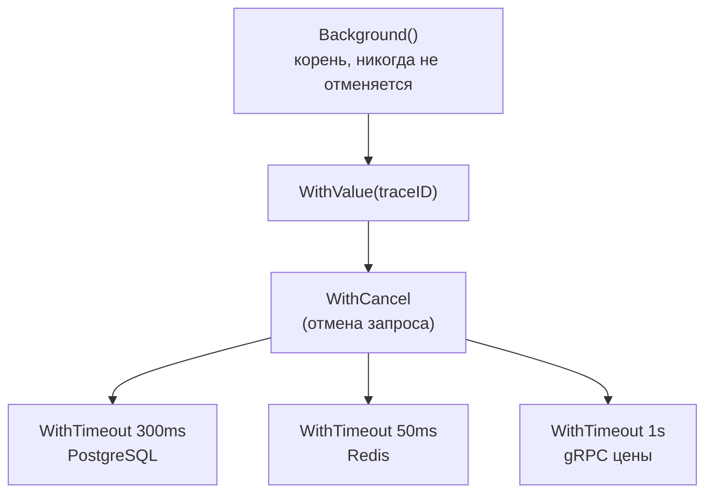
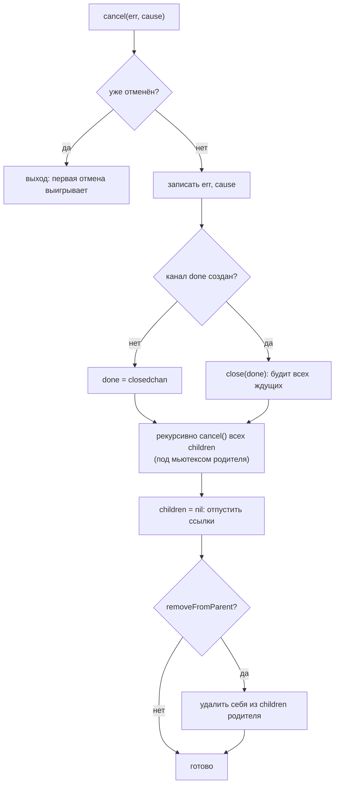
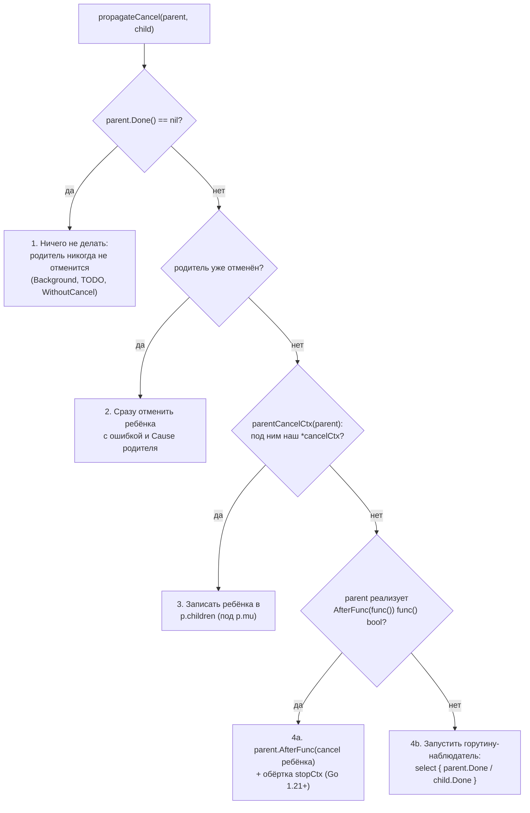
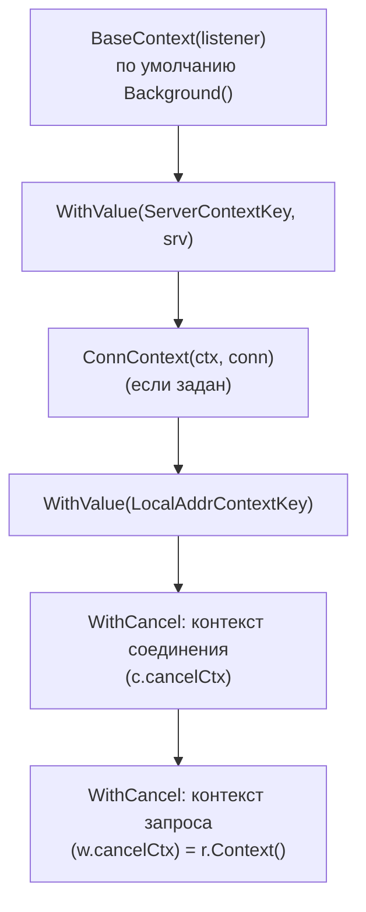
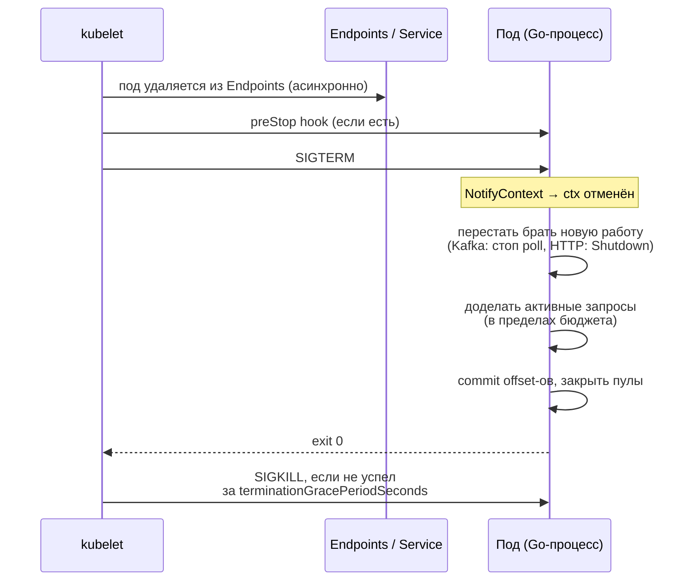
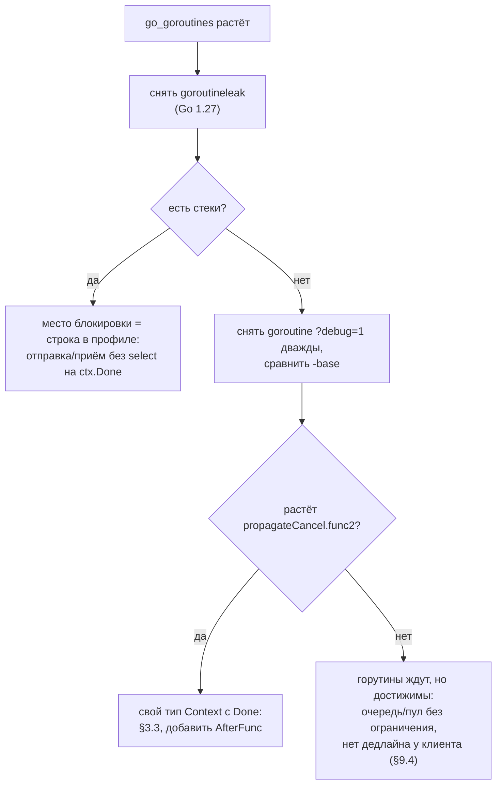

# Go context: Deep Dive для Senior Go-разработчика

> Актуально для **Go 1.27** (релиз — август 2026; последний патч на момент написания — go1.27.1).
> Факты сверены с исходниками ветки `go1.27.0` (`src/context/context.go`, `src/net/http/server.go`, `src/net/http/transport.go`, `src/net/http/internal/http2/server.go`, `src/database/sql/sql.go`, `src/os/signal/signal.go`, `src/testing/testing.go`, `src/runtime/pprof/pprof.go`) и с историей коммитов (`git log -S`, `git tag --contains`).
> Внешние библиотеки проверены по исходникам и запуском: `golang.org/x/sync v0.24.0` (errgroup), `google.golang.org/grpc v1.84.0`.
> Все бенчмарки и выводы команд — **реальные прогоны** на `go1.27.0 darwin/arm64, Apple M3 Pro, GOMAXPROCS=11`. Каждый бенчмарк запускался один раз (`-count=1`), поэтому смотрите на порядок чисел, а не на последнюю цифру.
> Места, где факт не удалось проверить по первоисточнику, помечены **⚠️ не проверено**.

## Оглавление

- [Словарь терминов](#словарь-терминов)
- [TL;DR](#tldr)
- [1. Модель: что такое context и зачем он нужен](#1-модель-что-такое-context-и-зачем-он-нужен)
- [2. Устройство: какие типы прячутся за интерфейсом](#2-устройство-какие-типы-прячутся-за-интерфейсом)
- [3. Дерево отмены: propagateCancel](#3-дерево-отмены-propagatecancel)
- [4. Ошибки отмены: Err и Cause](#4-ошибки-отмены-err-и-cause)
- [5. Дедлайны и таймеры](#5-дедлайны-и-таймеры)
- [6. Забытый cancel и утечки](#6-забытый-cancel-и-утечки)
- [7. AfterFunc и WithoutCancel](#7-afterfunc-и-withoutcancel)
- [8. Value: как устроен поиск и что туда класть](#8-value-как-устроен-поиск-и-что-туда-класть)
- [9. context в стандартной библиотеке и экосистеме](#9-context-в-стандартной-библиотеке-и-экосистеме)
- [10. Настройки и параметры](#10-настройки-и-параметры)
- [11. Production: graceful shutdown в Kubernetes](#11-production-graceful-shutdown-в-kubernetes)
- [12. Наблюдаемость и диагностика](#12-наблюдаемость-и-диагностика)
- [13. Оптимизация](#13-оптимизация)
- [14. Грабли, заблуждения и советы: сводка](#14-грабли-заблуждения-и-советы-сводка)
- [15. Сравнение с другими платформами](#15-сравнение-с-другими-платформами)
- [16. Вопросы для собеседования](#16-вопросы-для-собеседования)
- [17. Чеклист и шпаргалка](#17-чеклист-и-шпаргалка)

---

## Словарь терминов

Термины, которые встречаются в документе. Если слово непонятно, загляните сюда.

| Термин | Что значит простыми словами |
|---|---|
| **Контекст (context, ctx)** | Значение типа `context.Context`, которое передают из функции в функцию. Оно несёт три вещи: сигнал «хватит работать» (отмена), срок, к которому работа должна закончиться (дедлайн), и немного данных о запросе (значения). |
| **Отмена (cancellation)** | Сигнал «результат больше не нужен». Сам по себе он ничего не останавливает: код должен сам проверить сигнал и выйти. |
| **Дедлайн (deadline)** | Момент времени, после которого контекст отменится сам. `WithTimeout(ctx, 2*time.Second)` — это дедлайн «сейчас + 2 секунды». |
| **Родитель / ребёнок (parent / child)** | Каждый новый контекст делается из существующего: `child := WithCancel(parent)`. Отмена родителя отменяет всех детей, отмена ребёнка родителя не трогает. |
| **Дерево контекстов** | Все контексты одного запроса, связанные отношением «родитель — ребёнок». Корень — `context.Background()`. |
| **CancelFunc** | Функция, которую возвращают `WithCancel`/`WithTimeout`/`WithDeadline`. Вызов отменяет контекст и освобождает его ресурсы. Её нужно вызвать всегда, обычно через `defer cancel()`. |
| **Cause (причина)** | Ошибка, объясняющая, *почему* контекст отменили: «Kafka rebalance», «бюджет запроса к PostgreSQL исчерпан». Есть с Go 1.20. `Err()` знает только «отменён» или «дедлайн истёк», `Cause` — подробности. |
| **Канал Done** | Канал `chan struct{}`, который закрывается при отмене. Закрытый канал «будит» всех, кто из него читает, поэтому одной операцией можно разбудить тысячу горутин. |
| **Горутина-наблюдатель** | Служебная горутина, которую пакет `context` запускает, если родитель — «чужой» тип контекста. Она ждёт отмены родителя и передаёт её ребёнку (§3.3). |
| **Утечка (leak)** | Ресурс, который больше не нужен, но и не освобождается: горутина, которая никогда не завершится, или память, на которую кто-то держит ссылку. |
| **Таймер (timer)** | Объект рантайма, который вызывает функцию в заданный момент. Внутри `WithTimeout` живёт таймер, который отменит контекст по дедлайну. |
| **Мьютекс (mutex)** | Замок: пока одна горутина держит его, другие ждут. `sync.Mutex`. |
| **Атомарная операция (atomic)** | Чтение или запись, которую процессор делает «целиком», без мьютекса. Быстрее мьютекса, особенно когда много горутин читают одно и то же. |
| **Интерфейс** | Набор методов. Любой тип с этими методами «подходит» под интерфейс. `context.Context` — интерфейс из четырёх методов. |
| **Встраивание (embedding)** | Поле структуры без имени: `type x struct{ context.Context }`. Методы встроенного поля становятся методами структуры. Так внутренние контексты «наследуют» поведение родителя. |
| **Request-scoped данные** | Данные, которые живут ровно столько, сколько запрос: trace ID, ID пользователя, тенант. |
| **Graceful shutdown** | «Вежливая» остановка сервиса: перестать брать новую работу, доделать текущую, закрыть соединения и только потом выйти. |
| **SIGTERM** | Сигнал операционной системы «пожалуйста, завершись». Kubernetes посылает его поду перед остановкой. |
| **Middleware** | Обёртка над HTTP-обработчиком: делает что-то до и после основного обработчика (логирование, авторизация, трассировка). |
| **Пул соединений** | Набор заранее открытых соединений к БД, которые раздаются запросам по очереди. В `database/sql` он встроен в `*sql.DB`. |
| **Escape analysis / аллокация** | Компилятор решает, где разместить объект: на стеке (дёшево) или в куче (дороже, потом его убирает GC). «Аллокация» — выделение памяти в куче. |
| **go vet / staticcheck** | Статические анализаторы: читают код и ищут типичные ошибки, не запуская программу. `go vet` входит в Go, `staticcheck` — отдельный инструмент. |

---

## TL;DR

1. `context.Context` — это интерфейс из четырёх методов: `Deadline`, `Done`, `Err`, `Value`. Он решает одну задачу: **сообщить всем участникам запроса, что результат больше не нужен**, и передать вместе с этим немного данных о запросе. Пакет появился в стандартной библиотеке в Go 1.7.
2. Отмена **кооперативная**. Контекст ничего не прерывает силой: горутина, которая не смотрит на `ctx.Done()` или `ctx.Err()`, будет работать дальше (§1.2).
3. Контексты образуют дерево. Отмена идёт **сверху вниз**: родитель отменяет детей. Ребёнок не может отменить родителя и не может отодвинуть его дедлайн (§5.1).
4. Внутри три основных типа: `*cancelCtx` (отмена), `*timerCtx` (отмена + таймер), `*valueCtx` (одна пара ключ–значение). Каждый `WithXxx` добавляет к цепочке один узел (§2).
5. Родитель хранит своих детей в `map[canceler]struct{}`. Поэтому **забытый `cancel()` при отменяемом родителе — утечка памяти**: ребёнок висит в map, пока не отменят родителя. Если внутри ещё и таймер, он держит память до срабатывания. Замер: 200 000 забытых `WithTimeout(…, time.Minute)` — +52–59 МБ кучи (§6.1). `go vet` (анализатор `lostcancel`) ловит забытый cancel.
6. Если родитель — **ваш собственный тип** со своим каналом `Done`, пакет запускает **по горутине на каждого ребёнка**. Замер: 1000 детей — 1000 горутин. Начиная с Go 1.21 этого можно избежать, если у вашего типа есть метод `AfterFunc` (§3.3–§3.4).
7. `Err()` возвращает только `context.Canceled` или `context.DeadlineExceeded`. Подробную причину хранит `context.Cause(ctx)` (Go 1.20; `WithTimeoutCause`/`WithDeadlineCause` — Go 1.21). Сравнивайте через `errors.Is`, не через `==` (§4).
8. **Неочевидное:** HTTP-клиент с Go 1.23 возвращает `context.Cause(ctx)`, а не `ctx.Err()`. Если вы задали причину через `WithTimeoutCause`, проверка `errors.Is(err, context.DeadlineExceeded)` вернёт `false`. Решение: оборачивайте `DeadlineExceeded` в свою причину через `%w` (§4.4).
9. `ctx.Value` — это **линейный поиск** по цепочке узлов: 3,7 нс на глубине 1, 243 нс на глубине 100 (§8.1). Ключ — неэкспортируемый тип, а не строка. В `Value` кладут данные запроса (trace ID, пользователь), а не зависимости и не параметры функции (§8.3).
10. `context.WithoutCancel` (Go 1.21) — копия контекста без отмены и дедлайна, но со всеми значениями. Нужна для фоновой работы, которая должна пережить запрос: запись аудита, отправка события в Kafka после ответа клиенту (§7.3).
11. `context.AfterFunc` (Go 1.21) регистрирует функцию «выполни, когда ctx отменят». Удобно, чтобы прервать блокирующий вызов без своего контекста, например `net.Conn.Read` (§7.1).
12. `net/http`-сервер отменяет `r.Context()`, когда клиент оборвал соединение. Но в HTTP/1.x это видно, **только если тело запроса уже дочитано** (§9.1). `Server.Shutdown` **не отменяет** контексты активных запросов. Чтобы их отменить, нужен свой `BaseContext` (§9.1.3).
13. `ctx.Err()` с Go 1.25 читает ошибку атомарно, без мьютекса. Замер: параллельный `Err()` на общем контексте — 81,9 нс в Go 1.24 и 0,27 нс в Go 1.27 (§13.3).
14. `t.Context()` в тестах — Go 1.24. Контекст отменяется **до** функций `t.Cleanup`, а `go fix` в Go 1.27 сам заменяет `context.WithCancel(context.Background())` в тестах на `t.Context()` (§9.6).
15. `signal.NotifyContext` с Go 1.26 кладёт в `Cause` текст сигнала (`terminated signal received`), а с Go 1.27 эта причина ещё и проходит проверку `errors.Is(cause, context.Canceled)` (§9.7). В Go 1.27 профиль `goroutineleak` включён по умолчанию и находит горутины, которые навсегда заблокированы из-за забытой отмены (§12.2).

---

## 1. Модель: что такое context и зачем он нужен

### 1.1. Какую проблему решает context

Представьте HTTP-обработчик заказа. Он идёт в PostgreSQL за пользователем, в Redis за корзиной, в соседний сервис цен по gRPC и параллельно отправляет событие в Kafka. Клиент ждёт ответ две секунды и закрывает соединение. Что должно случиться со всей этой работой?

Без общего механизма каждый вызов будет работать до конца: запрос в БД доедет, горутина цены дождётся ответа, а результат никто не прочитает. Под нагрузкой такая «работа впустую» съедает соединения пула, CPU и память. А при каскадном отказе её становится больше, чем полезной.

`context` даёт один объект, который передают во все вызовы запроса. Через него каждая функция узнаёт три вещи:

- **пора ли остановиться** (`Done()` закрыт, `Err() != nil`);
- **сколько времени осталось** (`Deadline()`), чтобы, например, передать остаток бюджета в следующий сервис;
- **данные запроса** (`Value(key)`): trace ID, пользователь.

История. Пакет написали в Google около 2014 года как `golang.org/x/net/context` (copyright в `src/context/context.go` — 2014). В стандартную библиотеку его перенесли в **Go 1.7** (коммит `9db7ef5614`, «context: add the context package from golang.org/x/net/context»). В том же релизе появился `http.Request.Context()`. В Go 1.8 пришли `database/sql.QueryContext` и родственные методы.

### 1.2. Интерфейс и его контракт

```go
// src/context/context.go:72
type Context interface {
	Deadline() (deadline time.Time, ok bool)
	Done() <-chan struct{}
	Err() error
	Value(key any) any
}
```

| Метод | Что возвращает | Важные детали контракта (из комментариев в `context.go`) |
|---|---|---|
| `Deadline()` | время дедлайна и `ok` | `ok == false`, если дедлайна нет. Повторные вызовы возвращают одно и то же. |
| `Done()` | канал, который **закрывается** при отмене | Может вернуть `nil`, если контекст нельзя отменить (`Background`). Повторные вызовы возвращают тот же канал. |
| `Err()` | `nil`, пока `Done` не закрыт; потом `Canceled` или `DeadlineExceeded` | После первой ненулевой ошибки возвращает её же всегда. |
| `Value(key)` | значение или `nil` | Ключ должен быть сравнимым (`==`). |

Все методы безопасно вызывать из многих горутин одновременно. Контекст **неизменяемый**: новые свойства не добавляются в существующий объект, а оборачивают его в новый.



Отмена `C` закрывает `Done` у `DB`, `RD` и `GR`. Отмена `DB` (истёк таймаут PostgreSQL) не трогает ни `C`, ни соседей.

Проверка на живом коде: дерево из Value → Cancel → (Timeout, Cancel). Метод `String()` у внутренних типов печатает всю цепочку, это удобно в отладке.

```go
root := context.Background()
reqCtx := context.WithValue(root, ctxKey{}, "req-42")
reqCtx, cancelReq := context.WithCancel(reqCtx)
dbCtx, cancelDB := context.WithTimeout(reqCtx, 2*time.Second)
defer cancelDB()
kafkaCtx, cancelKafka := context.WithCancel(reqCtx)
defer cancelKafka()

fmt.Println(dbCtx)
fmt.Println(kafkaCtx)
cancelReq() // отмена родителя
<-dbCtx.Done(); <-kafkaCtx.Done()
fmt.Println("db:", dbCtx.Err(), "| kafka:", kafkaCtx.Err())
fmt.Println("value still visible:", dbCtx.Value(ctxKey{}))

p2, c3 := context.WithCancel(root)
defer c3()
ch2, c4 := context.WithCancel(p2)
c4()
fmt.Println("child:", ch2.Err(), "| parent:", p2.Err())
```

```text
context.Background.WithValue(main.ctxKey, req-42).WithCancel.WithDeadline(2026-10-22 23:58:30.835337 +0500 +05 m=+2.000113668 [1.99973425s])
context.Background.WithValue(main.ctxKey, req-42).WithCancel.WithCancel
db: context canceled | kafka: context canceled
value still visible: req-42
child: context canceled | parent: <nil>
```

Видно, что отмена родителя дошла до обоих детей, значение по-прежнему доступно через всю цепочку, а отмена ребёнка (`c4`) родителя `p2` не задела.

> **Заблуждение:** «`cancel()` останавливает горутину». На самом деле `cancel()` только закрывает канал `Done` и записывает ошибку. Горутина остановится, только если сама проверит `ctx.Done()`/`ctx.Err()` или вызовет функцию, которая это делает (драйвер БД, HTTP-клиент). Заблуждение идёт от `Thread.stop()`/`Thread.interrupt()` в Java и от отмены задач в других языках, где рантайм может бросить исключение «снаружи». В Go принудительно остановить горутину нельзя, такого API нет.

### 1.3. Два корня: Background и TODO

`context.Background()` и `context.TODO()` возвращают пустой контекст: без дедлайна, без значений, `Done() == nil`. Технически они одинаковы, отличаются только названием в `String()`:

- `Background()` — осознанный корень: `main`, инициализация, тесты (в тестах с Go 1.24 лучше `t.Context()`, §9.6), фоновые воркеры на всё время жизни процесса;
- `TODO()` — метка «здесь должен быть настоящий ctx, но его пока не протащили». Полезна при постепенном рефакторинге: `grep context.TODO` покажет, что ещё не доделано.

> **Совет.** Не создавайте `context.Background()` посреди обработки запроса. Это обрывает дерево: дедлайн клиента и отмена при обрыве соединения перестают доходить вниз. Если нужна работа, которая переживёт запрос, используйте `context.WithoutCancel(r.Context())` (§7.3). Он сохраняет trace ID и прочие значения. Не нужно, если работа действительно не относится к запросу (периодическая задача процесса).

### Простыми словами

Контекст — это «квитанция заказа», которую официант передаёт по цепочке: повару, бармену, курьеру. На квитанции написано, к какому времени нужно успеть (дедлайн), есть номер заказа (значения), и к ней привязан звонок. Если клиент ушёл, администратор нажимает кнопку, и звонок звенит у всех, кто держит копию квитанции. Но готовить перестанет только тот, кто прислушивается к звонку.

### Что важно для Senior

- Отмена кооперативная. Любая долгая операция без проверки `ctx` — это место, где отмена «не доходит». В code review ищите циклы и блокирующие вызовы без `ctx`.
- Дерево однонаправленное: отмена и дедлайн идут только вниз, значения видны снизу вверх через цепочку.
- `Background()` в глубине кода запроса — почти всегда ошибка: дерево рвётся, теряются дедлайн и trace ID.
- `context` появился в Go 1.7. Многие старые API (`net.Dial`, `sql.Query`) получили пары `XxxContext` (`DialContext`, `QueryContext`). Используйте именно их.

---

## 2. Устройство: какие типы прячутся за интерфейсом

### 2.1. Карта типов

Все реализации — неэкспортируемые типы в `src/context/context.go`. Каждая функция `WithXxx` возвращает новый узел, который **встраивает** родителя.

| Конструктор | Тип узла | Поля (главное) | Строки в `context.go` |
|---|---|---|---|
| `Background()` / `TODO()` | `backgroundCtx` / `todoCtx` (оба встраивают `emptyCtx`) | нет | 182–226 |
| `WithCancel`, `WithCancelCause` | `*cancelCtx` | `Context` (родитель), `mu`, `done`, `children`, `err`, `cause` | 432 |
| `WithDeadline`, `WithTimeout` (+`Cause`) | `*timerCtx` | встроенный `cancelCtx`, `timer *time.Timer`, `deadline` | 663 |
| `WithValue` | `*valueCtx` | `Context`, `key`, `val` | 743 |
| `WithoutCancel` | `withoutCancelCtx` (значение, не указатель) | `c Context` | 593 |
| `AfterFunc` | `*afterFuncCtx` | встроенный `cancelCtx`, `once`, `f` | 347 |
| (служебный) | `stopCtx` | `Context`, `stop func() bool` | 366 |

```text
Цепочка WithTimeout(WithValue(WithCancel(Background()))):

 timerCtx ─────────────┐
 │ cancelCtx           │
 │  ├ Context ─────────┼──► valueCtx
 │  ├ mu, done, err    │     ├ Context ───► cancelCtx
 │  └ children         │     ├ key            ├ Context ───► backgroundCtx{}
 │ timer, deadline     │     └ val            ├ children: {timerCtx}  ◄── регистрация
 └─────────────────────┘                      └ done, err
```

Обратите внимание: `timerCtx` зарегистрирован в `children` у ближайшего `cancelCtx`, хотя между ними стоит `valueCtx`. Как он этого «предка» нашёл, разобрано в §3.2.

### 2.2. emptyCtx, backgroundCtx, todoCtx

```go
// src/context/context.go:182-226 (сокращено)
type emptyCtx struct{}
func (emptyCtx) Done() <-chan struct{} { return nil }
// Deadline, Err, Value тоже возвращают нулевые значения

type backgroundCtx struct{ emptyCtx }
func (backgroundCtx) String() string { return "context.Background" }

func Background() Context { return backgroundCtx{} }
```

`Done()` возвращает `nil`. Чтение из `nil`-канала блокирует навсегда, поэтому `select { case <-ctx.Done(): }` на `Background` просто никогда не сработает. Это и есть «никогда не отменяется».

До Go 1.21 `Background()` возвращал указатель на глобальную переменную `*emptyCtx`. Коммит `6e5c26084f` («context: reduce init-time allocations», вошёл в Go 1.21) сделал отдельные типы-значения. Пустая структура в интерфейсе ничего не аллоцирует.

### 2.3. cancelCtx: поля и ленивый канал Done

```go
// src/context/context.go:432
type cancelCtx struct {
	Context

	mu       sync.Mutex            // protects following fields
	done     atomic.Value          // of chan struct{}, created lazily, closed by first cancel call
	children map[canceler]struct{} // set to nil by the first cancel call
	err      atomic.Value          // set to non-nil by the first cancel call
	cause    error                 // set to non-nil by the first cancel call
}
```

Три решения, которые стоит понимать.

**1. Канал `done` создаётся лениво.** `Done()` сначала читает канал атомарно. Если его нет, берёт мьютекс и создаёт (`context.go:449`). Если `cancel()` вызвали раньше, чем кто-то спросил `Done()`, канал вообще не создаётся: в `done` кладётся общий заранее закрытый канал `closedchan` (`context.go:424`). Так экономится аллокация канала (по замеру ниже — 112 байт) для контекстов, на которые никто не подписался. Ленивость появилась в Go 1.9 (коммит `986768de7f`).

Замер (`go1.27.0`, M3 Pro, одиночный прогон):

```text
BenchmarkWithCancel/noDone-11          12671978    92.48 ns/op    96 B/op   2 allocs/op
BenchmarkWithCancel/withDone-11        10310588   131.3 ns/op    208 B/op   3 allocs/op
BenchmarkWithCancel/fromBackground-11  22255020    61.40 ns/op    96 B/op   2 allocs/op
```

Вызов `Done()` добавил одну аллокацию на 112 байт: тот самый канал. А `fromBackground` дешевле `noDone` на треть, потому что у `Background` нечего регистрировать: нет мьютекса родителя и нет записи в map `children`.

**2. `err` — атомарное значение (Go 1.25).** Раньше `Err()` брал мьютекс. Коммит `0a0e6af39b` («context: use atomic operation in ctx.Err», Go 1.25) заменил его на `atomic.Value`. Комментарий в коде: «An atomic load is ~5x faster than a mutex, which can matter in tight loops». Главный выигрыш — при одновременном чтении из многих горутин (§13.3).

**3. `Err()` ждёт закрытия канала (Go 1.26).**

```go
// src/context/context.go:464
func (c *cancelCtx) Err() error {
	// An atomic load is ~5x faster than a mutex, which can matter in tight loops.
	if err := c.err.Load(); err != nil {
		// Ensure the done channel has been closed before returning a non-nil error.
		<-c.Done()
		return err.(error)
	}
	return nil
}
```

В `cancel()` ошибка записывается чуть раньше, чем закрывается канал. Без строки `<-c.Done()` другая горутина могла увидеть `Err() != nil`, тут же сделать неблокирующий `select` по `Done()` и обнаружить, что канал ещё открыт. Коммит `8ca209ec39` («context: don't return a non-nil from Err before Done is closed») закрыл это окно в Go 1.26. Ожидание тут почти нулевое: канал закрывается под тем же мьютексом сразу после записи ошибки.

### 2.4. Как работает cancel()

```go
// src/context/context.go:550 (сокращено)
func (c *cancelCtx) cancel(removeFromParent bool, err, cause error) {
	if cause == nil {
		cause = err
	}
	c.mu.Lock()
	if c.err.Load() != nil {
		c.mu.Unlock()
		return // already canceled
	}
	c.err.Store(err)
	c.cause = cause
	d, _ := c.done.Load().(chan struct{})
	if d == nil {
		c.done.Store(closedchan)
	} else {
		close(d)
	}
	for child := range c.children {
		child.cancel(false, err, cause)
	}
	c.children = nil
	c.mu.Unlock()

	if removeFromParent {
		removeChild(c.Context, c)
	}
}
```



Что из этого следует:

- **Первая отмена выигрывает.** Повторный `cancel()` — безопасный no-op, поэтому `defer cancel()` можно ставить всегда, даже если контекст уже отменили.
- **Дети отменяются с `removeFromParent=false`.** Родитель всё равно обнуляет свою map, удалять из неё по одному незачем.
- **Отмена — O(размер поддерева)** и выполняется синхронно в горутине, которая вызвала `cancel()`. Поддерево из 100 000 детей отменяется одним вызовом, но этот вызов будет долгим. Обычно поддеревья маленькие, и это не проблема.
- **Ребёнок, отменённый сам, удаляет себя у родителя** (`removeFromParent=true`). Именно это делает `defer cancel()`, и именно этого не происходит, если cancel забыли (§6).

### 2.5. timerCtx

```go
// src/context/context.go:663
type timerCtx struct {
	cancelCtx
	timer *time.Timer // Under cancelCtx.mu.
	deadline time.Time
}
```

`WithDeadlineCause` (`context.go:633`) делает по шагам:

1. Если у родителя дедлайн **раньше** нового, таймер не нужен: возвращается обычный `WithCancel(parent)` (§5.1).
2. Создаёт `timerCtx` и регистрирует его у родителя (`propagateCancel`, §3).
3. Если дедлайн уже прошёл, сразу отменяет с `DeadlineExceeded`.
4. Иначе заводит `time.AfterFunc(dur, func() { c.cancel(true, DeadlineExceeded, cause) })`.

`timerCtx.cancel` (`context.go:680`) вызывает `cancelCtx.cancel` и **останавливает таймер**. Поэтому `defer cancel()` у `WithTimeout` важен вдвойне: без него таймер живёт в куче таймеров рантайма до срабатывания и держит ссылку на весь контекст.

### 2.6. valueCtx и функция value()

```go
// src/context/context.go:743, 769, 776 (сокращено)
type valueCtx struct {
	Context
	key, val any
}

func (c *valueCtx) Value(key any) any {
	if c.key == key {
		return c.val
	}
	return value(c.Context, key)
}

func value(c Context, key any) any {
	for {
		switch ctx := c.(type) {
		case *valueCtx:
			if key == ctx.key { return ctx.val }
			c = ctx.Context
		case *cancelCtx:
			if key == &cancelCtxKey { return c }
			c = ctx.Context
		case withoutCancelCtx:
			if key == &cancelCtxKey { return nil } // Cause(ctx) == nil для WithoutCancel
			c = ctx.c
		case *timerCtx:
			if key == &cancelCtxKey { return &ctx.cancelCtx }
			c = ctx.Context
		case backgroundCtx, todoCtx:
			return nil
		default:
			return c.Value(key) // чужая реализация
		}
	}
}
```

Одна пара ключ–значение на узел, поиск — цикл по цепочке вверх. Почему не map? Контекст неизменяемый, а копировать map при каждом `WithValue` дороже, чем пройти пару узлов. Цепочки в реальных сервисах короткие (5–20 узлов). Цикл вместо рекурсии появился, чтобы глубокая цепочка не раздувала стек вызовов.

Обратите внимание на служебный ключ `&cancelCtxKey`. Это адрес глобальной переменной `var cancelCtxKey int` (`context.go:375`), и снаружи пакета его получить нельзя. По нему пакет ищет ближайший `cancelCtx` вверх по цепочке (§3.2) и читает `Cause` (§4.2).

### 2.7. withoutCancelCtx

```go
// src/context/context.go:593-615 (сокращено)
type withoutCancelCtx struct{ c Context }
func (withoutCancelCtx) Deadline() (deadline time.Time, ok bool) { return }
func (withoutCancelCtx) Done() <-chan struct{}                  { return nil }
func (withoutCancelCtx) Err() error                             { return nil }
func (c withoutCancelCtx) Value(key any) any                    { return value(c, key) }
```

Родитель хранится в именованном поле `c`, а не встраивается, поэтому методы отмены родителя «не просвечивают». `Value` ищет по цепочке родителя, а на ключе `&cancelCtxKey` возвращает `nil`. Поэтому `Cause` у такого контекста — `nil`, и дети `WithoutCancel` не регистрируются у отменённого родителя.

### 2.8. afterFuncCtx и stopCtx

`AfterFunc(ctx, f)` (`context.go:326`) создаёт `afterFuncCtx`. Это `cancelCtx`, который при отмене вместо «закрыть канал для детей» запускает `go a.f()` (`context.go:353`). `sync.Once` гарантирует, что `f` либо запустится один раз, либо её успеют остановить через `stop()`.

`stopCtx` (`context.go:366`) — служебная обёртка. Она появляется, когда родитель — чужой тип с методом `AfterFunc` (§3.4). В ней хранится функция `stop`, которую `removeChild` вызывает при отмене ребёнка.

### 2.9. String(): отладочная печать

У каждого внутреннего типа есть `String()`, который рекурсивно печатает цепочку (вывод в §1.2). Это помогает в отладке: `slog.Debug("ctx", "ctx", ctx)` покажет, какие обёртки и таймауты навешаны. Цена: `timerCtx.String()` вызывает `time.Until`, `valueCtx.String()` печатает значение через `String()` или имя типа. Для горячего пути это не годится.

> **Совет.** Если непонятно, откуда взялся «лишний» таймаут, распечатайте контекст в обработчике: `log.Printf("%v", ctx)`. В выводе видно каждое `WithDeadline(... [осталось])` по цепочке. Не делайте этого в production-логах на каждый запрос: строка длинная, а значения попадут в лог (там могут быть персональные данные).

### Простыми словами

Каждый `WithXxx` надевает на контекст ещё одну «матрёшку». Внешняя матрёшка знает только своё (таймер, одно значение, кнопку отмены) и ссылку на ту, что внутри. Когда вы спрашиваете значение, Go открывает матрёшки снаружи внутрь, пока не найдёт нужную. Кнопки отмены соединены проводами сверху вниз: родитель хранит список детей и при отмене «прозванивает» каждого.

### Что важно для Senior

- Внутренние типы: `cancelCtx` (map детей + ленивый канал), `timerCtx` (+ `time.AfterFunc`), `valueCtx` (одна пара на узел, поиск циклом).
- `Done()` создаёт канал лениво. Отмена неподписанного контекста стоит дешевле, чем подписанного.
- `Err()` с Go 1.25 без мьютекса, а с Go 1.26 гарантирует, что после `Err() != nil` канал `Done` уже закрыт.
- Повторный `cancel()` безопасен, первая причина выигрывает.
- `timerCtx` держит `time.Timer`. Без `cancel()` таймер живёт до дедлайна.

---
## 3. Дерево отмены: propagateCancel

### 3.1. Четыре пути регистрации ребёнка

Каждый отменяемый контекст при создании вызывает `propagateCancel(parent, child)` (`context.go:476`). Задача — сделать так, чтобы отмена родителя дошла до ребёнка. Путей четыре, от самого дешёвого к самому дорогому:



```go
// src/context/context.go:476 (сокращено)
func (c *cancelCtx) propagateCancel(parent Context, child canceler) {
	c.Context = parent
	done := parent.Done()
	if done == nil {
		return // parent is never canceled
	}
	select {
	case <-done:
		child.cancel(false, parent.Err(), Cause(parent))
		return
	default:
	}
	if p, ok := parentCancelCtx(parent); ok {
		p.mu.Lock()
		if err := p.err.Load(); err != nil {
			child.cancel(false, err.(error), p.cause)
		} else {
			if p.children == nil {
				p.children = make(map[canceler]struct{})
			}
			p.children[child] = struct{}{}
		}
		p.mu.Unlock()
		return
	}
	if a, ok := parent.(afterFuncer); ok {
		// ... stop := a.AfterFunc(func() { child.cancel(false, parent.Err(), Cause(parent)) })
		// c.Context = stopCtx{Context: parent, stop: stop}
		return
	}
	goroutines.Add(1)
	go func() {
		select {
		case <-parent.Done():
			child.cancel(false, parent.Err(), Cause(parent))
		case <-child.Done():
		}
	}()
}
```

Обратите внимание: `p.children` тоже создаётся лениво, при первом ребёнке.

### 3.2. Как пакет узнаёт «своего» родителя

`parentCancelCtx` (`context.go:383`) ищет ближайший `*cancelCtx` вверх по цепочке и проверяет, что он **действительно** отвечает за `parent.Done()`:

```go
func parentCancelCtx(parent Context) (*cancelCtx, bool) {
	done := parent.Done()
	if done == closedchan || done == nil {
		return nil, false
	}
	p, ok := parent.Value(&cancelCtxKey).(*cancelCtx)
	if !ok {
		return nil, false
	}
	pdone, _ := p.done.Load().(chan struct{})
	if pdone != done {
		return nil, false
	}
	return p, true
}
```

Ключевой трюк — `parent.Value(&cancelCtxKey)`. Он проходит сквозь `valueCtx` и любые обёртки, которые встраивают `Context` и не переопределяют `Value`. Поэтому `timerCtx` под `valueCtx` всё равно регистрируется у `cancelCtx` выше (схема в §2.1).

Зачем проверять `pdone != done`? Обёртка может встроить `cancelCtx`, но **подменить** метод `Done()` своим каналом. Тогда отмена «нашего» `cancelCtx` не означает отмену обёртки, и регистрироваться у него нельзя. Пакет честно уходит на медленный путь.

### 3.3. Чужая реализация Context: горутина-наблюдатель

Если ваш тип реализует `Context` сам (например, контекст из старой библиотеки или «контекст-адаптер» над своим сигналом остановки), пакету не за что зацепиться. Тогда на **каждого ребёнка** запускается горутина, которая ждёт либо отмены родителя, либо отмены ребёнка.

**Грабли: свой тип Context со своим каналом Done**

```go
// wrapper: встраивает context.Context, ничего не переопределяет.
type wrapper struct{ context.Context }

// ownDone: своя реализация отмены (свой канал Done).
type ownDone struct {
	context.Context
	done chan struct{}
}
func (c ownDone) Done() <-chan struct{} { return c.done }
func (c ownDone) Err() error { /* ... */ }

func measure(name string, parent context.Context) {
	before := runtime.NumGoroutine()
	for range 1000 {
		_, cancel := context.WithCancel(parent)
		cancels = append(cancels, cancel)
	}
	fmt.Printf("%-18s +%d goroutines for 1000 children\n", name, runtime.NumGoroutine()-before)
	// ... cancel all
}
```

```text
cancelCtx          +0 goroutines for 1000 children
wrapper            +0 goroutines for 1000 children
ownDone            +1000 goroutines for 1000 children
ownDone+AfterFunc  +0 goroutines for 1000 children
after all cancels: 1 goroutines
```

Почему так: у `ownDone` канал `Done()` не совпадает с каналом найденного внутри `cancelCtx` (проверка `pdone != done` из §3.2), поэтому срабатывает путь 4b. Горутины не утекают навсегда: каждая завершится, когда отменят ребёнка или родителя. Но пока запрос жив, их по одной на каждый `WithCancel`/`WithTimeout`, и каждая стоит минимум стек 2 КБ плюс работу планировщика. Простая обёртка `wrapper`, которая только встраивает контекст, ничего не стоит.

Как заметить: рост `runtime.NumGoroutine()` / метрики `go_goroutines` пропорционально RPS, а в goroutine-профиле много одинаковых горутин в `propagateCancel`. Реальный вывод `pprof.Lookup("goroutine").WriteTo(os.Stdout, 1)` для 100 детей такого контекста:

```text
100 @ 0x100685c58 0x1006654b8 0x10069dd94 0x10068bda4
#	0x10069dd93	context.(*cancelCtx).propagateCancel.func2+0x83	.../src/context/context.go:524
```

 Как исправить: не переопределять `Done()` в обёртках; если своя отмена нужна, реализовать `AfterFunc` (§3.4) или построить контекст через `context.WithCancel` и отменять его из своего сигнала.

### 3.4. Путь без горутин: метод AfterFunc (Go 1.21+)

С Go 1.21 (коммит `54d429999c`, «context: add AfterFunc») пакет проверяет, нет ли у родителя метода:

```go
// src/context/context.go:343
type afterFuncer interface {
	AfterFunc(func()) func() bool
}
```

Если есть, пакет просит родителя: «вызови эту функцию, когда тебя отменят» и сохраняет `stop` в обёртке `stopCtx`. Горутина не нужна. В замере выше `ownDone+AfterFunc` — это тот же `ownDone`, у которого колбэки хранятся в `map[int]func()` под мьютексом. Результат: +0 горутин.

> **Совет.** Если вы пишете библиотеку со своим типом `Context` (адаптер над сигналом остановки, тестовый «фейковый» контекст), добавьте метод `AfterFunc(func()) func() bool` с той же семантикой, что у `context.AfterFunc`. Эффект по замеру выше: 1000 → 0 горутин на 1000 детей. Не нужно, если ваш тип просто встраивает `context.Context` и не меняет `Done()`.

### 3.5. removeChild: отписка при отмене ребёнка

Когда ребёнка отменяют его собственным `cancel()`, он вызывает `removeChild(parent, child)` (`context.go:400`):

- если родитель обёрнут в `stopCtx` (путь 4a), вызывается `stop()` у колбэка родителя;
- иначе ищется `*cancelCtx` родителя (тем же `parentCancelCtx`), и ребёнок удаляется из `p.children` под мьютексом.

Именно эта отписка не происходит, если `cancel()` забыли (§6).

### Простыми словами

Когда вы создаёте дочерний контекст, Go пытается «подключить провод» от родителя к ребёнку. Если родитель — свой, стандартный, провод подключается напрямую: ребёнка записывают в список родителя. Если родитель — незнакомое устройство, Go ставит рядом «дежурного» (горутину), который смотрит на родителя и дёргает ребёнка. Дежурный на каждого ребёнка — дорого. С Go 1.21 незнакомое устройство может само предложить разъём (метод `AfterFunc`), и дежурный не нужен.

### Что важно для Senior

- Четыре пути: родитель неотменяемый → ничего; уже отменён → сразу; наш `cancelCtx` → запись в map; чужой → `AfterFunc` или горутина.
- Обёртки, которые встраивают `Context` и не трогают `Done()`, бесплатны (поиск через `Value(&cancelCtxKey)`).
- Переопределённый `Done()` = горутина на каждого ребёнка. Замерено: 1000 детей → 1000 горутин.
- Своя реализация `Context` в 2026 году почти никогда не нужна. Если нужна — с методом `AfterFunc`.

---

## 4. Ошибки отмены: Err и Cause

### 4.1. Canceled и DeadlineExceeded

```go
// src/context/context.go:168-178
var Canceled = errors.New("context canceled")
var DeadlineExceeded error = deadlineExceededError{}

type deadlineExceededError struct{}
func (deadlineExceededError) Error() string   { return "context deadline exceeded" }
func (deadlineExceededError) Timeout() bool   { return true }
func (deadlineExceededError) Temporary() bool { return true }
```

`DeadlineExceeded` реализует `net.Error` (`Timeout() == true`). Поэтому код, который классифицирует сетевые ошибки по `Timeout()`, правильно считает истёкший контекст таймаутом. Проверено запуском:

```text
DeadlineExceeded is net.Error: true true
```

`Err()` возвращает **только эти две** ошибки, никогда не обёрнутые. Но код выше по стеку почти всегда получает их обёрнутыми: `fmt.Errorf("load user 42: %w", err)`, `*url.Error`, `*net.OpError`.

**Грабли: сравнение ошибки отмены через ==**

```go
err := fmt.Errorf("load user 42: %w", ctx3.Err())
fmt.Println("== :", err == context.DeadlineExceeded, "| errors.Is:", errors.Is(err, context.DeadlineExceeded))
```

```text
== : false | errors.Is: true
```

Почему так: `==` сравнивает конкретные значения, а обёртка — это другой объект. `errors.Is` разворачивает цепочку `Unwrap()`. Как заметить: метрики «таймаутов» показывают ноль, хотя в логах «context deadline exceeded»; линтер `errorlint` (в golangci-lint) ругается на `==` с ошибками. `go vet` это **не ловит**. Как исправить: всегда `errors.Is(err, context.Canceled)` / `errors.Is(err, context.DeadlineExceeded)`.

> **Совет.** В метриках и логах разделяйте `Canceled` и `DeadlineExceeded`. `Canceled` на входящем запросе обычно значит «клиент ушёл сам» (не ваша вина, не алертить). `DeadlineExceeded` значит «не уложились в бюджет» (ваша проблема или проблема зависимости). Склеивать их в одну метрику «ошибки» — значит получать ложные алерты при массовых обрывах со стороны клиентов.

### 4.2. Cause: зачем нужна причина

`ctx.Err()` говорит только «отменён». В большом сервисе непонятно, *кто* отменил: клиент ушёл, сработал общий таймаут, упала соседняя горутина в `errgroup`, пришёл SIGTERM? С Go 1.20 (коммит `5b42f89e39`, «context: add APIs for writing and reading cancelation cause») есть:

```go
func WithCancelCause(parent Context) (ctx Context, cancel CancelCauseFunc) // cancel(cause error)
func Cause(c Context) error
```

`Cause` (`context.go:289`) берёт `Err()`. Если он `nil`, возвращает `nil`. Иначе ищет ближайший `*cancelCtx` через `Value(&cancelCtxKey)` и возвращает его `cause`, а если причины нет — тот же `Err()`.

```go
ctx, cancel := context.WithCancelCause(context.Background())
child, cc := context.WithCancel(ctx)
defer cc()
cancel(errors.New("kafka consumer rebalanced"))
fmt.Println("Err:  ", child.Err())
fmt.Println("Cause:", context.Cause(child))

ctx2, cancel2 := context.WithCancelCause(context.Background())
cancel2(nil)
fmt.Println("cancel(nil) Cause:", context.Cause(ctx2))

ctx5, cancel5 := context.WithCancelCause(context.Background())
cancel5(errors.New("first"))
cancel5(errors.New("second"))
fmt.Println("first wins:", context.Cause(ctx5))

fmt.Println("Cause(Background):", context.Cause(context.Background()))
fmt.Println("Cause(WithoutCancel(canceled)):", context.Cause(context.WithoutCancel(ctx5)))
```

```text
Err:   context canceled
Cause: kafka consumer rebalanced
cancel(nil) Cause: context canceled
first wins: first
Cause(Background): <nil>
Cause(WithoutCancel(canceled)): <nil>
```

Выводы из запуска:

- причина передаётся **детям**: у `child` своего `cause` нет, но при отмене родитель передал ему свою (`child.cancel(false, err, cause)` в §2.4);
- `cancel(nil)` эквивалентен обычной отмене: `Cause == Canceled`;
- первая причина выигрывает, вторая игнорируется;
- у неотменённого контекста `Cause == nil`, у `WithoutCancel` — тоже `nil`.

История исправлений, которые стоит знать, если вы поддерживаете сервис на старой версии:

| Версия | Коммит | Что исправлено |
|---|---|---|
| Go 1.25 | `ec4a9fb321` | `Cause` больше не возвращает `nil` для отменённого **чужого** типа контекста (теперь возвращает `Err()`) |
| Go 1.26 | `1a53ce9734` | `Cause` не возвращает неверную ошибку в гонке с отменой |
| Go 1.26 | `8ca209ec39` | `Err()` не возвращает ошибку раньше, чем закрыт `Done` (§2.3) |

### 4.3. WithDeadlineCause и WithTimeoutCause (Go 1.21)

```go
ctx3, cancel3 := context.WithTimeoutCause(context.Background(), 10*time.Millisecond, errSlowPostgres)
<-ctx3.Done()
fmt.Println("timeout Err:", ctx3.Err(), "| Cause:", context.Cause(ctx3))
cancel3()

ctx4, cancel4 := context.WithTimeoutCause(context.Background(), time.Hour, errSlowPostgres)
cancel4()
fmt.Println("manual cancel Cause:", context.Cause(ctx4))
```

```text
timeout Err: context deadline exceeded | Cause: postgres: query budget exhausted
manual cancel Cause: context canceled
```

Причина используется **только при срабатывании таймера**. Возвращаемая `CancelFunc` — обычная, без аргумента, и при ручной отмене `Cause == Canceled`. Это видно в коде: таймер вызывает `c.cancel(true, DeadlineExceeded, cause)`, а `CancelFunc` — `c.cancel(true, Canceled, nil)` (`context.go:633–660`). Функции появились в Go 1.21 (коммит `8bec956360`), на релиз позже `WithCancelCause`.

### 4.4. Грабли: net/http возвращает Cause, и errors.Is перестаёт работать

**Грабли: `errors.Is(err, context.DeadlineExceeded)` вдруг false**

```go
var errPaymentBudget = errors.New("payment-api budget 300ms exceeded")

ctx, cancel := context.WithTimeoutCause(context.Background(), 50*time.Millisecond, errPaymentBudget)
defer cancel()
req, _ := http.NewRequestWithContext(ctx, http.MethodGet, slow.URL, nil)
_, err := http.DefaultClient.Do(req)
fmt.Println("1.", err)
fmt.Println("   errors.Is DeadlineExceeded:", errors.Is(err, context.DeadlineExceeded), "| Cause:", context.Cause(ctx))

c := &http.Client{Timeout: 50 * time.Millisecond}
_, err = c.Get(slow.URL)
fmt.Println("2.", err)
fmt.Println("   errors.Is DeadlineExceeded:", errors.Is(err, context.DeadlineExceeded))
```

```text
1. Get "http://127.0.0.1:50020": payment-api budget 300ms exceeded
   errors.Is DeadlineExceeded: false | Cause: payment-api budget 300ms exceeded
2. Get "http://127.0.0.1:50020": context deadline exceeded (Client.Timeout exceeded while awaiting headers)
   errors.Is DeadlineExceeded: true
```

Почему так: `net/http.Transport` возвращает `context.Cause(ctx)`, а не `ctx.Err()` (`src/net/http/transport.go:698, 1640, 1651, 2620, 3116`). Это изменение пришло в Go 1.23 (коммиты `505000b2d3` «net/http: simplify HTTP/1 request cancelation» и `a61729b880`). Пока причины нет, `Cause == Err`, и всё работает как раньше. Стоит добавить `WithTimeoutCause`, и ваша причина заменяет `DeadlineExceeded` в цепочке ошибок. Ретраи, circuit breaker и метрики «таймаутов», построенные на `errors.Is(err, context.DeadlineExceeded)`, молча ломаются.

Как заметить: падает доля «timeout» в метриках после внедрения `WithTimeoutCause`; `go vet` и линтеры этого не видят. Как исправить — оборачивать стандартную ошибку в свою причину:

```go
var errPaymentBudget = fmt.Errorf("payment-api budget 300ms exceeded: %w", context.DeadlineExceeded)
```

```text
1. Get "http://127.0.0.1:50027": payment-api budget 300ms exceeded: context deadline exceeded
   errors.Is DeadlineExceeded: true | Cause: payment-api budget 300ms exceeded: context deadline exceeded
```

Второй вариант — классифицировать по самому контексту: `errors.Is(ctx.Err(), context.DeadlineExceeded)`, а `err` использовать только для текста.

> **Совет.** Делайте любую причину отмены «совместимой»: `fmt.Errorf("...: %w", context.Canceled)` для ручной отмены и `fmt.Errorf("...: %w", context.DeadlineExceeded)` для таймаутов. Тогда и старый код с `errors.Is`, и новый с `Cause` видят правильный тип. Так же поступил сам Go в 1.27 для `signal.NotifyContext` (§9.7).

### 4.5. Грабли: родительский дедлайн «съедает» причину ребёнка

```go
parent, pc := context.WithTimeout(context.Background(), 20*time.Millisecond)
defer pc()
child, cc := context.WithTimeoutCause(parent, time.Second, errPaymentBudget)
defer cc()
<-child.Done()
fmt.Println("3. child Cause:", context.Cause(child))
```

```text
3. child Cause: context deadline exceeded
```

Почему так: у родителя дедлайн раньше, поэтому `WithDeadlineCause` даже не заводит таймер и возвращает обычный `WithCancel(parent)` (`context.go:637`). Ваша причина нигде не сохраняется, отмену приносит родитель со своей причиной. Это правильная семантика («сработал не ваш бюджет, а внешний»), но в логах вы не увидите `errPaymentBudget`, хотя «ставили» именно его. Как заметить: в логах `Cause` — общая ошибка дедлайна вместо ожидаемой. Как исправить: ничего не исправлять, а помнить: `Cause` описывает **реальную** причину, то есть того, кто отменил первым.

### Простыми словами

`Err()` отвечает на вопрос «остановились ли мы и почему в общих чертах»: либо «отменили», либо «вышло время». `Cause()` — это записка с подробностями: «отменили, потому что Kafka сделала rebalance». Записку пишет тот, кто отменяет. Читать её может любой потомок.

### Что важно для Senior

- `Err()` — только `Canceled`/`DeadlineExceeded`. Сравнение — через `errors.Is`.
- `Cause` (1.20; `WithTimeoutCause`/`WithDeadlineCause` — 1.21) передаётся детям, первая причина выигрывает.
- С Go 1.23 HTTP-клиент возвращает `Cause`. Причина без `%w context.DeadlineExceeded` ломает `errors.Is`.
- Разделяйте `Canceled` и `DeadlineExceeded` в метриках: это разные проблемы.

---

## 5. Дедлайны и таймеры

### 5.1. Дедлайн нельзя продлить

```go
parent, c1 := context.WithTimeout(root, 100*time.Millisecond)
defer c1()
child, c2 := context.WithTimeout(parent, time.Hour)
defer c2()
pd, _ := parent.Deadline()
cd, _ := child.Deadline()
fmt.Println("child deadline == parent deadline:", pd.Equal(cd))
fmt.Printf("child type: %T\n", child)
```

```text
child deadline == parent deadline: true
child type: *context.cancelCtx
```

Если дедлайн родителя раньше, `WithTimeout(parent, time.Hour)` возвращает обычный `*cancelCtx`. Таймер не создаётся, а `Deadline()` берётся у родителя через встраивание. Это сознательное решение: ребёнок работает **на благо** родителя, и делать что-то после того, как родителю ответ уже не нужен, бессмысленно.

> **Заблуждение:** «`WithTimeout(ctx, 30*time.Second)` даст функции 30 секунд». На самом деле она получит `min(30s, остаток бюджета родителя)`. Если входящий HTTP-запрос пришёл с дедлайном 2 секунды, все «30 секунд» ниже превращаются в 2. Это частая причина вопроса «почему у нас таймаут 30 секунд, а запросы обрываются через 2».

Если работа действительно должна пережить дедлайн запроса, отвяжите её: `context.WithTimeout(context.WithoutCancel(ctx), 30*time.Second)` (§7.3).

### 5.2. Цена таймера

`timerCtx` использует `time.AfterFunc`. Таймеры рантайма живут в куче на каждом P (логическом процессоре планировщика). Создание и остановка таймера — операции над этой кучей. Замер (`go1.27.0`, M3 Pro, одиночный прогон):

```text
BenchmarkWithCancel/noDone-11    12671978    92.48 ns/op    96 B/op   2 allocs/op
BenchmarkWithTimeout-11           4017206   299.2 ns/op    272 B/op   4 allocs/op
```

`WithTimeout` + `cancel()` примерно в 3 раза дороже `WithCancel` + `cancel()` и делает 4 аллокации вместо 2: `timerCtx`, сам `time.Timer`, замыкание для таймера и `CancelFunc`. 300 нс на запрос в HTTP-сервисе — ничто. 300 нс на элемент в цикле обработки миллиона сообщений — уже 0,3 секунды CPU (§13.4).

Остановленный таймер не всегда сразу исчезает из кучи таймеров. В `src/runtime/time.go:148` есть счётчик `zombies` — «timers in the heap» помеченные к удалению, которые вычищаются позже. Это объясняет, почему после массовой отмены память освобождается не мгновенно (§6.1).

### 5.3. Бюджет запроса: общий и на попытку

```go
// Общий бюджет на вызов платёжного сервиса — 800 мс, включая ретраи.
func chargeWithRetry(ctx context.Context, c *PaymentClient, req ChargeReq) error {
	ctx, cancel := context.WithTimeout(ctx, 800*time.Millisecond)
	defer cancel()

	var err error
	for attempt := range 3 {
		// Каждая попытка — не дольше 300 мс, но и не дольше общего бюджета.
		attemptCtx, cancelAttempt := context.WithTimeout(ctx, 300*time.Millisecond)
		err = c.Charge(attemptCtx, req)
		cancelAttempt()
		if err == nil || ctx.Err() != nil || !isRetryable(err) {
			return err
		}
		select {
		case <-time.After(backoff(attempt)):
		case <-ctx.Done():
			return context.Cause(ctx)
		}
	}
	return err
}
```

> **Совет.** Задавайте **два** уровня: общий бюджет операции и таймаут одной попытки. Общий защищает вызывающего (и его дедлайн), попытка — от одной «зависшей» реплики, которая съела бы весь бюджет. Если таймаут только на попытку, ретраи могут растянуть операцию на `N × timeout` и пережить дедлайн клиента. Не нужно, если у вызова нет ретраев: хватает одного `WithTimeout`.

> **Совет.** Перед дорогой операцией проверяйте остаток: `if dl, ok := ctx.Deadline(); ok && time.Until(dl) < 50*time.Millisecond { return errNotEnoughBudget }`. Отправлять запрос в PostgreSQL, если до дедлайна 5 мс, бессмысленно: он почти наверняка отменится, а соединение пула будет занято и подтверждение отмены пойдёт по сети. Не нужно, если операция дешёвая (чтение из локального кеша).

### Простыми словами

Дедлайн — это «сдать работу до 18:00». Начальник (родитель) сказал «до 18:00», и подчинённый не может сам себе разрешить «до 20:00». Он может только сократить свой срок. Таймер внутри — это будильник на 18:00, который стоит денег, пока тикает. `cancel()` выключает будильник, если работа сделана раньше.

### Что важно для Senior

- Эффективный дедлайн ребёнка — минимум из своего и родительского. Продлить нельзя, только отвязаться через `WithoutCancel`.
- `WithTimeout` ≈ 300 нс и 4 аллокации против ≈ 90 нс и 2 у `WithCancel` (Go 1.27, M3 Pro).
- Делайте бюджет на операцию и на попытку. Проверяйте остаток бюджета перед дорогими вызовами.

---

## 6. Забытый cancel и утечки

### 6.1. Что именно держит память

Документация пакета говорит прямо: «Failing to call the CancelFunc leaks the child and its children until the parent is canceled» (комментарий в начале `context.go`). Посмотрим, когда это реально утечка, а когда нет.

```go
func try(name string, mk func() (context.Context, context.CancelFunc)) {
	before := heapMB() // runtime.GC() + HeapAlloc
	for range 200_000 {
		ctx, _ := mk() // намеренно теряем cancel
		_ = ctx
	}
	fmt.Printf("%-36s heap +%5.1f MB\n", name, heapMB()-before)
}

app, stop := context.WithCancel(context.Background())
defer stop()
try("WithCancel(Background)", func() (context.Context, context.CancelFunc) { return context.WithCancel(context.Background()) })
try("WithCancel(cancelable parent)", func() (context.Context, context.CancelFunc) { return context.WithCancel(app) })
try("WithTimeout(Background, 1m)", func() (context.Context, context.CancelFunc) { return context.WithTimeout(context.Background(), time.Minute) })
```

```text
WithCancel(Background)               heap +  0.0 MB
WithCancel(cancelable parent)        heap + 22.0 MB
WithTimeout(Background, 1m)          heap + 52.5 MB
```

| Ситуация | Кто держит ссылку | Когда освободится |
|---|---|---|
| `WithCancel(Background())` без cancel | никто: родитель не отменяемый, регистрации нет (путь 1 в §3.1) | сразу, при ближайшем GC |
| `WithCancel(отменяемый родитель)` без cancel | `parent.children` | когда отменят родителя |
| `WithTimeout(…)` без cancel | таймер рантайма + `parent.children` | когда сработает таймер или отменят родителя |
| родитель с чужим `Done()` без cancel | горутина-наблюдатель (§3.3) | когда отменят родителя |

Первая строка не повод забывать `cancel`. Код меняется: сегодня родитель `Background`, завтра его обернут в `WithCancel`, и утечка появится без единой правки в этом месте. `go vet` требует `cancel` всегда.

Сценарий из production: долгоживущий родитель (контекст Kafka-консьюмера или контекст процесса) и обработчик сообщения, который забыл `cancel`:

```go
func handle(parent context.Context, forget bool) {
	ctx, cancel := context.WithTimeout(parent, time.Minute)
	if !forget {
		defer cancel()
	}
	_ = ctx
}

appCtx, stop := context.WithCancel(context.Background())
// 200 000 вызовов с forget=false, затем с forget=true, затем stop()
```

```text
forget cancel=false heap +0.0 MB after 200k calls
forget cancel=true  heap +59.1 MB after 200k calls
after parent cancel +200ms: heap 41.8 MB
after parent cancel +400ms: heap 3.8 MB
after parent cancel +600ms: heap 3.8 MB
```

200 тысяч сообщений — это 59 МБ, которые не вернутся, пока жив родитель. При 2000 сообщений/с это «утечка» в 590 КБ/с, которая выглядит как медленный рост RSS до OOMKill в Kubernetes. После отмены родителя память вернулась не сразу, а за ~0,4 с. Скорее всего, это ленивое удаление остановленных таймеров («zombies», §5.2) ⚠️ не проверено: точная причина задержки не трассировалась.

### 6.2. go vet: анализатор lostcancel

`go vet` по умолчанию включает `lostcancel` (`src/cmd/vendor/golang.org/x/tools/go/analysis/suite/vet/vet.go:78`). Он проверяет `WithCancel`, `WithCancelCause`, `WithTimeout`, `WithTimeoutCause`, `WithDeadline`, `WithDeadlineCause` (`lostcancel.go:194`).

```go
func fetchPrice(ctx context.Context, sku string) (int, error) {
	ctx, _ = context.WithTimeout(ctx, 200*time.Millisecond)
	_ = ctx
	return 0, nil
}

func fetchStock(ctx context.Context, sku string) (int, error) {
	ctx, cancel := context.WithTimeout(ctx, 200*time.Millisecond)
	if sku == "" {
		return 0, nil // ранний выход без cancel
	}
	defer cancel()
	_ = ctx
	return 1, nil
}
```

```text
lost/main.go:9:7: the cancel function returned by context.WithTimeout should be called, not discarded, to avoid a context leak
lost/main.go:15:2: the cancel function is not used on all paths (possible context leak)
lost/main.go:17:3: this return statement may be reached without using the cancel var defined on line 15
```

Правило простое: `defer cancel()` **сразу** следующей строкой после `WithXxx`. Тогда ни ранний `return`, ни паника не оставят его невызванным.

### 6.3. Грабли: defer cancel() внутри цикла

```go
// Обработка пачки сообщений Kafka: defer внутри цикла.
func consumeBatchBad(ctx context.Context, batch []int) {
	for _, msg := range batch {
		msgCtx, cancel := context.WithTimeout(ctx, 30*time.Second)
		defer cancel() // выполнится только при выходе из функции!
		process(msgCtx, msg)
	}
	fmt.Printf("bad:  heap before return %.1f MB\n", heapMB())
}

func consumeBatchGood(ctx context.Context, batch []int) {
	for _, msg := range batch {
		func() {
			msgCtx, cancel := context.WithTimeout(ctx, 30*time.Second)
			defer cancel()
			process(msgCtx, msg)
		}()
	}
	fmt.Printf("good: heap before return %.1f MB\n", heapMB())
}
// batch из 100 000 сообщений
```

```text
good: heap before return 1.0 MB
bad:  heap before return 35.9 MB
```

Почему так: `defer` выполняется при выходе из **функции**, а не из итерации цикла. Все 100 000 контекстов, их таймеры и записи в `ctx.children` живут до конца пачки. Если функция — бесконечный цикл консьюмера, это настоящая утечка. Как заметить: `go vet` **молчит** (cancel формально вызывается); симптом — рост кучи пропорционально размеру пачки, в heap-профиле много `context.WithDeadlineCause`. Как исправить: тело итерации вынести в функцию (как выше) или вызывать `cancel()` явно в конце итерации.

### 6.4. Грабли: горутина не слушает ctx

Самая дорогая утечка не в контексте, а в горутине, которая его не проверяет.

```go
// Ищем цену в двух кешах, берём первый ответ.
func firstPriceLeaky(ctx context.Context) (int, error) {
	res := make(chan int) // небуферизованный
	for _, d := range []time.Duration{5 * time.Millisecond, 20 * time.Millisecond} {
		go func() {
			time.Sleep(d)
			res <- 100 // второй навсегда заблокируется: читать некому
		}()
	}
	select {
	case p := <-res:
		return p, nil
	case <-ctx.Done():
		return 0, ctx.Err()
	}
}

func firstPriceFixed(ctx context.Context) (int, error) {
	ctx, cancel := context.WithCancel(ctx)
	defer cancel() // будит проигравших
	res := make(chan int)
	for _, d := range []time.Duration{5 * time.Millisecond, 20 * time.Millisecond} {
		go func() {
			select {
			case <-time.After(d):
			case <-ctx.Done():
				return
			}
			select {
			case res <- 100:
			case <-ctx.Done():
			}
		}()
	}
	select {
	case p := <-res:
		return p, nil
	case <-ctx.Done():
		return 0, ctx.Err()
	}
}
// по 1000 вызовов каждой
```

```text
leaky  leaked goroutines: 1000
fixed  leaked goroutines: 0
```

Почему так: проигравшая горутина блокируется на отправке в канал, из которого никто больше не читает. Как заметить: `go_goroutines` растёт линейно с трафиком; в Go 1.27 профиль `goroutineleak` показывает такие горутины напрямую (§12.2). Как исправить: каждая отправка и каждое ожидание — в `select` с `<-ctx.Done()`, а функция, которая запускает горутины, делает `defer cancel()` собственного дочернего контекста. Здесь также сработал бы буферизованный канал `make(chan int, 2)`: отправка не блокируется, и горутины завершаются без контекста.

### Простыми словами

Каждый `WithCancel` от «живого» родителя — это запись в его записной книжке «у меня есть ребёнок». `cancel()` вычёркивает запись. Если её не вычеркнуть, книжка распухает, пока сам родитель не закончит работу. Для сервера, который работает неделями, «пока родитель не закончит» значит «никогда».

### Что важно для Senior

- Забытый cancel течёт, если родитель отменяемый или есть таймер. Замер: 200k `WithTimeout` → ~52–59 МБ.
- `defer cancel()` сразу после `WithXxx`. `go vet` (`lostcancel`) ловит потерю, но не `defer` в цикле.
- Самая частая утечка — горутина, которая не слушает `ctx.Done()` при отправке или ожидании.
- Утечки видны в `go_goroutines`, heap-профиле и (Go 1.27) профиле `goroutineleak`.

---
## 7. AfterFunc и WithoutCancel

Обе функции появились в Go 1.21 (коммиты `54d429999c` и `1844b54166`). Они закрывают два частых случая, которые раньше решали вручную: «сделай что-то при отмене» и «работай дальше, даже если запрос отменили».

### 7.1. AfterFunc: семантика

```go
func AfterFunc(ctx Context, f func()) (stop func() bool)
```

- Когда `ctx` отменят, `f` запустится **в отдельной горутине** (`go a.f()` в `context.go:353`).
- Если `ctx` уже отменён, `f` запускается сразу.
- `stop()` отвязывает `f`. Возвращает `true`, если успел (и `f` не запустится), `false`, если `f` уже запущена или `stop` уже вызывали.
- `stop()` **не ждёт** завершения `f`. Если нужно дождаться, синхронизируйтесь сами.

```go
// stop() до отмены: true, f не запустится
ctx2, cancel2 := context.WithCancel(context.Background())
stop := context.AfterFunc(ctx2, func() { fmt.Println("never printed") })
fmt.Println("stop before cancel:", stop())
cancel2()

// stop() после отмены: false, f уже запущена в своей горутине
ctx3, cancel3 := context.WithCancel(context.Background())
ran := make(chan struct{})
stop3 := context.AfterFunc(ctx3, func() { close(ran) })
cancel3()
<-ran
fmt.Println("stop after cancel:", stop3())

// AfterFunc на уже отменённом контексте — f запускается сразу
ran4 := make(chan struct{})
context.AfterFunc(ctx3, func() { close(ran4) })
```

```text
stop before cancel: true
stop after cancel: false
already canceled: f ran immediately
```

Внутри `AfterFunc` — это `afterFuncCtx`, тот же `cancelCtx`, зарегистрированный у родителя через `propagateCancel`. Поэтому для стандартного родителя он не стоит горутины, пока ждёт: горутина появляется только в момент срабатывания.

### 7.2. Прерывание блокирующего вызова

Классическая задача: `net.Conn.Read` не принимает `ctx`. Раньше писали горутину с `select` на `ctx.Done()`. С `AfterFunc` проще:

```go
// readWithContext прерывает блокирующий Read, когда ctx отменён.
func readWithContext(ctx context.Context, conn net.Conn, buf []byte) (int, error) {
	stop := context.AfterFunc(ctx, func() {
		conn.SetReadDeadline(time.Unix(1, 0)) // дедлайн в прошлом будит Read
	})
	defer stop()
	n, err := conn.Read(buf)
	if ctx.Err() != nil {
		return n, context.Cause(ctx)
	}
	return n, err
}

server, client := net.Pipe()
ctx, cancel := context.WithTimeout(context.Background(), 50*time.Millisecond)
defer cancel()
_, err := readWithContext(ctx, client, make([]byte, 16))
```

```text
read returned after 50ms: context deadline exceeded
```

Тот же приём работает для `sync.Cond.Wait` (в колбэке — `cond.Broadcast()`) и для любых API с методом «прервать» (`Close`, `SetDeadline`).

**Грабли: колбэк AfterFunc переживает функцию.** Если `stop()` вернул `false`, колбэк мог уже начать работу, а функция — выйти. В примере выше колбэк ставит дедлайн на соединение, которое к этому моменту, возможно, вернули в пул и выдали другому запросу. Тогда «чужой» `Read` неожиданно получит таймаут. Воспроизвести такую гонку детерминированно в одиночном прогоне нельзя, поэтому вывода здесь нет. Это вывод из семантики `stop()` («does not wait for f to complete», комментарий к `AfterFunc` в `context.go`). Как исправить: если `stop()` вернул `false`, дождитесь завершения колбэка (канал/`sync.WaitGroup`) и сбросьте дедлайн (`conn.SetReadDeadline(time.Time{})`), прежде чем отдавать ресурс дальше.

### 7.3. WithoutCancel: работа после ответа

**Грабли: фоновая горутина с r.Context()**

```go
srv := httptest.NewServer(http.HandlerFunc(func(w http.ResponseWriter, r *http.Request) {
	ctx := context.WithValue(r.Context(), reqIDKey{}, "req-7")
	go func() { // ошибка: r.Context() умрёт после возврата из handler
		time.Sleep(50 * time.Millisecond)
		result <- fmt.Sprint("bad  bg job: err=", ctx.Err())
	}()
	bg := context.WithoutCancel(ctx)
	go func() {
		time.Sleep(50 * time.Millisecond)
		result <- fmt.Sprint("good bg job: err=", bg.Err(), " reqID=", bg.Value(reqIDKey{}))
	}()
	w.WriteHeader(http.StatusAccepted)
}))
```

```text
bad  bg job: err=context canceled
good bg job: err=<nil> reqID=req-7
```

Почему так: сервер отменяет контекст запроса сразу после возврата из `ServeHTTP` (`w.cancelCtx()` в `src/net/http/server.go`, сразу после вызова обработчика). Фоновая отправка события в Kafka или запись аудита в PostgreSQL с этим контекстом упадёт с `context canceled`. Чаще всего это случается не сразу, а когда запрос к брокеру длится дольше обработчика, поэтому в тестах ошибка не видна. Как заметить: в логах фоновой задачи `context canceled` при 2xx ответах; `go vet` не ловит. Как исправить: `context.WithoutCancel(r.Context())`. Значения (trace ID, пользователь) сохраняются, отмена и дедлайн — нет.

> **Совет.** `WithoutCancel` снимает и дедлайн. Фоновая работа без таймаута — потенциальная вечная горутина. Всегда добавляйте свой: `ctx, cancel := context.WithTimeout(context.WithoutCancel(r.Context()), 5*time.Second)`. И учитывайте graceful shutdown: такие горутины нужно дождаться (`sync.WaitGroup`) при остановке, иначе событие потеряется при SIGTERM (§11).

До Go 1.21 то же делали своим типом-обёрткой («detached context»), который пробрасывал `Value` и возвращал `nil` из `Done()`. Если такой тип остался в коде, его можно заменить на стандартный.

### Простыми словами

`AfterFunc` — это «когда прозвенит звонок отмены, сделай вот это». Удобно, когда функцию, которую вы ждёте, нельзя попросить остановиться через контекст, но можно «пнуть» (закрыть соединение, поставить дедлайн). `WithoutCancel` — это «копия квитанции без звонка»: все данные заказа на месте, но отмена до неё не дойдёт. Её берут для дел, которые нужно закончить, даже если клиент ушёл.

### Что важно для Senior

- `AfterFunc` (1.21) запускает `f` в новой горутине. `stop()` не ждёт `f`, и это источник гонок при переиспользовании ресурсов.
- `WithoutCancel` (1.21) сохраняет значения, но снимает отмену **и** дедлайн. Ставьте свой таймаут.
- Контекст запроса отменяется сразу после возврата из обработчика. Фоновая работа — только через `WithoutCancel`.
- `Cause(WithoutCancel(ctx)) == nil`, и дети такого контекста не регистрируются у исходного родителя.

---

## 8. Value: как устроен поиск и что туда класть

### 8.1. Линейный поиск: цена глубины

Поиск значения идёт по цепочке узлов снизу вверх (функция `value`, §2.6). Чем глубже нужный ключ, тем дольше. Бенчмарк: искомый ключ лежит у самого корня, сверху `depth-1` других `WithValue`.

```go
func chain(depth int) context.Context {
	ctx := context.Background()
	ctx = context.WithValue(ctx, key(-1), "trace-id") // искомый ключ — в самом низу
	for i := range depth - 1 {
		ctx = context.WithValue(ctx, key(i), i)
	}
	return ctx
}

func BenchmarkValueDepth(b *testing.B) {
	for _, d := range []int{1, 5, 20, 100} {
		ctx := chain(d)
		b.Run(fmt.Sprint("depth=", d), func(b *testing.B) {
			for b.Loop() {
				sink = ctx.Value(key(-1))
			}
		})
	}
}

func BenchmarkValueMissing(b *testing.B) { // ключа нет, глубина 20
	ctx := chain(20)
	for b.Loop() {
		sink = ctx.Value(key(1000))
	}
}
```

```text
BenchmarkValueDepth/depth=1-11      327439832      3.685 ns/op   0 B/op   0 allocs/op
BenchmarkValueDepth/depth=5-11       81387433     12.53 ns/op    0 B/op   0 allocs/op
BenchmarkValueDepth/depth=20-11      24979530     50.50 ns/op    0 B/op   0 allocs/op
BenchmarkValueDepth/depth=100-11      5131112    243.3 ns/op     0 B/op   0 allocs/op
BenchmarkValueMissing-11             16101276     86.80 ns/op    0 B/op   0 allocs/op
```

Рост строго линейный, около 2,4 нс на узел. Промах (ключа нет) — самый дорогой случай: проходится вся цепочка до `Background`. В реальном сервисе глубина 10–30 узлов (каждый middleware, трассировка, логгер, `WithTimeout` добавляют по узлу), то есть 25–75 нс на `Value`. Это мало, пока `Value` не зовут в горячем цикле.

> **Заблуждение:** «`ctx.Value` — это поиск в map, O(1)». На самом деле это проход по связному списку, O(глубина). Заблуждение идёт от того, что API похож на map. Map внутри никогда не было, с первой версии в `x/net/context`.

### 8.2. Ключи: только неэкспортируемый тип

**Грабли: строковый ключ и коллизия между пакетами**

```go
// пакет auth
func authMiddleware(ctx context.Context) context.Context {
	return context.WithValue(ctx, "user", "alice@corp") // строковый ключ
}

// пакет tenant (другая команда, тот же "очевидный" ключ)
func tenantMiddleware(ctx context.Context) context.Context {
	return context.WithValue(ctx, "user", 1001)
}

type userKey struct{} // правильный ключ: неэкспортируемый тип

ctx := tenantMiddleware(authMiddleware(context.Background()))
email, ok := ctx.Value("user").(string)
fmt.Printf("email=%q ok=%v (затёрто значением %v)\n", email, ok, ctx.Value("user"))
ctx2 := context.WithValue(ctx, userKey{}, "alice@corp")
fmt.Println("typed key:", ctx2.Value(userKey{}))
```

```text
email="" ok=false (затёрто значением 1001)
typed key: alice@corp
```

Почему так: ключи сравниваются через `==` по интерфейсу, а две одинаковые строки равны, из какого бы пакета они ни пришли. Ближний к вершине узел «затеняет» дальний. Значение типа `userKey{}` из пакета `auth` не равно ничему из другого пакета: у типов разная идентичность, даже если имена совпадают.

Как заметить: `go vet` **молчит**. Ловит `staticcheck` (правило SA1029; проверено `staticcheck 2026.2.2`):

```text
keys/main.go:10:32: should not use built-in type string as key for value; define your own type to avoid collisions (SA1029)
keys/main.go:15:32: should not use built-in type string as key for value; define your own type to avoid collisions (SA1029)
```

Как исправить: `type userKey struct{}` (пустая структура не аллоцирует при упаковке в интерфейс) или `type ctxKey int` с константами. Тип **не экспортировать**, а доступ дать функциями:

```go
package auth

type userKey struct{}

type User struct {
	ID    int64
	Email string
}

func WithUser(ctx context.Context, u *User) context.Context {
	return context.WithValue(ctx, userKey{}, u)
}

func UserFrom(ctx context.Context) (*User, bool) {
	u, ok := ctx.Value(userKey{}).(*User)
	return u, ok
}
```

Так у пакета полный контроль: никто снаружи не может ни подменить значение, ни положить туда что-то другого типа.

Попытка использовать несравнимый ключ (слайс, map) паникует сразу в `WithValue`: `panic("key is not comparable")` (`context.go:728`).

### 8.3. Что класть в Value, а что нет

Правило из документации пакета: «Use context Values only for request-scoped data that transits processes and APIs, not for passing optional parameters to functions».

| Класть ✅ | Не класть ❌ | Почему |
|---|---|---|
| trace ID / span (OpenTelemetry так и делает) | `*sql.DB`, Redis-клиент, логгер-синглтон | Зависимость, а не данные запроса. Передавайте через конструктор/поле структуры. Иначе зависимость невидима в сигнатуре, и тест «забывает» её положить |
| аутентифицированный пользователь, тенант | параметры функции (`limit`, `userID` для выборки) | Функция «врёт» сигнатурой: параметр обязательный, но компилятор не проверит |
| request ID, correlation ID | флаги поведения («не кешировать», «dry-run») | Неявное управление логикой. Отладка превращается в поиск «кто положил флаг» |
| метаданные для исходящих вызовов (gRPC metadata) | изменяемые структуры, которые несколько горутин правят без синхронизации | `Value` безопасен для чтения, но значение внутри — нет |
| логгер **с полями запроса** (`slog.Logger` с trace ID) — допустимо, хотя спорно | большие объекты (тело запроса) | Держит память, пока жив контекст и все его потомки (включая `WithoutCancel`-копии в фоне) |

> **Совет.** Если сомневаетесь, задайте вопрос: «Если этого значения в контексте не окажется, функция должна работать с поведением по умолчанию?» Если да (trace ID: просто не будет трассировки), значению место в `Value`. Если нет (без `*sql.DB` работать нельзя), это параметр или поле.

### 8.4. Правила передачи контекста

Правила из документации пакета (`src/context/context.go`, начало файла):

1. **`ctx` — первый параметр**, имя `ctx`: `func (r *OrderRepo) Get(ctx context.Context, id int64) (*Order, error)`.
2. **Не хранить `Context` в структуре.** Подробно в блоге «Contexts and structs» (go.dev/blog/context-and-structs). Контекст живёт столько же, сколько вызов. Структура (клиент, репозиторий) живёт дольше. Сохранённый контекст либо давно отменён (и все вызовы падают), либо это `Background` (и отмена не работает). Исключение — структура, которая сама представляет одну операцию: так устроен `*http.Request`, он хранит свой контекст.
3. **Не передавать `nil`**, даже если функция допускает. Если не знаете, что передать, передайте `context.TODO()`.
4. **Контекст безопасен для параллельного использования.** Один `ctx` можно отдать в десять горутин.

**Грабли: nil вместо контекста**

```go
func query(ctx context.Context) {
	ctx, cancel := context.WithCancel(ctx)
	defer cancel()
	_ = ctx
}

func main() {
	defer func() { fmt.Println("panic:", recover()) }()
	query(nil)
}
```

```text
panic: cannot create context from nil parent
```

Почему так: все `WithXxx` явно проверяют родителя (`context.go:274`, `586`, `633`, `728`). А код, который сам вызывает `ctx.Done()` на `nil`, упадёт с nil pointer dereference где-то глубже. Как заметить: `go vet` молчит. `staticcheck` ловит (SA1012):

```text
nilctx/main.go:16:8: do not pass a nil Context, even if a function permits it; pass context.TODO if you are unsure about which Context to use (SA1012)
```

### Простыми словами

`Value` — это карман на квитанции для мелочей про заказ: номер, имя клиента. Чтобы найти нужную бумажку, Go перебирает карманы по одному, поэтому их не должно быть сотни. Подписывать бумажки надо «своей печатью» (собственным типом ключа), иначе соседний отдел положит бумажку с той же подписью и ваша потеряется. Инструменты (базу данных, клиент Redis) в карман не кладут: их выдают работнику при найме (через конструктор).

### Что важно для Senior

- `Value` — O(глубина), ~2,4 нс на узел (Go 1.27, M3 Pro). Промах проходит всю цепочку.
- Ключ — неэкспортируемый тип + функции-аксессоры. Строковые ключи ловит `staticcheck` SA1029, но не `go vet`.
- В `Value` — данные запроса, которые «транзитом» проходят через API. Зависимости и параметры — в сигнатуру.
- `ctx` первым аргументом, не в структуре, не `nil`.

---

## 9. context в стандартной библиотеке и экосистеме

### 9.1. net/http: сервер

#### 9.1.1. Откуда берётся r.Context()



Это реальные узлы из `src/net/http/server.go`: `ServerContextKey` (строка 3549), `ConnContext` (3572), `LocalAddrContextKey` (1933), контекст соединения (2030), контекст запроса (1089).

Контекст запроса отменяется:

| Когда | Где в коде |
|---|---|
| обработчик вернулся (`ServeHTTP` завершился) | `w.cancelCtx()` сразу после `serverHandler{c.server}.ServeHTTP(w, w.req)` |
| клиент закрыл соединение (HTTP/1.x) | фоновое чтение `backgroundRead` → `handleReadErrorLocked` → `cr.conn.cancelCtx()` (`server.go:745`, `813`) |
| клиент сбросил поток (HTTP/2, кадр RST_STREAM) | `st.cancelCtx()` в `src/net/http/internal/http2/server.go:1542` |
| соединение закрыто сервером | отмена контекста соединения |

#### 9.1.2. Грабли: обрыв клиента не виден, пока тело не дочитано (HTTP/1.x)

```go
func waitHandler(readBody bool, result chan<- string) http.HandlerFunc {
	return func(w http.ResponseWriter, r *http.Request) {
		if readBody {
			io.Copy(io.Discard, r.Body)
		}
		start := time.Now()
		select {
		case <-r.Context().Done():
			result <- fmt.Sprintf("handler ctx canceled after %v: %v", time.Since(start).Round(10*time.Millisecond), context.Cause(r.Context()))
		case <-time.After(time.Second):
			result <- "handler ctx NOT canceled within 1s"
		}
	}
}
// клиент: http.Client{Timeout: 100ms}, POST с телом "order=42"
```

```text
client: true
  readBody=true -> handler ctx canceled after 100ms: context canceled
client: true
  readBody=false -> handler ctx NOT canceled within 1s
```

Почему так: в HTTP/1.x сервер узнаёт об обрыве, только читая из сокета. Пока обработчик не дочитал тело, читать «дальше» нельзя: следующие байты — это тело, а не сигнал закрытия. Комментарий в коде (`server.go`, перед `startBackgroundRead`): «When the request has a body, we start the background read only after the entire body has been consumed». Обработчик, который не читает тело (быстро отвечает 4xx, проксирует только заголовки, ждёт очередь), не узнает об уходе клиента до первой неудачной записи.

Как заметить: в логах обработчиков с телом нет `context canceled` при массовых таймаутах клиентов, а нагрузка на БД не падает при обрыве. Как исправить: дочитывайте тело (или ограничьте его через `http.MaxBytesReader` и дочитайте) до долгой работы. Если тело не нужно, ставьте на работу собственный таймаут. В HTTP/2 этой проблемы нет: отмена потока приходит отдельным кадром.

Причина отмены при обрыве — просто `context canceled`, без `Cause` с подробностями (видно в выводе выше).

#### 9.1.3. Shutdown не отменяет активные запросы

```go
baseCtx, cancelBase := context.WithCancelCause(context.Background())
srv := &http.Server{
	Handler:     waitHandler(false, result),
	BaseContext: func(net.Listener) context.Context { return baseCtx },
}
// ... запрос в полёте
ctx, cancel := context.WithTimeout(context.Background(), 200*time.Millisecond)
defer cancel()
fmt.Println("Shutdown:", srv.Shutdown(ctx))
fmt.Println("  (request ctx still alive after Shutdown timeout)")
cancelBase(fmt.Errorf("server shutting down"))
fmt.Println(" ", <-result)
```

```text
Shutdown: context deadline exceeded
  (request ctx still alive after Shutdown timeout)
  handler ctx canceled after 250ms: server shutting down
```

`Shutdown(ctx)` закрывает слушатели, закрывает простаивающие соединения и **ждёт** активные. Контекст, переданный в `Shutdown`, ограничивает только ожидание: по истечении `Shutdown` возвращает `context deadline exceeded`, а обработчики продолжают работать, и их `r.Context()` не отменён. Чтобы сказать обработчикам «заканчивайте», нужен свой `BaseContext`, который вы отмените сами. Тогда причина (`server shutting down`) дойдёт до каждого запроса через `Cause`. Полный пример с SIGTERM — в §11.

> **Заблуждение:** «`srv.Shutdown(ctx)` с таймаутом прервёт зависшие запросы по таймауту». На самом деле таймаут только прекращает *ожидание*. Запросы и их контексты живут дальше, пока процесс не завершится. Из документации `Shutdown`: «If the provided context expires before the shutdown is complete, Shutdown returns the context's error».

### 9.2. net/http: клиент

- `http.NewRequestWithContext(ctx, …)` — контекст на весь запрос: соединение, отправку, ожидание заголовков **и чтение тела**. Если `ctx` отменят, пока вы читаете `resp.Body`, чтение вернёт ошибку.
- `http.Client{Timeout: …}` — общий таймаут, ошибка `context deadline exceeded (Client.Timeout exceeded while awaiting headers)`, и `errors.Is(err, context.DeadlineExceeded) == true` (вывод в §4.4).
- С Go 1.23 при отмене возвращается `context.Cause(ctx)` (§4.4).

**Грабли: cancel() до того, как прочитано тело.** Если функция делает `defer cancel()` и возвращает `resp` наружу, тело будет прочитано уже после отмены. Чтение тела вернёт ошибку, а снаружи это выглядит как случайный «обрыв ответа». Правило: читать тело в той же функции, где живёт `cancel`, или вернуть `cancel` вместе с телом.

```go
// Ошибка: cancel срабатывает при выходе, а тело читают снаружи.
func fetchReport(ctx context.Context, url string) (*http.Response, error) {
	ctx, cancel := context.WithTimeout(ctx, 2*time.Second)
	defer cancel()
	req, _ := http.NewRequestWithContext(ctx, http.MethodGet, url, nil)
	return http.DefaultClient.Do(req)
}
// сервер отдаёт 1 МБ; снаружи: io.Copy(io.Discard, resp.Body)
```

```text
read 16384 bytes, err=context canceled
```

Прочитались только 16 КБ, которые уже лежали в буфере, дальше — `context canceled`. На маленьких ответах ошибка не проявляется (всё тело успевает попасть в буфер), поэтому в тестах её часто не видно. `go vet` молчит: `cancel` формально вызван.

### 9.3. database/sql

Методы с контекстом (`QueryContext`, `ExecContext`, `BeginTx`, `PingContext`, `Conn`) появились в Go 1.8. Контекст работает в трёх местах:

1. **Ожидание соединения из пула** (`db.conn`, `sql.go:1330–1380`): если пул исчерпан (`SetMaxOpenConns`), запрос встаёт в очередь `connRequests` и ждёт `select` с `<-ctx.Done()`.
2. **Сам запрос**: контекст передаётся драйверу (`driver.QueryerContext`), и уже драйвер (pgx, lib/pq) отправляет в PostgreSQL отмену запроса.
3. **Чтение строк и транзакция**: `Rows` и `Tx` запускают горутину `awaitDone` (`sql.go:3007`, `1930`), которая закрывает `Rows`/откатывает `Tx` при отмене контекста.

Проверка с минимальным фейковым драйвером (он нужен, чтобы не поднимать PostgreSQL; драйвер уважает `ctx`, как настоящие):

```go
db.SetMaxOpenConns(2)

// 1. Таймаут запроса
ctx, cancel := context.WithTimeout(context.Background(), 50*time.Millisecond)
_, err := db.QueryContext(ctx, "SELECT pg_sleep(10)")
cancel()
fmt.Println("1. slow query:", err)

// 2. Отмена во время чтения строк: database/sql сам закрывает Rows
ctx, cancel = context.WithTimeout(context.Background(), 30*time.Millisecond)
rows, _ := db.QueryContext(ctx, "SELECT id FROM orders")
n := 0
for rows.Next() {
	n++
}
fmt.Printf("2. read %d rows, rows.Err()=%v\n", n, rows.Err())
rows.Close()
cancel()

// 3. Забытый rows.Close() исчерпывает пул
for range 2 {
	r, _ := db.QueryContext(context.Background(), "SELECT id FROM orders")
	r.Next() // ни Close, ни дочитывания
}
ctx, cancel = context.WithTimeout(context.Background(), 100*time.Millisecond)
_, err = db.QueryContext(ctx, "SELECT id FROM orders")
cancel()
s := db.Stats()
fmt.Printf("3. third query: %v | InUse=%d WaitCount=%d WaitDuration=%v\n",
	err, s.InUse, s.WaitCount, s.WaitDuration.Round(10*time.Millisecond))
```

```text
1. slow query: context deadline exceeded
2. read 21 rows, rows.Err()=context deadline exceeded
3. third query: context deadline exceeded | InUse=2 WaitCount=1 WaitDuration=100ms
```

**Грабли (сценарий 3): «таймауты БД», которых нет.** В логах `context deadline exceeded` на запросах к PostgreSQL, сама база здорова, медленных запросов нет. На самом деле запрос **даже не дошёл до базы**: он ждал соединение из пула, потому что где-то забыли `rows.Close()` (или держат транзакцию слишком долго). Как заметить: `db.Stats()`: `InUse == MaxOpenConnections`, растущие `WaitCount` и `WaitDuration`. Экспортируйте их в метрики (§12.3). `go vet` такого не видит. Линтеры из golangci-lint помогают лишь частично. Фрагмент вывода `golangci-lint 2.11.4` на этом же коде (прогон с `go1.26.1`: бинарник линтера собран им и не читает модули Go 1.27):

```text
main.go:70:26: rows.Err must be checked (rowserrcheck)
		r, _ := db.QueryContext(context.Background(), "SELECT id FROM orders")
main.go:65:12: Close should use defer (sqlclosecheck)
	rows.Close()
```

`rowserrcheck` ругается на непроверенный `rows.Err()`, а `sqlclosecheck` — только на `Close()` без `defer` в сценарии 2. Сами незакрытые `Rows` в цикле сценария 3 `sqlclosecheck` в этом прогоне **не нашёл**. На линтер не полагайтесь, смотрите метрики пула. Как исправить: `defer rows.Close()` сразу после проверки ошибки `QueryContext`, всегда проверять `rows.Err()` после цикла.

Сценарий 2 показывает, почему `rows.Err()` после цикла обязателен: `rows.Next()` просто вернул `false`, и без проверки код решил бы, что строк было 21.

### 9.4. gRPC

gRPC переносит дедлайн **между процессами**. Клиент читает `ctx.Deadline()` и отправляет остаток в заголовке `grpc-timeout` (`internal/transport/http2_client.go:619–626` в `grpc v1.84.0`). Сервер читает заголовок и создаёт `context.WithTimeout` для обработчика (`http2_server.go:453` и `537`). Метаданные (`metadata.AppendToOutgoingContext` → `metadata.FromIncomingContext`) едут в заголовках и на сервере оказываются в `Value` контекста.

Проверка (`grpc v1.84.0`, health-сервис, серверный interceptor «медленный запрос в PostgreSQL» на 200 мс, клиентский таймаут 80 мс):

```go
slow := func(ctx context.Context, req any, info *grpc.UnaryServerInfo, h grpc.UnaryHandler) (any, error) {
	dl, _ := ctx.Deadline()
	md, _ := metadata.FromIncomingContext(ctx)
	fmt.Printf("server: deadline in %v, x-request-id=%v\n", time.Until(dl).Round(time.Millisecond), md.Get("x-request-id"))
	select {
	case <-time.After(200 * time.Millisecond):
	case <-ctx.Done():
		done <- fmt.Sprint("server: ctx done: ", ctx.Err())
		return nil, ctx.Err()
	}
	return h(ctx, req)
}
// клиент:
ctx, cancel := context.WithTimeout(context.Background(), 80*time.Millisecond)
defer cancel()
ctx = metadata.AppendToOutgoingContext(ctx, "x-request-id", "req-42")
_, err = healthpb.NewHealthClient(conn).Check(ctx, &healthpb.HealthCheckRequest{})
fmt.Println("client:", status.Code(err), "-", err)
```

```text
server: deadline in 78ms, x-request-id=[req-42]
client: DeadlineExceeded - rpc error: code = DeadlineExceeded desc = context deadline exceeded
server: ctx done: context canceled
```

Что видно:

- сервер получил дедлайн 78 мс из 80: пару миллисекунд съела сеть и установка соединения. Каждый следующий сервис в цепочке получает **остаток**, а не исходный бюджет;
- клиент получил `codes.DeadlineExceeded`;
- на сервере `ctx.Err()` оказался `context canceled`, а не `DeadlineExceeded`. Клиент по своему дедлайну сбросил поток раньше, чем истёк серверный таймер, и сервер увидел отмену. Какая из двух ошибок придёт на сервер — вопрос гонки. Серверный код не должен на это полагаться.

> **Совет.** На входе gRPC/HTTP-сервиса, который вызывают другие сервисы, задайте **верхнюю границу** дедлайна: `ctx, cancel := context.WithTimeout(ctx, maxHandlerTime)`. Если вызывающий не поставил дедлайн, gRPC-контекст обработчика будет без дедлайна (сервер делает `WithCancel`, а не `WithTimeout`, когда `grpc-timeout` нет, `http2_server.go:539`). Один клиент без таймаута — и у вас вечные обработчики.

### 9.5. errgroup.WithContext

`golang.org/x/sync/errgroup` (проверено `v0.24.0`) создаёт контекст через `context.WithCancelCause` и отменяет его **первой ошибкой** горутины или в конце `Wait()`:

```go
// errgroup.go:48 (v0.24.0)
func WithContext(ctx context.Context) (*Group, context.Context) {
	ctx, cancel := context.WithCancelCause(ctx)
	return &Group{cancel: cancel}, ctx
}
```

```go
g, ctx := errgroup.WithContext(context.Background())
g.Go(func() error { return call(ctx, "profile", 10*time.Millisecond, false) })
g.Go(func() error { return call(ctx, "billing", 30*time.Millisecond, true) })
g.Go(func() error { return call(ctx, "recommendations", time.Second, false) })
err := g.Wait()
fmt.Println("Wait:", err, "| is Canceled:", errors.Is(err, context.Canceled))
fmt.Println("ctx after Wait:", ctx.Err())

g2, ctx2 := errgroup.WithContext(context.Background())
g2.Go(func() error { return nil })
g2.Wait()
fmt.Println("ctx after successful Wait:", ctx2.Err(), "| Cause:", context.Cause(ctx2))
```

```text
profile done
recommendations stopped: Err=context canceled Cause=billing: 503 from upstream
Wait: billing: 503 from upstream | is Canceled: false
ctx after Wait: context canceled
ctx after successful Wait: context canceled | Cause: context canceled
```

Что видно:

- `recommendations` узнала через `Cause`, **почему** её остановили: упал `billing`;
- `Wait()` вернул исходную ошибку `billing`, а не `context.Canceled` от остановленных;
- **ctx после `Wait()` всегда отменён, даже при успехе.**

**Грабли: использовать ctx от errgroup после Wait.** Частый код: `g, ctx := errgroup.WithContext(ctx)` затеняет внешний `ctx`, а после `g.Wait()` тот же `ctx` идёт в следующий вызов (запись результата в PostgreSQL). Вызов падает с `context canceled` (последняя строка вывода выше). Как заметить: ошибка `context canceled` в коде после успешного `Wait`. Как исправить: не затенять, называть по-другому: `g, gctx := errgroup.WithContext(ctx)`.

### 9.6. testing: t.Context() (Go 1.24)

`t.Context()` (а также `b.Context()`, `f.Context()`) появился в Go 1.24 (коммит `f432b5f756`). Любопытная деталь: метод уже добавляли в 2016 году для Go 1.8 и откатили до релиза (коммиты `26827bc2fe` и `4bf7d1e722`).

Контекст отменяется **до** запуска функций `t.Cleanup` (`src/testing/testing.go:1804`: `c.cancelCtx()` перед циклом по `c.cleanups`). Так `Cleanup` может дождаться горутин, которые останавливаются по `ctx.Done()`.

```go
func TestConsumeTContext(t *testing.T) {
	ctx := t.Context()
	t.Cleanup(func() {
		t.Logf("in Cleanup: ctx.Err() = %v", ctx.Err())
	})
	msgs, out := make(chan string), make(chan string, 1)
	go Consume(ctx, msgs, out)
	msgs <- "order-1"
	if got := <-out; got != "order-1" {
		t.Fatal(got)
	}
	t.Logf("in test body: ctx.Err() = %v", ctx.Err())
}
```

```text
    consumer_test.go:19: in test body: ctx.Err() = <nil>
    consumer_test.go:11: in Cleanup: ctx.Err() = context canceled
--- PASS: TestConsumeTContext (0.00s)
```

`go fix` в Go 1.27 включает модернизатор `testingcontext` (`src/cmd/vendor/golang.org/x/tools/go/analysis/suite/fix/fix.go` подключает `modernize.Suite`) и сам переписывает старый шаблон:

```text
 func TestConsumeOld(t *testing.T) {
-	ctx, cancel := context.WithCancel(context.Background())
-	defer cancel()
+	ctx := t.Context()
```

(фрагмент реального вывода `go fix -diff`).

> **Совет.** В тестах используйте `t.Context()` вместо `context.Background()`. Горутины, которые тест запустил, гарантированно получат отмену при завершении теста, а не будут висеть до конца всего `go test`. Не нужно в `TestMain` и в коде инициализации пакета: там `t` нет.

### 9.7. os/signal.NotifyContext

`signal.NotifyContext` (Go 1.16) возвращает контекст, который отменяется при получении сигнала. Внутри (`src/os/signal/signal.go`) — `context.WithCancelCause` и горутина, ждущая сигнал.

Эволюция:

| Версия | Изменение | Коммит |
|---|---|---|
| Go 1.16 | `NotifyContext` добавлен | `b6dbaef68f` |
| Go 1.26 | `Cause` = ошибка с текстом сигнала (`"terminated signal received"`) | `c1b7112af8` |
| Go 1.27 | эта ошибка реализует `Is(context.Canceled) == true` | `8494d25c4c` (issue #77639) |

```go
ctx, stop := signal.NotifyContext(context.Background(), os.Interrupt, syscall.SIGTERM)
defer stop()
go func() { // имитируем kubelet, присылающий SIGTERM
	time.Sleep(50 * time.Millisecond)
	syscall.Kill(os.Getpid(), syscall.SIGTERM)
}()
<-ctx.Done()
fmt.Println("Err:  ", ctx.Err())
fmt.Println("Cause:", context.Cause(ctx))
fmt.Println("errors.Is(Cause, Canceled):", errors.Is(context.Cause(ctx), context.Canceled))
stop()
```

```text
== go1.26.1
Err:   context canceled
Cause: terminated signal received
errors.Is(Cause, Canceled): false
== go1.27.0
Err:   context canceled
Cause: terminated signal received
errors.Is(Cause, Canceled): true
```

Изменение в 1.27 — ровно тот приём, что советуется в §4.4: причина несёт подробности и при этом остаётся «совместимой» со стандартной ошибкой.

**Важно про `stop()`.** Пока `stop` не вызван, сигнал перехвачен: повторный Ctrl+C или второй SIGTERM **не убьют** процесс. Комментарий к функции: «Future interrupts received will not trigger the default (exit) behavior until the returned stop function is called». Вызовите `stop()` сразу после `<-ctx.Done()`, чтобы второй сигнал завершал процесс немедленно (оператор или Kubernetes «настаивают»).

### Простыми словами

Стандартная библиотека и популярные библиотеки уже «слушают звонок». HTTP-сервер сам звонит, когда клиент ушёл. Драйвер БД сам отменяет запрос. gRPC даже передаёт оставшееся время в соседний сервис. errgroup звонит всем, когда один из участников упал. Ваша задача — не оборвать провод: передавать `ctx` дальше и не подменять его на `Background()`.

### Что важно для Senior

- `r.Context()` отменяется при возврате обработчика и при обрыве клиента. В HTTP/1.x — только после дочитанного тела.
- `Server.Shutdown` не отменяет запросы. Для этого нужен свой `BaseContext`.
- `database/sql`: `context deadline exceeded` часто значит «ждали пул», а не «медленная БД». Смотрите `db.Stats()`.
- gRPC передаёт остаток дедлайна в `grpc-timeout`. Без дедлайна у клиента обработчик сервера живёт бесконечно.
- `errgroup` отменяет ctx и при успешном `Wait`. `t.Context()` (1.24) отменяется до `Cleanup`. `NotifyContext`: `Cause` с 1.26, `Is(Canceled)` с 1.27.

---
## 10. Настройки и параметры

У пакета `context` нет ни переменных окружения, ни опций `GODEBUG`: в `doc/godebug.md` исходников Go 1.27 нет ни одной настройки этого пакета (поиск по слову `context` находит только две строки на другие темы). «Настройки» — это таймауты, которые вы задаёте в коде, и параметры библиотек, которые читают контекст.

| Параметр | Где | Значение по умолчанию | Как связан с context |
|---|---|---|---|
| `http.Server.ReadHeaderTimeout`, `ReadTimeout`, `WriteTimeout`, `IdleTimeout` | `net/http` | 0 (без ограничения) | Не отменяют `r.Context()` напрямую, но обрывают соединение, что отменяет контекст соединения и запроса |
| `http.Server.BaseContext` | `net/http` | `context.Background()` | Корень всех `r.Context()`. Свой корень даёт «рубильник» для всех запросов (§9.1.3) |
| `http.Server.ConnContext` | `net/http` | нет | Добавить значения на уровне соединения (например, данные TLS-клиента) |
| `http.Client.Timeout` | `net/http` | 0 (без ограничения) | Общий таймаут поверх контекста запроса; срабатывает то, что раньше |
| `http.TimeoutHandler(h, dt, msg)` | `net/http` | — | Оборачивает обработчик контекстом с таймаутом и отвечает 503 по истечении |
| `sql.DB.SetMaxOpenConns` | `database/sql` | 0 (без ограничения) | При исчерпании запросы ждут соединение с учётом `ctx` (§9.3) |
| `grpc-timeout` | gRPC | нет | Остаток `ctx.Deadline()` клиента → `WithTimeout` на сервере (§9.4) |
| `terminationGracePeriodSeconds` | Kubernetes Pod | 30 с | Время между SIGTERM и SIGKILL, верхняя граница для бюджета `Shutdown` (§11) |

Сценарии:

| Сценарий | Рекомендуемая настройка | Обоснование |
|---|---|---|
| Публичный HTTP API | `ReadHeaderTimeout` 5–10 с, свой таймаут обработчика через `context.WithTimeout` в middleware | Без `ReadHeaderTimeout` медленный клиент держит соединение бесконечно (атака Slowloris). Таймаут обработчика — бюджет на работу |
| Внутренний gRPC-сервис | Верхняя граница дедлайна на входе (interceptor с `WithTimeout`) | Клиенты без дедлайна не создадут вечных обработчиков (§9.4) |
| Kafka-консьюмер | Таймаут на одно сообщение (`WithTimeout` в теле итерации, не `defer` в цикле), корневой ctx от `NotifyContext` | Зависшее сообщение не блокирует партицию навсегда; SIGTERM останавливает цикл (§6.3, §11) |
| Пакетная выгрузка в PostgreSQL | Общий `WithTimeout` на пакет + `ctx` в каждый `ExecContext` | Пакет укладывается в окно, отмена доходит до каждого запроса |
| Вызов внешнего API с ретраями | Бюджет на операцию + таймаут на попытку | Ретраи не переживают дедлайн клиента (§5.3) |

### Простыми словами

У самого контекста нет «ручек» в настройках: нельзя переменной окружения сделать его быстрее или медленнее. Все сроки задаёте вы в коде (`WithTimeout`) и библиотеки, которые его читают (HTTP-сервер, пул БД, gRPC). Поэтому «настроить контекст» значит правильно расставить таймауты в этих местах.

### Что важно для Senior

- У `context` нет настроек рантайма. Всё поведение определяется кодом и таймаутами библиотек.
- Таймауты `http.Server` защищают соединение, таймаут в `ctx` — бюджет работы. Нужны оба.
- `BaseContext` — единственный штатный способ отменить все активные запросы сервера.

---

## 11. Production: graceful shutdown в Kubernetes

### 11.1. Что происходит при остановке пода



Удаление пода из Endpoints и SIGTERM происходят **параллельно**. Несколько секунд после SIGTERM на под ещё могут приходить новые запросы. Поэтому часто ставят `preStop: sleep 5` или ждут несколько секунд после SIGTERM, прежде чем закрывать слушатель ⚠️ не проверено: конкретная задержка распространения Endpoints зависит от кластера и в этой сессии не измерялась.

### 11.2. Полный пример: HTTP + Kafka-консьюмер

```go
func consumeOrders(ctx context.Context) {
	t := time.NewTicker(100 * time.Millisecond)
	defer t.Stop()
	for {
		select {
		case <-ctx.Done():
			slog.Info("consumer: stop", "cause", context.Cause(ctx))
			return // здесь: commit offset-ов, закрытие клиента Kafka
		case <-t.C:
			// poll + обработка сообщения
		}
	}
}

func main() {
	// 1. Корневой контекст процесса: отменяется по SIGTERM (kubelet) / Ctrl+C.
	ctx, stop := signal.NotifyContext(context.Background(), syscall.SIGTERM, os.Interrupt)
	defer stop()

	// 2. Базовый контекст запросов: отменим сами, когда Shutdown не уложится.
	reqBase, cancelReqs := context.WithCancelCause(context.WithoutCancel(ctx))
	defer cancelReqs(nil)

	mux := http.NewServeMux()
	mux.HandleFunc("/orders", func(w http.ResponseWriter, r *http.Request) {
		select {
		case <-time.After(300 * time.Millisecond): // запрос в PostgreSQL
			w.Write([]byte("ok"))
		case <-r.Context().Done():
			http.Error(w, "canceled", http.StatusServiceUnavailable)
		}
	})
	ln, _ := net.Listen("tcp", "127.0.0.1:0")
	srv := &http.Server{Handler: mux, BaseContext: func(net.Listener) context.Context { return reqBase }}

	var wg sync.WaitGroup
	wg.Go(func() { consumeOrders(ctx) })
	go func() {
		if err := srv.Serve(ln); !errors.Is(err, http.ErrServerClosed) {
			slog.Error("serve", "err", err)
		}
	}()

	// имитация: запрос в полёте + SIGTERM от kubelet
	go func() { /* http.Get(.../orders) и лог статуса */ }()
	time.AfterFunc(100*time.Millisecond, func() { syscall.Kill(os.Getpid(), syscall.SIGTERM) })

	<-ctx.Done()
	stop() // второй SIGTERM снова убивает процесс сразу
	slog.Info("shutdown: start", "cause", context.Cause(ctx))

	// 3. Бюджет на остановку < terminationGracePeriodSeconds.
	shCtx, cancel := context.WithTimeout(context.Background(), 2*time.Second)
	defer cancel()
	if err := srv.Shutdown(shCtx); err != nil {
		cancelReqs(errors.New("shutdown timeout"))
		slog.Warn("shutdown: forced", "err", err)
	}
	wg.Wait()
	slog.Info("shutdown: done")
}
```

```text
2026/10/23 00:04:30 INFO shutdown: start cause="terminated signal received"
2026/10/23 00:04:30 INFO consumer: stop cause="terminated signal received"
2026/10/23 00:04:31 INFO client: in-flight request finished status="200 OK"
2026/10/23 00:04:31 INFO shutdown: done
```

Три решения в этом коде:

1. **Запросы не наследуют отмену по SIGTERM напрямую.** `reqBase` построен на `WithoutCancel(ctx)`. Иначе SIGTERM мгновенно отменил бы все активные запросы, и вместо «доделать» мы бы их оборвали. Отмена запросов — отдельное решение (`cancelReqs`), только если `Shutdown` не уложился в бюджет. Запрос в полёте в примере успешно завершился с `200 OK`.
2. **Консьюмер, наоборот, останавливается сразу по SIGTERM**: новые сообщения брать не нужно, а текущее он доделывает внутри итерации.
3. **Бюджет `Shutdown` меньше `terminationGracePeriodSeconds`**, с запасом на `wg.Wait()` и закрытие пулов. Иначе SIGKILL придёт посреди коммита offset-ов.

> **Совет.** Отправка в Kafka и запись аудита «после ответа» (§7.3) живут вне `Shutdown`: сервер о них не знает. Регистрируйте такие горутины в общем `sync.WaitGroup` и ждите его после `Shutdown`. Иначе последние события при деплое теряются. Эффект виден по «дыркам» в событиях с интервалом ровно в момент раскатки.

### 11.3. Манифест

```yaml
apiVersion: apps/v1
kind: Deployment
metadata:
  name: orders-api
spec:
  template:
    spec:
      terminationGracePeriodSeconds: 30   # SIGTERM → SIGKILL
      containers:
        - name: app
          image: registry.example.com/orders-api:1.4.2
          env:
            - name: SHUTDOWN_TIMEOUT      # бюджет srv.Shutdown в коде
              value: "20s"                # < 30s: запас на wg.Wait и закрытие пулов
          lifecycle:
            preStop:
              exec:
                command: ["sleep", "5"]   # дать Endpoints обновиться до SIGTERM
          readinessProbe:
            httpGet: { path: /readyz, port: 8080 }
            periodSeconds: 2
```

Время `preStop` входит в `terminationGracePeriodSeconds`: на `Shutdown` остаётся 30 − 5 = 25 с, и 20 с бюджета укладываются с запасом. ⚠️ не проверено: манифест не применялся к кластеру в этой сессии. Поля и их смысл — по документации Kubernetes.

### Простыми словами

SIGTERM — это «закрываемся через 30 секунд». Хороший сервис по этому сигналу перестаёт пускать новых посетителей, обслуживает тех, кто уже внутри, и выключает свет. Контекст здесь — способ разослать «закрываемся» всем частям программы сразу. Важно не перепутать «перестать брать новое» (это по SIGTERM сразу) и «бросить начатое» (это только если время вышло).

### Что важно для Senior

- `NotifyContext` → `Shutdown` с бюджетом → при необходимости отмена `BaseContext` → ожидание фоновых горутин → exit.
- Не стройте `BaseContext` прямо на контексте сигнала: SIGTERM оборвёт активные запросы вместо их завершения.
- Бюджет `Shutdown` + `preStop` < `terminationGracePeriodSeconds`.
- `stop()` у `NotifyContext` сразу после сигнала, чтобы второй SIGTERM убивал процесс.

---

## 12. Наблюдаемость и диагностика

### 12.1. Симптом → инструмент

| Симптом | Вероятная причина с контекстом | Инструмент | Раздел |
|---|---|---|---|
| `go_goroutines` растёт линейно с трафиком | горутины не слушают `ctx.Done()`; свой тип `Context` с горутинами-наблюдателями | `goroutine` / `goroutineleak` профиль | §6.4, §3.3 |
| RSS растёт, heap-профиль полон `context.WithDeadlineCause` / `WithCancel` | забытый cancel или `defer cancel()` в цикле | heap-профиль (`inuse_space`) | §6.1, §6.3 |
| Много `context deadline exceeded` на запросах к БД при здоровой БД | ожидание пула | `sql.DBStats`: `WaitCount`, `WaitDuration`, `InUse` | §9.3 |
| Нагрузка на БД не падает при массовом обрыве клиентов | ctx не передаётся в драйвер; HTTP/1.x тело не дочитано | трейсы (OpenTelemetry), `pg_stat_activity` | §9.1.2 |
| Фоновые задачи падают с `context canceled` при ответах 2xx | `r.Context()` в горутине после ответа | логи с `context.Cause` | §7.3 |
| Метрика «таймаутов» обнулилась после рефакторинга | причина без `%w context.DeadlineExceeded` | `errors.Is` на `ctx.Err()` | §4.4 |
| Обработчики живут дольше минуты | у клиента нет дедлайна (gRPC), нет таймаута в middleware | гистограмма длительности, `ctx.Deadline()` в логе | §9.4 |

### 12.2. goroutine и goroutineleak профили

Профиль `goroutine` показывает **все** горутины, сгруппированные по стеку. Профиль `goroutineleak` показывает только **утёкшие**: GC находит горутины, заблокированные на объектах синхронизации (каналах, мьютексах), до которых больше никто не может дотянуться. В Go 1.26 он был экспериментом. В Go 1.27 эксперимент удалён (коммит `16449179ec`, «internal/goexperiment,runtime: drop goroutineleakprofile experiment»), и профиль доступен всегда: он зарегистрирован среди встроенных в `src/runtime/pprof/pprof.go:265` и в `net/http/pprof` (`/debug/pprof/goroutineleak`).

Реальный вывод для утечки из §6.4 (1000 вызовов `firstPriceLeaky`):

```go
for range 1000 {
	firstPriceLeaky(context.Background())
}
time.Sleep(50 * time.Millisecond)
fmt.Println("NumGoroutine:", runtime.NumGoroutine())
pprof.Lookup("goroutineleak").WriteTo(os.Stdout, 1)
```

```text
NumGoroutine: 1001
goroutineleak profile: total 1000
1000 @ 0x102815218 0x1027ae224 0x1027ade38 0x102868d84 0x10281b324
#	0x102868d83	main.firstPriceLeaky.func1+0x33	.../leakprof/main.go:18
```

Строка 18 — это `res <- 100`. Профиль указал точное место: отправка в канал, из которого никто не читает. Обычный профиль `goroutine` показал бы те же 1000 горутин, но не отличил бы их от нормально ждущих (например, от воркеров пула на `<-jobs`). `goroutineleak` отделяет «ждёт» от «ждёт навсегда».

```bash
# на работающем сервисе с net/http/pprof
curl -s 'http://localhost:6060/debug/pprof/goroutineleak?debug=1' | head -40
# сравнение двух снимков обычного профиля
go tool pprof -base goroutine-before.pb.gz goroutine-after.pb.gz
```

Снятие `goroutineleak` запускает цикл GC с поиском утечек (комментарий к `writeGoroutineLeak` в `pprof.go:784`). Не снимайте его в цикле каждую секунду на нагруженном сервисе.

### 12.3. Метрики

Своих метрик у пакета `context` нет. Полезные косвенные:

```go
// github.com/prometheus/client_golang v1.25.0
reg.MustRegister(collectors.NewDBStatsCollector(db, "orders"))
```

Проверено сборкой и `reg.Gather()` (фрагмент: имена метрик и метка):

```text
go_sql_in_use_connections [name:"db_name" value:"orders"]
go_sql_wait_count_total [name:"db_name" value:"orders"]
go_sql_wait_duration_seconds_total [name:"db_name" value:"orders"]
```

Полный список метрик коллектора (`prometheus/collectors/dbstats_collector.go`): `go_sql_max_open_connections`, `go_sql_open_connections`, `go_sql_in_use_connections`, `go_sql_idle_connections`, `go_sql_wait_count_total`, `go_sql_wait_duration_seconds_total`, `go_sql_max_idle_closed_total`, `go_sql_max_idle_time_closed_total`, `go_sql_max_lifetime_closed_total`.

```promql
# Насыщение пула: 1.0 = все соединения заняты
go_sql_in_use_connections{db_name="orders"} / go_sql_max_open_connections{db_name="orders"}

# Сколько секунд в секунду запросы ждут соединение (рост = исчерпание пула)
rate(go_sql_wait_duration_seconds_total{db_name="orders"}[5m])

# Горутины на единицу RPS: рост при стабильном трафике = утечка
go_goroutines / on(instance) sum by (instance) (rate(http_requests_total[5m]))
```

Метрика `http_requests_total` — из вашей HTTP-инструментации, её имя зависит от библиотеки. `go_goroutines` отдаёт стандартный `collectors.NewGoCollector()`.

Свою метрику стоит завести на «почему отменили»: считать ошибки по `errors.Is(err, context.Canceled)` и `errors.Is(err, context.DeadlineExceeded)` раздельно, с меткой `route`. Тогда видно, где клиенты уходят сами, а где не укладываетесь вы (§4.1).

### 12.4. Алгоритм расследования «растут горутины»



1. Снимите `goroutineleak`. Если стеки есть, это прямой ответ.
2. Если нет, сравните два снимка `goroutine` с разницей в минуту. Ищите стек, у которого счётчик растёт.
3. `propagateCancel.func2` в топе — горутины-наблюдатели из-за своего типа `Context`.
4. Остальное — горутины, которые ждут чего-то достижимого: обработчики без дедлайна, неограниченные очереди.

### Простыми словами

Проблемы с контекстом почти никогда не выглядят как «ошибка в контексте». Они выглядят как «горутин всё больше», «память растёт», «база тормозит». Профиль `goroutineleak` — это рентген, который показывает горутины, застрявшие навсегда, и строку, где они застряли. Метрики пула БД показывают, ждут ли запросы базу или очередь к ней.

### Что важно для Senior

- Go 1.27: `goroutineleak` профиль включён всегда — первый инструмент при росте горутин.
- `context deadline exceeded` в логах БД — сначала проверьте `sql.DBStats`.
- Метрики отмен раздельно: `Canceled` (клиент ушёл) и `DeadlineExceeded` (не уложились).

---

## 13. Оптимизация

Контекст редко бывает узким местом. Оптимизировать его стоит, только когда профиль показывает `context.*` в топе: в горячих циклах, на миллионах сообщений в секунду, в библиотеках, которые вызывают `Value` на каждый байт. Все числа — `go1.27.0`, Apple M3 Pro, одиночный прогон.

### 13.1. Одно значение-структура вместо пяти WithValue

```go
func BenchmarkFiveWithValue(b *testing.B) {
	base := context.Background()
	for b.Loop() {
		ctx := context.WithValue(base, key(0), "t")
		ctx = context.WithValue(ctx, key(1), "u")
		ctx = context.WithValue(ctx, key(2), "acme")
		ctx = context.WithValue(ctx, key(3), "ru")
		ctx = context.WithValue(ctx, key(4), "eu")
		sink = ctx.Value(key(0))
	}
}

type reqMeta struct{ TraceID, UserID, Tenant, Locale, Region string }
type metaKey struct{}

func BenchmarkOneStructValue(b *testing.B) {
	base := context.Background()
	for b.Loop() {
		ctx := context.WithValue(base, metaKey{}, &reqMeta{"t", "u", "acme", "ru", "eu"})
		sink = ctx.Value(metaKey{}).(*reqMeta).TraceID
	}
}
```

```text
BenchmarkFiveWithValue-11     18113650    66.76 ns/op   240 B/op   5 allocs/op
BenchmarkOneStructValue-11    32573547    35.98 ns/op   144 B/op   3 allocs/op
```

Почти вдвое быстрее и меньше аллокаций. Главный выигрыш даже не здесь: цепочка короче на 4 узла, и **каждый** последующий `Value` в запросе дешевле (§8.1). Цена: значения в структуре нужно менять вместе (копировать структуру), а пакеты теряют независимость ключей. Подходит для набора, который ставит одна middleware.

> **Совет.** Если одна middleware кладёт несколько связанных значений (trace ID, user, tenant), кладите одну структуру по указателю. Эффект: 66,8 → 36,0 нс, 5 → 3 аллокации, цепочка короче на 4 узла. Не нужно, если значения ставят разные пакеты: независимость ключей важнее 30 нс.

### 13.2. Достать значение один раз

`ctx.Value` в горячем цикле — 25–75 нс на вызов при реальной глубине. Если цикл обрабатывает 10 000 строк выгрузки и на каждую вызывает `logger := LoggerFrom(ctx)`, это до 0,75 мс лишнего CPU на запрос. Решение — получить значение до цикла:

```go
func exportOrders(ctx context.Context, rows []Order, w io.Writer) error {
	log := LoggerFrom(ctx) // один поиск по цепочке
	for i, o := range rows {
		if i%1000 == 0 && ctx.Err() != nil { // проверка отмены раз в 1000 строк
			return context.Cause(ctx)
		}
		if err := writeCSV(w, o); err != nil {
			log.Error("export", "order", o.ID, "err", err)
		}
	}
	return nil
}
```

Отдельный бенчмарк «до/после» здесь не нужен: разница — это ровно число вызовов `Value`, умноженное на цену из §8.1.

### 13.3. ctx.Err() вместо select с default; эффект Go 1.25

```go
func BenchmarkCheck(b *testing.B) {
	ctx, cancel := context.WithCancel(context.Background())
	defer cancel()
	b.Run("Err", func(b *testing.B) {
		for b.Loop() {
			if ctx.Err() != nil { b.Fatal() }
		}
	})
	b.Run("selectDone", func(b *testing.B) {
		for b.Loop() {
			select {
			case <-ctx.Done():
				b.Fatal()
			default:
			}
		}
	})
}
```

```text
BenchmarkCheck/Err-11           577577362    2.048 ns/op   0 B/op   0 allocs/op
BenchmarkCheck/selectDone-11    265115787    4.539 ns/op   0 B/op   0 allocs/op
```

`Err()` вдвое быстрее неблокирующего `select`. А главное — что происходит, когда **много горутин** проверяют один контекст (типичный случай: воркеры пакетной обработки, общий ctx запроса). Тот же код на двух версиях Go:

```go
func BenchmarkErrParallel(b *testing.B) {
	ctx, cancel := context.WithCancel(context.Background())
	defer cancel()
	b.RunParallel(func(pb *testing.PB) {
		for pb.Next() {
			if ctx.Err() != nil { b.Fatal() }
		}
	})
}
```

```text
== go1.24.4
BenchmarkErr-11            433657938     2.528 ns/op   0 B/op   0 allocs/op
BenchmarkErrParallel-11     14758891    81.86 ns/op    0 B/op   0 allocs/op
== go1.27.0
BenchmarkErr-11            584425783     2.014 ns/op   0 B/op   0 allocs/op
BenchmarkErrParallel-11   1000000000     0.2690 ns/op  0 B/op   0 allocs/op
```

В Go 1.24 `Err()` брал мьютекс, и 11 горутин дрались за одну кэш-линию: 81,9 нс на проверку. С Go 1.25 чтение атомарное (§2.3), горутины только читают, и проверка стоит 0,27 нс (в `RunParallel` время делится на число горутин). Разница в 300 раз.

> **Заблуждение:** «Проверять `ctx.Err()` в горячем цикле дорого, проверяйте раз в N итераций». Это было верно до Go 1.24 включительно при конкурентном доступе: мьютекс давал 80+ нс и конфликт за кэш-линию. С Go 1.25 проверка без мьютекса, 2 нс в одной горутине и доли наносекунды на горутину при параллельной работе. Проверять раз в N итераций всё ещё разумно, если тело итерации само по себе занимает единицы наносекунд, но это уже не про цену контекста.

### 13.4. WithTimeout только там, где нужен таймер

```text
BenchmarkWithCancel/noDone-11          12671978    92.48 ns/op    96 B/op   2 allocs/op
BenchmarkWithCancel/fromBackground-11  22255020    61.40 ns/op    96 B/op   2 allocs/op
BenchmarkWithTimeout-11                 4017206   299.2 ns/op    272 B/op   4 allocs/op
```

Если родитель уже имеет нужный дедлайн, а вам нужна только возможность отменить поддерево, используйте `WithCancel`: он в ~3 раза дешевле и без таймера. Создавать `WithTimeout` на каждый элемент миллионной выгрузки — 0,3 с CPU и 4 млн аллокаций. Лучше один таймаут на пачку.

> **Совет.** Таймаут — на единицу работы, которая может «зависнуть» (сетевой вызов, запрос в БД), а не на каждую функцию. Эффект: 299 → 92 нс и 4 → 2 аллокации на узел (`WithTimeout` → `WithCancel`). Не нужно экономить, если речь об одном вызове на HTTP-запрос: 200 нс на фоне миллисекунд сети не видны.

### Простыми словами

Контекст стоит наносекунды, а запрос в сеть — миллисекунды, то есть в миллион раз больше. Поэтому ускорять контекст имеет смысл только в местах, где он вызывается миллионы раз: в циклах по большим данным. Там помогают три вещи: меньше матрёшек (одна структура вместо пяти значений), достать значение один раз до цикла и не заводить будильник-таймер там, где он не нужен.

### Что важно для Senior

- Оптимизируйте контекст только по профилю: обычно его вклад — наносекунды на фоне миллисекунд I/O.
- Короче цепочка — дешевле каждый `Value`. Одна структура вместо пачки `WithValue` от одной middleware.
- С Go 1.25 `ctx.Err()` без мьютекса: проверка отмены практически бесплатна даже из многих горутин.
- `WithTimeout` в ~3 раза дороже `WithCancel` из-за таймера.

---
## 14. Грабли, заблуждения и советы: сводка

Подробный разбор с воспроизведением — в разделе, указанном в последней колонке.

### Грабли

| Ситуация | Что происходит | Как заметить | Как исправить | § |
|---|---|---|---|---|
| Свой тип `Context` с переопределённым `Done()` | горутина-наблюдатель на каждого ребёнка (1000 → 1000) | рост `go_goroutines`, `propagateCancel.func2` в профиле | не переопределять `Done`; реализовать `AfterFunc` | 3.3 |
| `err == context.DeadlineExceeded` | `false` для обёрнутой ошибки | `errorlint`; метрика таймаутов = 0 | `errors.Is` | 4.1 |
| `WithTimeoutCause` + HTTP-клиент | `errors.Is(err, DeadlineExceeded) == false` (Go 1.23+) | падение метрики таймаутов | причина с `%w context.DeadlineExceeded` | 4.4 |
| Родитель с более коротким дедлайном | своя причина ребёнка не попадает в `Cause` | в логах общий `deadline exceeded` | это норма: `Cause` — реальный отменивший | 4.5 |
| Забытый `cancel` при отменяемом родителе / с таймером | ~52–59 МБ на 200k контекстов до отмены родителя | `go vet` (lostcancel), heap-профиль | `defer cancel()` сразу после `WithXxx` | 6.1, 6.2 |
| `defer cancel()` в цикле | все контексты живут до выхода из функции (+35,9 МБ на 100k) | heap-профиль; `go vet` молчит | тело итерации в функцию | 6.3 |
| Горутина отправляет в канал без `select` на `ctx.Done()` | вечная блокировка (1000 из 1000) | `goroutineleak` (Go 1.27) | `select` с `ctx.Done()`, `defer cancel()`, буфер | 6.4 |
| Колбэк `AfterFunc` после `stop() == false` | колбэк трогает ресурс, который уже отдан дальше | редкие «чужие» таймауты | дождаться колбэка, сбросить дедлайн | 7.2 |
| `r.Context()` в фоновой горутине после ответа | `context canceled` | логи фоновых задач при 2xx | `WithoutCancel` + свой таймаут | 7.3 |
| Строковый ключ `Value` | коллизия между пакетами, значение «затёрто» | `staticcheck` SA1029; `go vet` молчит | неэкспортируемый тип-ключ | 8.2 |
| `nil` вместо ctx | `panic: cannot create context from nil parent` | `staticcheck` SA1012 | `context.TODO()` | 8.4 |
| HTTP/1.x, тело не дочитано | обрыв клиента не отменяет `r.Context()` | нагрузка не падает при обрывах | дочитать тело / свой таймаут | 9.1.2 |
| `Shutdown(ctx)` с таймаутом | активные запросы не отменяются | `Shutdown` вернул `deadline exceeded`, процесс убит SIGKILL | свой `BaseContext` и его отмена | 9.1.3 |
| `defer cancel()` и возврат `resp` наружу | чтение тела: `context canceled` после 16 КБ | обрывы больших ответов | читать тело рядом с `cancel` | 9.2 |
| Забытый `rows.Close()` | «таймауты БД» из-за ожидания пула | `sql.DBStats`: `WaitCount`, `InUse` | `defer rows.Close()`, `rows.Err()` | 9.3 |
| ctx от `errgroup` после `Wait()` | всегда отменён, даже при успехе | `context canceled` после успешного `Wait` | не затенять: `g, gctx := ...` | 9.5 |

### Заблуждения

| Думают | На самом деле | До какой версии было верно | § |
|---|---|---|---|
| `cancel()` останавливает горутину | только закрывает `Done`; остановка — кооперативная | никогда не было верно | 1.2 |
| `WithTimeout(ctx, 30s)` даёт 30 секунд | `min(30s, остаток родителя)` | никогда | 5.1 |
| `ctx.Value` — поиск в map, O(1) | связный список, O(глубина), ~2,4 нс/узел | никогда | 8.1 |
| `Shutdown(ctx)` по таймауту прервёт запросы | только прекращает ожидание | никогда | 9.1.3 |
| Проверять `ctx.Err()` в горячем цикле дорого | ~2 нс; без мьютекса | до Go 1.24 включительно (мьютекс, 81,9 нс при конкуренции) | 13.3 |
| Забытый cancel всегда течёт | от `Background` без таймера ничего не держится (+0 МБ), но vet прав: код меняется | — | 6.1 |

### Советы

| Действие | Когда | Эффект (замер) | Когда не нужно | § |
|---|---|---|---|---|
| `WithoutCancel(r.Context())` вместо `Background()` для фона | работа после ответа | сохраняются trace ID и значения | работа не связана с запросом | 1.3, 7.3 |
| Метод `AfterFunc` у своего типа `Context` | пишете свою реализацию | 1000 → 0 горутин на 1000 детей | тип только встраивает `Context` | 3.4 |
| Разделять `Canceled` и `DeadlineExceeded` в метриках | всегда | нет ложных алертов на обрывах клиентов | — | 4.1 |
| Причина с `%w` стандартной ошибки | используете `*Cause` | `errors.Is` снова `true` | причины не задаёте | 4.4 |
| Бюджет на операцию + на попытку | ретраи | ретраи не переживают дедлайн клиента | нет ретраев | 5.3 |
| Проверка остатка дедлайна перед дорогим вызовом | БД, внешние API | не тратится соединение на заведомо отменённый запрос | дешёвые операции | 5.3 |
| `t.Context()` в тестах | Go 1.24+ | горутины теста гарантированно останавливаются | `TestMain` | 9.6 |
| Верхняя граница дедлайна на входе сервиса | gRPC/HTTP для внутренних клиентов | нет вечных обработчиков | граница уже стоит в middleware | 9.4 |
| Одна структура вместо нескольких `WithValue` | одна middleware ставит много значений | 66,8 → 36,0 нс, 5 → 3 аллокации | значения от разных пакетов | 13.1 |
| `WithCancel` вместо `WithTimeout`, если таймер не нужен | горячие пути | 299 → 92 нс, 4 → 2 аллокации | один вызов на запрос | 13.4 |

### Простыми словами

Почти все ошибки с контекстом сводятся к двум: «звонок отмены не услышали» (горутина не проверяет `ctx`, провод оборван через `Background()`, сервер не видит ухода клиента) и «забыли выключить» (не вызвали `cancel`, и запись о ребёнке висит в памяти). Таблицы выше — список мест, где это происходит чаще всего.

### Что важно для Senior

- Самые дорогие грабли в production — утечки (забытый cancel, горутины без `select` на `ctx.Done()`) и «невидимая» отмена (HTTP/1.x без дочитанного тела, `Shutdown` без `BaseContext`).
- `go vet` ловит только забытый cancel. Строковые ключи и `nil` ловит `staticcheck`, остальное — метрики и профили.
- Большинство советов дают выигрыш в надёжности, а не в скорости. Скорость контекста важна только в горячих циклах.

---

## 15. Сравнение с другими платформами

⚠️ не проверено: таблица составлена по общему знанию платформ, первоисточники других языков в этой сессии не открывались.

| Платформа | Механизм отмены | Данные запроса | Отличие от Go |
|---|---|---|---|
| Java (классика) | `Thread.interrupt()`, `Future.cancel(true)` | `ThreadLocal` | Прерывание привязано к потоку, а не передаётся явно; блокирующие методы бросают `InterruptedException`. В Go отмена — явный параметр, а горутину прервать снаружи нельзя |
| Java (новое) | structured concurrency (`StructuredTaskScope`) | `ScopedValue` | Ближе к Go: дерево задач и отмена поддерева. Значения неявные (по области видимости), в Go — явные через параметр |
| C# / .NET | `CancellationToken` + `CancellationTokenSource` | `AsyncLocal<T>` | Очень похоже на Go: токен передаётся явно, «источник» отменяет. Дедлайн — `CancelAfter`. Данные хранятся отдельно от токена |
| Kotlin coroutines | `Job` в `CoroutineContext`, structured concurrency | элементы `CoroutineContext` | Отмена встроена в рантайм корутин: точки приостановки сами бросают `CancellationException`. В Go проверка ручная |
| Rust (tokio) | `CancellationToken` (tokio-util), drop future | task-local | Отмена через drop: future просто перестают опрашивать. В Go горутина продолжает жить, пока сама не выйдет |

Ключевые мысли для разговора с коллегами:

- Go выбрал **явную передачу**: `ctx` в сигнатуре. Это многословно, но видно, кто может быть отменён и кто нет. В языках с неявным контекстом (`ThreadLocal`, `AsyncLocal`) это скрыто.
- Go **не умеет** прерывать горутину снаружи. Поэтому кооперативная проверка `ctx` — обязанность каждого, кто делает долгую работу.
- В Go дедлайн и отмена — одно понятие (`DeadlineExceeded` — частный случай отмены). Во многих платформах таймауты — отдельный механизм.

### Простыми словами

В других языках «квитанцию» часто передают незаметно, через поток или скрытую область видимости, а остановить задачу может сам рантайм. В Go квитанцию передают из рук в руки (параметр `ctx`), а останавливаться каждый должен сам. Это больше кода, но зато сразу видно, кого можно отменить.

### Что важно для Senior

- Go передаёт контекст явно и не умеет прерывать горутину снаружи. Кооперативная проверка — обязанность кода.
- Ближайший аналог — `CancellationToken` в .NET. Ближайший по идее structured concurrency — `errgroup.WithContext`.
- В Go таймаут — это частный случай отмены (`DeadlineExceeded`), а не отдельный механизм.

---

## 16. Вопросы для собеседования

### 🟢 Middle

**1. Что такое `context.Context` и какие у него методы?**
Интерфейс из четырёх методов: `Deadline()`, `Done()`, `Err()`, `Value(key)`. Несёт сигнал отмены, дедлайн и данные запроса через границы API. Неизменяемый: новые свойства добавляются обёрткой (`WithCancel`, `WithTimeout`, `WithValue`). Безопасен для использования из многих горутин (§1.2).

**2. Чем `Background()` отличается от `TODO()`?**
Технически ничем: оба пустые, `Done() == nil`. Различаются только `String()` и смыслом: `Background` — осознанный корень, `TODO` — метка «здесь должен быть настоящий ctx». `TODO` удобен при рефакторинге: его легко найти поиском (§1.3).

**3. Зачем вызывать `cancel()`, если контекст и так отменится по таймауту?**
`cancel()` удаляет ребёнка из map `children` родителя и останавливает таймер. Без него контекст и всё, на что он ссылается, живут до дедлайна или до отмены родителя. Замер: 200k забытых `WithTimeout(…, 1m)` — +52–59 МБ кучи. `go vet` (lostcancel) это ловит (§6).

**4. Что вернёт `ctx.Err()` до и после отмены?**
До — `nil`. После — `context.Canceled` (отмена через `cancel()`) или `context.DeadlineExceeded` (истёк дедлайн). Всегда одна и та же ошибка после первой отмены (§4.1).

**5. Как правильно проверить, что ошибка — таймаут контекста?**
`errors.Is(err, context.DeadlineExceeded)`, не `==`: ошибку почти всегда оборачивают. `DeadlineExceeded` также реализует `net.Error` с `Timeout() == true` (§4.1).

**6. Как передать значение через контекст и какой должен быть ключ?**
`context.WithValue(ctx, key, val)`. Ключ — неэкспортируемый тип пакета (`type userKey struct{}`), а доступ — через функции `WithUser`/`UserFrom`. Строковые ключи приводят к коллизиям между пакетами (`staticcheck` SA1029) (§8.2).

**7. Где должен стоять `ctx` в сигнатуре и можно ли хранить его в структуре?**
Первым параметром, имя `ctx`. В структуре не хранить: структура живёт дольше вызова, и сохранённый контекст либо давно отменён, либо не отменяется никогда. Исключение — структура, которая сама представляет одну операцию, как `*http.Request` (§8.4).

**8. Что будет, если передать `nil` вместо контекста?**
`WithXxx` паникуют: `cannot create context from nil parent`. Код, вызывающий `ctx.Done()` на `nil`, упадёт с nil pointer dereference. Передавайте `context.TODO()` (§8.4).

### 🟡 Senior

**9. Как устроена отмена внутри? Почему отмена родителя доходит до детей?**
`cancelCtx` хранит `children map[canceler]struct{}`. При создании ребёнок регистрируется у ближайшего `cancelCtx` (`propagateCancel`). При отмене родитель под мьютексом закрывает свой `done`, рекурсивно вызывает `cancel` у всех детей и обнуляет map. Канал закрывается, поэтому все читающие `<-Done()` просыпаются разом (§2.4, §3.1).

**10. ⚠️ Создаёт ли `WithCancel` горутину?**
Обычно нет. Горутина появляется только если родитель — чужая реализация `Context` (с собственным `Done()`) без метода `AfterFunc`. Тогда по горутине на каждого ребёнка. Замер: 1000 детей → 1000 горутин; с методом `AfterFunc` (Go 1.21+) → 0 (§3.3–§3.4).

**11. Как пакет находит «своего» родителя через `WithValue`-обёртки?**
Через `parent.Value(&cancelCtxKey)`: это служебный ключ, на который `cancelCtx` отвечает собой. Запрос проходит сквозь `valueCtx` и любые встраивающие обёртки. Затем проверяется, что канал `Done` найденного `cancelCtx` совпадает с `parent.Done()`. Иначе обёртка подменила `Done`, и регистрироваться нельзя (§3.2).

**12. Можно ли продлить дедлайн в дочернем контексте?**
Нет. Если дедлайн родителя раньше, `WithDeadline` даже не создаёт таймер и возвращает `WithCancel(parent)`, а `Deadline()` берётся у родителя. Продлить можно только отвязавшись: `WithTimeout(WithoutCancel(ctx), d)` (§5.1).

**13. Что такое `context.Cause` и зачем он, если есть `Err()`?**
`Err()` знает только «отменён»/«дедлайн». `Cause` (Go 1.20) возвращает ошибку, переданную в `CancelCauseFunc`, или причину из `WithTimeoutCause`/`WithDeadlineCause` (Go 1.21). Причина передаётся детям, первая выигрывает. Если причины нет, `Cause == Err()` (§4.2–§4.3).

**14. ⚠️ Вы добавили `WithTimeoutCause` к HTTP-вызовам, и метрика таймаутов упала до нуля. Почему?**
С Go 1.23 `net/http.Transport` возвращает `context.Cause(ctx)`, а не `ctx.Err()`. Ваша причина заменила `DeadlineExceeded` в цепочке, и `errors.Is(err, context.DeadlineExceeded)` стал `false`. Исправление: причина вида `fmt.Errorf("...: %w", context.DeadlineExceeded)` или классификация по `ctx.Err()` (§4.4).

**15. Когда `r.Context()` в HTTP-сервере отменяется?**
Когда обработчик вернулся; когда клиент закрыл соединение (HTTP/1.x — только если тело запроса дочитано, иначе обрыв не виден до неудачной записи); когда клиент сбросил поток (HTTP/2, RST_STREAM); когда соединение закрыто сервером. `Shutdown` его **не** отменяет (§9.1).

**16. Как запустить фоновую задачу из HTTP-обработчика, чтобы она пережила ответ?**
`context.WithoutCancel(r.Context())` (Go 1.21) плюс свой `WithTimeout`. Значения (trace ID) сохраняются, отмена и дедлайн — нет. Горутину регистрировать в `WaitGroup`, который ждёт graceful shutdown (§7.3, §11).

**17. Что делает `context.AfterFunc` и в чём его подвох?**
Регистрирует `f`, которая запустится в новой горутине при отмене `ctx` (или сразу, если он уже отменён). `stop()` отвязывает `f` и возвращает `true`, если успел. Подвох: `stop()` не ждёт уже запущенную `f`, поэтому ресурс, который `f` трогает, нельзя сразу переиспользовать (§7.1–§7.2).

**18. Что будет с контекстом от `errgroup.WithContext` после `Wait()`?**
Он всегда отменён, даже если все горутины вернули `nil`: `Wait` вызывает `cancel(g.err)`. Если затенить внешний `ctx` этим контекстом, следующий вызов после `Wait` упадёт с `context canceled`. Называйте его `gctx` (§9.5).

**19. ⚠️ В логах много `context deadline exceeded` на запросах к PostgreSQL, а БД здорова. Что проверить?**
Пул `database/sql`: запрос мог ждать свободное соединение и не дойти до базы. Смотрите `db.Stats()`: `InUse == MaxOpenConnections`, растущие `WaitCount`/`WaitDuration` (в Prometheus — `go_sql_wait_duration_seconds_total`). Частая причина — незакрытые `rows` или долгие транзакции (§9.3).

**20. Как gRPC передаёт дедлайн между сервисами?**
Клиент читает `ctx.Deadline()` и отправляет остаток в заголовке `grpc-timeout`. Сервер делает `context.WithTimeout` для обработчика. Каждый сервис в цепочке получает остаток, а не исходный бюджет. Без дедлайна у клиента сервер создаёт `WithCancel` — обработчик без ограничения времени (§9.4).

**21. Как правильно сделать graceful shutdown HTTP-сервиса в Kubernetes с помощью context?**
`signal.NotifyContext(SIGTERM)` → после сигнала `stop()` → `srv.Shutdown(ctx с бюджетом < terminationGracePeriodSeconds)` → если не уложились, отменить свой `BaseContext` → дождаться фоновых горутин → выход. `BaseContext` не строить прямо на контексте сигнала, иначе SIGTERM оборвёт активные запросы (§11).

**22. Чем `t.Context()` лучше `context.Background()` в тестах?**
Он отменяется при завершении теста, **до** `t.Cleanup`. Горутины теста гарантированно получат отмену, а `Cleanup` может их дождаться. Есть с Go 1.24. `go fix` в Go 1.27 сам переписывает старый шаблон (§9.6).

### 🔴 Staff

**23. Почему `ctx.Value` реализован связным списком, а не map? Какова цена?**
Контекст неизменяемый: map пришлось бы копировать при каждом `WithValue`, это дороже короткой цепочки. Цена — O(глубина): ~2,4 нс на узел (Go 1.27, M3 Pro), 243 нс на глубине 100, промах проходит всю цепочку. Поиск — цикл, а не рекурсия, чтобы не раздувать стек (§2.6, §8.1).

**24. ⚠️ Почему с Go 1.26 `Err()` после атомарного чтения ждёт `<-c.Done()`?**
В `cancel()` ошибка записывается раньше, чем закрывается канал. Без ожидания другая горутина могла увидеть `Err() != nil` и сразу после этого — ещё открытый `Done()`, нарушая ожидаемый порядок. Коммит `8ca209ec39` гарантирует: если `Err() != nil`, канал уже закрыт. Ожидание почти нулевое, канал закрывается под тем же мьютексом сразу после записи (§2.3).

**25. Что изменилось в Go 1.25 в `ctx.Err()` и почему это важно для конкурентного кода?**
Мьютекс заменён на `atomic.Value`. Одиночный вызов ускорился умеренно (2,5 → 2,0 нс), а параллельные проверки одного контекста — в ~300 раз: 81,9 → 0,27 нс на операцию в `RunParallel` с 11 горутинами. Конфликт за мьютекс и кэш-линию исчез. Совет «проверяй `Err()` пореже» устарел (§13.3).

**26. Почему `Done()` создаёт канал лениво и что такое `closedchan`?**
Многие контексты отменяются, так и не получив подписчика. Ленивое создание экономит аллокацию канала (+112 байт и 1 аллокация в замере). Если отмена случилась раньше первого `Done()`, туда кладётся общий заранее закрытый `closedchan`. `parentCancelCtx` проверяет `done == closedchan`, чтобы не регистрироваться у уже отменённого (§2.3, §3.2).

**27. Как реализовать свой тип `Context`, чтобы он не порождал горутин?**
Не переопределять `Done()` (встраивать стандартный контекст), а если своя отмена необходима, реализовать метод `AfterFunc(func()) func() bool`: `propagateCancel` (Go 1.21+) вызовет его вместо горутины-наблюдателя и сохранит `stop` в `stopCtx` для отписки (§3.4).

**28. ⚠️ Сервер на HTTP/1.1 не реагирует на обрыв клиентов: нагрузка на БД не падает при массовых таймаутах. Почему?**
Фоновое чтение, которое замечает закрытие соединения, запускается только после того, как тело запроса прочитано до конца. Обработчики, которые не читают тело (или читают частично), не узнают об обрыве до первой неудачной записи. Нужно дочитать тело, ограничить работу своим таймаутом или перейти на HTTP/2, где отмена приходит кадром RST_STREAM (§9.1.2).

**29. Как найти утечку горутин, вызванную игнорированием контекста, в Go 1.27?**
Профиль `goroutineleak` (`/debug/pprof/goroutineleak?debug=1`): в 1.27 эксперимент удалён, профиль доступен всегда. GC находит горутины, заблокированные на недостижимых объектах синхронизации, и показывает их стеки с точной строкой. В замере 1000 утёкших горутин показаны одним стеком на строке `res <- 100`. Снятие запускает GC — не делать слишком часто (§12.2).

**30. Почему в `signal.NotifyContext` в Go 1.27 причина отмены «равна» `context.Canceled`?**
С Go 1.26 `Cause` содержит текст сигнала (`terminated signal received`), но код, проверявший `errors.Is(context.Cause(ctx), context.Canceled)`, перестал срабатывать. В Go 1.27 тип `signalError` получил метод `Is(target)`, возвращающий `true` для `context.Canceled` (коммит `8494d25c4c`, issue #77639). Тот же принцип, что для своих причин: подробности + совместимость с `errors.Is` (§9.7).

---

## 17. Чеклист и шпаргалка

### 17.1. Чеклист здоровья сервиса

**Код**

- [ ] `ctx` — первый параметр всех функций, которые делают I/O. Нет `context.Background()` в глубине обработки запроса (`grep -rn 'context.Background()' --include=*.go | grep -v _test`).
- [ ] `defer cancel()` сразу после каждого `WithCancel`/`WithTimeout`/`WithDeadline`. `go vet` в CI.
- [ ] Нет `defer cancel()` внутри циклов.
- [ ] Каждая отправка/приём в канал в долгоживущей горутине — в `select` с `<-ctx.Done()`.
- [ ] Ключи `Value` — неэкспортируемые типы; `staticcheck` (SA1029, SA1012) в CI.
- [ ] Ошибки отмены проверяются через `errors.Is`; свои причины оборачивают стандартные ошибки через `%w`.
- [ ] Фоновая работа после ответа — `WithoutCancel` + свой таймаут + `WaitGroup` для shutdown.
- [ ] `ctx` от `errgroup` не затеняет внешний.
- [ ] `defer rows.Close()` и проверка `rows.Err()`.
- [ ] В тестах `t.Context()` (Go 1.24+).

**Конфигурация**

- [ ] У `http.Server` заданы `ReadHeaderTimeout` и `IdleTimeout`; на обработчики — таймаут через middleware.
- [ ] На входе внутренних сервисов — верхняя граница дедлайна.
- [ ] Graceful shutdown: `NotifyContext` → `Shutdown` с бюджетом → отмена `BaseContext` → ожидание фона; бюджет + `preStop` < `terminationGracePeriodSeconds`.

**Наблюдаемость**

- [ ] Метрики ошибок раздельно: `Canceled` и `DeadlineExceeded`.
- [ ] `sql.DBStats` экспортируются (`go_sql_*`): насыщение пула и время ожидания.
- [ ] `net/http/pprof` доступен внутри кластера; в runbook есть команда для `goroutineleak` (Go 1.27).
- [ ] Алерт на рост `go_goroutines` при стабильном RPS.

### 17.2. API пакета context

| Функция | Версия Go | Что делает |
|---|---|---|
| `Background()`, `TODO()` | 1.7 | пустые корни |
| `WithCancel(parent)` | 1.7 | отменяемый ребёнок |
| `WithDeadline(parent, t)`, `WithTimeout(parent, d)` | 1.7 | отмена по времени (не позже родителя) |
| `WithValue(parent, k, v)` | 1.7 | одна пара ключ–значение |
| `WithCancelCause(parent)`, `Cause(ctx)` | 1.20 | отмена с причиной |
| `WithDeadlineCause`, `WithTimeoutCause` | 1.21 | причина при срабатывании таймера |
| `AfterFunc(ctx, f)` | 1.21 | колбэк при отмене |
| `WithoutCancel(parent)` | 1.21 | копия без отмены и дедлайна, со значениями |
| `testing.T/B/F.Context()` | 1.24 | контекст теста, отменяется до `Cleanup` |
| `signal.NotifyContext` | 1.16 (`Cause` — 1.26, `Is(Canceled)` — 1.27) | отмена по сигналу ОС |

### 17.3. Изменения по версиям (внутренности)

| Версия | Изменение | Коммит |
|---|---|---|
| 1.7 | пакет в стандартной библиотеке, `Request.Context()` | `9db7ef5614` |
| 1.8 | `database/sql` с контекстом | `e13df02e5f` |
| 1.9 | ленивое создание канала `Done`, `closedchan` | `986768de7f` |
| 1.20 | `WithCancelCause`, `Cause` | `5b42f89e39` |
| 1.21 | `AfterFunc`, `WithoutCancel`, `*Cause`-варианты дедлайна; `backgroundCtx`/`todoCtx` вместо `*emptyCtx` | `54d429999c`, `1844b54166`, `8bec956360`, `6e5c26084f` |
| 1.23 | `net/http`-клиент возвращает `context.Cause` | `505000b2d3`, `a61729b880` |
| 1.24 | `T.Context()` | `f432b5f756` |
| 1.25 | атомарный `Err()`; `Cause` для чужих контекстов | `0a0e6af39b`, `ec4a9fb321` |
| 1.26 | `Err()` ждёт закрытия `Done`; исправлена гонка `Cause`; причина у `NotifyContext` | `8ca209ec39`, `1a53ce9734`, `c1b7112af8` |
| 1.27 | `NotifyContext`: причина `Is(Canceled)`; профиль `goroutineleak` всегда доступен | `8494d25c4c`, `16449179ec` |

### 17.4. Инструменты и команды

| Задача | Команда / правило |
|---|---|
| Забытый cancel | `go vet ./...` (анализатор `lostcancel`, включён по умолчанию) |
| Строковые ключи, `nil` ctx | `staticcheck ./...` (SA1029, SA1012) |
| Непроверенный `rows.Err()` | `golangci-lint run --enable-only rowserrcheck,sqlclosecheck` |
| Заменить `WithCancel(Background())` в тестах на `t.Context()` | `go fix -diff ./...` (модернизатор `testingcontext`) |
| Утечки горутин | `curl 'http://host:6060/debug/pprof/goroutineleak?debug=1'` (Go 1.27) |
| Все горутины | `curl 'http://host:6060/debug/pprof/goroutine?debug=1'` |
| Рост горутин между снимками | `go tool pprof -base before.pb.gz after.pb.gz` |
| Посмотреть цепочку контекста | `fmt.Println(ctx)` (метод `String()` внутренних типов) |

### 17.5. Ключевые места в исходниках (Go 1.27.0)

| Что | Файл:строка |
|---|---|
| интерфейс `Context` | `src/context/context.go:72` |
| `Canceled`, `DeadlineExceeded` | `src/context/context.go:168`, `172` |
| `cancelCtx` | `src/context/context.go:432` |
| `Err()` (atomic + ожидание `Done`) | `src/context/context.go:464` |
| `propagateCancel`, горутина-наблюдатель | `src/context/context.go:476`, `522` |
| `cancel()` | `src/context/context.go:550` |
| `WithDeadlineCause` (короткий путь при раннем дедлайне родителя) | `src/context/context.go:633`, `637` |
| `value()` (поиск по цепочке) | `src/context/context.go:776` |
| `closedchan` | `src/context/context.go:424` |
| HTTP: фоновое чтение и отмена при обрыве | `src/net/http/server.go:745`, `813` |
| HTTP/2: отмена потока по RST_STREAM | `src/net/http/internal/http2/server.go:1542` |
| HTTP-клиент возвращает `Cause` | `src/net/http/transport.go:698`, `1640`, `1651` |
| `database/sql`: ожидание пула, `awaitDone` | `src/database/sql/sql.go:1330–1380`, `3015` |
| `T.Context()` и отмена до `Cleanup` | `src/testing/testing.go:1742`, `1804` |
| `NotifyContext`, `signalError.Is` | `src/os/signal/signal.go` |
| профиль `goroutineleak` | `src/runtime/pprof/pprof.go:193`, `265` |
| `lostcancel` | `src/cmd/vendor/golang.org/x/tools/go/analysis/passes/lostcancel/lostcancel.go:186` |

### 17.6. Первоисточники

- Документация пакета: `go doc context` и комментарии в `src/context/context.go` (правила использования — в начале файла).
- Блог Go: «Go Concurrency Patterns: Context» — go.dev/blog/context (ссылка из документации пакета).
- Блог Go: «Contexts and structs» — go.dev/blog/context-and-structs (ссылка из документации пакета).
- Release notes: go.dev/doc/go1.7, go1.20, go1.21, go1.23, go1.24, go1.25, go1.26, go1.27 (версии фич в этом документе определены по `git tag --contains` коммитов, указанных в §17.3).
- Issue #77639 — причина `NotifyContext` и `context.Canceled` (из сообщения коммита `8494d25c4c`).
- `golang.org/x/sync/errgroup` v0.24.0 — `errgroup.go`.
- `google.golang.org/grpc` v1.84.0 — `internal/transport/http2_client.go`, `http2_server.go`.
- `github.com/prometheus/client_golang` v1.25.0 — `prometheus/collectors/dbstats_collector.go`.
