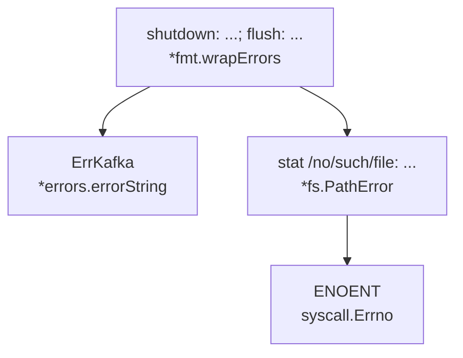
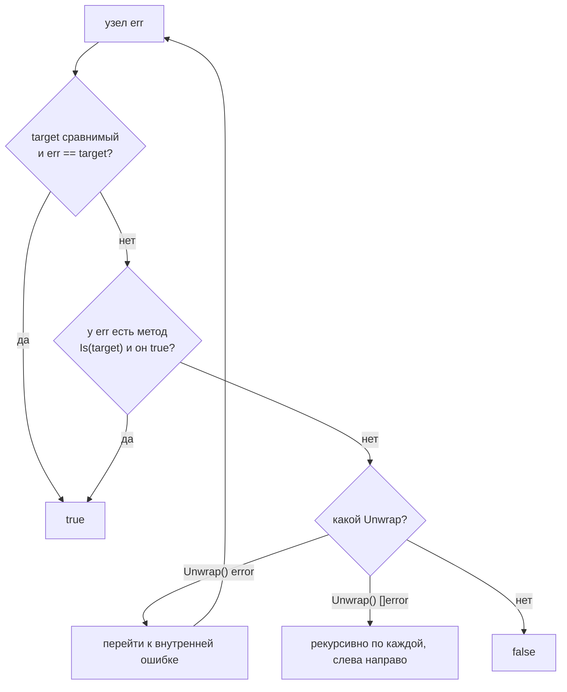
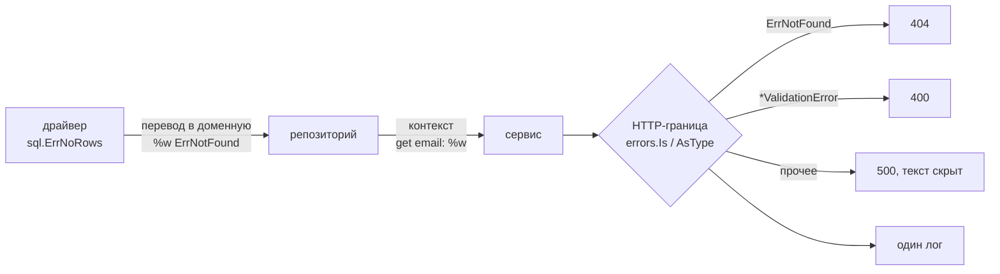
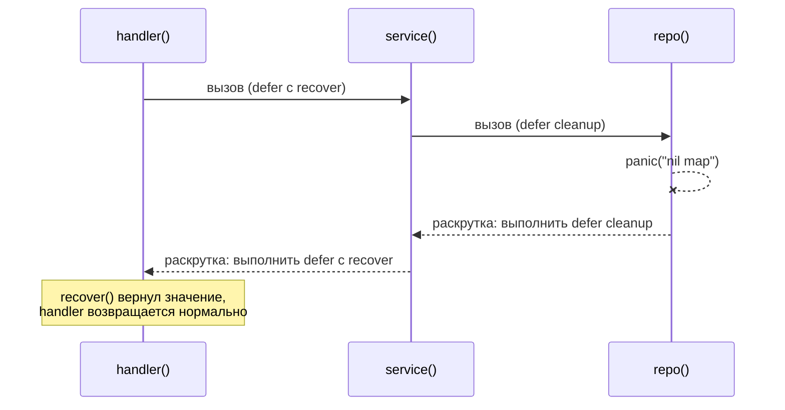
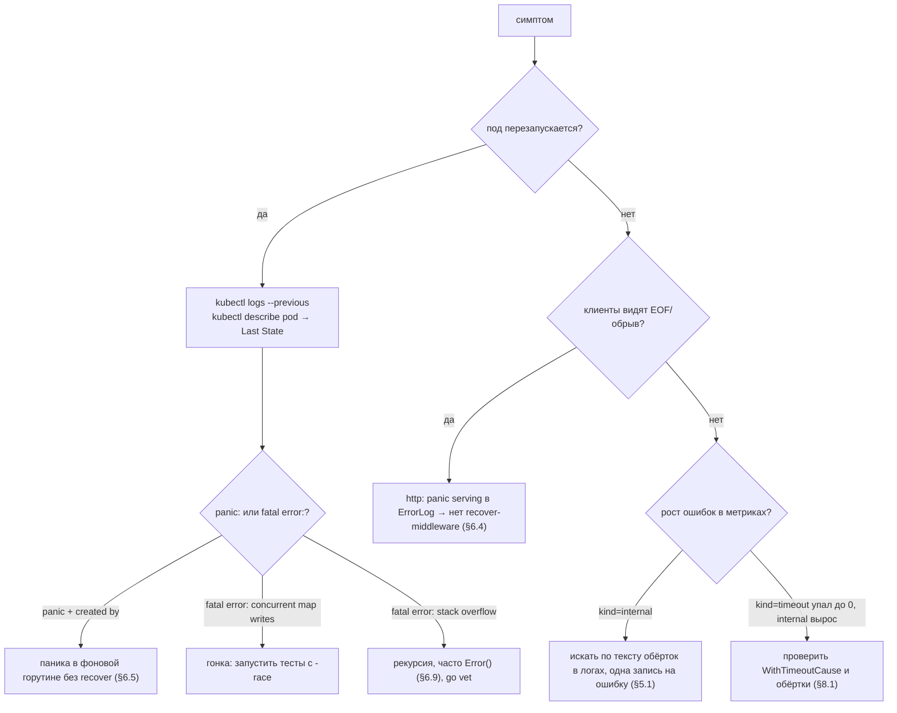

# Go Errors: Deep Dive для Senior Go-разработчика

> Актуально для **Go 1.27** (релиз — август 2026; последний патч на момент написания — go1.27.3 по данным `go.dev/dl`).
> Факты сверены с исходниками ветки `go1.27.0` (`src/errors/{errors,wrap,join}.go`, `src/fmt/errors.go`, `src/runtime/panic.go`, `src/net/http/server.go`, `src/syscall/syscall_unix.go`, `src/os/error.go`) и официальными release notes.
> Все бенчмарки и выводы команд — **реальные прогоны** на `go1.27.0 darwin/arm64, Apple M3 Pro, GOMAXPROCS=11`. Каждый бенчмарк — одиночный прогон (`-count=1`), во время замеров параллельно работали другие процессы: **B/op и allocs/op надёжны, ns/op — шумные**, сравнивайте их только по порядку величины.
> Места, где факт не удалось проверить по первоисточнику, помечены **⚠️ не проверено**.

## Оглавление

- [Словарь терминов](#словарь-терминов)
- [TL;DR](#tldr)
- [1. Модель: ошибка — это значение](#1-модель-ошибка--это-значение)
- [2. Обёртывание: %w, Unwrap и дерево ошибок](#2-обёртывание-w-unwrap-и-дерево-ошибок)
- [3. Проверка: errors.Is, errors.As, errors.AsType](#3-проверка-errorsis-errorsas-errorsastype)
- [4. Проектирование ошибок: sentinel, типы, непрозрачные ошибки](#4-проектирование-ошибок-sentinel-типы-непрозрачные-ошибки)
- [5. Обработка: «обработай один раз», логирование, defer](#5-обработка-обработай-один-раз-логирование-defer)
- [6. panic и recover](#6-panic-и-recover)
- [7. Стек вызовов в ошибках](#7-стек-вызовов-в-ошибках)
- [8. Ошибки на границах: HTTP, gRPC, context, database/sql](#8-ошибки-на-границах-http-grpc-context-databasesql)
- [9. Ошибки в конкурентном коде](#9-ошибки-в-конкурентном-коде)
- [10. Настройки и параметры](#10-настройки-и-параметры)
- [11. Production: контейнеры и Kubernetes](#11-production-контейнеры-и-kubernetes)
- [12. Наблюдаемость и диагностика](#12-наблюдаемость-и-диагностика)
- [13. Оптимизация](#13-оптимизация)
- [14. Линтеры и инструменты](#14-линтеры-и-инструменты)
- [15. Грабли, заблуждения и советы: сводка](#15-грабли-заблуждения-и-советы-сводка)
- [16. История и сравнение с другими платформами](#16-история-и-сравнение-с-другими-платформами)
- [17. Вопросы для собеседования](#17-вопросы-для-собеседования)
- [18. Чеклист и шпаргалка](#18-чеклист-и-шпаргалка)

## Словарь терминов

| Термин | Что значит простыми словами |
|---|---|
| **error** | Встроенный интерфейс с одним методом `Error() string`. Любой тип с таким методом — ошибка. |
| **Интерфейсное значение** | Пара «указатель на описание типа + указатель на данные», 16 байт на 64-битной платформе. `nil` только если **обе** половины пустые. |
| **typed nil** | Интерфейс, у которого тип заполнен, а данные — nil-указатель. Он **не равен** `nil`. Главная ловушка с ошибками. |
| **Sentinel error** (сигнальная ошибка) | Заранее созданная переменная-ошибка, с которой сравнивают: `io.EOF`, `sql.ErrNoRows`. |
| **Тип ошибки** (error type) | Собственная структура с полями (`*fs.PathError{Op, Path, Err}`), из которой можно достать детали. |
| **Непрозрачная ошибка** (opaque error) | Ошибка, о которой вызывающий знает только «есть/нет» и текст; детали скрыты. |
| **Обёртывание** (wrapping) | Создание новой ошибки, которая хранит старую внутри и добавляет контекст: `fmt.Errorf("load user: %w", err)`. |
| **Unwrap** | Метод, возвращающий «внутреннюю» ошибку. `Unwrap() error` — одна, `Unwrap() []error` — несколько. |
| **Цепочка / дерево ошибок** | Ошибка и всё, что из неё достаётся через `Unwrap`. С Go 1.20 это дерево, а не только цепочка. |
| **errors.Is** | «Есть ли в дереве ошибка, равная этой?» — для sentinel-ошибок. |
| **errors.As / errors.AsType** | «Есть ли в дереве ошибка такого-то типа? Дай мне её» — для типов ошибок. |
| **panic** | Аварийная остановка текущей горутины с раскруткой стека (выполнением `defer`). Если её не перехватить — падает весь процесс. |
| **recover** | Встроенная функция, которая внутри `defer` останавливает панику и возвращает её значение. |
| **Раскрутка стека** (unwinding) | Выход из функций одна за другой с выполнением их `defer`, пока паника не будет перехвачена или не дойдёт до верха горутины. |
| **runtime.Error** | Интерфейс для паник, которые вызывает сам рантайм: выход за границы, nil-указатель, деление на ноль. |
| **Граница** (boundary) | Место, где ошибка покидает ваш код: HTTP-ответ, gRPC-статус, лог, метрика. Здесь её «обрабатывают». |
| **Линтер** | Программа, которая ищет подозрительные места в коде без запуска: `go vet`, `staticcheck`, `golangci-lint`. |

## TL;DR

1. **Ошибка в Go — обычное значение** интерфейсного типа `error`, а не исключение. Её возвращают последним результатом и проверяют `if err != nil`. Это сознательное решение: путь ошибки виден в коде (§1.4).
2. **typed nil — ловушка №1**: функция с результатом `error`, которая возвращает nil-указатель конкретного типа, возвращает **не-nil** ошибку. `go vet` молчит, `staticcheck` (SA4023) ловит (§1.3).
3. **`%w` вместо `%v`** в `fmt.Errorf` сохраняет исходную ошибку внутри: `errors.Is/As` её найдут. С `%v` остаётся только текст (§2.1).
4. **С Go 1.20** ошибки образуют **дерево**: `errors.Join` и несколько `%w` в одном `Errorf`; `errors.Is/As` обходят его в глубину (§2.2).
5. **`errors.Is` вместо `==`**, `errors.As` вместо type assertion — иначе проверка ломается после первой же обёртки. Исключения: `io.EOF` от `Read` и `sql.ErrNoRows` от `Row.Scan` возвращаются необёрнутыми по контракту (§3.5).
6. **С Go 1.26 есть `errors.AsType[E]`** — типобезопасная версия `As`; в замере ~8× быстрее и без аллокации; `go fix` переписывает старый код автоматически (§3.3).
7. **Обёртка через `%w` — это обещание API**: вызывающие начнут проверять внутреннюю ошибку, и сменить её потом нельзя без поломки (§4.2).
8. **Правило «обработай один раз»**: либо логируйте, либо возвращайте. Лог в каждом слое даёт N строк на одну ошибку (§5.1).
9. **`defer f.Close()` на записи теряет ошибки**: для записываемых ресурсов объединяйте ошибку `Close` с результатом через `errors.Join` (§5.4).
10. **Паника в горутине без `recover` убивает весь процесс**, даже если в HTTP-обработчике стоит recover-middleware: он защищает только свою горутину (§6.5).
11. **`net/http` при панике обработчика не отправляет 500** — он закрывает соединение, клиент видит `EOF`. Нужен свой middleware (§6.4).
12. **`panic(nil)` с Go 1.21 превращается в `*runtime.PanicNilError`**; `recover()` больше не может вернуть nil при панике (§6.7).
13. **С Go 1.25** повторная паника после `recover` печатается одной строкой с пометкой `[recovered, repanicked]` (§6.6).
14. **Стандартная библиотека не хранит стек в ошибках**: это дорого (в замере `pkg/errors.Wrap` — 4 аллокации и 336 B против 2 аллокаций и 56 B у `fmt.Errorf` с `%w`). Контекст добавляйте текстом обёрток (§7).
15. **С Go 1.26 `fmt.Errorf("x")` без аргументов** аллоцирует так же, как `errors.New("x")`: 1 аллокация вместо 2 (§13).
16. **Go-команда официально прекратила попытки изменить синтаксис обработки ошибок** (пост в блоге Go от 3 июня 2025): `if err != nil` остаётся (§16).

---

## 1. Модель: ошибка — это значение

### 1.1. Интерфейс `error`

`error` — встроенный интерфейс языка:

```go
type error interface {
    Error() string
}
```

Любой тип с методом `Error() string` — ошибка. Функция сообщает о неудаче, возвращая ошибку **последним результатом**, а вызывающий проверяет её явно:

```go
order, err := repo.Get(ctx, id)
if err != nil {
    return fmt.Errorf("get order %d: %w", id, err)
}
```

Как любое интерфейсное значение, переменная типа `error` состоит из двух машинных слов:

```text
var err error                        err = &ValidationError{Field: "qty"}
┌──────────┬──────────┐              ┌──────────────────────┬──────────────┐
│ tab: nil │ data: nil│  == nil      │ tab: *ValidationError│ data: 0xc000…│  != nil
└──────────┴──────────┘              └──────────────────────┴──────────────┘
  8 байт     8 байт                    тип (itab)             указатель на значение
```

Размер проверен: `unsafe.Sizeof(err)` на darwin/arm64 печатает `16 bytes`. Сравнение `err == nil` истинно только если **обе** половины пустые. Из этого вытекает ловушка typed nil (§1.3).

### 1.2. `errors.New`: почему указатель

Исходник `src/errors/errors.go` целиком помещается на экран:

```go
func New(text string) error {
    return &errorString{text}
}

type errorString struct {
    s string
}

func (e *errorString) Error() string {
    return e.s
}
```

`New` возвращает **указатель**. Два вызова с одинаковым текстом дают разные ошибки, потому что сравниваются адреса, а не строки:

```go
a, b := errors.New("not found"), errors.New("not found")
fmt.Println("a == b:", a == b, "| errors.Is(a, b):", errors.Is(a, b), "| a.Error() == b.Error():", a.Error() == b.Error())
```

```text
a == b: false | errors.Is(a, b): false | a.Error() == b.Error(): true
```

**Почему так.** Если бы `errorString` сравнивался по значению, любой пакет мог бы случайно «совпасть» с чужим `io.EOF`, написав `errors.New("EOF")`. Указатель делает каждую sentinel-ошибку уникальной: совпасть может только та же самая переменная.

**Цена.** Каждый вызов `errors.New` — аллокация 16 байт (замер в §13). Поэтому сигнальные ошибки создают **один раз** на уровне пакета (`var ErrNotFound = errors.New(...)`), а не в каждом вызове.

### 1.3. typed nil: ошибка, которая не nil

**Грабли: функция возвращает nil-указатель конкретного типа**

```go
type ValidationError struct{ Field string }

func (e *ValidationError) Error() string { return "invalid field " + e.Field }

// validate возвращает *ValidationError, а не error — классическая ошибка.
func validate(qty int) *ValidationError {
    if qty <= 0 {
        return &ValidationError{Field: "qty"}
    }
    return nil
}

func CreateOrder(qty int) error {
    err := validate(qty) // err имеет тип *ValidationError
    return err           // упаковка nil-указателя в интерфейс error
}

func main() {
    err := CreateOrder(5)
    fmt.Println("err == nil:", err == nil)
    fmt.Printf("type=%T value=%v\n", err, err)
    var ve *ValidationError
    fmt.Println("errors.As:", errors.As(err, &ve), "ve == nil:", ve == nil)
}
```

```text
err == nil: false
type=*main.ValidationError value=<nil>
errors.As: true ve == nil: true
```

Почему так: при `return err` значение типа `*ValidationError` упаковывается в интерфейс `error`. Половина «тип» заполняется (`*ValidationError`), половина «данные» — nil. Интерфейс не пустой, значит `!= nil`. Обратите внимание: `errors.As` тоже «находит» ошибку и кладёт в `ve` nil-указатель — дальнейший `ve.Field` упадёт с nil pointer dereference. А `fmt` печатает `<nil>` и этим маскирует проблему в логах.

Как заметить: `go vet` **молчит**. `staticcheck` ловит:

```text
typednil/main.go:28:29: this comparison is never true (SA4023)
	typednil/main.go:27:9: the lhs of the comparison is the 1st return value of this function call
	typednil/main.go:21:6: errlab/typednil.CreateOrder never returns a nil interface value
```

Как исправить: функции, которые могут вернуть ошибку, объявляйте с результатом `error`, а не `*MyError`; возвращайте литерал `nil`:

```go
func validate(qty int) error {
    if qty <= 0 {
        return &ValidationError{Field: "qty"}
    }
    return nil // интерфейс с пустыми обеими половинами
}
```

### 1.4. Почему не исключения

Go сознательно не делает ошибки исключениями (`throw`/`catch` из Java, C#, Python):

| | Исключения | Ошибки-значения в Go |
|---|---|---|
| Где виден путь ошибки | не виден: любая строка может «выбросить» | в сигнатуре и в каждом `if err != nil` |
| Кто обязан обработать | никто, исключение улетает вверх само | вызывающий, явно |
| Стоимость | создание исключения обычно собирает стек | значение без стека; sentinel — 0 аллокаций |
| Контекст | стек вызовов | текст обёрток: `charge: call psp: timeout` |
| Риск | «проглоченное» исключение в `catch {}` | проигнорированный `err` (ловит `errcheck`) |

Аргумент авторов языка: ошибка — **ожидаемая** часть работы программы (сеть недоступна, файла нет, строка не найдена), и её обработка — такой же код, как всё остальное. Для по-настоящему аварийных ситуаций есть `panic` (§6). Подробнее о попытках добавить сахар к `if err != nil` и о том, почему их отклонили, — в §16.

> **Заблуждение:** «`if err != nil` — это просто многословная замена try/catch». На самом деле каждая проверка — место, где вы **решаете**, что делать: добавить контекст, перевести ошибку в доменную, повторить запрос, вернуть значение по умолчанию. В try/catch это решение обычно откладывается на верхний уровень, где контекст уже потерян.

### Простыми словами

Ошибка в Go — обычная переменная, как число или строка. Функция её возвращает, вы её проверяете. Переменная типа `error` — это «коробка» из двух частей: «какого типа ошибка» и «где лежат её данные». Коробка пустая (`nil`), только когда пусты **обе** части. Если положить в неё пустой указатель конкретного типа, коробка уже не пустая — отсюда ловушка typed nil.

### Что важно для Senior

- `error` — интерфейс; `err == nil` сравнивает обе половины. Typed nil ловит только `staticcheck` SA4023, не `go vet`.
- Функции объявляют результат `error`, а не конкретный тип ошибки — даже если всегда возвращают один тип.
- `errors.New` возвращает указатель ради уникальности; каждый вызов аллоцирует — sentinel-ошибки создают на уровне пакета.
- Ошибка — ожидаемая ситуация, panic — аварийная. Смешивать их нельзя (§6.2).

---

## 2. Обёртывание: %w, Unwrap и дерево ошибок

### 2.1. `fmt.Errorf` и глагол `%w`

Обёртывание (с Go 1.13) — создание ошибки, которая добавляет контекст и **хранит исходную ошибку внутри**. Делается глаголом `%w` в `fmt.Errorf`:

```go
var ErrNotFound = errors.New("user not found")

func findUser(id int) error { return ErrNotFound }

func loadV(id int) error { return fmt.Errorf("load user %d: %v", id, findUser(id)) }
func loadW(id int) error { return fmt.Errorf("load user %d: %w", id, findUser(id)) }

func main() {
    ev, ew := loadV(42), loadW(42)
    fmt.Println(ev)
    fmt.Println(ew)
    fmt.Println("v: errors.Is =", errors.Is(ev, ErrNotFound))
    fmt.Println("w: errors.Is =", errors.Is(ew, ErrNotFound))
    fmt.Println("w: ew == ErrNotFound =", ew == ErrNotFound)
    fmt.Printf("v type: %T, w type: %T\n", ev, ew)
    fmt.Println("Unwrap(ew) == ErrNotFound:", errors.Unwrap(ew) == ErrNotFound)
}
```

```text
load user 42: user not found
load user 42: user not found
v: errors.Is = false
w: errors.Is = true
w: ew == ErrNotFound = false
v type: *errors.errorString, w type: *fmt.wrapError
Unwrap(ew) == ErrNotFound: true
```

Текст одинаковый, но внутри — разные вещи. С `%v` получается `*errors.errorString`: от исходной ошибки остался только текст. С `%w` — `*fmt.wrapError`, который хранит её и отдаёт через `Unwrap()`. Проверка `==` не работает в обоих случаях: обёртка — уже другое значение.

Как это устроено внутри (`src/fmt/errors.go`, go1.27.0, сокращено):

```go
func Errorf(format string, a ...any) (err error) {
    // This function has been split in a somewhat unnatural way
    // so that both it and the errors.New call can be inlined.
    if err = errorf(format, a...); err != nil {
        return err
    }
    // No formatting was needed. We can avoid some allocations and other work.
    return errors.New(format)
}

func errorf(format string, a ...any) error {
    if len(a) == 0 && stringslite.IndexByte(format, '%') == -1 {
        return nil
    }
    p := newPrinter()
    p.wrapErrs = true
    p.doPrintf(format, a)
    s := string(p.buf)
    var err error
    switch len(p.wrappedErrs) {
    case 0:
        err = errors.New(s)
    case 1:
        w := &wrapError{msg: s}
        w.err, _ = a[p.wrappedErrs[0]].(error)
        err = w
    default:
        // ... сортировка, удаление дублей ...
        err = &wrapErrors{s, errs}
    }
    p.free()
    return err
}

type wrapError struct {
    msg string
    err error
}
func (e *wrapError) Error() string { return e.msg }
func (e *wrapError) Unwrap() error { return e.err }
```

Важные детали из кода:

- **Текст считается один раз**, при создании. `Error()` просто возвращает готовую строку — повторные вызовы бесплатны, но создание стоит форматирования (§13).
- **С Go 1.26** `fmt.Errorf` без аргументов и без `%` сразу вызывает `errors.New` — одна аллокация вместо двух (коммит c1e6e49d5d, «fmt: reduce Errorf("x") allocations to match errors.New("x")»; в release notes 1.26: *«For unformatted strings, fmt.Errorf("x") now allocates less and generally matches the allocations for errors.New("x")»*).
- **Ноль `%w`** — `*errors.errorString`, **один** — `*fmt.wrapError`, **несколько** — `*fmt.wrapErrors` с методом `Unwrap() []error`.

### 2.2. Несколько ошибок: `errors.Join` и много `%w` (Go 1.20)

С Go 1.20 (коммит 4a0a2b33df «errors, fmt: add support for wrapping multiple errors») одна ошибка может оборачивать **несколько**. Два способа:

```go
var (
    ErrKafka = errors.New("kafka: broker unavailable")
    ErrRedis = errors.New("redis: connection refused")
)

func main() {
    fmt.Println("Join(nil, nil) == nil:", errors.Join(nil, nil) == nil)

    j := errors.Join(ErrKafka, nil, ErrRedis)
    fmt.Printf("Join: %q\n", j.Error())
    fmt.Println("Is Kafka:", errors.Is(j, ErrKafka), "Is Redis:", errors.Is(j, ErrRedis))
    fmt.Println("errors.Unwrap(join) == nil:", errors.Unwrap(j) == nil)
    if u, ok := j.(interface{ Unwrap() []error }); ok {
        fmt.Println("Unwrap() []error len:", len(u.Unwrap()))
    }

    _, statErr := os.Stat("/no/such/file")
    m := fmt.Errorf("shutdown: %w; flush: %w", ErrKafka, statErr)
    fmt.Println(m)
    fmt.Println("Is Kafka:", errors.Is(m, ErrKafka), "Is fs.ErrNotExist:", errors.Is(m, fs.ErrNotExist))
    var pe *fs.PathError
    fmt.Println("As *fs.PathError:", errors.As(m, &pe), pe.Op, pe.Path)
    fmt.Printf("type: %T\n", m)
}
```

```text
Join(nil, nil) == nil: true
Join: "kafka: broker unavailable\nredis: connection refused"
Is Kafka: true Is Redis: true
errors.Unwrap(join) == nil: true
Unwrap() []error len: 2
shutdown: kafka: broker unavailable; flush: stat /no/such/file: no such file or directory
Is Kafka: true Is fs.ErrNotExist: true
As *fs.PathError: true stat /no/such/file
type: *fmt.wrapErrors
```

Что видно:

- `errors.Join` **выбрасывает nil** и возвращает `nil`, если все аргументы nil. Удобно для сбора ошибок в цикле.
- Текст `Join` — сообщения через **перевод строки**. Для однострочных логов это неудобно; если нужен свой формат, используйте `fmt.Errorf` с несколькими `%w`.
- **`errors.Unwrap` не умеет разворачивать множественные ошибки** — возвращает nil. Он вызывает только `Unwrap() error`. Это прямо написано в документации (`src/errors/wrap.go`): *«Unwrap only calls a method of the form "Unwrap() error". In particular Unwrap does not unwrap errors returned by [Join].»* Для дерева используйте `errors.Is/As`.

`errors.Join` внутри (`src/errors/join.go`): структура `joinError{errs []error}` с методом `Unwrap() []error`. С Go 1.22 метод `Error()` собирает строку в один `[]byte` и превращает его в строку через `unsafe.String` без копирования (коммит 26fc4aa956).

### 2.3. Дерево ошибок

С появлением `Unwrap() []error` ошибки образуют дерево. `errors.Is` и `errors.As` обходят его **в глубину, слева направо** и останавливаются на первом совпадении:



Порядок обхода для `errors.Is(m, fs.ErrNotExist)`: `A → B → C → D`. На узле `D` срабатывает метод `syscall.Errno.Is` (§3.2), который считает `ENOENT` равным `fs.ErrNotExist`.

### 2.4. Грабли обёртывания

**Грабли: `%w` с nil-ошибкой**

```go
func commit() error { return nil }

func SaveOrder() error {
    err := commit()
    return fmt.Errorf("commit order: %w", err) // забыли if err != nil
}

func main() {
    err := SaveOrder()
    fmt.Printf("err != nil: %v, text: %q\n", err != nil, err)
}
```

```text
err != nil: true, text: "commit order: %!w(<nil>)"
```

Почему так: `fmt.Errorf` **всегда** создаёт новую ошибку, даже если оборачивать нечего. Успешная операция превращается в «ошибку» с мусорным текстом `%!w(<nil>)`. Как заметить: ни `go vet`, ни `golangci-lint` (errcheck, errorlint, wrapcheck, nilerr, staticcheck) в проверке этого кода **ничего не нашли** (`0 issues`). В production — строка `%!w(<nil>)` в логах. Как исправить: оборачивайте только внутри `if err != nil`.

**Грабли: `%w` с аргументом не-ошибкой**

```go
bad := fmt.Errorf("oops: %w", "not an error")
fmt.Println(bad, "| Unwrap nil:", errors.Unwrap(bad) == nil)
```

```text
oops: %!w(string=not an error) | Unwrap nil: true
```

Это `go vet` ловит:

```text
join/main.go:37:27: fmt.Errorf format %w has arg "not an error" of wrong type string
```

> **Совет.** Добавляйте в обёртку **то, чего не знает вызывающий**: идентификаторы, имя операции, шаг. Не повторяйте то, что уже есть в исходной ошибке (`os.Open` уже пишет путь в `*fs.PathError`). Когда не нужно: если функция — тонкий прокси и контекст ничего не добавляет, возвращайте `err` как есть.

> **Совет.** Формат обёртки — `"<что делали>: %w"`, без «failed to», «error:» и заглавных букв. Тогда цепочка читается слева направо: `get email: user 42: not found`. Так пишут ошибки в стандартной библиотеке.

### Простыми словами

Обёртывание — это как вложить письмо в конверт и написать на конверте, откуда оно пришло. `%w` кладёт исходную ошибку внутрь, и потом её можно достать. `%v` переписывает только текст на конверт, а само письмо выбрасывает. С Go 1.20 в один конверт можно положить несколько писем — получается дерево, и функции поиска (`errors.Is/As`) проверяют все письма по очереди.

### Что важно для Senior

- `%w` сохраняет исходную ошибку, `%v` — только текст. Для проверки через `errors.Is/As` нужен `%w`.
- Тип результата `fmt.Errorf` зависит от числа `%w`: 0 → `*errors.errorString`, 1 → `*fmt.wrapError`, ≥2 → `*fmt.wrapErrors`.
- `errors.Unwrap` не разворачивает `Join` и мульти-`%w` — для деревьев только `errors.Is/As/AsType`.
- `fmt.Errorf("...: %w", nil)` возвращает не-nil ошибку; линтеры это не ловят.

---

## 3. Проверка: errors.Is, errors.As, errors.AsType

### 3.1. `errors.Is`: алгоритм

`errors.Is(err, target)` отвечает: есть ли в дереве `err` ошибка, равная `target`. Код из `src/errors/wrap.go` (go1.27.0):

```go
func Is(err, target error) bool {
    if err == nil || target == nil {
        return err == target
    }

    isComparable := reflectlite.TypeOf(target).Comparable()
    return is(err, target, isComparable)
}

func is(err, target error, targetComparable bool) bool {
    for {
        if targetComparable && err == target {
            return true
        }
        if x, ok := err.(interface{ Is(error) bool }); ok && x.Is(target) {
            return true
        }
        switch x := err.(type) {
        case interface{ Unwrap() error }:
            err = x.Unwrap()
            if err == nil {
                return false
            }
        case interface{ Unwrap() []error }:
            for _, err := range x.Unwrap() {
                if is(err, target, targetComparable) {
                    return true
                }
            }
            return false
        default:
            return false
        }
    }
}
```

На каждом узле три шага:



Детали, которые спрашивают:

- **`isComparable`**. Если тип `target` несравнимый (структура со слайсом или map), `==` пропускается — иначе сравнение интерфейсов с одинаковым несравнимым типом паникует. Эту защиту добавили ещё в Go 1.13 (коммит 0bf1f02ed9 «errors: fix Is panics if target is uncomparable»).
- **Цикл, а не рекурсия** для цепочек `Unwrap() error`: глубина цепочки не растит стек. Рекурсия только по ветвям дерева.
- **Стоимость линейна по глубине**: в замере (§13) глубина 1 — 6.6 ns, 5 — 18 ns, 20 — 61 ns, 0 аллокаций.

**Грабли: сравнение несравнимых ошибок через `==`**

```go
// MultiFieldError содержит слайс — значит, тип несравнимый.
type MultiFieldError struct{ Fields []string }

func (e MultiFieldError) Error() string { return fmt.Sprint("invalid fields: ", e.Fields) }

func main() {
    a := error(MultiFieldError{Fields: []string{"email"}})
    b := error(MultiFieldError{Fields: []string{"email"}})
    fmt.Println("errors.Is:", errors.Is(a, b)) // не паникует: Is пропускает ==
    fmt.Println("a == b:", a == b)            // паника
}
```

```text
errors.Is: false
panic: runtime error: comparing uncomparable type main.MultiFieldError

goroutine 1 [running]:
main.main()
	.../uncomparable/main.go:17 +0x100
exit status 2
```

Почему так: `==` для интерфейсов сравнивает динамические значения; если тип одинаковый и несравнимый — паника во время выполнения, компилятор её не видит. Как заметить: линтеры не ловят. Как исправить: ошибки-значения со слайсами/map делайте **указателями** (`*MultiFieldError`) — указатели всегда сравнимы — или добавьте метод `Is`.

### 3.2. Собственный метод `Is`

Тип может сказать «я считаюсь равным вот этой ошибке» через метод `Is(error) bool`. Пример: ошибка внешнего API, которую нужно сравнивать по HTTP-коду, а не по телу ответа:

```go
// StatusError — ответ внешнего API с HTTP-кодом.
type StatusError struct {
    Code int
    Body string
}

func (e *StatusError) Error() string { return fmt.Sprintf("upstream status %d: %s", e.Code, e.Body) }

// Is: совпадение по коду, тело не важно.
func (e *StatusError) Is(target error) bool {
    t, ok := target.(*StatusError)
    return ok && t.Code == e.Code
}

var ErrUpstreamThrottled = &StatusError{Code: 429}

func main() {
    err := fmt.Errorf("charge card: %w", &StatusError{Code: 429, Body: `{"retry_after":3}`})
    fmt.Println("Is(429):", errors.Is(err, ErrUpstreamThrottled))
    fmt.Println("Is(503):", errors.Is(err, &StatusError{Code: 503}))
}
```

```text
Is(429): true
Is(503): false
```

Так же сделана стандартная библиотека. `syscall.Errno` (`src/syscall/syscall_unix.go`) связывает системные коды с переносимыми ошибками пакета `io/fs`:

```go
func (e Errno) Is(target error) bool {
    switch target {
    case oserror.ErrPermission:
        return e == EACCES || e == EPERM
    case oserror.ErrExist:
        return e == EEXIST || e == ENOTEMPTY
    case oserror.ErrNotExist:
        return e == ENOENT
    case errorspkg.ErrUnsupported:
        return e == ENOSYS || e == ENOTSUP || e == EOPNOTSUPP
    }
    return false
}
```

Поэтому работает и проверка системной ошибки сети:

```go
_, err = os.Open("/no/such/file")
var errno syscall.Errno
errors.As(err, &errno)
fmt.Printf("errno=%d (%v) Is(fs.ErrNotExist)=%v\n", errno, errno, errors.Is(err, fs.ErrNotExist))

_, err = net.Dial("tcp", "127.0.0.1:1")
fmt.Println(err)
fmt.Println("Is(ECONNREFUSED):", errors.Is(err, syscall.ECONNREFUSED))
```

```text
errno=2 (no such file or directory) Is(fs.ErrNotExist)=true
dial tcp 127.0.0.1:1: connect: connection refused
Is(ECONNREFUSED): true
```

Правило из документации `errors.Is`: *«An Is method should only shallowly compare err and the target and not call Unwrap on either.»* Метод `Is` сравнивает только «себя», а обход дерева делает сам `errors.Is`.

### 3.3. `errors.As` и `errors.AsType` (Go 1.26)

`errors.As(err, &target)` ищет в дереве ошибку, которую можно присвоить переменной `target`, и кладёт её туда. Работает через рефлексию (`internal/reflectlite`): проверяет, что `target` — ненулевой указатель на интерфейс или на тип, реализующий `error`, и иначе **паникует**.

С Go 1.26 есть generic-версия (коммит a846bb0aa5 «errors: add AsType»; в release notes 1.26: *«The new AsType function is a generic version of As. It is type-safe, faster, and, in most cases, easier to use.»*):

```go
func AsType[E error](err error) (E, bool)
```

Сравнение на одном примере:

```go
_, err := os.Open("/no/such/file")
err = fmt.Errorf("load config: %w", err)

var pe *fs.PathError
if errors.As(err, &pe) {
    fmt.Println("As:", pe.Op, pe.Path)
}
if pe, ok := errors.AsType[*fs.PathError](err); ok {
    fmt.Println("AsType:", pe.Op, pe.Path)
}
```

```text
As: open /no/such/file
AsType: open /no/such/file
```

Чем `AsType` лучше:

| | `errors.As` | `errors.AsType[E]` |
|---|---|---|
| Проверка типа | во время выполнения, паника при ошибке | компилятором: `E` обязан реализовать `error` |
| Переменная | нужно объявить заранее, живёт вне `if` | объявляется в `if`, область видимости узкая |
| Механизм | рефлексия | type assertion `err.(E)` |
| Замер (§13) | 57 ns, 8 B, 1 alloc | 7 ns, 0 B, 0 alloc |

В документации `As` в go1.27.0 прямо написано: *«For most uses, prefer [AsType].»* Ограничение: `AsType` ищет только типы, реализующие `error`; `As` умеет искать и по произвольному интерфейсу (`var t interface{ Timeout() bool }`).

> **Совет.** Переведите кодовую базу на `AsType` автоматически: `go fix ./...` (с Go 1.26 `go fix` запускает набор «модернизаторов», среди них `errorsastype`). Проверенный вывод `go fix -diff` на go1.27.0:

```diff
-	var pe *fs.PathError
-	if errors.As(err, &pe) {
+	if pe, ok := errors.AsType[*fs.PathError](err); ok {
 		fmt.Println("As:", pe.Op, pe.Path)
 	}
```

Модернизатор переписывает только `errors.As` внутри `if` (в `switch` не трогает — так написано в комментарии к анализатору `errorsastype` в `src/cmd/vendor/golang.org/x/tools/go/analysis/passes/modernize/errorsastype.go`). Когда не нужно: если `go.mod` объявляет версию ниже 1.26 — `AsType` недоступен.

### 3.4. Грабли проверки

**Грабли: `errors.As` с не-указателем**

```go
_, err := os.Open("/no/such/file")
var pe fs.PathError // не указатель: *fs.PathError реализует error, fs.PathError — нет
fmt.Println(errors.As(err, &pe))
```

```text
panic: errors: *target must be interface or implement error

goroutine 1 [running]:
errors.As({0x1002f3048, 0x13ef2c1940f0}, {0x1002d3a60, 0x13ef2c194120?})
	.../src/errors/wrap.go:116 +0x1b8
```

`go vet` (анализатор `errorsas`) ловит это до запуска:

```text
aspanic/main.go:13:14: second argument to errors.As must be a non-nil pointer to either a type that implements error, or to any interface type
```

С `AsType` такая ошибка не скомпилируется.

**Грабли: тип с методом на значении, а ищут указатель**

```go
type RateLimitError struct{ RetryAfterSec int }

func (e RateLimitError) Error() string { return fmt.Sprintf("rate limited, retry after %ds", e.RetryAfterSec) }

func callAPI() error { return fmt.Errorf("call billing: %w", RateLimitError{RetryAfterSec: 30}) }

func main() {
    err := callAPI()
    var p *RateLimitError
    fmt.Println("As(*RateLimitError):", errors.As(err, &p))
    var v RateLimitError
    fmt.Println("As(RateLimitError):", errors.As(err, &v), v.RetryAfterSec)
}
```

```text
As(*RateLimitError): false
As(RateLimitError): true 30
```

Почему так: в дереве лежит значение `RateLimitError`, а не `*RateLimitError`. `As` ищет **точный** тип (точнее, присваиваемость), указатель и значение — разные типы. Как заметить: никакой линтер не предупредил; в production — ветка обработки rate limit никогда не срабатывает. Как исправить: договоритесь, что ошибки-структуры всегда создаются и ищутся **через указатель** (`&RateLimitError{}`, метод на `*RateLimitError`), как `*fs.PathError`, `*url.Error`, `*net.OpError`.

**Грабли: `os.IsNotExist` после обёртки**

```go
func loadConfig(path string) error {
    _, err := os.ReadFile(path)
    if err != nil {
        return fmt.Errorf("load config: %w", err)
    }
    return nil
}

func main() {
    err := loadConfig("/etc/orders/config.yaml")
    fmt.Println("os.IsNotExist:", os.IsNotExist(err))
    fmt.Println("errors.Is(fs.ErrNotExist):", errors.Is(err, fs.ErrNotExist))
}
```

```text
os.IsNotExist: false
errors.Is(fs.ErrNotExist): true
```

`os.IsNotExist`, `os.IsExist`, `os.IsPermission` старше `errors.Is` и не разворачивают обёртки `fmt.Errorf`. В `src/os/error.go`: *«This function predates [errors.Is]. It only supports errors returned by the os package. New code should use errors.Is(err, fs.ErrNotExist).»*

**Грабли: `==` и type switch после обёртки**

```go
if err == sql.ErrNoRows { ... }        // ломается, если кто-то обернул
switch err.(type) { case *os.PathError: ... } // то же самое
```

`golangci-lint` с `errorlint` ловит type switch: `type switch on error will fail on wrapped errors. Use errors.As to check for specific errors (errorlint)`. Сравнение `==` errorlint ловит не всегда — см. §3.5.

### 3.5. Когда `==` правильно

> **Заблуждение:** «С Go 1.13 ошибки всегда сравнивают через `errors.Is`, `==` — ошибка». На самом деле есть контракты, где ошибка **гарантированно не обёрнута**, и `==` — норма:
>
> - `io.EOF` от `Read`. В `src/io/io.go`: *«Read must return EOF itself, not an error wrapping EOF, because callers will test for EOF using ==.»* Значит, **если вы реализуете `io.Reader`, нельзя оборачивать `io.EOF`** — сломаете чужой код.
> - `sql.ErrNoRows` от `(*sql.Row).Scan`.
>
> Линтер `errorlint` знает эти контракты: в его списке разрешённых (`allowed.go` в go-errorlint v1.9.0) есть, например, `{Err: "database/sql.ErrNoRows", Fun: "(*database/sql.Row).Scan"}` и десятки пар с `io.EOF`. Поэтому `if err == sql.ErrNoRows` сразу после `Scan` errorlint не помечает. Но как только ошибка прошла через ваш слой — только `errors.Is`.

### Простыми словами

`errors.Is` — «есть ли среди вложенных ошибок вот эта конкретная?», как поиск по номеру паспорта. `errors.As`/`AsType` — «есть ли среди вложенных ошибка такого вида? Дай её мне», как поиск «любой человек с водительскими правами». Оба перебирают все вложенные ошибки. Обычное `==` смотрит только на верхний конверт и после обёртки ничего не находит.

### Что важно для Senior

- `errors.Is` — для sentinel, `errors.AsType` (1.26+) или `errors.As` — для типов; `==` и type switch ломаются после обёртки.
- `errors.Is` защищён от несравнимых `target`, а ваш `==` — нет: несравнимые ошибки делайте указателями.
- Метод `Is` сравнивает поверхностно, без `Unwrap`; так устроен `syscall.Errno.Is`.
- Ошибки-структуры — через указатель, иначе `As(&p)` молча не найдёт значение.
- `io.EOF` от `Read` не оборачивают никогда: вызывающие сравнивают `==`.

---

## 4. Проектирование ошибок: sentinel, типы, непрозрачные ошибки

### 4.1. Три стратегии

| Стратегия | Как выглядит | Как проверяют | Когда выбирать | Цена |
|---|---|---|---|---|
| **Sentinel** | `var ErrNotFound = errors.New("not found")` | `errors.Is(err, ErrNotFound)` | вызывающему нужен только **факт**: «не найдено», «конфликт», «конец потока» | переменная — часть API навсегда; нельзя приложить данные |
| **Тип ошибки** | `type ValidationError struct{ Field, Reason string }` | `errors.AsType[*ValidationError](err)` | вызывающему нужны **данные**: поле, код, `RetryAfter` | тип и его поля — часть API; сильная связь |
| **Непрозрачная** | `return fmt.Errorf("charge: %v", err)` | только `err != nil` | вызывающий ничего не может сделать иначе, кроме как вернуть ошибку дальше | нельзя различить причины |
| **Поведение** | метод `Timeout() bool`, `Temporary() bool` | `errors.As(err, &t)` где `t interface{ Timeout() bool }` | вызывающему нужно знать **свойство** («можно повторить?»), а не тип | соглашение неформальное |

Стандартная библиотека использует все четыре: `io.EOF`, `sql.ErrNoRows` — sentinel; `*fs.PathError`, `*url.Error`, `*net.OpError` — типы; большинство ошибок `encoding/json` — непрозрачные; `net.Error.Timeout()` — поведение.

**Как выбрать.** Начинайте с непрозрачной ошибки. Добавляйте sentinel, когда появился **реальный** вызывающий, которому нужно отличить случай. Добавляйте тип, когда этому вызывающему нужны данные. Каждая экспортированная ошибка — обязательство поддерживать её.

> **Совет.** Делайте sentinel-ошибки **доменными** и объявляйте их в пакете домена (`orders.ErrNotFound`), а не в пакете хранилища. Тогда HTTP-слой проверяет `orders.ErrNotFound` и ничего не знает о PostgreSQL (пример в §4.4). Не нужно, если сервис тривиальный и слоёв нет.

### 4.2. Ошибка как часть API

Обёртка `%w` — это **обещание**. В блоге Go (Damien Neil и Jonathan Amsterdam, «Working with Errors in Go 1.13», 17 октября 2019): *«In other words, wrapping an error makes that error part of your API.»*

Пример: репозиторий возвращает `fmt.Errorf("get user: %w", err)`, где `err` — ошибка драйвера `pgx`. Клиенты пакета начинают писать `errors.As(err, &pgErr)` и проверять коды PostgreSQL. Через год вы переходите на другой драйвер — код клиентов молча перестаёт работать. Компилятор ничего не скажет.

Правило:

| Ситуация | Глагол |
|---|---|
| Внутренняя ошибка — **ваша** доменная (`ErrNotFound`) или вы готовы поддерживать её как API | `%w` |
| Внутренняя ошибка — деталь реализации (драйвер БД, HTTP-клиент чужого сервиса), и вы не хотите, чтобы на неё завязывались | `%v`, либо перевод в свою ошибку |
| Нужно и сохранить причину для логов, и не раскрывать её как API | своя ошибка с `%w` на свою sentinel, а исходная — только в тексте через `%v` |

Последний вариант выглядит так:

```go
return fmt.Errorf("user %d: %w (driver: %v)", id, ErrNotFound, err)
```

> **Совет.** Для пакетов-библиотек включите линтер `wrapcheck`: он требует оборачивать ошибки, пришедшие из **чужих** пакетов, и тем самым заставляет решить, что вы обещаете. Проверенный вывод: `error returned from external package is unwrapped: sig: func encoding/json.Unmarshal(data []byte, v any) error (wrapcheck)`. Не нужно в маленьком сервисе, где пакеты не переиспользуются: там он даёт много шума.

### 4.3. Поведение вместо типа

Иногда вызывающему не важно, **что** случилось, — важно, **можно ли повторить**. Для этого проверяют метод, а не тип:

```go
var t interface{ Timeout() bool }
if errors.As(err, &t) && t.Timeout() {
    // повторить с backoff
}
```

`errors.As` с указателем на интерфейс находит **любую** ошибку в дереве, у которой есть такой метод: `*net.OpError`, `*url.Error`, `context.DeadlineExceeded` и ваши собственные типы.

> **Заблуждение:** «`net.Error.Temporary()` говорит, можно ли повторить». Метод объявлен устаревшим с Go 1.18 (коммит a53e3d5f88). Комментарий в `src/net/net.go`: *«Deprecated: Temporary errors are not well-defined. Most "temporary" errors are timeouts, and the few exceptions are surprising. Do not use this method.»* Используйте `Timeout()` или проверку конкретных ошибок (`syscall.ECONNREFUSED`, `syscall.ECONNRESET`).

### 4.4. Перевод ошибок между слоями

Реалистичный пример: репозиторий на `database/sql`, сервис, HTTP-обработчик. Ошибка драйвера переводится в доменную **в репозитории**, доменная — в HTTP-код **на границе**. Пример собран и запущен с минимальным тестовым драйвером, который на любой запрос возвращает пустой результат (код драйвера опущен).

```go
// ---- доменный уровень ----

var (
    ErrNotFound = errors.New("not found")
    ErrConflict = errors.New("conflict")
)

type ValidationError struct {
    Field, Reason string
}

func (e *ValidationError) Error() string { return e.Field + ": " + e.Reason }

// ---- репозиторий (PostgreSQL) ----

type UserRepo struct{ db *sql.DB }

func (r *UserRepo) EmailByID(ctx context.Context, id int64) (string, error) {
    var email string
    err := r.db.QueryRowContext(ctx, "SELECT email FROM users WHERE id = $1", id).Scan(&email)
    if errors.Is(err, sql.ErrNoRows) {
        return "", fmt.Errorf("user %d: %w", id, ErrNotFound) // переводим ошибку драйвера в доменную
    }
    if err != nil {
        return "", fmt.Errorf("select user %d: %w", id, err)
    }
    return email, nil
}

// ---- сервис ----

type UserService struct{ repo *UserRepo }

func (s *UserService) Email(ctx context.Context, id int64) (string, error) {
    if id <= 0 {
        return "", &ValidationError{Field: "id", Reason: "must be positive"}
    }
    email, err := s.repo.EmailByID(ctx, id)
    if err != nil {
        return "", fmt.Errorf("get email: %w", err)
    }
    return email, nil
}

// ---- транспорт (HTTP) ----

func httpStatus(err error) int {
    if _, ok := errors.AsType[*ValidationError](err); ok {
        return http.StatusBadRequest
    }
    switch {
    case errors.Is(err, ErrNotFound):
        return http.StatusNotFound
    case errors.Is(err, ErrConflict):
        return http.StatusConflict
    case errors.Is(err, context.Canceled):
        return 499 // клиент ушёл (нестандартный код nginx)
    case errors.Is(err, context.DeadlineExceeded):
        return http.StatusGatewayTimeout
    default:
        return http.StatusInternalServerError
    }
}

func handler(svc *UserService, log *slog.Logger) http.HandlerFunc {
    return func(w http.ResponseWriter, r *http.Request) {
        var id int64
        fmt.Sscan(strings.TrimPrefix(r.URL.Path, "/users/"), &id)
        email, err := svc.Email(r.Context(), id)
        if err != nil {
            code := httpStatus(err)
            msg := http.StatusText(code)
            if code < 500 {
                msg = err.Error()
            }
            // Логируем ОДИН раз — на границе, где ошибка обработана.
            log.LogAttrs(r.Context(), levelFor(code), "request failed",
                slog.String("path", r.URL.Path), slog.Int("status", code), slog.Any("err", err))
            w.WriteHeader(code)
            json.NewEncoder(w).Encode(map[string]string{"error": msg})
            return
        }
        json.NewEncoder(w).Encode(map[string]string{"email": email})
    }
}

func levelFor(code int) slog.Level {
    if code >= 500 {
        return slog.LevelError
    }
    return slog.LevelWarn
}
```

```text
level=WARN msg="request failed" path=/users/42 status=404 err="get email: user 42: not found"
/users/42 -> 404 map[error:get email: user 42: not found]
level=WARN msg="request failed" path=/users/-1 status=400 err="id: must be positive"
/users/-1 -> 400 map[error:id: must be positive]
```

Что здесь важно:



- Слои выше репозитория **не знают** о `database/sql`.
- Для 5xx клиент получает только `Internal Server Error`: текст внутренних ошибок может содержать SQL, адреса и имена таблиц.
- Логирование — один раз, на границе (§5.1).

**Грабли: `return nil, nil` вместо «не найдено»**

```go
if err == sql.ErrNoRows {
    return nil, nil // nilnil
}
```

Вызывающий получает «успех» и nil-указатель, и падает с nil pointer dereference где-то дальше. Линтер `nilnil` ловит: `return both a nil error and an invalid value: use a sentinel error instead (nilnil)`. Исправление: вернуть `ErrNotFound`.

**Грабли: сравнение по тексту**

```go
if strings.Contains(err.Error(), "duplicate key") { ... }
```

Ломается при смене драйвера, версии PostgreSQL, локали сервера. Правильно — достать типизированную ошибку драйвера (`*pgconn.PgError` с полем `Code == "23505"`) и перевести в доменную `ErrConflict`. ⚠️ не проверено запуском в этой сессии: конкретный тип `*pgconn.PgError` (драйвер pgx не подключался).

### Простыми словами

Есть три способа сообщить об ошибке. Sentinel — «табличка с надписью»: вызывающий видит, какая именно табличка. Тип ошибки — «бланк с полями»: можно прочитать, какое поле неверное. Непрозрачная ошибка — «что-то пошло не так», без подробностей. Чем больше подробностей вы отдаёте наружу, тем больше вызывающих на них завяжутся, и тем труднее потом что-то поменять.

### Что важно для Senior

- Начинайте с непрозрачных ошибок; sentinel и типы добавляйте под конкретного вызывающего.
- `%w` делает внутреннюю ошибку частью API. Ошибки чужих библиотек переводите в свои на границе пакета.
- Проверяйте поведение (`Timeout()`), а не тип, когда важна реакция, а не причина. `Temporary()` устарел с 1.18.
- Доменные ошибки → HTTP/gRPC-коды переводятся в одном месте, на границе; текст 5xx клиенту не отдаётся.

---

## 5. Обработка: «обработай один раз», логирование, defer

### 5.1. Правило «обработай один раз»

Обработать ошибку — значит принять решение: вернуть её выше, **или** залогировать и продолжить, **или** повторить, **или** подставить значение по умолчанию. Делать два действия сразу («залогировал и вернул») — главный источник шума в логах.

**Грабли: логирование в каждом слое**

```go
func repoGet() error {
    err := errors.New("pq: connection reset by peer")
    log.Error("repo: select failed", "err", err) // логирует...
    return err                                  // ...и возвращает
}

func serviceGet() error {
    if err := repoGet(); err != nil {
        log.Error("service: get failed", "err", err)
        return fmt.Errorf("get order: %w", err)
    }
    return nil
}

func main() {
    if err := serviceGet(); err != nil {
        log.Error("handler: request failed", "err", err)
    }
}
```

```text
level=ERROR msg="repo: select failed" err="pq: connection reset by peer"
level=ERROR msg="service: get failed" err="pq: connection reset by peer"
level=ERROR msg="handler: request failed" err="get order: pq: connection reset by peer"
```

Одна ошибка — три строки уровня ERROR. Алерт «число ошибок в логах» завышен в три раза, а при поиске в Loki/Elasticsearch непонятно, сколько было реальных сбоев. Как заметить: линтеры не ловят; в логах — серии одинаковых ошибок с разницей в миллисекунды. Как исправить: внутренние слои только **оборачивают**, логирует граница (HTTP-обработчик, consumer Kafka, воркер), как в §4.4.

### 5.2. `slog` и ошибки

`slog` печатает ошибку через `Error()` (в `src/log/slog/json_handler.go`: `s.appendString(err.Error())`). Структура ошибки в лог не попадает:

```go
type DBError struct{ Query, Code string }

func (e *DBError) Error() string { return "db error " + e.Code }

func main() {
    err := fmt.Errorf("charge: %w", &DBError{Query: "UPDATE accounts", Code: "40P01"})
    // opts убирает время из вывода
    slog.New(slog.NewJSONHandler(os.Stdout, opts)).Error("payment failed", "err", err)
    slog.New(slog.NewTextHandler(os.Stdout, opts)).Error("payment failed", "err", err)
    var e *DBError
    if errors.As(err, &e) {
        slog.New(slog.NewJSONHandler(os.Stdout, opts)).Error("payment failed",
            slog.Any("err", err), slog.String("pg_code", e.Code))
    }
}
```

```text
{"level":"ERROR","msg":"payment failed","err":"charge: db error 40P01"}
level=ERROR msg="payment failed" err="charge: db error 40P01"
{"level":"ERROR","msg":"payment failed","err":"charge: db error 40P01","pg_code":"40P01"}
```

> **Совет.** Поля, по которым вы будете искать и строить графики (код PostgreSQL, HTTP-код внешнего API, `tenant_id`), выносите **отдельными атрибутами** лога, а не оставляйте внутри текста ошибки. Тогда запрос `pg_code="40P01"` (deadlock) находит все случаи, а не только те, где текст совпал. Не нужно для редких ошибок, по которым никто не строит графики.

Тип ошибки может сам управлять своим представлением в `slog` через `slog.LogValuer` (метод `LogValue() slog.Value`). Но `slog` вызывает его только для **самого** значения атрибута, а не для ошибок внутри обёртки:

```go
func (e *DBError) LogValue() slog.Value {
    return slog.GroupValue(slog.String("code", e.Code), slog.String("query", e.Query))
}

e := &DBError{Query: "UPDATE accounts", Code: "40P01"}
logger.Error("payment failed", "err", e)
logger.Error("payment failed", "err", fmt.Errorf("charge: %w", e))
```

```text
{"level":"ERROR","msg":"payment failed","err":{"code":"40P01","query":"UPDATE accounts"}}
{"level":"ERROR","msg":"payment failed","err":"charge: db error 40P01"}
```

Две ловушки сразу: после обёртки `LogValue` не срабатывает, а без обёртки пропадает сам текст ошибки (в первой строке нет `db error 40P01`). Надёжнее явный атрибут, как в примере выше.

### 5.3. Затенение `err`

**Грабли: `:=` внутри блока создаёт новую `err`**

```go
func publish(topic string) error { return errors.New("kafka: leader not available") }

func Process(orderID int, notify bool) (err error) {
    if notify {
        err := publish("orders.created") // := создаёт НОВУЮ err внутри if
        if err != nil {
            fmt.Println("inner err:", err)
        }
    }
    return err // возвращается внешняя err — nil
}

func main() { fmt.Println("Process:", Process(1, true)) }
```

```text
inner err: kafka: leader not available
Process: <nil>
```

Почему так: `:=` объявляет новую переменную во внутренней области видимости и «затеняет» внешнюю. Как заметить: стандартный `go vet` **не ловит**. Ловит анализатор `shadow`, который нужно включить явно (в `golangci-lint`: `govet.enable: [shadow]`):

```text
shadow/main.go:12:3: shadow: declaration of "err" shadows declaration at line 10 (govet)
```

Как исправить: `err = publish(...)` или вернуть ошибку сразу.

### 5.4. `defer` и ошибки `Close`

**Грабли: `defer w.Close()` на записывающем ресурсе**

Для файлов на запись, загрузок в объектное хранилище, транзакций, буферизованных writer-ов настоящая запись часто происходит **в `Close`**. Ошибка `Close` — это ошибка записи.

```go
// s3Writer имитирует загрузку в объектное хранилище: данные реально уходят на Close.
type s3Writer struct{ buf []byte }

func (w *s3Writer) Write(p []byte) (int, error) { w.buf = append(w.buf, p...); return len(p), nil }
func (w *s3Writer) Close() error                { return errors.New("s3: upload failed: 503 SlowDown") }

func open() io.WriteCloser { return &s3Writer{} }

func SaveReportBad(data []byte) error {
    w := open()
    defer w.Close() // ошибка Close теряется
    _, err := w.Write(data)
    return err
}

func SaveReport(data []byte) (err error) {
    w := open()
    defer func() {
        err = errors.Join(err, w.Close()) // ошибка Close попадает в результат
    }()
    _, err = w.Write(data)
    return err
}

func main() {
    fmt.Println("bad: ", SaveReportBad([]byte("report")))
    fmt.Println("good:", SaveReport([]byte("report")))
}
```

```text
bad:  <nil>
good: s3: upload failed: 503 SlowDown
```

Почему работает исправление: у функции **именованный результат** `err`; отложенная функция выполняется после `return` и может его изменить. `errors.Join` возвращает nil, если обе ошибки nil, и сохраняет обе, если упали и запись, и закрытие. Как заметить: `errcheck` ловит `defer w.Close()`: `Error return value of 'w.Close' is not checked (errcheck)`.

Когда не нужно: для ресурсов **только на чтение** (`os.Open`, тело HTTP-ответа) ошибка `Close` ничего не значит — `defer f.Close()` допустим.

Тот же приём с именованным результатом — для добавления контекста ко всем ошибкам функции сразу:

```go
func (s *Service) Transfer(ctx context.Context, from, to int64, amount int64) (err error) {
    defer func() {
        if err != nil {
            err = fmt.Errorf("transfer %d->%d: %w", from, to, err)
        }
    }()
    // ... несколько шагов, каждый просто return err
}
```

### Простыми словами

С ошибкой нужно сделать **одно** действие: либо передать выше, либо записать в лог. Если делать оба в каждом слое, одна проблема превращается в три записи. А `defer Close()` для записи похож на «отправил письмо и не проверил, ушло ли оно»: если отправка сорвалась, вы об этом не узнаете.

### Что важно для Senior

- Логирует только граница; внутренние слои оборачивают. Иначе метрики по логам врут в N раз.
- Поля для поиска — отдельными атрибутами `slog`, а не в тексте ошибки.
- Затенение `err` ловит только `shadow`, не дефолтный `go vet`.
- Ошибку `Close` у записывающих ресурсов объединяйте с результатом: именованный результат + `errors.Join`.

---

## 6. panic и recover

### 6.1. Как это работает

`panic(v)` останавливает обычное выполнение текущей горутины. Рантайм раскручивает её стек: выходит из функций одна за другой и выполняет их `defer`. Если какой-то `defer` вызвал `recover()`, паника останавливается: функция, в которой стоял этот `defer`, возвращается обычным образом (с теми значениями именованных результатов, что успел выставить `defer`). Если паника дошла до верха горутины — **падает весь процесс** с кодом выхода 2.



Паники бывают двух видов:

```go
func safe(name string, f func()) {
    defer func() {
        r := recover()
        if err, ok := r.(error); ok {
            var re runtime.Error
            fmt.Printf("%-12s error=%v runtime.Error=%v\n", name, err, errors.As(err, &re))
            return
        }
        fmt.Printf("%-12s non-error value %v (%T)\n", name, r, r)
    }()
    f()
}

func main() {
    var s []int
    var a any = "x"
    var p *struct{ N int }
    i := 5
    safe("index", func() { _ = s[i] })
    safe("assert", func() { _ = a.(int) })
    safe("nilptr", func() { _ = p.N })
    safe("divide", func() { z := 0; _ = 10 / z })
    safe("custom", func() { panic(fmt.Errorf("invariant broken")) })
    safe("string", func() { panic("boom") })
}
```

```text
index        error=runtime error: index out of range [5] with length 0 runtime.Error=true
assert       error=interface conversion: interface {} is string, not int runtime.Error=true
nilptr       error=runtime error: invalid memory address or nil pointer dereference runtime.Error=true
divide       error=runtime error: integer divide by zero runtime.Error=true
custom       error=invariant broken runtime.Error=false
string       non-error value boom (string)
```

- **Паники рантайма** (выход за границы, nil-указатель, неудачный type assertion, деление на ноль) реализуют интерфейс `runtime.Error`.
- **Паники кода** — любое значение: ошибка, строка, что угодно. `recover()` возвращает `any`, поэтому обработчик должен быть готов к любому типу.

Не всё можно перехватить. **Фатальные ошибки рантайма** — `concurrent map writes`, нехватка памяти, переполнение стека, дедлок всех горутин — завершают процесс без вызова `defer` и без шанса на `recover`. Переполнение стека проверено в §6.9.

### 6.2. Когда паника допустима

| Ситуация | Паника? | Почему |
|---|---|---|
| Ошибка ввода, сети, БД, «не найдено» | **нет** | ожидаемая ситуация → `error` |
| Нарушен инвариант, который «не может случиться» (баг в коде) | да | продолжать опасно: данные уже в неизвестном состоянии |
| Ошибка конфигурации при старте (`regexp.MustCompile` на константе, `template.Must`) | да | программа не может работать, а падение при старте сразу видно |
| Функции `Must*` для тестов и инициализации пакета | да | соглашение: `Must` = «паникую вместо возврата ошибки» |
| Выход из глубокой рекурсии внутри **одного** пакета (парсер) | допустимо | паника перехватывается на границе пакета и превращается в `error`; наружу не выходит |
| Ошибка в библиотеке, которую вы публикуете | **нет** | вызывающий не ожидает паники и не ставит `recover` |

Последний приём долго использовал `encoding/json` (v1): encoder паниковал значением `jsonError{err}`, а `marshal` перехватывал его через `recover` и возвращал как `error`, перепаниковывая всё остальное (`src/encoding/json/encode.go`). Обратите внимание: в go1.27.0 этот файл собирается только с тегом `!goexperiment.jsonv2`, а эксперимент `JSONv2` в `src/internal/buildcfg/exp.go` включён по умолчанию (`JSONv2: true`), и `go list encoding/json` показывает только файлы `v2_*.go`. Сам приём от этого не меняется.

> **Заблуждение:** «panic/recover — это try/catch Go, их можно использовать для обычных ошибок». Технически можно, но: (1) путь ошибки становится невидимым — ровно то, от чего Go уходил (§1.4); (2) recover должен стоять в каждой горутине (§6.5); (3) это дороже: в замере §6.8 возврат ошибки — 1.9 ns, panic+recover — 140 ns.

### 6.3. Правила `recover`

Из спецификации языка (`doc/go_spec.html`, go1.27.0): *«The return value of recover is nil when the goroutine is not panicking or recover was not called directly by a deferred function.»*

Ключевое слово — **directly**: `recover` работает, только если его вызвала **сама** отложенная функция, а не функция, которую она вызвала.

**Грабли: recover во вспомогательной функции**

```go
func tryRecover() {
    if r := recover(); r != nil { // вызвана НЕ напрямую из отложенной функции
        fmt.Println("recovered:", r)
    }
}

func main() {
    defer func() {
        tryRecover()
    }()
    panic("db connection lost")
}
```

```text
panic: db connection lost

goroutine 1 [running]:
main.main()
	.../recoverindirect/main.go:15 +0x48
exit status 2
```

Как исправить: `defer tryRecover()` — тогда `tryRecover` сама является отложенной функцией и её `recover` сработает. Линтеры этот случай не ловят.

### 6.4. Паника в HTTP-обработчике

`net/http` перехватывает панику в горутине обработчика (`src/net/http/server.go`, `(*conn).serve`):

```go
defer func() {
    if err := recover(); err != nil && err != ErrAbortHandler {
        const size = 64 << 10
        buf := make([]byte, size)
        buf = buf[:runtime.Stack(buf, false)]
        c.server.logf("http: panic serving %v: %v\n%s", c.remoteAddr, err, buf)
    }
    // ... закрытие соединения ...
}()
```

Сервер выживает, но **ответа клиенту нет**:

```text
2026/10/23 01:14:34 http: panic serving 127.0.0.1:51079: assignment to entry in nil map
goroutine 34 [running]:
net/http.(*conn).serve.func1()
...
2026/10/23 01:14:34 /sync: err=Get "http://127.0.0.1:51078/sync": EOF (сервер жив)
```

Клиент получил `EOF` — соединение закрыто без статуса. Балансировщик или клиент может принять это за сетевой сбой и **повторить** запрос, повторяя и панику. Стек пишется через `Server.ErrorLog` в обход вашего структурированного логгера. Проверено для HTTP/1.1 через `httptest`; поведение HTTP/2 ⚠️ не проверено.

`http.ErrAbortHandler` — специальное значение: `panic(http.ErrAbortHandler)` намеренно обрывает ответ, и сервер не логирует стек. Его используют, например, прокси, когда upstream оборвал ответ на середине.

Свой middleware, который отвечает 500 и логирует через `slog`:

```go
func Recoverer(log *slog.Logger, next http.Handler) http.Handler {
    return http.HandlerFunc(func(w http.ResponseWriter, r *http.Request) {
        defer func() {
            rec := recover()
            if rec == nil {
                return
            }
            if rec == http.ErrAbortHandler { // намеренный обрыв ответа — пусть обработает net/http
                panic(rec)
            }
            log.Error("panic in handler", "path", r.URL.Path, "panic", rec,
                "stack_bytes", len(debug.Stack()))
            http.Error(w, http.StatusText(http.StatusInternalServerError), http.StatusInternalServerError)
        }()
        next.ServeHTTP(w, r)
    })
}
```

```text
level=ERROR msg="panic in handler" path=/orders panic="assignment to entry in nil map" stack_bytes=1981
/orders: 500 <nil>
```

В реальном сервисе вместо `stack_bytes` пишите сам стек (`string(debug.Stack())`) — здесь длина выведена, чтобы не загромождать пример. Если обработчик уже начал писать тело ответа, `http.Error` не сможет сменить статус — клиент получит обрезанный ответ.

### 6.5. Паника в горутине

**Грабли: recover-middleware не защищает горутины, запущенные из обработчика**

```go
mux.HandleFunc("/async", func(w http.ResponseWriter, r *http.Request) {
    go func() { // фоновая отправка в Kafka, например
        var m map[string]int
        m["x"] = 1 // паника в ДРУГОЙ горутине
    }()
    w.WriteHeader(http.StatusAccepted)
})
```

```text
panic: assignment to entry in nil map

goroutine 39 [running]:
main.main.func2.1()
created by main.main.func2 in goroutine 27
exit status 2
```

Почему так: `recover` работает только в **той горутине**, где произошла паника. У новой горутины свой стек и свои `defer`; паника доходит до её верха и роняет процесс. Все запросы, которые обслуживались в этот момент, обрываются. Как заметить: под в Kubernetes перезапускается (`RESTARTS` растёт), в логах контейнера — `panic:` и `created by`. Как исправить: каждая фоновая горутина получает свой `defer recover`:

```go
// Go запускает фоновую работу так, чтобы паника не уронила процесс.
func Go(log *slog.Logger, name string, f func()) {
    go func() {
        defer func() {
            if rec := recover(); rec != nil {
                log.Error("panic in goroutine", "task", name, "panic", rec)
            }
        }()
        f()
    }()
}
```

```text
level=ERROR msg="panic in goroutine" task=publish-event panic="assignment to entry in nil map"
/async: 202 <nil> — процесс жив
```

> **Совет.** Обёртку с `recover` ставьте на **границах выполнения**: HTTP/gRPC-обработчик, обработчик сообщения Kafka, задача воркера, фоновая горутина. Не ставьте её в каждую функцию — паника в середине бизнес-логики означает баг, и после неё данные могут быть в несогласованном состоянии. Если состояние разделяемое (кэш, счётчики под мьютексом), безопаснее дать процессу упасть и перезапуститься.

### 6.6. Повторная паника (re-panic)

Иногда в `defer` нужно сделать очистку и передать панику дальше:

```go
func handle() {
    defer func() {
        if r := recover(); r != nil {
            fmt.Println("cleanup after:", r)
            panic(r) // re-panic: передаём панику дальше
        }
    }()
    var m map[string]int
    m["orders"]++ // panic: assignment to entry in nil map
}
```

Вывод отличается по версиям:

```text
== go1.24.4
cleanup after: assignment to entry in nil map
panic: assignment to entry in nil map [recovered]
	panic: assignment to entry in nil map
== go1.27.0
cleanup after: assignment to entry in nil map
panic: assignment to entry in nil map [recovered, repanicked]
```

С Go 1.25 рантайм замечает, что повторно паникуют **тем же значением**, и печатает его один раз с пометкой `[recovered, repanicked]` (коммит 478ad013f9 «runtime: don't duplicate reraised panic values in printpanics»; слово `reraised` позже заменили на `repanicked`). Стек при этом указывает на место повторной паники, а не на исходную строку — исходная видна ниже в трассе как кадр `main.handle` под `panic(...)`.

> **Совет.** Если нужна только очистка, а не перехват, не вызывайте `recover` вовсе: обычный `defer` выполнится при раскрутке и без него. Re-panic нужен, только когда нужно **посмотреть** значение паники (залогировать, увеличить метрику).

### 6.7. `panic(nil)` (Go 1.21)

До Go 1.21 `panic(nil)` давал панику, при которой `recover()` возвращал `nil` — и код вида `if r := recover(); r != nil` её не замечал. С Go 1.21 (коммит aa51c40b1c) рантайм заменяет её на `*runtime.PanicNilError`:

```go
func main() {
    defer func() {
        r := recover()
        fmt.Printf("recover() = %v (%T)\n", r, r)
        _, isRuntime := r.(runtime.Error)
        fmt.Println("runtime.Error:", isRuntime)
    }()
    panic(nil)
}
```

```text
recover() = runtime error: panic called with nil argument (*runtime.PanicNilError)
runtime.Error: true
```

Со старым поведением (`GODEBUG=panicnil=1`):

```text
recover() = <nil> (<nil>)
runtime.Error: false
```

По `doc/godebug.md`, настройка `panicnil=1` включается автоматически, если `go.mod` основного модуля объявляет `go 1.20` или ниже.

### 6.8. Стоимость panic

```go
//go:noinline
func parseErr(s string) (int, error) {
    if s == "" {
        return 0, ErrNotFound
    }
    return len(s), nil
}

//go:noinline
func parsePanic(s string) int {
    if s == "" {
        panic(ErrNotFound)
    }
    return len(s)
}

func callPanic(s string) (n int, err error) {
    defer func() {
        if r := recover(); r != nil {
            err = r.(error)
        }
    }()
    return parsePanic(s), nil
}

func BenchmarkReturnErr(b *testing.B)    { for b.Loop() { sinkN, sink = parseErr("") } }
func BenchmarkPanicRecover(b *testing.B) { for b.Loop() { sinkN, sink = callPanic("") } }
func BenchmarkDeferNoPanic(b *testing.B) { for b.Loop() { sinkN, sink = callPanic("ok") } }
```

```text
BenchmarkReturnErr-11       	586220402	         1.921 ns/op	       0 B/op	       0 allocs/op
BenchmarkPanicRecover-11    	 8588959	       140.1 ns/op	       0 B/op	       0 allocs/op
BenchmarkDeferNoPanic-11    	270121874	         4.413 ns/op	       0 B/op	       0 allocs/op
```

Паника с перехватом примерно в 70 раз дороже возврата ошибки. А `defer` с `recover`, когда паники нет, стоит единицы наносекунд — ставить защитный `defer` на границе запроса можно без оглядки на производительность.

### 6.9. Фатальная ошибка: рекурсия в `Error()`

**Грабли: метод `Error()` форматирует сам себя**

```go
type QuotaError struct{ Tenant string }

func (e QuotaError) Error() string {
    return fmt.Sprintf("quota exceeded: %v", e) // %v у error вызывает Error() — бесконечная рекурсия
}

func main() { fmt.Println(QuotaError{Tenant: "acme"}.Error()) }
```

```text
runtime: goroutine stack exceeds 1000000000-byte limit
runtime: sp=0xe0606560360 stack=[0xe0606560000, 0xe0626560000]
fatal error: stack overflow
```

Это `fatal error`, а не паника: `recover` не поможет, процесс падает. Хорошая новость — `go vet` ловит это до запуска:

```text
recursion/main.go:8:38: fmt.Sprintf format %v with arg e causes recursive (errlab/recursion.QuotaError).Error method call
```

Как исправить: форматировать поля, а не саму ошибку: `fmt.Sprintf("quota exceeded for tenant %s", e.Tenant)`.

### Простыми словами

`panic` — «аварийный тормоз»: горутина бросает всё и начинает выходить из функций, выполняя по пути отложенные действия (`defer`). `recover` в `defer` — «поймать и остановить». Поймать можно только в той же горутине и только напрямую в отложенной функции. Если паника вырвалась из горутины — падает вся программа, а с ней все запросы, которые она обслуживала. Поэтому паники — для багов и невозможных ситуаций, а для «файл не найден» есть `error`.

### Что важно для Senior

- Паника, вышедшая из любой горутины, роняет процесс; recover-middleware защищает только горутину обработчика.
- `net/http` при панике закрывает соединение без ответа; свой middleware отвечает 500 и логирует структурированно, `http.ErrAbortHandler` пропускает.
- `recover` работает только при прямом вызове из отложенной функции.
- С 1.21 `panic(nil)` → `*runtime.PanicNilError`; с 1.25 re-panic печатается как `[recovered, repanicked]`.
- Фатальные ошибки (`concurrent map writes`, stack overflow, OOM) не перехватываются никак.

---

## 7. Стек вызовов в ошибках

### 7.1. Почему стандартная библиотека не хранит стек

Ошибки стандартной библиотеки — это текст плюс, иногда, поля. Стека вызовов в них нет. Контекст передаётся **текстом обёрток**: `get email: user 42: not found` читается как короткий «стек» из мест, которые сочли важным добавить.

Как к этому пришли:

- Черновик дизайна «error values» для Go 2 (go.dev/issue/29934) предлагал хранить в ошибках кадр вызова (`Frame`); Damien Neil в обсуждении (28 января 2019): *«A single stack frame, not a full trace.»* Эта часть живёт в экспериментальном пакете `golang.org/x/xerrors` (там есть `type Frame struct` и `func Caller(skip int) Frame`).
- В Go 1.13 в стандартную библиотеку вошли только `Unwrap`, `Is`, `As` и `%w`. Блог-пост о Go 1.13 стек не упоминает. ⚠️ не проверено: дословная формулировка решения не включать `Frame` (комментарий о решении от 2019-05-06 в issue не удалось получить).

Причины, которые обычно называют (⚠️ не проверено по первоисточнику как официальная позиция): цена захвата стека на каждой ошибке, даже если она будет обработана и никогда не напечатана; «ожидаемые» ошибки (`io.EOF`, `ErrNoRows`) создаются миллионами; стек мало полезен, если ошибка прошла через горутины и каналы.

### 7.2. `github.com/pkg/errors` и цена стека

До Go 1.13 стандартом де-факто был пакет `github.com/pkg/errors` (последняя версия — v0.9.1, её возвращает `go get @latest`). `errors.Wrap` захватывает стек, `%+v` его печатает:

```go
func query() error { return errors.New("pq: deadlock detected") }

func repo() error { return errors.Wrap(query(), "update balance") }

func main() {
    err := repo()
    fmt.Printf("%v\n---\n%+v\n", err, err)
}
```

```text
update balance: pq: deadlock detected
---
pq: deadlock detected
main.query
	./pkgst/main.go:9
main.repo
	./pkgst/main.go:11
main.main
	./pkgst/main.go:14
runtime.main
	GOROOT/src/runtime/proc.go:302
runtime.goexit
	GOROOT/src/runtime/asm_arm64.s:1039
update balance
main.repo
	./pkgst/main.go:11
...
```

Видны два стека — от `New` и от `Wrap`. Цена (§13):

```text
BenchmarkErrorfWrap-11        	13936418	        89.06 ns/op	      56 B/op	       2 allocs/op
BenchmarkPkgErrorsWrap-11     	 3449910	       301.9 ns/op	     336 B/op	       4 allocs/op
BenchmarkRuntimeCallers-11    	 5175793	       219.6 ns/op	     304 B/op	       2 allocs/op
```

`pkg/errors.Wrap` в ~3 раза медленнее `fmt.Errorf` с `%w` и выделяет в 6 раз больше памяти. Ручной захват 32 кадров через `runtime.Callers` — того же порядка. `pkg/errors` поддерживает `Unwrap`, поэтому `errors.Is/As` из стандартной библиотеки с ним работают; но в новом коде он не нужен.

### 7.3. Чем заменить стек

| Потребность | Решение |
|---|---|
| Понять, через какие слои прошла ошибка | текст обёрток `"<операция>: %w"` |
| Связать ошибку с запросом | `trace_id`/`request_id` в атрибутах `slog` (из `context`) |
| Найти место паники | стек паники печатается рантаймом автоматически; middleware пишет `debug.Stack()` |
| Нужен стек для редких «невозможных» ошибок | захват `runtime.Callers` только в этой точке, не во всех ошибках |

> **Совет.** Если хочется стека, потому что «непонятно, откуда пришла ошибка» — проблема в обёртках: какой-то слой возвращает `err` без контекста. Найти такие места помогает `wrapcheck` (§14).

### Простыми словами

В Java ошибка (исключение) несёт с собой «маршрут» — список всех функций, через которые прошла. В Go так не принято: собирать маршрут дорого, а ошибок в программе много. Вместо этого каждый слой дописывает к ошибке короткую пометку «что я делал», и из этих пометок складывается понятная история.

### Что важно для Senior

- Стандартные ошибки не хранят стек; контекст — текстом обёрток и атрибутами лога.
- Захват стека — сотни наносекунд и сотни байт на ошибку; на горячем пути это заметно.
- `pkg/errors` совместим с `errors.Is/As`, но в новом коде не нужен.
- Стек паники рантайм печатает сам; для HTTP-паник его пишет middleware.

---

## 8. Ошибки на границах: HTTP, gRPC, context, database/sql

### 8.1. HTTP-сервер и HTTP-клиент

Перевод доменных ошибок в HTTP-коды показан в §4.4. Правила:

| Доменная ошибка | HTTP-код | Текст клиенту |
|---|---|---|
| `*ValidationError` | 400 | да, это помогает клиенту исправить запрос |
| `ErrNotFound` | 404 | да |
| `ErrConflict` | 409 | да |
| `context.Canceled` (клиент ушёл) | 499 (нестандартный, принят в nginx) или не отвечать вовсе | ответ всё равно никто не прочитает |
| `context.DeadlineExceeded` | 504 | общий |
| всё остальное | 500 | только `Internal Server Error` |

Ошибки **HTTP-клиента** приходят обёрнутыми в `*url.Error`. Проверено, как разные таймауты и отмена видны через `errors.Is` и метод `Timeout()`:

```go
var ErrPaymentSLA = errors.New("payment provider SLA exceeded")

func classify(name string, err error) {
    var ne net.Error
    isNet := errors.As(err, &ne)
    fmt.Printf("%-14s Is(DeadlineExceeded)=%-5v Is(Canceled)=%-5v net.Error.Timeout=%-5v\n  msg: %v\n",
        name, errors.Is(err, context.DeadlineExceeded), errors.Is(err, context.Canceled), isNet && ne.Timeout(), err)
}

// slow — httptest-сервер, отвечающий через 1 с.
// 1. Client.Timeout
c := &http.Client{Timeout: 50 * time.Millisecond}
_, err := c.Get(slow.URL)
classify("Client.Timeout", err)

// 2. контекст с таймаутом
ctx, cancel := context.WithTimeout(context.Background(), 50*time.Millisecond)
req, _ := http.NewRequestWithContext(ctx, "GET", slow.URL, nil)
_, err = http.DefaultClient.Do(req)
cancel()
classify("WithTimeout", err)

// 3. контекст с таймаутом и причиной
ctx, cancel = context.WithTimeoutCause(context.Background(), 50*time.Millisecond, ErrPaymentSLA)
req, _ = http.NewRequestWithContext(ctx, "GET", slow.URL, nil)
_, err = http.DefaultClient.Do(req)
cancel()
classify("TimeoutCause", err)
fmt.Println("  Is(ErrPaymentSLA):", errors.Is(err, ErrPaymentSLA), "| ctx.Err():", ctx.Err())

// 4. отмена
ctx, cancel = context.WithCancel(context.Background())
time.AfterFunc(30*time.Millisecond, cancel)
req, _ = http.NewRequestWithContext(ctx, "GET", slow.URL, nil)
_, err = http.DefaultClient.Do(req)
classify("Cancel", err)
fmt.Printf("  %%T: %T\n", err)
```

```text
Client.Timeout Is(DeadlineExceeded)=true  Is(Canceled)=false net.Error.Timeout=true 
  msg: Get "http://127.0.0.1:51088": context deadline exceeded (Client.Timeout exceeded while awaiting headers)
WithTimeout    Is(DeadlineExceeded)=true  Is(Canceled)=false net.Error.Timeout=true 
  msg: Get "http://127.0.0.1:51088": context deadline exceeded
TimeoutCause   Is(DeadlineExceeded)=false Is(Canceled)=false net.Error.Timeout=false
  msg: Get "http://127.0.0.1:51088": payment provider SLA exceeded
  Is(ErrPaymentSLA): true | ctx.Err(): context deadline exceeded
Cancel         Is(DeadlineExceeded)=false Is(Canceled)=true  net.Error.Timeout=false
  msg: Get "http://127.0.0.1:51088": context canceled
  %T: *url.Error
```

**Грабли: `WithTimeoutCause` ломает проверку таймаута**

Строка `TimeoutCause`: HTTP-клиент вернул **причину** (`ErrPaymentSLA`), а не `context.DeadlineExceeded`, хотя `ctx.Err()` — именно `DeadlineExceeded`. Код `errors.Is(err, context.DeadlineExceeded)` и метод `Timeout()` дают `false`: метрика «таймауты к платёжному провайдеру» молча обнуляется, ретраи по таймауту перестают срабатывать. Как заметить: линтеры не ловят; в метриках — падение таймаутов до нуля при росте «прочих» ошибок. Как исправить: делайте причину, которая **оборачивает** стандартную ошибку:

```go
cause := fmt.Errorf("%w: %w", ErrPaymentSLA, context.DeadlineExceeded)
ctx, cancel := context.WithTimeoutCause(context.Background(), 50*time.Millisecond, cause)
defer cancel()
req, _ := http.NewRequestWithContext(ctx, "GET", slow.URL, nil)
_, err := http.DefaultClient.Do(req)
var ne net.Error
fmt.Println(err)
fmt.Println("Is(DeadlineExceeded):", errors.Is(err, context.DeadlineExceeded),
    "Is(ErrPaymentSLA):", errors.Is(err, ErrPaymentSLA),
    "Timeout():", errors.As(err, &ne) && ne.Timeout())
```

```text
Get "http://127.0.0.1:49747": payment provider SLA exceeded: context deadline exceeded
Is(DeadlineExceeded): true Is(ErrPaymentSLA): true Timeout(): false
```

Обе проверки `errors.Is` теперь работают. Но `Timeout()` у `*url.Error` всё ещё `false`: он смотрит, есть ли метод `Timeout()` у **непосредственно** вложенной ошибки, а у `*fmt.wrapErrors` такого метода нет. Если ваш код решает о повторе по `Timeout()`, проверяйте ещё и `errors.Is(err, context.DeadlineExceeded)` — или не используйте `WithTimeoutCause` для исходящих HTTP-запросов.

### 8.2. gRPC

В gRPC ошибка на проводе — это `status` с кодом (`codes.NotFound`, `codes.Internal`…) и текстом. Доменная ошибка в другой процесс **не передаётся**. Пример проверен с `google.golang.org/grpc` v1.84.0:

```go
var ErrNotFound = errors.New("not found")

func toStatus(err error) error {
    switch {
    case err == nil:
        return nil
    case errors.Is(err, ErrNotFound):
        return status.Error(codes.NotFound, err.Error())
    case errors.Is(err, context.DeadlineExceeded):
        return status.Error(codes.DeadlineExceeded, err.Error())
    case errors.Is(err, context.Canceled):
        return status.Error(codes.Canceled, err.Error())
    default:
        return status.Error(codes.Internal, "internal error") // детали не отдаём клиенту
    }
}

func main() {
    st := toStatus(fmt.Errorf("get order 7: %w", ErrNotFound))
    fmt.Println(st, "| code:", status.Code(st))

    // обёрнутый status: status.Code и FromError видят его через Unwrap
    wrapped := fmt.Errorf("call inventory: %w", st)
    s, ok := status.FromError(wrapped)
    fmt.Println("FromError ok:", ok, "code:", s.Code(), "| status.Code:", status.Code(wrapped))
    fmt.Println("message:", s.Message())

    // обычная ошибка без статуса
    fmt.Println("plain:", status.Code(errors.New("boom")))
    // Is ErrNotFound через границу status? нет: status хранит только текст
    fmt.Println("Is(ErrNotFound) after status:", errors.Is(st, ErrNotFound))
}
```

```text
rpc error: code = NotFound desc = get order 7: not found | code: NotFound
FromError ok: true code: NotFound | status.Code: NotFound
message: call inventory: rpc error: code = NotFound desc = get order 7: not found
plain: Unknown
Is(ErrNotFound) after status: false
```

Что видно:

- `status.Code` и `status.FromError` находят статус **внутри обёрток** `%w`.
- Но у статуса из обёртки `Message()` — это **весь текст обёртки**, включая `rpc error: code = ... desc = ...`. Если такую ошибку снова отдать клиенту через `s.Err()`, текст «вложится» дважды.
- Ошибка без статуса превращается в `codes.Unknown`. Не отдавайте сырые ошибки из gRPC-обработчика — клиент не сможет решить, повторять ли запрос.
- После `status.Error` связь с `ErrNotFound` потеряна: `errors.Is` даёт `false`. На стороне клиента проверяют `status.Code(err) == codes.NotFound`.

> **Совет.** Делайте перевод `error → status` в одном unary/stream interceptor, а не в каждом методе. Так же, как HTTP-граница в §4.4: один `switch`, один лог.

### 8.3. Ошибки context

| Ошибка | Когда | Свойства |
|---|---|---|
| `context.Canceled` | вызван `cancel()` или отменён родитель | `Timeout()` нет |
| `context.DeadlineExceeded` | истёк дедлайн | `Timeout() == true` — удовлетворяет `net.Error` |
| `context.Cause(ctx)` | причина, переданная в `WithCancelCause` / `WithTimeoutCause` / `WithDeadlineCause` | если причины нет — совпадает с `ctx.Err()` |

`ctx.Err()` всегда возвращает одну из двух стандартных ошибок, а `context.Cause` — то, что передал отменивший. Как показано в §8.1, некоторые библиотеки (HTTP-клиент) возвращают **причину**, поэтому проверять нужно с учётом обоих вариантов.

> **Совет.** `context.Canceled` в обработчике обычно значит «клиент ушёл». Не считайте его ошибкой сервиса: логируйте на уровне INFO/DEBUG и не включайте в SLO по ошибкам. Иначе обрывы мобильных клиентов выглядят как деградация сервиса.

### 8.4. database/sql

| Ситуация | Ошибка | Как проверять |
|---|---|---|
| `QueryRow(...).Scan` без строк | `sql.ErrNoRows` | `errors.Is`; сразу после `Scan` допустимо `==` (§3.5) |
| Ошибка во время итерации `rows.Next()` | `rows.Err()` | **проверять после цикла** — `Next` просто возвращает `false` |
| Транзакция уже завершена | `sql.ErrTxDone` | `errors.Is` |
| Соединение закрыто | `sql.ErrConnDone` | `errors.Is` |
| Ошибка СУБД (уникальность, deadlock) | тип драйвера (`*pgconn.PgError` у pgx) | `errors.AsType` + код SQLSTATE |

Источник `sql.ErrNoRows` (`src/database/sql/sql.go`): *«ErrNoRows is returned by [Row.Scan] when [DB.QueryRow] doesn't return a row.»*

**Грабли: не проверить `rows.Err()`**

```go
for rows.Next() {
    // ...
}
// если соединение оборвалось на середине — rows.Next() вернул false,
// и без этой проверки функция вернёт неполный результат как успех
if err := rows.Err(); err != nil {
    return nil, fmt.Errorf("iterate orders: %w", err)
}
```

Линтер `rowserrcheck` из `golangci-lint` (v2.15.0) ловит пропущенный `rows.Err()` — проверено на функции с циклом `rows.Next()` без проверки после него:

```text
rowserr/repo.go:10:30: rows.Err must be checked (rowserrcheck)
	rows, err := db.QueryContext(ctx, "SELECT id FROM orders")
```

Само поведение «обрыв на середине итерации» не воспроизводилось: тестовый драйвер в примере §4.4 не умеет обрывать итерацию.

### Простыми словами

Ошибка внутри программы — богатый объект: у неё есть тип, вложенные ошибки, поля. На границе с внешним миром (HTTP-ответ, gRPC-статус) от неё остаётся только код и короткий текст. Задача — правильно выбрать код и не отдать наружу лишнего. А таймауты и отмены (`context`) — особые ошибки, их надо отличать от настоящих сбоев.

### Что важно для Senior

- HTTP-клиент с `WithTimeoutCause` возвращает причину вместо `DeadlineExceeded` — причину делайте обёрткой над стандартной ошибкой.
- gRPC-статус не несёт доменную ошибку; перевод — в interceptor; у обёрнутого статуса `Message()` содержит весь текст обёртки.
- `context.Canceled` от ушедшего клиента — не ошибка сервиса для SLO.
- `rows.Err()` после цикла обязателен; `sql.ErrNoRows` — только от `QueryRow().Scan`.

---

## 9. Ошибки в конкурентном коде

Когда несколько горутин делают части одной работы, есть два варианта: остановиться на **первой** ошибке или собрать **все**.

```go
var (
    ErrInventory = errors.New("inventory: timeout")
    ErrPricing   = errors.New("pricing: 503")
)

func fetch(ctx context.Context, name string, d time.Duration, err error) error {
    select {
    case <-time.After(d):
        return err
    case <-ctx.Done():
        return fmt.Errorf("%s: %w", name, context.Cause(ctx))
    }
}

func main() {
    // errgroup: возвращает ПЕРВУЮ ошибку, отменяет остальных
    g, ctx := errgroup.WithContext(context.Background())
    g.Go(func() error { return fetch(ctx, "inventory", 10*time.Millisecond, ErrInventory) })
    g.Go(func() error { return fetch(ctx, "pricing", 20*time.Millisecond, ErrPricing) })
    g.Go(func() error { return fetch(ctx, "reviews", time.Second, nil) })
    err := g.Wait()
    fmt.Println("errgroup:", err, "| Is pricing:", errors.Is(err, ErrPricing))

    // собрать ВСЕ ошибки: errors.Join
    var (
        mu   sync.Mutex
        errs []error
        wg   sync.WaitGroup
    )
    for _, c := range []struct {
        name string
        err  error
    }{{"inventory", ErrInventory}, {"pricing", ErrPricing}, {"reviews", nil}} {
        wg.Go(func() {
            if e := fetch(context.Background(), c.name, time.Millisecond, c.err); e != nil {
                mu.Lock()
                errs = append(errs, e)
                mu.Unlock()
            }
        })
    }
    wg.Wait()
    all := errors.Join(errs...)
    fmt.Printf("join: %q | Is inventory: %v, Is pricing: %v\n", all, errors.Is(all, ErrInventory), errors.Is(all, ErrPricing))
}
```

```text
errgroup: inventory: timeout | Is pricing: false
join: "inventory: timeout\npricing: 503" | Is inventory: true, Is pricing: true
```

Проверено с `golang.org/x/sync` v0.24.0. `sync.WaitGroup.Go` есть с Go 1.25 (по `git tag --contains`).

| | `errgroup.WithContext` | `WaitGroup` + `errors.Join` |
|---|---|---|
| Что вернёт | первую ошибку, остальные **отброшены** | все ошибки |
| Отмена остальных | да, через `ctx` | нет (если не сделать самому) |
| Когда | все части нужны для ответа; нет смысла продолжать | независимые задачи: валидация полей, рассылка, закрытие ресурсов при shutdown |
| Порядок ошибок | — | порядок завершения горутин, **не** порядок запуска |

**Грабли: паника внутри `g.Go` или `wg.Go`**

Обе обёртки **не** перехватывают паники: паника в функции убивает процесс, как в §6.5. Проверено для `errgroup` v0.24.0:

```go
var g errgroup.Group
g.Go(func() error {
    var m map[string]int
    m["sku"]++ // паника внутри g.Go
    return nil
})
fmt.Println("Wait:", g.Wait())
```

```text
panic: assignment to entry in nil map

goroutine 34 [running]:
main.main.func1()
golang.org/x/sync/errgroup.(*Group).Go.func1()
created by golang.org/x/sync/errgroup.(*Group).Go in goroutine 1
```

`Wait` так и не вернулся. Для задач, где паника возможна (вызов чужого кода, парсинг входных данных), добавьте `defer recover` внутрь функции и превратите панику в ошибку через именованный результат.

> **Совет.** При graceful shutdown закрывайте ресурсы (Kafka producer, пул PostgreSQL, Redis) **все**, даже если первый вернул ошибку, и возвращайте `errors.Join` из всех — иначе в логе будет только первая проблема.

### Простыми словами

Если вы послали трёх курьеров и нужен ответ от всех — при первой же неудаче остальных можно отозвать (`errgroup`). Если же курьеры независимы — дождитесь всех и соберите все жалобы в одну пачку (`errors.Join`).

### Что важно для Senior

- `errgroup` возвращает только первую ошибку и отменяет контекст; остальные теряются.
- `errors.Join` + мьютекс — когда нужны все ошибки; порядок недетерминирован.
- Ни `errgroup.Go`, ни `WaitGroup.Go` не ловят паники.

---

## 10. Настройки и параметры

| Параметр | Значения | Версия | Эффект |
|---|---|---|---|
| `GODEBUG=panicnil=1` | 0 (по умолчанию) / 1 | Go 1.21 | `1` — старое поведение: `panic(nil)` не превращается в `*runtime.PanicNilError` (§6.7). По умолчанию `1`, если `go.mod` объявляет `go 1.20` или ниже |
| `GOTRACEBACK` | `none`, `single` (по умолчанию), `all`, `system`, `crash`, `wer` | давно | сколько стеков печатать при неперехваченной панике (`src/runtime/extern.go`); `crash` — ещё и аварийное завершение ОС (core dump) |
| `debug.SetCrashOutput(f, opts)` | файл | Go 1.23 | **дополнительно** к stderr печатать текст фатальной паники в файл (§11) |
| `debug.SetTraceback(level)` | как `GOTRACEBACK` | давно | то же, что переменная окружения, но из кода; вызов с уровнем ниже, чем в переменной окружения, игнорируется (`src/runtime/debug/garbage.go`) |
| `http.Server.ErrorLog` | `*log.Logger` | давно | куда `net/http` пишет «http: panic serving…» (§6.4) |

Описание `GOTRACEBACK` из `src/runtime/extern.go` (go1.27.0):

```text
GOTRACEBACK=none omits the goroutine stack traces entirely.
GOTRACEBACK=single (the default) behaves as described above.
GOTRACEBACK=all adds stack traces for all user-created goroutines.
GOTRACEBACK=system is like “all” but adds stack frames for run-time functions
GOTRACEBACK=crash is like “system” but crashes in an operating system-specific
GOTRACEBACK=wer is like “crash” but doesn't disable Windows Error Reporting (WER).
```

| Сценарий | Настройка | Обоснование |
|---|---|---|
| Обычный сервис в Kubernetes | `GOTRACEBACK=single` (по умолчанию) + `SetCrashOutput` в `/dev/termination-log` | стек паникующей горутины есть, причина видна в `kubectl describe` |
| Расследование дедлока или «зависшей» горутины при падении | `GOTRACEBACK=all` | стеки всех горутин в момент падения |
| Нужен core dump для `dlv core` | `GOTRACEBACK=crash` + `ulimit -c unlimited` | ⚠️ не проверено: сборка core dump в контейнере требует настройки ноды |
| Старый код полагается на `recover() == nil` после `panic(nil)` | временно `//go:debug panicnil=1` | переходная мера; исправьте код |

### Простыми словами

Настроек у ошибок почти нет — ошибки это обычный код. Настраивается только то, что происходит при **аварии**: сколько информации напечатать, когда программа падает от паники, и куда эту информацию записать.

### Что важно для Senior

- `GOTRACEBACK=all` — первое, что включают при расследовании падений с участием нескольких горутин.
- `debug.SetCrashOutput` (1.23+) позволяет сохранить текст паники отдельно от потока логов.
- `panicnil` — пример GODEBUG, который зависит от версии в `go.mod`.

---

## 11. Production: контейнеры и Kubernetes

Что происходит при неперехваченной панике в контейнере:

1. Рантайм печатает `panic: ...` и стек в **stderr**.
2. Процесс завершается с кодом **2** (проверено: `exit code: 2`).
3. Kubernetes видит завершение контейнера и перезапускает его по `restartPolicy`. При повторяющихся падениях — состояние `CrashLoopBackOff` с растущей паузой между запусками.
4. Текст паники остаётся в логах **предыдущего** контейнера: `kubectl logs <pod> --previous`.

Проблема: в общем потоке логов паника — десятки строк стека, перемешанных с JSON-логами, а сборщики логов часто режут многострочные записи. Решение — продублировать текст паники в отдельный файл через `debug.SetCrashOutput` (Go 1.23, коммит 1bb947b2eb). Kubernetes показывает содержимое `/dev/termination-log` в статусе пода:

```go
func main() {
    // В Kubernetes путь — /dev/termination-log (terminationMessagePath по умолчанию).
    path := os.Getenv("CRASH_LOG")
    if f, err := os.OpenFile(path, os.O_WRONLY|os.O_CREATE|os.O_TRUNC, 0o644); err == nil {
        debug.SetCrashOutput(f, debug.CrashOptions{})
        f.Close()
    }
    var cfg map[string]string
    cfg["dsn"] = "postgres://..." // panic: assignment to entry in nil map
}
```

Проверено локально (файл вместо `/dev/termination-log`):

```text
exit code: 2
panic: assignment to entry in nil map

goroutine 1 [running]:
     207
```

Файл получил текст паники (207 байт), stderr — тоже. Закрывать файл сразу можно: `SetCrashOutput` дублирует дескриптор (так сказано в документации функции).

Фрагмент манифеста:

```yaml
containers:
  - name: orders-api
    image: registry.example.com/orders-api:1.42.0
    env:
      - name: CRASH_LOG
        value: /dev/termination-log
      - name: GOTRACEBACK
        value: single            # all — на время расследования
    terminationMessagePath: /dev/termination-log      # значение по умолчанию
    terminationMessagePolicy: FallbackToLogsOnError   # если файл пуст — взять хвост логов
```

После падения причина видна в `kubectl describe pod` в блоке `Last State: Terminated` → `Message` и в `kubectl get pod -o jsonpath='{.status.containerStatuses[0].lastState.terminated.message}'`. ⚠️ не проверено на кластере в этой сессии: отображение сообщения и ограничение его размера (по документации Kubernetes — около 4 КБ, поэтому туда попадает в основном первая строка и начало стека).

> **Совет.** Алерт на `kube_pod_container_status_restarts_total` (kube-state-metrics) с фильтром по вашему сервису ловит паники, которые не дошли ни до какого вашего логгера. Не нужно, если перезапуски — штатная часть работы (job-ы).

### Простыми словами

Когда Go-программа в контейнере падает от паники, Kubernetes просто перезапускает её. Чтобы понять, почему она упала, текст паники стоит записать в специальный файл — тогда Kubernetes покажет его прямо в описании пода, и не нужно искать его в куче логов.

### Что важно для Senior

- Неперехваченная паника → код выхода 2 → перезапуск, при повторах `CrashLoopBackOff`.
- Логи упавшего контейнера — `kubectl logs --previous`.
- `debug.SetCrashOutput` + `/dev/termination-log` выносят причину падения в статус пода.

---

## 12. Наблюдаемость и диагностика

### 12.1. Метрики ошибок

Считайте ошибки **по классам**, а не по тексту. Пример с `prometheus/client_golang` v1.25.0:

```go
var ErrNotFound = errors.New("not found")

var (
    reg       = prometheus.NewRegistry()
    errsTotal = promauto.With(reg).NewCounterVec(prometheus.CounterOpts{
        Name: "app_errors_total",
        Help: "Ошибки по операции и классу (класс — конечный набор значений).",
    }, []string{"op", "kind"})
    panicsTotal = promauto.With(reg).NewCounter(prometheus.CounterOpts{
        Name: "app_panics_recovered_total",
        Help: "Паники, перехваченные middleware.",
    })
)

// kind возвращает класс ошибки. Никогда не кладите err.Error() в метку:
// текст содержит ID и создаёт бесконечное число временных рядов.
func kind(err error) string {
    switch {
    case errors.Is(err, ErrNotFound):
        return "not_found"
    case errors.Is(err, context.DeadlineExceeded):
        return "timeout"
    case errors.Is(err, context.Canceled):
        return "canceled"
    default:
        return "internal"
    }
}

func observe(op string, err error) {
    if err != nil {
        errsTotal.WithLabelValues(op, kind(err)).Inc()
    }
}

func main() {
    observe("get_order", fmt.Errorf("order 1: %w", ErrNotFound))
    observe("get_order", fmt.Errorf("order 2: %w", ErrNotFound))
    observe("charge", fmt.Errorf("call psp: %w", context.DeadlineExceeded))
    observe("charge", errors.New("pq: deadlock detected"))
    panicsTotal.Inc()
    // ... отдать reg через promhttp.HandlerFor и прочитать /metrics
}
```

```text
app_errors_total{kind="internal",op="charge"} 1
app_errors_total{kind="not_found",op="get_order"} 2
app_errors_total{kind="timeout",op="charge"} 1
app_panics_recovered_total 1
```

**Грабли: текст ошибки в метке.** `WithLabelValues(op, err.Error())` создаёт новый временной ряд на каждый уникальный текст (`order 1: not found`, `order 2: not found`, …). Prometheus расходует память на каждый ряд; через несколько часов — тысячи рядов и медленные запросы. В примере выше два разных текста дали **одну** строку `kind="not_found"`. Линтеры не ловят.

PromQL для панелей и алертов (⚠️ не проверено на живом Prometheus в этой сессии):

```promql
# доля внутренних ошибок по операциям за 5 минут
sum by (op) (rate(app_errors_total{kind="internal"}[5m]))

# любая перехваченная паника — повод для расследования
increase(app_panics_recovered_total[10m]) > 0
```

### 12.2. Пошаговое расследование



| Симптом | Где смотреть | Вероятная причина |
|---|---|---|
| В логах `%!w(<nil>)` | поиск по логам | `fmt.Errorf("...: %w", nil)` без `if err != nil` (§2.4) |
| Ошибка «есть», но `err.Error()` печатает `<nil>` | лог, отладчик | typed nil (§1.3) |
| Ветка `errors.Is(err, X)` не срабатывает | unit-тест на эту ветку | кто-то обернул через `%v` (§2.1) или `os.IsNotExist` (§3.4) |
| `errors.As` не находит тип | unit-тест | указатель vs значение (§3.4) |
| Одна ошибка — несколько строк ERROR | лог по `trace_id` | «залогировал и вернул» (§5.1) |
| Файл/объект пустой, ошибок нет | проверка записанных данных | потерянная ошибка `Close` (§5.4) |

### Простыми словами

Чтобы видеть ошибки в работающем сервисе, их надо **считать** (метрики) по понятным группам — «не найдено», «таймаут», «внутренняя» — и **записывать** (логи) по одному разу. А если программа падает, смотреть логи предыдущего запуска и статус пода.

### Что важно для Senior

- Метки метрик — конечный набор классов ошибок; текст ошибки в метку не кладут.
- Отдельный счётчик перехваченных паник и алерт на перезапуски подов.
- По тексту `panic:` / `fatal error:` / `created by` сразу видно класс проблемы.

---

## 13. Оптимизация

Ошибки редко бывают узким местом. Но есть случаи, где ошибка возникает **на каждом запросе** как нормальный результат: промах кэша, «не найдено» при проверке существования, валидация потока сообщений из Kafka, разбор пользовательского ввода. Там стоимость создания и проверки ошибки видна в профиле аллокаций.

Все замеры — `go1.27.0 darwin/arm64, Apple M3 Pro`, одиночный прогон; ns/op шумные (параллельно работали другие процессы), B/op и allocs/op надёжны.

### 13.1. Стоимость создания

```go
var (
    ErrNotFound = errors.New("not found")
    sink        error
    id          = 42
)

func BenchmarkSentinel(b *testing.B)     { for b.Loop() { sink = ErrNotFound } }
func BenchmarkErrorsNew(b *testing.B)    { for b.Loop() { sink = errors.New("not found") } }
func BenchmarkErrorfNoArgs(b *testing.B) { for b.Loop() { sink = fmt.Errorf("not found") } }
func BenchmarkErrorfInt(b *testing.B)    { for b.Loop() { sink = fmt.Errorf("user %d not found", id) } }
func BenchmarkErrorfWrap(b *testing.B)   { for b.Loop() { sink = fmt.Errorf("get user %d: %w", id, ErrNotFound) } }

type NotFoundError struct{ ID int }

func (e *NotFoundError) Error() string { return fmt.Sprintf("user %d not found", e.ID) }

func BenchmarkCustomType(b *testing.B)    { for b.Loop() { sink = &NotFoundError{ID: id} } }
func BenchmarkPkgErrorsWrap(b *testing.B) { for b.Loop() { sink = pkgerrors.Wrap(ErrNotFound, "get user") } }

type stackError struct {
    err error
    pcs []uintptr
}

func (e *stackError) Error() string { return e.err.Error() }
func (e *stackError) Unwrap() error { return e.err }

func BenchmarkRuntimeCallers(b *testing.B) {
    for b.Loop() {
        pcs := make([]uintptr, 32)
        n := runtime.Callers(2, pcs)
        sink = &stackError{err: ErrNotFound, pcs: pcs[:n]}
    }
}
```

```text
BenchmarkSentinel-11          	581458382	         1.897 ns/op	       0 B/op	       0 allocs/op
BenchmarkErrorsNew-11         	213625287	         5.600 ns/op	      16 B/op	       1 allocs/op
BenchmarkErrorfNoArgs-11      	145335157	         8.362 ns/op	      16 B/op	       1 allocs/op
BenchmarkErrorfInt-11         	21301695	        55.54 ns/op	      40 B/op	       2 allocs/op
BenchmarkErrorfWrap-11        	13936418	        89.06 ns/op	      56 B/op	       2 allocs/op
BenchmarkCustomType-11        	270738039	         5.104 ns/op	       8 B/op	       1 allocs/op
BenchmarkPkgErrorsWrap-11     	 3449910	       301.9 ns/op	     336 B/op	       4 allocs/op
BenchmarkRuntimeCallers-11    	 5175793	       219.6 ns/op	     304 B/op	       2 allocs/op
```

Выводы:

- **Sentinel бесплатен**: 0 аллокаций.
- **Свой тип с полями** (`&NotFoundError{ID: id}`) — 1 аллокация, 8 B, ~5 ns: текст форматируется **лениво**, только при вызове `Error()`. `fmt.Errorf` с тем же смыслом — 2 аллокации и ~10× дороже, потому что форматирует сразу.
- **`%w`** почти не добавляет к стоимости форматирования.
- **Захват стека** — на порядок дороже всего остального.

Сравнение `fmt.Errorf` без аргументов до и после оптимизации Go 1.26 (отдельный модуль, один и тот же код):

```text
== go1.25.3
BenchmarkErrorsNew-11       	89718579	        13.26 ns/op	      16 B/op	       1 allocs/op
BenchmarkErrorfNoArgs-11    	32113789	        40.05 ns/op	      32 B/op	       2 allocs/op
== go1.27.0
BenchmarkErrorsNew-11       	196361967	         6.045 ns/op	      16 B/op	       1 allocs/op
BenchmarkErrorfNoArgs-11    	150523224	         7.820 ns/op	      16 B/op	       1 allocs/op
```

2 аллокации → 1, как и обещают release notes 1.26. Разница ns/op у `errors.New` между версиями объясняется не пакетом `errors` (его код не менялся), а общими изменениями аллокатора и шумом.

> **Совет.** Если ошибка — **ожидаемый** результат на горячем пути (промах кэша, «нет такой записи» при проверке существования), возвращайте sentinel или `(value, ok bool)`, а не `fmt.Errorf` с идентификатором. Эффект в замере: 89 ns и 2 аллокации → 1.9 ns и 0 аллокаций. Не нужно, если ошибка редкая — тогда контекст в тексте ценнее наносекунд.

> **Совет.** Если в ошибку нужно положить данные (ID, код), сделайте **свой тип** с полями и форматированием в `Error()`, а не `fmt.Errorf`. Эффект: 55 ns / 40 B / 2 allocs → 5 ns / 8 B / 1 alloc. Не нужно, если текст ошибки всё равно печатается каждый раз (тогда форматирование просто переносится).

### 13.2. Стоимость проверки

```go
func chain(depth int) error {
    err := error(ErrNotFound)
    for i := range depth {
        err = fmt.Errorf("layer %d: %w", i, err)
    }
    return err
}

func benchIs(b *testing.B, depth int) {
    err := chain(depth)
    b.ResetTimer()
    for b.Loop() {
        sinkB = errors.Is(err, ErrNotFound)
    }
}
func BenchmarkIsEqual(b *testing.B) {
    err := error(ErrNotFound)
    for b.Loop() {
        sinkB = err == ErrNotFound
    }
}
func BenchmarkIsDepth1(b *testing.B)  { benchIs(b, 1) }
func BenchmarkIsDepth5(b *testing.B)  { benchIs(b, 5) }
func BenchmarkIsDepth20(b *testing.B) { benchIs(b, 20) }
func BenchmarkIsMiss5(b *testing.B) {
    err := chain(5)
    for b.Loop() {
        sinkB = errors.Is(err, fs.ErrNotExist)
    }
}

func BenchmarkAs(b *testing.B) {
    err := fmt.Errorf("handler: %w", fmt.Errorf("svc: %w", &NotFoundError{ID: 1}))
    for b.Loop() {
        var nf *NotFoundError
        sinkB = errors.As(err, &nf)
    }
}
func BenchmarkAsType(b *testing.B) {
    err := fmt.Errorf("handler: %w", fmt.Errorf("svc: %w", &NotFoundError{ID: 1}))
    for b.Loop() {
        _, sinkB = errors.AsType[*NotFoundError](err)
    }
}
func BenchmarkJoinIs(b *testing.B) {
    errs := make([]error, 10)
    for i := range errs {
        errs[i] = fmt.Errorf("item %d: %w", i, fs.ErrPermission)
    }
    errs[9] = fmt.Errorf("item 9: %w", ErrNotFound)
    err := errors.Join(errs...)
    b.ResetTimer()
    for b.Loop() {
        sinkB = errors.Is(err, ErrNotFound)
    }
}
```

```text
BenchmarkIsEqual-11           	627213350	         2.040 ns/op	       0 B/op	       0 allocs/op
BenchmarkIsDepth1-11          	175603674	         6.602 ns/op	       0 B/op	       0 allocs/op
BenchmarkIsDepth5-11          	74057694	        17.96 ns/op	       0 B/op	       0 allocs/op
BenchmarkIsDepth20-11         	19266004	        61.32 ns/op	       0 B/op	       0 allocs/op
BenchmarkIsMiss5-11           	51997668	        21.06 ns/op	       0 B/op	       0 allocs/op
BenchmarkAs-11                	21203660	        57.30 ns/op	       8 B/op	       1 allocs/op
BenchmarkAsType-11            	172418385	         6.991 ns/op	       0 B/op	       0 allocs/op
BenchmarkJoinIs-11            	12182853	       100.0 ns/op	       0 B/op	       0 allocs/op
```

- `errors.Is` растёт линейно, ~3 ns на уровень, без аллокаций. Промах (ошибки нет в цепочке) стоит как полный обход.
- **`errors.As` аллоцирует** (8 B): указатель на переменную `nf` уходит в рефлексию и «убегает» в кучу. **`AsType` — 0 аллокаций и ~8× быстрее.** Это готовая оптимизация через `go fix` (§3.3).
- Поиск в `Join` из 10 элементов, где нужная ошибка последняя, — 100 ns: обход в глубину проверяет все ветви до неё.

> **Совет.** В обработчике с несколькими проверками (`switch` по классам ошибок, §4.4) ставьте самые частые классы первыми — каждая ветка это отдельный полный обход дерева. Не нужно, если ошибок мало: это наносекунды.

### Простыми словами

Создать заранее объявленную ошибку — бесплатно. Создать новую через `fmt.Errorf` — немного дороже, потому что сразу собирается текст. Захват «маршрута» (стека) — заметно дороже. Поиск через `errors.Is` проходит по всем вложенным конвертам по очереди, и чем их больше, тем дольше. Новая функция `errors.AsType` ищет типы гораздо быстрее старой `errors.As`.

### Что важно для Senior

- Sentinel — 0 аллокаций; `fmt.Errorf` с аргументами — 2; захват стека — ~4 и сотни байт.
- Свой тип с ленивым `Error()` дешевле `fmt.Errorf`, когда текст печатается не всегда.
- `errors.As` аллоцирует, `errors.AsType` — нет; перевод через `go fix`.
- Ожидаемые «ошибки» горячего пути — sentinel или `(v, ok)`.

---

## 14. Линтеры и инструменты

Проверено на go1.27.0: `go vet` из тулчейна, `staticcheck 2026.2.2`, `golangci-lint 2.15.0` (собран go1.27.0).

> **Грабли инструментов.** Установленный ранее `staticcheck 2025.1.1`, собранный старым Go, на коде go1.27 падает: `internal error in importing "internal/byteorder" (cannot decode "internal/byteorder", export data version 4 is greater than maximum supported version 2)`. Линтеры, работающие с типами, нужно пересобирать новым тулчейном после обновления Go.

| Проблема | Пример | `go vet` | Чем ловится | Раздел |
|---|---|---|---|---|
| `errors.As` с не-указателем | `errors.As(err, &pe)` где `pe fs.PathError` | ✅ `errorsas` | — | §3.4 |
| `%w` с не-ошибкой | `fmt.Errorf("%w", "str")` | ✅ `printf` | — | §2.4 |
| Рекурсия в `Error()` | `Sprintf("%v", e)` внутри `Error` | ✅ `printf` | — | §6.9 |
| typed nil | `return (*MyErr)(nil)` как `error` | ❌ | `staticcheck` SA4023 | §1.3 |
| Проигнорированная ошибка | `f.Write(data)`, `defer w.Close()` | ❌ | `errcheck` | §5.4 |
| `%v` вместо `%w` | `fmt.Errorf("...: %v", err)` | ❌ | `errorlint` | §2.1 |
| `==` / type switch по ошибкам | `err == ErrX`, `switch err.(type)` | ❌ | `errorlint`, `err113` | §3.4 |
| Чужая ошибка без обёртки | `return err` из `json.Unmarshal` | ❌ | `wrapcheck` | §4.2 |
| `err != nil`, но `return nil` | `if err != nil { return nil }` | ❌ | `nilerr` | — |
| `return nil, nil` | «не найдено» как успех | ❌ | `nilnil` | §4.4 |
| Затенение `err` | `err :=` во вложенном блоке | ❌ (не по умолчанию) | `govet` + `shadow` | §5.3 |
| `rows.Err()` не проверен | цикл `rows.Next()` | ❌ | `rowserrcheck` | §8.4 |
| `%w` с nil | `fmt.Errorf("...: %w", nil)` | ❌ | **ничем** | §2.4 |
| `As` ищет указатель, в дереве значение | `*RateLimitError` vs `RateLimitError` | ❌ | **ничем** | §3.4 |
| recover не напрямую в `defer` | helper вызывает `recover` | ❌ | **ничем** | §6.3 |

Реальный вывод `golangci-lint` на файле с типичными ошибками (конфигурация ниже):

```text
lint/repo.go:19:5: do not compare errors directly "err == sql.ErrNoRows", use "errors.Is(err, sql.ErrNoRows)" instead (err113)
lint/repo.go:23:15: do not define dynamic errors, use wrapped static errors instead: "fmt.Errorf(\"get user %d: %v\", id, err)" (err113)
lint/repo.go:42:15: Error return value of `f.Close` is not checked (errcheck)
lint/repo.go:43:9: Error return value of `f.Write` is not checked (errcheck)
lint/repo.go:23:49: non-wrapping format verb for fmt.Errorf. Use `%w` to format errors (errorlint)
lint/repo.go:55:9: type switch on error will fail on wrapped errors. Use errors.As to check for specific errors (errorlint)
lint/repo.go:49:3: error is not nil (line 47) but it returns nil (nilerr)
lint/repo.go:20:3: return both a `nil` error and an invalid value: use a sentinel error instead (nilnil)
lint/repo.go:32:15: error returned from external package is unwrapped: sig: func encoding/json.Unmarshal(data []byte, v any) error (wrapcheck)
```

```yaml
version: "2"
linters:
  default: none
  enable: [errcheck, errorlint, wrapcheck, nilerr, nilnil, err113, staticcheck, govet]
issues:
  uniq-by-line: false
```

**Грабли: `golangci-lint` прячет замечания на одной строке.** Без `uniq-by-line: false` первый прогон того же файла показал **8** замечаний вместо 9: на строке 23 `err113` вытеснил замечание `errorlint` про `%v`, хотя оба линтера его нашли. Если вы включаете несколько линтеров ошибок, отключите схлопывание или помните, что «исправил одно — появилось другое» на той же строке.

> **Совет.** Минимальный набор для сервиса: `errcheck`, `errorlint`, `nilerr`, `staticcheck` (+ `govet` по умолчанию). `wrapcheck` и `err113` — для библиотек и строгих команд: в сервисах они дают много замечаний на код, который осознанно возвращает ошибку как есть.

### Простыми словами

Часть ошибок в работе с ошибками ловит встроенный `go vet`. Больше — внешние линтеры: `errcheck` (забыли проверить), `errorlint` (сравнили неправильно), `staticcheck` (typed nil). Но три коварные ловушки не ловит никто — для них нужны тесты на ветки обработки ошибок.

### Что важно для Senior

- `go vet` ловит только ошибки `errors.As` и форматирования; остальное — внешние линтеры.
- Типовые линтеры пересобирают после обновления Go.
- Ветки `errors.Is/As` покрывают unit-тестами: часть ловушек не видит ни один линтер.

---

## 15. Грабли, заблуждения и советы: сводка

### Грабли

| Ситуация | Что происходит | Как заметить | Как исправить | § |
|---|---|---|---|---|
| Функция возвращает `*MyErr(nil)` как `error` | `err != nil` всегда | `staticcheck` SA4023 | результат `error`, литерал `nil` | §1.3 |
| `fmt.Errorf("...: %v", err)` | `errors.Is/As` не находят причину | `errorlint` | `%w` | §2.1 |
| `fmt.Errorf("...: %w", nil)` | успех превращается в ошибку `%!w(<nil>)` | логи; линтеры молчат | оборачивать внутри `if err != nil` | §2.4 |
| `a == b` для несравнимых ошибок | паника `comparing uncomparable type` | линтеры молчат | ошибки — указателями | §3.1 |
| `errors.As(err, &value)` при не-error типе | паника | `go vet` errorsas | указатель на тип, реализующий error; `AsType` | §3.4 |
| `As(&ptr)`, в дереве значение | ветка не срабатывает | линтеры молчат | единообразно указатели | §3.4 |
| `os.IsNotExist(wrapped)` | `false` | ветка не срабатывает; линтеры на этом примере не прогонялись | `errors.Is(err, fs.ErrNotExist)` | §3.4 |
| Логирование в каждом слое | N строк ERROR на ошибку | логи по `trace_id` | логирует граница | §5.1 |
| `err :=` во вложенном блоке | ошибка теряется | `shadow` | `=` или ранний `return` | §5.3 |
| `defer w.Close()` на запись | ошибка записи теряется | `errcheck` | именованный результат + `errors.Join` | §5.4 |
| recover в helper-функции | паника не перехвачена | линтеры молчат | `defer helper()` | §6.3 |
| Паника в HTTP-обработчике без middleware | клиент видит `EOF`, возможны ретраи | `http: panic serving` в stderr | Recoverer-middleware | §6.4 |
| Паника в горутине из обработчика | падение процесса | рестарты пода | `recover` в каждой горутине | §6.5 |
| `Sprintf("%v", e)` в `Error()` | `fatal error: stack overflow` | `go vet` printf | форматировать поля | §6.9 |
| `WithTimeoutCause` + HTTP-клиент | `Is(DeadlineExceeded)` = false | метрики таймаутов | причина оборачивает `DeadlineExceeded` | §8.1 |
| Нет `rows.Err()` после цикла | неполный результат как успех | `rowserrcheck` | проверить после цикла | §8.4 |
| Паника в `errgroup.Go` | падение процесса, `Wait` не вернётся | рестарты | `recover` внутри функции | §9 |
| `err.Error()` в метке Prometheus | взрыв числа рядов | рост памяти Prometheus | класс ошибки как метка | §12.1 |
| `uniq-by-line` в golangci-lint | часть замечаний скрыта | — | `uniq-by-line: false` | §14 |

### Заблуждения

| Думают | На самом деле | До какой версии было верно | § |
|---|---|---|---|
| «`if err != nil` — многословный try/catch» | каждая проверка — место решения, путь ошибки виден | — | §1.4 |
| «`==` по ошибкам всегда неправильно» | `io.EOF` от `Read` и `sql.ErrNoRows` от `Scan` не оборачиваются по контракту | — | §3.5 |
| «`errors.Unwrap` разворачивает любую обёртку» | не разворачивает `Join` и мульти-`%w` | до 1.20 мульти-обёрток не было | §2.2 |
| «`Temporary()` говорит, можно ли повторить» | устарел, не определён | устарел с 1.18 | §4.3 |
| «panic/recover можно использовать как исключения» | невидимый путь, recover в каждой горутине, ~70× дороже | — | §6.2 |
| «`recover()` вернул nil — паники не было» | с 1.21 `panic(nil)` → `*runtime.PanicNilError` | верно до 1.20 включительно | §6.7 |
| «recover-middleware защищает весь сервер» | только горутину обработчика | — | §6.5 |
| «ошибкам нужен стек, как в Java» | контекст — текстом обёрток; стек дорог | — | §7 |
| «`fmt.Errorf("x")` дороже `errors.New("x")`» | одинаково по аллокациям | верно до 1.25 включительно | §13.1 |

### Советы

| Действие | Когда | Эффект | Когда не нужно | § |
|---|---|---|---|---|
| `go fix ./...` для перехода на `AsType` | `go.mod` ≥ 1.26 | 57 ns/8 B → 7 ns/0 B на проверку | старый `go.mod` | §3.3 |
| Доменные sentinel в пакете домена | многослойный сервис | транспорт не знает о БД | тривиальный сервис | §4.1 |
| Ошибки чужих библиотек — переводить на границе пакета | библиотеки, общие пакеты | свобода менять зависимость | сервис без переиспользования | §4.2 |
| Поля ошибки — отдельными атрибутами slog | по полю ищут или строят графики | точный поиск | редкие ошибки | §5.2 |
| `recover` на границах выполнения | HTTP, gRPC, Kafka-consumer, воркеры | процесс переживает баг в одном запросе | разделяемое состояние могло испортиться | §6.5 |
| `SetCrashOutput` в `/dev/termination-log` | Kubernetes | причина падения в статусе пода | — | §11 |
| Sentinel вместо `fmt.Errorf` на горячем пути | ожидаемая «ошибка» на каждом запросе | 89 ns/2 allocs → 1.9 ns/0 | редкие ошибки | §13.1 |
| Свой тип с ленивым `Error()` | нужны данные в ошибке, текст печатается не всегда | 55 ns/40 B → 5 ns/8 B | текст печатается всегда | §13.1 |

---

## 16. История и сравнение с другими платформами

### 16.1. Попытки изменить синтаксис

`if err != nil { return err }` — самая частая жалоба на Go. Официальная история (Robert Griesemer, «[ On | No ] syntactic support for error handling», блог Go, 3 июня 2025):

| Год | Предложение | Суть | Итог |
|---|---|---|---|
| 2018 | `check` / `handle` (Russ Cox, черновик дизайна Go 2) | `check f()` возвращает ошибку автоматически, `handle` задаёт обработчик | не принято |
| 2019 | `try` (go.dev/issue/32437) | встроенная функция `try(f())` | отклонено после обсуждения |
| 2024 | оператор `?` (Ian Lance Taylor, go.dev/issue/71203) | `f() ?` или `f() ? { обработка }` | не принято |
| 2025 | вариант `check`/`handle` (Jimmy Frasche, go.dev/issue/73376) | возврат к идее 2018 года | — |

Решение из того же поста: *«For the foreseeable future, the Go team will stop pursuing syntactic language changes for error handling.»*

Основные аргументы, приведённые в посте (⚠️ не проверено дословно, пересказ): ни одно предложение не набрало широкой поддержки сообщества; сокращённый синтаксис скрывает место возврата из функции; инструменты (IDE, генерация кода) уже снимают большую часть набора текста.

### 16.2. Сравнение

| | Go | Java / Kotlin (JVM) | Rust | C++ |
|---|---|---|---|---|
| Основной механизм | значение `error` | исключения | `Result<T, E>` | исключения или коды/`std::expected` (C++23) |
| Обязан ли вызывающий обработать | нет (ловит `errcheck`) | checked exceptions в Java — да; в Kotlin — нет | да: `Result` нельзя «забыть» без предупреждения компилятора (`#[must_use]`) | нет |
| Проброс вверх | `return fmt.Errorf("...: %w", err)` | автоматически | оператор `?` | автоматически |
| Стек | нет | да, при создании исключения | нет (есть `std::backtrace` опционально) | нет по умолчанию |
| Аварийный механизм | `panic` | `Error` (OutOfMemoryError и т.п.) | `panic!` | `std::terminate` |
| Цепочка причин | `%w`, `Unwrap`, `errors.Is/As` | `getCause()` | `source()` у `std::error::Error` | `std::nested_exception` |

⚠️ не проверено запуском: таблица по другим языкам составлена по общеизвестному поведению, замеры не делались.

Ключевые мысли для разговора с коллегами:

- Rust ближе всего к Go по философии (ошибка — значение), но добавляет проверку компилятором и сахар `?` — ровно то, что Go обсуждал и отклонил.
- Java-разработчику непривычно отсутствие стека: в Go его роль играет текст обёрток и `trace_id`.
- Паника в Go ближе к `Error` в Java, чем к `Exception`: это не способ сообщить об ожидаемой проблеме.

### Простыми словами

Многие предлагали сделать обработку ошибок в Go короче, и команда Go серьёзно рассматривала несколько вариантов. В 2025 году она решила больше этим не заниматься: явный `if err != nil` остаётся. В других языках ошибки устроены по-разному: в Java — исключения, в Rust — похожие на Go значения, но с проверкой компилятором.

### Что важно для Senior

- Синтаксис обработки ошибок в обозримом будущем не изменится (решение июня 2025).
- Отличие от Rust — нет обязательности обработки на уровне компилятора; её заменяют линтеры.
- Отличие от JVM — нет стека; контекст — обёртками и трассировкой.

---

## 17. Вопросы для собеседования

### 🟢 Middle

**1. Что такое `error` в Go?**
Встроенный интерфейс с одним методом `Error() string`. Ошибку возвращают последним результатом, вызывающий проверяет `if err != nil`. Почему так: путь ошибки виден в коде и сигнатуре (§1.4). Цена — многословность. В production: проигнорированные ошибки ловит `errcheck`.

**2. ⚠️ Почему функция вернула ошибку, а `err == nil` даёт `false`, хотя внутри nil?**
Typed nil: в интерфейс упакован nil-указатель конкретного типа, половина «тип» заполнена (§1.3). Исправление — объявлять результат `error` и возвращать литерал `nil`. Ловит `staticcheck` SA4023, `go vet` — нет.

**3. Чем `%w` отличается от `%v` в `fmt.Errorf`?**
`%w` сохраняет исходную ошибку (тип `*fmt.wrapError` с `Unwrap()`), `%v` — только текст (`*errors.errorString`). Без `%w` `errors.Is/As` не найдут причину (§2.1).

**4. Зачем `errors.Is`, если есть `==`?**
`==` сравнивает только верхний уровень; после любой обёртки он ломается. `errors.Is` обходит всё дерево, учитывает методы `Is` и защищён от несравнимых `target` (§3.1).

**5. Чем `errors.As` отличается от `errors.Is`?**
`Is` ищет конкретное **значение** (sentinel), `As` — ошибку **типа** и отдаёт её, чтобы прочитать поля. С Go 1.26 есть `errors.AsType[E]` — без рефлексии и аллокации (§3.3).

**6. Что такое sentinel error? Приведите примеры.**
Заранее созданная переменная-ошибка для сравнения: `io.EOF`, `sql.ErrNoRows`, `fs.ErrNotExist`. Создаётся один раз на уровне пакета, 0 аллокаций при возврате (§4.1, §13.1).

**7. ⚠️ Два вызова `errors.New("x")` равны?**
Нет: `New` возвращает указатель, сравниваются адреса. Это сделано, чтобы sentinel-ошибки разных пакетов не совпадали случайно (§1.2).

**8. Когда в Go уместна паника?**
Нарушенный инвариант (баг), невозможность запуститься (`MustCompile` на константе), внутренняя раскрутка внутри одного пакета с перехватом на границе. Не для ожидаемых ошибок: сеть, ввод, «не найдено» (§6.2).

**9. Как работает `recover`?**
Вызванный **напрямую** в отложенной функции во время паники, он останавливает её и возвращает значение. Функция с этим `defer` возвращается нормально. Вне `defer` или не напрямую — возвращает nil (§6.3).

**10. Что делает `errors.Join`?**
Создаёт ошибку, оборачивающую несколько; nil-аргументы выбрасывает, при всех nil возвращает nil. `errors.Is/As` видят все вложенные, `errors.Unwrap` — ни одной (§2.2).

### 🟡 Senior

**11. ⚠️ Паника в горутине, запущенной из HTTP-обработчика. Что будет, если в сервере стоит recover-middleware?**
Процесс упадёт: `recover` действует только в своей горутине (§6.5). Каждая фоновая горутина нуждается в своём `defer recover`. В production — рестарт пода и обрыв всех текущих запросов.

**12. Что делает `net/http` при панике в обработчике?**
Перехватывает в `(*conn).serve`, пишет «http: panic serving …» со стеком в `ErrorLog` и закрывает соединение **без ответа** — клиент видит `EOF` (§6.4). `panic(http.ErrAbortHandler)` обрывает ответ без лога. Поэтому нужен свой middleware, который ответит 500.

**13. Почему обёртка через `%w` — это часть API?**
Вызывающие начнут проверять внутреннюю ошибку через `errors.Is/As`, и смена зависимости сломает их без ошибки компиляции (блог Go 1.13: «wrapping an error makes that error part of your API», §4.2). Ошибки чужих библиотек переводят в свои на границе пакета.

**14. Как спроектировать ошибки многослойного сервиса (репозиторий → сервис → HTTP)?**
Доменные sentinel/типы в пакете домена; репозиторий переводит `sql.ErrNoRows` в `ErrNotFound`; сервис оборачивает с контекстом; HTTP-граница одним `switch` переводит в коды и логирует один раз; текст 5xx клиенту не отдаётся (§4.4).

**15. Что значит «обработай ошибку один раз»?**
Либо вернуть (с обёрткой), либо залогировать и решить, что делать дальше. «Залогировал и вернул» в каждом слое даёт N строк на одну ошибку и ложные алерты (§5.1).

**16. ⚠️ Почему `defer f.Close()` может терять данные?**
Для записывающих ресурсов запись часто завершается в `Close` (буферы, загрузки, fsync). Ошибку нужно объединить с результатом: именованный результат + `err = errors.Join(err, f.Close())` (§5.4). Для ресурсов на чтение допустимо.

**17. Как проверить, что ошибка — таймаут?**
`errors.Is(err, context.DeadlineExceeded)` и/или поведенческий интерфейс `Timeout() bool` через `errors.As`. `Temporary()` устарел с 1.18. С `WithTimeoutCause` HTTP-клиент возвращает причину — нужна причина, оборачивающая `DeadlineExceeded` (§4.3, §8.1).

**18. Как передать доменную ошибку через gRPC?**
Никак напрямую: на проводе только `status` (код + текст). Перевод — в interceptor; клиент проверяет `status.Code`. `status.FromError` находит статус внутри `%w`, но `Message()` тогда содержит весь текст обёртки (§8.2).

**19. `errgroup` или `errors.Join`?**
`errgroup.WithContext` — первая ошибка и отмена остальных, когда без всех частей ответа нет. `errors.Join` с мьютексом — когда нужны все ошибки (валидация, закрытие ресурсов). Ни то, ни другое не ловит паники (§9).

**20. Что изменилось с `panic(nil)` в Go 1.21?**
Рантайм заменяет её на `*runtime.PanicNilError` (реализует `runtime.Error`), чтобы `recover() != nil` надёжно означал панику. Старое поведение — `GODEBUG=panicnil=1`, автоматически для `go.mod` ≤ 1.20 (§6.7).

**21. Чем `errors.AsType` лучше `errors.As`?**
Проверка типа компилятором вместо паники во время выполнения, узкая область видимости переменной, нет рефлексии: в замере 7 ns / 0 B против 57 ns / 8 B. Переход — `go fix` (модернизатор `errorsastype`). Ограничение: ищет только типы, реализующие `error` (§3.3).

**22. ⚠️ Метод `Error()` объявлен на значении, `errors.As(err, &ptr)` с `*T` возвращает `false`. Почему?**
В дереве лежит `T`, а ищут `*T` — это разные типы. Линтеры не ловят. Правило: ошибки-структуры создают и ищут через указатель (§3.4).

### 🔴 Staff

**23. Почему стандартная библиотека не хранит стек в ошибках?**
Захват стека — сотни наносекунд и сотни байт на каждую ошибку (`pkg/errors.Wrap`: 4 аллокации, 336 B), а многие ошибки ожидаемые и создаются массово. Черновик Go 2 предлагал одиночный `Frame`, эта часть осталась в `x/xerrors`, в Go 1.13 вошли только `Unwrap/Is/As/%w` (§7.1). Контекст — обёртками, связь с запросом — `trace_id`.

**24. Как устроен обход в `errors.Is` и какая у него сложность?**
Цикл по `Unwrap() error` (без роста стека), рекурсия по `Unwrap() []error` в глубину слева направо; на каждом узле `==` (если `target` сравним) и метод `Is`. Линейно по числу узлов: глубина 20 — ~61 ns, 0 аллокаций (§3.1, §13.2).

**25. Как бы вы сделали, чтобы паники в production были быстро видны и не роняли сервис целиком?**
Recover-middleware на HTTP/gRPC, обёртка для фоновых горутин и обработчиков Kafka; счётчик `app_panics_recovered_total` с алертом на любое увеличение; `debug.SetCrashOutput` в `/dev/termination-log` для неперехваченных; алерт на рестарты подов; `GOTRACEBACK=all` на время расследования (§6.5, §11, §12).

**26. Когда recover-middleware опасен?**
Когда паника случилась посреди изменения разделяемого состояния (кэш, структура под мьютексом, частично применённая транзакция в памяти): процесс продолжит работать с испорченными данными. Фатальные ошибки (`concurrent map writes`, stack overflow) не перехватываются вовсе. Иногда правильнее упасть и перезапуститься (§6.1, §6.5).

**27. ⚠️ Как не допустить взрыва кардинальности при метриках ошибок?**
Метка — конечный класс (`not_found`, `timeout`, `internal`), вычисленный через `errors.Is/As`, никогда не `err.Error()` (§12.1).

**28. Почему Go отказался от `try`/`?` и что это значит для команды?**
Ни одно из предложений (2018 check/handle, 2019 try, 2024 `?`) не получило широкой поддержки; в июне 2025 команда Go объявила, что прекращает работу над синтаксисом обработки ошибок (§16.1). Для команды: инвестировать в соглашения (формат обёрток, граница логирования) и линтеры, а не ждать языковых изменений.

**29. ⚠️ Какие ловушки обработки ошибок не ловит ни один линтер, и как их закрыть?**
`fmt.Errorf("%w", nil)`, указатель vs значение в `As`, `recover` не напрямую, `WithTimeoutCause` + HTTP-клиент, `==` по несравнимым ошибкам. Закрываются unit-тестами на ветки обработки ошибок (тест-драйвер, `httptest`, фейковые зависимости, возвращающие нужные ошибки) (§14).

**30. Как переводить ошибку драйвера БД, чтобы не протекли детали?**
В репозитории: `errors.AsType` на тип драйвера, проверка кода SQLSTATE, перевод в доменную (`ErrConflict` для 23505); исходную ошибку — в текст через `%v`, а не `%w`, если не хотите делать её API: `fmt.Errorf("user %d: %w (driver: %v)", id, ErrNotFound, err)` (§4.2).

---

## 18. Чеклист и шпаргалка

### Чеклист «здоровье production-сервиса»

**Код**
- [ ] Функции возвращают `error`, а не конкретный тип ошибки (typed nil).
- [ ] Обёртки в формате `"<операция>: %w"`, оборачивание только внутри `if err != nil`.
- [ ] Проверки через `errors.Is` / `errors.AsType`; `==` только для `io.EOF` от `Read` и `sql.ErrNoRows` от `Scan`.
- [ ] Ошибки чужих библиотек переводятся в доменные на границе пакета.
- [ ] Логирование ошибки — один раз, на границе.
- [ ] Ошибки `Close` записывающих ресурсов объединяются с результатом.
- [ ] `rows.Err()` проверяется после цикла.
- [ ] Recover-middleware на HTTP/gRPC; `recover` в каждой фоновой горутине и обработчике сообщений.
- [ ] Нет `panic` для ожидаемых ошибок; `Must*` — только при инициализации.

**Конфигурация**
- [ ] `golangci-lint`: `errcheck`, `errorlint`, `nilerr`, `staticcheck`, `govet`; `uniq-by-line: false`.
- [ ] Линтеры пересобраны текущим тулчейном Go.
- [ ] `debug.SetCrashOutput` в `/dev/termination-log`; `terminationMessagePolicy: FallbackToLogsOnError`.

**Наблюдаемость**
- [ ] `app_errors_total{op, kind}` с конечным набором классов.
- [ ] Счётчик перехваченных паник + алерт.
- [ ] Алерт на рестарты подов.
- [ ] `context.Canceled` от ушедших клиентов не входит в SLO по ошибкам.

### API пакета errors (go1.27.0)

| Функция | С версии | Что делает |
|---|---|---|
| `errors.New(text)` | 1.0 | новая ошибка (указатель, уникальная) |
| `errors.Unwrap(err)` | 1.13 | одна внутренняя ошибка через `Unwrap() error`; не разворачивает `Join` |
| `errors.Is(err, target)` | 1.13 | есть ли в дереве равная ошибка |
| `errors.As(err, &target)` | 1.13 | есть ли ошибка, присваиваемая `target`; кладёт её туда |
| `errors.Join(errs...)` | 1.20 | объединяет ошибки; nil при всех nil |
| `errors.ErrUnsupported` | 1.21 | стандартная sentinel «операция не поддерживается» |
| `errors.AsType[E](err)` | 1.26 | generic `As`: `(E, bool)` |
| `fmt.Errorf` с `%w` | 1.13 | одна обёртка; несколько `%w` — с 1.20 |
| `runtime.PanicNilError` | 1.21 | значение паники для `panic(nil)` |
| `debug.SetCrashOutput` | 1.23 | дубль текста фатальной паники в файл |

### GODEBUG и переменные окружения

| Настройка | Значение | Эффект |
|---|---|---|
| `GODEBUG=panicnil=1` | 0 / 1 | старое поведение `panic(nil)` (до 1.21) |
| `GOTRACEBACK` | `none` / `single` / `all` / `system` / `crash` / `wer` | объём стека при падении |

### Команды

| Команда | Что делает |
|---|---|
| `go vet ./...` | ловит `errors.As` с неверным аргументом, `%w` с не-ошибкой, рекурсию в `Error()` |
| `go fix -diff ./...` | показывает переход `errors.As` → `errors.AsType` (и другие модернизации) |
| `staticcheck ./...` | typed nil (SA4023) и многое другое |
| `golangci-lint run` | `errcheck`, `errorlint`, `wrapcheck`, `nilerr`, `nilnil`, `rowserrcheck` |
| `kubectl logs <pod> --previous` | логи упавшего контейнера (текст паники) |
| `GOTRACEBACK=all ./app` | стеки всех горутин при падении |

### Ключевые места в исходниках

| Что | Файл (go1.27.0) |
|---|---|
| `errors.New`, `errorString` | `src/errors/errors.go` |
| `Is`, `As`, `AsType`, `Unwrap` | `src/errors/wrap.go` |
| `Join`, `joinError` | `src/errors/join.go` |
| `fmt.Errorf`, `wrapError`, `wrapErrors` | `src/fmt/errors.go` |
| `PanicNilError`, печать re-panic | `src/runtime/panic.go` |
| `GOTRACEBACK` | `src/runtime/extern.go` |
| `SetCrashOutput` | `src/runtime/debug/stack.go` |
| recover в HTTP-сервере, `ErrAbortHandler` | `src/net/http/server.go` |
| `syscall.Errno.Is` | `src/syscall/syscall_unix.go` |
| `os.IsNotExist` | `src/os/error.go` |
| `net.Error`, устаревший `Temporary` | `src/net/net.go` |
| модернизатор `errorsastype` | `src/cmd/vendor/golang.org/x/tools/go/analysis/passes/modernize/errorsastype.go` |

### Первоисточники

- Спецификация: раздел «Handling panics» — `doc/go_spec.html`, https://go.dev/ref/spec#Handling_panics
- Документация пакета: https://pkg.go.dev/errors
- Damien Neil, Jonathan Amsterdam. «Working with Errors in Go 1.13», Go Blog, 17 октября 2019: https://go.dev/blog/go1.13-errors
- Robert Griesemer. «[ On | No ] syntactic support for error handling», Go Blog, 3 июня 2025: https://go.dev/blog/error-syntax
- Rob Pike. «Errors are values», Go Blog: https://go.dev/blog/errors-are-values
- Release notes Go 1.26 (`errors.AsType`, `fmt.Errorf`, `go fix`): https://go.dev/doc/go1.26
- Предложение error values (Go 2): https://go.dev/issue/29934
- Предложение `try`: https://go.dev/issue/32437; оператор `?`: https://go.dev/issue/71203
- `doc/godebug.md` (настройка `panicnil`)
- Линтеры: https://github.com/kisielk/errcheck, https://codeberg.org/polyfloyd/go-errorlint, https://github.com/tomarrell/wrapcheck, https://staticcheck.dev/docs/checks/#SA4023
