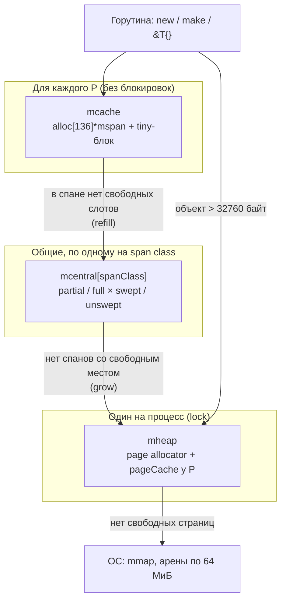
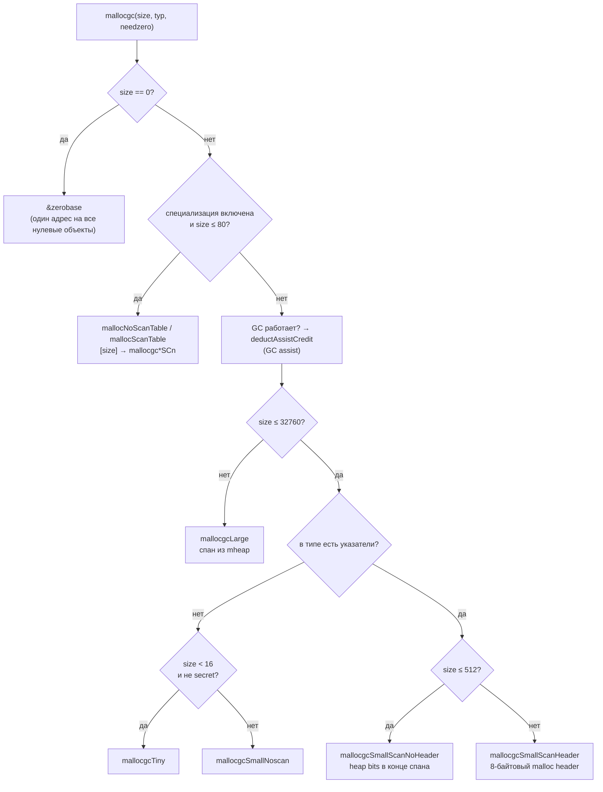
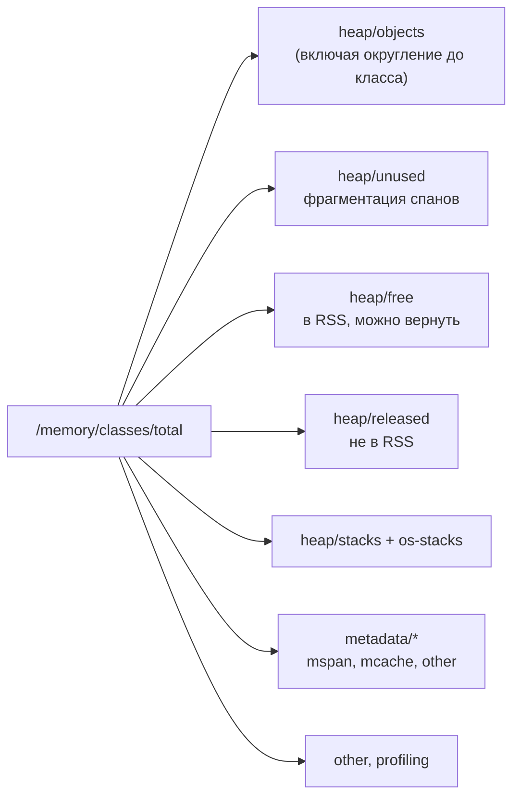
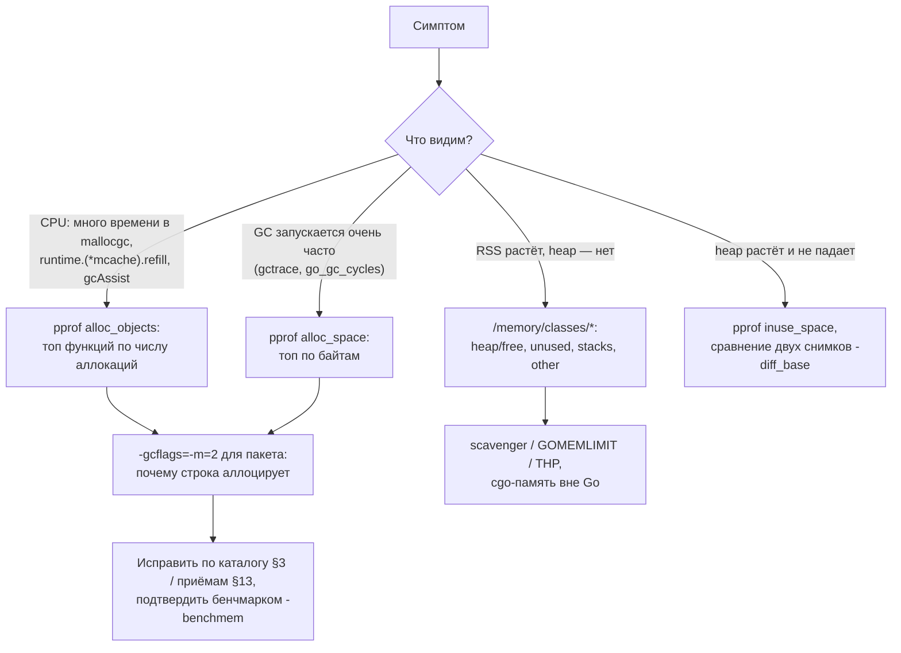

# Go Escape Analysis и аллокатор памяти: Deep Dive для Senior Go-разработчика

> Актуально для **Go 1.27** (релиз — август 2026; последний патч на момент написания — go1.27.0).
> Факты сверены с исходниками ветки `release-branch.go1.27` (тег `go1.27.0`): `src/cmd/compile/internal/escape/*`, `src/cmd/compile/internal/ir/cfg.go`, `src/cmd/compile/internal/walk/builtin.go`, `src/cmd/compile/internal/slice/slice.go`, `src/cmd/compile/internal/ssagen/ssa.go`, `src/runtime/malloc.go`, `malloc_stubs.go`, `malloc_generated.go`, `mcache.go`, `mcentral.go`, `mheap.go`, `mpagealloc.go`, `mpagecache.go`, `mbitmap.go`, `mstats.go`, `src/internal/runtime/gc/sizeclasses.go`, `src/internal/buildcfg/exp.go`, а также с черновиками release notes Go 1.25, 1.26, 1.27 из истории репозитория (`doc/next/*`) и страницей https://go.dev/doc/go1.26.
> Все бенчмарки и выводы команд — **реальные прогоны** на `go1.27.0 darwin/arm64, Apple M3 Pro, GOMAXPROCS=11`. Прогоны одиночные, если не сказано иное; абсолютные наносекунды на вашей машине будут другими, смотрите на `B/op` и `allocs/op` и на порядок разницы.
> Места, где факт не удалось проверить по первоисточнику, помечены **⚠️ не проверено**.

## Оглавление

- [Словарь терминов](#словарь-терминов)
- [TL;DR](#tldr)
- [1. Модель: стек и куча](#1-модель-стек-и-куча)
- [2. Escape analysis: как компилятор решает, где жить переменной](#2-escape-analysis-как-компилятор-решает-где-жить-переменной)
- [3. Почему переменная уезжает в кучу: каталог причин](#3-почему-переменная-уезжает-в-кучу-каталог-причин)
- [4. Новые оптимизации Go 1.25–1.27](#4-новые-оптимизации-go-125127)
- [5. Аллокатор: общая архитектура](#5-аллокатор-общая-архитектура)
- [6. Путь mallocgc по шагам](#6-путь-mallocgc-по-шагам)
- [7. Tiny allocator](#7-tiny-allocator)
- [8. Большие объекты, mheap, page allocator и heap arenas](#8-большие-объекты-mheap-page-allocator-и-heap-arenas)
- [9. Интерфейс между аллокатором и GC](#9-интерфейс-между-аллокатором-и-gc)
- [10. Настройки и параметры](#10-настройки-и-параметры)
- [11. Production: контейнеры и Kubernetes](#11-production-контейнеры-и-kubernetes)
- [12. Наблюдаемость и диагностика](#12-наблюдаемость-и-диагностика)
- [13. Оптимизация: снижение числа аллокаций](#13-оптимизация-снижение-числа-аллокаций)
- [14. Грабли, заблуждения и советы: сводка](#14-грабли-заблуждения-и-советы-сводка)
- [15. Сравнение с другими платформами](#15-сравнение-с-другими-платформами)
- [16. Вопросы для собеседования](#16-вопросы-для-собеседования)
- [17. Чеклист и шпаргалка](#17-чеклист-и-шпаргалка)

## Словарь терминов

| Термин | Что это простыми словами |
|---|---|
| **Стек (stack)** | Память, которая принадлежит одной горутине и устроена как стопка тарелок: функция при вызове кладёт свои переменные сверху, при возврате снимает их. Освобождение бесплатное — достаточно сдвинуть указатель. |
| **Фрейм (stack frame)** | Кусок стека, который занимает один вызов функции: её локальные переменные, аргументы, адрес возврата. |
| **Куча (heap)** | Общая память процесса, из которой объекты выдаются «на неопределённый срок». Освобождает её сборщик мусора (GC), когда объект больше никому не нужен. |
| **Аллокация (allocation)** | Выделение памяти под объект. В Go обычно имеют в виду именно выделение в куче: оно стоит дорого, на стеке — почти ничего. |
| **Escape analysis (анализ побега)** | Проверка, которую делает компилятор при сборке: может ли переменная остаться на стеке, или ссылка на неё «сбежит» за пределы функции, и тогда переменную надо положить в кучу. |
| **«Убегает в кучу» (escapes to heap)** | Вывод escape analysis: объект будет выделен в куче. |
| **Leaking param** | Параметр функции, значение которого (указатель) функция сохраняет куда-то, что живёт дольше вызова: в глобальную переменную, в кучу, в результат. |
| **Встраивание (inlining)** | Компилятор копирует тело маленькой функции прямо в место вызова. Важно для нашей темы: после встраивания escape analysis видит больше и часто оставляет объект на стеке. |
| **`mallocgc`** | Главная функция рантайма, которая выделяет память в куче. Её вызывают `new`, `make`, `&T{}`, `append` при росте, упаковка в интерфейс и т.д. |
| **Size class (размерный класс)** | Одна из 67 фиксированных «ячеек» размера (8, 16, 24, 32, 48, …, 32768 байт). Запрос округляется вверх до ближайшего класса: просили 33 байта — получили 48. |
| **Страница (page)** | Единица учёта памяти в аллокаторе Go: **8 КиБ** (`PageShift = 13`). Не путать со страницей ОС (обычно 4 КиБ). |
| **mspan (спан)** | Непрерывный кусок из одной или нескольких страниц, нарезанный на объекты одного размерного класса. Как лоток для яиц: все ячейки одинаковые. |
| **span class** | Размерный класс + флаг «есть ли в объектах указатели» (scan / noscan). Всего 68 × 2 = 136 вариантов. |
| **scan / noscan** | Объект с указателями (GC должен его просматривать) / без указателей (GC внутрь не заглядывает). Например, `[]byte` — noscan, `[]*User` — scan. |
| **mcache** | Личный кэш спанов у каждого P (логического процессора планировщика). Выделение из него идёт без блокировок. |
| **P (processor)** | Логический процессор планировщика Go; их число равно `GOMAXPROCS`. Горутина выполняет Go-код, только когда её поток держит P. |
| **mcentral** | Общий для всех P склад спанов одного span class. К нему идут, когда в mcache кончилось место. |
| **mheap** | Главный менеджер кучи: раздаёт страницы, хранит метаданные, общается с ОС. |
| **Page allocator** | Часть mheap, которая ищет свободные последовательности страниц (через битовую карту и дерево сводок). |
| **Heap arena** | Регион адресного пространства в **64 МиБ** (на 64-битных Linux/macOS), которым куча прирастает. У каждой арены есть свои метаданные. |
| **Tiny allocator** | Отдельный механизм для очень маленьких (< 16 байт) объектов без указателей: несколько таких объектов упаковываются в один 16-байтовый блок. |
| **Большой объект (large object)** | Объект больше 32760 байт. Получает собственный спан прямо из mheap, минуя mcache и mcentral. |
| **Malloc header** | 8-байтовый заголовок с указателем на тип, который рантайм с Go 1.22 ставит в начало объектов с указателями размером больше 512 байт, чтобы GC знал, где в объекте указатели. |
| **Heap bits** | Битовая карта «где в объекте указатели» для мелких (≤ 512 байт) объектов с указателями; хранится в конце спана. |
| **Sweep (подметание)** | Фаза GC, когда рантайм проходит по спанам и помечает свободными слоты объектов, которые не пометил маркер. Частично выполняется прямо при аллокации. |
| **GC assist** | Механизм, при котором горутина, много аллоцирующая во время работы GC, вынуждена сама помогать маркировать. Это «налог» за аллокации во время цикла GC. |
| **Scavenger** | Фоновая задача рантайма, которая возвращает ОС неиспользуемые страницы. |
| **RSS** | Resident Set Size — сколько физической памяти процесс реально занимает. Именно его видит OOM killer в Kubernetes. |
| **`-gcflags=-m`** | Флаг компилятора, который печатает решения escape analysis и встраивания. |
| **GOEXPERIMENT** | Переменная окружения при сборке, которая включает/выключает экспериментальные возможности тулчейна. |

## TL;DR

1. **Где живёт переменная — решает компилятор, а не синтаксис.** `new(T)` и `&T{}` могут остаться на стеке, а `var x T` — уехать в кучу. Узнать решение можно только через `go build -gcflags=-m`.
2. Escape analysis — **статический** анализ при компиляции: строится граф присваиваний, и если адрес переменной может «пережить» её фрейм или попасть в кучу, переменная идёт в кучу (`src/cmd/compile/internal/escape/escape.go`).
3. Самые частые причины побега: возврат указателя, упаковка значения в интерфейс (в том числе `fmt.*`, `slog` с `...any`), передача указателя в метод интерфейса, захват переменной замыканием или горутиной, указатель на переменную цикла, размер больше лимита.
4. Лимиты стека в компиляторе (`ir/cfg.go`): явная переменная — до **128 КиБ**, неявная (`new`, `&T{}`, `make` с константой) — до **64 КиБ**. Флаг `-smallframes` снижает их до 64 и 16 КиБ.
5. **Go 1.25**: `make([]T, n)` с неизвестным `n` может разместить массив на стеке, если он помещается в **32 байта** (`VariableMakeThreshold = 32`).
6. **Go 1.26**: `append` в локальный слайс использует 32-байтовый буфер на стеке, а перед `return s` компилятор вставляет перенос в кучу (`moveSlice`). На практике: `Collect(3)` — 1 аллокация вместо 3.
7. **Go 1.27**: компилятор напрямую вызывает специализированные по размеру функции выделения памяти (`mallocgcSmallNoScanSC2` и т.п.) для объектов ≤ **80 байт**. На микробенчмарке `new(T)` ускорился на 43 %. Отключение — `GOEXPERIMENT=nosizespecializedmalloc`.
8. Аллокатор происходит от tcmalloc: **mcache (на P, без блокировок) → mcentral (на span class) → mheap (страницы) → ОС**. Чем выше по иерархии, тем реже и дороже.
9. Размер запроса округляется до одного из **67 размерных классов**; 33 байта стоят 48 байт (проверено: `48 B/op`). Порядок полей структуры может перевести её в меньший класс (48 → 32 байта).
10. Объекты < 16 байт без указателей идут в **tiny allocator** и делят блок с соседями. Поэтому `AddCleanup` или финализатор на таком объекте может **не выполниться никогда**: в эксперименте 0 из 750.
11. Объекты > **32760 байт** — «большие»: отдельный спан из mheap, размер округляется до 8 КиБ-страниц (33000 байт → 40960 байт).
12. Аллокация во время GC стоит дороже: горутина платит **GC assist**, новый объект сразу помечается «чёрным», а спаны подметаются прямо при выделении.
13. Для диагностики есть `pprof` с `-sample_index=alloc_objects` (кто чаще аллоцирует — это нагрузка на CPU) и `alloc_space` (кто больше байт — это нагрузка на GC-цикл), `runtime/metrics` `/gc/heap/allocs:objects` и Prometheus `go_memstats_mallocs_total`.
14. Самый дешёвый способ убрать аллокацию в горячем пути — не дать значению попасть в `interface{}`: выключенный `slog.Debug` с `...any` всё равно стоит **2 аллокации**, с `if logger.Enabled(...)` — 0.

## 1. Модель: стек и куча

### Простыми словами

Представьте кухню ресторана. **Стек** — это разделочная доска повара: он кладёт на неё продукты для текущего блюда, а когда блюдо готово, одним движением смахивает всё. Убирать доску ничего не стоит. **Куча** — это общий холодильник: туда кладут то, что понадобится потом и, возможно, другим поварам. Холодильник надо периодически разбирать и выбрасывать испорченное, это делает уборщик (сборщик мусора). Чем больше вы кладёте в холодильник, тем чаще и дольше работает уборщик.

Компилятор Go старается держать всё «на доске». В «холодильник» объект попадает только тогда, когда компилятор не может доказать, что после завершения функции на него никто не сошлётся.

### 1.1. Стек горутины

У каждой горутины свой стек. Начинается он с **2 КиБ** (`stackMin = 2048`, `src/runtime/stack.go`) и растёт по мере надобности: когда функции не хватает места, рантайм выделяет стек вдвое больше и **копирует** туда старый, исправляя указатели внутри стека. Максимум — `maxstacksize = 1000000000` байт (≈ 1 ГБ) на 64-битных платформах (`src/runtime/proc.go`); при превышении программа падает с сообщением `runtime: goroutine stack exceeds 1000000000-byte limit` и `fatal error: stack overflow`.

Из этого следуют два ограничения:

1. **Указатель из кучи на стек запрещён.** Стек может переехать при росте, а рантайм исправляет указатели только внутри самого стека. Если бы объект в куче хранил адрес стековой переменной, после копирования адрес стал бы неверным.
2. **Указатель на стековую переменную не должен пережить её фрейм.** После возврата из функции её фрейм перезаписывается следующими вызовами.

Это ровно два инварианта, которые обеспечивает escape analysis. Так написано в шапке `src/cmd/compile/internal/escape/escape.go`:

> «(1) pointers to stack objects cannot be stored in the heap, and (2) pointers to a stack object cannot outlive that object».

Сами стеки тоже лежат в памяти, которую выдаёт аллокатор кучи (спаны специального типа). Поэтому в `runtime/metrics` есть отдельная строка `/memory/classes/heap/stacks:bytes`.

### 1.2. Чем платят за кучу

| | Стек | Куча |
|---|---|---|
| Выделение | сдвиг указателя стека, часто уже учтён в прологе функции | вызов `mallocgc`: выбор класса, поиск слота, обнуление, учёт, возможно GC assist |
| Освобождение | бесплатно при возврате | работа GC: маркировка, подметание |
| Влияние на GC | стек сканируется только как корень | каждый байт приближает следующий цикл GC; объекты с указателями ещё и сканируются |
| Локальность кэша | отличная, фрейм «горячий» | хуже, объект может лежать далеко |
| Кто решает | компилятор | компилятор (если не доказал, что можно на стек) |

Пример цены из прогона (§3.1): возврат `*User` — `7.4 ns/op, 24 B/op, 1 allocs/op`; возврат `User` по значению — `2.0 ns/op, 0 B/op`. Разница в 3,6 раза на одной структуре из двух полей, а в production это ещё и дополнительная нагрузка на GC.

> **Заблуждение:** «`new(T)` и `&T{}` всегда выделяют память в куче, а `var x T` — на стеке». На самом деле в Go нет связи между синтаксисом и местом размещения. Спецификация языка вообще не говорит о стеке и куче, это деталь реализации. Заблуждение пришло из C/C++, где `new`/`malloc` действительно означают кучу. Проверка:

```go
func SumNew() int {
	p := new(int)
	*p = 42
	return *p
}

func NewUserPtr(id int64) *User {
	u := User{ID: id, Name: "alice"} // обычная var-переменная
	return &u
}
```

```text
esc/esc.go:30:10: new(int) does not escape
esc/esc.go:17:2: moved to heap: u
```

`new(int)` остался на стеке, а «обычная» переменная `u` уехала в кучу, потому что наружу возвращается её адрес.

### Что важно для Senior

- Место размещения определяется доказуемым временем жизни ссылок, а не ключевым словом. Аргументируйте только выводом `-gcflags=-m`.
- Два инварианта: нет указателей «куча → стек» и нет указателей, переживающих фрейм. Из них выводятся почти все правила §3.
- Стек растёт копированием, поэтому стековые адреса нестабильны. Это одна из причин, почему `unsafe`-код с `uintptr` на стековые данные опасен.
- Аллокация стоит дважды: сейчас (`mallocgc`) и потом (GC). Поэтому смотрят и на `allocs/op`, и на `B/op`.

## 2. Escape analysis: как компилятор решает, где жить переменной

### Простыми словами

Компилятор рисует схему «кто кому передаёт адрес». Каждая переменная — кружок, каждое присваивание — стрелка. Потом он смотрит: можно ли по стрелкам дойти от переменной до чего-то «вечного» — глобальной переменной, кучи, возвращаемого значения? Если можно, переменная уезжает в кучу. Если все пути заканчиваются внутри функции, она остаётся на стеке.

### 2.1. Граф «местоположений»

Алгоритм описан в комментарии к `src/cmd/compile/internal/escape/escape.go`:

1. Каждая переменная и каждое неявное выделение (`new`, `make`, составной литерал, замыкание) — это **location** (вершина графа).
2. Каждое присваивание — **ребро** с весом `derefs` = (число разыменований) − (число взятий адреса):

```text
p = &q    // derefs = -1  (взяли адрес)
p = q     // derefs =  0
p = *q    // derefs =  1
p = **q   // derefs =  2
```

3. Анализ **нечувствителен к полям и элементам**: `x.f = u[0]` моделируется просто как `x = *u`. Компилятор не различает `x.f` и `x.g`, `u[0]` и `u[1]`.
4. Затем решатель (`solve.go`) обходит граф от «опасных» вершин: куча (`heapLoc`), результаты функции, переменные из внешнего цикла. Если вершина с `derefs = -1` (то есть адрес) достижима из места, которое её «переживает» (`outlives`), она помечается как убегающая.

Функция `outlives` (`solve.go`) перечисляет случаи, когда одно место живёт дольше другого:

| Случай | Пример из комментария в исходнике |
|---|---|
| куча переживает всё | `global = &x` |
| результат функции переживает её локальные переменные | `return &u` |
| переменная, объявленная снаружи цикла, переживает переменные внутри цикла | `var l *int; for { l = new(int) }` → `new(int)` в куче |
| переменная внешней функции переживает переменные замыкания | `var l *int; func() { l = new(int) }()` (если замыкание не встроено) |

Исключение: если замыкание вызывается сразу и все его вызовы известны, возврат адреса внешней переменной из замыкания её в кучу не отправляет.

### 2.2. Межпроцедурность: теги параметров

Анализ идёт **снизу вверх по графу вызовов** (`ir.VisitFuncsBottomUp`): сначала анализируются вызываемые функции, потом вызывающие. Для каждой функции компилятор сохраняет сводку «куда утекают параметры» — тип `leaks` (`leaks.go`): массив из 8 байт, где хранится минимальный `derefs` для потоков параметра в кучу, в «мутатор», в вызываемую функцию и в первые 5 результатов.

Эта сводка попадает в объектный файл и используется при компиляции вызывающих пакетов. Поэтому escape analysis работает через границы пакетов, но только для **статических** вызовов. Если вызов идёт через интерфейс или через значение-функцию, компилятор не знает, какая функция будет вызвана, и пессимистично считает, что аргументы утекают в кучу (§3.3).

### 2.3. Как читать `-gcflags=-m`

```bash
go build -gcflags=-m ./pkg          # решения только для ./pkg
go build -gcflags='-m -m' ./pkg     # то же, что -m=2: с объяснением цепочки
go build -gcflags=all=-m ./...      # для всех пакетов, включая зависимости и stdlib
```

Реальный вывод для тестового пакета (`esc/esc.go`):

```text
esc/esc.go:17:2: moved to heap: u
esc/esc.go:30:10: new(int) does not escape
esc/esc.go:37:13: ... argument does not escape
esc/esc.go:37:14: id escapes to heap
esc/esc.go:42:2: moved to heap: n
esc/esc.go:43:9: func literal escapes to heap
esc/esc.go:56:11: make([]byte, 64) does not escape
esc/esc.go:61:11: make([]byte, n) does not escape
esc/esc.go:67:6: moved to heap: a
esc/esc.go:72:10: new([102400]byte) escapes to heap
esc/esc.go:79:12: leaking param: u
esc/esc.go:81:15: leaking param: u to result ~r0 level=1
esc/esc.go:87:13: append escapes to heap
esc/esc.go:98:39: &User{...} escapes to heap
esc/esc.go:101:14: &User{...} does not escape
```

Словарь сообщений:

| Сообщение | Что значит |
|---|---|
| `moved to heap: x` | именованная переменная `x` размещена в куче |
| `X escapes to heap` | неявное выделение (литерал, `new`, `make`, упаковка в интерфейс) идёт в кучу |
| `X does not escape` | остаётся на стеке |
| `leaking param: p` | функция сохраняет сам указатель `p` туда, что её переживает; у вызывающего аргумент уедет в кучу |
| `leaking param content: p` | утекает не `p`, а то, на что он указывает (например, элементы слайса) |
| `leaking param: p to result ~r0 level=1` | `p` (с одним разыменованием) попадает в результат: аргумент уедет в кучу, только если в куче окажется результат |
| `... argument does not escape` | сам скрытый слайс для вариадических аргументов остался на стеке (но элементы могут убежать, см. `id escapes to heap`) |
| `zero-copy string->[]byte conversion` | `[]byte(s)` без копирования: компилятор доказал, что байты не меняются (Go 1.22+) |

С `-m=2` компилятор показывает **цепочку**, из-за которой объект убежал. Это главное средство, когда непонятно, почему переменная в куче:

```text
esc/esc.go:37:14: id escapes to heap in PrintID:
esc/esc.go:37:14:   flow: {storage for ... argument} ← &{storage for id}:
esc/esc.go:37:14:     from id (spill) at esc/esc.go:37:14
esc/esc.go:37:14:     from ... argument (slice-literal-element) at esc/esc.go:37:13
esc/esc.go:37:14:   flow: fmt.a ← &{storage for ... argument}:
esc/esc.go:37:14:     from ... argument (spill) at esc/esc.go:37:13
esc/esc.go:37:14:     from fmt.a := ... argument (assign-pair) at esc/esc.go:37:13
esc/esc.go:37:14:   flow: {heap} ← *fmt.a:
esc/esc.go:37:14:     from fmt.Fprintln(os.Stdout, fmt.a...) (call parameter) at esc/esc.go:37:13
```

Читается снизу вверх: `fmt.Fprintln` отправляет содержимое `a` в кучу, `a` — это скрытый слайс аргументов, в слайс положен `id`, упакованный в интерфейс. Итог — `id` копируется в кучу.

### 2.4. Встраивание меняет ответ

Escape analysis работает **после** встраивания. Конструктор, который сам по себе отправляет объект в кучу, после встраивания в вызывающую функцию может оставить его на стеке:

```go
func NewUser(id int64) *User { return &User{ID: id} }

func UseInlined() int64 {
	u := NewUser(7)
	return u.ID
}
```

```text
esc/esc.go:101:14: inlining call to NewUser
esc/esc.go:98:39: &User{...} escapes to heap        // в теле NewUser
esc/esc.go:101:14: &User{...} does not escape       // после встраивания в UseInlined
```

**Грабли: в бенчмарке 0 аллокаций, в production — 1**

Почему так: в бенчмарке функция встроилась, и escape analysis увидел, что результат не уходит дальше. В production та же функция вызывается через интерфейс, оказалась слишком «дорогой» для встраивания после правки или вызывается из другого контекста, где результат сохраняется в структуру. Как заметить: `-gcflags=-m` в месте **реального** вызова (а не только в бенчмарке), профиль `alloc_objects` в production (§12.4). Как исправить: проверять escape в том контексте, где код работает; для горячих конструкторов держать функцию маленькой (бюджет встраивания — 80 «узлов», константа `inlineMaxBudget` в `src/cmd/compile/internal/inline/inl.go`; для горячих по PGO-профилю функций — `inlineHotMaxBudget = 2000`). Стоимость функции и причину отказа во встраивании показывает `-gcflags=-m=2`. Реальные строки из прогона:

```text
iface/iface.go:6:6: can inline WriteHeader with cost 72 as: func(io.Writer, byte) { buf := make([]byte, 16); buf[0] = code; w.Write(buf) }
iface/iface.go:24:6: cannot inline StartWorker: unhandled op GO
esc/esc.go:16:6: cannot inline NewUserPtr: marked go:noinline
```

`WriteHeader` со стоимостью 72 — на грани: добавьте пару строк, и она перестанет встраиваться.

### 2.5. Почему статический и «грубый» анализ

- **Альтернатива — анализ в рантайме** (как в JIT JVM: escape analysis + scalar replacement после профилирования). Go компилируется заранее и не имеет JIT, поэтому всё решается при сборке.
- **Нечувствительность к полям и путям выполнения** — сознательный компромисс: анализ должен быть быстрым (Go гордится скоростью компиляции) и предсказуемым. Цена — ложные срабатывания: если одно поле структуры убегает, убегает вся структура; если адрес убегает в редкой ветке `if`, объект в куче всегда.
- **Пессимизм на динамических вызовах** — плата за отсутствие межпроцедурной информации о том, кто реализует интерфейс. Частично компенсируется девиртуализацией (компилятор доказал конкретный тип) и PGO-девиртуализацией горячих вызовов.

### Что важно для Senior

- Escape analysis — это граф присваиваний с весами `derefs` и проверка «кто кого переживает». Он не различает поля и пути выполнения, поэтому один «утекающий» путь делает утекающим весь объект.
- Результаты передаются между пакетами через теги параметров, но только для статических вызовов. Интерфейс и функция-значение — «чёрный ящик», аргумент утекает.
- `-m=2` показывает цепочку `flow:`. Читайте её снизу вверх, чтобы найти настоящую причину.
- Решение зависит от встраивания. Проверяйте в реальном контексте вызова и помните, что `-l` (отключить встраивание) меняет картину.

## 3. Почему переменная уезжает в кучу: каталог причин

### Простыми словами

Есть ограниченный набор ситуаций, когда компилятор говорит «не могу доказать, что безопасно». Если знать этот список, большую часть лишних аллокаций видно прямо при чтении кода, без профилировщика.

| # | Причина | Пример | Сообщение `-m` | Как избежать (если нужно) |
|---|---|---|---|---|
| 1 | Возврат адреса локальной переменной | `return &u` | `moved to heap: u` | вернуть значение, если структура небольшая |
| 2 | Упаковка в интерфейс с последующим сохранением | `fmt.Println(id)`, `slog.Info("", "id", id)` | `id escapes to heap` | типизированные API: `strconv.AppendInt`, `slog.Int64` |
| 3 | Аргумент метода интерфейса | `w.Write(buf)` с `w io.Writer` | `make([]byte, 16) escapes to heap` | конкретный тип в горячем пути, переиспользование буфера |
| 4 | Захват замыканием, которое переживает функцию | `return func() { n++ }`, `go func() { x++ }()` | `moved to heap: n`, `func literal escapes to heap` | передать значение аргументом |
| 5 | Адрес переменной цикла | `out = append(out, &v)` | `moved to heap: v` | `&items[i]` |
| 6 | Слишком большой объект | `var a [200<<10]byte` | `moved to heap: a` (`-m=2`: `too large for stack`) | переиспользовать буфер, `sync.Pool` |
| 7 | Размер неизвестен при компиляции и больше 32 байт | `make([]byte, n)` | `does not escape`, но в рантайме при `n > 32` — куча | преаллокация с известной ёмкостью, пул |
| 8 | Сохранение в глобальную переменную, кучу, канал, map | `global = u`, `ch <- &x`, `m[k] = &x` | `leaking param: u` | — (это и есть «долгоживущий» объект) |
| 9 | Рост слайса через `append`, если слайс возвращается или сохраняется | `return s` после `append` | `append escapes to heap` | `make(..., 0, n)` |

Ниже — подробности по пунктам, где есть неочевидное.

### 3.1. Возврат указателя против возврата значения

```go
//go:noinline
func NewUserPtr(id int64) *User {
	u := User{ID: id, Name: "alice"}
	return &u
}

//go:noinline
func NewUserVal(id int64) User {
	return User{ID: id, Name: "alice"}
}
```

```text
BenchmarkReturnPtr-11        	162230059	         7.385 ns/op	      24 B/op	       1 allocs/op
BenchmarkReturnVal-11        	586425590	         2.037 ns/op	       0 B/op	       0 allocs/op
```

`User` — 24 байта (`int64` + `string`), копировать их дешевле, чем выделять в куче.

> **Совет.** Возвращайте небольшие структуры (до нескольких машинных слов, ориентировочно до 64–128 байт) по значению, когда вызывающему не нужна общая изменяемая копия. Эффект: 7.4 → 2.0 ns/op и 1 → 0 allocs/op на 24-байтовой структуре. Не нужно, если объект по смыслу общий (кэш, соединение, мьютекс внутри — `sync.Mutex` копировать нельзя, `go vet` предупредит), если структура большая (сотни байт копируются при каждом вызове) или если конструктор встраивается и объект и так остаётся на стеке (§2.4).

> **Заблуждение:** «Возвращать указатель быстрее, ведь не надо копировать структуру». Для маленьких структур копирование — несколько инструкций, а аллокация в куче — вызов рантайма плюс будущая работа GC. Указатель выгоден для больших структур и для разделяемого состояния.

### 3.2. Интерфейсы: упаковка значения

Когда значение кладут в переменную типа интерфейс (`any`, `error`, `fmt.Stringer`), интерфейс хранит **указатель** на данные. Если значение не помещается прямо в слово интерфейса (то есть не является указателем), рантайм копирует его в кучу (функции `convT64`, `convTstring`, `convT` в `src/runtime/iface.go`) — если escape analysis не доказал, что интерфейс не убегает.

Исключения, когда упаковка бесплатна:

- константы и значения нулевого размера;
- целые числа **0–255**: рантайм отдаёт указатель на заранее выделенный массив `staticuint64s` (`iface.go`, с Go 1.15);
- указатели, каналы, map, функции — они и так одно слово.

```go
var small int64 = 200
var big int64 = 100500

func BenchmarkBoxSmallInt(b *testing.B) { for b.Loop() { sinkAny = small } }
func BenchmarkBoxBigInt(b *testing.B)   { for b.Loop() { sinkAny = big } }
```

```text
BenchmarkBoxSmallInt-11      	618955112	         1.948 ns/op	       0 B/op	       0 allocs/op
BenchmarkBoxBigInt-11        	189006836	         6.362 ns/op	       8 B/op	       1 allocs/op
```

**Грабли: бенчмарк с маленькими ID не показывает аллокаций**

Если в тестовых данных `userID = 1..100`, упаковка в `any` не аллоцирует, и вы делаете вывод «`fmt`/`slog` бесплатны». В production ID шестизначные, и каждый вызов даёт аллокацию. Как заметить: `alloc_objects` в профиле production указывает на `runtime.convT64`. Как исправить: в бенчмарках использовать реалистичные значения (> 255).

### 3.3. Аргумент метода интерфейса

```go
func WriteHeader(w io.Writer, code byte) {
	buf := make([]byte, 16)
	buf[0] = code
	w.Write(buf)
}

func WriteHeaderConcrete(w *CountWriter, code byte) {
	buf := make([]byte, 16)
	buf[0] = code
	w.Write(buf)
}
```

```text
iface/iface.go:7:13: make([]byte, 16) escapes to heap
iface/iface.go:18:13: make([]byte, 16) does not escape

BenchmarkWriteIface-11       	176736428	         6.864 ns/op	      16 B/op	       1 allocs/op
BenchmarkWriteConcrete-11    	630529033	         1.933 ns/op	       0 B/op	       0 allocs/op
```

Компилятор не знает, какая реализация `Write` будет вызвана. Реализация вправе сохранить `p` (хотя документация `io.Writer` это запрещает, компилятор документацию не читает), поэтому `buf` уезжает в кучу. С конкретным типом компилятор видит тело `Write` и доказывает, что `p` не утекает.

> **Совет.** В горячем пути, где через интерфейс передаются временные буферы (кодеки, `io.Writer` в сериализации), переиспользуйте один буфер на уровне структуры или пула, а не создавайте новый на каждый вызов. Эффект: 1 → 0 allocs/op. Не нужно, если вызов редкий (раз на запрос) — 16 байт на запрос не видны на фоне остального.

### 3.4. Замыкания и горутины

```go
func Counter() func() int {
	n := 0
	return func() int { n++; return n }
}

func StartWorker(jobs <-chan int) *int {
	processed := 0
	go func() {
		for range jobs {
			processed++
		}
	}()
	return nil
}
```

```text
esc/esc.go:42:2: moved to heap: n
esc/esc.go:43:9: func literal escapes to heap
iface/iface.go:25:2: moved to heap: processed
iface/iface.go:26:5: func literal escapes to heap
```

`-m=2` уточняет: `Counter capturing by ref: n (addr=false assign=true width=8)`. Переменная, которую замыкание **изменяет**, захватывается по ссылке и уезжает в кучу вместе с объектом замыкания. Горутина всегда переживает функцию, которая её запустила, поэтому всё, что она захватывает по ссылке, уходит в кучу.

Замыкание, которое вызывается на месте и не сохраняется, остаётся на стеке (в примере `Local()` оно вообще встроилось: `inlining call to Local.func1`).

### 3.5. Адрес переменной цикла (Go 1.22+)

С Go 1.22 у каждой итерации `for` **своя** переменная цикла. Это исправило классический баг «все указатели смотрят на последний элемент», но если взять адрес переменной цикла, каждая итерация даёт отдельную аллокацию:

```go
func PtrsToLoopVar(items []Item) []*Item {
	out := make([]*Item, 0, len(items))
	for _, v := range items {
		out = append(out, &v)
	}
	return out
}

func PtrsToElems(items []Item) []*Item {
	out := make([]*Item, 0, len(items))
	for i := range items {
		out = append(out, &items[i])
	}
	return out
}
```

```text
loopvar/l.go:11:9: moved to heap: v

BenchmarkPtrsToLoopVar-11    	 1000000	      1055 ns/op	    3296 B/op	     101 allocs/op
BenchmarkPtrsToElems-11      	 7783800	       150.1 ns/op	     896 B/op	       1 allocs/op
```

**Грабли: `&v` в цикле — 100 лишних аллокаций на 100 элементов**

Почему так: каждая `v` — копия элемента, на которую взят адрес, а `out` возвращается наружу. Как заметить: `moved to heap: v` в `-m`; линтеры не ругаются (код корректен). Как исправить: `&items[i]`, если нужны указатели на исходные элементы; если нужны именно копии — это осознанные аллокации. Важно: семантика разная — `&items[i]` указывает на элемент исходного слайса, изменения через него видны в `items`.

До Go 1.22 переменная цикла была одна на весь цикл: она уезжала в кучу один раз, а все указатели в `out` оказывались одинаковыми. Это была логическая ошибка, а не оптимизация.

### 3.6. Лимиты размера

Константы из `src/cmd/compile/internal/ir/cfg.go`:

| Константа | Значение | К чему применяется | С `-gcflags=-smallframes` |
|---|---|---|---|
| `MaxStackVarSize` | 128 КиБ | явные переменные: `var x T`, `x := ...` | 64 КиБ |
| `MaxImplicitStackVarSize` | 64 КиБ | `new(T)`, `&T{}`, `make([]T, const)`, `[]byte("...")`, замыкания, method values | 16 КиБ |
| `VariableMakeThreshold` (`base/flag.go`) | 32 байта | `make([]T, n)` с неконстантным `n` и буфер для `append` (§4) | — |

Проверка (`-m=2`):

```text
esc/esc.go:67:6: a escapes to heap in BigVar:
esc/esc.go:67:6:   flow: {heap} ← &a:
esc/esc.go:67:6:     from a (too large for stack) at esc/esc.go:67:6
esc/esc.go:67:6: moved to heap: a
esc/esc.go:72:10: new([102400]byte) escapes to heap in BigNew:
esc/esc.go:72:10:     from new([102400]byte) (too large for stack) at esc/esc.go:72:10
```

Ещё одна причина из `HeapAllocReason` (`escape/utils.go`) — `too aligned for stack`: тип, требующий выравнивания больше размера указателя.

Почему лимиты вообще есть: огромный фрейм заставит стек горутины вырасти (с копированием) при каждом вызове и будет держать память, пока горутина жива. Большой объект в куче хотя бы освободится сборщиком.

### 3.7. `[]byte(s)` и `string(b)`

С Go 1.22 компилятор умеет **не копировать** строку при `[]byte(s)`, если доказал, что срез только читается и не убегает:

```text
iface/iface.go:36:14: ([]byte)(s) does not escape
iface/iface.go:36:14: zero-copy string->[]byte conversion

BenchmarkBytesShort-11       	625021022	         1.925 ns/op	       0 B/op	       0 allocs/op
BenchmarkBytesLong-11        	624318776	         1.916 ns/op	       0 B/op	       0 allocs/op
```

Обе строки (8 и 52 байта) обработаны за одинаковое время без аллокаций. Если же срез изменяется или сохраняется, копия неизбежна. Для коротких неубегающих результатов (до 32 байт, `tmpStringBufSize` в `src/runtime/string.go`) рантайм использует буфер на стеке вызывающего.

### Что важно для Senior

- Держите в голове таблицу из 9 причин. Большинство лишних аллокаций в сервисах — это №2 (интерфейсы в логировании и метриках) и №3 (буферы через `io.Writer`).
- Упаковка в интерфейс бесплатна для 0–255, констант и указателей. Бенчмарки с маленькими числами врут.
- С Go 1.22 `&v` в цикле — по аллокации на итерацию. Код корректен, но может быть дорогим.
- Лимиты стека: 128 КиБ / 64 КиБ / 32 байта для неизвестного размера. Большие локальные буферы молча уезжают в кучу.

## 4. Новые оптимизации Go 1.25–1.27

### Простыми словами

Раньше правило было простым: размер неизвестен при компиляции — значит, куча. За последние три релиза компилятор научился «подстилать соломку»: заводит на стеке маленький буфер на 32 байта и пользуется им, если данные поместились. Если не поместились, всё работает как раньше. А в Go 1.27 ускорили саму функцию выделения памяти для маленьких объектов.

| Версия | Что изменилось | Где в коде | Как отключить |
|---|---|---|---|
| 1.25 | `make([]T, n)` с неконстантным `n`: если `cap ≤ 32/sizeof(T)`, массив на стеке | `walk/builtin.go` (`walkMakeSlice`), `escape/utils.go` | `-gcflags=all=-d=variablemakehash=n` |
| 1.26 | `append` в неубегающий слайс использует 32-байтовый стековый буфер; перед `return s` вставляется перенос в кучу (`moveSlice*`) | `slice/slice.go`, `ssagen/ssa.go`, `runtime/slice.go` (`growsliceBuf`, `moveSlice*`) | `-gcflags=all=-d=variablemakehash=n` |
| 1.27 | Компилятор вызывает специализированные по размерному классу функции выделения для объектов ≤ 80 байт | `ssagen/ssa.go` (`specializedMallocSym`), `runtime/malloc_generated.go` | `GOEXPERIMENT=nosizespecializedmalloc` (обещают убрать в 1.28) |
| 1.26–1.27, выключено | `GOEXPERIMENT=runtimefreegc`: компилятор и рантайм освобождают память «вручную» в отдельных случаях (`freegc`) | `runtime/malloc.go`, `runtime/slice.go` | по умолчанию выключено |

Версии найдены через `git log -S` и `git tag --contains`: коммит `2c9689ab0e` (variable make, `go1.25rc1`), `32f5aadd2f` «cmd/compile: stack allocate backing stores during append» (`go1.26rc1`), `2a93576965` «enable SizeSpecializedMalloc by default» (`go1.27rc1`; в 1.26 эксперимент был выключен коммитом `4af8ad24ee`).

### 4.1. Go 1.25: `make` с переменным размером

Компилятор переписывает `make([]T, n)` (если слайс не убегает) в гибрид. Так это описано в комментарии `escape/utils.go`:

```go
// if cap <= K {
//     var backing [K]E
//     s = backing[:len:cap]
// } else {
//     s = makeslice(E, len, cap)
// }
```

где `K = 32 / sizeof(E)` (`base.Debug.VariableMakeThreshold = 32`). Для `[]byte` это 32 элемента, для `[]int64` — 4.

```go
func MakeVar(n int) int {
	b := make([]byte, n)
	return len(b)
}
```

```text
BenchmarkMakeVar16-11        	579348518	         2.014 ns/op	       0 B/op	       0 allocs/op
BenchmarkMakeVar32-11        	603417099	         2.000 ns/op	       0 B/op	       0 allocs/op
BenchmarkMakeVar33-11        	139614553	         8.587 ns/op	      48 B/op	       1 allocs/op
```

Граница ровно на 32 байтах. И обратите внимание: 33 байта стоят **48 B/op** — это округление до размерного класса (§5.2).

Из release notes 1.25 (дословно): «This change has the potential to amplify the effects of incorrect unsafe.Pointer usage, see for example issue 73199». Код, который через `unsafe` полагался на то, что такой массив лежит в куче (не двигается, выровнен как результат `mallocgc`), может сломаться. Компилятор частично страхуется: стековый буфер обёрнут в структуру с полем `[0]uintptr`, чтобы выровнять его по указателю (комментарий про issue 73199 в `walk/builtin.go`). Для поиска виноватого места release notes советуют `bisect` с флагом `-compile=variablemake`.

### 4.2. Go 1.26: стековый буфер для `append` и перенос в кучу при возврате

Комментарий в `src/cmd/compile/internal/slice/slice.go` объясняет идею. В цикле

```go
var s []int
for i := range n {
	s = append(s, i)
}
return s
```

`append` при росте вызывает `growslice` на 1-м, 2-м, 4-м, 8-м… элементе, и все промежуточные массивы сразу становятся мусором. Если компилятор доказал, что `return s` — **единственный** способ, которым массив покидает функцию, он переписывает код так:

```go
var s []int            // append пишет в стековый буфер, пока помещается
for i := range n {
	s = append(s, i)
}
s = move2heap(s)       // если s в стековом буфере — скопировать в кучу
return s
```

Ключевое понятие — **«эксклюзивная» переменная-слайс**: только она ссылается на стековый буфер. Операции, которые сохраняют эксклюзивность, перечислены в белом списке: `s = nil`, `s = append(s, ...)`, `s = s[i:j]`, `s[i]`, `s[i] = ...`, `f(s)` с неутекающим параметром. **Всё остальное** (присваивание другой переменной, `return`, передача в утекающий параметр) считается переходом в «неэксклюзивное» состояние, и перед ним вставляется `move2heap`.

Замер (функции помечены `//go:noinline`, чтобы не встроились):

```text
== по умолчанию (1.27.0)
BenchmarkCollect3-11         	100000000	        12.15 ns/op	      24 B/op	       1 allocs/op
BenchmarkCollect100-11       	 1774005	       701.2 ns/op	    1984 B/op	       5 allocs/op
== -gcflags='example.com/alloc/collect=-d=variablemakehash=n'
BenchmarkCollect3-11         	29219178	        46.49 ns/op	      56 B/op	       3 allocs/op
BenchmarkCollect100-11       	 1466500	       799.3 ns/op	    2040 B/op	       8 allocs/op
```

Для трёх элементов — одна аллокация (финальная копия 24 байта) вместо трёх (8 + 16 + 32). Для 100 элементов — 5 вместо 8: первые шаги роста прошли в стековом буфере. В ассемблере видно, что компилятор вставил вызов `runtime.moveSliceNoCapNoScan` перед возвратом.

**Грабли: `range` по слайсу отключает выигрыш (найдено при проверке)**

```go
//go:noinline
func SumConstLoop() int {
	var s []int
	for i := 0; i < 3; i++ {
		s = append(s, i)
	}
	t := 0
	for _, v := range s { // range не в белом списке
		t += v
	}
	return t
}

//go:noinline
func SumIndexLoop() int {
	var s []int
	for i := 0; i < 3; i++ {
		s = append(s, i)
	}
	t := 0
	for i := 0; i < len(s); i++ { // индексация в белом списке
		t += s[i]
	}
	return t
}
```

```text
BenchmarkRangeOverSlice-11    	96362314	        12.38 ns/op	      24 B/op	       1 allocs/op
BenchmarkIndexLoop-11         	226904936	         5.262 ns/op	       0 B/op	       0 allocs/op
```

Почему так: `-m` в обоих случаях пишет `append does not escape`, но в первом варианте компилятор вставил `runtime.moveSliceNoCapNoScan` перед циклом `range` (видно в `-gcflags=-S`). `range s` не входит в белый список операций, сохраняющих эксклюзивность (`slice.go`), и анализ осторожно копирует буфер в кучу, хотя слайс никуда не уходит. Это поведение go1.27.0, в следующих версиях список может расшириться. Как заметить: только бенчмарк или `-S`, сообщение `-m` вводит в заблуждение. Как исправить: в горячем коде, где это важно, — индексный цикл или явный `make([]T, 0, n)` с заранее известной ёмкостью. Не переписывайте все `range` ради этого: выигрыш — одна аллокация 24 байт на вызов.

### 4.3. Go 1.27: специализированные функции `mallocgc`

Раньше `new(T)` компилировался в `runtime.newobject(typ)`, а тот вызывал универсальный `mallocgc`, который на каждом вызове ветвился: какой размер, есть ли указатели, tiny или нет, какой класс. В Go 1.27 генератор `runtime/_mkmalloc` создаёт отдельную функцию для каждого класса до 80 байт (`malloc_generated.go`):

- `mallocgcTinySC2` — tiny-объекты;
- `mallocgcSmallNoScanSC2` … `SC7` — без указателей, 16–80 байт;
- `mallocgcSmallScanNoHeaderSC1` … `SC7` — с указателями, 8–80 байт.

В каждой из них размер класса — константа, ветвления убраны. Компилятор выбирает функцию при сборке (`specializedMallocSym` в `ssagen/ssa.go`, `const specializedMallocMax = 80`):

```go
type Point struct{ X, Y int64 }         // 16 байт, без указателей
type Node struct{ Next *Node; V int64 } // 16 байт, с указателем
type Big struct{ A [20]int64 }          // 160 байт
// P = &Point{1, 2}; N = &Node{V: 1}; B = &Big{}; F = new(float32)
```

```text
== 1.27 по умолчанию
CALL	runtime.mallocgcSmallNoScanSC2
CALL	runtime.mallocgcSmallScanNoHeaderSC2
CALL	runtime.newobject
CALL	runtime.mallocgcTinySC2
== GOEXPERIMENT=nosizespecializedmalloc
CALL	runtime.newobject
CALL	runtime.newobject
CALL	runtime.newobject
CALL	runtime.newobject
```

`Big` (160 байт) по-прежнему идёт через `newobject`. Сам `mallocgc` тоже пользуется таблицами `mallocScanTable`/`mallocNoScanTable`, если его вызвали с маленьким размером.

Замер, 6 прогонов, `benchstat`:

```text
            │ spec_off.txt │             spec_on.txt             │
            │    sec/op    │    sec/op     vs base               │
NoScan16-11    8.886n ± 2%   5.046n ± 30%  -43.22% (p=0.002 n=6)
NoScan64-11   11.830n ± 2%   7.494n ± 99%        ~ (p=0.056 n=6)
Scan16-11     11.225n ± 6%   5.621n ±  2%  -49.92% (p=0.002 n=6)
Scan48-11     13.955n ± 6%   7.991n ± 20%  -42.73% (p=0.002 n=6)
geomean        11.33n        6.420n        -43.33%
```

В release notes обещано «up to 30%» на маленьких аллокациях и «~1%» на реальных программах. Микробенчмарк, который только аллоцирует, показал больше, но реальный сервис делает много другого, ориентируйтесь на 1 %. Размер бинарника тестовой программы вырос на 34,8 КБ (2 502 114 → 2 536 962 байт, darwin/arm64); в release notes — «about 60 KB».

Специализация выключается автоматически под `-race`, `-msan`, `-asan` и на plan9 (`sizeSpecializedMallocEnabled` в `malloc.go`).

### 4.4. Эксперимент `runtimefreegc` (выключен)

В `src/internal/goexperiment/flags.go` есть флаг `RuntimeFreegc`: «enables the runtime to free and reuse memory more eagerly in some circumstances with compiler help». Компилятор в отдельных случаях (`append` в слайс без алиасов, `AppendNoAlias`) сообщает рантайму, что старый массив точно никому не нужен, и тот кладёт его в список `mcache.reusableNoscan` для повторного использования без GC. В Go 1.27 эксперимент выключен по умолчанию (коммит `5a347b775e`), в release notes не упоминается. В `malloc.go` прямо написано: «please do not send changes that attempt to add freegc calls to the standard library». Для production это пока не инструмент, а знак направления: рантайм идёт к частичному ручному освобождению, которое расставляет компилятор.

### Что важно для Senior

- 32 байта — новая «магическая» граница: `make` с переменным размером и буфер `append` на стеке. Всё, что больше, идёт в кучу как раньше.
- Сообщение `-m` не всегда отражает итог: оптимизация `append` (1.26) может вставить копирование в кучу в точке, о которой `-m` молчит. Последнее слово за бенчмарком и `-S`.
- Если после обновления Go появились странные падения в `unsafe`-коде, первым делом попробуйте `-gcflags=all=-d=variablemakehash=n` и `bisect -compile=variablemake`.
- Специализированный malloc (1.27) ускоряет каждую маленькую аллокацию, но не убирает её. Снижение числа аллокаций по-прежнему выгоднее.

## 5. Аллокатор: общая архитектура

### Простыми словами

Аллокатор похож на сеть магазинов. У каждого кассира (P) есть свой ящик с мелочью (mcache): размен без очереди. Когда мелочь заканчивается, кассир идёт на склад своего этажа (mcentral), где лежат пачки монет нужного номинала. Если и там пусто, склад заказывает новые пачки в банке (mheap). Банк, в свою очередь, получает наличность от государства (ОС). Чем дальше идти, тем дольше, но ходят туда редко.

### 5.1. Иерархия

Описание из шапки `src/runtime/malloc.go`: «This was originally based on tcmalloc, but has diverged quite a bit».



| Уровень | Сколько их | Блокировка | Что хранит | Файл |
|---|---|---|---|---|
| `mcache` | по одному на P | нет (P принадлежит одному потоку) | по одному текущему спану на каждый из 136 span class, tiny-блок, кэш стеков | `mcache.go` |
| `mcentral` | 136 (по span class) | `spanSet`: чтение и запись без блокировок, lock только при росте внутренней структуры | частично заполненные и полные спаны, подметённые и нет | `mcentral.go` |
| `mheap` | один | `mheap_.lock` (кроме пути через `pageCache`) | page allocator, метаданные арен, `central[]`, учёт | `mheap.go`, `mpagealloc.go` |
| ОС | — | — | адресное пространство | `mem_*.go` |

Почему так спроектировано:

- **Без блокировок в частом случае.** Большинство аллокаций обслуживает `mcache`: найти свободный бит в текущем спане — несколько инструкций. Блокировки и синхронизация нужны только при смене спана.
- **Амортизация.** К `mcentral` идут за целым спаном (десятки–сотни объектов), к ОС — за большими кусками («at least 1MB», комментарий в `malloc.go`), а резервируют адресное пространство аренами по 64 МиБ.
- **Нет фрагментации внутри спана.** Все объекты в спане одного размера. Свободный слот — просто бит в битовой карте, слоты не надо склеивать.
- **Цена**: внутренняя фрагментация (округление до класса), память, «застрявшая» в mcache разных P, и метаданные.

### 5.2. Размерные классы

Таблица генерируется программой `mksizeclasses.go` и лежит в `src/internal/runtime/gc/sizeclasses.go`. Константы оттуда:

| Константа | Значение | Смысл |
|---|---|---|
| `NumSizeClasses` | 68 | классы 1–67 плюс класс 0 для больших объектов |
| `MaxSmallSize` | 32768 | максимальный класс |
| `PageShift` | 13 | страница = 8 КиБ |
| `MaxObjsPerSpan` | 1024 | максимум объектов в спане (класс 8 байт) |
| `MaxSizeClassNPages` | 10 | максимальный размер спана маленьких объектов — 10 страниц |
| `TinySize` / `TinySizeClass` | 16 / 2 | tiny-блок 16 байт, класс 2 |

Фрагмент таблицы из комментария в том же файле:

```text
// class  bytes/obj  bytes/span  objects  tail waste  max waste  min align
//     1          8        8192     1024           0     87.50%          8
//     2         16        8192      512           0     43.75%         16
//     3         24        8192      341           8     29.24%          8
//     4         32        8192      256           0     21.88%         32
//     5         48        8192      170          32     31.52%         16
//     6         64        8192      128           0     23.44%         64
//    ...
//    26        512        8192       16           0      6.05%        512
//    27        576        8192       14         128     12.33%         64
//    ...
//    32       1024        8192        8           0     12.40%       1024
//    33       1152        8192        7         128     12.41%        128
//    ...
//    67      32768       32768        1           0     12.50%       8192
```

- **max waste** — худший случай потерь: например, для класса 48 — если просить 33 байта. До 1024 байт классы идут с шагом 8–64 байта, дальше крупнее, поэтому относительная потеря держится в районе 12–15 %.
- Почему не степени двойки: при них худшая потеря была бы до 50 %. Шкала подобрана так, чтобы потери были не больше ~12,5 % для крупных классов, а спаны делились на объекты почти без остатка («tail waste»).

**Грабли: «лишние» 15 байт превращаются в 16 потерянных**

```go
type SessionBad struct {
	Active  bool
	UserID  int64
	Admin   bool
	Created int64
	Flags   bool
	Expires int64
} // 48 байт из-за выравнивания

type SessionGood struct {
	UserID  int64
	Created int64
	Expires int64
	Active  bool
	Admin   bool
	Flags   bool
} // 32 байта
```

```text
opt_test.go:147: SessionBad=48 SessionGood=32
BenchmarkSessionBad-11                	160616965	         7.271 ns/op	      48 B/op	       1 allocs/op
BenchmarkSessionGood-11               	201164138	         5.998 ns/op	      32 B/op	       1 allocs/op
```

Почему так: каждый `bool` перед `int64` тянет за собой 7 байт выравнивания. Структура 48 байт попадает в класс 48, переставленная — 32 байта, класс 32. Если таких объектов миллионы (сессии в памяти, кэш), это треть памяти кучи. Как заметить: `unsafe.Sizeof`, линтер `fieldalignment` из `golang.org/x/tools/go/analysis/passes/fieldalignment` (в `go vet` по умолчанию не входит). Как исправить: поля по убыванию размера. Не нужно для структур, которые создаются единицами, — читаемость важнее.

### 5.3. Span class: scan и noscan

`spanClass = sizeclass << 1 | noscan` (`mheap.go`, `numSpanClasses = gc.NumSizeClasses << 1` = 136). Для каждого размера есть **два** вида спанов: с указателями и без. Зачем:

- GC вообще не заглядывает в noscan-спаны: `[]byte`, `string`, `[]int64` бесплатны для фазы маркировки (их нужно только пометить живыми).
- Метаданные о расположении указателей (heap bits) нужны только scan-спанам.

Отсюда практический вывод: большой кэш в виде `map[string][]byte` или `[]byte`-арены дешевле для GC, чем такой же объём в виде `map[string]*Struct` с указателями внутри.

### 5.4. mspan: как найти свободный слот

Ключевые поля `mspan` (`mheap.go`):

| Поле | Зачем |
|---|---|
| `startAddr`, `npages` | где лежит и сколько страниц |
| `spanclass`, `elemsize`, `nelems` | класс, размер объекта, сколько их |
| `freeindex` | с какого слота искать следующий свободный |
| `allocBits` | битовая карта занятых слотов |
| `allocCache` | 64-битный кэш **инвертированных** `allocBits` начиная с `freeindex`: свободный слот находится одной инструкцией «count trailing zeros» |
| `gcmarkBits` | биты пометки текущего цикла GC; после подметания становятся новыми `allocBits` |
| `sweepgen` | поколение подметания: нужно ли подмести спан перед использованием |
| `freeIndexForScan` | граница, до которой GC может считать объекты инициализированными (issue 54596) |

Быстрый путь выделения (`nextFreeFast` в `malloc.go` и его копии в `malloc_generated.go`) выглядит так:

```go
if span.allocCache != 0 {
	theBit := sys.TrailingZeros64(span.allocCache)
	result := span.freeindex + uint16(theBit)
	// ... сдвинуть allocCache, увеличить freeindex
}
```

Это изящный трюк: после подметания `gcmarkBits` (биты «жив») просто становятся `allocBits` (биты «занят»). Мёртвые объекты становятся свободными без обхода каждого объекта.

### Что важно для Senior

- Иерархия mcache → mcentral → mheap → ОС — это амортизация блокировок и системных вызовов. Частый путь без блокировок.
- 67 размерных классов, страница 8 КиБ, объекты до 32 КиБ — «маленькие». Округление съедает до 12–15 % (а для мелких классов и больше). Порядок полей влияет на класс.
- Scan и noscan живут в разных спанах. Данные без указателей почти бесплатны для маркировки.
- Свободные слоты — биты, после GC биты пометки становятся битами занятости. Освобождение объекта по отдельности не требует работы.

## 6. Путь mallocgc по шагам

### Простыми словами

`mallocgc` — это диспетчер, который по размеру и «начинке» объекта решает, через какое окошко его выдать: tiny (крошки), small noscan, small scan или large. Плюс по пути платит налоги: помогает GC, если тот работает, и отмечает выборку для профилировщика.

### 6.1. Диспетчер

Упрощённо по `mallocgc` в `src/runtime/malloc.go` (Go 1.27):



«Secret» на схеме — горутина, выполняющая код внутри экспериментального пакета `runtime/secret` (`GOEXPERIMENT=runtimesecret`): ей tiny allocator не дают, чтобы секретные данные не застревали в общем 16-байтовом блоке с чужими объектами (go.dev/issue/76356).

Порог «большой объект» — `size <= maxSmallSize - gc.MallocHeaderSize`, то есть **32760 байт**, причём для любых объектов, даже без указателей:

```text
BenchmarkSmall32760-11    	  699100	      1705 ns/op	   32768 B/op	       1 allocs/op
BenchmarkLarge32761-11    	  724986	      1623 ns/op	   32768 B/op	       1 allocs/op
BenchmarkLarge33000-11    	  629088	      1982 ns/op	   40960 B/op	       1 allocs/op
```

32761 байт — уже большой объект на 4 страницы (32768 байт), 33000 байт — 5 страниц (40960 байт). У больших объектов шаг округления — целая страница 8 КиБ.

### 6.2. Быстрый и медленный путь

Внутри каждой функции (на примере сгенерированной `mallocgcSmallScanNoHeaderSC1`):

1. `acquirem()` — запретить вытеснение, пока идёт выделение (иначе GC мог бы начаться посередине).
2. Проверить, не нужен ли медленный путь: `debug.malloc || gcBlackenEnabled != 0 || ...`. **Пока GC в фазе маркировки (`gcBlackenEnabled`), всегда идёт медленный путь**: там платится GC assist.
3. Взять спан `c.alloc[spanClass]` из mcache, найти свободный слот через `allocCache`.
4. Если слотов нет — `c.nextFree` → `mcache.refill` → `mcentral.cacheSpan`. После смены спана выставляется `checkGCTrigger`.
5. Обнулить память, если спан этого требует (`needzero`). Объекты с указателями всегда обнуляются: `throw("objects with pointers must be zeroed")`.
6. Записать информацию о типе (heap bits или malloc header) для scan-объектов.
7. `publicationBarrier()` — на слабо упорядоченных CPU (ARM) гарантировать, что GC увидит инициализированный объект.
8. Если идёт GC — пометить объект как живой (allocate black, §9).
9. Учесть выборку для профиля памяти: `c.nextSample -= size`; когда счётчик уходит в минус — `profilealloc` записывает стек.
10. Если был `checkGCTrigger` — проверить `gcTrigger{kind: gcTriggerHeap}.test()` и при необходимости запустить GC.

### 6.3. Откуда берутся вызовы mallocgc

| Код | Функция рантайма |
|---|---|
| `new(T)`, `&T{}`, переменная, уехавшая в кучу | `newobject` или (1.27, ≤ 80 байт) `mallocgc*SCn` |
| `make([]T, n)` | `makeslice` |
| `append` при нехватке ёмкости | `growslice` (с 1.26 ещё `growsliceBuf`) |
| `make(map...)`, вставка в map | `internal/runtime/maps` → `newobject`/`newarray` |
| `make(chan T, n)` | `makechan` |
| упаковка в интерфейс | `convT64`, `convTstring`, `convTslice`, `convT` |
| конкатенация строк | `concatstrings` → `rawstring` |
| `string(b)`, `[]byte(s)` | `slicebytetostring`, `stringtoslicebyte` |
| замыкание, method value, `go f(x)` | `newobject` для записи замыкания |

### Что важно для Senior

- `mallocgc` выбирает одну из четырёх дорог: tiny, small noscan, small scan (с header или без), large. Граница large — 32760 байт для всех типов.
- Пока GC маркирует, каждая аллокация идёт медленным путём и платит assist. Поэтому всплески аллокаций во время GC бьют по latency сильнее, чем вне его.
- Объекты с указателями всегда обнуляются, noscan — только если память «грязная». Большие noscan-буферы обнуляются частями в вытесняемом контексте.
- Точка запуска GC по размеру кучи проверяется только при смене спана, а не на каждой аллокации.

## 7. Tiny allocator

### Простыми словами

Выдавать отдельную ячейку на каждый 1–15-байтовый объект расточительно: минимальный класс — 8 байт, а у каждого объекта ещё и бит в битовой карте. Поэтому рантайм берёт 16-байтовый блок и «подселяет» в него несколько крошечных объектов подряд, как в плацкартном купе. Блок освобождается, только когда **все** его жильцы стали мусором.

### 7.1. Как работает

Комментарий «Tiny allocator» в `malloc.go`:

- Условия: размер **< 16 байт** (`maxTinySize = 16`) и в типе **нет указателей**. Объекты с указателями так не объединяются, иначе один живой указатель мог бы держать в памяти чужие объекты, и потери были бы не ограничены.
- В `mcache` хранятся `tiny` (адрес текущего блока) и `tinyoffset` (сколько занято). Новый объект выравнивается (по 8 байт, если размер кратен 8, и т.д.) и кладётся по смещению. Если не помещается — берётся новый 16-байтовый блок из класса 2 (`tinySpanClass`).
- Размер блока выбран компромиссом: «16 bytes, which relates to 2x worst case memory wastage... 32 bytes provides more opportunities for combining, but can lead to 4x worst case wastage».
- Эффект, заявленный авторами: «On a json benchmark the allocator reduces number of allocations by ~12% and reduces heap size by ~20%».
- Основные «клиенты»: короткие строки и одиночные убегающие переменные (`*int64`, `*bool`, `*float32`).

### 7.2. Учёт в метриках

Tiny-объекты учитываются особо, и это сбивает с толку при чтении метрик. Реальный прогон: 100 000 объектов `[4]byte` (tiny) и 100 000 `make([]byte, 33)` (класс 48):

```text
/gc/heap/allocs:objects                              125366
/gc/heap/tiny/allocs:objects                          75002
...
MemStats: Mallocs=200442 Frees=75097 ...

BySize (size: mallocs):
     16: 25056
     48: 100045
```

- 100 000 объектов по 4 байта уложились в ~25 000 блоков по 16 байт (`BySize[16]`).
- `/gc/heap/allocs:objects` считает **блоки**, а не объекты; «подселённые» объекты (75 002) — отдельно в `/gc/heap/tiny/allocs:objects`.
- `MemStats.Mallocs` **включает** tiny-объекты, и, чтобы `Mallocs − Frees` оставалось числом живых объектов, рантайм прибавляет их же к `Frees` (`mstats.go`: «For historical reasons, MemStats includes tiny allocations... nFree += consStats.tinyAllocCount»). Поэтому `Frees = 75097` при том, что сборщик ничего из этих объектов не освобождал.

### 7.3. Грабли: cleanup и финализаторы на tiny-объектах

```go
// Handle — 4 байта без указателей: идёт через tiny allocator (< 16 байт, noscan).
type Handle struct{ fd int32 }

var kept []*Handle

func main() {
	var cleaned atomic.Int64
	const total = 1000
	for i := range total {
		h := &Handle{fd: int32(i)}
		if i%4 == 0 {
			kept = append(kept, h) // каждый 4-й держим живым
			continue
		}
		runtime.AddCleanup(h, func(int) { cleaned.Add(1) }, 0)
	}
	for range 5 {
		runtime.GC()
		time.Sleep(20 * time.Millisecond)
	}
	fmt.Printf("стали мусором: %d, cleanup выполнен: %d, держим: %d\n",
		total-len(kept), cleaned.Load(), len(kept))
}
```

```text
стали мусором: 750, cleanup выполнен: 0, держим: 250
```

Тот же код, но `Handle` дополнен до 16 байт (`_ [12]byte`), — уже не tiny:

```text
стали мусором: 750, cleanup выполнен: 750, держим: 250
```

Почему так: четыре 4-байтовых `Handle` лежат в одном 16-байтовом блоке. Каждый 4-й жив, значит, жив и весь блок, и GC не может считать «соседей» недостижимыми. Документация `runtime.AddCleanup` (`mcleanup.go`) это оговаривает: «Typically, this batching only happens for tiny (on the order of 16 bytes or less) and pointer-free objects». Как заметить: ресурсы (файловые дескрипторы, соединения), которые «должен был закрыть cleanup», утекают; `GODEBUG=checkfinalizers=1` ищет частые ошибки с финализаторами (`extern.go`). Как исправить: **не полагаться** на cleanup/финализатор для освобождения ресурсов, закрывать явно (`Close`, `defer`). Если cleanup нужен как страховка, объект не должен быть tiny (содержать указатель или быть ≥ 16 байт).

### Что важно для Senior

- Tiny — это < 16 байт и без указателей. Несколько объектов делят блок, блок освобождается целиком.
- В метриках tiny-объекты учитываются отдельно: `/gc/heap/allocs:objects` считает блоки, `MemStats.Frees` искусственно завышен.
- Cleanup/финализатор на tiny-объекте может не сработать никогда (0 из 750 в эксперименте). Ресурсы освобождают явно.

## 8. Большие объекты, mheap, page allocator и heap arenas

### Простыми словами

Для маленьких объектов есть «лотки» (спаны с одинаковыми ячейками). Большой объект (> 32 КиБ) в лоток не влезет, ему выделяют целый кусок страниц напрямую. Этим занимается mheap, и чтобы быстро находить свободные куски нужной длины, у него есть «карта местности» — битовая карта страниц и дерево сводок над ней.

### 8.1. Большие объекты

`mallocgcLarge` (`malloc.go`):

- берёт спан из `mheap` через `mcache.allocLarge`, минуя `mcentral`; класс такого спана — 0;
- размер округляется до целых страниц (8 КиБ): 33 000 байт → 40 960 (§6.1);
- информация о типе для GC хранится в самом спане (`span.largeType`), а не в heap bits или заголовке. Пока объект не инициализирован, `largeType = nil` («Tell the GC not to look at this yet»);
- обнуление большого noscan-буфера откладывается и выполняется частями в вытесняемом контексте, чтобы один `make([]byte, 64<<20)` не держал P и не задерживал GC;
- если идёт GC, объект сразу помечается живым (`gcmarknewobject`).

> **Совет.** Если сервис часто выделяет буферы чуть больше 32 КиБ (например, 33–40 КиБ под чтение сообщений Kafka), каждый такой буфер — отдельное обращение к mheap под общей блокировкой и округление до 8 КиБ. Держите размер буфера ≤ 32 КиБ или переиспользуйте его через `sync.Pool`. Эффект: в замере 33 000 байт стоили 40 960 B/op (+24 %) против 32 768 для 32 760 байт. Не нужно, если такие аллокации редкие (раз в секунду).

### 8.2. Page allocator

Комментарий в начале `src/runtime/mpagealloc.go`:

- Свободные и занятые страницы — **битовая карта** на всё адресное пространство, разбитая на чанки по **4 МиБ** (`pallocChunkPages = 512` страниц).
- Поиск — **поразрядное дерево (radix tree) сводок**: каждая сводка хранит три числа — сколько свободных страниц в начале региона, в конце и максимальный непрерывный свободный отрезок внутри. На 64-битных системах 5 уровней (`summaryLevels = 5`, `mpagealloc_64bit.go`), корень описывает регионы по 16 ГиБ.
- Стратегия — **address-ordered first-fit**: берётся первый подходящий отрезок с наименьшим адресом. Это держит кучу компактной и помогает scavenger'у возвращать «хвост» ОС.

У каждого P есть ещё `pageCache` (`mpagecache.go`): 64 страницы (512 КиБ) из одного чанка, описанные 64-битной маской. Выделения меньше 16 страниц (`npages < pageCachePages/4`) обслуживаются из него **без блокировки** `mheap_.lock` (`allocSpan` в `mheap.go`).

Почему так: в Go до 1.14 mheap использовал деревья свободных отрезков (treap) под глобальной блокировкой, и при высокой параллельности аллокаций она становилась узким местом. Битовая карта плюс сводки дают поиск за O(log) с хорошей локальностью, а кэш страниц на P убирает блокировку из частого случая. Новый page allocator появился в **Go 1.14**: коммит `14849f0fa5` «runtime: add new page allocator constants and description» входит в `go1.14`. Номер design doc и issue — **⚠️ не проверено** (по памяти — «Scaling the Go page allocator», go.dev/issue/35112).

### 8.3. Heap arenas

Из шапки `malloc.go`: «The heap consists of a set of arenas, which are 64MB on 64-bit and 4MB on 32-bit (heapArenaBytes)». Формула `logHeapArenaBytes` в `malloc.go` даёт 64 МиБ на 64-битных Linux/macOS и 4 МиБ на Windows/64, 32-битных системах и iOS/arm64.

- У каждой арены — объект `heapArena` вне кучи с метаданными: карта «страница → спан» (`spans`), биты страниц и т.п.
- Карта арен `mheap_.arenas` двухуровневая и покрывает всё возможное адресное пространство (на большинстве 64-битных платформ — 48 бит).
- Арена — это **резервирование адресного пространства**, а не физическая память. Физические страницы появляются, только когда в них пишут.
- С Go 1.26 базовый адрес кучи на 64-битных платформах **рандомизируется** при старте («security enhancement», release notes 1.26; отключение — `GOEXPERIMENT=norandomizedheapbase64`).

**Не путать с пакетом `arena`.** Экспериментальный пакет `arena` (`src/arena/arena.go`, `//go:build goexperiment.arenas`) — это ручное освобождение группы объектов разом: «manually freeing memory before a garbage collection delays that cycle». Он доступен только с `GOEXPERIMENT=arenas`, допускает use-after-free по замыслу и сам предупреждает, что реализация вправе выделять память обычным способом. Статус предложения (go.dev/issue/51317) — **⚠️ не проверено**, по памяти — «on hold», развитие не планируется. Для production не рекомендуется.

### 8.4. Возврат памяти ОС (кратко)

Свободные страницы mheap делятся на «ещё отображены» (`/memory/classes/heap/free:bytes`) и «возвращены ОС» (`/memory/classes/heap/released:bytes`). Возвратом занимается фоновый **scavenger** через `madvise`. Детали — тема GC; для аллокатора важно, что повторное использование «возвращённой» страницы стоит page fault при первой записи.

### Что важно для Senior

- Большой объект — отдельный спан из mheap, округление до 8 КиБ, тип хранится в спане. Буферы чуть больше 32 КиБ дороже, чем кажутся.
- Page allocator = битовая карта + дерево сводок + first-fit по адресу. Частые небольшие запросы страниц идут через `pageCache` у P без глобальной блокировки.
- Арены по 64 МиБ — резерв адресов, отсюда большой VSZ у Go-процессов. На RSS это не влияет.
- Пакет `arena` — эксперимент с ручным освобождением, не путать с heap arenas.

## 9. Интерфейс между аллокатором и GC

### Простыми словами

Аллокатор и сборщик мусора — соседи по одной квартире. Аллокатор раздаёт ячейки, GC их освобождает. Чтобы не мешать друг другу, у них есть договорённости: аллокатор подписывает каждый объект, где в нём указатели; во время уборки новые объекты сразу считаются «чистыми»; а кто много мусорит во время уборки, тот помогает убирать.

Подробно устройство GC здесь не разбирается, только точки соприкосновения.

| Точка контакта | Что делает аллокатор | Зачем GC | Где в коде |
|---|---|---|---|
| Информация о типе | ≤ 512 байт с указателями — heap bits в конце спана; > 512 байт — 8-байтовый malloc header с `*_type` (Go 1.22+); large — `span.largeType` | знать, какие слова объекта — указатели | `mbitmap.go` (`heapBitsInSpan`), `internal/runtime/gc/malloc.go` (`MinSizeForMallocHeader = 512` на 64-битных) |
| Allocate black | во время маркировки новый объект сразу помечается живым (`gcmarknewobject`) | не сканировать новые объекты в этом цикле: они содержат только nil | `malloc.go` |
| GC assist | при `gcBlackenEnabled` горутина «платит» работой маркировки пропорционально выделенным байтам (`deductAssistCredit`) | не дать аллоцирующим горутинам обогнать маркировку | `malloc.go`, `mgcmark.go` |
| Запуск цикла | после смены спана (`checkGCTrigger`) проверяется `gcTrigger{kind: gcTriggerHeap}` | начать цикл, когда куча дошла до триггера | `malloc.go` |
| Подметание при выделении | `mcentral.cacheSpan` подметает спаны, прежде чем отдать их (бюджет — до 100 спанов) | распределить работу sweep между аллоцирующими горутинами | `mcentral.go` |
| `sweepgen` у mcache | при смене поколения mcache сбрасывает свои спаны (`flushGen`) | чтобы закэшированные спаны тоже подмели | `mcache.go` |
| `freeIndexForScan` | граница, до которой объекты точно инициализированы | консервативное сканирование не должно видеть недописанный объект (issue 54596) | `mheap.go` |
| `nextSample` | выборка стека для профиля памяти раз в ~`MemProfileRate` байт | — (это профилировщик, не GC) | `malloc.go`, `mprof.go` |

Почему malloc header появился только в Go 1.22: раньше для всей кучи была отдельная битовая карта указателей (по 2 бита на слово), которую надо было обновлять при каждой аллокации. Заголовок для крупных объектов и биты в спане для мелких сделали запись информации о типе дешевле и упростили код. Коммит `e3585c6757` «runtime: enable allocheaders by default» входит в `go1.22rc1`. Порог 512 байт выбран там, где накладные расходы заголовков сравниваются с расходами heap bits: «8 KiB / 512 bytes * 8 bytes-per-header = 128 bytes of overhead» (`internal/runtime/gc/malloc.go`).

**Следствие для кода.** Скорость аллокации зависит от фазы GC: вне цикла — быстрый путь, во время маркировки — медленный путь с assist. Сервис, который во время GC продолжает аллоцировать с той же скоростью, получает латентность, растущую вместе с долей времени маркировки. Снижение числа аллокаций уменьшает и частоту циклов, и долю assist.

### Что важно для Senior

- Аллокатор пишет метаданные о типе тремя способами в зависимости от размера: heap bits (≤ 512 байт), malloc header (> 512 байт), `largeType` (large).
- Во время маркировки: allocate black + GC assist + медленный путь. Аллокации во время GC дороже.
- Sweep частично выполняется прямо в аллоцирующих горутинах (`cacheSpan`).
- Триггер GC проверяется при смене спана, а не на каждом `new`.

## 10. Настройки и параметры

### Простыми словами

Крутить аллокатор почти не нужно: у него нет «ручек» уровня `GOGC`. Большинство параметров ниже — диагностические: показать решения компилятора, временно выключить новую оптимизацию, чтобы проверить, не она ли виновата, или собрать более подробный профиль.

| Параметр | Значения | Версия | Эффект |
|---|---|---|---|
| `-gcflags=-m`, `-m=2`, `all=-m` | — | давно | печать решений escape analysis и встраивания |
| `-gcflags=-smallframes` | флаг | 1.13+ (коммит `037ac2bd84`, «for GC latency diagnosis») | лимиты стека 64 КиБ / 16 КиБ вместо 128 / 64 (`gc/main.go`) |
| `-gcflags=all=-d=variablemakehash=n` | `n` | 1.25+ | выключить стековые буферы для `make` с переменным размером и (1.26+) для `append` |
| `-gcflags=all=-d=variablemakethreshold=N` | байты | 1.25+ | размер стекового буфера вместо 32 (`base/debug.go`: «threshold in bytes for possible stack allocation of variable-sized make results») |
| `-gcflags=-l` | — | давно | выключить встраивание (меняет результаты escape analysis) |
| `GOEXPERIMENT=nosizespecializedmalloc` | — | 1.27 | выключить специализированные функции malloc; обещают убрать в 1.28 |
| `GOEXPERIMENT=runtimefreegc` | — | 1.26+, выключено | экспериментальное раннее освобождение памяти |
| `GOEXPERIMENT=norandomizedheapbase64` | — | 1.26+ | не рандомизировать базовый адрес кучи |
| `GOEXPERIMENT=arenas` | — | 1.20+ | сделать доступным пакет `arena` |
| `GODEBUG=memprofilerate=X` / `runtime.MemProfileRate` | байты, по умолчанию 524288 (512 КиБ) | давно | частота выборки стеков в профиль памяти; 1 — каждая аллокация (очень дорого) |
| `GODEBUG=traceallocfree=1` | 0/1 | 1.23+ | детальные события аллокаций и освобождений в execution trace (`runtime1.go`; в `extern.go` не задокументирован — внутренний инструмент) |
| `GODEBUG=checkfinalizers=1` | 0/1 | 1.25+ | GC ищет типичные ошибки с финализаторами и cleanup |
| `GODEBUG=efence=1` | 0/1 | давно | каждый объект на отдельной странице, страницы не переиспользуются — поиск use-after-free в `unsafe`/cgo, огромный расход памяти |
| `GODEBUG=sbrk=1` | 0/1 | давно | тривиальный аллокатор без GC (для отладки рантайма) |
| `GODEBUG=disablethp=1` | 0/1 | 1.22+ (коммит `c915215af6`) | на Linux выключить transparent huge pages для кучи |
| `GODEBUG=decoratemappings=0` | 0/1 | 1.25+ | не подписывать анонимные отображения памяти (`[anon: Go: heap]`) |
| `GOGC`, `GOMEMLIMIT` | — | — | управляют GC, а не аллокатором; влияют на частоту циклов при той же скорости аллокаций |

`allocfreetrace` (печать каждой аллокации в stderr) **удалён в Go 1.23** (коммит `11047345f5`: «It's not terribly useful because it has a really huge overhead»); его замена — `traceallocfree` в execution trace.

| Сценарий | Что делать | Обоснование |
|---|---|---|
| Ищем, почему функция аллоцирует | `go build -gcflags='-m=2' ./pkg 2>&1 \| grep 'escapes\|moved'` | цепочка `flow:` указывает на причину |
| Подозрение на регрессию после обновления до 1.25/1.26 (`unsafe`) | `-gcflags=all=-d=variablemakehash=n`, затем `bisect -compile=variablemake` | рекомендация release notes |
| Подозрение на регрессию после обновления до 1.27 | собрать с `GOEXPERIMENT=nosizespecializedmalloc`, сравнить бенчмарки, завести issue | опция будет удалена в 1.28 |
| Сервис с огромным числом горутин и глубокой рекурсией | `-gcflags=-smallframes` для подозрительных пакетов | меньше стековых кадров, меньше копирования стеков |
| Профиль памяти пустой на коротком тесте | `-test.memprofilerate=1` (для `go test`) | при 512 КиБ выборка редкая |

### Что важно для Senior

- Флаги `-gcflags` и `GOEXPERIMENT` — инструменты диагностики и отката, а не тюнинга. В production-сборке их быть не должно без записанной причины.
- Для каждой новой оптимизации последних релизов есть выключатель: `variablemakehash=n` (1.25/1.26), `nosizespecializedmalloc` (1.27). Это первый шаг при подозрении на регрессию.
- `allocfreetrace` удалён в 1.23; подробную картину аллокаций дают профиль памяти и `traceallocfree` в execution trace.


## 11. Production: контейнеры и Kubernetes

### Простыми словами

Kubernetes убивает под по **RSS** — по реально занятой физической памяти. А Go-разработчик обычно смотрит на «размер кучи». Это разные числа: кроме живых объектов в RSS есть округление до классов, пустые слоты в спанах, свободные, но ещё не отданные ОС страницы, стеки и метаданные. Аллокатор объясняет, откуда берётся разница.

### 11.1. Из чего состоит память Go-процесса

Реальный прогон (§7.2, после `runtime.GC()`):

```text
/memory/classes/heap/objects:bytes                  9132752   живые объекты + ещё не подметённые мёртвые
/memory/classes/heap/unused:bytes                    460080   свободные слоты в занятых спанах
/memory/classes/heap/free:bytes                     4415488   свободные страницы, ещё не отданные ОС
/memory/classes/heap/released:bytes                 2375680   отданы ОС (в RSS не входят)
/memory/classes/metadata/mspan/inuse:bytes           167520   структуры mspan
/memory/classes/metadata/mcache/inuse:bytes           25256   mcache всех P
/memory/classes/total:bytes                        21715224   всё, что рантайм отобразил в память
```



Грубая оценка RSS со стороны Go: `total − heap/released`. Не учтено то, что выделил cgo-код и `syscall.Mmap`.

| Наблюдение | Объяснение со стороны аллокатора | Что делать |
|---|---|---|
| RSS заметно больше `HeapAlloc` | `heap/free` (scavenger ещё не вернул), `heap/unused` (фрагментация), стеки | смотреть memory classes, а не только heap; `GOMEMLIMIT` заставляет scavenger работать активнее |
| `heap/unused` растёт после пика нагрузки | спаны заняты одним-двумя живыми объектами из сотни (рваная куча после всплеска) | обычно проходит само по мере GC; долгоживущие объекты, созданные во время пика, держат спаны |
| Огромный VSZ (виртуальная память) | резерв арен по 64 МиБ, сводки page allocator | не проблема, лимиты Kubernetes считают RSS/working set |
| RSS не падает после освобождения на Linux | возврат через `madvise`; с `GODEBUG=madvdontneed=0` (MADV_FREE) ядро забирает страницы только при давлении памяти | по умолчанию на Linux используется MADV_DONTNEED, RSS падает сразу (`extern.go`) |
| Внезапные скачки RSS кратно 2 МиБ | transparent huge pages | `GODEBUG=disablethp=1` (Go 1.22+), если THP мешает |

> **Совет.** Чтобы в `/proc/<pid>/maps` и `pmap` видеть, какая память принадлежит куче Go, используйте Linux-ядро с `CONFIG_ANON_VMA_NAME`: с Go 1.25 рантайм подписывает отображения (`[anon: Go: heap]`), отключение — `GODEBUG=decoratemappings=0`. Помогает отличить кучу Go от памяти cgo-библиотек при расследовании OOM. **⚠️ не проверено** запуском: проверка требует Linux-машины, прогоны этого документа сделаны на macOS.

### 11.2. Пример манифеста

```yaml
apiVersion: apps/v1
kind: Deployment
metadata:
  name: orders-consumer
spec:
  template:
    spec:
      containers:
        - name: app
          image: registry.example.com/orders-consumer:1.27
          resources:
            requests:
              cpu: "2"
              memory: 1Gi
            limits:
              memory: 1Gi          # OOM killer смотрит на RSS
          env:
            # Мягкий лимит для GC и scavenger'а: ~90 % от лимита контейнера.
            # Запас нужен на heap/unused, стеки, метаданные и память вне Go.
            - name: GOMEMLIMIT
              value: "900MiB"
            # GOMAXPROCS с Go 1.25 сам учитывает CPU limit (cgroup), явно не задаём.
          ports:
            - name: metrics
              containerPort: 9090
```

Пояснения:

- Аллокатор держит по одному «текущему» спану на каждый span class **в каждом P**. Чем больше P, тем больше памяти «размазано» по mcache и тем выше `heap/unused` при малой нагрузке. Обычно это сотни КиБ, но на машине с 64+ ядрами без CPU limit заметнее. С Go 1.25 `GOMAXPROCS` по умолчанию учитывает CPU limit контейнера (release notes 1.25).
- Запас между `GOMEMLIMIT` и `limits.memory` должен покрыть то, что лимит GC не контролирует: память cgo, `heap/unused`, стеки в момент пика.

### Что важно для Senior

- OOM в Kubernetes — по RSS. Разница между RSS и кучей видна в `/memory/classes/*`: `heap/free`, `heap/unused`, стеки, метаданные.
- Большой VSZ у Go — норма (арены, сводки page allocator).
- `heap/unused` — метрика фрагментации спанов; рост после пиков — признак долгоживущих объектов, созданных во время всплеска.
- Число P влияет на память в mcache. Учитывайте это для больших машин без CPU limit.

## 12. Наблюдаемость и диагностика

### Простыми словами

На вопрос «сколько и где мы аллоцируем» отвечают три инструмента. Метрики говорят «сколько и как быстро». Профиль памяти говорит «какая строка кода». `-gcflags=-m` объясняет, «почему эта строка аллоцирует».

### 12.1. `runtime/metrics` и `MemStats`

| Что | `runtime/metrics` | `runtime.MemStats` | Особенность |
|---|---|---|---|
| Число аллокаций (накопительно) | `/gc/heap/allocs:objects` (+ `/gc/heap/tiny/allocs:objects`) | `Mallocs` | metrics считают tiny-блоки, а не tiny-объекты; MemStats включает tiny-объекты (§7.2) |
| Байты аллокаций (накопительно) | `/gc/heap/allocs:bytes` | `TotalAlloc` | размер слота (после округления до класса) |
| Живые объекты | `/gc/heap/objects:objects` | `HeapObjects` | включая ещё не подметённые |
| Распределение по размерам | `/gc/heap/allocs-by-size:bytes` (гистограмма) | `BySize[]` (в `mstats.go` массив `BySize [61]struct{...}`: классы 0–60, то есть объекты до 18432 байт; более крупные в нём не видны) | помогает увидеть, где теряем на округлении |
| Фрагментация спанов | `/memory/classes/heap/unused:bytes` | `HeapInuse − HeapAlloc` | — |
| Цена чтения | дёшево, без stop-the-world | `ReadMemStats` останавливает мир (коротко) | в production читайте `runtime/metrics` |

Код чтения метрик (запускался в этой сессии, вывод — в §7.2 и §11.1):

```go
names := []string{
	"/gc/heap/allocs:objects",
	"/gc/heap/allocs:bytes",
	"/gc/heap/tiny/allocs:objects",
	"/memory/classes/heap/unused:bytes",
}
samples := make([]metrics.Sample, len(names))
for i, n := range names {
	samples[i].Name = n
}
metrics.Read(samples)
for _, s := range samples {
	fmt.Printf("%-40s %d\n", s.Name, s.Value.Uint64())
}
```

### 12.2. Prometheus и Grafana

`client_golang` v1.25.0, `collectors.NewGoCollector()` по умолчанию (реальный вывод, фрагмент):

```text
go_memstats_alloc_bytes 203808
go_memstats_alloc_bytes_total 203808
go_memstats_frees_total 0
go_memstats_heap_alloc_bytes 203808
go_memstats_heap_objects 109
go_memstats_mallocs_total 109
```

С `collectors.WithGoCollectorRuntimeMetrics(collectors.MetricsGC, collectors.MetricsMemory)` добавляются имена из `runtime/metrics`:

```text
go_gc_heap_allocs_bytes_total 195616
go_gc_heap_allocs_objects_total 105
go_gc_heap_objects_objects 105
go_gc_heap_tiny_allocs_objects_total 0
go_memory_classes_heap_free_bytes 0
go_memory_classes_heap_objects_bytes 195616
go_memory_classes_heap_released_bytes 6.053888e+06
go_memory_classes_heap_stacks_bytes 425984
go_memory_classes_heap_unused_bytes 1.71312e+06
```

PromQL для панелей:

```promql
# Аллокаций в секунду (нагрузка на mallocgc и CPU)
rate(go_memstats_mallocs_total{job="orders-consumer"}[5m])

# Байт в секунду (как быстро приближается следующий цикл GC)
rate(go_memstats_alloc_bytes_total{job="orders-consumer"}[5m])

# Средний размер объекта
rate(go_memstats_alloc_bytes_total[5m]) / rate(go_memstats_mallocs_total[5m])

# Аллокаций на обработанное сообщение (метрика сервиса messages_processed_total)
rate(go_memstats_mallocs_total[5m]) / rate(messages_processed_total[5m])

# Доля фрагментации спанов (нужны runtime-метрики)
go_memory_classes_heap_unused_bytes
  / (go_memory_classes_heap_objects_bytes + go_memory_classes_heap_unused_bytes)
```

> **Совет.** Заведите панель «аллокаций на запрос/сообщение» и алерт на её рост после релиза. Это самый ранний индикатор регрессии по памяти: абсолютный `rate(mallocs)` скачет вместе с трафиком, а отношение к числу запросов стабильно. Не нужно для batch-задач без понятия «запрос».

Имена метрик взяты из реального вывода выше, но сами PromQL-запросы на живом Prometheus в этой сессии не выполнялись — **⚠️ не проверено**.

### 12.3. pprof: четыре индекса одного профиля

Профиль памяти (`/debug/pprof/allocs` или `/debug/pprof/heap` — это один и тот же профиль с разным индексом по умолчанию, `go test -memprofile`) содержит четыре индекса выборки:

| `-sample_index` | Что показывает | На какой вопрос отвечает |
|---|---|---|
| `alloc_objects` | число аллокаций за всё время | кто нагружает CPU через `mallocgc` |
| `alloc_space` | байты аллокаций за всё время | кто приближает следующий цикл GC |
| `inuse_objects` | живые объекты на момент последнего GC | кто держит много мелких объектов (нагрузка на маркировку) |
| `inuse_space` | живые байты на момент последнего GC | кто держит память (утечки, кэши) |

Реальный профиль трёх бенчмарков из §13:

```text
== alloc_space
      flat  flat%   sum%        cum   cum%
13938.14MB 88.41% 88.41% 13938.14MB 88.41%  example.com/alloc/opt.loadNoPrealloc
 1147.02MB  7.28% 95.69%  1147.02MB  7.28%  example.com/alloc/opt.BenchmarkSlogDebugDisabledAny
  386.52MB  2.45% 98.14%   386.52MB  2.45%  bytes.(*Buffer).grow
  290.01MB  1.84%   100%   677.04MB  4.29%  example.com/alloc/opt.BenchmarkEncodeNewBuffer
== alloc_objects
      flat  flat%   sum%        cum   cum%
  75170938 83.46% 83.46%   75170938 83.46%  example.com/alloc/opt.BenchmarkSlogDebugDisabledAny
   6335436  7.03% 90.49%   12668579 14.07%  example.com/alloc/opt.BenchmarkEncodeNewBuffer
   6332802  7.03% 97.52%    6332802  7.03%  bytes.(*Buffer).grow
   2157987  2.40% 99.92%    2157987  2.40%  example.com/alloc/opt.loadNoPrealloc
```

Один и тот же профиль даёт **противоположные** ответы. По байтам лидирует `loadNoPrealloc` (88 %, большие массивы при росте слайса), по числу объектов — выключенный `slog.Debug` (83 %, мелкие упаковки в интерфейс). Если CPU тратится в `mallocgc`, смотрите `alloc_objects`; если GC запускается слишком часто — `alloc_space`.

`-list` показывает строку:

```text
ROUTINE ======================== example.com/alloc/opt.BenchmarkSlogDebugDisabledAny in .../opt/opt_test.go
  75170938   75170938 (flat, cum) 83.46% of Total
  75170938   75170938     60:		logger.Debug("order processed", "order_id", orderID, "amount", orderID*2)
```

Команды для production:

```bash
# Снять профиль с работающего сервиса (net/http/pprof подключён на порту метрик)
go tool pprof -sample_index=alloc_objects http://orders-consumer:9090/debug/pprof/allocs

# Сравнить до и после релиза
go tool pprof -sample_index=alloc_space -diff_base=before.pb.gz after.pb.gz

# Только за последние 30 секунд, а не за всё время жизни процесса
curl -o delta.pb.gz 'http://orders-consumer:9090/debug/pprof/allocs?seconds=30'
```

> **Заблуждение:** «В профиле памяти видна каждая аллокация». Профиль — выборка: по умолчанию в среднем одна запись на 512 КиБ (`MemProfileRate = 512 * 1024`, `mprof.go`), и pprof масштабирует результаты. Для редких мелких аллокаций числа приблизительные. Для тестов есть `go test -memprofilerate=1`, для production не меняйте rate без причины: каждая записанная выборка — раскрутка стека.

### 12.4. Алгоритм расследования



Шаги для самого частого случая «сервис тратит много CPU на память»:

1. CPU-профиль: суммарная доля `runtime.mallocgc*` + `runtime.gcBgMarkWorker` + `runtime.gcAssistAlloc`. Если больше 15–20 % — есть что оптимизировать (порог эмпирический).
2. Профиль `allocs` с `-sample_index=alloc_objects`, `top -cum` → найти свою функцию.
3. `-list Функция` → строка.
4. `go build -gcflags='-m=2' ./pkg 2>&1 | grep 'файл.go:строка'` → цепочка причины.
5. Бенчмарк «до», правка, бенчмарк «после» с `-benchmem` и `benchstat` на 6–10 прогонах.
6. После выката — панель «аллокаций на запрос» (§12.2).

### Что важно для Senior

- Профиль памяти — четыре индекса; `alloc_objects` и `alloc_space` могут указывать на разные функции. Выбирайте индекс по симптому.
- В production читайте `runtime/metrics`, а не `ReadMemStats`. Помните про разный учёт tiny-объектов.
- Метрика «аллокаций на единицу работы» — лучший детектор регрессий.
- Профиль — выборка раз в 512 КиБ, а не полный журнал. Для подробностей есть `GODEBUG=traceallocfree=1` в execution trace (Go 1.23+, внутренний инструмент; как смотреть эти события — **⚠️ не проверено**: в этой сессии не запускалось).

## 13. Оптимизация: снижение числа аллокаций

### Простыми словами

Самая быстрая аллокация та, которой нет. Ниже — приёмы, которые дают измеримый выигрыш, с замерами «до» и «после». Применяйте их только там, где профиль показал проблему: в холодном коде читаемость важнее сэкономленных 20 наносекунд.

Сводка замеров (все — реальные прогоны, go1.27.0, Apple M3 Pro):

| Приём | До | После | § |
|---|---|---|---|
| Преаллокация слайса на 1000 элементов | 6232 ns, 77 800 B, 12 allocs | 1851 ns, 24 576 B, 1 alloc | 13.1 |
| Проверка `Enabled` перед `slog.Debug` | 18.4 ns, 2 allocs | 2.9 ns, 0 allocs | 13.2 |
| `strconv.AppendInt` в переиспользуемый буфер вместо `fmt.Sprintf` | 48.4 ns, 2 allocs | 6.5 ns, 0 allocs | 13.3 |
| `sync.Pool` для `bytes.Buffer` | 185 ns, 112 B, 2 allocs | 162 ns, 0 B, 0 allocs | 13.4 |
| Возврат значения вместо указателя | 7.4 ns, 1 alloc | 2.0 ns, 0 allocs | 3.1 |
| Конкретный тип вместо `io.Writer` для временного буфера | 6.9 ns, 1 alloc | 1.9 ns, 0 allocs | 3.3 |
| `&items[i]` вместо `&v` в цикле (100 элементов) | 1055 ns, 101 allocs | 150 ns, 1 alloc | 3.5 |
| Перестановка полей структуры (48 → 32 байта) | 48 B/op | 32 B/op | 5.2 |

### 13.1. Преаллокация

```go
type Order struct {
	ID     int64
	Amount int64
	UserID int64
}

func loadNoPrealloc(n int) []Order {
	var out []Order
	for i := range n {
		out = append(out, Order{ID: int64(i)})
	}
	return out
}

func loadPrealloc(n int) []Order {
	out := make([]Order, 0, n)
	for i := range n {
		out = append(out, Order{ID: int64(i)})
	}
	return out
}
```

```text
BenchmarkOrdersAppend-11              	  190202	      6232 ns/op	   77800 B/op	      12 allocs/op
BenchmarkOrdersPrealloc-11            	  724657	      1851 ns/op	   24576 B/op	       1 allocs/op
```

Без преаллокации — 12 промежуточных массивов, в сумме 77 800 байт мусора ради 24 000 байт результата, и копирование при каждом росте. С преаллокацией — одна аллокация (24 576 = 24 000, округлённые до 3 страниц).

> **Совет.** Если число элементов известно или его легко оценить (`len(rows)`, `LIMIT` в SQL-запросе, размер батча Kafka), задавайте ёмкость `make([]T, 0, n)`. Эффект: в 3,4 раза быстрее, в 3,2 раза меньше байт. Не нужно, если `n` обычно маленький (≤ 32 байт данных — с Go 1.26 сработает стековый буфер, §4.2) или оценка может быть сильно завышена (зарезервируете лишнюю память).

### 13.2. Логирование: интерфейсы в горячем пути

```go
var logger = slog.New(slog.NewJSONHandler(io.Discard, &slog.HandlerOptions{Level: slog.LevelInfo}))
var orderID int64 = 100500

// 1. Уровень Debug выключен, аргументы ...any
logger.Debug("order processed", "order_id", orderID, "amount", orderID*2)

// 2. Типизированные атрибуты
logger.LogAttrs(context.Background(), slog.LevelDebug, "order processed",
	slog.Int64("order_id", orderID), slog.Int64("amount", orderID*2))

// 3. Проверка уровня заранее
if logger.Enabled(ctx, slog.LevelDebug) {
	logger.Debug("order processed", "order_id", orderID, "amount", orderID*2)
}
```

```text
BenchmarkSlogDebugDisabledAny-11      	63474430	        18.36 ns/op	      16 B/op	       2 allocs/op
BenchmarkSlogDebugDisabledAttr-11     	100000000	        11.53 ns/op	       0 B/op	       0 allocs/op
BenchmarkSlogDebugDisabledGuard-11    	413881052	         2.871 ns/op	       0 B/op	       0 allocs/op
```

**Грабли: выключенный уровень логирования не бесплатен**

Почему так: аргументы вычисляются и **упаковываются в `any` до вызова** `Debug`. Сама функция внутри сразу видит, что уровень выключен, но аллокации уже сделаны: `orderID` и `orderID*2` больше 255, упаковка выделяет память (§3.2). Как заметить: `alloc_objects` в профиле указывает на строку с `logger.Debug` (§12.3). Как исправить: `LogAttrs` с типизированными атрибутами или проверка `Enabled` в горячем цикле. Не нужно для логов уровня Info и выше, которые и так пишутся, и для кода, который выполняется раз на запрос.

### 13.3. Форматирование без `fmt`

```go
func FormatFmt(id int64) string     { return fmt.Sprintf("user-%d", id) }
func FormatStrconv(id int64) string { return "user-" + strconv.FormatInt(id, 10) }

// Переиспользуемый буфер:
buf = append(buf[:0], "user-"...)
buf = strconv.AppendInt(buf, userID, 10)
```

```text
BenchmarkFmtVar-11            	24322474	        48.37 ns/op	      24 B/op	       2 allocs/op
BenchmarkStrconvVar-11        	43277162	        27.55 ns/op	      24 B/op	       2 allocs/op
BenchmarkAppendVar-11         	184846964	         6.470 ns/op	       0 B/op	       0 allocs/op
BenchmarkAppendToString-11    	77846464	        15.60 ns/op	      16 B/op	       1 allocs/op
```

> **Заблуждение:** «`strconv` вместо `fmt` убирает аллокации». По времени `strconv` быстрее (27.6 против 48.4 ns), но аллокаций столько же — две: `FormatInt` создаёт строку `"123456"`, а конкатенация — ещё одну. У `fmt.Sprintf` тоже две: упаковка `id` в интерфейс и итоговая строка. Аллокации уходят, только когда пишут в **переиспользуемый буфер** (`AppendInt`): 0 allocs. Если нужна именно `string`, остаётся одна аллокация (`AppendToString`: стековый массив + `string(buf)`).

**Грабли: константа в бенчмарке прячет упаковку в интерфейс**

Первый вариант бенчмарка вызывал `FormatFmt(123456)` с константой:

```text
BenchmarkFormatFmt-11        	27214201	        44.71 ns/op	      16 B/op	       1 allocs/op
BenchmarkFmtVar-11            	24322474	        48.37 ns/op	      24 B/op	       2 allocs/op
```

Почему так: `FormatFmt` встроилась, аргумент стал константой, а упаковка константы в интерфейс не требует аллокации (значение лежит в статических данных). Реальный код получает ID из запроса, там аллокаций две. Как заметить: сравнить бенчмарк с константой и с глобальной переменной. Как исправить: входные данные бенчмарка брать из переменных пакетного уровня (или из среза тестовых данных), а не из литералов.

### 13.4. `sync.Pool` для временных буферов

```go
var bufPool = sync.Pool{New: func() any { return new(bytes.Buffer) }}

func encodePooled(ev *Event) int {
	buf := bufPool.Get().(*bytes.Buffer)
	buf.Reset()
	_ = json.NewEncoder(buf).Encode(ev)
	n := buf.Len()
	bufPool.Put(buf)
	return n
}
```

```text
BenchmarkEncodeNewBuffer-11           	 6647995	       184.8 ns/op	     112 B/op	       2 allocs/op
BenchmarkEncodePooledBuffer-11        	 7373839	       162.1 ns/op	       0 B/op	       0 allocs/op
```

Выигрыш по времени скромный (−12 %), а аллокаций нет совсем. В production выигрыш больше, чем в бенчмарке: меньше аллокаций — реже GC и меньше assist в соседних горутинах.

> **Совет.** `sync.Pool` — для временных объектов среднего размера (буферы кодеков, `bytes.Buffer`, scratch-слайсы), которые создаются на каждый запрос. Эффект в замере: 2 → 0 allocs/op. Не нужно для объектов в несколько байт (пул дороже аллокации tiny-объекта) и для объектов, которые надо долго хранить (пул очищается на каждом GC, см. документацию `sync.Pool`). **Грабли** известны: класть в пул буферы, выросшие до мегабайт, — пул будет держать их и раздувать RSS. Перед `Put` проверяйте `buf.Cap()` и выбрасывайте слишком большие (так делает `fmt` для своего внутреннего буфера: `if cap(p.buf) > 64*1024` в `src/fmt/print.go`).

**Грабли: слайс в `sync.Pool` по значению**

```go
var byValue = sync.Pool{New: func() any { return make([]byte, 0, 4096) }}

func UseByValue() int {
	b := byValue.Get().([]byte)
	b = append(b[:0], "payload"...)
	n := len(b)
	byValue.Put(b) // слайс (3 слова) упаковывается в any → аллокация
	return n
}

var byPtr = sync.Pool{New: func() any { b := make([]byte, 0, 4096); return &b }}

func UseByPtr() int {
	bp := byPtr.Get().(*[]byte)
	b := append((*bp)[:0], "payload"...)
	n := len(b)
	*bp = b
	byPtr.Put(bp)
	return n
}
```

```text
BenchmarkPoolByValue-11    	79778470	        14.38 ns/op	      24 B/op	       1 allocs/op
BenchmarkPoolByPtr-11      	160406863	         7.506 ns/op	       0 B/op	       0 allocs/op

$ staticcheck ./pool
pool/p.go:11:14: argument should be pointer-like to avoid allocations (SA6002)
```

Почему так: `Put(any)` принимает интерфейс, а слайс не помещается в одно слово, поэтому заголовок слайса (24 байта) копируется в кучу при каждом `Put` (§3.2). Пул экономит 4 КиБ буфера, но платит аллокацию 24 байт. Как заметить: `staticcheck` (SA6002), `go vet` это не ловит. Как исправить: класть в пул указатели (`*[]byte`, `*bytes.Buffer`).

### 13.5. Чего не делать

- **Не заменяйте значения на указатели «для скорости»** без замера (§3.1).
- **Не прячьте аллокацию `unsafe`-трюками** (`unsafe.String`, приведение `[]byte` к `string` без копии) без жёсткой гарантии неизменности данных. Выигрыш — одна аллокация, риск — повреждение данных, которое не найдёт ни `-race`, ни `go vet`.
- **Не отключайте GC** (`GOGC=off`) ради «меньше работы с памятью» в долгоживущих сервисах: аллокатор продолжит брать память у ОС, и под упрётся в лимит.

### Что важно для Senior

- Порядок эффективности: убрать аллокацию (буфер, преаллокация, значение вместо указателя) > переиспользовать (`sync.Pool`) > ускорить саму аллокацию (это уже сделал Go 1.27).
- Главный источник лишних мелких аллокаций в сервисах — интерфейсы: логирование, `fmt`, метрики с `...any`.
- Бенчмарки с константами и маленькими числами занижают аллокации. Данные для бенчмарка — из переменных, со значениями > 255.
- Каждое изменение подтверждайте `-benchmem` и `benchstat`, а после выката — метрикой «аллокаций на запрос».

## 14. Грабли, заблуждения и советы: сводка

Подробные разборы — в разделах механизмов, здесь только сводные таблицы.

### Грабли

| Ситуация | Что происходит | Как заметить | Как исправить | § |
|---|---|---|---|---|
| Бенчмарк показывает 0 аллокаций благодаря встраиванию | в production функция не встроена или результат сохраняется → куча | `-m` в реальном месте вызова, `alloc_objects` в production | проверять escape в боевом контексте | 2.4 |
| Тестовые ID 0–255 | упаковка в `any` бесплатна только для них | профиль: `runtime.convT64` | реалистичные значения в бенчмарках | 3.2 |
| `&v` в цикле `for range` | Go 1.22+: по аллокации на итерацию | `moved to heap: v` | `&items[i]` (с учётом другой семантики) | 3.5 |
| `range` по слайсу, собранному через `append` (1.26+) | компилятор копирует стековый буфер в кучу, `-m` молчит | бенчмарк, `-S` (`moveSlice*`) | индексный цикл или `make` с ёмкостью — только в горячем коде | 4.2 |
| Поля структуры в «неудачном» порядке | выравнивание увеличивает размер и класс (32 → 48) | `unsafe.Sizeof`, `fieldalignment` | поля по убыванию размера | 5.2 |
| `AddCleanup`/финализатор на объекте < 16 байт без указателей | tiny-блок держат соседи, cleanup не выполняется (0 из 750) | ресурсы утекают; `GODEBUG=checkfinalizers=1` | закрывать ресурсы явно | 7.3 |
| Выключенный `slog.Debug` с `...any` | 2 аллокации на вызов, даже если запись не делается | `alloc_objects` → строка с `Debug` | `LogAttrs` или `Enabled` | 13.2 |
| Константа в бенчмарке | упаковка константы в интерфейс бесплатна, аллокаций меньше, чем в жизни | сравнить с переменной | данные из переменных | 13.3 |
| Огромные буферы в `sync.Pool` | пул держит их, RSS раздувается | `inuse_space`, `heap/objects` | не класть в пул буферы больше порога | 13.4 |
| Слайс в `sync.Pool` по значению | аллокация 24 байт на каждый `Put` | `staticcheck` SA6002 | класть `*[]byte` | 13.4 |

### Заблуждения

| Думают | На самом деле | До какой версии было верно | § |
|---|---|---|---|
| `new`/`&T{}` = куча, `var` = стек | решает escape analysis, синтаксис не важен | никогда не было верно в Go | 1.2 |
| Указатель возвращать быстрее | для маленьких структур значение дешевле в 3,6 раза | — | 3.1 |
| `make([]T, n)` с переменной `n` всегда в куче | до 32 байт — на стеке | до Go 1.24 включительно | 4.1 |
| Каждый рост `append` — аллокация | первые шаги роста неубегающего слайса — в стековом буфере | до Go 1.25 включительно | 4.2 |
| `strconv` убирает аллокации | время меньше, аллокаций столько же (2); убирает только запись в буфер | — | 13.3 |
| Профиль памяти показывает каждую аллокацию | выборка раз в ~512 КиБ | — | 12.3 |
| Большой VSZ — утечка | резерв арен 64 МиБ и сводок | — | 8.3 |
| `MemStats.Frees` — сколько освободил GC | включает tiny-объекты «для баланса» | — | 7.2 |
| `[]byte(s)` всегда копирует | при чтении без побега — без копии | до Go 1.21 включительно | 3.7 |

### Советы

| Действие | Когда | Эффект (замер) | Когда не нужно | § |
|---|---|---|---|---|
| Возврат значения | структура в несколько слов | 7.4 → 2.0 ns, 1 → 0 allocs | общий изменяемый объект, большие структуры | 3.1 |
| Переиспользовать буфер вместо передачи нового в `io.Writer` | горячий путь сериализации | 1 → 0 allocs | редкие вызовы | 3.3 |
| Буферы ≤ 32 КиБ | частые чтения сетевых сообщений | 40 960 → 32 768 B/op | редкие аллокации | 8.1 |
| Преаллокация `make(..., 0, n)` | `n` известен | 3,4× быстрее, 12 → 1 allocs | маленький `n`, завышенная оценка | 13.1 |
| `Enabled`/`LogAttrs` | Debug-логи в горячем коде | 18.4 → 2.9 ns, 2 → 0 allocs | Info+ логи, холодный код | 13.2 |
| `strconv.Append*` в буфер | форматирование в горячем пути | 48.4 → 6.5 ns, 2 → 0 allocs | единичные вызовы | 13.3 |
| `sync.Pool` | временные буферы на каждый запрос | 2 → 0 allocs | крошечные объекты, долгое хранение | 13.4 |
| Панель «аллокаций на запрос» | любой сервис | ранний сигнал регрессии | batch без единицы работы | 12.2 |

## 15. Сравнение с другими платформами

### Простыми словами

Все языки решают одну задачу — быстро выдать память и потом её забрать, — но разными способами. Java выдаёт память «сдвигом указателя» и потом уплотняет кучу, C++ и Rust освобождают память явно, Go раскладывает объекты по ячейкам фиксированного размера и никогда их не двигает.

| Аспект | Go 1.27 | JVM (HotSpot) | C++ / Rust |
|---|---|---|---|
| Кто решает «стек или куча» | компилятор, статически, при сборке | программист (`new` = куча), но JIT делает escape analysis и **scalar replacement** во время работы | программист явно (`Box`, `std::make_unique`, `Vec` — куча) |
| Быстрый путь аллокации | поиск бита в `allocCache` спана из mcache (без блокировок) | bump pointer в TLAB (Thread-Local Allocation Buffer) | malloc-библиотека (glibc, jemalloc, mimalloc, tcmalloc) |
| Перемещение объектов | никогда (non-moving GC) | да, копирующие/уплотняющие сборщики | нет (нет GC) |
| Фрагментация | внутренняя (размерные классы), частично заполненные спаны | уплотнение устраняет | зависит от malloc |
| Метаданные указателей | heap bits / malloc header / largeType | заголовок объекта (mark word + class pointer) у каждого объекта | нет (нет GC) |
| Освобождение | GC; `runtimefreegc` — эксперимент | GC | явное (`delete`, `drop`, RAII) |
| Видимость решения | `-gcflags=-m` | `-XX:+PrintEscapeAnalysis` (debug-сборки JVM) **⚠️ не проверено** | очевидно из кода |

Ключевые мысли для разговора с коллегами:

- **С Java:** TLAB с bump pointer быстрее поиска слота, но требует перемещающего GC (уплотнять кучу, чтобы были непрерывные свободные регионы). Go выбрал non-moving GC (проще взаимодействие с cgo и `unsafe`, нет барьеров чтения), поэтому аллокатор с классами и битовыми картами. Escape analysis в JVM — во время работы, с профилем, и может «убрать» объект после встраивания горячих путей. В Go — один раз при сборке, зато предсказуемо и видно в `-m`.
- **С C++/Rust:** аллокатор Go — прямой потомок tcmalloc (кэш на поток → центральные списки → page heap). Разница в том, что освобождает не программист, а GC, поэтому «освобождение» — это переключение битов после подметания.

### Что важно для Senior

- Non-moving GC — корень многих решений аллокатора Go: размерные классы, битовые карты, отсутствие bump pointer.
- Escape analysis в Go статический и видимый (`-m`), в JVM — динамический и зависит от прогрева JIT. Сравнивать «у кого быстрее аллокация» без учёта GC бессмысленно.
- Тем, кто пришёл из C++/Rust: аналог «положить на стек» в Go — не ключевое слово, а код, в котором ссылка не покидает функцию.

## 16. Вопросы для собеседования

### 🟢 Middle

**1. Где размещается переменная, созданная через `new(T)`?**
Что: там, где решит escape analysis. Если адрес не покидает функцию, она на стеке (`new(int) does not escape`). Почему так: спецификация Go не говорит о стеке и куче, это деталь реализации компилятора. Цена: программист не управляет размещением напрямую, но может проверить. Как видно: `go build -gcflags=-m`.

**2. Что такое escape analysis и когда он выполняется?**
Что: статический анализ компилятора, который определяет, может ли значение жить на стеке. Выполняется при компиляции, после встраивания. Почему: нет JIT, а размещение в куче дорогое. Цена: консервативность (ложные «побеги»). Как видно: `-gcflags=-m`, `-m=2`.

**3. Назовите пять типичных причин, по которым переменная уезжает в кучу.**
Возврат адреса, упаковка в интерфейс с сохранением (`fmt`, логирование), передача в метод интерфейса, захват замыканием или горутиной, слишком большой размер. Плюс указатель на переменную цикла, сохранение в глобальную переменную/map/канал (§3).

**4. Почему возврат небольшой структуры по значению часто быстрее, чем указателя?**
Копирование нескольких слов дешевле, чем вызов `mallocgc` плюс будущая работа GC. Замер: 7.4 против 2.0 ns/op и 1 против 0 allocs/op (§3.1).

**5. Чем отличаются `B/op` и `allocs/op` в бенчмарке?**
`allocs/op` — число вызовов аллокатора (CPU на `mallocgc`), `B/op` — байты (скорость приближения следующего GC). Байты считаются после округления до размерного класса: 33 байта дают `48 B/op`.

**6. ⚠️ Аллоцирует ли `var x any = 42`?**
Нет: 42 — константа, а для целых 0–255 рантайм к тому же использует статический массив `staticuint64s`. `any(int64(100500))` из переменной аллоцирует 8 байт (§3.2). Подвох: бенчмарки с маленькими числами вводят в заблуждение.

**7. Что изменилось с переменными цикла в Go 1.22 и как это влияет на аллокации?**
У каждой итерации своя переменная. `&v` в цикле теперь даёт по аллокации на итерацию (101 allocs на 100 элементов в замере), но указатели больше не совпадают (§3.5).

**8. Как посмотреть, почему конкретная переменная уехала в кучу?**
`go build -gcflags='-m=2' ./pkg` — показывает цепочку `flow:` от переменной до кучи. Читать снизу вверх.

### 🟡 Senior

**9. Как устроен аллокатор Go? Опишите путь маленькой аллокации.**
Размер → размерный класс → span class (с учётом наличия указателей) → текущий спан в mcache текущего P → свободный бит через `allocCache` (count trailing zeros). Нет места → `mcache.refill` → `mcentral.cacheSpan` (может подмести спаны) → при необходимости `mheap` → ОС. Почему: амортизировать блокировки. Цена: внутренняя фрагментация и память в кэшах P. Как видно: CPU-профиль `mallocgc` → `refill` → `cacheSpan`.

**10. Что такое размерные классы и чем за них платят?**
67 фиксированных размеров от 8 до 32768 байт (`sizeclasses.go`). Платят округлением (до 12–15 % для крупных классов, больше для мелких) — за это нет внешней фрагментации внутри спана, а освобождение — просто бит. Видно: `B/op` больше запрошенного, `/memory/classes/heap/objects` включает округление.

**11. Зачем разделять спаны на scan и noscan?**
GC не просматривает noscan-спаны и не хранит для них информацию об указателях. Данные без указателей (`[]byte`, строки) почти бесплатны для маркировки. Практика: большие кэши лучше хранить без указателей.

**12. Что такое tiny allocator и какие у него побочные эффекты?**
Объекты < 16 байт без указателей упаковываются в общий 16-байтовый блок. Побочные эффекты: блок живёт, пока жив хоть один объект; cleanup/финализатор на таком объекте может не выполниться (0 из 750 в эксперименте, §7.3); метрики считают его особо (§7.2).

**13. Какой объект считается большим и чем его выделение отличается?**
Больше 32760 байт (для любых типов). Отдельный спан из mheap, округление до страниц 8 КиБ, тип хранится в `span.largeType`, обнуление отложенное. 33 000 байт стоят 40 960 (§6.1).

**14. Как аллокатор взаимодействует с GC во время фазы маркировки?**
Медленный путь для всех аллокаций, GC assist (горутина маркирует пропорционально выделенному), allocate black (новые объекты сразу живые), подметание при получении спана. Следствие: аллокации во время GC дороже, и латентность растёт.

**15. Что изменилось в Go 1.25 и 1.26 в размещении слайсов?**
1.25: `make([]T, n)` с переменной `n` — массив на стеке, если `cap ≤ 32 байт / sizeof(T)`. 1.26: стековый буфер для `append` и перенос в кучу (`moveSlice`) перед `return`. Отключение — `-gcflags=all=-d=variablemakehash=n`. Риск — некорректный `unsafe`-код начинает ломаться (issue 73199).

**16. Что даёт Go 1.27 для аллокаций?**
Компилятор напрямую вызывает специализированные по размерному классу функции (`mallocgcSmallNoScanSC2` и т.п.) для объектов ≤ 80 байт. Release notes: до 30 % на мелких аллокациях, ~1 % в реальных программах, +~60 КБ к бинарнику. Микробенчмарк в этой сессии: −43 %. Отключение — `GOEXPERIMENT=nosizespecializedmalloc`.

**17. Чем отличаются `alloc_space` и `alloc_objects` в pprof, и когда какой смотреть?**
Байты против количества. CPU в `mallocgc` → `alloc_objects`; частые GC → `alloc_space`. В примере §12.3 они указывают на разные функции (88 % против 83 %).

**18. ⚠️ Почему `logger.Debug(...)` аллоцирует, если уровень Debug выключен?**
Аргументы вычисляются и упаковываются в `any` **до** вызова. Решение — `LogAttrs` с типизированными атрибутами или `if logger.Enabled(...)`. Замер: 2 → 0 allocs/op.

**19. Почему RSS Go-сервиса больше `HeapAlloc`, и где смотреть разницу?**
`/memory/classes/*`: `heap/unused` (фрагментация спанов), `heap/free` (ещё не возвращено ОС), стеки, метаданные (mspan, mcache), профилирование. `heap/released` в RSS не входит.

**20. Как работает escape analysis между пакетами?**
Для каждой функции сохраняются «теги параметров» (`leaks` — 8 байт с минимальными `derefs` потоков в кучу/результаты), они попадают в экспортные данные. Вызывающий пакет использует их для статических вызовов. Динамические вызовы (интерфейс, функция-значение) — пессимистично «утекает».

### 🔴 Staff

**21. Почему Go не использует bump-pointer аллокацию, как JVM с TLAB?**
Bump pointer требует непрерывных свободных регионов, а это значит перемещающий (уплотняющий) GC. Go выбрал non-moving GC: указатели в cgo и `unsafe` стабильны, нет барьеров чтения, проще конкурентная маркировка. Цена: фрагментация и поиск слота по битовой карте вместо одного сложения. Компенсация: `allocCache` + count trailing zeros, специализированные функции (1.27).

**22. Как устроен page allocator и почему его переписали в Go 1.14?**
Битовая карта страниц, чанки по 4 МиБ, radix-дерево сводок (начало/конец/максимум свободных отрезков), 5 уровней на 64-битных, first-fit по адресу. Плюс `pageCache` на P (64 страницы) без глобальной блокировки. До 1.14 был treap свободных отрезков под `mheap_.lock`, который упирался в масштабируемость при многих ядрах.

**23. Зачем в Go 1.22 появились malloc headers?**
Чтобы не поддерживать отдельную битовую карту указателей для всей кучи. Объекты ≤ 512 байт хранят heap bits в конце спана, крупнее — 8-байтовый указатель на тип в начале объекта, large — тип в спане. Порог 512 — точка, где накладные расходы заголовков сравниваются с расходами heap bits.

**24. ⚠️ `-m` говорит `append does not escape`, а бенчмарк показывает 1 аллокацию. Как такое возможно?**
Go 1.26+: оптимизация `append` в стековый буфер вставляет `move2heap` перед любой операцией вне белого списка, например перед `range s`. `-m` сообщает про сам `append`, а копирование делает отдельный проход (`slice.go`). Найти можно `-S` по вызову `runtime.moveSlice*` (§4.2).

**25. Как бы вы искали причину того, что после обновления Go сервис начал редко падать с повреждением памяти?**
Подозревать `unsafe`/cgo-код и новые стековые размещения: собрать с `-gcflags=all=-d=variablemakehash=n` (1.25+); если падения пропали — `bisect -compile=variablemake`, чтобы найти конкретную строку. Для 1.27 — сравнить с `GOEXPERIMENT=nosizespecializedmalloc`. Дополнительно — `-race`, `-asan`, `GODEBUG=efence=1` на стенде.

**26. Почему проверка триггера GC делается при смене спана, а не на каждой аллокации?**
Экономия на быстром пути: проверка триггера требует атомарных чтений общих счётчиков. Спан меняется раз в десятки–сотни аллокаций, точности хватает. Цена — куча может немного превысить точку запуска, прежде чем проверка сработает.

**27. Зачем `publicationBarrier` в `mallocgc`?**
На слабо упорядоченных архитектурах (ARM) без барьера другой поток (GC) мог бы увидеть указатель на объект раньше, чем записанные heap bits или `largeType`, и просканировать мусор. Барьер упорядочивает записи инициализации перед публикацией указателя.

**28. Как оценить, сколько памяти теряется на размерных классах в конкретном сервисе?**
Гистограмма `/gc/heap/allocs-by-size:bytes` или `MemStats.BySize` (классы до 18432 байт) + `inuse`-профиль с размерами типов. Сравнить размеры типов (`unsafe.Sizeof`) с классами: типы чуть больше границы класса (33, 49, 65 байт…) — кандидаты на перестановку полей.

**29. Что произойдёт, если в `sync.Pool` класть `[]byte` по значению, а не `*[]byte`?**
При `Put` слайс (3 слова) упаковывается в `any` и аллоцирует 24 байта на заголовок. Пул экономит буфер, но тратит аллокацию на каждый `Put`: замер — `24 B/op, 1 allocs/op` против `0` с указателем (§13.4). Ловит `staticcheck` (SA6002: «argument should be pointer-like to avoid allocations»), `go vet` — нет.

**30. Когда escape analysis ошибается в сторону кучи, и как с этим жить?**
Нечувствительность к полям (одно утекающее поле — вся структура в куче), к путям (редкая ветка с утечкой), динамические вызовы, переменные из внешнего цикла. Тактика: в горячем коде выносить «утекающие» ветки в отдельные функции, передавать значения вместо указателей, использовать конкретные типы. Проверять только `-m=2` и бенчмарком.

## 17. Чеклист и шпаргалка

### Чеклист «здоровье сервиса» по аллокациям

**Конфигурация**
- [ ] `GOMEMLIMIT` ≈ 90 % от `limits.memory`, запас на `heap/unused`, стеки, cgo.
- [ ] Нет «экспериментальных» `GOEXPERIMENT` в production-сборке без причины; `nosizespecializedmalloc` — только для проверки регрессии (опция исчезнет в 1.28).
- [ ] Сборка без `-gcflags=-l`/`-N` в production.

**Наблюдаемость**
- [ ] Экспортируются `go_memstats_mallocs_total`, `go_memstats_alloc_bytes_total`; при возможности — runtime-метрики (`WithGoCollectorRuntimeMetrics`).
- [ ] Панель «аллокаций на запрос/сообщение» и алерт на рост после релиза.
- [ ] Панель memory classes: objects / unused / free / released / stacks.
- [ ] `net/http/pprof` доступен на внутреннем порту; есть процедура снятия `allocs?seconds=30`.

**Код**
- [ ] Горячие пути проверены `-gcflags=-m`; нет `fmt.Sprintf`, `...any`-логирования, `&v` в циклах.
- [ ] Слайсы с известным размером преаллоцированы.
- [ ] Временные буферы в горячем пути переиспользуются (`sync.Pool`, поле структуры), большие буферы не возвращаются в пул.
- [ ] Массово создаваемые структуры — с полями по убыванию размера.
- [ ] Ресурсы освобождаются явно, а не через cleanup/финализатор.
- [ ] Бенчмарки с `-benchmem`, реалистичными данными из переменных, `benchstat` на 6+ прогонах.

### Команды

| Задача | Команда |
|---|---|
| Решения escape analysis | `go build -gcflags=-m ./pkg` |
| С объяснением цепочки | `go build -gcflags='-m=2' ./pkg 2>&1 \| grep -A20 'файл.go:строка'` |
| Для всех зависимостей | `go build -gcflags=all=-m ./...` |
| Без встраивания (для сравнения) | `go build -gcflags='-m -l' ./pkg` |
| Какие функции рантайма вызываются | `go build -gcflags=-S ./pkg 2>&1 \| grep 'CALL.*runtime\.'` |
| Бенчмарк с аллокациями | `go test -run=^$ -bench=. -benchmem -count=6 ./pkg > new.txt` |
| Сравнение | `go run golang.org/x/perf/cmd/benchstat@latest old.txt new.txt` |
| Профиль памяти из теста | `go test -bench=X -memprofile=mem.out -o pkg.test ./pkg` |
| Топ по числу аллокаций | `go tool pprof -sample_index=alloc_objects -top pkg.test mem.out` |
| Строка-виновник | `go tool pprof -sample_index=alloc_objects -list 'Func' pkg.test mem.out` |
| Профиль из production | `go tool pprof -sample_index=alloc_space http://host:port/debug/pprof/allocs` |
| Отключить стековые буферы 1.25/1.26 | `-gcflags=all=-d=variablemakehash=n` |
| Отключить специализированный malloc 1.27 | `GOEXPERIMENT=nosizespecializedmalloc go build` |

### Ключевые константы

| Константа | Значение | Файл |
|---|---|---|
| `MaxStackVarSize` | 128 КиБ (64 КиБ с `-smallframes`) | `src/cmd/compile/internal/ir/cfg.go` |
| `MaxImplicitStackVarSize` | 64 КиБ (16 КиБ с `-smallframes`) | `src/cmd/compile/internal/ir/cfg.go` |
| `VariableMakeThreshold` | 32 байта | `src/cmd/compile/internal/base/flag.go` |
| `specializedMallocMax` | 80 байт | `src/cmd/compile/internal/ssagen/ssa.go` |
| `inlineMaxBudget` | 80 | `src/cmd/compile/internal/inline/inl.go` |
| `stackMin` | 2048 байт | `src/runtime/stack.go` |
| `maxstacksize` (64-бит) | 1 000 000 000 байт | `src/runtime/proc.go` |
| `NumSizeClasses` | 68 (классы 1–67 + 0 для large) | `src/internal/runtime/gc/sizeclasses.go` |
| `MaxSmallSize` | 32768 | `src/internal/runtime/gc/sizeclasses.go` |
| Граница large-объекта | 32760 (`maxSmallSize − MallocHeaderSize`) | `src/runtime/malloc.go` |
| `PageShift` / страница | 13 / 8 КиБ | `src/internal/runtime/gc/sizeclasses.go` |
| `TinySize` | 16 байт | `src/internal/runtime/gc/sizeclasses.go` |
| `MinSizeForMallocHeader` (64-бит) | 512 байт | `src/internal/runtime/gc/malloc.go` |
| `MallocHeaderSize` | 8 байт | `src/internal/runtime/gc/malloc.go` |
| `numSpanClasses` | 136 | `src/runtime/mheap.go` |
| `heapArenaBytes` (64-бит Linux/macOS) | 64 МиБ | `src/runtime/malloc.go` |
| `pallocChunkPages` | 512 страниц (4 МиБ) | `src/runtime/mpagealloc.go` |
| `summaryLevels` (64-бит) | 5 | `src/runtime/mpagealloc_64bit.go` |
| `pageCachePages` | 64 страницы (512 КиБ) | `src/runtime/mpagecache.go` |
| `MemProfileRate` | 524288 (512 КиБ) | `src/runtime/mprof.go` |
| `tmpStringBufSize` | 32 байта | `src/runtime/string.go` |

### GODEBUG и GOEXPERIMENT по теме

| Опция | Назначение |
|---|---|
| `GODEBUG=memprofilerate=N` | частота выборки профиля памяти |
| `GODEBUG=traceallocfree=1` | события аллокаций в execution trace (1.23+, внутренний) |
| `GODEBUG=checkfinalizers=1` | поиск ошибок с финализаторами и cleanup (1.25+) |
| `GODEBUG=efence=1` | объект на отдельной странице, поиск use-after-free |
| `GODEBUG=madvdontneed=0/1` | способ возврата памяти ОС |
| `GODEBUG=disablethp=1` | выключить THP для кучи на Linux (1.22+) |
| `GODEBUG=decoratemappings=0` | не подписывать отображения памяти (1.25+) |
| `GOEXPERIMENT=nosizespecializedmalloc` | выключить специализированный malloc (1.27) |
| `GOEXPERIMENT=runtimefreegc` | эксперимент с ранним освобождением (выключен) |
| `GOEXPERIMENT=norandomizedheapbase64` | не рандомизировать базу кучи (1.26+) |
| `GOEXPERIMENT=arenas` | пакет `arena` (эксперимент с 1.20) |

### Первоисточники

- Исходники: `src/cmd/compile/internal/escape/escape.go` (описание алгоритма), `solve.go`, `leaks.go`, `utils.go`; `src/cmd/compile/internal/slice/slice.go` (стековые буферы `append`); `src/runtime/malloc.go` (шапка-описание аллокатора, tiny allocator), `malloc_stubs.go` (как генерируются специализированные функции), `mcache.go`, `mcentral.go`, `mheap.go`, `mpagealloc.go`, `mpagecache.go`, `mbitmap.go`, `mstats.go`, `mcleanup.go`; `src/internal/runtime/gc/sizeclasses.go`, `malloc.go`; `src/runtime/metrics/description.go`.
- Release notes: https://go.dev/doc/go1.25 (Compiler: стековые слайсы), https://go.dev/doc/go1.26 (Compiler, Runtime: рандомизация базы кучи), https://go.dev/doc/go1.27 (Runtime: «Faster memory allocation»).
- Руководство по GC и памяти: https://go.dev/doc/gc-guide (разделы про escape analysis, memory classes, финализаторы и cleanup).
- Diagnostics: https://go.dev/doc/diagnostics.
- tcmalloc: http://goog-perftools.sourceforge.net/doc/tcmalloc.html (на него ссылается `malloc.go`).
- Issues: go.dev/issue/73199 (стековые слайсы и `unsafe`), go.dev/issue/79286 (специализированный malloc), go.dev/issue/76356 (tiny allocator и `runtime/secret`), go.dev/issue/54596 (`freeIndexForScan`), go.dev/issue/51317 (пакет `arena`).
