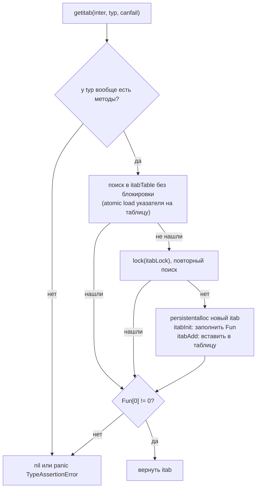
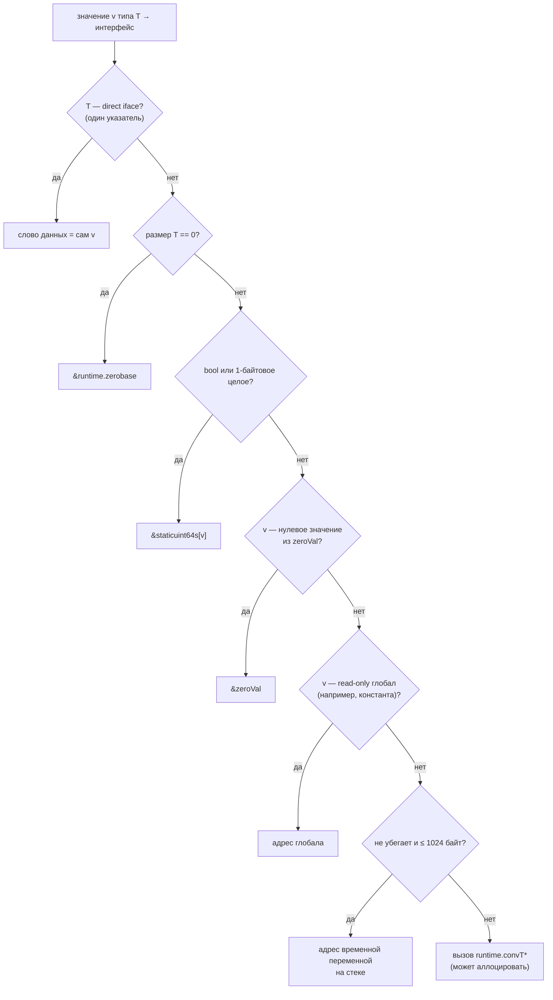
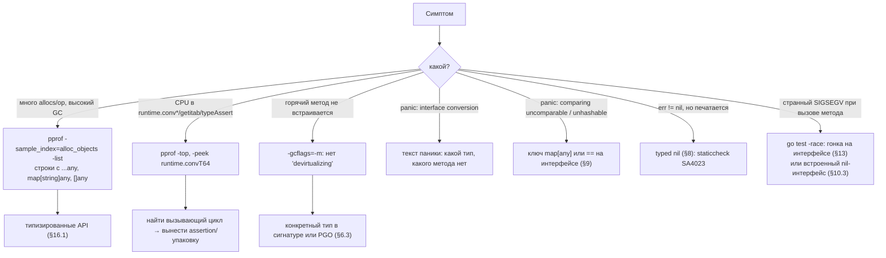

# Go Интерфейсы: Deep Dive для Senior Go-разработчика

> Актуально для **Go 1.27** (релиз go1.27.0 — август 2026, метка времени в файле `VERSION`: 2026-08-18). В локальном кэше тулчейнов есть go1.27.2; **⚠️ не проверено**, что это последний патч на момент чтения.
> Факты сверены с исходниками ветки `go1.27.0-deep-dive` (тег `go1.27.0`): `src/runtime/iface.go`, `src/runtime/runtime2.go`, `src/runtime/alg.go`, `src/internal/abi/iface.go`, `src/internal/abi/switch.go`, `src/internal/abi/type.go`, `src/cmd/compile/internal/walk/convert.go`, `src/cmd/compile/internal/walk/switch.go`, `src/cmd/compile/internal/devirtualize/`. Версии фич определены через `git log -S` + `git tag --contains`.
> Все бенчмарки и выводы команд — **реальные прогоны** на `go1.27.0 darwin/arm64, Apple M3 Pro (11 ядер), GOMAXPROCS=11`. Прогоны одиночные или `-count 3`; во время замеров на машине шли другие нагрузки, поэтому абсолютные числа шумные — смотрите на соотношения и на `B/op`, `allocs/op` (они от шума не зависят).
> Места, где факт не удалось проверить по первоисточнику, помечены **⚠️ не проверено**.

## Оглавление

- [Словарь терминов](#словарь-терминов)
- [TL;DR](#tldr)
- [1. Модель: что такое интерфейс](#1-модель-что-такое-интерфейс)
- [2. Устройство в памяти: eface, iface, itab](#2-устройство-в-памяти-eface-iface-itab)
- [3. Глобальный кэш itab: itabTable и getitab](#3-глобальный-кэш-itab-itabtable-и-getitab)
- [4. Упаковка значения в интерфейс и аллокации](#4-упаковка-значения-в-интерфейс-и-аллокации)
- [5. Вызов метода через интерфейс и его цена](#5-вызов-метода-через-интерфейс-и-его-цена)
- [6. Девиртуализация: статическая и PGO](#6-девиртуализация-статическая-и-pgo)
- [7. Type assertion и type switch](#7-type-assertion-и-type-switch)
- [8. nil-интерфейс и «typed nil»](#8-nil-интерфейс-и-typed-nil)
- [9. Сравнение и хеширование интерфейсов](#9-сравнение-и-хеширование-интерфейсов)
- [10. Method sets, встраивание и опциональные интерфейсы](#10-method-sets-встраивание-и-опциональные-интерфейсы)
- [11. Интерфейсы и generics](#11-интерфейсы-и-generics)
- [12. reflect и интерфейсы](#12-reflect-и-интерфейсы)
- [13. Интерфейсы и конкурентность](#13-интерфейсы-и-конкурентность)
- [14. Проектирование интерфейсов](#14-проектирование-интерфейсов)
- [15. Инструменты, флаги и диагностика](#15-инструменты-флаги-и-диагностика)
- [16. Оптимизация](#16-оптимизация)
- [17. Грабли, заблуждения и советы: сводка](#17-грабли-заблуждения-и-советы-сводка)
- [18. Сравнение с другими платформами](#18-сравнение-с-другими-платформами)
- [19. Вопросы для собеседования](#19-вопросы-для-собеседования)
- [20. Чеклист и шпаргалка](#20-чеклист-и-шпаргалка)

---

## Словарь терминов

Термины идут в том порядке, в котором встречаются в документе.

| Термин | Что значит простыми словами |
|---|---|
| **Интерфейс** (interface) | Тип, который описывает набор методов. Переменная интерфейсного типа может хранить значение **любого** типа, у которого эти методы есть. |
| **Конкретный тип** (concrete type) | Обычный, не интерфейсный тип: `int`, `string`, `*Order`, `struct{...}`. |
| **Статический тип** | Тип переменной, как он написан в коде. Для `var w io.Writer` статический тип — `io.Writer`. Не меняется. |
| **Динамический тип** | Конкретный тип значения, которое **сейчас** лежит в интерфейсной переменной. `w = os.Stdout` → динамический тип `*os.File`. Меняется при присваивании. |
| **Пустой интерфейс** | `interface{}`, он же `any` (Go 1.18+). Без методов, поэтому ему удовлетворяет любой тип. |
| **eface** (empty interface) | Внутреннее представление `any` в рантайме: два машинных слова — указатель на описание типа и указатель на данные. |
| **iface** | Внутреннее представление непустого интерфейса (`io.Reader`, `error`): указатель на `itab` и указатель на данные. |
| **Машинное слово** | Размер указателя: 8 байт на 64-битных платформах (amd64, arm64). |
| **Дескриптор типа** (`_type`, `abi.Type`) | Структура, которую компилятор кладёт в бинарник для каждого типа: размер, выравнивание, хеш, функция сравнения, карта указателей для GC. Один дескриптор на тип на всю программу. |
| **itab** (interface table) | Таблица «интерфейс + конкретный тип»: какой тип лежит внутри и адреса его методов в порядке методов интерфейса. Аналог vtable из C++. |
| **vtable** | «Таблица виртуальных методов» в C++/Java: массив адресов функций, через который делается вызов, когда точный тип неизвестен при компиляции. |
| **Косвенный вызов** (indirect call) | Вызов по адресу, загруженному из памяти (`CALL (R2)`), а не по адресу, зашитому в инструкцию. Процессору труднее его предсказать, и компилятор не может его встроить. |
| **Инлайнинг** (inlining) | Компилятор подставляет тело маленькой функции прямо в место вызова. Убирает накладные расходы вызова и открывает другие оптимизации. |
| **Девиртуализация** (devirtualization) | Компилятор доказывает, какой конкретный тип лежит в интерфейсе, и заменяет косвенный вызов прямым — после чего его можно ещё и встроить. |
| **PGO** (profile-guided optimization) | Оптимизация по профилю: компилятор берёт CPU-профиль реальной нагрузки и оптимизирует «горячие» места. В Go 1.21+ включается файлом `default.pgo`. |
| **Аллокация** | Выделение памяти в куче (heap). Стоит времени и создаёт работу для сборщика мусора (GC). |
| **Escape-анализ** | Анализ компилятора: может ли значение жить на стеке функции, или оно «убегает» (escapes) и его надо положить в кучу. |
| **Boxing** («упаковка») | Превращение значения конкретного типа в интерфейс. Часто требует аллокации, чтобы положить копию значения в кучу. |
| **Direct iface** | Типы «размером в один указатель» (указатели, `map`, `chan`, `func`, структуры из одного указателя), которые кладутся прямо во второе слово интерфейса, без копии в куче. |
| **Type assertion** | Выражение `x.(T)`: «достань из интерфейса значение типа T» (или проверь, что оно реализует интерфейс T). |
| **Type switch** | `switch v := x.(type) { case A: ... case B: ... }` — выбор ветки по динамическому типу. |
| **Comma-ok** | Форма `v, ok := x.(T)`: вместо паники возвращает `ok == false`. |
| **Typed nil** | Интерфейс, у которого тип задан, а указатель внутри — `nil`. Такой интерфейс **не равен** `nil`. Главная ловушка с `error`. |
| **Method set** («набор методов») | Список методов, которые есть у типа. У `T` — методы с приёмником `T`; у `*T` — методы с приёмником `T` и `*T`. От этого зависит, реализует ли тип интерфейс. |
| **Приёмник** (receiver) | «Хозяин» метода: `func (o *Order) Pay()` — приёмник `o` типа `*Order`. Бывает по значению (`T`) и по указателю (`*T`). |
| **Встраивание** (embedding) | Включение одного интерфейса в другой (`io.ReadWriter = Reader + Writer`) или поля без имени в структуру — методы поля «поднимаются» наверх. |
| **Опциональный интерфейс** | Дополнительный интерфейс, который код проверяет через type assertion: `if f, ok := w.(http.Flusher); ok { f.Flush() }`. |
| **Generics / параметр типа** | Обобщённый код: `func F[T Constraint](x T)`. Компилятор Go генерирует один экземпляр на «форму» типа (GC shape) плюс словарь. |
| **GC shape** («форма» типа) | Класс типов, одинаковых для генератора кода: например, все указатели имеют одну форму `*uint8`. Для одной формы компилятор делает одну копию generic-функции. |
| **Словарь** (dictionary) | Скрытый аргумент generic-функции: дескрипторы типов, itab'ы и адреса методов для конкретного набора типовых аргументов. |
| **Jump table** («таблица переходов») | Массив адресов кода: вместо цепочки `if` процессор по индексу сразу прыгает в нужную ветку. |
| **Data race** (гонка данных) | Две горутины одновременно обращаются к одной переменной, хотя бы одна пишет, и между ними нет синхронизации. |
| **Torn read** («разорванное чтение») | При гонке читатель видит половину старого и половину нового значения. Для интерфейса из двух слов — тип от одного значения, данные от другого. |

---

## TL;DR

1. Интерфейсная переменная — это **два машинных слова** (16 байт на 64-битной платформе): у `any` это `(*_type, data)`, у непустого интерфейса — `(*itab, data)` (`src/runtime/runtime2.go`). Проверено: `unsafe.Sizeof(any)` = `unsafe.Sizeof(io.Writer)` = 16.
2. **itab** — таблица «интерфейс × конкретный тип» с адресами методов. Большую часть itab'ов компилятор кладёт в бинарник готовыми; остальные рантайм строит при первом type assertion и кэширует в глобальной хеш-таблице `itabTable` навсегда (память не освобождается) (`src/runtime/iface.go`).
3. Вызов метода через интерфейс — **косвенный вызов** через `itab.Fun[i]`. Разница с прямым вызовом — около 1 нс, но главная цена в том, что метод **нельзя встроить**. В замере цикл из 1024 вызовов: прямой ~0,56 мкс, через интерфейс ~1,3–2,0 мкс.
4. **Упаковка в интерфейс может аллоцировать.** Без аллокации: указатели и «указателеподобные» типы, нули, `bool`/`byte`, целые 0..255 (таблица `staticuint64s`), пустая строка и nil-слайс (`zeroVal`), константы (read-only данные), значения, которые не убегают из функции. Остальное — `convT*` → `mallocgc` (замер: `any(int(300))` — 8 B/op, 1 alloc; `any(int(42))` — 0).
5. С **Go 1.26** напрямую (без копии) в интерфейс кладутся и структуры «один указатель + поля нулевого размера» (коммит `03ed43988f`). Замер: go1.25.3 — 8 B/op, 1 alloc; go1.27.0 — 0.
6. **Девиртуализация**: если компилятор видит, какой тип лежит в интерфейсе, он заменяет косвенный вызов прямым. С **Go 1.26** анализ следит за несколькими присваиваниями одного типа (коммит `de9da0de30`). **PGO** (Go 1.21+) девиртуализирует горячие вызовы по профилю: в замере 1,0 с → 0,52 с.
7. `x.(T)` к **конкретному** типу — одно сравнение указателей, без вызова рантайма. `x.(I)` к **интерфейсу** — поиск itab; с **Go 1.22** перед вызовом рантайма стоит кэш в самом месте вызова (`abi.TypeAssertCache`).
8. **Type switch** по конкретным типам с 5+ ветками компилируется в **jump table** по битам хеша типа (Go 1.22, коммит `4711299661`); по интерфейсным типам — один вызов `runtime.interfaceSwitch` с кэшем (Go 1.22).
9. **Typed nil**: `var p *MyErr = nil; var err error = p` → `err != nil`. Интерфейс равен `nil`, только если **оба** слова нулевые. `go vet` это не ловит; `staticcheck` ловит (`SA4023`).
10. `==` на интерфейсах **паникует**, если динамические типы одинаковы и несравнимы (`[]T`, `map`, `func`): `comparing uncomparable type`. Ключ `map[any]` со слайсом — `hash of unhashable type`. С Go 1.20 `any` удовлетворяет ограничению `comparable`, поэтому та же паника возможна в generic-коде.
11. Метод с приёмником `*T` не входит в method set `T`: `T{}` не реализует интерфейс, `&T{}` — реализует. Ошибка компиляции: `method Notify has pointer receiver`.
12. Значение в интерфейсе — **копия**. Изменение исходной переменной после присваивания не видно через интерфейс.
13. Generic-функция, вызывающая метод параметра типа, — тоже **косвенный вызов** через словарь (видно `CALL (R2)` в дизассемблере). Generics не равны «бесплатной мономорфизации», как в C++/Rust.
14. Интерфейсная переменная из двух слов **не атомарна**: гонка может дать «разорванное» значение (тип от одного, данные от другого) и порчу памяти (`doc/go_mem.html`). Используйте `atomic.Pointer[T]` или мьютекс.
15. Дизайн: «принимай интерфейсы, возвращай структуры»; объявляй интерфейс **на стороне потребителя**; делай его маленьким (1–3 метода); не заводи интерфейс «на будущее» под одну реализацию.

---

## 1. Модель: что такое интерфейс

### 1.1. Контракт без объявления «implements»

Интерфейс в Go — это **набор методов**. Тип реализует интерфейс автоматически, если у него есть все эти методы с теми же сигнатурами. Ключевого слова `implements` нет.

```go
// Пакет billing объявляет то, что ему нужно.
type PaymentGateway interface {
	Charge(ctx context.Context, orderID int64, amount int64) error
}

// Пакет stripe ничего не знает про billing.PaymentGateway,
// но *Client ему удовлетворяет — методы совпали.
type Client struct{ /* ... */ }

func (c *Client) Charge(ctx context.Context, orderID int64, amount int64) error { /* ... */ return nil }
```

**Почему так спроектировано.** Неявная реализация позволяет объявлять интерфейс **там, где его используют**, а не там, где пишут реализацию. Пакету `stripe` не нужно импортировать `billing`, чтобы ему удовлетворять, — нет циклических зависимостей, нет «иерархий». Можно задним числом описать интерфейсом тип из чужой библиотеки. Цена: из кода типа не видно, какие интерфейсы он реализует, а опечатка в имени метода обнаруживается не в месте объявления типа, а там, где его присваивают интерфейсу (защита — compile-time assertion, §10.5).

### 1.2. Статический и динамический тип

У интерфейсной переменной два «типа»:

```text
var w io.Writer          // статический тип: io.Writer (навсегда)
w = os.Stdout            // динамический тип: *os.File
w = &bytes.Buffer{}      // динамический тип: *bytes.Buffer
w = nil                  // динамического типа нет — это nil-интерфейс
```

Компилятор проверяет вызовы по статическому типу (`w.Write` можно, `w.Close` — нельзя, даже если внутри `*os.File`). Рантайм выбирает реализацию по динамическому типу.

### 1.3. Два вида интерфейсов внутри

Для рантайма есть два вида интерфейсов, и устроены они по-разному (§2):

| Вид | Примеры | Первое слово | Зачем отдельно |
|---|---|---|---|
| Пустой | `any`, `interface{}` | `*_type` — дескриптор типа | Методов нет, таблица методов не нужна |
| Непустой | `error`, `io.Reader`, свой `Notifier` | `*itab` — таблица методов + тип | Нужен быстрый доступ к методам |

### 1.4. Интерфейсы-ограничения (только для generics)

С Go 1.18 интерфейс может содержать ещё и **набор типов**: `interface{ ~int | ~string }`. Такие интерфейсы — только **ограничения** для параметров типа; переменную такого типа объявить нельзя. В остальном документе речь про обычные интерфейсы-значения, ограничения разобраны в §11.

> **Простыми словами.** Интерфейс — это «розетка» с описанием формы вилки (набор методов). Любой прибор с подходящей вилкой включается, и прибору не нужно заранее знать про эту розетку. Интерфейсная переменная хранит «что за прибор» (тип) и «сам прибор» (данные).

**Что важно для Senior**
- Реализация неявная: интерфейс объявляет потребитель, а не поставщик (§14).
- Статический тип определяет, что можно вызвать; динамический — что реально вызовется.
- Пустой и непустой интерфейсы в рантайме устроены по-разному: у первого в первом слове тип, у второго — itab.
- Интерфейсы с набором типов (`~int | ~string`) — только ограничения generics, не значения.

---

## 2. Устройство в памяти: eface, iface, itab

### 2.1. Два слова

Определения из `src/runtime/runtime2.go`:

```go
type iface struct {
	tab  *itab
	data unsafe.Pointer
}

type eface struct {
	_type *_type
	data  unsafe.Pointer
}
```

```text
any (eface)                         io.Writer (iface)
┌──────────────┬──────────────┐    ┌──────────────┬──────────────┐
│ _type ───────┼──┐  data ────┼─┐  │ tab ─────────┼──┐  data ────┼─┐
└──────────────┴──┼───────────┘ │  └──────────────┴──┼───────────┘ │
                  ▼             ▼                    ▼             ▼
          ┌─────────────┐   значение          ┌─────────────┐   значение
          │ abi.Type    │   (или сам          │ abi.ITab    │   (или сам
          │ Size_, Hash │    указатель)       │ Inter ──────┼─► abi.InterfaceType
          │ Equal, Kind │                     │ Type  ──────┼─► abi.Type (*os.File)
          │ GCData, ... │                     │ Hash        │
          └─────────────┘                     │ Fun[0..n-1] │ ← адреса методов
                                              └─────────────┘
```

Проверим на живом коде: повторим эти структуры через `unsafe` и посмотрим содержимое.

```go
type eface struct{ typ, data unsafe.Pointer }
type iface struct{ tab, data unsafe.Pointer }
type itab struct {
	inter, typ unsafe.Pointer
	hash       uint32
	fun        [1]uintptr
}

func main() {
	var a any
	var w io.Writer
	fmt.Println("sizeof any:", unsafe.Sizeof(a), "sizeof io.Writer:", unsafe.Sizeof(w))

	a = 42
	e := (*eface)(unsafe.Pointer(&a))
	fmt.Printf("any(42): type=%p data=%p value=%d\n", e.typ, e.data, *(*int)(e.data))

	w = os.Stdout
	i := (*iface)(unsafe.Pointer(&w))
	tab := (*itab)(i.tab)
	fmt.Printf("io.Writer(os.Stdout): itab=%p itab.typ=%p data=%p (os.Stdout=%p)\n",
		i.tab, tab.typ, i.data, os.Stdout)

	var w2 io.Writer = os.Stderr
	i2 := (*iface)(unsafe.Pointer(&w2))
	fmt.Println("same itab for *os.File→io.Writer:", i.tab == i2.tab)
}
```

```text
sizeof any: 16 sizeof io.Writer: 16
any(42): type=0x100300718 data=0x100246548 value=42
io.Writer(os.Stdout): itab=0x10030ec58 itab.typ=0x1002f0180 data=0x549c26314008 (os.Stdout=0x549c26314008)
same itab for *os.File→io.Writer: true
```

Что видно:
- оба вида интерфейса — 16 байт;
- `data` для `any(42)` указывает **не в кучу**, а в область бинарника (`0x1002...` рядом с адресами типов) — это таблица `staticuint64s`, §4.2;
- `data` для `os.Stdout` **равен самому указателю** `os.Stdout`: указатель кладётся в интерфейс как есть (direct iface, §2.4);
- у `os.Stdout` и `os.Stderr` один и тот же itab: itab описывает пару «интерфейс × тип», а не конкретное значение.

> **Грабли.** Код с `unsafe`, который разбирает интерфейс «руками», — только для обучения. Раскладка — деталь реализации; например, в Go 1.26 изменилось, какие типы хранятся напрямую (§2.4).

### 2.2. itab

Определение из `src/internal/abi/iface.go`:

```go
type ITab struct {
	Inter *InterfaceType
	Type  *Type
	Hash  uint32     // copy of Type.Hash. Used for type switches.
	Fun   [1]uintptr // variable sized. fun[0]==0 means Type does not implement Inter.
}
```

| Поле | Что хранит | Зачем |
|---|---|---|
| `Inter` | Дескриптор интерфейсного типа (список методов) | Для type assertion и сообщений об ошибках |
| `Type` | Дескриптор конкретного типа | Чтобы из `iface` получить динамический тип (например, при `any(w)`, `x.(T)`) |
| `Hash` | Копия `Type.Hash` | Для type switch: хеш берётся из itab без лишнего разыменования (§7.3) |
| `Fun` | Адреса методов в порядке методов интерфейса | Сам вызов: `w.Write` → `tab.Fun[0]` |

Массив `Fun` объявлен как `[1]uintptr`, но на самом деле его длина равна числу методов интерфейса: память выделяется с запасом (`unsafe.Sizeof(itab{}) + (len(inter.Methods)-1)*PtrSize`, `getitab` в `src/runtime/iface.go`). Размер itab на 64-битной платформе: 32 байта + 8 байт на каждый метод после первого.

`Fun[0] == 0` — особая метка «тип **не** реализует интерфейс». Так рантайм кэширует и **отрицательные** результаты (§3.2).

### 2.3. Дескриптор типа

Первые поля `abi.Type` (`src/internal/abi/type.go`):

```go
type Type struct {
	Size_       uintptr
	PtrBytes    uintptr // number of (prefix) bytes in the type that can contain pointers
	Hash        uint32  // hash of type; avoids computation in hash tables
	TFlag       TFlag   // extra type information flags
	Align_      uint8
	FieldAlign_ uint8
	Kind_       Kind
	Equal func(unsafe.Pointer, unsafe.Pointer) bool
	GCData    *byte
	// ...
}
```

Для интерфейсов важны три поля:
- `Hash` — используется в type switch и в кэшах assertion'ов;
- `Equal` — функция сравнения; если она `nil`, тип **несравним**, и `==` на интерфейсе паникует (§9);
- `TFlag & TFlagDirectIface` — значение хранится прямо в слове `data` (§2.4).

Если у типа есть методы, после `Type` лежит `UncommonType` с количеством методов и смещением до их списка. Методы и типа, и интерфейса отсортированы **по имени** (сначала экспортированные) — `types.CompareSyms` в компиляторе. Благодаря этому `itabInit` заполняет `Fun` за один проход по двум отсортированным спискам — `O(ni + nt)`, а не `O(ni × nt)` (комментарий в `src/runtime/iface.go`).

> Небольшое расхождение в исходниках: у поля `abi.InterfaceType.Methods` комментарий `// sorted by hash`, а `itabInit` и компилятор (`typecheck/subr.go`: `slices.SortFunc(ms, types.CompareFields)`) сортируют по имени. Верить стоит коду: сортировка по имени.

### 2.4. Что кладётся во второе слово: direct и indirect

Второе слово интерфейса — всегда указатель. Значит, значение либо **само является указателем** и кладётся как есть, либо рантайм кладёт туда **указатель на копию** значения.

Правило из компилятора (`src/cmd/compile/internal/types/type.go`):

```go
func IsDirectIface(t *Type) bool {
	return t.Size() == int64(PtrSize) && PtrDataSize(t) == int64(PtrSize)
}
```

То есть «тип размером ровно в одно слово, и это слово — указатель». Сюда попадают:
- `*T`, `unsafe.Pointer`, `map[K]V`, `chan T`, `func(...)`;
- массивы и структуры из одного такого элемента: `[1]*T`, `struct{ p *T }`;
- **с Go 1.26**: структуры из одного указателя и любого количества полей нулевого размера, например `struct{ _ [0]func(); p *T }` (коммит `03ed43988f`, «allow multi-field structs to be stored directly in interfaces», первый тег `go1.26rc1`; до этого была одна попытка, откаченная коммитом `74421a305b`).

Проверка на двух версиях (бенчмарк из §4.4):

```text
go1.25.3:  BenchmarkWrapper-11   100000000   10.68 ns/op   8 B/op   1 allocs/op
go1.27.0:  BenchmarkWrapper-11   635922464   1.888 ns/op   0 B/op   0 allocs/op
```

Где `Wrapper` — `struct{ _ [0]func(); p *Point }`. Поле `_ [0]func()` — распространённый приём, чтобы сделать структуру несравнимой; до 1.26 он стоил аллокации при каждой упаковке в интерфейс.

Всё остальное (`int`, `string`, `[]byte`, структуры из двух полей) — **indirect**: в интерфейсе лежит указатель на копию. Где берётся память для копии — §4.

> **Простыми словами.** Интерфейс — коробка с двумя кармашками. В первом — «паспорт» типа (или itab: паспорт + список телефонов методов). Во втором — адрес, по которому лежит само значение. Если значение и так «адрес» (указатель), его кладут прямо в кармашек. Если нет — значение копируют куда-то и кладут адрес копии.

**Что важно для Senior**
- Интерфейс — 16 байт: `(*itab | *_type, data)`. Слайс интерфейсов — 16 байт на элемент плюс то, на что указывают `data`.
- itab — одна на пару «интерфейс × тип», не на значение; содержит адреса методов и копию хеша типа.
- `Equal == nil` в дескрипторе означает «несравнимый тип» → паника при `==` (§9).
- Указателеподобные типы хранятся напрямую; с Go 1.26 — и структуры «указатель + поля нулевого размера».

---

## 3. Глобальный кэш itab: itabTable и getitab

### 3.1. Откуда берутся itab'ы

Есть два источника:

1. **Статические.** Если в коде есть преобразование `var w io.Writer = os.Stdout`, компилятор знает обе стороны и кладёт готовый itab `go:itab.*os.File,io.Writer` в бинарник. При старте `itabsinit` добавляет все такие itab'ы во глобальную таблицу (`addModuleItabs`). В Go 1.27 линкер перестал хранить отдельный список указателей на itab'ы (`itablinks`): рантайм просто проходит по области itab'ов, а её размер теперь записывается явно (коммиты `6ef7fe9a48`, `9387929d09`).
2. **Динамические.** При `x.(io.Writer)`, когда `x` — `any`, или при преобразовании интерфейса в интерфейс (`io.ReadWriter` → `io.Reader`) компилятор не знает динамический тип. Тогда рантайм строит itab сам в `getitab`.

### 3.2. Как работает getitab



Детали из `src/runtime/iface.go`:

| Что | Значение | Зачем |
|---|---|---|
| Начальный размер таблицы | `itabInitSize = 512` | Хватает для большинства программ без роста |
| Хеш ключа | `inter.Type.Hash ^ typ.Hash` | Хеши типов уже посчитаны компилятором |
| Разрешение коллизий | Квадратичное пробирование `h(i) = h0 + i*(i+1)/2 mod 2^k` | Обходит все ячейки таблицы размера 2^k |
| Рост | при заполнении 75% — в 2 раза | Короткие цепочки пробирования |
| Чтение | без блокировки, через атомарную загрузку | Частый путь не платит за мьютекс |
| Запись | под `itabLock` | Редкий путь |
| Память под itab | `persistentalloc` (вне кучи GC) | itab живёт до конца программы |

Важная деталь — **кэшируется и отрицательный результат**. Если тип не реализует интерфейс, itab всё равно создаётся с `Fun[0] = 0`. Следующий `x.(I)` для той же пары найдёт его в таблице и сразу вернёт `false`. А если позже придёт форма без `ok`, рантайм повторно вызовет `itabInit(m, false)`, только чтобы узнать имя недостающего метода для текста паники.

**Цена решения.** itab'ы **никогда не освобождаются**. Обычно их сотни или тысячи — копейки. Но если программа порождает типы в рантайме (`reflect.StructOf`, `reflect.FuncOf`) и приводит их к интерфейсам, таблица растёт без предела. Эта память видна в метрике `/memory/classes/other:bytes` (`memstats.other_sys`, `src/runtime/metrics.go`) — туда `persistentalloc` относит itab'ы. **⚠️ не проверено** на реальной утечке: нагрузку с `reflect.StructOf` я не воспроизводил.

> **Простыми словами.** Чтобы проверить «умеет ли этот тип то, что требует интерфейс», рантайм один раз сверяет списки методов и записывает ответ в общую справочную книгу. В следующий раз он просто смотрит в книгу. Книгу никто не чистит, но она маленькая.

**Что важно для Senior**
- Для преобразований, известных при компиляции, itab готов заранее; рантайм строит itab только для динамических случаев.
- Глобальная таблица читается без блокировок; мьютекс нужен только при вставке.
- Отрицательный результат тоже кэшируется: повторный неудачный `x.(I)` дешёвый.
- itab'ы не освобождаются; рост виден в `/memory/classes/other:bytes`.

---

## 4. Упаковка значения в интерфейс и аллокации

### 4.1. Что происходит при `var x any = v`

Компилятор превращает присваивание в операцию `OMAKEFACE` из двух слов: первое — адрес дескриптора типа (или itab), второе — **слово данных**. Как получить слово данных, решает функция `dataWord` в `src/cmd/compile/internal/walk/convert.go`. Она перебирает способы **избежать аллокации** по порядку и только в конце вызывает рантайм:



Если дошло до рантайма, выбор функции — в `dataWordFuncName` (тот же файл):

| Тип значения | Функция рантайма | Когда без аллокации |
|---|---|---|
| 2 байта, выравнивание 2 (`int16`, `uint16`) | `convT16` | значение < 256 |
| 4 байта без указателей (`int32`, `float32`, `rune`) | `convT32` | значение < 256 |
| 8 байт без указателей (`int`, `int64`, `float64`, `time.Duration`) | `convT64` | **биты** значения < 256 |
| строка (или структура из одной строки) | `convTstring` | пустая строка |
| слайс (или структура из одного слайса) | `convTslice` | nil-слайс (`array == nil`) |
| остальное с указателями | `convT` | никогда |
| остальное без указателей | `convTnoptr` | никогда |

Код из `src/runtime/iface.go`:

```go
func convT64(val uint64) (x unsafe.Pointer) {
	if val < uint64(len(staticuint64s)) {
		x = unsafe.Pointer(&staticuint64s[val])
	} else {
		x = mallocgc(8, uint64Type, false)
		*(*uint64)(x) = val
	}
	return
}

func convTstring(val string) (x unsafe.Pointer) {
	if val == "" {
		x = unsafe.Pointer(&zeroVal[0])
	} else {
		x = mallocgc(unsafe.Sizeof(val), stringType, true)
		*(*string)(x) = val
	}
	return
}
```

### 4.2. staticuint64s и zeroVal

- `staticuint64s [256]uint64` — read-only массив чисел 0..255 (`staticuint64s[i] == i`). Если упаковываемое число маленькое, слово данных просто указывает на нужный элемент. Отсюда адрес `0x100246548` у `any(42)` в §2.1 — это не куча, а данные бинарника.
- `zeroVal` — блок нулевых байтов. На него указывают пустая строка, nil-слайс и некоторые нулевые значения.
- `zerobase` — общий адрес для всех значений размера 0 (`struct{}`, `[0]int`).

Это безопасно, потому что значение в интерфейсе **неизменяемо**: нельзя написать `x.(int)++`, а type assertion возвращает копию. Поэтому много интерфейсов могут указывать на один и тот же read-only адрес.

Тонкость: `convT64` проверяет **биты** значения. Для `float64(0)` биты нулевые — аллокации нет. Для `float64(1)` биты `0x3FF0000000000000` — аллокация есть (замер ниже).

### 4.3. Что показывает компилятор

Флаг `-gcflags='-m -d=escapedebug=1'` печатает решения `dataWord` (строки `convert:`; они выводятся при `base.Debug.EscapeDebug > 0`). Исходник:

```go
var sink any

type Point struct{ X, Y int }
type Empty struct{}
type Wrapper struct {
	_ [0]func()
	p *Point
}

func Small(v int)     { sink = v }    // строка 14
func Byte(v byte)     { sink = v }    // 15
func Bool(v bool)     { sink = v }    // 16
func Str(s string)    { sink = s }    // 17
func Pt(p Point)      { sink = p }    // 18
func PtrV(p *Point)   { sink = p }    // 19
func Emp()            { sink = Empty{} } // 20
func Wrap(w Wrapper)  { sink = w }    // 21
func Float(f float64) { sink = f }    // 22
func Const()          { sink = 1000 } // 23
func Local(v int) string { return fmt.Sprint(v) } // 24–26
func NoEscape(v int) bool { // 27
	var x any = v
	_, ok := x.(int)
	return ok
}
```

```text
conv/conv.go:14:33: v escapes to heap
conv/conv.go:15:33: v escapes to heap
conv/conv.go:16:33: v escapes to heap
conv/conv.go:17:10: leaking param: s
conv/conv.go:17:33: s escapes to heap
conv/conv.go:18:33: p escapes to heap
conv/conv.go:19:11: leaking param: p
conv/conv.go:20:38: Empty{} escapes to heap
conv/conv.go:21:11: leaking param: w
conv/conv.go:22:33: f escapes to heap
conv/conv.go:23:33: 1000 escapes to heap
conv/conv.go:25:19: ... argument does not escape
conv/conv.go:25:20: v escapes to heap
conv/conv.go:28:14: v does not escape
conv/conv.go:15:11: convert: using global for single-byte interface value: v
conv/conv.go:16:11: convert: using global for single-byte interface value: v
conv/conv.go:20:38: convert: using global for zero-sized interface value: .stmp_0
conv/conv.go:23:33: convert: using global for interface value: .stmp_1
conv/conv.go:27:15: convert: using stack temporary for interface value: v
```

> **Заблуждение:** «Если `-m` пишет `escapes to heap`, будет аллокация». На самом деле для `byte`, `bool`, `Empty{}` и константы `1000` компилятор пишет `escapes to heap`, а следом `convert: using global ...` — аллокации нет. `escapes to heap` значит «значение должно пережить функцию», а **где** его разместить, решает уже `dataWord`. Для `int` и `float64` решение принимает рантайм по значению — компилятор его не знает. Проверяйте `allocs/op` в бенчмарке или `testing.AllocsPerRun`.

Для `Wrap` (строка 21) нет строки `w escapes to heap` — только `leaking param: w`: с Go 1.26 `Wrapper` хранится напрямую, как указатель.

### 4.4. Замер

```go
func BenchmarkSmallInt(b *testing.B)    { for i := 0; b.Loop(); i++ { Small(i & 255) } }
func BenchmarkBigInt(b *testing.B)      { for i := 0; b.Loop(); i++ { Small(i | 256) } }
func BenchmarkByte(b *testing.B)        { for i := 0; b.Loop(); i++ { Byte(byte(i)) } }
func BenchmarkEmptyString(b *testing.B) { for b.Loop() { Str("") } }
func BenchmarkString(b *testing.B)      { for b.Loop() { Str("order-42") } }
func BenchmarkStruct(b *testing.B)      { for i := 0; b.Loop(); i++ { Pt(Point{i, i}) } }
func BenchmarkPointer(b *testing.B)     { p := &Point{1, 2}; for b.Loop() { PtrV(p) } }
func BenchmarkWrapper(b *testing.B)     { w := Wrapper{p: &Point{1, 2}}; for b.Loop() { Wrap(w) } }
func BenchmarkFloatZero(b *testing.B)   { for b.Loop() { Float(0) } }
func BenchmarkFloatOne(b *testing.B)    { for b.Loop() { Float(1) } }
func BenchmarkConst(b *testing.B)       { for b.Loop() { Const() } }
```

```text
goos: darwin
goarch: arm64
cpu: Apple M3 Pro
BenchmarkSmallInt-11       	566691858	         1.917 ns/op	       0 B/op	       0 allocs/op
BenchmarkBigInt-11         	193713733	         6.142 ns/op	       8 B/op	       1 allocs/op
BenchmarkByte-11           	587615511	         1.963 ns/op	       0 B/op	       0 allocs/op
BenchmarkEmptyString-11    	630880551	         1.878 ns/op	       0 B/op	       0 allocs/op
BenchmarkString-11         	162203534	         7.742 ns/op	      16 B/op	       1 allocs/op
BenchmarkStruct-11         	169778756	         6.958 ns/op	      16 B/op	       1 allocs/op
BenchmarkPointer-11        	636941548	         1.871 ns/op	       0 B/op	       0 allocs/op
BenchmarkWrapper-11        	635922464	         1.888 ns/op	       0 B/op	       0 allocs/op
BenchmarkFloatZero-11      	643351431	         1.872 ns/op	       0 B/op	       0 allocs/op
BenchmarkFloatOne-11       	195637248	         6.562 ns/op	       8 B/op	       1 allocs/op
BenchmarkConst-11          	555646233	         2.045 ns/op	       0 B/op	       0 allocs/op
```

Вывод: одна упаковка с аллокацией стоит ~4–6 нс и 8–16 байт в куче. Само по себе это мало. Проблема появляется, когда упаковка стоит в горячем цикле: логирование с `...any`, `fmt.Sprintf`, `[]any` для SQL-аргументов, `map[string]any` для JSON. Тогда растут `allocs/op` и нагрузка на GC (§16.1).

**Грабли: аргументы `...any` убегают в кучу**

```go
func Local(v int) string { return fmt.Sprint(v) }
```

```text
conv/conv.go:25:19: ... argument does not escape
conv/conv.go:25:20: v escapes to heap
```

Почему так: сам слайс `[]any` для вариадика лежит на стеке (`... argument does not escape`), но `fmt` хранит аргументы в своих структурах, поэтому escape-анализ считает, что значения внутри интерфейсов убегают. Каждое `int` ≥ 256, каждая непустая строка и каждая структура — отдельная аллокация. Как заметить: `allocs/op` в бенчмарке, `-gcflags=-m`, профиль `alloc_objects` (§15.3). Как исправить: в горячем пути — типизированные API (`strconv.AppendInt`, `slog.Int64`, `zap.Int64`).

> **Простыми словами.** Чтобы положить число в «коробку» `any`, Go обычно копирует число в кучу. Для маленьких чисел (0–255), `true/false`, пустой строки и констант у Go есть заранее заготовленные ячейки — их не надо выделять. Указатели вообще не копируются: в коробку кладётся сам адрес.

**Что важно для Senior**
- Указатели и указателеподобные типы упаковываются бесплатно; значения — обычно с аллокацией `convT*`.
- Без аллокации: размер 0, `bool`/`byte`, целые с битами < 256, `""`, nil-слайс, константы, неубегающие значения ≤ 1024 байт.
- `escapes to heap` в `-m` не равно аллокации; смотрите `convert:` строки (`-d=escapedebug=1`) и `allocs/op`.
- Значение внутри интерфейса неизменяемо — поэтому возможен общий read-only адрес для многих интерфейсов.

---

## 5. Вызов метода через интерфейс и его цена

### 5.1. Что делает процессор

Вызов `d.Apply(p)`, где `d` — интерфейс, превращается в:

```text
tab  := d.tab                 // загрузка 1: первое слово интерфейса
fn   := tab.Fun[k]            // загрузка 2: адрес k-го метода
fn(d.data, p)                 // косвенный вызов: CALL (R2)
```

Компилятор знает индекс `k` при компиляции (методы интерфейса отсортированы), поэтому поиска по имени **нет** — это две загрузки из памяти и косвенный вызов. В дизассемблере бенчмарка ниже видно именно его:

```text
== BenchmarkIface$
  call.go:27		0x10011ee58		d63f0040		CALL (R2)
```

### 5.2. Обёртки для методов с приёмником-значением

В itab лежат функции, которые принимают **указатель** на данные (второе слово интерфейса). Если метод объявлен с приёмником-значением (`func (d Percent) Apply`), а значение хранится indirect, компилятор генерирует обёртку `(*Percent).Apply`: она проверяет указатель на nil, загружает значение и вызывает настоящий метод. В выводе `-m` это видно как `<autogenerated>:1: inlining call to Percent.Apply` — настоящий метод встроен в обёртку. Начало дизассемблера обёртки:

```text
   MOVD 16(R28), R16        // проверка стека (пролог)
   CMP R16, RSP
   ...
   CBZ R0, 14(PC)           // проверка указателя на nil
   MOVD (R0), R2            // загрузка поля P из копии значения
   MUL R2, R1, R2
```

### 5.3. Замер: прямой вызов, интерфейс, generic, функция-значение

```go
type Discount interface{ Apply(price int64) int64 }

type Percent struct{ P int64 }
func (d Percent) Apply(price int64) int64 { return price - price*d.P/100 }

type Fixed struct{ V int64 }
func (d *Fixed) Apply(price int64) int64 { return price - d.V }

func TotalConcrete(d Percent, prices []int64) (s int64) {
	for _, p := range prices { s += d.Apply(p) }
	return
}
func TotalIface(d Discount, prices []int64) (s int64) {
	for _, p := range prices { s += d.Apply(p) }
	return
}
func TotalGeneric[D Discount](d D, prices []int64) (s int64) {
	for _, p := range prices { s += d.Apply(p) }
	return
}
func TotalFunc(apply func(int64) int64, prices []int64) (s int64) {
	for _, p := range prices { s += apply(p) }
	return
}

var global Discount = Percent{10}   // тип неизвестен в месте вызова
var globalPtr Discount = &Fixed{5}
// prices — 1024 элемента
```

```text
BenchmarkConcrete-11        	 2074086	       577.9 ns/op	       0 B/op	       0 allocs/op
BenchmarkConcrete-11        	 1764759	       628.1 ns/op	       0 B/op	       0 allocs/op
BenchmarkConcrete-11        	 2124634	       573.7 ns/op	       0 B/op	       0 allocs/op
BenchmarkIface-11           	  761509	      1574 ns/op	       0 B/op	       0 allocs/op
BenchmarkIface-11           	  914683	      2009 ns/op	       0 B/op	       0 allocs/op
BenchmarkIface-11           	  595627	      1845 ns/op	       0 B/op	       0 allocs/op
BenchmarkGenericValue-11    	 1323314	       908.9 ns/op	       0 B/op	       0 allocs/op
BenchmarkGenericValue-11    	 1332187	       915.8 ns/op	       0 B/op	       0 allocs/op
BenchmarkGenericValue-11    	 1323537	       908.3 ns/op	       0 B/op	       0 allocs/op
BenchmarkGenericPtr-11      	 1310064	       910.7 ns/op	       0 B/op	       0 allocs/op
BenchmarkGenericPtr-11      	 1304509	       932.8 ns/op	       0 B/op	       0 allocs/op
BenchmarkGenericPtr-11      	 1372125	       883.1 ns/op	       0 B/op	       0 allocs/op
BenchmarkFunc-11            	 1295707	       926.3 ns/op	       0 B/op	       0 allocs/op
BenchmarkFunc-11            	 1266361	       945.9 ns/op	       0 B/op	       0 allocs/op
BenchmarkFunc-11            	 1279075	       941.4 ns/op	       0 B/op	       0 allocs/op
BenchmarkIfacePtr-11        	 1000000	      1076 ns/op	       0 B/op	       0 allocs/op
BenchmarkIfacePtr-11        	 1000000	      1042 ns/op	       0 B/op	       0 allocs/op
BenchmarkIfacePtr-11        	 1000000	      1031 ns/op	       0 B/op	       0 allocs/op
```

Как читать (на 1024 вызова):

| Вариант | ~нс на вызов | Почему |
|---|---|---|
| Конкретный тип | ~0,56 | `Percent.Apply` встроен в цикл, вызова нет вообще |
| Интерфейс, приёмник-значение | ~1,5–2,0 | косвенный вызов + обёртка `(*Percent).Apply` с прологом и nil-проверкой |
| Интерфейс, приёмник-указатель | ~1,0 | косвенный вызов, но без обёртки |
| Generic (значение и указатель) | ~0,9 | тоже косвенный вызов через словарь (`CALL (R2)`, §11.2) |
| Функция-значение | ~0,9 | косвенный вызов через замыкание |

Главный вывод: **дорог не сам косвенный вызов, а потеря инлайнинга**. Встроенный метод даёт компилятору выкинуть пролог, держать значения в регистрах и оптимизировать арифметику. Разница в 2–3 раза получается только на крошечных методах вроде этого; если метод делает запрос в PostgreSQL или пишет в Kafka, 1 нс на вызов не видна.

> **⚠️ не проверено:** почему вариант «интерфейс, приёмник-значение» в этом прогоне медленнее generic-варианта на тот же метод. Оба делают косвенный вызов; разница, вероятно, в обёртке `(*Percent).Apply`, но покомандно я её не разбирал, а прогоны шли на нагруженной машине.

> **Заблуждение:** «Вызов через интерфейс ищет метод по имени, как в динамических языках». На самом деле индекс метода известен при компиляции; рантайм делает две загрузки и косвенный вызов. Поиск по имени есть только при построении itab (§3), и он кэшируется.

> **Совет.** Не уходите от интерфейса ради скорости, пока профиль не показал, что косвенный вызов в горячем цикле. Если показал — сначала попробуйте PGO (§6.3): он сам девиртуализирует горячий вызов без изменения кода. Эффект в замере: 1,0 с → 0,52 с. Не нужно, если метод делает I/O.

> **Простыми словами.** Прямой вызов — как позвонить другу, номер которого знаешь наизусть; компилятор может даже «пересказать разговор заранее» (встроить функцию). Вызов через интерфейс — сначала открыть справочник (itab), найти номер и только потом звонить. Пересказать заранее уже нельзя — неизвестно, кто ответит.

**Что важно для Senior**
- Интерфейсный вызов = 2 загрузки + косвенный вызов; поиска по имени нет.
- Основная цена — потеря инлайнинга, а не сам `CALL (R2)`.
- Методы с приёмником-значением вызываются через автосгенерированную обёртку `(*T).M`.
- Generic-код с методами ограничения — тоже косвенные вызовы (§11).

---

## 6. Девиртуализация: статическая и PGO

### 6.1. Статическая девиртуализация

Если компилятор доказал, что в интерфейсе лежит конкретный тип `T`, он заменяет `i.M()` на `i.(T).M()` — прямой вызов, который потом можно встроить. Код — `StaticCall` в `src/cmd/compile/internal/devirtualize/devirtualize.go`. Девиртуализация работает вместе с инлайнингом: часто конкретный тип становится виден только **после** встраивания функции, которая принимает интерфейс.

С **Go 1.26** анализ стал умнее (коммит `de9da0de30`, «improve concrete type analysis», первый тег `go1.26rc1`): раньше девиртуализация срабатывала только если интерфейсной переменной присваивали ровно один раз; теперь компилятор отслеживает **все** присваивания, type assertion'ы и преобразования, и если везде один и тот же конкретный тип — девиртуализирует. В Go 1.27 код ещё под константой `go126ImprovedConcreteTypeAnalysis = true`.

Проверка на двух версиях:

```go
type Discount interface{ Apply(price int64) int64 }
type Percent struct{ P int64 }
func (d Percent) Apply(price int64) int64 { return price - price*d.P/100 }

func applyAll(d Discount, prices []int64) (s int64) {
	for _, p := range prices { s += d.Apply(p) }
	return
}

func Simple(price int64) int64 {          // строка 16
	var d Discount = Percent{10}
	return d.Apply(price)                  // 18
}

func ViaInline(prices []int64) int64 {    // 21
	return applyAll(Percent{10}, prices)   // 22
}

func Branch(vip bool, price int64) int64 { // 25
	var d Discount = Percent{5}            // 26
	if vip {
		d = Percent{20}                     // 28
	}
	return d.Apply(price)                  // 30
}
```

```text
== go1.25.3
devirt/devirt.go:18:16: devirtualizing d.Apply to Percent
devirt/devirt.go:22:17: inlining call to applyAll
devirt/devirt.go:22:17: devirtualizing d.Apply to Percent
devirt/devirt.go:26:26: Percent{...} escapes to heap
devirt/devirt.go:28:14: Percent{...} escapes to heap
== go1.27.0
devirt/devirt.go:18:16: devirtualizing d.Apply to Percent
devirt/devirt.go:30:16: devirtualizing d.Apply to Percent
devirt/devirt.go:22:17: inlining call to applyAll
devirt/devirt.go:22:17: devirtualizing d.Apply to Percent
devirt/devirt.go:26:26: Percent{...} does not escape
devirt/devirt.go:28:14: Percent{...} does not escape
```

В `Branch` на go1.25 вызов остался косвенным, и оба `Percent{...}` ушли в кучу. На go1.27 вызов девиртуализирован, и аллокации пропали: девиртуализация помогает ещё и escape-анализу.

Чего статическая девиртуализация не умеет:
- интерфейс пришёл из поля структуры, глобальной переменной, map, канала, параметра не встроенной функции;
- в разных ветках присваиваются **разные** типы;
- вызов в `go`/`defer` — пропускается намеренно, чтобы паника из обёртки не сместилась (комментарий в `StaticCall`, issue #52072);
- получатель — параметр типа generic-функции («shaped receiver»).

Замер девиртуализации (тот же цикл на 1024 элемента, что в §5.3):

```go
func BenchmarkIfaceLocalN(b *testing.B) {
	for i := 0; i < b.N; i++ {
		var d Discount = Percent{10}
		sink = TotalIface(d, prices)   // TotalIface встроится → d.Apply девиртуализируется
	}
}
```

```text
call/local_test.go:8:20: inlining call to TotalIface
call/local_test.go:8:20: devirtualizing d.Apply to Percent
call/local_test.go:8:20: inlining call to Percent.Apply

BenchmarkConcrete-11       	 2141805	       561.2 ns/op	       0 B/op	       0 allocs/op
BenchmarkIface-11          	  822086	      1543 ns/op	       0 B/op	       0 allocs/op
BenchmarkIfaceLocalN-11    	 1824939	       644.7 ns/op	       0 B/op	       0 allocs/op
```

Девиртуализированный вызов работает со скоростью прямого.

**Грабли: `b.Loop()` мешает девиртуализации в бенчмарке**

```go
func BenchmarkIfaceLocal(b *testing.B) {
	for b.Loop() {
		var d Discount = Percent{10}
		sink = TotalIface(d, prices)
	}
}
```

```text
call/call_test.go:61:20: inlining call to TotalIface
call/call_test.go:60:27: Percent{...} escapes to heap      // нет строки "devirtualizing"
BenchmarkIfaceLocal-11     	  820183	      1481 ns/op	       0 B/op	       0 allocs/op
BenchmarkIfaceLocalN-11    	 1824939	       644.7 ns/op	       0 B/op	       0 allocs/op
```

Тот же код в цикле `for i := 0; i < b.N; i++` девиртуализируется, а в `for b.Loop()` — нет. Почему так: внутри `b.Loop()` компилятор оборачивает присваивания и результаты вызовов в `runtime.KeepAlive`, чтобы их не выкинула оптимизация (`src/cmd/compile/internal/bloop/bloop.go`). **⚠️ не проверено** по коду, что мешает именно `KeepAlive`, — это вывод из наблюдения: разница появляется только с `b.Loop()`. Как заметить: сравнить `-gcflags=-m` для теста. Как исправить: если меряете эффект девиртуализации, выносите тело в отдельную функцию или используйте `b.N`.

### 6.2. Частичная девиртуализация

Если метод «поднят» из встроенного интерфейсного поля структуры, компилятор может девиртуализировать только первый шаг. В `-m` это видно как `partially devirtualizing ...` (`devirtualize.go`, issue #42279).

### 6.3. PGO-девиртуализация

Когда тип неизвестен статически (стратегия из конфига, реестр плагинов, `map[string]Handler`), помогает **PGO** (Go 1.21+, коммит `8c445b7c9f` «enable PGO-driven call devirtualization», первый тег `go1.21rc1`; для функций-значений — с Go 1.22, коммит `fb6ff1e4ca`). Компилятор смотрит в CPU-профиль, находит самый частый конкретный тип в месте вызова и генерирует:

```go
// было
s += d.Apply(p)

// стало (концептуально)
if c, ok := d.(Percent); ok {
	s += c.Apply(p)   // прямой вызов, встраивается
} else {
	s += d.Apply(p)   // запасной косвенный вызов
}
```

Пример: стратегия скидки выбирается по флагу и берётся из `map`.

```go
var registry = map[string]Discount{"percent": Percent{10}, "fixed": Fixed{5}}

//go:noinline
func total(d Discount, prices []int64) (s int64) {
	for _, p := range prices {
		s += d.Apply(p)
	}
	return
}

func main() {
	// ... флаги -cpuprofile и -kind, prices из 4096 элементов
	d := registry[*kind]
	for range 200_000 {
		s += total(d, prices)
	}
}
```

```bash
go build -pgo=off -o nopgo .
./nopgo -cpuprofile default.pgo                 # снимаем профиль
go build -pgo=default.pgo -gcflags=-m -o withpgo .
```

```text
pgo/main.go:27:15: PGO devirtualizing interface call d.Apply to Percent.Apply
pgo/main.go:27:15: inlining call to Percent.Apply
```

Время (по три запуска каждой сборки, чередуя):

```text
nopgo   -kind percent: 1.015s  1.04s  992ms
withpgo -kind percent: 543ms   514ms  530ms
withpgo -kind fixed:   1.068s           (холодный тип — запасной путь)
nopgo   -kind fixed:   1.203s
```

Ускорение в 2 раза для горячего типа; для «холодного» типа (`fixed`, которого не было в профиле) остаётся обычный косвенный вызов плюс одна лишняя проверка типа.

> **Совет.** Кладите в репозиторий `default.pgo` (CPU-профиль из production) рядом с `main`-пакетом — `go build` подхватит его сам (`-pgo=auto` по умолчанию с Go 1.21). Эффект на коде со стратегиями и плагинами: в замере ×2 на горячем вызове. Не нужно, если горячих интерфейсных вызовов нет в профиле или профиль сильно отличается от реальной нагрузки.

> **Простыми словами.** Девиртуализация — компилятор «угадывает», кто ответит на звонок, и звонит напрямую. Статическая — когда это видно из кода. PGO — когда это видно из статистики: «в 99% случаев отвечает Percent, звоню ему, а если не он — через справочник».

**Что важно для Senior**
- Девиртуализация снимает косвенный вызов **и** открывает инлайнинг и escape-анализ.
- С Go 1.26 статическая девиртуализация работает при нескольких присваиваниях одного типа.
- Тип из поля, map, канала, глобала статически не виден — тут помогает только PGO (Go 1.21+).
- Проверяйте `-gcflags=-m`: `devirtualizing`, `partially devirtualizing`, `PGO devirtualizing interface call`.
- Бенчмарки с `b.Loop()` могут не показать эффект девиртуализации.

---

## 7. Type assertion и type switch

### 7.1. Четыре вида assertion

| Выражение | Что проверяется | Как компилируется |
|---|---|---|
| `e.(T)`, `e` — `any`, `T` конкретный | `e._type == &type.T` | одно сравнение указателей, без вызова рантайма |
| `i.(T)`, `i` — непустой, `T` конкретный | `i.tab == &go:itab.T,I` | одно сравнение указателей (itab для пары известен при компиляции) |
| `e.(I)`, `I` — интерфейс | реализует ли динамический тип `I` | кэш в месте вызова → `runtime.typeAssert` → `getitab` |
| `i.(I)` или неявное `I1 → I2` | то же | то же; преобразование «интерфейс → более узкий интерфейс» компилируется как `x, _ = c.(I2)` (`walkConvInterface`) |

Assertion к **конкретному** типу — очень дешёвый: в замере ниже ~2 нс вместе с вызовом не встроенной функции. Assertion к **интерфейсу** нужно проверить методы, поэтому там поиск itab.

### 7.2. Кэш в месте вызова (Go 1.22+)

С **Go 1.22** (коммит `b455e239ae` «use descriptors for type assertion runtime calls» и последующие, первый тег `go1.22rc1`) для каждого `x.(I)` компилятор создаёт дескриптор `abi.TypeAssert` с полем `Cache` (`src/internal/abi/switch.go`):

```go
type TypeAssert struct {
	Cache   *TypeAssertCache
	Inter   *InterfaceType
	CanFail bool
}
type TypeAssertCacheEntry struct {
	Typ  uintptr // тип исходного значения
	Itab uintptr // itab результата; nil, если CanFail и не реализует
}
```

Сгенерированный код сначала ищет тип в этом маленьком кэше прямо в месте вызова (атомарная загрузка указателя на кэш, линейное пробирование по `Typ.Hash`), и только при промахе вызывает `runtime.typeAssert`. Рантайм обновляет кэш **не каждый раз**: примерно 1 раз из 1024 вызовов (`cheaprand()&1023 != 0` → выход), а с ростом кэша ещё реже. Кэш заполнен максимум на 50%; новый кэш строится копированием и публикуется через CAS (`buildTypeAssertCache` в `src/runtime/iface.go`).

**Почему так.** Глобальная таблица `itabTable` общая для всех мест вызова и требует хеширования пары. Локальный кэш знает свой интерфейс заранее, и в типичном месте вызова встречается 1–3 типа — поиск почти всегда с первой попытки. Редкое обновление кэша не даёт тратить память на места, через которые прошло мало значений. Кэш включён только на архитектурах с атомарной загрузкой в SSA: amd64, arm64, loong64, mips, mips64, ppc64, riscv64, s390x (`UseInterfaceSwitchCache`).

### 7.3. Type switch

**По конкретным типам.** Компилятор сортирует ветки по хешу типа. Если веток 5 и больше, он пытается найти «идеальный хеш»: набор из `b` бит хеша, который различает все ветки, и строит **jump table** (`typeSwitch.tryJumpTable`, `src/cmd/compile/internal/walk/switch.go`; с Go 1.22, коммит `4711299661`). Если не получилось — бинарный поиск по хешу. В конце каждой ветки — точное сравнение указателя на тип/itab (хеши могут совпасть).

Дизассемблер функции с пятью ветками (`Created`, `Paid`, `Shipped`, `Cancelled`, `Refunded`) на arm64:

```text
  CBZ R0, 37(PC)             // nil-интерфейс → default
  MOVWU 16(R0), R1           // itab.Hash (смещение 16 в abi.ITab)
  AND $7, R1, R1             // 3 младших бита хеша → индекс 0..7
  ADRP ...; ADD ..., R2      // адрес jump table
  MOVD (R2)(R1<<3), R27      // адрес ветки
  JMP (R27)                  // прыжок
  ...
  CMP R1, R0                 // точная проверка: itab == go:itab.Paid,Event
  BNE ...
  ORR $2, ZR, R0             // return 2
```

Здесь пригодилось поле `itab.Hash`: хеш берётся прямо из itab, без перехода к дескриптору типа.

**По интерфейсным типам** (`case io.ReadWriter:`, `case io.Reader:`). С Go 1.22 (коммит `28f4ea16a2` «improve interface type switches») весь switch — **один** вызов `runtime.interfaceSwitch`, который перебирает ветки по порядку, а перед ним — кэш в месте вызова, как у assertion (`abi.InterfaceSwitchCache`, запись хранит ещё и номер ветки). Дизассемблер:

```text
  LDAR (R3), R4                     // атомарная загрузка указателя на кэш
  ...                               // пробирование по хешу типа
  CMP R8, R0
  BEQ 7(PC)                         // попали в кэш → номер ветки из записи
  CALL runtime.interfaceSwitch(SB)  // промах → рантайм
```

Замер (каждая функция помечена `//go:noinline`, значения по кругу из 5 разных типов):

```text
BenchmarkConcreteSwitch-11    	436419973	         2.739 ns/op	       0 B/op	       0 allocs/op
BenchmarkIfaceSwitch-11       	438082646	         2.774 ns/op	       0 B/op	       0 allocs/op
BenchmarkAssertIface-11       	452199454	         2.514 ns/op	       0 B/op	       0 allocs/op
BenchmarkAssertConcrete-11    	614385319	         1.997 ns/op	       0 B/op	       0 allocs/op
```

Благодаря кэшам type switch по интерфейсам и assertion к интерфейсу почти не уступают проверке конкретного типа — все в пределах 2–3 нс с учётом вызова функции.

> **Заблуждение:** «Type switch — это цепочка `if` по каждой ветке, поэтому порядок веток важен для скорости». Для конкретных типов это неверно с Go 1.22: jump table или бинарный поиск по хешу, порядок не влияет. Для **интерфейсных** веток порядок важен **семантически**: выбирается первая подходящая ветка (`io.ReadWriter` до `io.Reader`), но не для скорости — после прогрева работает кэш.

В Go 1.27 добавилась ещё одна оптимизация для generic-кода: если внутри generic-функции значение «формы» `string` упаковывается в `any` и проверяется на `[]byte`, такая ветка невозможна, и компилятор её удаляет (коммит `343fbe2971` «eliminate impossible type assertions in generic functions», первый тег `go1.27rc1`).

### 7.4. Ошибки assertion

```go
var x any = strings.NewReader("payload")
var none any

_ = x.(string)
_ = x.(io.Writer)
_ = none.(int)
s, ok := x.(string)
r, ok := x.(io.Reader)
```

```text
x.(string): panic: interface conversion: interface {} is *strings.Reader, not string (*runtime.TypeAssertionError)
x.(io.Writer): panic: interface conversion: *strings.Reader is not io.Writer: missing method Write (*runtime.TypeAssertionError)
none.(int): panic: interface conversion: interface {} is nil, not int (*runtime.TypeAssertionError)
comma-ok: "" false
to iface: *strings.Reader true
```

Паника — значение типа `*runtime.TypeAssertionError`, оно реализует `runtime.Error`. Текст паники к интерфейсу называет **недостающий метод** — полезно при отладке.

**Грабли: невозможный assertion**

```go
type closerWithCode interface {
	Close() int // в io.Closer — Close() error
}

var w io.WriteCloser = os.Stdout
if c, ok := w.(closerWithCode); ok { // никогда не выполнится
	fmt.Println(c.Close())
}
```

```text
vetassert/main.go:15:17: impossible type assertion: no type can implement both io.WriteCloser and ifaces/vetassert.closerWithCode (conflicting types for Close method)
```

Почему так: ни один тип не может иметь два метода `Close` с разными сигнатурами, поэтому `ok` всегда `false`. Компилятор это пропускает (проверка законна), а `go vet` ловит анализатором `ifaceassert`. Как исправить: согласовать сигнатуру с тем интерфейсом, из которого делается assertion.

> **Простыми словами.** Type assertion — вопрос «что лежит в коробке?». Если спрашиваешь про конкретный тип («там `int`?»), достаточно сравнить паспорт. Если про умение («оно умеет писать?»), надо проверить методы — но ответ запоминается, и в следующий раз он мгновенный.

**Что важно для Senior**
- Assertion к конкретному типу — сравнение указателей; к интерфейсу — поиск itab с кэшем в месте вызова (Go 1.22+).
- Type switch по конкретным типам — jump table/бинарный поиск по хешу (Go 1.22+); порядок веток не влияет на скорость.
- Type switch по интерфейсам — один вызов `runtime.interfaceSwitch` + кэш; порядок веток влияет на результат.
- Форма без `ok` паникует `*runtime.TypeAssertionError`; невозможные assertion'ы ловит `go vet` (`ifaceassert`).

---

## 8. nil-интерфейс и «typed nil»

### 8.1. Когда интерфейс равен nil

Интерфейс равен `nil`, только если **оба** слова нулевые: нет типа и нет данных. Если тип есть, а указатель внутри `nil` — интерфейс **не** `nil`.

```text
var err error            →  (tab=nil,              data=nil)   err == nil  ✔
var p *ValidationError   →  p == nil
err = p                  →  (tab=itab(*VE,error),  data=nil)   err == nil  ✘
```

Сравнение `err == nil` компилируется в проверку первого слова (`tab == nil`), поэтому оно дешёвое — и поэтому typed nil проходит как «не nil».

**Грабли: функция возвращает `error`, но внутри — `nil`-указатель конкретного типа**

```go
type ValidationError struct{ Field string }

func (e *ValidationError) Error() string { return "invalid field " + e.Field }

func validate(qty int) *ValidationError {
	if qty <= 0 {
		return &ValidationError{Field: "qty"}
	}
	return nil
}

func CreateOrder(qty int) error {
	err := validate(qty)
	return err // typed nil, если qty > 0
}

func main() {
	err := CreateOrder(10)
	fmt.Println("err == nil:", err == nil)
	fmt.Printf("err: %v, тип: %T\n", err, err)

	var ve *ValidationError
	fmt.Println("errors.As:", errors.As(err, &ve), "ve == nil:", ve == nil)
}
```

```text
err == nil: false
err: <nil>, тип: *main.ValidationError
errors.As: true ve == nil: true
```

Почему так: `return err` упаковывает `*ValidationError(nil)` в `error` — получается `(itab, nil)`. Обработчик HTTP увидит «ошибку», залогирует `<nil>` и вернёт клиенту 500 на успешный заказ. Обратите внимание: `Error()` здесь читает `e.Field` и на nil-приёмнике паникует, но `fmt` перехватывает панику и для nil-указателя печатает просто `<nil>` (`catchPanic` в `src/fmt/print.go`) — в логах проблема маскируется. А вот `err.Error()`, вызванный напрямую, упадёт с nil pointer dereference.

Как заметить:
- `go vet` **не** ловит (проверено: `vet: ok`);
- `staticcheck` ловит, проверка `SA4023`:

```text
nilerr/main.go:29:29: this comparison is never true (SA4023)
	nilerr/main.go:28:9: the lhs of the comparison is the 1st return value of this function call
	nilerr/main.go:22:6: ifaces/nilerr.CreateOrder never returns a nil interface value
```

(`staticcheck 2026.2.2 (0.8.2)`, собран go1.27.0. Старый бинарник `staticcheck`, собранный ранним тулчейном, на этом коде падает с `export data version 4 is greater than maximum supported version 2` — пересоберите линтер под текущий Go.)

Как исправить: функции, которые возвращают ошибку, должны иметь в сигнатуре тип `error`, а не конкретный тип; `nil` возвращать литералом:

```go
func CreateOrder(qty int) error {
	if err := validate(qty); err != nil {
		return err
	}
	return nil
}
```

### 8.2. Typed nil — не всегда ошибка

Метод с приёмником-указателем можно вызвать на `nil`-указателе — если метод это учитывает. Так сделаны, например, «пустые» реализации:

```go
type NoopMetrics struct{}

func (m *NoopMetrics) Inc(name string) {
	if m == nil {
		return // nil-приёмник — валидное «выключенное» состояние
	}
	// ...
}
```

Поэтому язык и не превращает `(itab, nil)` в `nil`: для рантайма это валидное значение с известным типом, у которого можно вызывать методы.

### 8.3. Вызов метода у nil-интерфейса

У nil-интерфейса нет itab — неоткуда взять адрес метода. Вызов `err.Error()` при `err == nil` даёт `invalid memory address or nil pointer dereference` (SIGSEGV). Пример с встроенным nil-интерфейсом — в §10.3.

### 8.4. Как проверить «nil внутри» через reflect

```go
v := reflect.ValueOf(err)
fmt.Println(v.Kind(), v.IsNil(), err != nil)  // ptr true true
```

Это работает, но в обычном коде нужно не проверять typed nil, а не создавать его (§8.1).

> **Заблуждение:** «`if err != nil` надёжно проверяет, что ошибки нет». Это проверяет, что **интерфейс** не пустой. Если код где-то упаковал nil-указатель конкретного типа в `error`, проверка скажет «ошибка есть». Так было всегда, с Go 1.0.

> **Простыми словами.** Пустая коробка (`nil`) и коробка с наклейкой «ValidationError», внутри которой пусто, — разные вещи. Проверка `err != nil` смотрит на наклейку, а не внутрь.

**Что важно для Senior**
- `iface == nil` ⇔ оба слова нулевые; проверка смотрит на первое слово.
- Никогда не возвращайте конкретный тип ошибки через переменную в функции с результатом `error` — возвращайте `nil` явно.
- `go vet` typed nil не ловит, `staticcheck SA4023` — ловит.
- nil-приёмник — легальный приём; поэтому `(itab, nil)` и не равен `nil`.

---

## 9. Сравнение и хеширование интерфейсов

### 9.1. Правила `==`

Два интерфейса равны, если равны их динамические типы **и** равны значения по правилам этого типа. Код — `efaceeq`/`ifaceeq` в `src/runtime/alg.go`:

```go
func efaceeq(t *_type, x, y unsafe.Pointer) bool {
	if t == nil {
		return true
	}
	eq := t.Equal
	if eq == nil {
		panic(errorString("comparing uncomparable type " + toRType(t).string()))
	}
	if t.IsDirectIface() {
		return x == y
	}
	return eq(x, y)
}
```

Сначала сгенерированный код сравнивает первые слова (тип или itab). Если они разные — `false` без вызова рантайма. Если одинаковые — вызывается `efaceeq`/`ifaceeq`: у несравнимого типа (`Equal == nil`) — **паника**.

**Грабли: паника при сравнении и при использовании как ключа**

```go
type Labels []string

var a, b any = Labels{"x"}, Labels{"x"}
var c, d any = 1, "1"

fmt.Println(c == d)   // разные типы
fmt.Println(a == b)   // одинаковый несравнимый тип
fmt.Println(a == c)   // разные типы, один из них несравним

cache := map[any]int{}
cache[a] = 1

var e any = int64(1)
fmt.Println(e == 1)   // константа 1 становится int
```

```text
false
int vs string: ok
Labels == Labels: panic: runtime error: comparing uncomparable type main.Labels
false
Labels vs int: ok
map key Labels: panic: runtime error: hash of unhashable type main.Labels
any(int64(1)) == 1: false
```

Почему так: проверка сравнимости в компиляторе работает по **статическому** типу; `any` сравним, поэтому код компилируется. Динамический тип становится известен только в рантайме. `go vet` молчит (проверено). Как заметить: панику в production обычно вызывает «универсальный» кэш `map[any]V`, дедупликация `[]any` или сравнение ошибок, где одна из ошибок — структура со слайсом. Как исправить: ключ кэша — строка или сравнимая структура; перед `==` на интерфейсах с неизвестным содержимым — `reflect.TypeOf(x).Comparable()`; для ошибок — `errors.Is`, который проверяет сравнимость сам.

Последняя строка — отдельная ловушка: `e == 1` сравнивает `any(int64(1))` с `any(int(1))`. Типы разные — `false`.

### 9.2. Хеширование

`map[any]V` и `map[I]V` хешируют динамическое значение функциями `nilinterhash`/`interhash` (`src/runtime/alg.go`). Они тоже проверяют `t.Equal == nil` и паникуют с `hash of unhashable type`. Хеш общий (через `typehash`) — медленнее специализированных функций для `map[string]V`.

### 9.3. comparable в generics (Go 1.20+)

С Go 1.20 обычные интерфейсы удовлетворяют ограничению `comparable` (`src/cmd/compile/internal/types2/instantiate.go`: «V is comparable if we are at Go 1.20 or higher», сообщение `comparable requires go1.20 or later`). Спецификация разделяет «строго сравнимые» типы и просто сравнимые: интерфейсы не строго сравнимы, но ограничению удовлетворяют. Значит, `comparable` **не гарантирует** отсутствие паники.

```go
func Dedup[T comparable](xs []T) []T {
	seen := make(map[T]struct{}, len(xs))
	out := xs[:0]
	for _, x := range xs {
		if _, ok := seen[x]; !ok {
			seen[x] = struct{}{}
			out = append(out, x)
		}
	}
	return out
}

fmt.Println(Dedup([]any{1, "a", 1}))
fmt.Println(Dedup([]any{1, []string{"tag"}}))
```

```text
[1 a]
panic: runtime error: hash of unhashable type []string
```

`go vet` молчит (проверено).

> **Заблуждение:** «Ограничение `comparable` гарантирует, что `==` и `map[T]` не запаникуют». До Go 1.20 так и было: `any` не удовлетворял `comparable`. С Go 1.20 удовлетворяет, и паника возможна.

> **Простыми словами.** Go разрешает сравнивать две коробки `any`, но если внутри у обеих лежат слайсы, которые сравнивать нельзя, программа упадёт — и узнать об этом заранее компилятор не может.

**Что важно для Senior**
- `==` на интерфейсах: разные типы → `false` дёшево; одинаковый несравнимый тип → паника.
- `map[any]V` паникует на ключе-слайсе/map/func: `hash of unhashable type`.
- `comparable` с Go 1.20 пропускает интерфейсы — generic-код тоже может паниковать.
- Константа в сравнении с `any` получает тип по умолчанию (`int`, `float64`, `string`) — частая причина `false`.

---

## 10. Method sets, встраивание и опциональные интерфейсы

### 10.1. Method set: `T` и `*T`

| Приёмник метода | Входит в method set `T` | Входит в method set `*T` |
|---|---|---|
| `func (t T) M()` | да | да |
| `func (t *T) M()` | **нет** | да |

**Грабли: значение не реализует интерфейс с методом на указателе**

```go
type Notifier interface{ Notify(msg string) error }

type EmailNotifier struct{ sent int }

func (n *EmailNotifier) Notify(msg string) error { n.sent++; return nil }

var n Notifier = EmailNotifier{}
```

```text
vet: mset/main.go:12:19: cannot use EmailNotifier{} (value of struct type EmailNotifier) as Notifier value in variable declaration: EmailNotifier does not implement Notifier (method Notify has pointer receiver)
```

Почему так спроектировано: значение в интерфейсе — **копия**, и у неё нет адреса, который можно было бы отдать в метод `*T`. Если бы язык разрешил это, `Notify` менял бы счётчик `sent` во временной копии, и изменения молча терялись бы. Поэтому компилятор требует явно положить указатель: `var n Notifier = &EmailNotifier{}`.

Обратное направление работает: метод с приёмником `T` вызывается и через `*T` — рантайм разыменует указатель (а компилятор сгенерирует обёртку `(*T).M`, §5.2).

**Грабли: изменения после присваивания не видны**

```go
type Counter struct{ n int }

func (c Counter) Value() int { return c.n }

c := Counter{n: 1}
var v Valuer = c // копия c кладётся в интерфейс
c.n = 100
fmt.Println("c.n =", c.n, "v.Value() =", v.Value())
```

```text
c.n = 100 v.Value() = 1
```

Почему так: упаковка копирует значение (§4). Как исправить: если нужен общий объект — кладите указатель.

### 10.2. Встраивание интерфейсов в интерфейсы

```go
type Reader interface{ Read(p []byte) (int, error) }
type Closer interface{ Close() error }
type ReadCloser interface {
	Reader
	Closer
}
```

С **Go 1.14** разрешено встраивать интерфейсы с **одинаковыми** методами (с совпадающими сигнатурами) — раньше это была ошибка `duplicate method`. Проверка версии — `typeset.go` в `types2`: `!check.allowVersion(go1_14)`. Методы с одинаковым именем и **разной** сигнатурой — по-прежнему ошибка.

### 10.3. Встраивание интерфейса в структуру

Частый приём в тестах: структура встраивает интерфейс и переопределяет только нужные методы.

**Грабли: вызов неперекрытого метода у встроенного nil-интерфейса**

```go
type OrderRepo interface {
	Get(ctx context.Context, id int64) (string, error)
	Save(ctx context.Context, id int64, v string) error
}

// fakeRepo встраивает интерфейс, чтобы реализовать только Get.
type fakeRepo struct {
	OrderRepo // nil
}

func (fakeRepo) Get(context.Context, int64) (string, error) { return "order", nil }

var r OrderRepo = fakeRepo{}
fmt.Println(r.Get(context.Background(), 1))
_ = r.Save(context.Background(), 1, "x")
```

```text
order <nil>
panic: runtime error: invalid memory address or nil pointer dereference
[signal SIGSEGV: segmentation violation code=0x2 addr=0x20 pc=0x1026cf6b0]

goroutine 1 [running]:
main.main()
	.../embed/main.go:23 +0x70
```

Почему так: `fakeRepo` формально реализует весь `OrderRepo` — `Save` «поднят» из встроенного поля. Но поле `nil`, и вызов `Save` разыменовывает nil-itab. Как заметить: панику видно только в тесте, который дошёл до метода; линтеры не ловят. Это бывает и полезно — тест сразу падает, если код начал вызывать то, что тест не ожидал. Как исправить, если паника неудобна: явно реализовать метод с `t.Fatal`, или сгенерировать мок (`mockgen`, `moq`).

### 10.4. Опциональные интерфейсы и обёртки

Стандартная библиотека часто проверяет «дополнительные умения» через type assertion: `io.WriterTo`, `io.ReaderFrom` в `io.Copy`, `http.Flusher`, `http.Hijacker`. Проблема: обёртка скрывает эти умения.

**Грабли: middleware прячет `http.Flusher`**

```go
// statusRecorder — типичная middleware-обёртка для метрик.
type statusRecorder struct {
	http.ResponseWriter
	status int
}

func (r *statusRecorder) WriteHeader(code int) { r.status = code; r.ResponseWriter.WriteHeader(code) }

func (r *statusRecorder) Unwrap() http.ResponseWriter { return r.ResponseWriter }

inner := httptest.NewRecorder() // реализует http.Flusher
var w http.ResponseWriter = &statusRecorder{ResponseWriter: inner}

_, ok := w.(http.Flusher)
fmt.Println("w.(http.Flusher):", ok)

err := http.NewResponseController(w).Flush()
fmt.Println("ResponseController.Flush err:", err, "flushed:", inner.Flushed)
```

```text
w.(http.Flusher): false
ResponseController.Flush err: <nil> flushed: true
```

Почему так: встраивание поля типа `http.ResponseWriter` поднимает **только методы интерфейса `ResponseWriter`**, а не все методы динамического значения. `Flush` у внутреннего значения есть, но у `*statusRecorder` его нет. Для SSE и стриминга ответ перестаёт отправляться по частям. Как исправить: с **Go 1.20** использовать `http.NewResponseController(w)` (первый тег коммита `go1.20`) и реализовать в обёртке `Unwrap() http.ResponseWriter` — контроллер разворачивает цепочку сам.

### 10.5. Проверка реализации при компиляции

```go
var _ Notifier = (*EmailNotifier)(nil)
```

Строка ничего не стоит в рантайме (переменная `_` не создаётся), но если сигнатура `Notify` разойдётся с интерфейсом, сборка упадёт **в пакете с типом**, а не где-то у потребителя. Используйте, когда тип пишется специально под чужой интерфейс (`sql.Scanner`, `json.Marshaler`, `slog.LogValuer`).

> **Простыми словами.** У значения и у указателя на него разные «наборы умений». Указатель умеет всё, а значение — только то, что не меняет оригинал. Обёртка умеет только то, что явно перечислено в типе её поля, даже если внутри лежит что-то более умелое.

**Что важно для Senior**
- Метод `*T` не входит в method set `T`: интерфейс реализует `&T{}`, а не `T{}`.
- Значение в интерфейсе — копия; общий изменяемый объект кладут указателем.
- Встроенный в структуру nil-интерфейс даёт панику на неперекрытом методе.
- Обёртки скрывают опциональные интерфейсы; для HTTP — `http.ResponseController` + `Unwrap` (Go 1.20+).
- `var _ I = (*T)(nil)` — бесплатная проверка реализации при компиляции.

---

## 11. Интерфейсы и generics

### 11.1. Две роли интерфейса

| Роль | Пример | Где живёт | Механизм |
|---|---|---|---|
| Тип значения | `var d Discount` | в переменной: 2 слова | itab, косвенный вызов |
| Ограничение | `func F[D Discount](d D)` | только при компиляции | словарь + GC shape |

Интерфейс с набором типов (`interface{ ~int64 | ~float64 }`) или с `comparable` — **только** ограничение. Переменную такого типа объявить нельзя.

### 11.2. Как Go компилирует generics: GC shape + словарь

Go (с 1.18) **не** создаёт отдельную копию функции на каждый тип, как C++ или Rust. Он создаёт одну копию на **GC shape** — класс типов с одинаковым представлением в памяти — и передаёт скрытый **словарь** с дескрипторами типов и адресами методов. Все указатели имеют одну форму `*uint8`. В выводе `-m` это видно прямо в именах экземпляров:

```text
call/call.go:33:6: can inline TotalGeneric[go.shape.struct { P int64 }]
call/call.go:33:6: can inline TotalGeneric[go.shape.*uint8]
```

`TotalGeneric(Percent{10}, …)` получил форму `struct { P int64 }`, а `TotalGeneric(&Fixed{5}, …)` — форму `*uint8`: этот экземпляр общий для **всех** указателей.

Вызов метода у параметра типа идёт через словарь — то есть это **косвенный вызов**, как у интерфейса:

```text
== BenchmarkIface$
  call.go:27		0x10011ee58		d63f0040		CALL (R2)
== BenchmarkGenericValue$
  call.go:35		0x10011ef40		d63f0040		CALL (R2)
```

В замере §5.3 generic-вариант (~0,9 нс/вызов) не догнал конкретный тип (~0,56 нс/вызов): метод не встроился. Девиртуализация тоже не работает — у компилятора есть сообщения `cannot devirtualize %v: shaped receiver` (`devirtualize.go`).

**Почему так спроектировано.** Полная мономорфизация (копия на каждый тип) раздувает бинарник и время компиляции; чистые словари (как в Java, через boxing) медленные. GC shape stenciling — компромисс: код для `int` и `string` разный (у них разные формы), а для всех указателей — общий. Цена: методы параметров типа вызываются косвенно, и generics не дают «бесплатной» скорости там, где тип — указатель или где зовутся методы.

### 11.3. Когда что выбирать

| Ситуация | Выбор | Почему |
|---|---|---|
| Контейнер или алгоритм над значениями (`slices.Sort`, `Set[T]`, кэш) | generics | нет упаковки в `any`, типобезопасность, операторы `<`, `==` |
| Разное **поведение** (стратегии, драйверы, обработчики) | интерфейс | значения разных типов в одной коллекции, подмена в рантайме |
| Нужна коллекция разнородных объектов (`[]Handler`) | интерфейс | у generics `[]T` — один тип |
| Горячий цикл по методу ограничения | конкретный тип или PGO | generics всё равно делают косвенный вызов |
| Функция принимает `any` и делает type switch | generics с набором типов | проверка при компиляции вместо паники |

> **Заблуждение:** «Generics в Go быстрее интерфейсов, потому что мономорфизируются, как в Rust». Для методов ограничения — нет: вызов идёт через словарь, `CALL (R2)` в дизассемблере. Выигрыш generics — отсутствие упаковки значений в `any` и операторы над базовыми типами (`+`, `<`) без косвенных вызовов. Так с Go 1.18 и до 1.27 включительно.

> **Простыми словами.** Generics в Go — шаблон, который печатается не на каждый тип, а на каждую «форму». Все указатели — одна форма. Чтобы вызвать метод, шаблон заглядывает в «шпаргалку» (словарь) — почти как интерфейс заглядывает в itab.

**Что важно для Senior**
- Интерфейс-значение и интерфейс-ограничение — разные механизмы: itab против словаря.
- Один экземпляр generic-функции на GC shape; все указатели — `go.shape.*uint8`.
- Методы параметра типа — косвенный вызов; девиртуализации нет.
- Generics выигрывают у `any` за счёт отсутствия упаковки, а не за счёт прямых вызовов методов.

---

## 12. reflect и интерфейсы

`reflect` построен поверх интерфейсов: `reflect.TypeOf(x any)` и `reflect.ValueOf(x any)` принимают `any` и просто читают его слова — `_type` и `data`.

```go
var err error
fmt.Println("TypeOf(nil error):", reflect.TypeOf(err))
fmt.Println("ValueOf(nil error).IsValid():", reflect.ValueOf(err).IsValid())

err = find() // возвращает (*NotFound)(nil) как error
v := reflect.ValueOf(err)
fmt.Println("typed nil: Kind =", v.Kind(), "IsNil =", v.IsNil(), "err != nil:", err != nil)

t := reflect.TypeOf((*error)(nil)).Elem()
fmt.Println("error type:", t, t.Kind(), "NumMethod:", t.NumMethod())
fmt.Println("*NotFound implements error:", reflect.TypeOf(&NotFound{}).Implements(t))
fmt.Println("reflect.TypeFor[error]():", reflect.TypeFor[error]())
```

```text
TypeOf(nil error): <nil>
ValueOf(nil error).IsValid(): false
typed nil: Kind = ptr IsNil = true err != nil: true
error type: error interface NumMethod: 1
*NotFound implements error: true
reflect.TypeFor[error](): error
```

Что из этого следует:
- `reflect.TypeOf(nilInterface)` возвращает `nil` — у пустого интерфейса нет типа. Обращение к методам такого `reflect.Type` — паника.
- Передав интерфейс в `reflect.TypeOf`, вы теряете его **статический** тип: `TypeOf(err)` даёт `*NotFound`, а не `error`. Получить сам интерфейсный тип можно через указатель — `reflect.TypeOf((*error)(nil)).Elem()` — или, с **Go 1.22**, через `reflect.TypeFor[error]()` (первый тег коммита `go1.22rc1`).
- `Type.Implements` — проверка «реализует ли тип интерфейс» без значения; внутри та же логика, что у `getitab`.
- `reflect.Value.Interface()` упаковывает значение обратно в `any` — с теми же правилами аллокаций (§4). В горячем пути (сериализаторы) это заметно; поэтому `encoding/json` и подобные кэшируют функции кодирования по типу.

> **Простыми словами.** `reflect` — это «рентген» для интерфейса: он показывает, что лежит в коробке. Пустая коробка на рентгене — вообще без типа.

**Что важно для Senior**
- `reflect.TypeOf(nil-интерфейс) == nil`; `ValueOf(nil-интерфейс).IsValid() == false`.
- Статический интерфейсный тип через `reflect` достаётся только через `(*I)(nil)` или `reflect.TypeFor[I]()` (Go 1.22+).
- `Value.Interface()` — упаковка с возможной аллокацией.
- typed nil в `reflect` виден как `Kind() == Ptr && IsNil()`.

---

## 13. Интерфейсы и конкурентность

Интерфейсная переменная — **два** машинных слова. Запись в неё — две записи, и другая горутина без синхронизации может увидеть «половину»: itab от нового значения и данные от старого. Модель памяти Go прямо говорит об этом (`doc/go_mem.html`):

> races on multiword data structures can lead to inconsistent values not corresponding to a single write. When the values depend on the consistency of internal (pointer, length) or (pointer, type) pairs, as can be the case for interface values, maps, slices, and strings in most Go implementations, such races can in turn lead to arbitrary memory corruption.

**Грабли: горячая замена реализации без синхронизации**

```go
type Codec interface{ Name() string }

type JSON struct{}
func (JSON) Name() string { return "json" }

type Proto struct{ buf []byte }
func (p *Proto) Name() string { return fmt.Sprint("proto", len(p.buf)) }

var current Codec = JSON{} // «горячая» замена кодека без синхронизации

func main() {
	var wg sync.WaitGroup
	wg.Go(func() {
		for range 1000 {
			current = &Proto{}
			current = JSON{}
		}
	})
	wg.Go(func() {
		for range 1000 {
			_ = current.Name()
		}
	})
	wg.Wait()
}
```

```text
==================
WARNING: DATA RACE
Read at 0x0001030036f0 by goroutine 8:
  main.main.func2()
      .../race/main.go:30 +0x34

Previous write at 0x0001030036f0 by goroutine 7:
  main.main.func1()
      .../race/main.go:24 +0x8c
...
Found 1 data race(s)
exit status 66
```

Почему опасно: при «разорванном» чтении `current.Name()` вызовет метод `(*Proto).Name` с данными от `JSON{}` (или наоборот) — это уже не логическая ошибка, а порча памяти, которая может проявиться как странный SIGSEGV далеко от места гонки. Падения без `-race` я не воспроизводил (нужно попасть в узкое окно), но запрет следует из модели памяти. Как заметить: `go test -race`, `go run -race`. Как исправить: `atomic.Pointer[T]` или `sync.RWMutex`.

**Грабли: `atomic.Value` с разными динамическими типами**

```go
var p atomic.Pointer[Codec] // вариант без сюрпризов
var c Codec = &Proto{}
p.Store(&c)
fmt.Println("atomic.Pointer:", (*p.Load()).Name())

var v atomic.Value
v.Store(Codec(JSON{}))
v.Store(Codec(&Proto{})) // другой динамический тип
```

```text
atomic.Pointer: proto
panic: sync/atomic: store of inconsistently typed value into Value
```

Почему так: `atomic.Value` хранит `any` и требует, чтобы **динамический** тип всех `Store` был одинаковым — то, что вы привели значение к `Codec`, не помогает: в `any` попадает конкретный тип. Как исправить: `atomic.Pointer[T]` (Go 1.19+) с указателем на структуру-конфиг или на интерфейсную переменную.

> **Простыми словами.** Интерфейс — две ячейки памяти, а не одна. Если одна горутина меняет обе, а другая в это время читает, можно прочитать «паспорт» от одного объекта и «адрес» от другого. Это как позвонить по чужому номеру с чужим именем.

**Что важно для Senior**
- Интерфейс из двух слов не атомарен; гонка на нём — порча памяти, а не просто «старое значение».
- Горячая замена реализации — через `atomic.Pointer[T]` или мьютекс.
- `atomic.Value` паникует при смене динамического типа.
- `-race` в CI ловит такие гонки.

---

## 14. Проектирование интерфейсов

### 14.1. «Принимай интерфейсы, возвращай структуры»

```go
// Хорошо: конструктор принимает интерфейсы и возвращает конкретный тип.
func NewOrderService(store OrderStore, pub EventPublisher) *OrderService {
	return &OrderService{store: store, pub: pub}
}

// Плохо: конструктор возвращает интерфейс-«зеркало» своей же реализации.
// func NewOrderService(store OrderStore, pub EventPublisher) OrderServiceInterface
```

Почему:
- конкретный результат не прячет методы: потребитель может использовать всё, что есть у `*OrderService`, и сам объявить узкий интерфейс под свою задачу;
- добавление метода в структуру не ломает никого; добавление метода в возвращаемый интерфейс ломает все его реализации (моки, обёртки);
- компилятор видит конкретный тип — возможны инлайнинг и девиртуализация (§6), нет typed nil (§8).

Исключения, когда возвращать интерфейс правильно: `error`; фабрика, которая выбирает реализацию по конфигу (`NewStorage(cfg) Storage` — S3 или локальный диск); стандартные абстракции вроде `io.Reader` из `gzip.NewReader`… хотя и он возвращает `*gzip.Reader`.

### 14.2. Интерфейс объявляет потребитель

```go
// package orders — потребитель.
// Объявляет ровно то, что использует.
type OrderStore interface {
	Get(ctx context.Context, id int64) (Order, error)
	Save(ctx context.Context, o Order) error
}

type EventPublisher interface {
	Publish(ctx context.Context, topic string, key, value []byte) error
}

type OrderService struct {
	store OrderStore
	pub   EventPublisher
}
```

```go
// package postgres — поставщик. Возвращает конкретный тип,
// никаких интерфейсов не объявляет; orders.OrderStore ему не нужен для работы.
type OrderRepo struct{ db *sql.DB }

func NewOrderRepo(db *sql.DB) *OrderRepo { return &OrderRepo{db: db} }

func (r *OrderRepo) Get(ctx context.Context, id int64) (orders.Order, error) {
	var o orders.Order
	err := r.db.QueryRowContext(ctx, `SELECT id, amount FROM orders WHERE id = $1`, id).Scan(&o.ID, &o.Amount)
	return o, err
}

func (r *OrderRepo) Save(ctx context.Context, o orders.Order) error {
	_, err := r.db.ExecContext(ctx, `UPDATE orders SET amount = $2 WHERE id = $1`, o.ID, o.Amount)
	return err
}

// Метод, который orders не использует, — в его интерфейс не попадает.
func (r *OrderRepo) ListStale(ctx context.Context) ([]orders.Order, error) { return nil, nil }
```

(Код из §14.2 и §14.5 собран и проверен `go vet` в виде двух пакетов `orders` и `postgres`.)

Так работают неявные интерфейсы (§1.1): `postgres.OrderRepo` реализует `orders.OrderStore` без объявления `implements` — достаточно совпадения методов. Для тестов `orders` достаточно мока из двух методов, а не из всех двадцати методов репозитория.

### 14.3. Маленькие интерфейсы

Самые полезные интерфейсы стандартной библиотеки — из одного метода: `io.Reader`, `io.Writer`, `fmt.Stringer`, `error`, `http.Handler`, `sort.Interface` (три). Чем меньше интерфейс, тем больше типов ему удовлетворяют и тем проще его подменить. Большие интерфейсы собирают встраиванием (`io.ReadWriteCloser`), а не пишут с нуля.

Признаки «интерфейса ради интерфейса»:
- одна реализация и нет тестов, которым нужен мок;
- интерфейс лежит рядом с реализацией и повторяет все её методы (`type UserService interface` + `type userService struct`);
- имя вида `IUserRepository` или `UserRepositoryInterface`.

> **Совет.** Заводите интерфейс, когда появился **второй** потребитель с другой реализацией — например, тест с фейком или второй драйвер хранилища. До этого передавайте конкретный тип. Эффект: меньше кода, нет typed nil, компилятор может встраивать методы. Не применимо к границам модулей, которые публикуются как библиотека: там интерфейс в API — осознанное обещание.

### 14.4. Ошибки как интерфейс

`error` — интерфейс из одного метода. Правила, которые следуют из устройства:
- функция возвращает `error`, а не `*MyError` (typed nil, §8.1);
- сравнение ошибок — `errors.Is`/`errors.As`, а не `==` и не type assertion: обёртки (`fmt.Errorf("...: %w", err)`) прячут исходный тип;
- тип ошибки с несравнимыми полями (слайс деталей) делайте указателем (`*ValidationError`), иначе `==` в чужом коде может запаниковать (§9.1).

### 14.5. Опциональные умения

Если нужна «дополнительная» функция, лучше проверять её через маленький интерфейс, чем расширять основной:

```go
type Flusher interface{ Flush(ctx context.Context) error }

func (s *OrderService) Close(ctx context.Context) error {
	if f, ok := s.pub.(Flusher); ok { // Kafka-продюсер умеет дожидаться отправки
		return f.Flush(ctx)
	}
	return nil
}
```

Цена: обёртки прячут такие умения (§10.4) — документируйте, что обёртка должна их пробрасывать или реализовывать `Unwrap`.

> **Простыми словами.** Интерфейс — это «требование потребителя», а не «паспорт поставщика». Пусть каждый, кому что-то нужно, сам скажет, что ему нужно — и как можно короче.

**Что важно для Senior**
- Возвращайте конкретные типы; исключения — `error` и фабрики с выбором реализации.
- Интерфейс объявляйте в пакете-потребителе и только с теми методами, что он вызывает.
- 1–3 метода; большие интерфейсы — встраиванием маленьких.
- Не заводите интерфейс под единственную реализацию «на будущее».

---

## 15. Инструменты, флаги и диагностика

### 15.1. Флаги компилятора

У интерфейсов нет GODEBUG-настроек и переменных окружения: всё решает компилятор. Инструменты:

| Команда | Что показывает |
|---|---|
| `go build -gcflags=-m` | инлайнинг, escape-анализ, строки `devirtualizing ...`, `PGO devirtualizing interface call ...` |
| `go build -gcflags='-m -d=escapedebug=1'` | плюс решения об упаковке: `convert: using global for ...`, `using stack temporary ...` |
| `go build -gcflags='-m=2'` | подробные причины, почему функция не встроилась / значение убежало |
| `go build -pgo=default.pgo` | сборка с PGO; `-pgo=auto` (по умолчанию с Go 1.21) берёт `default.pgo` из каталога main-пакета |
| `go tool objdump -s 'pkg.Func$' bin` | дизассемблер: `CALL (R2)` — косвенный вызов, `JMP (R27)` — jump table |
| `go vet` | `ifaceassert` — невозможные type assertion'ы |
| `staticcheck` | `SA4023` — сравнение интерфейса с nil, которое никогда не истинно (typed nil) |
| `go test -race` | гонки на интерфейсных переменных |

### 15.2. Что искать в CPU-профиле

| Функция в профиле | Что значит | Что делать |
|---|---|---|
| `runtime.convT64`, `convT32`, `convTstring`, `convTslice`, `convT`, `convTnoptr` | упаковка значений в интерфейс с аллокацией | типизированные API, указатели вместо значений (§16) |
| `runtime.mallocgc` под `convT*` | то же, плюс работа аллокатора | то же |
| `runtime.getitab` | построение/поиск itab в глобальной таблице | редко узкое место; если часто — assertion в горячем цикле по множеству типов |
| `runtime.typeAssert`, `runtime.assertE2I` | assertion к интерфейсу с промахом кэша | вынести assertion из цикла |
| `runtime.interfaceSwitch` | type switch по интерфейсам с промахом кэша | вынести из цикла, переписать на конкретные типы |
| `runtime.efaceeq`, `runtime.ifaceeq`, `runtime.nilinterhash`, `runtime.interhash` | сравнение и хеширование интерфейсов, `map[any]V` | типизированный ключ |
| `(*T).M` с пометкой `<autogenerated>` | обёртка для метода с приёмником-значением через интерфейс | обычно не проблема; сделать приёмник указателем, если горячо |

Пример: логирование в стиле «ключ-значение» через `slog`.

```text
$ go tool pprof -top logbox.test cpu.out | grep -i "conv\|mallocgc"
     0.01s  0.98% 87.25%      0.03s  2.94%  runtime.convT64
         0     0%   100%      0.02s  1.96%  runtime.mallocgc
         0     0%   100%      0.02s  1.96%  runtime.mallocgcTinySC2
```

### 15.3. Где упаковка видна в профиле памяти

В профиле аллокаций функции рантайма (`convT64`, `mallocgc`) **отрезаны** — аллокация приписывается строке **вызывающего** кода. Поэтому ищите строку с `...any`:

```text
$ go tool pprof -sample_index=alloc_objects -list 'BenchmarkKeyValues$' logbox.test mem.out
ROUTINE ======================== ifaces/logbox.BenchmarkKeyValues in .../logbox/log_test.go
   1409045    1452736 (flat, cum) 99.64% of Total
   1409045    1452736     15:		logger.Info("order paid", "order_id", orderID, "amount", amount, "currency", "KZT")
```

96,65% объектов в этом профиле — на строке вызова `logger.Info`, а не внутри `slog`: это упаковка `orderID` и `amount` в `any`.

### 15.4. Метрики

Специальных метрик для интерфейсов в `runtime/metrics` нет. Косвенно:
- `/gc/heap/allocs:objects` и `/gc/heap/allocs:bytes` — рост из-за упаковки виден здесь;
- `/memory/classes/other:bytes` — сюда относится память `persistentalloc`, в том числе itab'ы (§3.2).

### 15.5. Алгоритм расследования



> **Простыми словами.** У интерфейсов нет «ручек настройки» — всё решает компилятор. Поэтому смотрят, что он решил (`-gcflags=-m`), что делает процессор (профиль) и что пропустили люди (линтеры).

**Что важно для Senior**
- Настроек рантайма у интерфейсов нет; диагностика — `-gcflags=-m`, pprof, objdump, линтеры.
- В CPU-профиле упаковка — `runtime.convT*`; в профиле памяти — строка вызывающего кода.
- Девиртуализацию проверяют по строкам `devirtualizing` в `-m`.
- typed nil ловит `staticcheck SA4023`; невозможные assertion'ы — `go vet`.

---

## 16. Оптимизация

Сначала профиль, потом оптимизация. Все приёмы ниже имеют смысл только для горячего пути.

### 16.1. Типизированные API вместо `...any`

```go
var logger = slog.New(slog.NewJSONHandler(io.Discard, nil))

func BenchmarkKeyValues(b *testing.B) {
	orderID, amount := int64(100500), int64(4990)
	for b.Loop() {
		logger.Info("order paid", "order_id", orderID, "amount", amount, "currency", "KZT")
	}
}

func BenchmarkAttrs(b *testing.B) {
	ctx := context.Background()
	orderID, amount := int64(100500), int64(4990)
	for b.Loop() {
		logger.LogAttrs(ctx, slog.LevelInfo, "order paid",
			slog.Int64("order_id", orderID), slog.Int64("amount", amount), slog.String("currency", "KZT"))
	}
}

// То же для выключенного уровня (Debug при уровне Info).
func BenchmarkKeyValuesDisabled(b *testing.B) { /* logger.Debug(...) */ }
func BenchmarkAttrsDisabled(b *testing.B)     { /* logger.LogAttrs(ctx, slog.LevelDebug, ...) */ }
```

```text
BenchmarkKeyValues-11            	 2432487	       483.5 ns/op	      16 B/op	       2 allocs/op
BenchmarkAttrs-11                	 2637322	       479.3 ns/op	       0 B/op	       0 allocs/op
BenchmarkKeyValuesDisabled-11    	68789424	        16.42 ns/op	      16 B/op	       2 allocs/op
BenchmarkAttrsDisabled-11        	128733414	         9.327 ns/op	       0 B/op	       0 allocs/op
```

Что видно:
- `orderID` и `amount` (> 255) упаковываются в `any` — 2 аллокации по 8 байт; строка `"KZT"` — константа, без аллокации (§4.1);
- `slog.Int64` хранит число внутри `slog.Value` без интерфейса — 0 аллокаций;
- главное: при **выключенном** уровне вариант с `...any` всё равно аллоцирует — упаковка происходит **до** вызова, на стороне вызывающего кода. Debug-логи в горячем цикле стоят аллокаций, даже если их никто не пишет.

> **Совет.** В горячем пути логируйте через `LogAttrs` + `slog.Int64`/`slog.String` (или аналоги `zap`). Эффект в замере: 2 → 0 allocs/op, при выключенном уровне 16,4 → 9,3 нс. Не нужно для редких логов (старт, ошибки).

### 16.2. Указатель вместо большого значения

Упаковка структуры копирует её в кучу при каждом присваивании интерфейсу (`BenchmarkStruct`: 16 B/op, 1 alloc, §4.4). Если одна и та же структура много раз передаётся как интерфейс, создайте её один раз и передавайте указатель (`BenchmarkPointer`: 0 allocs). Не нужно, если значение маленькое, неизменяемое и упаковывается один раз.

### 16.3. Не держите значения в `[]any` и `map[string]any`

Каждый элемент `[]any` — 16 байт плюс, как правило, отдельный объект в куче. Слайс `[]Order` — одна непрерывная область без указателей на каждый элемент: меньше памяти, меньше работы GC, лучше кэш процессора. И `[]string` нельзя передать как `[]any` без копирования:

```text
vet: sliceany/main.go:9:11: cannot use ids (variable of type []string) as []any value in argument to printAll
```

Это намеренное ограничение: раскладка в памяти разная (16 байт строки против 16 байт `(type, data)`), и преобразование было бы скрытым `O(n)` с аллокациями.

### 16.4. Вынесите assertion из цикла

```go
type Writer interface{ Write(r Row) }
type BatchWriter interface{ WriteRow(r Row) }

//go:noinline
func perRow(w Writer, rows []Row) { // assertion на каждой строке
	for _, row := range rows {
		if bw, ok := w.(BatchWriter); ok {
			bw.WriteRow(row)
		} else {
			w.Write(row)
		}
	}
}

//go:noinline
func hoisted(w Writer, rows []Row) { // один assertion до цикла
	if bw, ok := w.(BatchWriter); ok {
		for _, row := range rows {
			bw.WriteRow(row)
		}
		return
	}
	for _, row := range rows {
		w.Write(row)
	}
}
// rows — 1024 элемента, w — *csvSink, реализует оба интерфейса
```

```text
BenchmarkPerRow-11     	  564142	      1981 ns/op	       0 B/op	       0 allocs/op
BenchmarkPerRow-11     	  598461	      1981 ns/op	       0 B/op	       0 allocs/op
BenchmarkPerRow-11     	  606645	      1988 ns/op	       0 B/op	       0 allocs/op
BenchmarkHoisted-11    	 1410907	       852.0 ns/op	       0 B/op	       0 allocs/op
BenchmarkHoisted-11    	 1411620	       849.9 ns/op	       0 B/op	       0 allocs/op
BenchmarkHoisted-11    	 1405623	       850.4 ns/op	       0 B/op	       0 allocs/op
```

~1,1 нс на строку экономии — это и есть цена assertion к интерфейсу с попаданием в кэш (§7.2). В 2,3 раза — только потому, что сам `WriteRow` крошечный; при реальной записи в файл или сокет разница не видна.

### 16.5. Конкретный тип или PGO в горячем цикле

Если профиль показывает косвенный вызов маленького метода в горячем цикле:
1. **PGO** — без изменения кода, ×2 в замере §6.3;
2. **конкретный тип в сигнатуре** внутренней функции — девиртуализация и инлайнинг (§6.1, `BenchmarkIfaceLocalN` ≈ `BenchmarkConcrete`);
3. **пакетная обработка** — один вызов интерфейса на пачку данных (`WriteBatch([]Row)`) вместо вызова на элемент: стоимость косвенного вызова делится на размер пачки.

> **Простыми словами.** Каждое «положить в коробку `any`» — маленькая покупка в куче. В горячем коде лучше не покупать: передавайте указатели, пользуйтесь типизированными функциями и проверяйте тип один раз, а не в каждой итерации.

**Что важно для Senior**
- Упаковка в `...any` происходит у вызывающего — даже если вызываемый код ничего не делает (выключенный лог-уровень).
- `slog.LogAttrs` + типизированные атрибуты убирают аллокации упаковки.
- `[]any`/`map[string]any` дороже типизированных коллекций по памяти и GC.
- Для косвенных вызовов в горячем цикле: PGO → конкретный тип → пакетная обработка.

---

## 17. Грабли, заблуждения и советы: сводка

Подробный разбор каждого пункта — в разделе по ссылке.

### 17.1. Грабли

| Ситуация | Что происходит | Как заметить | Как исправить |
|---|---|---|---|
| Функция с результатом `error` возвращает переменную типа `*MyErr` (§8.1) | `err != nil` при «успехе», в логе `<nil>` | `staticcheck SA4023`; `go vet` молчит | возвращать `nil` литералом, тип результата — `error` |
| `==` на интерфейсах с одинаковым несравнимым типом (§9.1) | `panic: comparing uncomparable type` | паника в рантайме; линтеры молчат | `reflect.TypeOf(x).Comparable()`, ошибки — через `errors.Is` |
| Слайс/map/func как ключ `map[any]V` (§9.1) | `panic: hash of unhashable type` | паника в рантайме | ключ — строка или сравнимая структура |
| `T comparable` и `T = any` в generic-коде (§9.3) | та же паника внутри generic-функции | паника; `go vet` молчит | не инстанцировать `comparable`-функции типом `any` с неизвестным содержимым |
| `any(int64(1)) == 1` (§9.1) | `false`: константа стала `int` | неверный результат | приводить константу к нужному типу |
| Значение `T` присваивается интерфейсу с методом на `*T` (§10.1) | ошибка компиляции `method ... has pointer receiver` | компилятор | `&T{}` |
| Изменение переменной после упаковки (§10.1) | интерфейс хранит старую копию | неверный результат | класть указатель |
| Встроенный nil-интерфейс в структуре-моке (§10.3) | SIGSEGV на неперекрытом методе | паника в тесте | реализовать метод явно или сгенерировать мок |
| Middleware-обёртка `http.ResponseWriter` (§10.4) | `w.(http.Flusher)` → `false`, стриминг ломается | ответ приходит целиком | `http.NewResponseController` + `Unwrap` (Go 1.20+) |
| Невозможный assertion (§7.4) | `ok` всегда `false` | `go vet` (`ifaceassert`) | согласовать сигнатуры |
| Гонка на интерфейсной переменной (§13) | «разорванное» значение, порча памяти | `-race` | `atomic.Pointer[T]` или мьютекс |
| `atomic.Value` с разными динамическими типами (§13) | `panic: store of inconsistently typed value` | паника | `atomic.Pointer[T]` |
| `...any` в горячем пути (§4.4, §16.1) | аллокации на каждый вызов, даже при выключенном логе | `allocs/op`, профиль `alloc_objects` | типизированные API |
| Замер девиртуализации в `for b.Loop()` (§6.1) | девиртуализация не срабатывает | нет `devirtualizing` в `-m` | тело в отдельной функции или `b.N` |
| Старый `staticcheck` на новом Go (§8.1) | `export data version 4 is greater than maximum supported version 2` | ошибка линтера | пересобрать линтер текущим тулчейном |

### 17.2. Заблуждения

| Думают | На самом деле | Было верно до |
|---|---|---|
| «Вызов через интерфейс ищет метод по имени» (§5.1) | индекс известен при компиляции; 2 загрузки + косвенный вызов | никогда не было верно |
| «Главная цена интерфейса — сам косвенный вызов» (§5.3) | главная цена — потеря инлайнинга и escape-анализа | — |
| «`escapes to heap` в `-m` = аллокация» (§4.3) | для `bool`, `byte`, констант, `struct{}` — глобальный адрес без аллокации | — |
| «Любая упаковка в `any` аллоцирует» (§4.1) | указатели, нули, 0..255, `""`, nil-слайс, константы — без аллокации | — |
| «Структура `{_ [0]func(); p *T}` в интерфейсе аллоцирует» (§2.4) | хранится напрямую | Go 1.25 включительно |
| «Девиртуализация — только если переменной присвоили один раз» (§6.1) | компилятор отслеживает все присваивания одного типа | Go 1.25 включительно |
| «Type switch — цепочка `if`, порядок веток важен для скорости» (§7.3) | jump table или бинарный поиск по хешу | Go 1.21 включительно |
| «`x.(io.Reader)` всегда идёт в рантайм» (§7.2) | сначала кэш в месте вызова | Go 1.21 включительно |
| «`if err != nil` надёжно проверяет отсутствие ошибки» (§8) | проверяет пустоту интерфейса; typed nil проходит | никогда не было верно |
| «`comparable` гарантирует отсутствие паники при `==`» (§9.3) | интерфейсы удовлетворяют `comparable` | Go 1.19 включительно |
| «Generics в Go мономорфизируются, как в Rust, и быстрее интерфейсов» (§11.2) | одна копия на GC shape, методы — через словарь (косвенно) | никогда не было верно |
| «Чтение интерфейса без синхронизации даст в худшем случае старое значение» (§13) | может дать смесь двух значений и порчу памяти | никогда не было верно |

### 17.3. Советы

| Действие | Когда применять | Измеренный эффект | Когда не нужно |
|---|---|---|---|
| PGO с `default.pgo` (§6.3) | горячие интерфейсные вызовы со стратегиями/плагинами | 1,0 с → 0,52 с | вызовы не горячие или профиль не похож на нагрузку |
| Конкретный тип во внутренней функции (§6.1) | горячий цикл с маленьким методом | ~1,5 мкс → ~0,64 мкс на 1024 вызова | метод делает I/O |
| `slog.LogAttrs` + `slog.Int64` (§16.1) | логи в горячем пути | 2 → 0 allocs/op | редкие логи |
| Assertion до цикла (§16.4) | опциональный интерфейс в цикле | 1981 → 850 нс на 1024 строки | тело итерации тяжёлое |
| Указатель вместо значения при упаковке (§16.2) | одна структура много раз уходит в интерфейс | 16 B/op → 0 | маленькое значение, упаковывается один раз |
| `var _ I = (*T)(nil)` (§10.5) | тип пишется под чужой интерфейс | ошибка компиляции в пакете типа | интерфейс и тип в одном месте и используются вместе |
| Интерфейс в пакете-потребителе, 1–3 метода (§14) | всегда | — | публичный API библиотеки с осознанным контрактом |

---

## 18. Сравнение с другими платформами

| | Go | Java | C++ | Rust |
|---|---|---|---|---|
| Реализация интерфейса | неявная, по набору методов | явная, `implements` | явное наследование от абстрактного класса | явная, `impl Trait for T` |
| Где таблица методов | в itab, **рядом с указателем** (fat pointer) | в объекте (заголовок → класс → vtable/itable) | в объекте (`vptr`) | в `dyn Trait` — **рядом с указателем** (fat pointer) |
| Размер ссылки | 2 слова | 1 слово (сжатые ссылки — 4 байта) | 1 слово | `&dyn Trait` — 2 слова |
| Объект знает свой интерфейс | нет | да (иерархия классов) | да | нет |
| Обобщённый код | GC shape + словарь | стирание типов (boxing) | полная мономорфизация шаблонов | полная мономорфизация (`impl Trait`, `T: Trait`) |
| Девиртуализация | статическая + PGO при компиляции | JIT в рантайме по профилю (inline caches) | статическая, LTO, PGO | статическая; `dyn` — только с LTO/PGO |
| Значения примитивов в интерфейсе | упаковка (часто без аллокации, §4) | boxing (`Integer`), кэш −128..127 | — | `Box<dyn Trait>` — явная аллокация |

Ключевые мысли для разговора с коллегами:
- **Go ближе к Rust `dyn Trait`, чем к Java**: таблица методов живёт в интерфейсном значении, а не в объекте. Поэтому любой тип, даже `int`, может удовлетворять интерфейсу без изменений в самом типе — но и ссылка вдвое толще.
- **Java/JVM девиртуализирует в рантайме** (JIT видит реальные типы и делает inline cache), поэтому «интерфейсы бесплатны» в горячем коде Java. Go компилирует заранее (AOT) — эквивалент JIT-профиля здесь PGO.
- **Generics Go не равны шаблонам C++/Rust**: для методов ограничения остаётся косвенный вызов (§11.2). Перенося привычки из Rust («generic = zero-cost»), стоит это помнить.
- **Кэш маленьких чисел** есть и в Go (0..255, `staticuint64s`), и в Java (`Integer.valueOf` для −128..127) — похожая идея, разная граница.

> **Простыми словами.** В Java и C++ объект сам носит с собой «справочник методов». В Go справочник носит не объект, а интерфейсная переменная — поэтому подойти к интерфейсу может любой тип, даже чужой.

**Что важно для Senior**
- Go-интерфейс — fat pointer, как `dyn Trait` в Rust; в Java/C++ таблица методов живёт в объекте.
- JVM девиртуализирует в рантайме (JIT), Go — при компиляции (статически и через PGO).
- Generics в Go не дают zero-cost вызовов методов, в отличие от шаблонов C++ и generics Rust.

**⚠️ не проверено** запусками: числа и поведение Java/C++/Rust в этой таблице — по общеизвестному устройству платформ, без замеров в этой сессии.

---

## 19. Вопросы для собеседования

### 🟢 Middle

**1. Как устроена интерфейсная переменная в памяти?**
Два машинных слова (16 байт на 64-битной платформе). У `any` — `(*_type, data)`, у непустого интерфейса — `(*itab, data)` (`runtime/runtime2.go`). Почему так: тип и методы нужны для вызова и assertion, данные — для самого значения. Цена: слайс интерфейсов вдвое «толще» слайса указателей, плюс часто отдельный объект в куче на элемент. В production видно по памяти `[]any`, `map[string]any`.

**2. ⚠️ Чем `var err error = nil` отличается от `var p *MyErr; var err error = p`?**
Первое — nil-интерфейс `(nil, nil)`. Второе — `(itab(*MyErr,error), nil)`: тип есть, значит `err != nil`. Почему так: nil-указатель — валидный приёмник, тип известен. Цена: классическая ошибка «успешный запрос вернул 500». Ловится `staticcheck SA4023`, не `go vet` (§8).

**3. Почему `EmailNotifier{}` не реализует интерфейс, если метод объявлен на `*EmailNotifier`?**
Method set `T` не включает методы `*T`. Значение в интерфейсе — копия без адреса, и метод-мутатор менял бы копию. Компилятор: `method Notify has pointer receiver`. Исправление: `&EmailNotifier{}` (§10.1).

**4. Что происходит при `v := x.(T)`, если в `x` другой тип? А при `v, ok := x.(T)`?**
Первое — паника `*runtime.TypeAssertionError` с текстом вроде `interface {} is *strings.Reader, not string`. Второе — `ok == false`, `v` — нулевое значение. Для assertion к интерфейсу паника называет недостающий метод (§7.4).

**5. Можно ли сравнивать интерфейсы через `==`? Когда это опасно?**
Можно; равны, если равны динамические типы и значения. Если типы одинаковы и несравнимы (слайс, map, func) — паника `comparing uncomparable type`. Ключ `map[any]` со слайсом — `hash of unhashable type` (§9).

**6. Изменится ли значение в интерфейсе, если поменять исходную переменную после присваивания?**
Нет: интерфейс хранит копию (для indirect-типов — копию в куче или на стеке). Для общего изменяемого объекта нужно класть указатель (§10.1).

**7. Почему нельзя передать `[]string` туда, где ждут `[]any`?**
Разная раскладка: элемент `[]string` — `(ptr, len)`, элемент `[]any` — `(type, data)`. Преобразование потребовало бы скрытого O(n) копирования с аллокациями. Компилятор: `cannot use ids (variable of type []string) as []any value` (§16.3).

**8. Что значит «принимай интерфейсы, возвращай структуры»?**
Параметры — узкие интерфейсы, которые объявил потребитель; результаты — конкретные типы. Так потребитель видит все методы и может объявить свой интерфейс, добавление методов никого не ломает, компилятор может девиртуализировать, нет typed nil (§14.1).

### 🟡 Senior

**9. Что такое itab и откуда он берётся?**
Таблица «интерфейс × конкретный тип»: `Inter`, `Type`, `Hash`, `Fun[]` (`internal/abi/iface.go`). Для статически известных пар компилятор кладёт готовый itab в бинарник (`go:itab.*os.File,io.Writer`), рантайм регистрирует их при старте. Для динамических случаев (`x.(I)`) рантайм строит itab в `getitab` и кэширует в `itabTable` навсегда. Цена: память не освобождается, растёт при генерации типов через `reflect` (§3).

**10. Как работает глобальная таблица itab'ов?**
Открытая адресация с квадратичным пробированием, ключ — `inter.Hash ^ typ.Hash`, начальный размер 512, рост ×2 при заполнении 75%. Чтение без блокировки (атомарная загрузка указателя на таблицу), вставка под `itabLock`. Кэшируются и отрицательные результаты (`Fun[0] == 0`) (§3.2).

**11. Почему `any(42)` не аллоцирует, а `any(300)` аллоцирует?**
Для 8-байтовых значений без указателей вызывается `convT64`: если биты < 256, слово данных указывает в read-only массив `staticuint64s`; иначе — `mallocgc(8)`. Замер: 0 vs 8 B/op. То же для `float64(0)` (биты нулевые) vs `float64(1)` (§4).

**12. ⚠️ `-gcflags=-m` пишет `v escapes to heap` для `byte`. Будет аллокация?**
Нет. `escapes to heap` говорит, что значение переживает функцию; затем `dataWord` выбирает `staticuint64s` — видно с `-d=escapedebug=1`: `convert: using global for single-byte interface value`. Проверять надо `allocs/op` (§4.3).

**13. Какие типы хранятся в интерфейсе напрямую? Что изменилось в Go 1.26?**
Типы размером в одно слово, которое является указателем: `*T`, `map`, `chan`, `func`, `unsafe.Pointer`, структуры/массивы из одного такого элемента. С Go 1.26 — и структуры «один указатель + поля нулевого размера» (коммит `03ed43988f`). Замер `struct{_ [0]func(); p *T}`: go1.25 — 1 alloc, go1.27 — 0 (§2.4).

**14. Сколько стоит вызов метода через интерфейс и почему?**
Две загрузки (`tab`, `tab.Fun[k]`) и косвенный вызов `CALL (R2)`. Около 1 нс разницы, но метод нельзя встроить — поэтому крошечные методы в цикле в 2–3 раза медленнее. Для методов с приёмником-значением добавляется обёртка `(*T).M` (§5).

**15. Что такое девиртуализация и когда она срабатывает?**
Замена `i.M()` на прямой вызов `i.(T).M()`, когда компилятор знает конкретный тип. Срабатывает после инлайнинга функции, принимающей интерфейс. С Go 1.26 отслеживаются все присваивания одного типа. Не срабатывает для полей, map, глобалов, `go`/`defer`, shaped-получателей. Видно в `-m`: `devirtualizing d.Apply to Percent` (§6.1).

**16. Как PGO помогает интерфейсам?**
С Go 1.21 компилятор по CPU-профилю находит самый частый тип в месте интерфейсного вызова и генерирует `if c, ok := d.(T); ok { c.M() } else { d.M() }` — прямой вызов встраивается. В замере ×2. `-pgo=auto` по умолчанию с Go 1.21 берёт `default.pgo` из каталога main-пакета. Для функций-значений — с Go 1.22 (§6.3).

**17. Как компилируется type switch?**
По конкретным типам: сортировка по хешу, при 5+ ветках — jump table по битам хеша (Go 1.22), иначе бинарный поиск; в ветке — точное сравнение указателя. Хеш берётся из `itab.Hash`. По интерфейсным типам — один вызов `runtime.interfaceSwitch` с кэшем в месте вызова (Go 1.22) (§7.3).

**18. Что за кэш у `x.(io.Reader)` с Go 1.22?**
Дескриптор `abi.TypeAssert` с полем `Cache`: маленькая хеш-таблица «тип → itab» прямо в месте вызова. Промах — `runtime.typeAssert`, который обновляет кэш примерно раз на 1024 вызова, заполняя его не более чем на 50%, и публикует через CAS. Только на архитектурах с атомарной загрузкой в SSA (§7.2).

**19. ⚠️ Generic-функция `F[T Stringer](x T)` вызывает `x.String()`. Это прямой вызов?**
Нет. Go генерирует один экземпляр на GC shape (все указатели — `go.shape.*uint8`) и передаёт словарь; метод зовётся косвенно (`CALL (R2)`), девиртуализации нет (`cannot devirtualize ...: shaped receiver`). Выигрыш generics — отсутствие упаковки в `any`, а не прямые вызовы (§11).

**20. ⚠️ Функция `Dedup[T comparable]` вызвана с `[]any`. Может ли она запаниковать?**
Да. С Go 1.20 интерфейсы удовлетворяют `comparable`, но не строго сравнимы: `map[T]struct{}` с ключом-слайсом паникует `hash of unhashable type` (§9.3).

**21. Чем опасна гонка на интерфейсной переменной?**
Интерфейс — два слова, запись не атомарна; читатель может получить itab от одного значения и данные от другого и вызвать метод с чужими данными. `doc/go_mem.html` прямо называет это «arbitrary memory corruption». Решение — `atomic.Pointer[T]`, мьютекс; ловится `-race` (§13).

**22. Почему middleware-обёртка ломает `http.Flusher` и как это чинят?**
Встраивание поля `http.ResponseWriter` поднимает только методы этого интерфейса; `Flush` внутреннего значения теряется, `w.(http.Flusher)` → `false`. С Go 1.20 — `http.NewResponseController(w)` и метод `Unwrap()` в обёртке (§10.4).

### 🔴 Staff

**23. Как бы вы нашли в production-сервисе потери на интерфейсах?**
CPU-профиль: `runtime.convT*`, `mallocgc` под ними, `getitab`, `typeAssert`, `interfaceSwitch`, `efaceeq`/`nilinterhash`. Профиль памяти: аллокации приписаны строке вызывающего кода с `...any` (рантайм-кадры отрезаны). `-gcflags=-m` — нет ли `devirtualizing` там, где ожидается. Метрики: `/gc/heap/allocs:objects`. Дальше — типизированные API, PGO, конкретные типы в горячих циклах (§15, §16).

**24. Почему itab'ы не освобождаются и когда это проблема?**
Они в `persistentalloc` — вне кучи GC: так их можно читать без блокировок и без барьеров записи, а глобальная таблица остаётся простой. Проблема — только при неограниченном создании типов в рантайме (`reflect.StructOf` + приведение к интерфейсу). Видно в `/memory/classes/other:bytes` (§3.2).

**25. Почему методы в itab упорядочены и как это используется?**
Методы и типа, и интерфейса отсортированы по имени (экспортированные первыми, `types.CompareSyms`). `itabInit` строит `Fun` одним совместным проходом — `O(ni + nt)`. Индекс метода в `Fun` известен при компиляции, поэтому вызов — загрузка по фиксированному смещению. Комментарий `sorted by hash` у `abi.InterfaceType.Methods` устарел (§2.3).

**26. Почему Go выбрал fat pointer, а не vptr в объекте, как C++/Java?**
Неявная реализация: тип не знает, каким интерфейсам удовлетворяет, и интерфейсом можно описать чужой тип или `int`. Таблицу методов нельзя положить в объект — их бесконечно много вариантов. Цена: ссылка в 2 слова, построение itab для динамических пар, отсутствие JIT-девиртуализации — компенсируется статической девиртуализацией и PGO (§18).

**27. ⚠️ В бенчмарке с `b.Loop()` девиртуализация не видна, а с `b.N` — видна. Почему и что из этого следует?**
Внутри `b.Loop()` компилятор оборачивает присваивания и результаты в `runtime.KeepAlive` (`cmd/compile/internal/bloop`), чтобы оптимизатор их не выкинул; по наблюдению, это мешает анализу конкретного типа. Следствие: эффект девиртуализации меряют, вынося тело в функцию; выводы «интерфейс медленный» из такого бенчмарка могут не совпасть с production (§6.1).

**28. Когда вы бы заменили интерфейс на generics и наоборот?**
Generics — для контейнеров и алгоритмов над значениями (нет упаковки, операторы, типобезопасность). Интерфейсы — для поведения, разнородных коллекций и подмены в рантайме. В горячих циклах по методам ни то, ни другое не даёт прямого вызова — нужен конкретный тип или PGO (§11.3).

**29. Как спроектировать API пакета, чтобы потребителям было удобно тестировать?**
Возвращать конкретные типы; не экспортировать «интерфейс-зеркало» реализации; потребитель объявляет маленький интерфейс у себя (`OrderStore` из двух методов вместо всего репозитория); опциональные умения — через отдельные маленькие интерфейсы и type assertion; обёртки реализуют `Unwrap` (§14).

**30. Что поменялось в работе с интерфейсами за последние версии Go?**
1.14 — пересекающиеся методы при встраивании; 1.18 — интерфейсы-ограничения, `any`; 1.20 — интерфейсы удовлетворяют `comparable`, `http.ResponseController`; 1.21 — PGO-девиртуализация, `-pgo=auto`; 1.22 — кэши type assertion/switch, jump table для type switch, `reflect.TypeFor`, PGO для функций-значений; 1.26 — direct iface для структур с полями нулевого размера, улучшенный анализ конкретного типа; 1.27 — удаление невозможных assertion'ов в generic-коде, отказ от `itablinks`.

---

## 20. Чеклист и шпаргалка

### 20.1. Чеклист production-сервиса

**Код**
- [ ] Функции возвращают `error`, а не конкретный тип ошибки; `nil` возвращается литералом.
- [ ] Ошибки сравниваются через `errors.Is`/`errors.As`.
- [ ] Нет `map[any]V` и `==` на интерфейсах с неизвестным содержимым (или есть проверка `Comparable()`).
- [ ] Интерфейсы объявлены в пакетах-потребителях, 1–3 метода; конструкторы возвращают конкретные типы.
- [ ] Для типов под чужие интерфейсы есть `var _ I = (*T)(nil)`.
- [ ] Обёртки `http.ResponseWriter` реализуют `Unwrap()`; для `Flush` используется `http.ResponseController`.
- [ ] Горячая замена реализаций — через `atomic.Pointer[T]` или мьютекс.
- [ ] В горячем пути логирование через типизированные атрибуты (`slog.LogAttrs`).

**Сборка и CI**
- [ ] `go vet` (включая `ifaceassert`) и `staticcheck` (включая `SA4023`) в CI; линтеры собраны текущим тулчейном.
- [ ] `go test -race` в CI.
- [ ] `default.pgo` из production-профиля в каталоге main-пакета, обновляется периодически.

**Наблюдаемость**
- [ ] В CPU-профиле проверено: нет крупных `runtime.convT*`, `getitab`, `typeAssert`, `interfaceSwitch`.
- [ ] В профиле памяти (`alloc_objects`) нет горячих строк с `...any`.
- [ ] `/gc/heap/allocs:objects` и `/memory/classes/other:bytes` на графиках.

### 20.2. Команды

| Команда | Зачем |
|---|---|
| `go build -gcflags=-m ./...` | инлайнинг, escape, девиртуализация |
| `go build -gcflags='-m -d=escapedebug=1' ./pkg` | решения об упаковке (`convert: ...`) |
| `go build -pgo=default.pgo -gcflags=-m` | проверить `PGO devirtualizing interface call` |
| `go tool objdump -s 'pkg.Func$' bin` | `CALL (R2)`, jump table, вызовы `runtime.interfaceSwitch` |
| `go tool pprof -top bin cpu.out \| grep conv` | упаковка в CPU-профиле |
| `go tool pprof -sample_index=alloc_objects -list Func bin mem.out` | строка с упаковкой в профиле памяти |
| `go vet ./...` | `ifaceassert` |
| `staticcheck ./...` | `SA4023` (typed nil) |
| `go test -race ./...` | гонки на интерфейсах |

### 20.3. Функции рантайма

| Функция | Файл | Что делает |
|---|---|---|
| `getitab` | `runtime/iface.go` | найти или построить itab |
| `itabInit` | `runtime/iface.go` | заполнить `Fun`, вернуть имя недостающего метода |
| `itabAdd`, `(*itabTableType).find` | `runtime/iface.go` | вставка и поиск в глобальной таблице |
| `typeAssert`, `buildTypeAssertCache` | `runtime/iface.go` | assertion к интерфейсу + кэш (Go 1.22+) |
| `interfaceSwitch`, `buildInterfaceSwitchCache` | `runtime/iface.go` | type switch по интерфейсам + кэш (Go 1.22+) |
| `convT16/32/64`, `convTstring`, `convTslice`, `convT`, `convTnoptr` | `runtime/iface.go` | упаковка значения |
| `efaceeq`, `ifaceeq` | `runtime/alg.go` | `==` на интерфейсах |
| `nilinterhash`, `interhash` | `runtime/alg.go` | хеш для `map[any]V`, `map[I]V` |
| `dataWord`, `dataWordFuncName` | `cmd/compile/internal/walk/convert.go` | выбор способа упаковки при компиляции |
| `StaticCall` | `cmd/compile/internal/devirtualize/devirtualize.go` | статическая девиртуализация |
| `ProfileGuided` | `cmd/compile/internal/devirtualize/pgo.go` | PGO-девиртуализация |
| `typeSwitch.tryJumpTable` | `cmd/compile/internal/walk/switch.go` | jump table для type switch |

### 20.4. Константы и пороги

| Что | Значение | Где |
|---|---|---|
| Размер интерфейса | 2 слова (16 байт на 64-бит) | `runtime/runtime2.go` |
| Размер itab | 32 байта + 8 × (число методов − 1) | `internal/abi/iface.go` |
| Начальный размер `itabTable` | 512 | `itabInitSize`, `runtime/iface.go` |
| Рост `itabTable` | ×2 при 75% | `itabAdd` |
| Кэш маленьких чисел | 0..255 | `staticuint64s [256]uint64`, `runtime/iface.go` |
| Неубегающее значение на стеке при упаковке | ≤ 1024 байт | `dataWord`, `walk/convert.go` |
| Минимум веток для jump table в type switch | 5 | `typeSwitch.tryJumpTable` |
| Обновление кэша assertion/switch | ~1 из 1024 промахов, кэш ≤ 50% заполнения | `typeAssert`, `buildTypeAssertCache` |
| Архитектуры с кэшем assertion/switch | amd64, arm64, loong64, mips, mips64, ppc64, riscv64, s390x | `abi.UseInterfaceSwitchCache` |

### 20.5. Версии

| Версия | Что появилось | Подтверждение |
|---|---|---|
| Go 1.14 | пересекающиеся методы при встраивании интерфейсов | `types2/typeset.go`: `allowVersion(go1_14)` |
| Go 1.18 | `any`, интерфейсы-ограничения, generics на GC shape + словарях | — |
| Go 1.19 | `atomic.Pointer[T]` | `git tag --contains` |
| Go 1.20 | интерфейсы удовлетворяют `comparable`; `http.ResponseController` | `types2/instantiate.go`; `git tag --contains` |
| Go 1.21 | PGO-девиртуализация интерфейсных вызовов; `-pgo=auto` по умолчанию | коммиты `8c445b7c9f`, `0aa14fca8c` |
| Go 1.22 | кэши type assertion / interface switch; jump table для type switch; PGO для функций-значений; `reflect.TypeFor` | коммиты `b455e239ae`, `28f4ea16a2`, `4711299661`, `fb6ff1e4ca` |
| Go 1.26 | direct iface для «указатель + поля нулевого размера»; улучшенный анализ конкретного типа при девиртуализации | коммиты `03ed43988f`, `de9da0de30` |
| Go 1.27 | удаление невозможных type assertion'ов в generic-коде; удалён `itablinks` | коммиты `343fbe2971`, `6ef7fe9a48` |

### 20.6. Первоисточники

- Спецификация: [Interface types](https://go.dev/ref/spec#Interface_types), [Type assertions](https://go.dev/ref/spec#Type_assertions), [Comparison operators](https://go.dev/ref/spec#Comparison_operators), [Method sets](https://go.dev/ref/spec#Method_sets) (локально — `doc/go_spec.html`).
- Модель памяти: [The Go Memory Model](https://go.dev/ref/mem) (локально — `doc/go_mem.html`).
- Russ Cox, [Go Data Structures: Interfaces](https://research.swtch.com/interfaces) (2009) — классическое описание itab; детали с тех пор поменялись (например, маленькие значения больше не хранятся прямо в слове данных).
- FAQ: [Why is my nil error value not equal to nil?](https://go.dev/doc/faq#nil_error).
- [Profile-guided optimization](https://go.dev/doc/pgo).
- Design doc generics: [Generics implementation — GC Shape Stenciling](https://github.com/golang/proposal/blob/master/design/generics-implementation-gcshape.md) и [Dictionaries](https://github.com/golang/proposal/blob/master/design/generics-implementation-dictionaries-go1.18.md).
- Исходники: `src/runtime/iface.go`, `src/runtime/runtime2.go`, `src/runtime/alg.go`, `src/internal/abi/iface.go`, `src/internal/abi/switch.go`, `src/internal/abi/type.go`, `src/cmd/compile/internal/walk/convert.go`, `src/cmd/compile/internal/walk/switch.go`, `src/cmd/compile/internal/devirtualize/`, `src/cmd/compile/internal/bloop/bloop.go`.

**⚠️ не проверено:** ссылки на внешние страницы (go.dev, research.swtch.com, github.com/golang/proposal) в этой сессии не открывались; адреса — по памяти.
