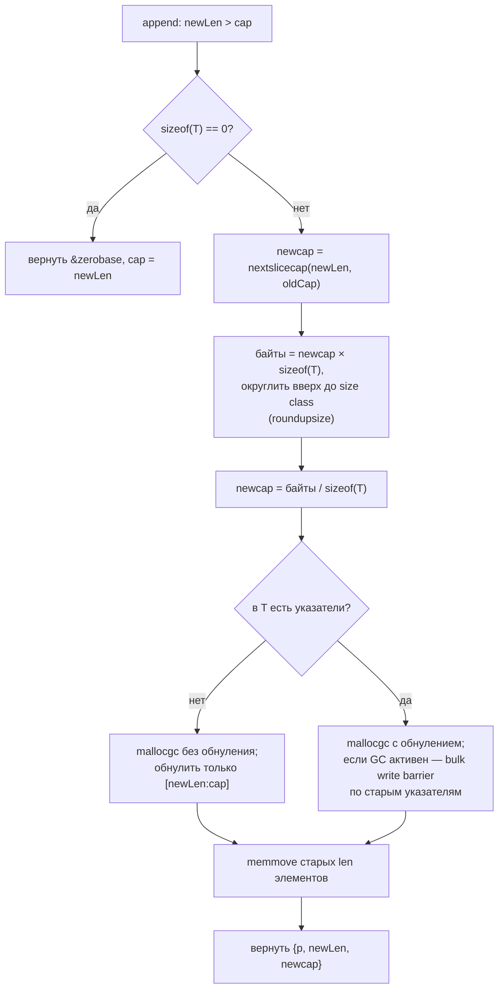
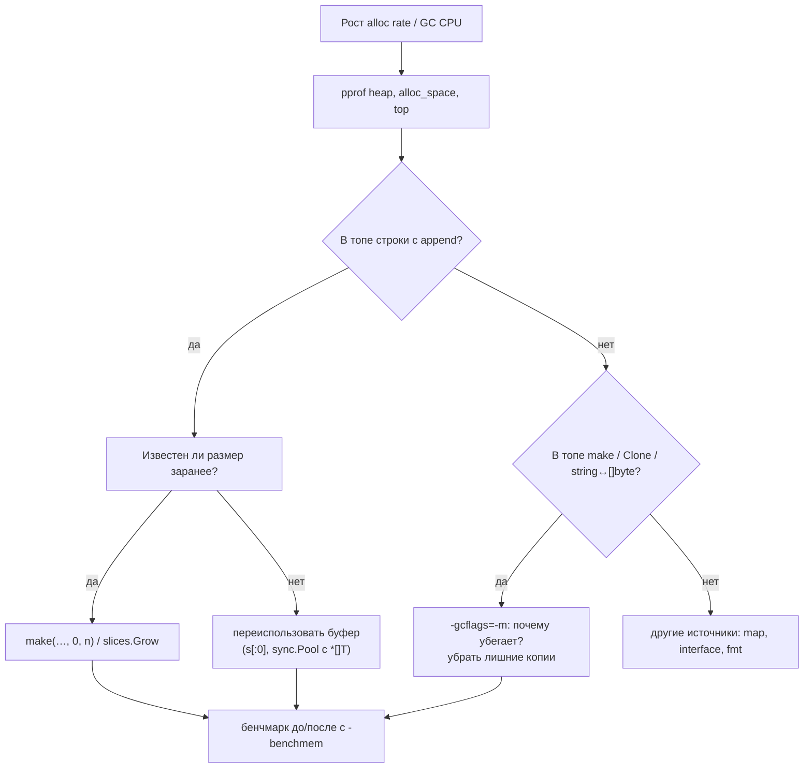

# Go Slices: Deep Dive для Senior Go-разработчика

> Актуально для **Go 1.27** (go1.27.0 выпущен в августе 2026; последний патч на момент написания — go1.27.2).
> Факты сверены с исходниками тега `go1.27.0`: рантайм (`src/runtime/slice.go`, `msize.go`, `malloc.go`, `src/internal/runtime/gc/sizeclasses.go`), компилятор (`src/cmd/compile/internal/ssagen/ssa.go`, `walk/builtin.go`, `walk/range.go`, `escape/utils.go`, `slice/slice.go`, `base/flag.go`), пакет `slices` (`src/slices/`), спецификация (`doc/go_spec.html`), файлы `api/go1.N.txt` и история коммитов.
> Все бенчмарки и выводы команд — **реальные одиночные прогоны** на `go1.27.2 darwin/arm64, Apple M3 Pro, GOMAXPROCS=11` (где указано иное — в тексте). На вашем железе абсолютные числа будут другими, соотношения — примерно те же.
> Места, где факт не удалось проверить по первоисточнику, помечены **⚠️ не проверено**.
> В выводах команд длинные пути сокращены: `./` — каталог временного модуля, `GOROOT` — каталог тулчейна.

> **Если вы только начинаете разбираться во внутренностях Go:** сначала прочитайте [словарь терминов](#словарь-терминов). Перед плотными местами стоят блоки **«Простыми словами»**: их достаточно для общего понимания, детали под ними можно читать позже. Разделы 1, 3, 4 и 5 нужны всем, кто пишет на Go; разделы 2 и 3.6 — про то, как компилятор и рантайм размещают память.

---

## Оглавление

- [Словарь терминов](#словарь-терминов)
- [TL;DR](#tldr)
- [1. Модель: массив, слайс и заголовок](#1-модель-массив-слайс-и-заголовок)
- [2. Где живёт массив: память и escape-анализ](#2-где-живёт-массив-память-и-escape-анализ)
- [3. append и рост ёмкости](#3-append-и-рост-ёмкости)
- [4. Общий массив: алиасинг и удержание памяти](#4-общий-массив-алиасинг-и-удержание-памяти)
- [5. Копирование, итерация, очистка](#5-копирование-итерация-очистка)
- [6. Пакет slices и итераторы](#6-пакет-slices-и-итераторы)
- [7. unsafe и reflect](#7-unsafe-и-reflect)
- [8. Слайсы и конкурентность](#8-слайсы-и-конкурентность)
- [9. Настройки и параметры](#9-настройки-и-параметры)
- [10. Production: сервисы и Kubernetes](#10-production-сервисы-и-kubernetes)
- [11. Наблюдаемость и диагностика](#11-наблюдаемость-и-диагностика)
- [12. Оптимизация](#12-оптимизация)
- [13. Грабли, заблуждения и советы: сводка](#13-грабли-заблуждения-и-советы-сводка)
- [14. Сравнение с другими платформами](#14-сравнение-с-другими-платформами)
- [15. Вопросы для собеседования](#15-вопросы-для-собеседования)
- [16. Чеклист и шпаргалка](#16-чеклист-и-шпаргалка)

---

## Словарь терминов

Термины встречаются по всему документу. Имена функций рантайма даны как справка: их не нужно запоминать, достаточно понимать, что за ними стоит.

**Язык**

| Термин | Простыми словами |
|---|---|
| Массив (array) | Ряд из N значений одного типа, лежащих в памяти подряд. Размер — часть типа: `[4]int` и `[5]int` — разные типы. Присваивание копирует все элементы. |
| Слайс (slice) | «Окно» в массив: указатель на первый элемент окна, длина и ёмкость. Сам слайс маленький (24 байта на 64-битной платформе), данные лежат в массиве. |
| Заголовок слайса (slice header) | Те самые три поля: `ptr`, `len`, `cap`. При передаче слайса в функцию копируется только заголовок. |
| Базовый массив (backing array) | Массив, в который смотрит слайс. Несколько слайсов могут смотреть в один массив. |
| Длина (`len`) | Сколько элементов видно через слайс. Индексы `0..len-1`. |
| Ёмкость (`cap`) | Сколько элементов есть в массиве от начала окна до конца массива. Это запас, в который `append` может писать без выделения новой памяти. |
| Выражение среза | `s[low:high]` — новое окно в тот же массив. `s[low:high:max]` («полное выражение среза») дополнительно ограничивает ёмкость. |
| nil-слайс | Слайс без массива: `var s []int`. `len == cap == 0`, `s == nil`. С ним работают `len`, `append`, `range`. |
| Алиасинг (aliasing) | Два слайса смотрят в один массив: изменение через один видно через другой. |
| `append` | Встроенная функция: дописывает элементы в конец. Если ёмкости не хватает, выделяет новый массив побольше и копирует туда старые элементы. Всегда возвращает новый заголовок — его нужно присвоить. |
| `copy` | Встроенная функция: копирует `min(len(dst), len(src))` элементов, возвращает их число. |
| `clear` | Встроенная функция (Go 1.21): обнуляет все элементы слайса, длину не меняет. |
| Амортизированная сложность | Средняя цена операции на длинной серии. Отдельный `append` иногда дорогой (копирование), но в среднем — O(1), потому что массив растёт в разы, а не на 1. |

**Рантайм и компилятор**

| Термин | Простыми словами |
|---|---|
| Рантайм (runtime) | Код, который Go добавляет в каждую программу: выделение памяти, сборщик мусора, планировщик. |
| Куча (heap) | Общая память программы, которую чистит сборщик мусора (GC). Выделение в куче стоит десятки наносекунд и создаёт работу для GC. |
| Стек (stack) | Память конкретной горутины для локальных переменных. Выделение почти бесплатное, освобождается при выходе из функции, GC её не чистит. |
| Escape-анализ | Проверка компилятора: может ли значение пережить функцию («убежать»). Если нет — его можно положить на стек. Результат показывает `go build -gcflags=-m`. |
| Size class (класс размера) | Рантайм выделяет маленькие объекты (до 32 КБ) не любого размера, а из фиксированной лестницы: 8, 16, 24, 32, 48, 64, … байт. Запрос округляется вверх до ступеньки. Поэтому `cap` после `append` бывает «странной»: 848, 853, 1365. |
| `mallocgc` | Функция рантайма, которая выделяет память в куче. |
| `makeslice` | Функция рантайма, в которую превращается `make([]T, len, cap)`, когда массив нужно положить в кучу. |
| `growslice` | Функция рантайма, которую вызывает `append`, когда не хватает ёмкости: выбирает новую ёмкость, выделяет массив, копирует. |
| `memmove` | Быстрое копирование блока байт. Им копируются элементы при росте и в `copy`. |
| noscan | Пометка «в этом объекте нет указателей». GC такой объект не просматривает, и рантайму не нужно обнулять всю память заранее. |
| Write barrier | Несколько команд, которыми программа сообщает GC о записи указателя, пока GC работает параллельно с ней. Касается слайсов с указателями (`[]*T`, `[]string`). |
| Проверка границ (bounds check) | Перед `s[i]` компилятор вставляет проверку `0 <= i < len(s)`; при нарушении — паника. |
| BCE (bounds check elimination) | Компилятор убирает проверку, если доказал, что индекс точно в границах. |
| Встраивание (inlining) | Компилятор подставляет тело маленькой функции в место вызова. Влияет на escape-анализ. |

**Инструменты**

| Термин | Простыми словами |
|---|---|
| `-gcflags=-m` | Флаг компилятора: печатает решения escape-анализа и встраивания. |
| `-race` | Детектор гонок: программа с проверками, которая сообщает о небезопасном одновременном доступе. |
| pprof | Профилировщик: показывает, где программа тратит CPU (`-cpuprofile`) и где выделяет память (`-memprofile`). |
| `-benchmem` | Флаг `go test`: показывает в бенчмарках байты и число выделений памяти на операцию. |

---

## TL;DR

1. **Слайс — это заголовок из трёх слов** (`ptr`, `len`, `cap`; 24 байта на 64-битной платформе), а данные лежат в отдельном массиве. Присваивание и передача в функцию копируют заголовок, не данные (§1.2, замер `unsafe.Sizeof`).
2. **`append` всегда присваивайте обратно** (`s = append(s, x)`). Внутри функции `append` к параметру не виден вызывающему: меняется копия заголовка. `ineffassign` ловит, `go vet` — нет (§4.3).
3. **Рост ёмкости:** если нужно больше `2×cap` — ровно сколько нужно; при `cap < 256` — вдвое; дальше плавно до ×1,25 по формуле `newcap += (newcap + 768) / 4`. Затем округление вверх до size class, поэтому `cap` бывает 848 или 1365. Формула действует с Go 1.18, до этого порог был 1024 (§3.3–3.4).
4. **Рост дорог не только по CPU:** собрать 100 000 структур через `append` без предвыделения — 28 выделений и 16,4 МБ мусора против одного выделения на 3,2 МБ; пик памяти процесса — 570 МБ против 234 МБ на 240 МБ данных (§3.5).
5. **С Go 1.25 маленькие массивы слайсов могут жить на стеке:** `make([]T, n)` с переменным `n` до 32 байт и первый буфер `append` для локального слайса. **С Go 1.26** — даже если слайс возвращается из функции (`move2heap`): сбор 3 элементов — 1 выделение вместо 3, 10,6 нс против 42 нс (§2.3, §3.6).
6. **Подслайс делит массив с исходным.** `append` в подслайс с запасом ёмкости молча перезапишет элементы исходного слайса. Защита — полное выражение среза `s[a:b:b]` (§4.1–4.2).
7. **Маленький подслайс держит весь массив:** 100 заголовков по 16 байт из сообщений по 1 МБ удержали 100 МБ кучи; `bytes.Clone` — 0,2 МБ (§4.4).
8. **nil и пустой слайс почти одинаковы**, но `json.Marshal` даёт `null` и `[]`, а `reflect.DeepEqual` считает их разными. `slices.Equal` — одинаковыми (§1.4).
9. **`range` копирует элемент в переменную.** Изменение `v.Field` в цикле не меняет слайс; ни `go vet`, ни staticcheck это не ловят. Если копия «материализуется» (берётся адрес), цикл по значению на структурах в 250 байт был в 10 раз медленнее, чем по индексу (§5.2, §12.4).
10. **С Go 1.22 у каждой итерации своя переменная цикла**: `&v` в цикле больше не указывает на одно и то же. Поведение зависит от строки `go` в `go.mod` (§5.3).
11. **`slices.Delete`/`DeleteFunc`/`Compact` с Go 1.22 обнуляют освободившийся хвост**, чтобы GC мог собрать объекты по указателям. Ручное `append(s[:i], s[i+1:]...)` хвост не чистит (§4.5).
12. **Конкурентный `append` в общий слайс — гонка данных:** без `-race` теряются элементы (869 из 1000 в замере). Предвыделяйте и пишите по индексу или защищайте мьютексом (§8).
13. **`slices.Sort` в 1,8 раза быстрее `sort.Slice`** и не выделяет память (100 000 int: 4,7 мс против 8,5 мс) (§6.5).
14. **В `sync.Pool` кладите `*[]byte`, не `[]byte`:** иначе каждый `Put` выделяет 24 байта под заголовок в интерфейсе (staticcheck SA6002; 15 нс/1 alloc против 7,6 нс/0 alloc) (§12.5).
15. **`unsafe.String(unsafe.SliceData(b), len(b))` не копирует**, но строка меняется вместе с `b`; ключ map, созданный так, ломает map (§7).

---

## 1. Модель: массив, слайс и заголовок

> **Простыми словами.** Массив — это коробка с N ячейками, размер которой не меняется. Слайс — это «окошко» в коробку: где окошко начинается, сколько ячеек в нём видно (`len`) и сколько ячеек есть до конца коробки (`cap`). Окошко лёгкое, его можно копировать и передавать. Ячейки при этом остаются одни и те же, поэтому через два окошка можно менять одни данные.

### 1.1 Массив — значение фиксированного размера

Массив `[N]T` — значение: присваивание, передача в функцию и `range` копируют все N элементов. Размер — часть типа, поэтому функция `func f(a [4]int)` не примет `[5]int`. Массивы сравнимы через `==`, если сравним `T`, и могут быть ключом map.

Для сервисного кода массив нужен редко: ключи фиксированной длины (`[16]byte` для UUID, `[32]byte` для SHA-256), маленькие буферы на стеке, `[N]T` внутри структуры. Всё переменной длины — слайсы.

### 1.2 Слайс — окно в массив

Структура слайса в рантайме (`src/runtime/slice.go`):

```go
type slice struct {
	array unsafe.Pointer // указатель на первый элемент окна
	len   int
	cap   int
}
```

```text
  s := make([]int, 3, 5)          t := s[1:4]

  s ┌──────┬─────┬─────┐          t ┌──────┬─────┬─────┐
    │ ptr ─┼─┐   │ len 3 cap 5│     │ ptr ─┼──┐  │ len 3 cap 4│
    └──────┴─┼───┴─────┘          └──────┴──┼──┴─────┘
             ▼                              ▼
  массив   [ 0 ][ 0 ][ 0 ][ 0 ][ 0 ]
             0    1    2    3    4
             └─ видно через s ─┘ └ запас s ┘
                  └── видно через t ──┘ └ запас t ┘
```

`t` смотрит в тот же массив, начиная с элемента 1. Её `cap` — от начала окна до конца массива: `5 - 1 = 4`.

Размер заголовка проверен запуском:

```go
fmt.Println("sizeof slice header:", unsafe.Sizeof([]int{}), "string:", unsafe.Sizeof(""))
```

```text
sizeof slice header: 24 string: 16
```

Строка — тот же заголовок без `cap` (строки неизменяемы, расти им некуда).

**Почему так спроектировано.** Альтернативы — передавать массив целиком (дорого и размер зашит в тип) или указатель на массив (размер всё равно зашит в тип). Слайс отделяет «сколько данных» от «где данные»: одна функция работает с любой длиной, передача стоит три машинных слова, подслайс создаётся без копирования. Цена — алиасинг: несколько слайсов могут неявно делить данные (§4).

> **Заблуждение:** «слайс — это ссылочный тип, как в Java». На самом деле слайс — значение-структура, в которой есть указатель. Копия заголовка разделяет элементы, но не длину и ёмкость. Поэтому `s[0] = x` в функции видно снаружи, а `s = append(s, x)` — нет (§4.3). Спецификация так и описывает слайс: «a descriptor for a contiguous segment of an underlying array» — описатель участка массива.

### 1.3 `len`, `cap` и выражения среза

| Выражение | len | cap | Комментарий |
|---|---|---|---|
| `s[low:high]` | `high-low` | `cap(s)-low` | `high` может быть больше `len(s)`, но не больше `cap(s)` |
| `s[low:high:max]` | `high-low` | `max-low` | полное выражение среза; `max ≤ cap(s)`; для строк запрещено |
| `s[:0]` | 0 | `cap(s)` | «очистить», сохранив массив для повторного использования |
| `s[len(s):]` | 0 | `cap(s)-len(s)` | пустое окно в запас |

Индексы проверяются при выполнении: `0 ≤ low ≤ high ≤ max ≤ cap(s)`. Читать запас «за `len`» можно только через новый срез `s[:cap(s)]`, не через `s[i]`.

Пример из спецификации (`doc/go_spec.html`, «Full slice expressions»): `a := [5]int{1,2,3,4,5}; t := a[1:3:5]` даёт `len 2, cap 4`.

### 1.4 nil и пустой слайс

```go
type Resp struct {
	Items []string `json:"items"`
}

var a []string  // nil
b := []string{} // пустой, не nil
fmt.Println(len(a), cap(a), a == nil, "|", len(b), cap(b), b == nil)
ja, _ := json.Marshal(Resp{Items: a})
jb, _ := json.Marshal(Resp{Items: b})
fmt.Println(string(ja), string(jb))
fmt.Println("DeepEqual:", reflect.DeepEqual(a, b), "slices.Equal:", slices.Equal(a, b))
a = append(a, "ok") // append к nil работает
fmt.Println(a)
```

```text
0 0 true | 0 0 false
{"items":null} {"items":[]}
DeepEqual: false slices.Equal: true
[ok]
```

Для кода на Go разницы почти нет: `len`, `range`, `append` одинаково работают с обоими. Разница видна в трёх местах: сравнение с `nil`, сериализация (`encoding/json` даёт `null`) и `reflect.DeepEqual` (а значит, и тесты на `testify`/`reflect`).

**Грабли: `null` вместо `[]` в API.** Фронтенд или клиент на TypeScript ждёт массив, получает `null` и падает на `.map`. Как заметить: контрактные тесты, логи ошибок клиента. Как исправить: инициализировать поле `make([]T, 0)` или `[]T{}` перед сериализацией там, где контракт требует массив. В `encoding/json/v2` (в Go 1.27 эксперимент `jsonv2` включён по умолчанию, `src/internal/buildcfg/exp.go`) nil-слайс кодируется как `[]`: тот же `Resp` на go1.27.2 дал `{"items":[]}`. Старый `encoding/json` по-прежнему даёт `null`.

> **Совет.** Возвращайте из функций nil-слайс для «ничего не найдено» и не делайте `return []T{}` «на всякий случай» — когда это не уходит в JSON. `[]T{}` с ненулевым `len` не выделяет память, но код с проверкой `res == nil` начинает вести себя по-разному в зависимости от ветки.

### 1.5 Выход за границы: какие паники бывают

Все проверки делаются при выполнении. Реальные сообщения (`s := make([]int, 3, 5)`, индексы приходят из переменных, чтобы компилятор не поймал их заранее):

```text
index          runtime error: index out of range [5] with length 3
slice high     runtime error: slice bounds out of range [:6] with capacity 5
slice 3-idx    runtime error: slice bounds out of range [::6] with capacity 5
low>high       runtime error: slice bounds out of range [4:3]
to array       runtime error: cannot convert slice with length 3 to array or pointer to array with length 4
make len<0     runtime error: makeslice: len out of range
s[:5] ok: [0 0 0 0 0]
```

Последняя строка — не ошибка: срез до `cap` разрешён, элементы запаса видны (здесь нули).

Если индекс — константа, а операнд — массив, ошибку находит компилятор: `invalid argument: index 5 out of bounds [0:3]`. Для слайса — даже литерала `[]int{1, 2, 3}` — проверка остаётся на время выполнения (проверено: `_ = s[5]` для слайс-литерала компилируется).

### 1.6 Преобразования слайс ↔ массив

```go
s := []byte("abcd")
arr := [4]byte(s)  // Go 1.20: копия
p := (*[4]byte)(s) // Go 1.17: указатель на тот же массив
s[0] = 'X'
fmt.Println(string(arr[:]), string(p[:]))
```

```text
abcd Xbcd
```

| Преобразование | С версии | Копирует? | Если `len(s) < N` |
|---|---|---|---|
| `(*[N]T)(s)` | Go 1.17 | нет, указатель в массив слайса | паника |
| `[N]T(s)` | Go 1.20 | да | паника |
| `a[:]` (массив → слайс) | всегда | нет | — |

Версии — из раздела «Language versions» спецификации. Практическое применение: передать первые 16 байт буфера как `[16]byte` (UUID, trace ID) без ручного цикла.

### Что важно для Senior

- Слайс — значение из трёх слов; копия заголовка делит элементы, но не `len`/`cap`. Из этого выводятся почти все грабли раздела 4.
- `cap` — запас, в который `append` пишет без выделения. Срез до `cap` легален и открывает «чужие» элементы.
- nil и пустой слайс различаются только в `== nil`, JSON и `reflect.DeepEqual`; в публичном API зафиксируйте, что отдаёте.
- Паника выхода за границы — всегда ошибка программиста; сообщение содержит индекс и длину или ёмкость — по нему сразу видно, какая проверка не прошла.

---

## 2. Где живёт массив: память и escape-анализ

> **Простыми словами.** Массив слайса может лежать в двух местах. На **стеке** — в памяти функции; это почти бесплатно, но только если массив маленький и не нужен после выхода из функции. В **куче** — общей памяти; это дороже, и потом мусор убирает GC. Компилятор сам решает, куда класть. С каждой версией Go (1.25, 1.26) он кладёт на стек всё больше.

### 2.1 `make` и выделение в куче

`make([]T, len, cap)` для массива в куче превращается в вызов `runtime.makeslice` (`src/runtime/slice.go`):

1. считает `cap * sizeof(T)` с проверкой переполнения; при ошибке — паника `len out of range` или `cap out of range`;
2. вызывает `mallocgc(mem, et, true)` — выделить и обнулить.

Рантайм выделяет маленькие объекты (до `MaxSmallSize = 32768` байт, `src/internal/runtime/gc/sizeclasses.go`) по лестнице size class: `8, 16, 24, 32, 48, 64, 80, 96, 112, 128, …, 896, 1024, …, 6784, …, 10240, …, 20480, …, 32768`. Большие — округляются до страниц по 8 КБ. Запрос в 33 байта займёт 48.

`make` не расширяет `cap` до size class — вы получаете ровно запрошенную ёмкость, хвост ступеньки просто не используется. А `append` расширяет (§3.4): `append([]byte(nil), make([]byte, 33)...)` дал `len 33, cap 48`.

Для элементов без указателей (noscan) рантайм может не обнулять память заранее. `growslice` пользуется этим: обнуляет только часть после новой длины, остальное сразу перезапишет `append` (`mallocgc(capmem, nil, false)` + `memclrNoHeapPointers` в `growslice`).

### 2.2 Стек или куча

Массив попадает на стек, если escape-анализ доказал, что он не переживёт функцию, и размер известен и невелик. Реальный вывод `go build -gcflags=-m` (Go 1.27.2):

```go
func fixedLocal() int {
	buf := make([]byte, 64) // размер известен при компиляции
	return len(buf)
}

func varLocal(n int) int {
	buf := make([]byte, n) // размер известен только при запуске
	return len(buf)
}

func tooBig() int {
	buf := make([]byte, 128<<10) // 128 КБ
	return len(buf)
}

func returned(n int) []byte { return make([]byte, n) }

func stored(n int) { sink = make([]byte, n) }
```

```text
esc/main.go:8:13: make([]byte, 64) does not escape
esc/main.go:13:13: make([]byte, n) does not escape
esc/main.go:18:13: make([]byte, 131072) escapes to heap
esc/main.go:23:13: make([]byte, n) escapes to heap
esc/main.go:27:13: make([]byte, n) escapes to heap
```

| Случай | Куда | Почему |
|---|---|---|
| `make([]T, const)`, не убегает, ≤ 64 КБ | стек | `ir.MaxImplicitStackVarSize = 64 * 1024` (`src/cmd/compile/internal/ir/cfg.go`) |
| `make([]T, const)` > 64 КБ | куча | «too large for stack» (`escape/utils.go`) |
| `make([]T, n)`, не убегает | стек, если `cap*sizeof(T) ≤ 32` байт при выполнении; иначе куча | Go 1.25, §2.3 |
| возвращается, пишется в глобальную переменную, в поле объекта в куче, в интерфейс | куча | значение переживает функцию |

> **Заблуждение:** «`make` с переменным размером всегда идёт в кучу». Это было верно до Go 1.24 включительно. С Go 1.25 компилятор вставляет проверку при выполнении: маленький `cap` — массив на стеке, большой — `makeslice` в куче. `-m` в обоих случаях пишет `does not escape`.

### 2.3 Go 1.25: `make` переменного размера на стеке

Для `make([]T, len, cap)` с неконстантным `cap`, который не убегает, компилятор генерирует такой код (комментарий в `src/cmd/compile/internal/walk/builtin.go`, `walkMakeSlice`):

```go
// K := maxStackSize/sizeof(E)
// if cap <= K {
//     var arr [K]E
//     slice = arr[:len:cap]
// } else {
//     slice = makeslice(elemType, len, cap)
// }
```

`maxStackSize` — `base.Debug.VariableMakeThreshold`, по умолчанию **32 байта** (`src/cmd/compile/internal/base/flag.go`). Для `[]byte` это 32 элемента, для `[]int64` — 4, для структуры в 24 байта — 1, для элементов больше 32 байт оптимизация не применяется.

Почему так мало: стековый буфер резервируется в кадре функции всегда, даже когда сработает ветка с кучей. Большой порог раздул бы стеки всех горутин. Буфер ещё и выравнивается по указателю (обёртка `struct{ _ [0]uintptr; arr [K]E }`), потому что часть пользовательского кода с `unsafe` полагалась на выравнивание, которое давал `mallocgc` (issue 73199 — ссылка в комментарии к коду).

Release notes Go 1.25 (фрагмент `doc/next/5-toolchain.md` из истории репозитория): «The compiler can now allocate the backing store for slices on the stack in more situations… This change has the potential to amplify the effects of incorrect unsafe.Pointer usage». Отключить: `-gcflags=all=-d=variablemakehash=n`; найти конкретное место — `bisect -compile=variablemake`.

**Грабли: `unsafe`-код, который «работал годами», падает после обновления на 1.25+.** Если код через `unsafe.Pointer` сохраняет указатель на элементы слайса туда, где компилятор его не видит, а массив теперь на стеке, после выхода из функции указатель смотрит в чужой кадр стека. Как заметить: странные данные или падения только на новой версии; сборка с `-d=variablemakehash=n` их убирает. Как исправить: найти место через `bisect`, затем убрать незаконное использование `unsafe` (правила — в документации `unsafe.Pointer`).

### 2.4 Слайсы элементов нулевого размера

`[]struct{}` не хранит данных. `growslice` для `et.Size_ == 0` сразу возвращает `slice{unsafe.Pointer(&zerobase), newLen, newLen}` — указатель на общую глобальную переменную `runtime.zerobase` (`src/runtime/malloc.go`). Выделений памяти нет, сколько бы элементов ни было. Отсюда следствие: адреса `&s[0]` у разных `[]struct{}` могут совпадать — спецификация это разрешает.

### Что важно для Senior

- Слайс в куче — это одно выделение под массив; заголовок обычно живёт на стеке или внутри другой структуры.
- `-gcflags=-m` показывает решение escape-анализа для каждого `make` и `append`; «does not escape» для переменного `make` с Go 1.25 значит «на стеке, если ≤ 32 байт при выполнении».
- Порог 32 байта и 64 КБ — константы компилятора, не настройки рантайма. Менять их в production не нужно.
- Ошибки `unsafe`, скрытые раньше, могут проявиться после перехода на 1.25/1.26; выключатель `-d=variablemakehash=n` — для диагностики, не для постоянной работы.

---

## 3. append и рост ёмкости

> **Простыми словами.** `append` смотрит, есть ли в массиве свободное место после `len`. Если есть — просто пишет туда и увеличивает длину. Если нет — заводит новый массив побольше (примерно вдвое для маленьких слайсов, примерно на четверть для больших), переносит туда всё старое и дописывает новое. Старый массив становится мусором. Поэтому `append` в среднем дешёвый, но иногда — дорогой.

### 3.1 Что компилятор делает с `append`

`append` — не обычная функция: компилятор разворачивает его на месте (`(*state).append` в `src/cmd/compile/internal/ssagen/ssa.go`). Для `s = append(s, e1, e2, e3)` получается примерно такой код (комментарий из исходника, сокращён):

```go
// ptr, len, cap := s
// len += 3
// if uint(len) > uint(cap) {
//     ptr, len, cap = growslice(ptr, len, cap, 3, typ)
// }
// *(ptr+(len-3)) = e1   // с write barrier, если нужно
// *(ptr+(len-2)) = e2
// *(ptr+(len-1)) = e3
```

Быстрый путь — сравнение и несколько записей, без вызова функции. В рантайм (`growslice`) уходим только при нехватке ёмкости.

### 3.2 `growslice` по шагам

`runtime.growslice` (`src/runtime/slice.go`):



Важные следствия:
- Старый массив **не освобождается** явно — он становится мусором, если на него никто не ссылается. Его соберёт GC.
- Копируются только `oldLen` элементов, не весь `oldCap`.
- Для типов с указателями память обнуляется целиком: GC может начать сканировать объект сразу, и мусор в нём выглядел бы как указатели.
- Есть экспериментальный вариант `growsliceNoAlias`, который при `GOEXPERIMENT=runtimefreegc` сразу возвращает старый массив аллокатору, если компилятор доказал, что на него никто не ссылается. Эксперимент **выключен по умолчанию** (коммит `5a347b775e`, «set GOEXPERIMENT=runtimefreegc to disabled by default»; в базовом наборе `src/internal/buildcfg/exp.go` его нет).

### 3.3 Формула роста

`runtime.nextslicecap` (с Go 1.22 вынесена в отдельную функцию, коммит `1d84b02b22`; сама формула — с Go 1.18):

```go
func nextslicecap(newLen, oldCap int) int {
	newcap := oldCap
	doublecap := newcap + newcap
	if newLen > doublecap {
		return newLen // просят больше удвоения — даём ровно сколько просят
	}
	const threshold = 256
	if oldCap < threshold {
		return doublecap // маленький слайс — удвоить
	}
	for {
		// плавный переход от ×2 к ×1,25
		newcap += (newcap + 3*threshold) >> 2
		if uint(newcap) >= uint(newLen) {
			break
		}
	}
	...
}
```

Коэффициент роста по формуле (из сообщения коммита `2dda92ff6f`, Go 1.18):

| Старая ёмкость | Коэффициент |
|---|---|
| < 256 | 2,0 |
| 256 | 2,0 |
| 512 | 1,63 |
| 1024 | 1,44 |
| 2048 | 1,35 |
| 4096 | 1,30 |
| → ∞ | → 1,25 |

**Почему так.** До Go 1.18 было `×2` при `cap < 1024` и `×1,25` после. У этого были две проблемы: резкий скачок коэффициента и немонотонность — больший начальный `cap` мог дать меньший итоговый. Новый порог 256 подобран так, чтобы общее число перевыделений при росте до очень большого слайса осталось примерно прежним. Компромисс: удвоение даёт меньше копирований, но больше неиспользуемой памяти; ×1,25 для больших слайсов экономит память ценой большего числа копирований.

> **Заблуждение:** «слайс растёт вдвое до 1024 элементов, потом на 25%». Это было верно до Go 1.17 включительно. С Go 1.18 порог — 256 и переход плавный. Плюс к формуле всегда добавляется округление до size class (§3.4), поэтому ни «ровно ×2», ни «ровно ×1,25» на практике не бывает.

### 3.4 Округление до size class: почему `cap` «странная»

После формулы `growslice` переводит ёмкость в байты и округляет вверх до ближайшего size class (`roundupsize`, `src/runtime/msize.go`), а затем обратно в элементы. Реальная последовательность `cap` при добавлении по одному элементу (слайс заставили «убежать» в кучу, чтобы исключить стековый буфер из §3.6):

```text
byte     heap  [8 16 32 64 128 256 512 896 1408 2048 3072]
int64    heap  [1 2 4 8 16 32 64 128 256 512 848 1280 1792 2560]
Event24  heap  [1 2 4 8 16 32 64 128 256 512 853 1365 2048 3072]
```

Разбор для `int64` после 512:
- формула: `512 + (512 + 768) / 4 = 832` элементов → `832 × 8 = 6656` байт;
- ближайший size class сверху — 6784 байта → `6784 / 8 = 848`.

Для структуры в 24 байта: `832 × 24 = 19968` → класс 20480 → `20480 / 24 = 853` (остаток 8 байт пропадает).

Для `[]byte` первый `append` к nil даёт `cap 8`, а не 1: минимальный класс — 8 байт.

Для больших массивов (больше 32 КБ) округление идёт до страницы 8 КБ. Для элементов с указателями, если массив больше 512 байт, учитывается 8-байтовый заголовок аллокатора (`MallocHeaderSize = 8`, `MinSizeForMallocHeader = 8 × 64 = 512`, `src/internal/runtime/gc/malloc.go`): рантайм вычитает его из размера класса, поэтому `cap` чуть меньше.

> **Совет.** Не пишите тесты и код, которые полагаются на конкретное значение `cap` после `append`. Оно зависит от size class-таблицы и от того, где лежит слайс (стек или куча), и менялось в Go 1.18, 1.25 и 1.26. Полагаться можно только на `cap(s) >= len(s)` и на `cap` после `make`.

### 3.5 Цена роста: копирование, мусор и пиковая память

Сбор структур по 32 байта (`Order{ID, UserID, Amount, Status int64}`) разными способами:

```go
func collectAppend(n int) []Order { // ёмкость не задана
	var res []Order
	for i := range n {
		res = append(res, Order{ID: int64(i)})
	}
	return res
}

func collectPrealloc(n int) []Order { // ёмкость известна заранее
	res := make([]Order, 0, n)
	for i := range n {
		res = append(res, Order{ID: int64(i)})
	}
	return res
}
```

```text
BenchmarkCollect/append/n=10-11         	 9913976	       120.1 ns/op	     960 B/op	       4 allocs/op
BenchmarkCollect/prealloc/n=10-11       	30447868	        34.70 ns/op	     320 B/op	       1 allocs/op
BenchmarkCollect/append/n=1000-11       	  182823	      6692 ns/op	  100928 B/op	      11 allocs/op
BenchmarkCollect/prealloc/n=1000-11     	  625294	      1949 ns/op	   32768 B/op	       1 allocs/op
BenchmarkCollect/append/n=100000-11     	    1780	    679097 ns/op	16403066 B/op	      28 allocs/op
BenchmarkCollect/prealloc/n=100000-11   	   12732	     95384 ns/op	 3203074 B/op	       1 allocs/op
```

На 100 000 элементов: в 7 раз дольше, в 5 раз больше выделенной памяти (16,4 МБ против 3,2 МБ), 28 выделений против одного. Всё, кроме последнего массива, — мусор для GC.

**Пиковая память.** Во время роста старый и новый массивы живут одновременно. 30 млн `int64` (229 МБ данных), отдельный процесс, `/usr/bin/time -l`:

```text
append   cap=30078976 (229 MB)  TotalAlloc=1147 MB  HeapSys=728 MB
           597164032  maximum resident set size
prealloc cap=30000000 (229 MB)  TotalAlloc=229 MB  HeapSys=236 MB
           245465088  maximum resident set size
```

Пик процесса — 570 МБ против 234 МБ для тех же данных. Для контейнера с лимитом 512 МиБ это разница между «работает» и OOMKilled (§10).

> **Совет.** Если число элементов известно или его можно оценить (`len(rows)`, `COUNT(*)`, размер партии Kafka), создавайте слайс через `make([]T, 0, n)` или `slices.Grow`. Эффект в замере выше: ×3,5–7 по времени, одно выделение вместо 11–28. Не нужно, если элементов обычно единицы и верхняя граница неизвестна: завышенная оценка тратит память на каждый вызов.

### 3.6 Go 1.25–1.26: стековый буфер для `append` и `move2heap`

> **Простыми словами.** Компилятор научился давать слайсу первый маленький буфер на стеке (32 байта). Пока слайс маленький, в куче ничего не выделяется. С Go 1.26 это работает даже если слайс в конце возвращается из функции: перед `return` компилятор переносит данные в кучу одним выделением точного размера, вместо трёх-четырёх промежуточных.

**Go 1.25** (коммит `ce88e341b9`, «allocate backing store for append on the stack»): если результат `append` не убегает, первый буфер берётся на стеке размером 32 байта. Это видно по первой ёмкости локального слайса:

```text
# Go 1.24.4, слайс не убегает
byte     local [8 16 32 64 128 256 512 896 1408 2048 3072]
int64    local [1 2 4 8 16 32 64 128 256 512 848 1280 1792 2560]

# Go 1.25.3 и 1.27.2, тот же код
byte     local [32 64 128 256 512 896 1408 2048 3072]
int64    local [4 8 16 32 64 128 256 512 848 1280 1792 2560]
```

**Go 1.26** (коммиты `32f5aadd2f` и `3c6bf6fbf3`, CL 707755 и 722440): то же, даже если слайс возвращается. Компилятор (пакет `src/cmd/compile/internal/slice`) доказывает, что переменная-слайс «эксклюзивна» — никто больше не держит ссылку на её стековый буфер, — и перед каждым местом, где эксклюзивность теряется (`return s`, `x = s`, передача в убегающую функцию), вставляет `s = move2heap(s)`: если массив на стеке — скопировать в кучу, иначе ничего не делать. Если `cap` и элементы за `len` дальше нигде не используются, копия делается размером «следующий size class от `len`», а не `cap`.

Функция, которая собирает и возвращает ID (`//go:noinline`, чтобы замер шёл по самой функции):

```go
//go:noinline
func smallIDs(n int) []int {
	var r []int
	for i := range n {
		r = append(r, i)
	}
	return r
}
```

```text
# go1.25.3
BenchmarkSmallReturned/n=3-11    28799769     42.34 ns/op     56 B/op    3 allocs/op
BenchmarkSmallReturned/n=4-11    27639472     43.85 ns/op     56 B/op    3 allocs/op
BenchmarkSmallReturned/n=5-11    18852942     62.99 ns/op    120 B/op    4 allocs/op
BenchmarkSmallReturned/n=20-11   10619923    115.5  ns/op    504 B/op    6 allocs/op
# go1.27.2
BenchmarkSmallReturned/n=3-11   112580322     10.61 ns/op     24 B/op    1 allocs/op
BenchmarkSmallReturned/n=4-11   100000000     11.32 ns/op     32 B/op    1 allocs/op
BenchmarkSmallReturned/n=5-11    69463707     16.95 ns/op     64 B/op    1 allocs/op
BenchmarkSmallReturned/n=20-11   17888120     69.59 ns/op    448 B/op    3 allocs/op
# go1.27.2 -gcflags=-d=variablemakehash=n (оптимизация выключена)
BenchmarkSmallReturned/n=3-11    31905630     37.81 ns/op     56 B/op    3 allocs/op
BenchmarkSmallReturned/n=20-11   11084877    110.1  ns/op    504 B/op    6 allocs/op
```

Для `n=3`: одно выделение на 24 байта (ровно 3 `int`, size class 24) вместо трёх, в 4 раза быстрее.

Как увидеть оптимизацию: `-gcflags=-m` продолжает писать `append escapes to heap`, потому что результат действительно уходит в кучу. Видно в ассемблере:

```text
$ go build -gcflags=-S ./esc 2>&1 | <вызовы внутри main.ids>
CALL	runtime.growslice(SB)
CALL	runtime.moveSliceNoCapNoScan(SB)
```

`moveSlice*` — реализация `move2heap` в рантайме (`src/runtime/slice.go`).

**Границы оптимизации** (из исходников и замеров):
- элемент не больше 32 байт (`getBackingStoreInfo` в `ssa.go` отказывается при `et.Size() > maxStackSize`);
- обрабатывается `append` с фиксированным числом элементов; `append(s, other...)` — нет (TODO в `ssa.go`);
- в нашем замере, когда `smallIDs` без `//go:noinline` встраивалась в бенчмарк, где результат сразу пишется в глобальную переменную, оптимизация не срабатывала: 3 выделения, 56 байт. Правило про «эксклюзивность» проверяется для конкретной переменной в конкретной функции после встраивания.

> **Заблуждение:** «предвыделение маленьких слайсов больше не нужно, компилятор всё сделает сам». Оптимизация покрывает только первые 32 байта. Уже на 20 `int` остаётся 3 выделения против одного с `make([]int, 0, n)`. Для больших слайсов §3.5 по-прежнему в силе.

### 3.7 Несколько элементов и `append(s, other...)`

- `append(s, a, b, c)` и `append(s, other...)` вызывают `growslice` не более одного раза. Если `newLen > 2×cap`, новая ёмкость — ровно `newLen` (до округления): `append([]int{1,2,3}, 4,5,6,7,8)` дал `len 8, cap 8`.
- `append([]byte(nil), make([]byte, 33)...)` дал `cap 48`: 33 байта округлены до класса 48.
- `append(s, make([]T, n)...)` компилятор распознаёт и не создаёт временный слайс (`isAppendOfMake`, `extendSlice` в `src/cmd/compile/internal/walk/assign.go`). На этом построен `slices.Grow`: `append(s[:cap(s)], make([]E, n)...)[:len(s)]` — одно выделение.
- `append([]byte(nil), str...)` — разрешено (строка как источник байт).

**Грабли: результат `append` не присвоен.** Выражение `append(s, x)` без присваивания не компилируется (`append(s, x) (value of type []int) is not used`). Зато легко присвоить не туда — `other = append(s, x)` — и потом читать `s`. Об этом §4.1.

### Что важно для Senior

- `append` — развёрнутый компилятором быстрый путь плюс `growslice` при нехватке места; амортизированно O(1), но каждое перевыделение — копирование и мусор.
- Формула: >2×cap → ровно сколько нужно; <256 → ×2; дальше плавно к ×1,25; затем size class. С Go 1.18.
- Рост без предвыделения стоит до ×5 выделенной памяти и ×2,5 пикового RSS — это видно в контейнерах с лимитом памяти.
- Go 1.25/1.26 убирают выделения для очень маленьких слайсов (≤ 32 байт), включая возвращаемые; на больших слайсах предвыделение по-прежнему главный приём.

---

## 4. Общий массив: алиасинг и удержание памяти

> **Простыми словами.** Когда вы делаете `t := s[1:3]`, данные не копируются: `t` и `s` смотрят в одну коробку. Это быстро, но коварно: запись через `t` меняет `s`, `append` в `t` может затереть элементы `s`, а маленький `t` не даёт GC выбросить большую коробку целиком.

### 4.1 `append` в подслайс перезаписывает чужие данные

**Грабли: «приоритетные» заказы затёрли партию.**

```go
// Партия заказов из Kafka; первые два — «приоритетные».
batch := make([]string, 3, 4)
copy(batch, []string{"o-1", "o-2", "o-3"})

priority := batch[:2]                   // len 2, cap 4 — тот же массив
priority = append(priority, "o-urgent") // места хватает: пишем в batch[2]!
fmt.Println("batch:   ", batch)
fmt.Println("priority:", priority)
```

```text
batch:    [o-1 o-2 o-urgent]
priority: [o-1 o-2 o-urgent]
```

Почему так: у `priority` `len 2`, `cap 4`. Места хватает, `append` пишет в элемент 2 общего массива, где лежал `o-3`. Новый массив не создаётся. Если бы ёмкости не хватило, `append` создал бы новый массив и `batch` не пострадал бы — поэтому ошибка проявляется «иногда», в зависимости от запаса ёмкости.

Как заметить: `go vet`, staticcheck и golangci-lint (проверено `golangci-lint 2.11.4` с `staticcheck`, `govet`, `gocritic`, `ineffassign`) не ловят. В production — «пропавшие» или задублированные записи, которые не воспроизводятся на малых данных. Как исправить: §4.2.

### 4.2 Полное выражение среза как защита

```go
batch2 := []string{"o-1", "o-2", "o-3", ""}[:3]
safe := batch2[:2:2]            // len 2, cap 2
safe = append(safe, "o-urgent") // места нет → новый массив
fmt.Println("batch2:  ", batch2)
fmt.Println("safe:    ", safe)
```

```text
batch2:   [o-1 o-2 o-3]
safe:     [o-1 o-2 o-urgent]
```

`s[low:high:high]` делает `cap == len`: первый же `append` уйдёт в новый массив. То же делает `slices.Clip(s)` (Go 1.21) — `s[:len(s):len(s)]`.

> **Совет.** Когда функция или метод отдаёт наружу подслайс своего внутреннего буфера (парсер, кольцевой буфер, батчер), отдавайте `buf[a:b:b]`. Это бесплатно и защищает от `append` вызывающей стороны. Не нужно, если отдаёте копию.

### 4.3 Слайс в параметрах функции

```go
func addTag(tags []string, t string) {
	tags = append(tags, t) // меняется локальная копия заголовка
}

func upper(tags []string) {
	tags[0] = "PROD" // меняется общий массив
}

tags := make([]string, 1, 8)
tags[0] = "prod"
addTag(tags, "eu-west")
fmt.Println(len(tags), tags, tags[:2])
upper(tags)
fmt.Println(tags)
```

```text
1 [prod] [prod eu-west]
[PROD]
```

Три урока из одного вывода:
1. `len(tags)` у вызывающего не изменился: функция получила копию заголовка.
2. Но `eu-west` **записан** в общий массив — его видно через `tags[:2]`. Функция с `append` к параметру может портить данные за `len` у вызывающего.
3. Запись по индексу видна снаружи.

Как заметить: `ineffassign` ловит строку `tags = append(tags, t)`:

```text
fn/main.go:6:2: ineffectual assignment to tags (ineffassign)
```

`go vet` — нет. Как исправить: вернуть слайс (`func addTag(tags []string, t string) []string`) — это идиома стандартной библиотеки (`strconv.AppendInt`, `fmt.Appendf`) — или принимать `*[]string`, если API так проще.

### 4.4 Утечка памяти через маленький подслайс

**Грабли: кэш заголовков удерживает все сообщения целиком.**

```go
// Читаем «сообщение» на 1 МБ, а храним только заголовок из 16 байт.
func headerView(msg []byte) []byte  { return msg[:16] }
func headerClone(msg []byte) []byte { return bytes.Clone(msg[:16]) }

func run(name string, f func([]byte) []byte) {
	cache := make([][]byte, 0, 100)
	for range 100 {
		msg := make([]byte, 1<<20)
		cache = append(cache, f(msg))
	}
	fmt.Printf("%-12s heap=%.1f MB  (хранимых данных: %d байт)\n", name, heapMB(), 100*16)
	runtime.KeepAlive(cache)
}
```

```text
view msg[:16] heap=100.2 MB  (хранимых данных: 1600 байт)
bytes.Clone  heap=0.2 MB  (хранимых данных: 1600 байт)
```

Почему так: GC не умеет освобождать часть объекта. Пока жив хоть один указатель внутрь массива (`msg[:16]` указывает на его начало), жив весь массив в 1 МБ. То же для строк: `s[:16]` от большой строки держит всю строку.

Как заметить: heap-профиль (`-memprofile`, `/debug/pprof/heap`, `inuse_space`) показывает большие объекты, выделенные в коде чтения (`io.ReadAll`, декодер), хотя логически они давно не нужны; RSS растёт с размером кэша непропорционально. Линтеры не ловят. Как исправить: копировать то, что хранится долго — `bytes.Clone` (Go 1.20), `strings.Clone` (Go 1.20), `slices.Clone` (Go 1.21).

> **Совет.** Правило для кэшей, map и долгоживущих структур: всё, что получено подслайсом из сетевого буфера, файла или ответа БД, клонируйте перед сохранением. Эффект в замере: 100 МБ → 0,2 МБ. Не нужно для данных, которые живут в пределах запроса.

### 4.5 Удаление элементов и указатели в хвосте

Удаление «сдвигом» оставляет в массиве за новой `len` старые значения. Если это указатели, GC видит их и не собирает объекты.

```go
type Conn struct{ ID int }

conns := []*Conn{{1}, {2}, {3}, {4}}
// Ручное удаление элемента 1: хвост массива держит лишний указатель.
manual := append(conns[:1:4], conns[2:]...)
fmt.Println("manual:", len(manual), "хвост:", conns[3] != nil)

conns2 := []*Conn{{1}, {2}, {3}, {4}}
res := slices.Delete(conns2, 1, 2)
fmt.Println("slices.Delete:", len(res), "хвост:", conns2[3] != nil)
```

```text
manual: 3 хвост: true
slices.Delete: 3 хвост: false
```

С Go 1.22 `slices.Delete`, `DeleteFunc`, `Compact`, `CompactFunc` и `Replace` обнуляют освободившиеся элементы (коммит `e21dc702d5`, «zero the slice elements discarded by…»; doc-комментарий: «Delete zeroes the elements s[len(s)-(j-i):len(s)]»).

> **Заблуждение:** «`slices.Delete` не трогает хвост, поэтому держит память». Было верно в Go 1.21. С Go 1.22 хвост обнуляется. Но у этого есть обратная сторона: если у вас был второй слайс на тот же массив (алиасинг, §4.1), он теперь увидит нули — раньше видел «старые» значения.

Способы удалить элемент:

| Способ | Порядок | Сложность | Хвост |
|---|---|---|---|
| `slices.Delete(s, i, i+1)` | сохраняется | O(len-i) | обнуляется (1.22+) |
| `s[i] = s[len(s)-1]; s[len(s)-1] = zero; s = s[:len(s)-1]` | нарушается | O(1) | обнулили вручную |
| `slices.DeleteFunc(s, pred)` | сохраняется | O(len) за все удаления | обнуляется (1.22+) |
| цикл с `slices.Delete` по одному | сохраняется | O(n²) | — избегать |

### Что важно для Senior

- Подслайс делит массив; `append` в подслайс с запасом ёмкости молча пишет в чужие данные. Защита — `s[a:b:b]` / `slices.Clip`.
- Функция, которая делает `append` к параметру, должна возвращать слайс; иначе изменения длины теряются, а данные за `len` портятся.
- Маленький подслайс держит весь массив; в долгоживущие структуры кладите копию.
- `slices.Delete` и компания с Go 1.22 чистят хвост — это хорошо для GC, но меняет то, что видят другие слайсы на тот же массив.

---

## 5. Копирование, итерация, очистка

### 5.1 `copy`

`copy(dst, src)` копирует `min(len(dst), len(src))` элементов и возвращает их число. Учитывается `len`, не `cap`: `copy` в `make([]T, 0, n)` скопирует ноль элементов — частая ошибка при «клонировании».

Перекрытие `dst` и `src` разрешено (используется `memmove`), поэтому `copy(s[i:], s[i+1:])` корректно сдвигает элементы. Для элементов без указателей компилятор вызывает `runtime.slicecopy`, для элементов с указателями — копирование с write barrier.

Способы клонировать:

| Код | Сохраняет nil | Выделений | Комментарий |
|---|---|---|---|
| `slices.Clone(s)` | да | 1 | Go 1.21; внутри `append(S{}, s...)`, `cap` может быть больше `len` |
| `append([]T(nil), s...)` | нет: для пустого `s` даёт nil | 1 | классическая идиома |
| `dst := make([]T, len(s)); copy(dst, s)` | нет | 1 | точная ёмкость; `make`+`copy` компилятор объединяет в `makeslicecopy` |
| `s[:0:0]` + `append` | — | — | избегать: держит ссылку на исходный массив при пустом `s` (issue 68488, комментарий в `slices.Clone`) |

### 5.2 `range`: что копируется и когда вычисляется

`for i, v := range s` — `v` получает **копию** элемента. Сам слайс (заголовок) вычисляется один раз до начала цикла.

**Грабли: изменение копии в цикле.**

```go
type Pod struct {
	Name     string
	Restarts int
}

pods := []Pod{{"api-0", 0}, {"api-1", 0}}
for _, p := range pods {
	p.Restarts++ // меняется копия
}
fmt.Println(pods)
for i := range pods {
	pods[i].Restarts++
}
fmt.Println(pods)

// range вычисляет слайс один раз: добавленное в цикле не обходится.
queue := []string{"a", "b"}
for _, q := range queue {
	if q == "a" {
		queue = append(queue, "c")
	}
}
fmt.Println(queue, "- обошли только 2 элемента")
```

```text
[{api-0 0} {api-1 0}]
[{api-0 1} {api-1 1}]
[a b c] - обошли только 2 элемента
```

Как заметить: `go vet` молчит; golangci-lint 2.11.4 с `staticcheck`, `govet`, `gocritic`, `ineffassign` в конфигурации по умолчанию тоже промолчал. Симптом — «обновление не применилось». Как исправить: цикл по индексу (`pods[i].X = …`) или слайс указателей `[]*Pod`, если элементы большие и часто меняются.

Для очереди, которая растёт во время обхода (обход графа, BFS), нужен цикл `for i := 0; i < len(queue); i++` — он перечитывает `len` на каждой итерации.

### 5.3 Переменная цикла и указатели (Go 1.22)

```go
type User struct{ Name string }

users := []User{{"ann"}, {"bob"}, {"eve"}}
var ptrs []*User
for _, u := range users {
	ptrs = append(ptrs, &u) // адрес переменной цикла
}
for _, p := range ptrs {
	fmt.Print(p.Name, " ")
}
```

Один и тот же код, тулчейн go1.27.2, разная строка `go` в `go.mod`:

```text
== go 1.21 in go.mod
eve eve eve
== go 1.22 in go.mod
ann bob eve
```

> **Заблуждение:** «`&v` в `range` всегда даёт один и тот же адрес». Было верно до Go 1.21. С Go 1.22 у каждой итерации своя переменная (раздел «Language versions» спецификации). Решает **версия языка модуля** (`go` в `go.mod`), не версия тулчейна. При этом `&u` — по-прежнему адрес **копии**, а не элемента `users`: изменения через `ptrs[i]` в `users` не попадут. Нужен адрес элемента — пишите `&users[i]`.

### 5.4 `clear` и обнуление

`clear(s)` (Go 1.21) обнуляет все элементы `s[:len(s)]`, `len` и `cap` не меняет. Компилятор превращает и `clear(s)`, и цикл

```go
for i := range s {
	s[i] = zero
}
```

в один вызов очистки памяти (`arrayRangeClear` / `arrayClear` в `src/cmd/compile/internal/walk/range.go`), так что вручную писанный цикл не медленнее.

Типовой сценарий — переиспользование буфера с указателями:

```go
batch = batch[:0]  // длина 0, массив тот же
// но старые *Message всё ещё в массиве — GC их не соберёт до перезаписи
clear(batch[:cap(batch)]) // если важно отпустить объекты сразу
```

### 5.5 Проверки границ и BCE

Перед каждым `s[i]` компилятор вставляет проверку. Если может доказать, что индекс в границах, проверку убирает (bounds check elimination). Увидеть оставшиеся проверки: `-gcflags=-d=ssa/check_bce/debug=1`.

```go
// Разбор заголовка пакета: 4 байта длины, big-endian.
func frameLen(b []byte) uint32 {
	return uint32(b[0])<<24 | uint32(b[1])<<16 | uint32(b[2])<<8 | uint32(b[3])
}

func frameLenHint(b []byte) uint32 {
	_ = b[3] // одна проверка вместо четырёх
	return uint32(b[0])<<24 | uint32(b[1])<<16 | uint32(b[2])<<8 | uint32(b[3])
}

func sum(xs []int) int {
	t := 0
	for i := 0; i < len(xs); i++ {
		t += xs[i] // проверка не нужна: i < len(xs)
	}
	return t
}
```

```text
bce/main.go:7:17: Found IsInBounds
bce/main.go:7:36: Found IsInBounds
bce/main.go:7:55: Found IsInBounds
bce/main.go:7:73: Found IsInBounds
bce/main.go:11:7: Found IsInBounds
```

В `frameLen` — четыре проверки, в `frameLenHint` — одна (строка 11, сам `_ = b[3]`), в `sum` — ни одной. Так написан `encoding/binary.BigEndian.Uint32`.

> **Совет.** Подсказку `_ = s[N]` ставьте только в горячих функциях разбора бинарных форматов, которые видны в CPU-профиле, и проверяйте результат флагом `check_bce`. Не нужно в обычном коде: проверка границ — одно сравнение с почти всегда предсказуемым переходом.

### Что важно для Senior

- `copy` копирует по `len`, не по `cap`; перекрытие разрешено.
- `range` копирует элемент; слайс вычисляется один раз. Для изменения — индекс; для растущей очереди — классический `for`.
- С Go 1.22 своя переменная на итерацию; определяется `go` в `go.mod`.
- `clear` и цикл обнуления компилируются в одну очистку памяти; для буферов с указателями чистите хвост, чтобы не держать объекты.

---

## 6. Пакет slices и итераторы

### 6.1 Что есть и с какой версии

Версии — из файлов `api/go1.N.txt`.

| Группа | Функции | Версия |
|---|---|---|
| Поиск и сравнение | `Index`, `IndexFunc`, `Contains`, `ContainsFunc`, `Equal`, `EqualFunc`, `Compare`, `CompareFunc` | 1.21 |
| Изменение на месте | `Insert`, `Delete`, `DeleteFunc`, `Replace`, `Compact`, `CompactFunc`, `Reverse` | 1.21 |
| Ёмкость | `Grow`, `Clip`, `Clone` | 1.21 |
| Сортировка и поиск | `Sort`, `SortFunc`, `SortStableFunc`, `IsSorted*`, `BinarySearch*`, `Min*`, `Max*` | 1.21 |
| Сборка | `Concat` | 1.22 |
| Итераторы | `All`, `Values`, `Backward`, `Collect`, `AppendSeq`, `Sorted`, `SortedFunc`, `SortedStableFunc`, `Chunk` | 1.23 |
| Повтор | `Repeat` | 1.23 |

```text
Grow: 0 10 false
Clip: 2 2
Insert: [1 2 3 4]
Compact: [a b a]
Concat: [1 2 3]
BinarySearch 25: 2 false
```

(`slices.Grow([]int(nil), 10)`, `Clip(make([]int, 2, 10))`, `Insert([]int{1, 4}, 1, 2, 3)`, `Compact` убирает только **соседние** дубликаты, `BinarySearch` возвращает позицию вставки и `false`.)

### 6.2 Модифицирующие функции возвращают слайс

`Insert`, `Delete`, `DeleteFunc`, `Compact`, `Replace`, `Grow`, `Clip` возвращают новый заголовок. Как и с `append`, результат надо присваивать: `s = slices.Delete(s, i, i+1)`. Они работают **на месте**: исходный массив меняется, другие слайсы на него увидят изменения (§4).

### 6.3 nil на входе и выходе

С Go 1.25 поведение с nil задокументировано для всех функций (коммит `4878b4471b`, «document and test nilness behavior of all functions»): «The result preserves the nilness of s» для `Clone`, `Grow`, `Clip`, `Insert`/`Delete` при пустом результате; `Concat` и `Collect` для пустого результата возвращают nil; `Repeat` — никогда не nil. Если API отдаёт результат в JSON, это важно (§1.4).

### 6.4 Итераторы и пачки

`slices.Chunk` (Go 1.23) — готовая нарезка на пачки, например для `INSERT` в PostgreSQL или отправки в Kafka:

```go
ids := []int64{101, 102, 103, 104, 105, 106, 107}
for batch := range slices.Chunk(ids, 3) {
	// здесь был бы INSERT ... VALUES ($1), ($2), ($3)
	fmt.Println(batch, "len", len(batch), "cap", cap(batch))
}
```

```text
[101 102 103] len 3 cap 3
[104 105 106] len 3 cap 3
[107] len 1 cap 1
```

Пачки — подслайсы исходного массива без копирования, но с `cap == len` («All sub-slices are clipped», doc-комментарий): `append` в пачку не затрёт соседнюю.

`slices.Collect(seq)` и `slices.AppendSeq(s, seq)` собирают итератор в слайс; размер заранее неизвестен, поэтому рост — как у обычного `append` (§3.5). Если размер известен, `AppendSeq(make([]T, 0, n), seq)` экономит перевыделения.

### 6.5 Сортировка

`slices.Sort` — дженерик-реализация pdqsort (`src/slices/zsortordered.go`), без интерфейсов и замыканий; `sort.Slice` — через `reflect` и функцию сравнения по индексам.

```text
BenchmarkSort/sort.Slice-11     141    8468245 ns/op    56 B/op    2 allocs/op
BenchmarkSort/slices.Sort-11    253    4702304 ns/op     0 B/op    0 allocs/op
```

100 000 случайных `int`: `slices.Sort` в 1,8 раза быстрее и без выделений. Для структур — `slices.SortFunc(s, func(a, b T) int { return cmp.Compare(a.X, b.X) })`; стабильная — `SortStableFunc`.

> **Совет.** В новом коде используйте `slices.Sort`/`SortFunc` вместо `sort.Slice`/`sort.Sort`. Эффект: ×1,8 в замере, ноль выделений. Не нужно переписывать старый код, где сортировка не видна в профиле.

> **Заблуждение:** «`slices.Compact` удаляет все дубликаты». Удаляет только идущие подряд (`[a a b b a]` → `[a b a]`). Для полного удаления — сначала `slices.Sort`, потом `Compact`, или map.

### Что важно для Senior

- `slices` (1.21+) заменяет большинство самописных циклов и `sort.Slice`; итераторы и `Chunk` — с 1.23.
- Модифицирующие функции работают на месте и возвращают слайс — присваивайте результат.
- Nil-поведение задокументировано с 1.25: `Concat`/`Collect` могут вернуть nil, `Repeat` — нет.
- `Chunk` отдаёт подслайсы с обрезанной ёмкостью — безопасно для `append`.

---

## 7. unsafe и reflect

> **Простыми словами.** Пакет `unsafe` позволяет смотреть на одну и ту же память как на разные типы без копирования. Это быстро, но компилятор больше не защищает вас: если «неизменяемая» строка указывает в изменяемый массив байт, она изменится.

| Функция | Версия | Что делает |
|---|---|---|
| `unsafe.Slice(ptr, n)` | 1.17 | слайс длины и ёмкости `n` из указателя на первый элемент |
| `unsafe.SliceData(s)` | 1.20 | указатель на первый элемент массива слайса |
| `unsafe.String(ptr, n)` | 1.20 | строка из указателя на байты и длины |
| `unsafe.StringData(str)` | 1.20 | указатель на байты строки |
| `reflect.Value.Grow(n)` | 1.20 | аналог `slices.Grow` для `reflect.Value` |
| `reflect.SliceAt(typ, ptr, n)` | 1.23 | аналог `unsafe.Slice` в `reflect` |

**Грабли: строка без копирования ломает map.**

```go
// Без копирования: строка смотрит в тот же массив байт.
func bytesToString(b []byte) string {
	return unsafe.String(unsafe.SliceData(b), len(b))
}

buf := []byte("user:42")
key := bytesToString(buf)
cache := map[string]int{key: 1}
buf[5] = '9' // «неизменяемая» строка изменилась
fmt.Println(key, cache["user:42"], cache["user:92"], len(cache))
```

```text
user:92 0 0 1
```

Ключ в map изменился после вставки: его хеш посчитан для `user:42`, а содержимое теперь `user:92`. Найти запись нельзя ни по старому, ни по новому ключу, хотя `len(cache) == 1`. `go vet` молчит. Как исправить: использовать `string(b)` (копия); компилятор сам избегает копирования в безопасных случаях — например, в `m[string(b)]` при поиске (`testing.AllocsPerRun`: 0 выделений на `m[string(b)]` и 1 — на `sink = string(b)`). Без копирования — только если `b` гарантированно больше не меняется (так сделан `strings.Builder.String`).

### Что важно для Senior

- `unsafe.Slice`/`String`/`SliceData`/`StringData` — легальный способ без копирования, но инвариант неизменяемости строки теперь на вас.
- `m[string(b)]` при поиске компилятор и так делает без выделения — `unsafe` там не нужен.
- После Go 1.25 массивы слайсов чаще на стеке; некорректный `unsafe` может начать падать (§2.3).

---

## 8. Слайсы и конкурентность

Слайс не потокобезопасен. Заголовок — три слова, которые нельзя записать атомарно, а `append` — «прочитать заголовок → возможно, перевыделить → записать элемент → записать заголовок».

**Грабли: сбор результатов из горутин через общий `append`.**

```go
var results []int
var wg sync.WaitGroup
for i := range 1000 {
	wg.Go(func() {
		results = append(results, i) // гонка: общий заголовок и массив
	})
}
wg.Wait()
fmt.Println("len:", len(results), "(ожидали 1000)")
```

```text
len: 869 (ожидали 1000)
```

С `-race`:

```text
==================
WARNING: DATA RACE
Read at 0x00c000012148 by goroutine 10:
  runtime.growslice()
      GOROOT/src/runtime/slice.go:178 +0x0
  main.main.func1()
      ./race/main.go:13 +0x60

Previous write at 0x00c000012148 by goroutine 9:
  main.main.func1()
      ./race/main.go:13 +0x7c
```

Почему теряются элементы: две горутины читают одинаковый `len`, обе пишут в один и тот же индекс, обе сохраняют `len+1`. Или одна перевыделяет массив, а другая пишет в старый. Как заметить: только `-race` или тест на число элементов. Как исправить — в таблице.

| Способ | Когда | Цена |
|---|---|---|
| `res := make([]T, n)`; горутина `i` пишет только `res[i]` | число задач известно | ноль синхронизации; разные элементы — не гонка |
| `sync.Mutex` вокруг `append` | число неизвестно, запись редкая | блокировка на каждую запись |
| канал результатов + одна горутина-сборщик | конвейер, результаты нужно обрабатывать по мере готовности | синхронизация на каждое значение |
| локальный слайс в каждой горутине + слияние в конце | много записей | одно слияние |

Запись в **разные** элементы одного слайса из разных горутин — не гонка данных (это разные переменные с точки зрения модели памяти). Но соседние элементы в одной кэш-линии (64 байта) дают false sharing: ядра процессора по очереди забирают одну и ту же линию кэша. 8 горутин, каждая 100 000 раз увеличивает свой счётчик:

```go
type padded struct {
	n int64
	_ [56]byte // дополнение до 64 байт
}
// adjacent: c := make([]int64, 8);  горутина w делает c[w]++
// padded:   c := make([]padded, 8); горутина w делает c[w].n++
```

```text
BenchmarkCounters/adjacent-11   5425   215327 ns/op
BenchmarkCounters/padded-11     7652   141190 ns/op
```

Разница ×1,5. Выравнивание нужно только для элементов, которые разные горутины **часто пишут** (счётчики, шардированные статистики); для «записал один раз результат» оно бесполезно.

> **Совет.** Если число задач известно, предвыделяйте `make([]T, n)` и пишите по индексу из горутин (с `errgroup` или `WaitGroup`). Это быстрее и проще мьютекса и не теряет порядок. Не подходит, если задач заранее не знаете (стрим из Kafka) — там мьютекс или канал.

### Что важно для Senior

- `append` из нескольких горутин — гонка; `-race` ловит, без него — потеря элементов.
- Запись в разные индексы — безопасна; это главный приём для параллельной обработки.
- Чтение слайса, пока другая горутина делает `append`, — тоже гонка (читается заголовок).

---

## 9. Настройки и параметры

У слайсов нет настроек рантайма (GODEBUG). Всё, чем можно управлять, — флаги компилятора для диагностики и общие настройки памяти.

| Параметр | Значения | Версия | Эффект |
|---|---|---|---|
| `-gcflags=-m` (`-m=2` подробнее) | — | все | печатает решения escape-анализа: `make(...) does not escape` / `escapes to heap` |
| `-gcflags=all=-d=variablemakehash=n` | `n` — выключить | 1.25+ | выключает стековые массивы для `make` переменного размера и `append` (§2.3, §3.6). Только для диагностики |
| `bisect -compile=variablemake` | — | 1.25+ | находит конкретное место, где стековое размещение ломает некорректный `unsafe`-код (`golang.org/x/tools/cmd/bisect`) |
| `-gcflags=-d=variablemakethreshold=N` | байты, по умолчанию 32 | 1.25+ | порог стекового буфера. С `64`: первая ёмкость `[]byte` 64, `[]int64` 8 (проверено). Для экспериментов, не для production |
| `-gcflags=-d=ssa/check_bce/debug=1` | — | все | показывает оставшиеся проверки границ (§5.5) |
| `GOEXPERIMENT=runtimefreegc` | выключен по умолчанию | 1.26+ | `growslice` сразу возвращает аллокатору старый массив, если на него точно нет ссылок (§3.2) |
| `GOEXPERIMENT=nosizespecializedmalloc` | по умолчанию специализация включена | 1.27 | выключает специализированные по размеру функции выделения (до 80 байт — до 30% быстрее, по release notes 1.27); опция будет удалена в 1.28 |
| `GOGC`, `GOMEMLIMIT` | — | 1.19+ для `GOMEMLIMIT` | как часто GC собирает мусор, включая брошенные при росте массивы |

| Сценарий | Что делать | Почему |
|---|---|---|
| После обновления на 1.25/1.26 «плавающие» падения в коде с `unsafe` | собрать с `-d=variablemakehash=n`; если пропало — `bisect -compile=variablemake` | новые стековые массивы проявляют старые ошибки `unsafe` |
| Горячий путь, много мелких `append` | смотреть `-benchmem` и `-gcflags=-m`, предвыделять | §3.5 |
| Пакетная обработка больших объёмов в контейнере | предвыделение + `GOMEMLIMIT` ≈ 90% лимита | §10 |

### Что важно для Senior

- У слайсов нет настроек рантайма: поведение управляется кодом (ёмкостью, копиями), а не переменными окружения.
- Флаги `-d=variablemake*` — инструменты диагностики после обновления Go, а не тюнинг.
- `-m`, `-S` и `check_bce` отвечают на вопросы «где лежит», «сработала ли оптимизация» и «осталась ли проверка».

---

## 10. Production: сервисы и Kubernetes

> **Простыми словами.** В контейнере у процесса жёсткий лимит памяти. Слайсы опасны для него тремя способами: при росте старый и новый массивы на мгновение живут вместе (пик ×2,5), буфер, однажды выросший на всплеске, остаётся большим навсегда, и маленький подслайс удерживает большой массив.

### 10.1 Что меняется под лимитом памяти

| Явление | Чем опасно | Что делать |
|---|---|---|
| Рост большого слайса без предвыделения | пик RSS в 2,4 раза выше объёма данных (§3.5: 570 МБ против 234 МБ на 229 МБ данных) → OOMKilled | `make(…, 0, n)` по известному размеру; ограничить размер пачки |
| Переиспользуемый буфер вырос на пике | держит пиковый объём до рестарта | сбрасывать буфер, если `cap` выше порога (пример ниже) |
| Подслайсы сетевых буферов в кэше | кэш «весит» в сотни раз больше, чем хранит (§4.4: 100 МБ против 0,2 МБ) | клонировать перед сохранением |
| Хвост `[]*T` после `s = s[:0]` | объекты не собираются | `clear` перед обрезкой |

### 10.2 Батчер с переиспользованием буфера

```go
type Message struct {
	Key, Value []byte
}

// Batcher копит сообщения и отправляет пачками (Kafka, ClickHouse, PostgreSQL COPY).
type Batcher struct {
	buf     []Message
	maxKeep int // ёмкость, выше которой массив не храним между пачками
}

func (b *Batcher) Add(m Message) { b.buf = append(b.buf, m) }

func (b *Batcher) Flush(send func([]Message) error) error {
	err := send(b.buf)
	clear(b.buf) // отпустить Key/Value для GC
	if cap(b.buf) > b.maxKeep {
		b.buf = nil // после всплеска не держим огромный массив вечно
	} else {
		b.buf = b.buf[:0] // переиспользуем массив
	}
	return err
}
```

С `maxKeep: 4`: после пачки из 10 сообщений буфер сброшен, после пачки из 1 — переиспользуется:

```text
sent 10
after flush: len 0 cap 0 nil true
sent 1
after flush: len 0 cap 1
```

Важно: `send` не должен сохранять `ms` после возврата — массив будет переиспользован и очищен. Если отправка асинхронная (буферизующий продюсер), отдавайте копию или новый буфер.

### 10.3 Фрагмент манифеста

```yaml
apiVersion: apps/v1
kind: Deployment
metadata:
  name: events-consumer
spec:
  template:
    spec:
      containers:
        - name: consumer
          image: registry.example.com/events-consumer:1.4.2
          resources:
            requests:
              memory: "512Mi"
              cpu: "500m"
            limits:
              memory: "512Mi"   # requests == limits: предсказуемо для OOM
          env:
            - name: GOMEMLIMIT   # мягкий предел для GC ≈ 90% лимита
              value: "460MiB"
            - name: BATCH_SIZE   # верхняя граница пачки = верхняя граница слайса
              value: "5000"
```

`GOMEMLIMIT` заставляет GC работать чаще при приближении к пределу и успевать собирать брошенные при росте массивы. От пика «старый + новый массив» он не спасает: оба массива живы одновременно. Поэтому граница пачки (`BATCH_SIZE`) и предвыделение важнее.

### Что важно для Senior

- Оценивайте память не по объёму данных, а по пику во время роста: до ×2,5 без предвыделения.
- Всё переиспользуемое — с верхней границей ёмкости и очисткой указателей.
- Кэши и map не должны хранить подслайсы входящих буферов.
- `GOMEMLIMIT` помогает GC, но не отменяет пиков; ограничивайте размер пачек конфигурацией.

---

## 11. Наблюдаемость и диагностика

### 11.1 Инструменты

| Симптом | Инструмент | Что искать |
|---|---|---|
| Много выделений, высокий `go_memstats_alloc_bytes_total` | `go test -bench -benchmem`, `pprof -sample_index=alloc_space` | строки с `append` и `make` в топе |
| CPU в `runtime.memmove`, `runtime.mallocgc` | CPU-профиль, `pprof -peek 'runtime.growslice$'` | кто вызывает `growslice` |
| Растёт `inuse_space`, хотя данных мало | heap-профиль `inuse_space` | большие объекты из кода чтения (`io.ReadAll`, декодеры) — признак удержания подслайсом (§4.4) |
| «Пропадают» элементы, нестабильные тесты | `go test -race` | `DATA RACE` в `growslice` или на строке `append` |
| Неожиданные выделения в горячей функции | `-gcflags=-m` | `escapes to heap` у `make`/`append` |
| Нужна уверенность, что сработал `move2heap` | `-gcflags=-S` | вызовы `runtime.moveSlice*` |
| Паника `index out of range` | стек паники | индекс и длина в сообщении (§1.5) |

### 11.2 Как выглядит рост в профилях

Профиль памяти бенчмарка с `append` без предвыделения (`n=1000`):

```text
$ go test -run=^$ -bench='Collect/append/n=1000$' -memprofile=mem.out -o bench.test .
$ go tool pprof -sample_index=alloc_space -list='collectAppend' bench.test mem.out
Total: 16.61GB
ROUTINE ======================== bench.collectAppend in ./grow_test.go
   16.61GB    16.61GB (flat, cum)   100% of Total
   16.61GB    16.61GB     22:		res = append(res, Order{ID: int64(i)})
```

В профиле памяти `growslice` отдельно не виден: выделение приписывается строке с `append`. В CPU-профиле видно, на что уходит время роста (`n=100000`):

```text
$ go tool pprof -peek 'runtime.growslice$' bench.test cpu.out
      flat  flat%   sum%        cum   cum%   calls calls% + context
----------------------------------------------------------+-------------
                                             0.15s   100% |   bench.collectAppend
         0     0%     0%      0.15s  8.11%                | runtime.growslice
                                             0.14s 93.33% |   runtime.memmove
                                             0.01s  6.67% |   runtime.memclrNoHeapPointers
```

93% времени `growslice` — копирование старых элементов (`memmove`). Остальной CPU в этом профиле — работа GC и возврат памяти ОС (`runtime.madvise` — 33% всех сэмплов): это цена мусора, который оставляет рост.

### 11.3 Алгоритм расследования «сервис много выделяет»



1. Снять heap-профиль (`/debug/pprof/heap`) и смотреть `alloc_space` (сколько выделено), а не только `inuse_space` (сколько живёт).
2. `pprof -list <функция>` — найти строку.
3. Если это `append` в цикле — оценить размер заранее.
4. Если `make` или `Clone` «убегает» — `-gcflags=-m=2` покажет путь (`flow: ...`).
5. Подтвердить бенчмарком «до/после» с `-benchmem`.

### Что важно для Senior

- Выделения от роста слайса в профиле памяти приписаны строке `append`; в CPU-профиле видны как `growslice → memmove` плюс работа GC.
- `alloc_space` — для поиска «кто мусорит», `inuse_space` — для поиска «кто держит».
- Оптимизацию `move2heap` проверяют по ассемблеру (`moveSlice*`), а не по `-m`.

---

## 12. Оптимизация

Все замеры — `go1.27.2 darwin/arm64, Apple M3 Pro`, одиночные прогоны, `-benchmem`.

### 12.1 Предвыделение

Подробно в §3.5. Сводка на 1000 структур по 32 байта:

```text
BenchmarkCollect/append/n=1000-11       	  182823	      6692 ns/op	  100928 B/op	      11 allocs/op
BenchmarkCollect/prealloc/n=1000-11     	  625294	      1949 ns/op	   32768 B/op	       1 allocs/op
BenchmarkCollect/index/n=1000-11        	  621314	      2082 ns/op	   32768 B/op	       1 allocs/op
BenchmarkCollect/grow/n=1000-11         	  557044	      2109 ns/op	   32768 B/op	       1 allocs/op
```

`make(0, n)` + `append`, `make(n)` + запись по индексу и `slices.Grow` — одинаково (разница в пределах шума). Выбирайте по читаемости: `make(n)` + индекс, если заполняете все элементы; `make(0, n)` + `append`, если часть отфильтруется.

### 12.2 Фильтрация на месте

```go
// Фильтр в новый слайс.
func filterNew(ms []Metric) []Metric {
	var out []Metric
	for _, m := range ms {
		if !m.Drop {
			out = append(out, m)
		}
	}
	return out
}

// Фильтр «на месте»: тот же массив.
func filterInPlace(ms []Metric) []Metric {
	return slices.DeleteFunc(ms, func(m Metric) bool { return m.Drop })
}
```

```text
BenchmarkFilter/new-11       9896    119204 ns/op   815720 B/op   17 allocs/op
BenchmarkFilter/inplace-11  43342     27850 ns/op        0 B/op    0 allocs/op
```

10 000 метрик, треть отбрасывается; в замер «на месте» входит `copy` для восстановления входа. ×4,3 быстрее, без выделений. Условие: вызывающему больше не нужен исходный слайс — он будет изменён.

### 12.3 Двумерные данные одним массивом

```go
func gridRows(r, c int) [][]float64 {
	g := make([][]float64, r)
	for i := range g {
		g[i] = make([]float64, c)
	}
	return g
}

func gridFlat(r, c int) [][]float64 {
	g := make([][]float64, r)
	cells := make([]float64, r*c)
	for i := range g {
		g[i] = cells[i*c : (i+1)*c : (i+1)*c] // cap ограничен: append не залезет в соседнюю строку
	}
	return g
}
```

```text
BenchmarkGrid/rows-11   103477   11582 ns/op   92288 B/op   101 allocs/op
BenchmarkGrid/flat-11   193362    6218 ns/op   84608 B/op     2 allocs/op
```

Матрица 100×100: 2 выделения вместо 101, ×1,9 быстрее; данные лежат подряд, что лучше для кэша процессора при обходе.

### 12.4 Цикл по индексу для больших элементов

Структура `Span` ≈ 250 байт, 4096 элементов:

```text
BenchmarkRangeBig/value-11        238033     5001 ns/op   // for _, s := range spans { t += s.Dur }
BenchmarkRangeBig/index-11        247404     4930 ns/op   // for i := range spans { t += spans[i].Dur }
BenchmarkRangeBigCall/value-11     37182    32237 ns/op   // ... spanDur(&s)
BenchmarkRangeBigCall/index-11    351400     3354 ns/op   // ... spanDur(&spans[i])
```

> **Заблуждение:** «`range` по значению всегда копирует всю структуру и поэтому медленный». В первом замере разницы нет: используется одно поле, и компилятор не копирует остальное. Копия появляется, когда переменной нужен адрес (`&s`, вызов метода с указателем-получателем, передача в функцию, которая не встроилась): тогда ×9,6 медленнее. Правило: для больших структур в горячих циклах берите `&s[i]` или индекс; для маленьких — пишите как читабельнее.

### 12.5 `sync.Pool` и слайсы

```go
var poolVal = sync.Pool{New: func() any { return make([]byte, 0, 4096) }}
var poolPtr = sync.Pool{New: func() any { b := make([]byte, 0, 4096); return &b }}

// slice: buf := poolVal.Get().([]byte); ...; poolVal.Put(buf)
// ptr:   bp := poolPtr.Get().(*[]byte); *bp = append((*bp)[:0], ...); poolPtr.Put(bp)
```

```text
BenchmarkPool/slice-11   77212003   15.03 ns/op   24 B/op   1 allocs/op
BenchmarkPool/ptr-11    156991090    7.641 ns/op    0 B/op   0 allocs/op
```

`Put([]byte)` упаковывает 24-байтовый заголовок в `any` — это выделение на каждый вызов. staticcheck ловит:

```text
pool/main.go:10:14: SA6002: argument should be pointer-like to avoid allocations (staticcheck)
```

### 12.6 Переиспользование буфера

```go
func encode(dst []byte, ids []int) []byte {
	for _, id := range ids {
		dst = append(dst, byte(id), ',')
	}
	return dst
}
// fresh: sinkBytes = encode(nil, ids)
// reuse: buf = encode(buf[:0], ids)
```

```text
BenchmarkReuse/fresh-11   2029684   589.3 ns/op   3320 B/op   9 allocs/op
BenchmarkReuse/reuse-11   6732549   179.4 ns/op      0 B/op   0 allocs/op
```

Стиль «`AppendX(dst []byte, …) []byte`» (как `strconv.AppendInt`, `fmt.Appendf`, `time.Time.AppendFormat`) позволяет вызывающему решать, откуда память. ×3,3 быстрее, без выделений. Не забывайте верхнюю границу буфера (§10.2).

### 12.7 Сводка приёмов

| Приём | Эффект в замере | Когда не нужно |
|---|---|---|
| `make(…, 0, n)` / `slices.Grow` | ×3,5 по времени, 1 alloc вместо 11 (n=1000) | размер неизвестен и обычно мал |
| Фильтр на месте (`slices.DeleteFunc`) | ×4,3, 0 alloc | исходный слайс нужен дальше |
| Один массив для 2D | ×1,9, 2 alloc вместо 101 | строки разной длины, растут независимо |
| `&s[i]` вместо копии большой структуры | ×9,6, если копия материализуется | маленькие структуры |
| `*[]byte` в `sync.Pool` | ×2, 0 alloc | — |
| Переиспользование буфера `buf[:0]` | ×3,3, 0 alloc | буфер уходит за пределы вызова |
| `slices.Sort` вместо `sort.Slice` | ×1,8, 0 alloc | сортировка не в профиле |
| `bytes.Clone` для долгоживущих подслайсов | 100 МБ → 0,2 МБ кучи | данные живут в пределах запроса |

### Что важно для Senior

- Главные выигрыши — убрать перевыделения (предвыделение, переиспользование) и лишние копии (фильтр на месте, `&s[i]`).
- Каждую оптимизацию подтверждайте `-benchmem`: число выделений важнее наносекунд — оно определяет нагрузку на GC.
- Переиспользование требует дисциплины: верхняя граница ёмкости и очистка указателей.

---

## 13. Грабли, заблуждения и советы: сводка

Подробный разбор с реальным выводом — в разделе, указанном в ссылке.

### 13.1 Грабли

| Ситуация | Что происходит | Как заметить | Как исправить |
|---|---|---|---|
| `append` в подслайс с запасом ёмкости (§4.1) | перезапись элементов исходного слайса | линтеры не ловят; «пропавшие» записи | `s[a:b:b]`, `slices.Clip`, копия |
| `append` к параметру функции (§4.3) | длина у вызывающего не меняется, данные за `len` портятся | `ineffassign` | возвращать слайс |
| Маленький подслайс большого буфера в кэше (§4.4) | удерживается весь буфер | heap `inuse_space` | `bytes.Clone`/`slices.Clone` |
| Ручное удаление из `[]*T` (§4.5) | хвост держит объекты | heap-профиль | `slices.Delete` (1.22+) или `clear` хвоста |
| Изменение `v` в `for _, v := range` (§5.2) | изменения теряются | линтеры по умолчанию не ловят | индекс или `[]*T` |
| `&v` в цикле при `go ≤ 1.21` в `go.mod` (§5.3) | все указатели на последний элемент | `go vet` не ловит (проверено на этом примере) | поднять `go` в `go.mod` до 1.22+ или `&s[i]` |
| `nil` уходит в JSON как `null` (§1.4) | клиент падает на `null` | контрактные тесты | `make([]T, 0)` или `encoding/json/v2` |
| Конкурентный `append` (§8) | потеря элементов, порча памяти | `-race` | запись по индексу, мьютекс |
| `unsafe.String` от изменяемого буфера как ключ map (§7) | запись в map не находится | линтеры не ловят | `string(b)` |
| `[]byte` в `sync.Pool` (§12.5) | выделение на каждый `Put` | staticcheck SA6002 | `*[]byte` |
| `copy` в `make([]T, 0, n)` (§5.1) | копируется 0 элементов | тест | `make([]T, n)` или `append` |
| Растущая очередь в `range` (§5.2) | новые элементы не обходятся | тест | `for i := 0; i < len(q); i++` |

### 13.2 Заблуждения

| Думают | На самом деле | До какой версии было верно |
|---|---|---|
| Слайс — ссылочный тип, как в Java (§1.2) | значение-заголовок с указателем; `len`/`cap` копируются | никогда |
| Рост ×2 до 1024, потом ×1,25 (§3.3) | порог 256, плавный переход, плюс size class | до Go 1.17 |
| `make` с переменным размером всегда в куче (§2.2) | до 32 байт — на стеке | до Go 1.24 |
| Возвращаемый слайс всегда собирается в куче по кусочкам (§3.6) | с Go 1.26 первый буфер на стеке, одно выделение при `return` | до Go 1.25 |
| `slices.Delete` не чистит хвост (§4.5) | обнуляет | Go 1.21 |
| `&v` в цикле — один адрес (§5.3) | своя переменная на итерацию | до Go 1.21 (по `go` в `go.mod`) |
| `range` по значению всегда копирует структуру (§12.4) | копия только если нужна; иначе разницы нет | — |
| `slices.Compact` удаляет все дубликаты (§6.5) | только соседние | никогда |
| После `append` `cap` предсказуема (§3.4) | зависит от size class и места размещения | — |

### 13.3 Советы

| Действие | Когда | Эффект (замер) | Когда не нужно |
|---|---|---|---|
| Предвыделять `make(…, 0, n)` (§3.5) | размер известен или оценивается | ×3,5–7, 1 alloc вместо 11–28 | элементов обычно единицы |
| Отдавать наружу `buf[a:b:b]` (§4.2) | возвращаете подслайс внутреннего буфера | бесплатная защита | возвращаете копию |
| Клонировать перед долгим хранением (§4.4) | кэши, map, глобальные структуры | 100 МБ → 0,2 МБ | данные живут в пределах запроса |
| Фильтровать на месте (§12.2) | исходный слайс больше не нужен | ×4,3, 0 alloc | исходник нужен |
| `slices.Sort` вместо `sort.Slice` (§6.5) | новый код | ×1,8, 0 alloc | сортировка не в профиле |
| `_ = s[N]` подсказка (§5.5) | горячий разбор бинарных форматов | 4 проверки → 1 | обычный код |
| Сбрасывать переиспользуемый буфер выше порога (§10.2) | долгоживущие батчеры | память не залипает на пике | короткоживущие буферы |
| Писать по индексу из горутин (§8) | число задач известно | ноль синхронизации | стрим неизвестной длины |

---

## 14. Сравнение с другими платформами

Факты о других языках в этом разделе не проверялись по их исходникам в этой сессии — **⚠️ не проверено**; приведены для разговора с коллегами.

| | Go slice | Java `ArrayList` | Rust `Vec<T>` / `&[T]` | C++ `std::vector` / `std::span` |
|---|---|---|---|---|
| «Окно» без владения | слайс сам по себе (делит массив) | `subList` — представление | `&[T]` — заимствование, проверяется компилятором | `std::span` (C++20) |
| Рост | ×2 → ×1,25 + size class | ×1,5 | ×2 | зависит от реализации (libstdc++ ×2, MSVC ×1,5) |
| Алиасинг при росте | подслайс может молча писать в общий массив | `subList` после изменения родителя — `ConcurrentModificationException` | запрещено borrow checker | итераторы и `span` становятся висячими (UB) |
| Элементы | значения подряд в памяти | ссылки на объекты (кроме массивов примитивов) | значения подряд | значения подряд |
| Проверка границ | всегда (кроме доказанных BCE) | всегда | всегда для `[]`, `get` возвращает `Option` | нет для `[]`, есть в `at()` |

Ключевые мысли:
- Go-слайс ближе всего к паре «`Vec` + `&mut [T]`» из Rust, но без borrow checker: правила владения держатся на дисциплине (§4).
- В отличие от `ArrayList<Integer>`, `[]int` хранит числа подряд, без упаковки — поэтому слайсы структур быстры при обходе.
- В отличие от C++, выход за границы — паника, а не неопределённое поведение.

---

## 15. Вопросы для собеседования

### 🟢 Middle

**1. Из чего состоит слайс и сколько он занимает?**
Из указателя на первый элемент окна, длины и ёмкости — 24 байта на 64-битной платформе (`runtime.slice` в `slice.go`). Данные лежат в отдельном массиве. Поэтому передача слайса в функцию дешёвая, но изменение элементов видно снаружи (§1.2).

**2. Чем отличаются `len` и `cap`?**
`len` — сколько элементов видно, `cap` — сколько поместится от начала окна до конца массива. `s[:cap(s)]` легален и открывает запас (§1.3).

**3. Чем nil-слайс отличается от пустого?**
`s == nil`, `json.Marshal` даёт `null` против `[]`, `reflect.DeepEqual` считает их разными. Для `len`, `range`, `append` разницы нет (§1.4).

**4. Почему нужно писать `s = append(s, x)`?**
`append` может создать новый массив и всегда возвращает новый заголовок с новой длиной. Без присваивания выражение не компилируется (`… is not used`); присваивание не той переменной — частая ошибка (§3.7, §4.3).

**5. ⚠️ Функция `func add(s []int) { s = append(s, 1) }`. Что увидит вызывающий?**
`len` не изменится. Но если у вызывающего был запас ёмкости, `1` запишется в массив за его `len` и будет видно через `s[:len+1]` — функция испортила данные, которые вызывающий не видит (§4.3, реальный вывод). `ineffassign` ловит.

**6. Как растёт слайс?**
Если нужно больше 2×cap — ровно сколько нужно; при `cap < 256` — ×2; дальше `newcap += (newcap + 768)/4`, коэффициент плавно падает к 1,25; затем округление до size class. С Go 1.18 (§3.3).

**7. Почему после `append` `cap` бывает 848, а не 832?**
Ёмкость в байтах округляется до size class аллокатора: 832×8 = 6656 → класс 6784 → 848 (§3.4).

**8. Как скопировать слайс?**
`slices.Clone` (сохраняет nil), `append([]T(nil), s...)`, `make`+`copy`. `copy` копирует по `len`, не по `cap` (§5.1).

**9. Что делает `for _, v := range s { v.X = 1 }`?**
Ничего полезного: `v` — копия. Нужен `s[i].X = 1` (§5.2).

**10. Как удалить элемент?**
`slices.Delete(s, i, i+1)` — с сохранением порядка, O(n), хвост обнуляется (1.22+). Без порядка — перенести последний на место `i` и укоротить, O(1) (§4.5).

### 🟡 Senior

**11. ⚠️ `a := make([]int, 3, 4); b := a[:2]; b = append(b, 9)`. Что в `a`?**
`a[2] == 9`: у `b` был запас, `append` записал в общий массив. Защита — `a[:2:2]` (§4.1–4.2).

**12. Что такое полное выражение среза и зачем оно?**
`s[low:high:max]` задаёт `cap = max-low`. Применяют, чтобы отдать подслайс, `append` в который гарантированно уйдёт в новый массив (§4.2).

**13. Почему маленький подслайс может держать много памяти? Как найти?**
GC не освобождает часть объекта: указатель внутрь массива держит весь массив. В замере 100 подслайсов по 16 байт удержали 100 МБ. Находится по heap-профилю `inuse_space`, лечится `bytes.Clone` (§4.4).

**14. Где лежит массив `make([]byte, n)`?**
Решает escape-анализ. Если не убегает: константный размер ≤ 64 КБ — на стеке; переменный — с Go 1.25 на стеке, если ≤ 32 байт при выполнении, иначе куча. Убегает — куча. Проверка: `-gcflags=-m` (§2.2–2.3).

**15. Что изменилось для `append` в Go 1.25 и 1.26?**
1.25: первый буфер неубегающего слайса — 32 байта на стеке. 1.26: то же для возвращаемого слайса, с переносом в кучу (`move2heap`) перед `return`. Сбор 3 `int`: 3 выделения → 1, 42 → 10,6 нс (§3.6).

**16. Как проверить, что `move2heap` сработал?**
`-m` продолжает писать `escapes to heap`. Смотреть ассемблер (`-gcflags=-S`) на вызовы `runtime.moveSlice*` или бенчмарк с `-benchmem` (§3.6).

**17. Сколько памяти нужно, чтобы собрать 1 ГБ данных в слайс через `append`?**
В пике — старый и новый массив одновременно; в замере на 229 МБ данных RSS был 570 МБ против 234 МБ с предвыделением. В контейнере это разница между работой и OOMKilled (§3.5, §10).

**18. ⚠️ Безопасно ли из горутин писать в разные элементы одного слайса?**
Да, это разные переменные — не гонка. Небезопасен `append` и чтение заголовка во время `append`. Но частые записи в соседние элементы дают false sharing (×1,5 в замере) (§8).

**19. Почему `sync.Pool` со `[]byte` выделяет память?**
`Put(any)` упаковывает 24-байтовый заголовок в интерфейс — выделение. Храните `*[]byte` (SA6002); 15 → 7,6 нс, 1 → 0 alloc (§12.5).

**20. Что изменилось в `slices.Delete` в Go 1.22 и чем это может удивить?**
Освободившиеся элементы обнуляются — GC может собрать объекты. Но второй слайс на тот же массив теперь видит нули вместо прежних значений (§4.5).

**21. Чем `slices.Sort` лучше `sort.Slice`?**
Дженерик-pdqsort без `reflect` и замыкания по индексам: ×1,8 быстрее и 0 выделений на 100 000 `int` (§6.5).

**22. ⚠️ Всегда ли `range` по значению медленнее для больших структур?**
Нет. Если используется пара полей, компилятор не копирует остальное — разницы нет. Если нужен адрес копии (`&v`, метод с указателем, невстроенный вызов) — копия есть, в замере ×9,6 (§12.4).

### 🔴 Staff

**23. Почему в `growslice` для типов с указателями память обнуляется целиком, а для noscan — только хвост?**
GC может просканировать объект сразу после выделения; неинициализированные байты выглядели бы как указатели. Для noscan GC объект не сканирует, поэтому обнуляется только то, что не перезапишет `append` (`[newLen:cap]`). При активном GC для старых указателей вызывается `bulkBarrierPreWriteSrcOnly` (§3.2).

**24. Почему в Go 1.18 поменяли формулу роста?**
Старая (×2 до 1024, потом ×1,25) была немонотонной и давала резкий скачок. Новая плавная, порог 256 подобран, чтобы общее число перевыделений при росте до большого размера осталось примерно прежним (коммит `2dda92ff6f`) (§3.3).

**25. Почему стековый буфер для `make`/`append` всего 32 байта?**
Буфер резервируется в кадре функции всегда, даже если сработает ветка с кучей; большой порог раздул бы стеки всех горутин и время их копирования при росте стека. Порог — `VariableMakeThreshold` в `base/flag.go`, меняется только отладочным флагом (§2.3).

**26. Как компилятор гарантирует безопасность `move2heap`?**
Анализ «эксклюзивности» (`cmd/compile/internal/slice`): переменная-слайс эксклюзивна, пока она единственная ссылается на стековый буфер. Белый список операций сохраняет эксклюзивность (`append`, срез, индекс, передача в неубегающую функцию); перед любой другой операцией (`x = s`, `return s`, передача в убегающую функцию) вставляется `move2heap` (§3.6).

**27. ⚠️ После обновления на Go 1.26 сервис стал изредка падать в коде с `unsafe`. Ваши действия?**
Собрать с `-gcflags=all=-d=variablemakehash=n`. Если падения пропали — `bisect -compile=variablemake` для поиска места; исправить нарушение правил `unsafe.Pointer` (указатель на стековый массив пережил функцию). Выключатель — временная мера (§2.3, §9).

**28. Что такое `growsliceNoAlias` и `runtimefreegc`?**
Экспериментальная (1.26+, выключена по умолчанию) связка: компилятор доказывает, что старый массив больше никому не нужен, и `growslice` сразу возвращает его аллокатору вместо ожидания GC (§3.2).

**29. Как бы вы спроектировали API парсера, который возвращает поля из входного буфера?**
Возвращать подслайсы с ограниченной ёмкостью (`buf[a:b:b]`) — без копий и без риска `append`; явно документировать, что результат действителен до следующего вызова или пока жив буфер; для долгого хранения пользователь делает `Clone`. Альтернатива — `Append`-API с `dst []byte` (§4.2, §12.6).

**30. Как найти в production, что рост слайсов — проблема?**
Рост `alloc_space` в heap-профиле на строках `append`; в CPU-профиле `growslice → memmove` и высокая доля GC (`madvise`, фоновые воркеры); пики RSS при пакетной обработке. Подтвердить бенчмарком «до/после» (§11).

---

## 16. Чеклист и шпаргалка

### 16.1 Чеклист «слайсы в production-сервисе»

**Код**
- [ ] Размер известен → `make(…, 0, n)` / `slices.Grow`.
- [ ] Функции, делающие `append` к параметру, возвращают слайс.
- [ ] Подслайсы внутренних буферов отдаются как `buf[a:b:b]`.
- [ ] В кэши, map и глобальные структуры попадают копии, а не подслайсы входящих данных.
- [ ] Переиспользуемые буферы: `clear` для указателей и верхняя граница `cap`.
- [ ] Удаление — через `slices.Delete`/`DeleteFunc`, а не ручной сдвиг в `[]*T`.
- [ ] Нет `append` в общий слайс из горутин; запись по индексу или мьютекс.
- [ ] В `sync.Pool` лежат `*[]T`.
- [ ] `go` в `go.mod` ≥ 1.22 (своя переменная цикла).
- [ ] Для JSON-API явно решено: `null` или `[]`.

**Конфигурация**
- [ ] Размер пачек ограничен конфигурацией (`BATCH_SIZE`), а не только данными.
- [ ] `GOMEMLIMIT` ≈ 90% лимита контейнера.

**Наблюдаемость**
- [ ] `go test -race` в CI.
- [ ] Бенчмарки горячих путей с `-benchmem`.
- [ ] Доступен `/debug/pprof/heap` (смотреть `alloc_space` и `inuse_space`).
- [ ] Линтеры: `ineffassign`, `staticcheck` (SA6002).

### 16.2 Встроенные функции и API

| Что | Версия | Заметка |
|---|---|---|
| `append`, `copy`, `len`, `cap`, `make` | 1.0 | |
| `s[low:high:max]` | 1.2 | для строк запрещено |
| `(*[N]T)(s)` | 1.17 | без копии |
| `unsafe.Slice` | 1.17 | |
| `[N]T(s)` | 1.20 | копия |
| `unsafe.SliceData`, `unsafe.String`, `unsafe.StringData` | 1.20 | |
| `bytes.Clone`, `strings.Clone`, `reflect.Value.Grow` | 1.20 | |
| `clear`, `min`, `max` | 1.21 | |
| пакет `slices` | 1.21 | |
| `slices.Concat`, обнуление хвоста в `Delete` и др. | 1.22 | |
| переменная цикла на итерацию, `range` по `int` | 1.22 | по `go` в `go.mod` |
| итераторы `slices.All/Values/Collect/Chunk/…`, `slices.Repeat`, `reflect.SliceAt` | 1.23 | |
| документированное nil-поведение `slices` | 1.25 | |

### 16.3 Флаги и команды

| Команда | Что показывает |
|---|---|
| `go build -gcflags=-m ./...` | куда идут `make`/`append` |
| `go build -gcflags=-m=2 ./pkg` | почему убегает (`flow: …`) |
| `go build -gcflags=-S ./pkg 2>&1 \| grep moveSlice` | сработал ли `move2heap` |
| `go build -gcflags=-d=ssa/check_bce/debug=1 ./pkg` | оставшиеся проверки границ |
| `go build -gcflags=all=-d=variablemakehash=n` | выключить стековые массивы (диагностика) |
| `go test -race ./...` | гонки на `append` |
| `go test -bench=. -benchmem -memprofile=mem.out` | выделения на операцию |
| `go tool pprof -sample_index=alloc_space -list=Func bin mem.out` | строки, которые выделяют |
| `go tool pprof -peek 'runtime.growslice$' bin cpu.out` | кто растит слайсы |

### 16.4 Константы

| Константа | Значение | Файл |
|---|---|---|
| размер заголовка слайса | 24 байта (64 бит) | `runtime/slice.go` (`type slice`) |
| порог удвоения (`threshold`) | 256 элементов | `runtime/slice.go` (`nextslicecap`) |
| шаг роста после порога | `newcap += (newcap + 768) >> 2` | `runtime/slice.go` |
| `MaxSmallSize` | 32768 байт | `internal/runtime/gc/sizeclasses.go` |
| `MallocHeaderSize` / `MinSizeForMallocHeader` | 8 / 512 байт | `internal/runtime/gc/malloc.go` |
| размер страницы | 8 КБ | `runtime/malloc.go` (`pageSize`) |
| `VariableMakeThreshold` | 32 байта | `cmd/compile/internal/base/flag.go` |
| `MaxImplicitStackVarSize` | 64 КБ | `cmd/compile/internal/ir/cfg.go` |
| `MaxStackVarSize` | 128 КБ | `cmd/compile/internal/ir/cfg.go` |

### 16.5 Первоисточники

- Спецификация: [Slice types](https://go.dev/ref/spec#Slice_types), [Slice expressions](https://go.dev/ref/spec#Slice_expressions), [Appending and copying slices](https://go.dev/ref/spec#Appending_and_copying_slices), [Conversions from slice to array](https://go.dev/ref/spec#Conversions_from_slice_to_array_or_array_pointer), [Language versions](https://go.dev/ref/spec#Language_versions).
- Go blog: [Go Slices: usage and internals](https://go.dev/blog/slices-intro), [Arrays, slices (and strings): The mechanics of 'append'](https://go.dev/blog/slices), [Fixing For Loops in Go 1.22](https://go.dev/blog/loopvar-preview).
- Документация пакетов: [slices](https://pkg.go.dev/slices), [unsafe](https://pkg.go.dev/unsafe).
- Release notes: [Go 1.18](https://go.dev/doc/go1.18), [Go 1.21](https://go.dev/doc/go1.21), [Go 1.22](https://go.dev/doc/go1.22), [Go 1.25](https://go.dev/doc/go1.25), [Go 1.26](https://go.dev/doc/go1.26), [Go 1.27](https://go.dev/doc/go1.27).
- Исходники (тег `go1.27.0`): `src/runtime/slice.go` (`growslice`, `nextslicecap`, `makeslice`, `moveSlice*`, `growsliceBuf`), `src/runtime/msize.go` (`roundupsize`), `src/cmd/compile/internal/ssagen/ssa.go` (`(*state).append`), `src/cmd/compile/internal/walk/builtin.go` (`walkMakeSlice`), `src/cmd/compile/internal/slice/slice.go` (`move2heap`), `src/slices/`.
- Коммиты: `2dda92ff6f` (формула роста, 1.18), `1d84b02b22` (`nextslicecap`, 1.22), `e21dc702d5` (обнуление в `slices.Delete`, 1.22), `7a427143b6` (стековый `make`, 1.25), `ce88e341b9` (стековый буфер `append`, 1.25), `32f5aadd2f` и `3c6bf6fbf3` (`move2heap`, 1.26), `4879151d1d` (`growsliceNoAlias`, 1.26).
- Issues: [73199](https://go.dev/issue/73199) (выравнивание стековых массивов и `unsafe`), [68488](https://go.dev/issue/68488) (`slices.Clone` и удержание памяти).
