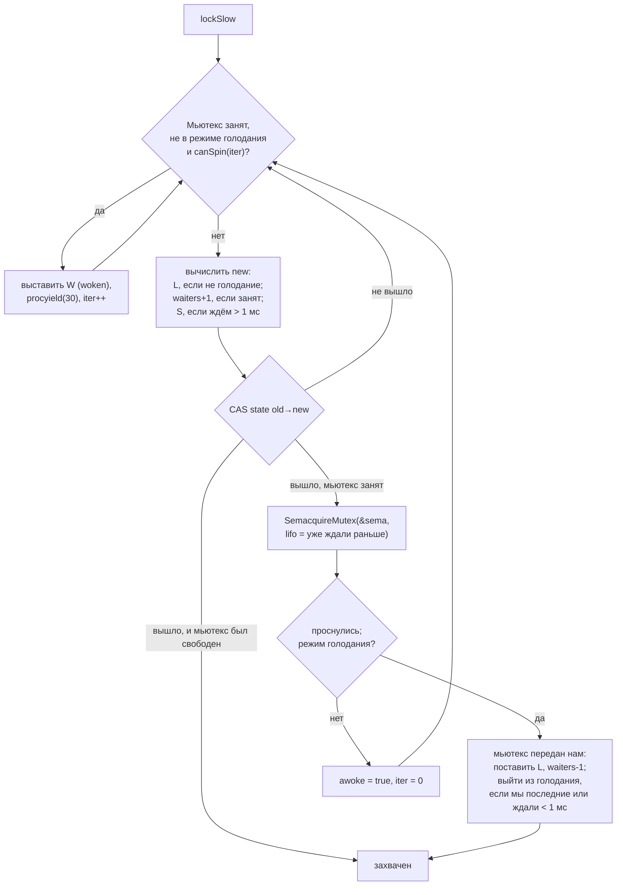
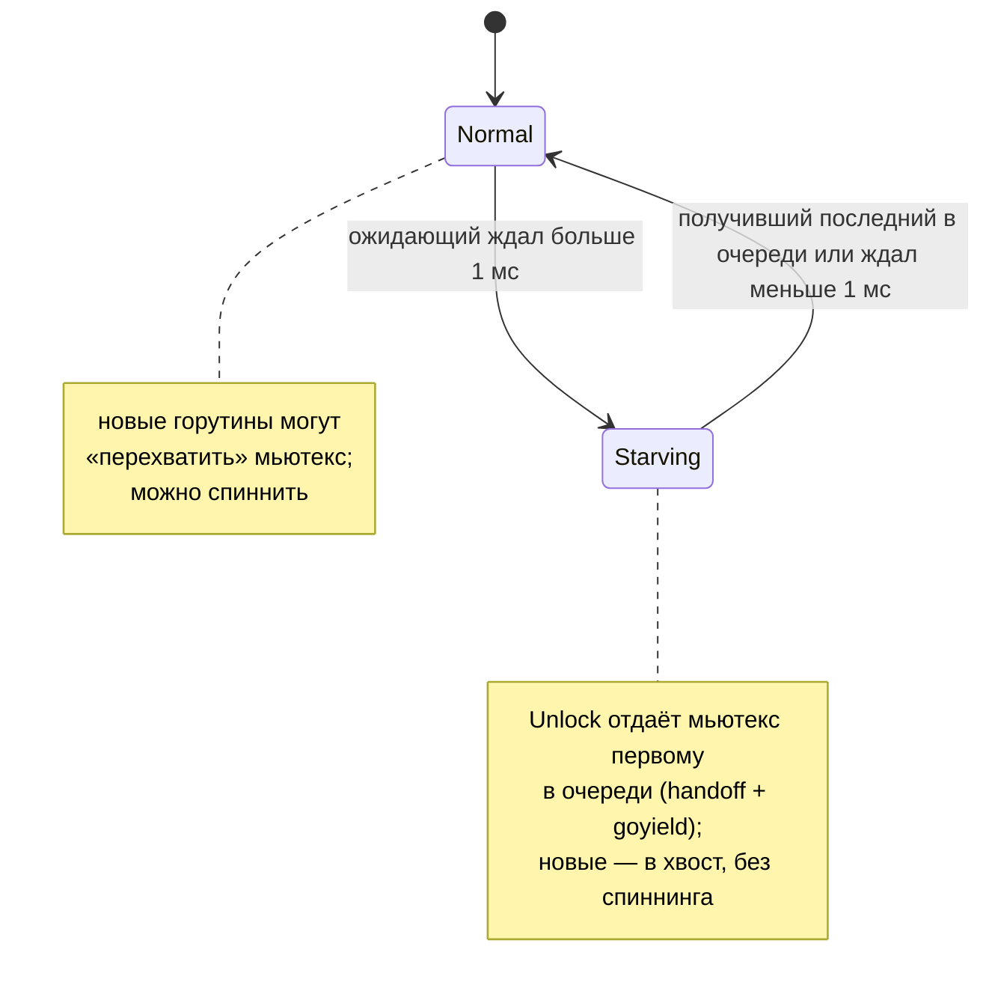
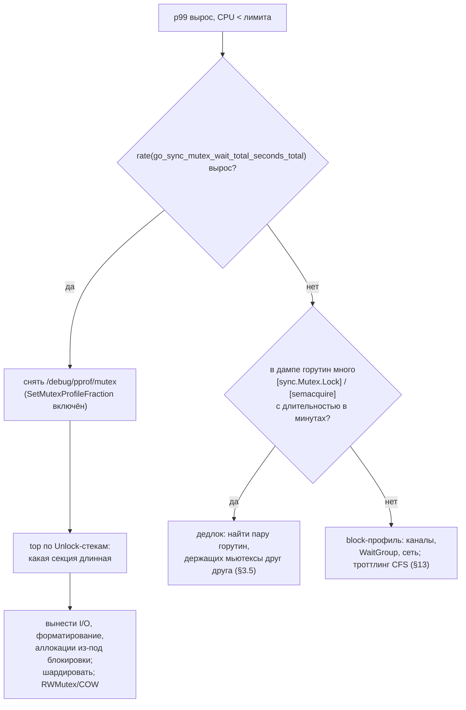

# Go sync и sync/atomic: Deep Dive для Senior Go-разработчика

> Актуально для **Go 1.27** (релиз go1.27.0 — август 2026; последний патч на момент написания — go1.27.1, в нём изменений в `sync` нет).
> Факты сверены с исходниками ветки `go1.27.0` (`src/internal/sync/mutex.go`, `src/sync/*.go`, `src/sync/atomic/type.go`, `src/runtime/sema.go`, `src/runtime/proc.go`, `src/internal/sync/hashtriemap.go`) и историей коммитов (`git log -S` + `git tag --contains`).
> Все бенчмарки и выводы команд — **реальные прогоны** на `go1.27.0 darwin/arm64, Apple M3 Pro (11 ядер), GOMAXPROCS=11`. Каждый прогон одиночный: числа показывают порядок величин, а не точное значение.
> Места, где факт не удалось проверить по первоисточнику, помечены **⚠️ не проверено**.

## Оглавление

- [Словарь терминов](#словарь-терминов)
- [TL;DR](#tldr)
- [1. Модель: зачем вообще синхронизировать](#1-модель-зачем-вообще-синхронизировать)
- [2. Фундамент: атомарные инструкции и семафор рантайма](#2-фундамент-атомарные-инструкции-и-семафор-рантайма)
- [3. sync.Mutex изнутри](#3-syncmutex-изнутри)
- [4. sync.RWMutex](#4-syncrwmutex)
- [5. sync.WaitGroup](#5-syncwaitgroup)
- [6. sync.Once, OnceFunc, OnceValue, OnceValues](#6-synconce-oncefunc-oncevalue-oncevalues)
- [7. sync.Cond](#7-synccond)
- [8. sync.Pool](#8-syncpool)
- [9. sync.Map](#9-syncmap)
- [10. Пакет sync/atomic](#10-пакет-syncatomic)
- [11. Что выбрать: мьютекс, атомик, канал, шардирование, copy-on-write](#11-что-выбрать-мьютекс-атомик-канал-шардирование-copy-on-write)
- [12. Настройки и параметры](#12-настройки-и-параметры)
- [13. Production: контейнеры и Kubernetes](#13-production-контейнеры-и-kubernetes)
- [14. Наблюдаемость и диагностика](#14-наблюдаемость-и-диагностика)
- [15. Оптимизация](#15-оптимизация)
- [16. Грабли, заблуждения и советы: сводка](#16-грабли-заблуждения-и-советы-сводка)
- [17. Сравнение с другими платформами](#17-сравнение-с-другими-платформами)
- [18. Вопросы для собеседования](#18-вопросы-для-собеседования)
- [19. Чеклист и шпаргалка](#19-чеклист-и-шпаргалка)

---

## Словарь терминов

Термины, без которых дальше трудно читать. Если слово встретилось в тексте и непонятно — оно, скорее всего, здесь.

| Термин | Простыми словами |
|---|---|
| **Горутина (G)** | Лёгкий поток выполнения Go. Их могут быть сотни тысяч. |
| **M (machine)** | Настоящий поток операционной системы, на котором выполняются горутины. |
| **P (processor)** | «Разрешение выполнять Go-код». Их ровно `GOMAXPROCS` штук. Горутина работает, только когда её M держит P. У каждого P свои локальные кэши (очередь горутин, кусок `sync.Pool` и т.д.). |
| **Критическая секция** | Кусок кода между `Lock()` и `Unlock()`. В нём одновременно находится не больше одной горутины. |
| **Гонка данных (data race)** | Две горутины обращаются к одной переменной одновременно, хотя бы одна пишет, и между ними нет синхронизации. В Go это ошибка программы: результат не определён. |
| **Контеншн (contention, конкуренция за блокировку)** | Ситуация, когда горутина хочет взять мьютекс, а он занят, и ей приходится ждать. |
| **Атомарная операция** | Операция над переменной, которую процессор выполняет «целиком»: никто не увидит её половину. Пример — `atomic.AddInt64`. |
| **CAS (Compare-And-Swap)** | Атомарная операция «если в ячейке значение `old`, запиши `new` и верни `true`; иначе ничего не делай и верни `false`». Основа почти всех lock-free алгоритмов. |
| **Lock-free** | Алгоритм без мьютексов: горутины не засыпают, а повторяют CAS, пока не получится. |
| **Fast path / slow path** | Быстрый путь — самый частый и дешёвый случай (мьютекс свободен, взяли одним CAS). Медленный путь — всё остальное (ждать, спать, будить). Fast path делают маленьким, чтобы компилятор мог встроить его в место вызова (inlining). |
| **Спиннинг (spinning, активное ожидание)** | Горутина не засыпает, а несколько раз крутится в цикле, проверяя, не освободился ли мьютекс. Выгодно, если владелец вот-вот отпустит. |
| **Парковка (park)** | Горутина засыпает: планировщик снимает её с P и не запускает, пока кто-то её не разбудит («ready»). |
| **Семафор рантайма (sema)** | Внутренний механизм Go: «усыпить горутину на адресе X» и «разбудить одну горутину, спящую на X». На нём построены `Mutex`, `RWMutex`, `WaitGroup`. |
| **sudog** | Маленькая структура рантайма «горутина ждёт на таком-то объекте». Из них строятся очереди ожидания семафоров и каналов. |
| **Handoff (передача из рук в руки)** | Отпускающая горутина не просто освобождает ресурс, а сразу отдаёт его конкретному ожидающему, так что «вклиниться» никто не может. |
| **Голодание (starvation)** | Горутина ждёт блокировку очень долго, потому что другие всё время успевают взять её первыми. |
| **Модель памяти Go** | Документ (go.dev/ref/mem), который говорит, когда запись в одной горутине гарантированно видна чтению в другой. |
| **Happens-before / «synchronizes before»** | Отношение «A гарантированно произошло раньше B, и B видит всё, что записал A». Его создают мьютексы, каналы, атомики, `WaitGroup` и т.д. |
| **Sequentially consistent (последовательно согласованный)** | Самая строгая модель для атомиков: все атомарные операции всех горутин выглядят так, будто выполнились в одном общем порядке. В Go атомики именно такие. |
| **Кэш-линия** | Блок памяти (обычно 64 или 128 байт), которым процессорные ядра обмениваются между своими кэшами. Ядро не может «владеть» половиной линии. |
| **False sharing (ложное разделение)** | Две независимые переменные лежат в одной кэш-линии; ядра, пишущие каждое в «свою» переменную, всё равно постоянно отбирают линию друг у друга. |
| **Шардирование (sharding)** | Разбить одну горячую структуру на N независимых кусков, чтобы горутины реже сталкивались. |
| **Copy-on-write (COW)** | Читатели читают неизменяемый снимок данных; писатель делает копию, меняет её и атомарно подменяет указатель. |
| **Victim cache** | «Второй шанс» в `sync.Pool`: при сборке мусора объекты не выбрасываются сразу, а переезжают в запасной кэш и живут ещё один цикл GC. |
| **`noCopy`** | Пустая структура-маркер внутри типов `sync`. Сама ничего не делает, но по ней `go vet` находит копирование мьютексов. |
| **`-race` (race detector)** | Режим сборки, в котором программа сама отслеживает гонки данных во время работы и печатает отчёт. |
| **Mutex profile / block profile** | Профили pprof: где горутины теряли время, ожидая мьютексы (mutex), и где они вообще блокировались (block: мьютексы, каналы, `select`, `WaitGroup`). |
| **STW (stop-the-world)** | Короткая пауза, когда рантайм останавливает все горутины (например, в начале цикла GC). |

---

## TL;DR

1. `sync.Mutex` — это 8 байт: `state int32` (флаги + число ожидающих) и `sema uint32` (адрес, на котором спят ожидающие). Свободный мьютекс берётся **одним CAS** за ~2.6 нс; с Go 1.24 реализация лежит в `internal/sync`, а `sync.Mutex` — тонкая обёртка.
2. Мьютекс работает в двух режимах. **Нормальный**: проснувшийся ожидающий соревнуется с новыми горутинами и часто проигрывает (это быстро). **Голодания** (с Go 1.9): если кто-то ждёт дольше **1 мс** (`starvationThresholdNs = 1e6`), мьютекс передаётся строго по очереди из рук в руки. В нашем замере ожидание «жадного» мьютекса — p50 = 1.02 мс: ровно порог.
3. Перед засыпанием горутина может **спиннить** — не больше 4 итераций (`active_spin = 4`) по 30 инструкций `PAUSE/YIELD`, и только если ядер > 1, есть другие работающие P и локальная очередь пуста.
4. `RWMutex` **не масштабирует чтение при коротких секциях**: все читатели бьют атомиком в один счётчик `readerCount`. При чтении одного ключа из map на 11 ядрах RWMutex — 105 нс/оп против 114 нс у Mutex (почти одно и то же), а `sync.Map` — 2.6 нс. RWMutex выигрывает в 4.7 раза, только когда секция тяжёлая (64 поиска: 137 нс против 643 нс).
5. Ожидающий писатель в `RWMutex` блокирует **новых** читателей. Поэтому повторный `RLock` в той же горутине — это дедлок, а не «безопасное чтение». Воспроизведено в §4.4.
6. `WaitGroup.Go(f)` появился в Go 1.25; с Go 1.26 при панике в `f` он **не вызывает `Done`**, чтобы `Wait` не вернулся раньше, чем упадёт процесс. `go vet` (анализатор `waitgroup`, Go 1.25) ловит `wg.Add(1)` внутри горутины.
7. `Once.Do` не перезапускает `f` после паники или ошибки: «один раз» значит один раз. `OnceFunc/OnceValue/OnceValues` (Go 1.21) запоминают и панику, и результат — удобнее для ленивой инициализации.
8. `sync.Pool` устроен по P: у каждого P `private` (1 объект) и `shared` (lock-free дек). На каждом цикле GC основной кэш становится victim и живёт ещё один цикл (Go 1.13). **Неожиданное**: объект в `private` чужого P из victim не достаётся — после `runtime.GC()` горутина часто просыпается на другом P и получает `nil`.
9. Класть в `Pool` слайс по значению — лишняя аллокация 24 байта на каждый `Put` (16 нс против 8 нс у указателя). Класть без ограничения размера буферы, которые иногда бывают огромными, — раздувание памяти: в нашем замере 168–296 МиБ живой кучи против 8 МиБ с лимитом 64 КиБ.
10. С Go 1.24 `sync.Map` внутри — **HashTrieMap** (конкурентное префиксное дерево по хешу, 16 детей в узле, чтение без блокировок). Старая реализация `read/dirty` удалена в Go 1.26 вместе с `GOEXPERIMENT=synchashtriemap`.
11. Типизированные атомики (`atomic.Int64`, `atomic.Pointer[T]` и др., Go 1.19) сами выравниваются по 8 байт даже на 32-битных платформах; «голый» `int64` в структуре на `386/arm` может лежать по смещению 4 — и `atomic.AddInt64` по нему упадёт. Методы `And/Or` — с Go 1.23.
12. Атомики в Go **sequentially consistent** (как `std::memory_order_seq_cst` в C++ и `volatile` в Java). Ослабленных порядков (relaxed/acquire) в публичном API нет.
13. Копировать любой тип из `sync` после первого использования нельзя. `go vet copylocks` ловит это на этапе сборки; у `Cond` есть ещё и проверка во время выполнения (`panic: sync.Cond is copied`).
14. `/sync/mutex/wait/total:seconds` (Go 1.20) — всегда включённая метрика суммарного ожидания мьютексов; в Prometheus её надо включить явно (`go_sync_mutex_wait_total_seconds_total`). Mutex-профиль приписывает задержку **стеку того, кто держал и отпустил** мьютекс, а не тому, кто ждал.
15. `-race` замедляет `Lock/Unlock` примерно в 60 раз (2.6 → 160 нс в нашем замере): гоняйте его в тестах и стейджинге, а не в production.

---

## 1. Модель: зачем вообще синхронизировать

### 1.1. Что ломается без синхронизации

Процессор и компилятор имеют право переставлять и кэшировать операции с памятью, пока **одна** горутина этого не замечает. Как только к переменной обращаются две горутины, этих «невидимых» оптимизаций становится видно. Простейший пример — счётчик.

**Грабли: `counter++` из нескольких горутин**

```go
package main

import (
	"fmt"
	"sync"
)

func main() {
	var processed int // счётчик обработанных сообщений Kafka
	var wg sync.WaitGroup
	for range 8 {
		wg.Go(func() {
			for range 100_000 {
				processed++ // гонка: чтение-изменение-запись без синхронизации
			}
		})
	}
	wg.Wait()
	fmt.Println("processed =", processed, "ожидали", 8*100_000)
}
```

```text
$ go run .
processed = 214517 ожидали 800000

$ go run -race .
==================
WARNING: DATA RACE
Read at 0x00c000114038 by goroutine 9:
  main.main.func1()
      .../race/main.go:14 +0x38

Previous write at 0x00c000114038 by goroutine 8:
  main.main.func1()
      .../race/main.go:14 +0x48

Goroutine 9 (running) created at:
  sync.(*WaitGroup).Go()
      .../src/sync/waitgroup.go:238 +0x6c
```

Почему так: `processed++` — это три шага: прочитать, прибавить, записать. Две горутины читают одно и то же значение, обе прибавляют единицу, обе записывают — одно увеличение теряется. Потеряно 73% инкрементов. Как заметить: `go run -race` / `go test -race`; `go vet` такое не ловит. Как исправить: `atomic.Int64` (§10) или мьютекс (§3).

**Грабли: конкурентная запись в обычную map**

```go
cache := map[int]int{}
var wg sync.WaitGroup
for w := range 4 {
	wg.Go(func() {
		for i := range 100_000 {
			cache[i] = w
		}
	})
}
wg.Wait()
```

```text
fatal error: concurrent map writes

goroutine 35 [running]:
```

Почему так: рантайм map дешёво проверяет флаг «сейчас идёт запись» и, если видит параллельную запись, роняет процесс `fatal error` — это **не** `panic`, его нельзя перехватить `recover`. Проверка вероятностная: она ловит не каждую гонку, поэтому отсутствие падения ничего не доказывает. Как исправить: защитить map мьютексом или взять `sync.Map` (§9).

### 1.2. Что даёт пакет sync: отношение happens-before

Модель памяти Go описывает, **когда запись одной горутины гарантированно видна другой**. Для этого нужна цепочка «synchronizes before». Пакет `sync` документирует свои гарантии прямо в комментариях к типам:

| Примитив | Гарантия (цитата из исходников, смысл) | Файл |
|---|---|---|
| `Mutex` | n-й `Unlock` synchronizes before m-го `Lock` при n < m | `src/sync/mutex.go` |
| `RWMutex` | n-й `Unlock` → `RLock`; `RUnlock` → (n+1)-й `Lock` | `src/sync/rwmutex.go` |
| `WaitGroup` | `Done` synchronizes before возврата из `Wait`, который он разблокировал; возврат из `f` в `Go(f)` — тоже | `src/sync/waitgroup.go` |
| `Once` | возврат из `f` synchronizes before возврата **любого** вызова `Do(f)` | `src/sync/once.go` |
| `Pool` | `Put(x)` synchronizes before `Get`, вернувшего этот же `x` | `src/sync/pool.go` |
| `Map` | запись synchronizes before чтения, которое увидело её результат | `src/sync/map.go` |
| `atomic` | если B увидел результат A, то A synchronizes before B; все атомики — в одном общем порядке | `src/sync/atomic/doc.go` |

Практический смысл: всё, что горутина записала **до** `Unlock`, другая горутина гарантированно увидит **после** своего `Lock`. Без этой пары никаких гарантий нет, даже если «по времени» запись была раньше.

> **Заблуждение:** «Если писать в переменную, а читать с задержкой (`time.Sleep`), гонки не будет». На самом деле `Sleep` не создаёт happens-before: компилятор вправе держать значение в регистре, а процессор — показывать старое значение из кэша. `-race` сообщит о гонке независимо от задержки. Синхронизация — это не «прошло достаточно времени», а пара операций с гарантией из таблицы выше.

### 1.3. Простыми словами

Представьте общий блокнот, в который пишут несколько человек. Если писать одновременно, строчки перемешаются. Мьютекс — это ручка, которая одна на всех: пишет тот, у кого ручка. Модель памяти добавляет важную деталь: передав ручку, вы гарантируете, что следующий увидит **всё**, что вы успели написать. Без передачи ручки — никаких гарантий, даже если вы писали «давно».

### Что важно для Senior

- Гонка данных в Go — неопределённое поведение, а не «иногда неточный счётчик»: при гонке на интерфейсе или слайсе можно получить порванное значение и падение.
- `concurrent map writes` — `fatal error`, его не перехватить `recover`, а детектор вероятностный.
- Видимость обеспечивает только пара операций с документированной гарантией (`Unlock→Lock`, `Done→Wait`, атомик→атомик), а не время.
- `-race` — основной инструмент; `go vet` гонки не ищет.

---

## 2. Фундамент: атомарные инструкции и семафор рантайма

Все примитивы `sync` собраны из двух кирпичей: **атомарных инструкций процессора** и **семафора рантайма**.

### 2.1. Атомарные инструкции

`atomic.CompareAndSwapInt32(&x, old, new)` компилируется в одну инструкцию (или короткую последовательность): на amd64 — `LOCK CMPXCHG`, на arm64 — `CASAL` (при наличии LSE) или цикл `LDAXR/STLXR`. Чтобы выполнить её, ядро получает кэш-линию в монопольное владение. Отсюда главное свойство атомиков:

- **без контеншна** атомик стоит единицы наносекунд;
- **с контеншном** ядра «перекидывают» кэш-линию друг другу, и цена растёт с числом ядер. В нашем замере `atomic.Int64.Add` из 1 горутины — 1.9 нс, из 4 — 9.3 нс, из 11 — 26.9 нс на операцию (§11.2).

### 2.2. Семафор рантайма (`src/runtime/sema.go`)

Когда атомиком «взять» не получилось, горутина должна заснуть и потом проснуться. Для этого у рантайма есть семафор — не тот семафор из учебника, а, как пишут сами авторы, «примитив сна и пробуждения, где каждому сну соответствует ровно одно пробуждение, даже если из-за гонки пробуждение пришло раньше сна» (комментарий в начале `sema.go`).

```text
semtable: [251]struct{ root semaRoot; pad }   ← 251 — простое число, чтобы не совпадать с паттернами адресов
                │
   адрес &m.sema ──hash──►  semaRoot { lock; treap *sudog; nwait }
                                       │
                         сбалансированное дерево (treap) по адресам
                         ┌──────────┴──────────┐
                    sudog(addr A)          sudog(addr B)
                         │ waitlink              │
                    sudog(addr A)          sudog(addr B)   ← очередь горутин,
                         │                                    ждущих на одном адресе
                    sudog(addr A)
```

Как это работает:

1. `semacquire1(addr)`: если `*addr > 0`, атомарно уменьшить и вернуться (быстрый случай). Иначе взять `sudog`, найти `semaRoot` по хешу адреса, увеличить `nwait`, ещё раз попробовать (чтобы не пропустить пробуждение), встать в очередь и уснуть через `goparkunlock`.
2. `semrelease1(addr, handoff)`: атомарно увеличить `*addr`. Если `nwait == 0` — никто не ждёт, выход. Иначе достать первого ожидающего и сделать его runnable.
3. Если `handoff == true` (так делает мьютекс в режиме голодания), рантайм сразу «отдаёт» семафор проснувшемуся (`s.ticket = 1`) и уступает ему свой квант времени (`goyield`), чтобы тот начал работать немедленно.
4. Флаг `lifo` ставит горутину **в начало** очереди. Мьютекс использует это для горутины, которую уже будили, но она проиграла гонку: она не должна снова стоять в хвосте.

Почему так спроектировано: очередь привязана к **адресу**, а не к объекту, поэтому `sync.Mutex` может быть просто `int32 + uint32` без указателей и без инициализации — нулевое значение готово к работе. Ценой стала общая хеш-таблица на 251 корень с собственными блокировками; когда много горутин ждут на адресах, попавших в один корень, они делят его `lock`. Двухуровневая структура (дерево адресов + список на адрес) появилась после issue 17953, где одна очередь работала плохо.

Как это видно на практике: в дампе горутин ожидание на семафоре видно по причине (wait reason) в квадратных скобках — `[sync.Mutex.Lock]`, `[sync.RWMutex.RLock]`, `[sync.RWMutex.Lock]`, `[sync.WaitGroup.Wait]` (константы `waitReasonSync*` в `src/runtime/runtime2.go`). Пример — §3.7.

### 2.3. Простыми словами

Атомарная инструкция — это «потрогать общую ячейку так, чтобы никто не вмешался». Это быстро, пока ячейку трогает один человек, и медленнее, когда за неё дерутся многие. Семафор рантайма — это «зал ожидания»: если ячейку захватить не удалось, горутина садится на скамейку с номером (адресом) и засыпает, а освободивший ресурс будит первого на этой скамейке.

### Что важно для Senior

- Любой `Mutex/RWMutex/WaitGroup` при контеншне сводится к `semacquire1/semrelease1`; их и надо искать в профилях.
- Нулевое значение примитивов `sync` готово к работе благодаря тому, что очередь ожидания хранится в рантайме по адресу, а не в самом объекте.
- Стоимость атомика растёт с числом ядер, которые трогают одну кэш-линию: атомик — не «бесплатная замена мьютексу».
- Wait reason в дампе горутин (`[sync.Mutex.Lock]`) — самый быстрый способ понять, на чём висит сервис.

---
## 3. sync.Mutex изнутри

### 3.1. Структура

С Go 1.24 реализация мьютекса перенесена в `internal/sync` (коммит 6c66005285: это нужно, чтобы `unique` и `HashTrieMap` могли пользоваться мьютексом без циклической зависимости пакетов). Публичный тип — обёртка:

```go
// src/sync/mutex.go
type Mutex struct {
	_  noCopy      // маркер для go vet, 0 байт
	mu isync.Mutex
}

// src/internal/sync/mutex.go
type Mutex struct {
	state int32
	sema  uint32
}
```

`unsafe.Sizeof(sync.Mutex{})` = **8 байт** (проверено запуском, §19.3). Всё состояние упаковано в одно `int32`, чтобы менять его **одним CAS**:

```text
state (int32):
 31                                   3   2   1   0
┌────────────────────────────────────┬───┬───┬───┐
│  число ожидающих (waiters), 29 бит │ S │ W │ L │
└────────────────────────────────────┴───┴───┴───┘
  L = mutexLocked   (1)  мьютекс захвачен
  W = mutexWoken    (2)  кого-то уже разбудили / кто-то спиннит — Unlock не должен будить ещё одного
  S = mutexStarving (4)  режим голодания
  waiters = state >> mutexWaiterShift (3)
sema (uint32): адрес, на котором ожидающие спят в семафоре рантайма (§2.2)
```

### 3.2. Lock: быстрый путь, спиннинг, сон

```go
// src/internal/sync/mutex.go
func (m *Mutex) Lock() {
	// Fast path: grab unlocked mutex.
	if atomic.CompareAndSwapInt32(&m.state, 0, mutexLocked) {
		...
		return
	}
	m.lockSlow() // вынесено, чтобы Lock встраивался в место вызова
}
```

Быстрый путь — один CAS «0 → locked». Если мьютекс свободен и никто не ждёт, на этом всё: ~2.6 нс (§11.2). Медленный путь `lockSlow` — цикл:



**Спиннинг.** Условия в `internal_sync_runtime_canSpin` (`src/runtime/proc.go`):

```go
if i >= active_spin || numCPUStartup <= 1 || gomaxprocs <= sched.npidle.Load()+sched.nmspinning.Load()+1 {
	return false
}
if p := getg().m.p.ptr(); !runqempty(p) {
	return false
}
return true
```

| Условие | Зачем |
|---|---|
| `i < active_spin` (4, `src/runtime/lock_spinbit.go`) | спиннинг короткий: не больше 4 раундов |
| `numCPUStartup > 1` | на одном ядре владелец мьютекса не может работать, пока мы крутимся — спиннинг бесполезен |
| `gomaxprocs > npidle + nmspinning + 1` | должен быть хотя бы ещё один **работающий** P — возможно, это владелец, и он скоро отпустит |
| локальная очередь P пуста | если есть другие готовые горутины, лучше уступить P им |

Каждый раунд — `procyield(active_spin_cnt)` = 30 инструкций `PAUSE` (amd64) / `YIELD` (arm64). Комментарий в коде прямо говорит: «sync.Mutex кооперативный, поэтому мы осторожны со спиннингом».

Пока горутина спиннит, она ставит флаг `mutexWoken`. Он сообщает `Unlock`: «не буди никого из спящих, я сейчас сам возьму». Это экономит дорогое пробуждение.

### 3.3. Нормальный режим и режим голодания

Это главное, что надо знать о `sync.Mutex` на собеседовании. Цитата из `src/internal/sync/mutex.go` (сокращённо, в переводе):

> В нормальном режиме ожидающие стоят в очереди FIFO, но разбуженный ожидающий **не владеет** мьютексом, а соревнуется за него с только что пришедшими горутинами. У новых преимущество: они уже выполняются на CPU, и их может быть много, поэтому разбуженный часто проигрывает. Тогда он встаёт **в начало** очереди. Если ожидающий не может получить мьютекс **дольше 1 мс**, он переключает мьютекс в режим голодания.
>
> В режиме голодания владение передаётся из рук в руки — от отпускающего первому в очереди. Новые горутины не пытаются взять мьютекс, даже если он выглядит свободным, и не спиннят, а встают в хвост.
>
> Если ожидающий получил мьютекс и видит, что (1) он последний в очереди или (2) он ждал меньше 1 мс, он возвращает мьютекс в нормальный режим.
>
> Нормальный режим заметно быстрее: горутина может взять мьютекс несколько раз подряд, даже если есть ожидающие. Режим голодания нужен, чтобы не было патологических хвостов задержки.

Константа: `starvationThresholdNs = 1e6` (1 мс). Режим появился в Go 1.9 (коммит 0556e26273).



**Проверка на живом коде.** Одна «жадная» горутина держит мьютекс 20 мкс, отпускает и сразу берёт снова. Вторая горутина пытается взять мьютекс и меряет, сколько ждала:

```go
go func() {
	for {
		mu.Lock()
		t := time.Now()
		for time.Since(t) < 20*time.Microsecond { // короткая критическая секция
		}
		mu.Unlock()
		hogAcq.Add(1)
	}
}()
// ...
for range 50 {
	before := hogAcq.Load()
	t := time.Now()
	mu.Lock()
	waits = append(waits, time.Since(t))
	grabs = append(grabs, hogAcq.Load()-before)
	mu.Unlock()
	time.Sleep(2 * time.Millisecond)
}
```

```text
ожидание Lock: min=10.542µs p50=1.023084ms max=1.052041ms
сколько раз жадная горутина успела взять мьютекс, пока мы ждали: p50=48 max=50
```

Видно ровно то, что написано в коде: ожидающий проигрывает «жадной» горутине ~48 раз подряд (нормальный режим), а через ~1 мс мьютекс переходит в режим голодания и достаётся ему. Без режима голодания (до Go 1.9) хвост ожидания был бы неограниченным.

Почему так спроектировано: честный (FIFO) мьютекс медленнее, потому что каждая передача требует переключения контекста — разбудить спящую горутину, дождаться, пока планировщик её запустит. «Нечестный» мьютекс позволяет горутине, которая уже на CPU, взять его сразу — пропускная способность выше. Порог 1 мс — компромисс: пропускная способность в обычном случае и ограниченная задержка в худшем. Цена — в режиме голодания пропускная способность падает: каждая передача — это пробуждение + переключение (`goyield` из `semrelease1` отдаёт ожидающему остаток кванта текущей горутины).

> **Заблуждение:** «`sync.Mutex` честный: кто раньше пришёл, тот раньше получит». На самом деле в нормальном режиме — нет: новая горутина обгоняет спящих. Честность включается только после 1 мс ожидания. Если вам нужен строгий FIFO с первой наносекунды (например, очередь запросов к БД), мьютекс — не тот инструмент; нужен канал-очередь или явная очередь.

### 3.4. Unlock

```go
func (m *Mutex) Unlock() {
	new := atomic.AddInt32(&m.state, -mutexLocked) // Fast path: снять бит L
	if new != 0 {
		m.unlockSlow(new) // кто-то ждёт или есть флаги
	}
}
```

`unlockSlow`:
- если бит L уже был снят — `fatal("sync: unlock of unlocked mutex")`;
- **нормальный режим**: если ожидающих нет или кто-то уже разбужен/спиннит/успел взять мьютекс — ничего не делать. Иначе CAS «waiters-1, поставить W» и `Semrelease(&sema, handoff=false)` — разбудить одного;
- **режим голодания**: `Semrelease(&sema, handoff=true)` — передать владение первому в очереди и уступить ему P. Бит L при этом не ставится: его поставит сам проснувшийся, а новые горутины видят бит S и не лезут.

**Грабли: Unlock незахваченного мьютекса — неперехватываемая ошибка**

```go
func main() {
	defer func() { fmt.Println("recover:", recover()) }()
	var mu sync.Mutex
	mu.Unlock()
}
```

```text
fatal error: sync: unlock of unlocked mutex

goroutine 1 [running]:
internal/sync.fatal({0x1004ac2bc?, 0x10044c27c?})
	.../src/runtime/panic.go:1205 +0x20
internal/sync.(*Mutex).unlockSlow(0x29e32d9cc110, 0xffffffff)
	.../src/internal/sync/mutex.go:204 +0x38
```

Почему так: состояние мьютекса уже испорчено, и продолжать работу небезопасно, поэтому рантайм вызывает `fatal`, а не `panic`. `recover:` не напечатался — `defer` не помог. Как заметить: падение процесса; статически не ловится. Типичная причина — двойной `Unlock` (явный плюс `defer`) или `Unlock` в ветке, где `Lock` не вызывался. Как исправить: держать `Lock` и `defer Unlock` рядом, в одной функции.

### 3.5. Мьютекс не привязан к горутине и не реентерабельный

Из документации `sync.Mutex`: «захваченный мьютекс не связан с конкретной горутиной: одна горутина может его захватить, а другая — освободить». Обратная сторона — мьютекс **не знает владельца**, поэтому:

- повторный `Lock` в той же горутине — дедлок (реентерабельности, как у `ReentrantLock` в Java, нет; обычное объяснение авторов Go — рекурсивная блокировка скрывает нарушенные инварианты: код внутри секции может застать данные в промежуточном состоянии. **⚠️ не проверено**: эта мотивировка известна по обсуждениям в golang-nuts, по первоисточнику не сверена);
- нельзя спросить «кто держит мьютекс» — это видно только в дампе горутин.

**Грабли: AB-BA — два мьютекса в разном порядке**

```go
type Account struct {
	mu      sync.Mutex
	balance int
}

// Перевод блокирует сначала from, потом to — порядок зависит от аргументов.
func transfer(from, to *Account, amount int) {
	from.mu.Lock()
	defer from.mu.Unlock()
	time.Sleep(time.Millisecond) // окно для встречного перевода
	to.mu.Lock()
	defer to.mu.Unlock()
	from.balance -= amount
	to.balance += amount
}

func main() {
	a, b := &Account{balance: 100}, &Account{balance: 100}
	go transfer(a, b, 10)
	go transfer(b, a, 20)
	// Имитация живого сервиса: пока есть хоть одна «живая» горутина,
	// детектор "all goroutines are asleep" не срабатывает.
	time.Sleep(500 * time.Millisecond)
	fmt.Println("сервис жив, но переводы зависли; дамп горутин:")
	pprof.Lookup("goroutine").WriteTo(os.Stdout, 2)
}
```

```text
сервис жив, но переводы зависли; дамп горутин:
...
goroutine 35 [sync.Mutex.Lock]:
internal/sync.runtime_SemacquireMutex(0x0?, 0x0?, 0x0?)
	src/runtime/sema.go:95 +0x28
internal/sync.(*Mutex).lockSlow(0x394c8dc90030)
	src/internal/sync/mutex.go:149 +0x174
...
main.transfer(0x394c8dc90020, 0x394c8dc90030, 0xa)
	abba/main.go:21 +0xfc

goroutine 36 [sync.Mutex.Lock]:
...
main.transfer(0x394c8dc90030, 0x394c8dc90020, 0x14)
	abba/main.go:21 +0xfc
```

Почему так: горутина 35 держит `a` и ждёт `b`, горутина 36 держит `b` и ждёт `a`. Как заметить: в реальном сервисе (HTTP-сервер, consumer Kafka) всегда есть живые горутины, поэтому `fatal error: all goroutines are asleep - deadlock!` **не появится** — сервис просто перестаёт обрабатывать часть запросов. Признаки: растёт `go_goroutines`, растёт латентность, в дампе (`/debug/pprof/goroutine?debug=2`) две+ горутины в `[sync.Mutex.Lock]` со строкой на одном и том же месте; через минуту ожидания в скобках появляется длительность (`[sync.Mutex.Lock, 2 minutes]`). Линтеры это не ловят. Как исправить: единый порядок захвата (например, по ID счёта: сначала меньший), или один мьютекс на операцию, или вынести перевод в одну горутину-владельца.

### 3.6. TryLock

`TryLock` (Go 1.18) пытается взять мьютекс без ожидания. Он **не** берёт мьютекс в режиме голодания, даже если тот на мгновение свободен (`old&(mutexLocked|mutexStarving) != 0 → false`). В документации прямо написано: правильные применения редки, и использование `TryLock` часто говорит о более глубокой проблеме. Реальный сценарий — «если фоновое обновление кэша уже идёт, не запускать второе»:

```go
func (c *Cache) maybeRefresh(ctx context.Context) {
	if !c.refreshMu.TryLock() {
		return // обновление уже идёт в другой горутине
	}
	defer c.refreshMu.Unlock()
	c.reloadFromPostgres(ctx)
}
```

Для этой задачи часто лучше подходит `atomic.Bool.CompareAndSwap(false, true)` или `singleflight`.

### 3.7. Цена defer и прочие мелочи

> **Заблуждение:** «`defer mu.Unlock()` дорогой, в горячем коде надо разблокировать вручную». Это было верно до Go 1.14: `defer` стоил десятки наносекунд. С Go 1.14 компилятор встраивает `defer` прямо в код функции (open-coded defers, коммит dad616375f). В нашем замере `Lock+Unlock` — 2.6 нс, а функция с `Lock; defer Unlock` — 3.9 нс, причём часть разницы — сам вызов функции-замыкания. Ради 1 нс отказываться от `defer` не стоит: ручной `Unlock` теряется при раннем `return` и панике.

> **Совет.** Не встраивайте `sync.Mutex` в экспортируемую структуру (`type Cache struct { sync.Mutex; ... }`), когда у неё есть внешние пользователи. Методы `Lock/Unlock` становятся частью публичного API, и любой может взять ваш мьютекс извне и нарушить инварианты. Делайте поле неэкспортируемым: `mu sync.Mutex`. Не нужно для приватных типов внутри пакета.

### 3.8. Простыми словами

Мьютекс — это дверь в комнату с одним ключом. Пришёл — пробуешь дверь (CAS). Открыто — вошёл. Закрыто — пару секунд топчешься у двери (спиннинг): вдруг сейчас выйдут. Не вышли — садишься в зал ожидания (семафор). Когда человек выходит, он будит одного из зала, но пока тот просыпается, дверь может перехватить кто-то, кто как раз проходил мимо. Это быстро, но несправедливо. Если кто-то ждёт дольше 1 мс, включается «живая очередь»: выходящий отдаёт ключ строго следующему в очереди, прохожие встают в конец.

### Что важно для Senior

- `state` = L/W/S + число ожидающих в одном `int32`; быстрый путь — один CAS, медленный — спиннинг (≤ 4 × 30 `PAUSE`) и сон на семафоре.
- Нормальный режим — для пропускной способности, режим голодания (> 1 мс, Go 1.9) — для хвостовой задержки. Ожидание > 1 мс в mutex-профиле — признак того, что мьютекс уходит в голодание и пропускная способность падает.
- Мьютекс не знает владельца и не реентерабелен; дедлок в живом сервисе не детектируется рантаймом — только дамп горутин.
- `Unlock` незахваченного — `fatal`, не `panic`.
- `defer Unlock` почти бесплатен с Go 1.14.

---

## 4. sync.RWMutex

### 4.1. Структура

```go
// src/sync/rwmutex.go
type RWMutex struct {
	w           Mutex        // держат писатели, чтобы не мешать друг другу
	writerSem   uint32       // семафор: писатель ждёт ухода читателей
	readerSem   uint32       // семафор: читатели ждут ухода писателя
	readerCount atomic.Int32 // число читателей (активных + ждущих)
	readerWait  atomic.Int32 // сколько читателей писатель ещё должен дождаться
}
const rwmutexMaxReaders = 1 << 30
```

Размер — 24 байта. Главный трюк — `readerCount` одновременно хранит число читателей и флаг «есть писатель»: писатель вычитает из него `1<<30`, и счётчик становится **отрицательным**.

### 4.2. Алгоритм

```text
RLock:   if readerCount.Add(1) < 0 → писатель есть или ждёт → спать на readerSem
RUnlock: if readerCount.Add(-1) < 0 → писатель ждёт → readerWait.Add(-1);
                                       последний уходящий читатель будит писателя (writerSem)
Lock:    w.Lock()                                   // сначала разобраться с другими писателями
         r := readerCount.Add(-1<<30) + 1<<30       // объявить «писатель здесь», узнать r активных читателей
         if r != 0 && readerWait.Add(r) != 0 → спать на writerSem
Unlock:  r := readerCount.Add(1<<30)                // снять флаг; r = сколько читателей успели заснуть
         разбудить r читателей (readerSem); w.Unlock()
```

```mermaid
sequenceDiagram
    participant R1 as Читатель 1
    participant W as Писатель
    participant R2 as Читатель 2
    R1->>R1: RLock: readerCount 0→1
    W->>W: Lock: w.Lock(); readerCount 1→1-2^30 (<0), r=1, readerWait=1
    Note over W: спит на writerSem
    R2->>R2: RLock: readerCount → <0 → спит на readerSem
    R1->>R1: RUnlock: readerCount-1 <0 → readerWait 1→0
    R1-->>W: Semrelease(writerSem)
    Note over W: пишет
    W->>W: Unlock: readerCount += 2^30 → r=1
    W-->>R2: Semrelease(readerSem)
    Note over R2: читает
```

Почему так: читатели в обычном случае делают **одну** атомарную операцию и никогда не трогают внутренний `Mutex`. Писатель получает приоритет: как только он объявился, новые читатели ждут — иначе при постоянном потоке читателей писатель голодал бы вечно. Цена — два следствия ниже.

### 4.3. Следствие 1: RWMutex не масштабирует короткое чтение

Все читатели делают `readerCount.Add(1)` и `Add(-1)` по **одной** кэш-линии. На многих ядрах эта линия становится горячей точкой — ровно как у обычного мьютекса.

```go
func BenchmarkReadMutex(b *testing.B) {
	var mu sync.Mutex
	m := newMap() // map[string]int на 1024 ключа
	b.RunParallel(func(pb *testing.PB) {
		i := 0
		for pb.Next() {
			mu.Lock()
			_ = m[keys[i%nKeys]]
			mu.Unlock()
			i++
		}
	})
}
// BenchmarkReadRWMutex — то же с RLock/RUnlock; BenchmarkReadSyncMap — sync.Map.Load;
// BenchmarkReadAtomicPointer — атомарный указатель на неизменяемую map (§11.3).
// Heavy-варианты: 64 поиска в map под одной блокировкой.
```

```text
BenchmarkReadMutex                   	146225515	         8.445 ns/op
BenchmarkReadMutex-4                 	14213490	        83.34 ns/op
BenchmarkReadMutex-11                	10627803	       113.5 ns/op
BenchmarkReadRWMutex                 	138588532	         9.009 ns/op
BenchmarkReadRWMutex-4               	28223312	        41.86 ns/op
BenchmarkReadRWMutex-11              	11249331	       104.6 ns/op
BenchmarkReadSyncMap-11              	461475376	         2.604 ns/op
BenchmarkReadAtomicPointer-11        	952800284	         1.755 ns/op

BenchmarkHeavyReadMutex-11      	 2001679	       643.4 ns/op
BenchmarkHeavyReadRWMutex       	 2521594	       485.5 ns/op
BenchmarkHeavyReadRWMutex-4     	 7935818	       162.6 ns/op
BenchmarkHeavyReadRWMutex-11    	 9861196	       136.5 ns/op
```

Вывод: при **коротком** чтении (один поиск в map) на 11 ядрах `RWMutex` почти не лучше `Mutex` (105 против 114 нс), а решения без общего счётчика (`sync.Map`, атомарный указатель) — в 40–60 раз быстрее. При **тяжёлом** чтении (64 поиска) `RWMutex` даёт реальный выигрыш: 137 против 643 нс, потому что стоимость атомика на входе размазывается по длинной секции и читатели действительно работают параллельно.

> **Заблуждение:** «Если читателей больше, чем писателей, всегда берите `RWMutex`». На самом деле `RWMutex` выигрывает, только когда секция чтения достаточно длинная, чтобы стоимость двух атомиков по общей линии была мала на её фоне. Для коротких секций при большом числе ядер он ведёт себя как обычный мьютекс, а без контеншна даже чуть медленнее (9.0 против 8.4 нс). Решайте бенчмарком на целевом числе ядер.

### 4.4. Следствие 2: рекурсивный RLock — дедлок

Документация: «если горутина вызвала `Lock`, пока мьютекс держат читатели, новые `RLock` блокируются до тех пор, пока писатель не получит и не отпустит блокировку… Это запрещает рекурсивную блокировку на чтение».

**Грабли: метод под RLock вызывает другой метод, который тоже берёт RLock**

```go
type Registry struct {
	mu    sync.RWMutex
	items map[string]int
}

func (r *Registry) Get(k string) int {
	r.mu.RLock()
	defer r.mu.RUnlock()
	return r.items[k]
}

// Sum берёт RLock и внутри вызывает Get, который берёт RLock ещё раз.
func (r *Registry) Sum(keys ...string) int {
	r.mu.RLock()
	defer r.mu.RUnlock()
	time.Sleep(10 * time.Millisecond) // окно, в которое успевает прийти писатель
	s := 0
	for _, k := range keys {
		s += r.Get(k)
	}
	return s
}

func main() {
	r := &Registry{items: map[string]int{"a": 1, "b": 2}}
	go func() {
		time.Sleep(5 * time.Millisecond)
		r.mu.Lock() // писатель встаёт в очередь между двумя RLock
		r.items["c"] = 3
		r.mu.Unlock()
	}()
	fmt.Println(r.Sum("a", "b"))
}
```

```text
fatal error: all goroutines are asleep - deadlock!

goroutine 1 [sync.RWMutex.RLock]:
sync.runtime_SemacquireRWMutexR(0x1996bbd1278?, 0x8?, 0x4c0028484d78?)
	.../src/runtime/sema.go:100 +0x28
sync.(*RWMutex).RLock(...)
	.../src/sync/rwmutex.go:74
main.(*Registry).Get(0x4c00284a0080, {0x10096c280, 0x1})
	.../rrecursive/main.go:15 +0x80
main.(*Registry).Sum(0x4c00284a0080, {0x4c0028484e60, 0x2, 0x1?})
	.../rrecursive/main.go:27 +0xd4

goroutine 19 [sync.RWMutex.Lock]:
sync.runtime_SemacquireRWMutex(0x0?, 0x0?, 0x4c00284881e0?)
	.../src/runtime/sema.go:105 +0x28
sync.(*RWMutex).Lock(0x4c4b40?)
	.../src/sync/rwmutex.go:155 +0xf0
```

Почему так: `Sum` держит чтение; писатель вычел `1<<30` и ждёт ухода этого читателя; второй `RLock` в `Get` видит отрицательный `readerCount` и засыпает за писателем. Круг замкнулся. Как заметить: в тестах без писателя всё работает — дедлок появляется только под нагрузкой с записями. В сервисе рантайм его не обнаружит (§3.5). Ни `go vet`, ни `-race` это не ловят. Как исправить: разделить методы на публичные (берут блокировку) и внутренние `getLocked` (ожидают, что блокировка уже взята) и внутри вызывать только `*Locked`-варианты.

Также нельзя «повысить» `RLock` до `Lock` или «понизить» `Lock` до `RLock` — это прямо запрещено документацией. Повышение через `RUnlock(); Lock()` допустимо, но между ними данные могут измениться: после `Lock` проверяйте условие заново.

### 4.5. Простыми словами

`RWMutex` — это читальный зал: читать могут сколько угодно человек сразу, а писатель должен остаться один. Когда приходит писатель, он вешает табличку «скоро ремонт»: новых читателей не пускают, ждут, пока уйдут те, кто внутри. Проблема в том, что каждый читатель на входе и выходе отмечается в **одном** журнале у двери. Если читатели заходят на секунду и их очень много, очередь к журналу становится узким местом — и зал работает не лучше, чем комната на одного.

### Что важно для Senior

- `readerCount < 0` означает «есть писатель»; писатель ждёт ровно тех читателей, что были внутри в момент `Lock` (`readerWait`).
- Писатель приоритетнее новых читателей → рекурсивный `RLock` ведёт к дедлоку под нагрузкой.
- Для коротких секций на многих ядрах `RWMutex` ≈ `Mutex`; для чтения горячих данных смотрите на `sync.Map`, `atomic.Pointer` (copy-on-write) или шардирование (§11).
- `RWMutex` оправдан, когда секция чтения длинная (сотни наносекунд и больше) и записи редки.

---
## 5. sync.WaitGroup

### 5.1. Структура

```go
// src/sync/waitgroup.go
type WaitGroup struct {
	noCopy noCopy
	// Bits (high to low):
	//   bits[0:32]  counter
	//   bits[32]    flag: synctest bubble membership
	//   bits[33:64] wait count
	state atomic.Uint64
	sema  uint32
}
```

Размер — 16 байт. Счётчик задач (старшие 32 бита) и число ожидающих `Wait` (младшие 31 бит) лежат в **одном** `uint64`, чтобы `Add` и `Wait` видели согласованную пару одним атомарным чтением. Бит 31 — флаг для `testing/synctest` (Go 1.25).

```text
Add(delta): state += delta<<32
            counter < 0                       → panic("sync: negative WaitGroup counter")
            counter > 0 или waiters == 0      → выход
            counter == 0 и waiters > 0        → state = 0; разбудить waiters горутин (Semrelease × waiters)
Wait():     counter == 0                      → выход сразу
            иначе CAS waiters+1 → спать на sema
            после пробуждения state != 0      → panic("WaitGroup is reused before previous Wait has returned")
```

### 5.2. WaitGroup.Go (Go 1.25) и изменение в Go 1.26

`wg.Go(f)` = `Add(1)` + запуск горутины + `Done` по завершении. В Go 1.25 реализация была `defer wg.Done(); f()`. В Go 1.26 её изменили (коммит 95a0e5adc1, issue 76126): если `f` паникует, `Done` **не вызывается** — иначе `Wait` в главной горутине мог разблокироваться и программа успевала, например, завершиться с `os.Exit(0)` раньше, чем паника уронит процесс.

```go
var wg sync.WaitGroup
wg.Go(func() {
	var m map[string]int
	m["order"] = 1 // panic: запись в nil map
})
wg.Wait()
fmt.Println("Wait вернулся") // не напечатается
```

```text
panic: assignment to entry in nil map [recovered, repanicked]

goroutine 6 [running]:
sync.(*WaitGroup).Go.func1.1()
	.../src/sync/waitgroup.go:251 +0x48
```

Документация `Go` требует: «функция f не должна паниковать». Если задача может паниковать и вы хотите превратить панику в ошибку — используйте `errgroup` с собственным `recover` внутри задачи.

> **Совет.** В новом коде (Go ≥ 1.25) пишите `wg.Go(func() { ... })` вместо пары `wg.Add(1)` / `defer wg.Done()`. Это убирает целый класс ошибок: `Add` в неправильном месте, забытый `Done`. Не нужно, если модуль должен собираться старыми версиями Go (`go` в `go.mod` < 1.25).

### 5.3. Грабли

**Грабли: `wg.Add(1)` внутри запущенной горутины**

```go
var wg sync.WaitGroup
var mu sync.Mutex
done := 0
for range 1000 {
	go func() {
		wg.Add(1) // ошибка: Add внутри горутины
		defer wg.Done()
		mu.Lock()
		done++
		mu.Unlock()
	}()
}
wg.Wait()
```

```text
$ go vet .
wgadd/main.go:14:10: WaitGroup.Add called from inside new goroutine

$ go run .   (три запуска)
готово задач: 964 из 1000
готово задач: 991 из 1000
готово задач: 987 из 1000
```

Почему так: `Wait` может выполниться раньше, чем часть горутин дошла до `Add`, — он видит счётчик 0 и возвращается. Документация `Add`: вызовы с положительным `delta` при счётчике 0 должны **happen before** `Wait`. Как заметить: `go vet` (анализатор `waitgroup`, в составе vet с Go 1.25) — ошибка сборки в `go test`. Как исправить: `wg.Go(...)` или `wg.Add(1)` до `go`.

**Грабли: WaitGroup передан по значению**

```go
func process(wg sync.WaitGroup) { defer wg.Done() }
...
wg.Add(1)
go process(wg)
wg.Wait() // ждёт вечно: Done вызван у копии
```

```text
$ go vet .
copylock/main.go:20:17: process passes lock by value: sync.WaitGroup contains sync.noCopy
copylock/main.go:27:13: call of process copies lock value: sync.WaitGroup contains sync.noCopy
```

Как исправить: передавать `*sync.WaitGroup` или, лучше, не передавать `WaitGroup` в функцию вовсе: `wg.Go(func() { process() })`.

### 5.4. Простыми словами

`WaitGroup` — это табло «сколько задач ещё не закончено» и скамейка для тех, кто ждёт нуля. `Add` прибавляет, `Done` вычитает. Когда табло доходит до нуля, всех со скамейки будят. Важно прибавить **до** того, как кто-то сел ждать: если ждущий успеет посмотреть на ноль раньше, чем вы прибавили, он просто уйдёт.

### Что важно для Senior

- Счётчик и число ожидающих — в одном `atomic.Uint64`; ожидание — семафор рантайма (`[sync.WaitGroup.Wait]` в дампе).
- `WaitGroup.Go` — Go 1.25; с Go 1.26 он не вызывает `Done` при панике `f`.
- `go vet` ловит `Add` внутри горутины (Go 1.25+) и копирование (`copylocks`).
- Переиспользовать `WaitGroup` можно только после того, как **все** предыдущие `Wait` вернулись.

---

## 6. sync.Once, OnceFunc, OnceValue, OnceValues

### 6.1. Как устроен Once

```go
// src/sync/once.go
type Once struct {
	_    noCopy
	done atomic.Bool // первым полем: так короче инструкции в горячем пути (amd64/386)
	m    Mutex
}

func (o *Once) Do(f func()) {
	if !o.done.Load() {  // fast path, встраивается
		o.doSlow(f)
	}
}

func (o *Once) doSlow(f func()) {
	o.m.Lock()
	defer o.m.Unlock()
	if !o.done.Load() {
		defer o.done.Store(true)
		f()
	}
}
```

Размер — 12 байт. После первого вызова каждый `Do` — это одно атомарное чтение.

**Почему не CAS?** В исходниках есть комментарий с «неправильной реализацией»:

```go
if o.done.CompareAndSwap(false, true) {
	f()
}
```

Она нарушает главную гарантию `Do`: **когда `Do` вернулся, `f` уже закончилась**. С CAS вторая горутина проиграет CAS и сразу вернётся, хотя первая ещё внутри `f` — и увидит недоинициализированное значение. Поэтому медленный путь использует мьютекс, а `done` ставится только **после** возврата `f` (через `defer`).

### 6.2. Семантика паники и ошибок

Документация: «если f паникует, Do считает, что она вернулась; последующие вызовы Do вернутся без вызова f».

**Грабли: Once для подключения к БД с ошибкой — навсегда nil**

```go
var (
	once sync.Once
	db   *DB
)

func getDB(attempt int) *DB {
	once.Do(func() {
		var err error
		db, err = connect(attempt) // первая попытка: "connection refused"
		if err != nil {
			panic(err)
		}
	})
	return db
}

func main() {
	func() {
		defer func() { fmt.Println("попытка 1, recover:", recover()) }()
		getDB(1)
	}()
	fmt.Println("попытка 2, db =", getDB(2)) // f больше не вызовется
}
```

```text
попытка 1, recover: connection refused
попытка 2, db = <nil>
```

Почему так: `done` выставляется в `defer`, то есть и после паники. То же самое происходит, если `f` просто запомнила ошибку и вернулась. Как заметить: сервис после неудачного старта (PostgreSQL поднимался медленнее, чем pod) навсегда получает `nil` и падает с nil pointer dereference в случайном месте. Статически не ловится. Как исправить: если инициализацию надо повторять при ошибке — не используйте `Once`; нужен мьютекс + проверка `db == nil`, либо инициализация при старте с ретраями и падением процесса, если не получилось (Kubernetes перезапустит pod).

**Грабли: Do внутри f того же Once — дедлок**

```go
var once sync.Once

func initA() { once.Do(initB) }
func initB() { once.Do(func() {}) } // повторный Do на том же Once изнутри f

func main() { initA() }
```

```text
fatal error: all goroutines are asleep - deadlock!

goroutine 1 [sync.Mutex.Lock]:
internal/sync.runtime_SemacquireMutex(0x5889c8196e98?, 0x48?, 0x12dc6abc8?)
```

Почему так: внутренний `Mutex` уже захвачен первым `Do`, второй ждёт его же. Документация предупреждает об этом явно.

### 6.3. OnceFunc, OnceValue, OnceValues (Go 1.21)

Обёртки вокруг `Once`, которые решают две частые задачи: вернуть значение и правильно обработать панику.

```go
type Config struct{ Brokers string }

var loadConfig = sync.OnceValues(func() (*Config, error) {
	fmt.Println("читаю конфиг (должно быть один раз)")
	b, ok := os.LookupEnv("KAFKA_BROKERS")
	if !ok {
		return nil, fmt.Errorf("KAFKA_BROKERS не задан")
	}
	return &Config{Brokers: b}, nil
})

func main() {
	var wg sync.WaitGroup
	for range 3 {
		wg.Go(func() {
			cfg, err := loadConfig()
			fmt.Println(cfg, err)
		})
	}
	wg.Wait()
}
```

```text
читаю конфиг (должно быть один раз)
<nil> KAFKA_BROKERS не задан
<nil> KAFKA_BROKERS не задан
<nil> KAFKA_BROKERS не задан
```

Отличия от «голого» `Once` (по исходникам `src/sync/oncefunc.go`):

| | `Once.Do(f)` | `OnceFunc/OnceValue/OnceValues` |
|---|---|---|
| Результат | надо сохранять в замыкание вручную | возвращается из функции |
| Паника в `f` | первый вызов паникует, **последующие молча возвращаются** | **каждый** вызов паникует тем же значением |
| Ссылка на `f` после вызова | хранится вызывающим кодом | `d.f = nil` — замыкание освобождается для GC |
| Аллокации | `Once` — поле структуры | одна аллокация на структуру-состояние |

Ошибка (`OnceValues`) тоже запоминается: повторного вызова не будет — та же семантика «один раз», что и в граблях выше.

> **Совет.** Для ленивых глобальных значений (клиент Redis, скомпилированный шаблон, регулярное выражение) пишите `var getX = sync.OnceValue(func() *X {...})` вместо пары `var once sync.Once; var x *X`. Нельзя забыть вызвать `once.Do` перед чтением `x`, а паника не превращается в тихий `nil`. Не нужно, если значение можно посчитать при старте в `init`/`main` — это проще и ошибки видны сразу.

### 6.4. Простыми словами

`Once` — это табличка «уже сделано». Первый пришедший берёт ключ, делает работу, вешает табличку и только потом отдаёт ключ. Остальные, увидев табличку, сразу уходят; если таблички ещё нет — ждут ключ. Табличка вешается даже если работа сорвалась — переделывать никто не будет.

### Что важно для Senior

- Fast path — одно атомарное чтение; slow path — мьютекс, `done` ставится после `f`, чтобы `Do` гарантированно возвращался после завершения `f`.
- `Once` не повторяет `f` ни после паники, ни после «ошибки» — для повторяемой инициализации он не подходит.
- `OnceValue(s)` (Go 1.21) повторяют панику на каждом вызове и отпускают `f` для GC.
- Рекурсивный `Do` на том же `Once` — дедлок.

---

## 7. sync.Cond

### 7.1. Устройство

```go
// src/sync/cond.go
type Cond struct {
	noCopy  noCopy
	L       Locker      // мьютекс, под которым проверяется условие
	notify  notifyList  // очередь ожидающих, реализована в рантайме (sema.go)
	checker copyChecker // проверка копирования во время выполнения
}

func (c *Cond) Wait() {
	c.checker.check()
	t := runtime_notifyListAdd(&c.notify) // взять «билет»
	c.L.Unlock()
	runtime_notifyListWait(&c.notify, t)  // спать, пока не вызовут наш билет
	c.L.Lock()
}
```

`notifyList` — очередь по билетам: `wait` — номер следующего билета (атомарный счётчик), `notify` — номер следующего, кого надо разбудить. `Signal` будит владельца билета `notify`, `Broadcast` — всех. Билет берётся **до** `Unlock`, поэтому `Signal`, пришедший между `Unlock` и засыпанием, не потеряется.

### 7.2. Главное правило: условие проверяется в цикле

**Грабли: `if` вместо `for` вокруг `Wait`**

```go
func (q *Queue) Pop() string {
	q.mu.Lock()
	defer q.mu.Unlock()
	if len(q.items) == 0 { // ошибка: должно быть for
		q.cond.Wait()
	}
	it := q.items[0]
	q.items = q.items[1:]
	return it
}

// два воркера ждут; продюсер кладёт ОДНУ задачу и делает Broadcast
q.mu.Lock()
q.items = append(q.items, "job-1")
q.cond.Broadcast()
q.mu.Unlock()
```

```text
worker 1 получил job-1
panic: runtime error: index out of range [0] with length 0
```

Почему так: после пробуждения `Wait` заново берёт мьютекс, но между сигналом и этим моментом условие могло измениться — задачу уже забрал другой воркер. Документация: «Wait не может вернуться, если его не разбудили Broadcast или Signal», но не обещает, что условие истинно. Как исправить: `for len(q.items) == 0 { q.cond.Wait() }`. Линтеры это не ловят.

**Грабли: копия Cond**

```go
c1 := sync.NewCond(&sync.Mutex{})
c1.Signal()
c2 := *c1 // копия Cond после использования
c2.Signal()
```

```text
$ go vet .
condcopy/main.go:8:8: assignment copies lock value to c2: sync.Cond contains sync.noCopy

$ go run .
panic: sync.Cond is copied
```

`Cond` — единственный тип в `sync`, который проверяет копирование ещё и во время выполнения: `copyChecker` хранит собственный адрес и сравнивает его при каждом вызове.

### 7.3. Когда Cond, а когда канал

`Cond` не умеет работать с `select`, таймаутом и `context.Context`. Поэтому в сервисном коде его почти всегда заменяют каналом:

| Задача | Канал | Cond |
|---|---|---|
| Разбудить одного (Signal) | `ch <- struct{}{}` в буферизованный канал | `Signal` |
| Разбудить всех один раз | `close(ch)` | `Broadcast` |
| Разбудить всех **многократно** | нужен новый канал на каждое событие | `Broadcast` — естественно |
| Ждать с таймаутом / ctx | `select { case <-ch: case <-ctx.Done(): }` | нет |

`Cond` оправдан, когда много горутин ждут **многократно меняющееся** условие над данными, уже защищёнными мьютексом (например, ограниченный буфер в библиотеке), и отмена по контексту не нужна. В Go 1.27 в документацию `Broadcast` добавили замечание (коммит 1225feb0da): держать `c.L` во время `Broadcast` можно, но не обязательно, а время `Broadcast` пропорционально числу ожидающих — вызов под блокировкой удлиняет её удержание.

### 7.4. Простыми словами

`Cond` — это звонок в приёмной. Сотрудники ждут, пока появится работа. Важно: услышав звонок, нужно **снова посмотреть**, есть ли работа — пока вы шли, её мог взять коллега.

### Что важно для Senior

- `Wait` = взять билет → `Unlock` → спать → `Lock`; сигнал между `Unlock` и сном не теряется.
- Условие — только в цикле `for`.
- Нет `select`/таймаута/контекста — в сервисах обычно лучше канал.
- Копирование ловится и `go vet`, и в рантайме (`panic: sync.Cond is copied`).

---

## 8. sync.Pool

### 8.1. Назначение

`Pool` — кэш **временных** объектов для повторного использования, чтобы снизить нагрузку на GC. Документация: любой объект в пуле может быть удалён в любой момент без уведомления; хороший пример — пул буферов в `fmt`; плохой — свободный список внутри короткоживущего объекта.

### 8.2. Устройство: по кусочку на каждый P

```go
// src/sync/pool.go
type Pool struct {
	noCopy noCopy
	local     unsafe.Pointer // [P]poolLocal — по элементу на каждый P
	localSize uintptr
	victim     unsafe.Pointer // local с прошлого цикла GC
	victimSize uintptr
	New func() any
}

type poolLocalInternal struct {
	private any       // только для своего P
	shared  poolChain // свой P: pushHead/popHead; чужие P: popTail
}

type poolLocal struct {
	poolLocalInternal
	pad [128 - unsafe.Sizeof(poolLocalInternal{})%128]byte // защита от false sharing
}
```

```text
Pool
 ├── local[P0]  { private: obj | shared: poolChain ⇄ [dequeue 8]→[dequeue 16]→[32]… }  pad до 128 байт
 ├── local[P1]  { private: obj | shared: … }
 ├── …
 └── victim[P0..Pn]  — то же самое, но с прошлого цикла GC
```

`poolChain` — список lock-free колец (`poolDequeue`), первое на 8 элементов, каждое следующее вдвое больше (`initSize = 8`, `src/sync/poolqueue.go`). Свой P кладёт и берёт с головы, чужие P воруют с хвоста — без мьютексов.

**Get:**
1. «Пришпилиться» к текущему P (`runtime_procPin` — запрет вытеснения, чтобы горутину не перенесли на другой P посреди операции).
2. Взять `private`; если пусто — `shared.popHead()` своего P.
3. `getSlow`: украсть `popTail` у остальных P; потом victim: `victim[pid].private`, затем `popTail` из `shared` всех victim.
4. Ничего не нашли — `New()` (если задан) или `nil`.

**Put:** если `private` пуст — положить туда, иначе `shared.pushHead`.

### 8.3. Связь с GC и victim cache (Go 1.13)

Функция `poolCleanup` вызывается рантаймом **в начале каждого цикла GC, при остановленном мире** (`clearpools` в `src/runtime/mgc.go`):

```go
// src/sync/pool.go — poolCleanup
for _, p := range oldPools { p.victim = nil; p.victimSize = 0 }           // выбросить старый victim
for _, p := range allPools { p.victim = p.local; p.victimSize = p.localSize // основной кэш → victim
                             p.local = nil;      p.localSize = 0 }
oldPools, allPools = allPools, nil
```

Объект, не взятый из пула, переживает **один** цикл GC в victim и исчезает на втором. До Go 1.13 (коммит 2dcbf8b369) пул очищался полностью на каждом GC: после сборки все `Get` шли в `New`, и под нагрузкой это давало всплески аллокаций и задержки.

**Неожиданное при проверке: victim-объект из `private` чужого P недоступен**

```go
var p sync.Pool
p.Put("буфер")
runtime.GC()
fmt.Println("после 1 GC:", p.Get())
```

```text
$ go run .            (GOMAXPROCS=11, три запуска)
после 1 GC: <nil>
после 1 GC: <nil>
после 1 GC: <nil>

$ GOMAXPROCS=1 go run .
после 1 GC: буфер
```

Почему так: единственный объект лёг в `private` текущего P. `runtime.GC()` блокирует горутину, и после неё она часто продолжает работу на **другом** P. В `getSlow` из victim берётся `private` только своего P (`victim[pid].private`), а у остальных P — лишь `shared`. Проверка: если положить два объекта (второй уходит в `shared`), после GC второй достаётся:

```text
после 1 GC: B <nil>
после 1 GC: A B
после 1 GC: B <nil>
```

Практический вывод: не пишите тесты, которые проверяют, что `Get` после `Put` возвращает тот же объект, — документация прямо запрещает делать предположения о связи `Put` и `Get`. Под реальной нагрузкой это неважно: объекты распределены по `shared` многих P.

### 8.4. Грабли и советы

**Грабли: слайс в Pool по значению — аллокация на каждый Put**

```go
var slicePool = sync.Pool{New: func() any { return make([]byte, 0, 4096) }}

func BenchmarkPoolSliceValue(b *testing.B) {
	for b.Loop() {
		buf := slicePool.Get().([]byte)
		buf = append(buf[:0], "payload"...)
		sink = buf
		slicePool.Put(buf) // []byte → any: заголовок слайса копируется в кучу
	}
}

var ptrPool = sync.Pool{New: func() any { s := make([]byte, 0, 4096); return &s }}

func BenchmarkPoolSlicePointer(b *testing.B) {
	for b.Loop() {
		bp := ptrPool.Get().(*[]byte)
		buf := append((*bp)[:0], "payload"...)
		sink = buf
		*bp = buf
		ptrPool.Put(bp) // в any кладётся указатель — без аллокации
	}
}
```

```text
BenchmarkPoolSliceValue-11           	73013054	        16.67 ns/op	      24 B/op	       1 allocs/op
BenchmarkPoolSlicePointer-11         	151355904	         8.126 ns/op	       0 B/op	       0 allocs/op
```

Почему так: интерфейс `any` хранит указатель на данные. Слайс — это структура из трёх слов (24 байта), поэтому при `Put` её копия размещается в куче. Как заметить: `allocs/op` в бенчмарке, `staticcheck` SA6002. `go vet` не ловит. Как исправить: хранить `*[]byte` или `*bytes.Buffer`.

**Грабли: буферы переменного размера раздувают память**

Сервис рендерит ответы: обычно 1 КиБ, но 1% запросов — отчёт на 8 МиБ. Буфер, который однажды вырос до 8 МиБ, возвращается в пул и дальше обслуживает маленькие запросы, удерживая 8 МиБ.

```go
const maxPooledCap = 64 << 10 // как в fmt: буферы больше 64 КиБ не возвращаем

func render(size int, limit bool) {
	buf := pool.Get().(*bytes.Buffer)
	buf.Reset()
	buf.Write(payload[:size])
	if limit && buf.Cap() > maxPooledCap {
		return // большой буфер отдаём GC
	}
	pool.Put(buf)
}
// 44 горутины × 5000 запросов, каждый сотый — 8 МиБ; затем runtime.GC() и замер HeapAlloc
```

```text
limit=false живая куча после GC:  168 МиБ (из них 8 МиБ — payload)
limit=true  живая куча после GC:    8 МиБ (из них 8 МиБ — payload)
limit=false живая куча после GC:  296 МиБ (из них 8 МиБ — payload)
limit=true  живая куча после GC:    8 МиБ (из них 8 МиБ — payload)
```

Почему так: пул не знает размеров объектов; GC не может собрать то, на что ссылается пул (а после цикла GC — victim). В Kubernetes это выглядит как «утечка» RSS и OOMKilled без видимой причины. Ровно эту проблему решает `fmt` (`src/fmt/print.go`, issue 23199): «правильное использование sync.Pool требует, чтобы элементы стоили примерно одинаково». Как исправить: не возвращать в пул объекты больше порога; для сильно разных размеров — несколько пулов по классам размеров.

> **Совет.** Перед `Put` сбрасывайте объект (`buf.Reset()`, обнулить поля с указателями). Иначе пул удерживает от GC всё, на что ссылается старый объект (например, тело последнего HTTP-запроса), а следующий `Get` получит чужие данные.

> **Совет.** Пул окупается на часто создаваемых объектах заметного размера. В нашем замере `bytes.Buffer` на 4 КиБ без пула — 457 нс и 4096 B/op, с пулом — 10 нс и 0 B/op. Для маленьких структур (десятки байт) пул часто не выигрывает у аллокатора и только усложняет код — меряйте.

### 8.5. Простыми словами

`Pool` — это полка с использованной посудой у каждого стола (P). Помыл тарелку — поставил на свою полку; нужна тарелка — сначала берёшь со своей, потом с чужих. Раз в цикл уборки (GC) всю посуду с полок переносят в кладовку (victim); если и оттуда её за следующий цикл никто не взял — выбрасывают. Не ставьте на полку огромные кастрюли, если обычно нужны блюдца: полка будет забита кастрюлями.

### Что важно для Senior

- Пул по P: `private` + lock-free `shared`, кража с хвоста у других P; `procPin` на время операции.
- Каждый GC: `local → victim`, старый victim выбрасывается (Go 1.13+). Объект живёт в пуле максимум два цикла GC.
- В пул — только указатели (`*bytes.Buffer`, `*[]byte`), с ограничением размера и сбросом перед `Put`.
- Связи между `Put` и последующим `Get` нет — не стройте на ней логику и тесты.

---
## 9. sync.Map

### 9.1. История реализаций

| Версия | Реализация | Источник |
|---|---|---|
| Go 1.9 – 1.23 | две map: `read` (атомарный снимок, читается без блокировки) + `dirty` (под мьютексом) + счётчик промахов `misses`; после N промахов `dirty` целиком становится новым `read` | история `src/sync/map.go` |
| Go 1.24 – 1.25 | по умолчанию `internal/sync.HashTrieMap[any, any]`; старую можно было вернуть `GOEXPERIMENT=nosynchashtriemap` | коммит aecb8faa91 (go1.24rc1) |
| Go 1.26+ | только HashTrieMap; эксперимент и старый код удалены | коммит e15a14c4dd: «It's been true by default for a full release. It's time to remove the old map.» |

Причина смены (из сообщения коммита aecb8faa91): «почти во всех бенчмарках HashTrieMap[any, any] быстрее, чем Map». У старой схемы были патологии: при постоянной записи **новых** ключей каждые несколько промахов вся `dirty` копировалась в `read`; `Range` и `LoadOrStore` новых ключей шли под глобальным мьютексом.

### 9.2. Устройство HashTrieMap

```go
// src/internal/sync/hashtriemap.go
type HashTrieMap[K comparable, V any] struct {
	inited   atomic.Uint32
	initMu   Mutex
	root     atomic.Pointer[indirect[K, V]]
	keyHash  hashFunc   // берётся из типа map[K]V — тот же хеш, что у обычных map
	valEqual equalFunc
	seed     uintptr
}

type indirect[K comparable, V any] struct {
	node[K, V]
	dead     atomic.Bool
	mu       Mutex                       // защищает изменение children этого узла
	parent   *indirect[K, V]
	children [16]atomic.Pointer[node[K, V]]
}
```

```text
hash(key) = 64 бита:  [4 бита][4 бита][4 бита] … — каждые 4 бита выбирают одного из 16 детей
root (indirect)
 ├─ [0x0] → nil
 ├─ [0x3] → entry{key, value, overflow → entry…}   ← лист (коллизии полного хеша — список overflow)
 ├─ [0xA] → indirect                                 ← если два ключа совпали в 4 битах — углубляемся
 │           ├─ [0x1] → entry
 │           └─ [0x7] → entry
 └─ …
```

- **Load** — без блокировок: спуск по дереву атомарными чтениями `children[i].Load()`.
- **Store/Delete** — найти узел-родитель, взять **его** `mu` (а не глобальный мьютекс), проверить, что узел не `dead` (его не удалили параллельно), и заменить указатель. Разные ветки дерева меняются параллельно.
- **16 детей** — из комментария в коде: меньше — теряется 50%+ производительности чтения, больше — выигрыш минимален (~1% для 32).
- **Clear** — просто новый пустой корень (одна аллокация).
- **Range/All** — обход дерева; не снимок: ключ не будет посещён дважды, но значения могут быть из любого момента обхода. `Range` может стоить O(N), даже если `f` вернула `false` рано (документация).

Та же структура используется пакетом `unique` (Go 1.23) — единственный другой пользователь `HashTrieMap` в стандартной библиотеке.

### 9.3. Когда sync.Map, а когда map + мьютекс

Документация по-прежнему говорит: «Map — специализированный тип. Большинству кода лучше обычная map с отдельной блокировкой — для типобезопасности и чтобы проще поддерживать другие инварианты вместе с содержимым map». Оптимизирована для двух случаев: (1) ключ пишется один раз и много раз читается (растущий кэш), (2) горутины работают с **непересекающимися** наборами ключей.

```text
Чтение 1024 ключей, 100% Load:
BenchmarkReadRWMutex-11       11249331   104.6 ns/op
BenchmarkReadSyncMap          71848044   16.63 ns/op     ← на 1 ядре sync.Map в 2 раза медленнее map+RWMutex
BenchmarkReadSyncMap-11      461475376    2.604 ns/op    ← на 11 ядрах — в 40 раз быстрее

Смесь 90% Load / 10% Store:
BenchmarkMixedRWMutexMap        100000000   10.01 ns/op   0 B/op
BenchmarkMixedRWMutexMap-11      37568188   32.73 ns/op   0 B/op
BenchmarkMixedSyncMap            55505445   22.31 ns/op   7 B/op
BenchmarkMixedSyncMap-11        129640773    7.916 ns/op  7 B/op
```

Выводы: без параллелизма `sync.Map` дороже (интерфейсы `any`, хеширование через функцию типа, спуск по дереву). При многих ядрах она выигрывает за счёт отсутствия общей точки контеншна. `Store` аллоцирует (новый `entry` — ~70 байт на запись, 7 B/op при 10% записей).

| Ситуация | Выбор |
|---|---|
| Мало ядер или мало параллельных обращений | `map` + `Mutex` |
| Нужны инварианты между несколькими полями/картами | `map` + `Mutex` (одна блокировка на всё) |
| Нужно `len`, сортированный обход, атомарный снимок | `map` + `Mutex` |
| Горячий кэш, много читателей на многих ядрах | `sync.Map` или copy-on-write (§11.3) |
| Типобезопасность важнее | обёртка-дженерик над `sync.Map` или `map`+`Mutex` |

> **Заблуждение:** «`sync.Map` годится только для кэшей, которые только растут, а при частых записях она медленная». Это было верно для старой реализации `read/dirty` (Go 1.9–1.23). С Go 1.24 HashTrieMap блокирует только узел-родитель, и смешанная нагрузка масштабируется: в замере выше 7.9 нс/оп на 11 ядрах против 32.7 нс у `map`+`RWMutex`.

### 9.4. Простыми словами

Старая `sync.Map` была двумя тетрадями: чистовик для быстрого чтения и черновик для записи; время от времени черновик переписывали в чистовик целиком. Новая — это картотека с ящиками, разложенными по первым буквам хеша: читать можно из любого ящика, не спрашивая разрешения, а при записи закрывают только один маленький ящик, а не всю картотеку.

### Что важно для Senior

- С Go 1.24 `sync.Map` = `HashTrieMap[any, any]`, старая реализация удалена в Go 1.26.
- Чтение без блокировок, запись блокирует один узел из 16 детей; масштабируется и на смешанной нагрузке.
- На одном ядре или без контеншна `map`+`Mutex` быстрее и типобезопаснее — это по-прежнему выбор по умолчанию.
- `Range` — не снимок и может быть O(N).

---

## 10. Пакет sync/atomic

### 10.1. Функции и типы

| API | С версии | Комментарий |
|---|---|---|
| `AddInt64`, `LoadUint32`, `CompareAndSwapPointer`… (функции) | Go 1.0 | работают с «голыми» переменными; легко смешать с обычным доступом |
| `atomic.Value` | Go 1.4 | хранит `any`; все `Store` — одного конкретного типа |
| `atomic.Bool/Int32/Int64/Uint32/Uint64/Uintptr/Pointer[T]` (типы) | Go 1.19 (коммит ffe48e00ad) | нельзя случайно прочитать неатомарно; автоматическое выравнивание 64-битных |
| методы `And`/`Or` у целых типов и функции `AndInt32`… | Go 1.23 (коммит 192d65e46b) | атомарные битовые операции, возвращают **старое** значение |

Атомиков для `int8/int16` нет намеренно: в Go 1.27 в документацию добавили пояснение (коммит 0af7dbf1e6) — на многих архитектурах атомарные операции над не словными размерами неэффективны или невозможны; поэтому, например, `atomic.Bool` занимает 4 байта, а не 1 (проверено: `unsafe.Sizeof(atomic.Bool{})` = 4).

> **Совет.** В новом коде используйте типы (`atomic.Int64`, `atomic.Pointer[Config]`), а не функции. Тип не даёт написать `x++` или прочитать `x` без атомика, сам выравнивается и содержит `noCopy`. Функции нужны, только если атомарность требуется для поля, тип которого менять нельзя (API, сериализация).

### 10.2. Модель памяти: sequentially consistent

`src/sync/atomic/doc.go`: «если эффект атомарной операции A наблюдается атомарной операцией B, то A synchronizes before B. Кроме того, все атомарные операции программы ведут себя так, будто выполнены в некотором последовательно согласованном порядке. Это та же семантика, что у sequentially consistent атомиков C++ и volatile-переменных Java».

Следствие: атомик — это не только «неделимость», но и **барьер видимости**. Классический шаблон публикации:

```go
type Config struct{ RedisAddr string; Timeout time.Duration }

var current atomic.Pointer[Config]

// писатель (горутина, следящая за ConfigMap в Kubernetes)
cfg := &Config{RedisAddr: "redis:6379", Timeout: time.Second}
current.Store(cfg) // всё, что записано в *cfg до Store, увидит любой, кто сделал Load и получил cfg

// читатели (обработчики HTTP)
c := current.Load()
dial(c.RedisAddr, c.Timeout)
```

Важно: объект, опубликованный так, **нельзя менять** после `Store` — иначе изменения уже не защищены. Хотите поменять — создайте новый и сделайте `Store` ещё раз (copy-on-write, §11.3).

**Грабли: атомарная запись + обычное чтение**

```go
var inflight int64
var wg sync.WaitGroup
for range 4 {
	wg.Go(func() {
		atomic.AddInt64(&inflight, 1) // запись атомарная...
	})
}
fmt.Println("in-flight:", inflight) // ...а чтение обычное — гонка
wg.Wait()
inflight = atomic.AddInt64(&inflight, 1) // go vet: atomic
```

```text
$ go vet .
mixed/main.go:19:2: direct assignment to atomic value

$ go run -race .
in-flight: 0
==================
WARNING: DATA RACE
Write at 0x00c000114038 by goroutine 8:
  ...
  sync/atomic.AddInt64()
      <autogenerated>:1 +0x10

Previous read at 0x00c000114038 by main goroutine:
  main.main()
      mixed/main.go:17 +0x118
```

Почему так: атомарность есть только тогда, когда **все** обращения к переменной атомарные. `go vet` ловит лишь частный случай `x = atomic.AddInt64(&x, …)`; обычное чтение находит только `-race`. Как исправить: `atomic.Int64` — с ним неатомарный доступ не скомпилируется.

### 10.3. Выравнивание 64-битных атомиков на 32-битных платформах

`doc.go`, раздел BUG: «на ARM, 386 и 32-битном MIPS вызывающий отвечает за 64-битное выравнивание 64-битных слов, к которым обращаются атомарно через функции-примитивы. Можно полагаться на выравнивание первого слова в выделенной структуре, массиве или слайсе… Типы `Int64` и `Uint64` выравниваются автоматически». Внутри `atomic.Int64` есть поле `_ align64` — маркер, который компилятор понимает особо.

Проверка (значение смещения печатается через ошибку компиляции с константой):

```go
type StatsRaw struct {
	enabled bool
	hits    int64 // для atomic.AddInt64
}

type StatsTyped struct {
	enabled bool
	hits    atomic.Int64
}

var _ [int(unsafe.Offsetof(StatsRaw{}.hits)) - 100]byte
var _ [int(unsafe.Offsetof(StatsTyped{}.hits)) - 200]byte
```

```text
--- linux/amd64
Offsetof(StatsRaw{}.hits)) - 100 (constant -92 of type int)    → смещение 8
Offsetof(StatsTyped{}.hits)) - 200 (constant -192 of type int) → смещение 8
--- linux/386
Offsetof(StatsRaw{}.hits)) - 100 (constant -96 of type int)    → смещение 4 (!)
Offsetof(StatsTyped{}.hits)) - 200 (constant -192 of type int) → смещение 8
--- linux/arm
Offsetof(StatsRaw{}.hits)) - 100 (constant -96 of type int)    → смещение 4 (!)
Offsetof(StatsTyped{}.hits)) - 200 (constant -192 of type int) → смещение 8
```

На 386/arm `atomic.AddInt64(&s.hits, 1)` для `StatsRaw` получит невыровненный адрес. Ассемблерные реализации 64-битных атомиков для 386, arm и 32-битного MIPS проверяют выравнивание и вызывают `panicUnaligned` → `panic("unaligned 64-bit atomic operation")` (`src/internal/runtime/atomic/unaligned.go`, `atomic_386.s`, `atomic_arm.s`). **⚠️ не проверено запуском**: на машине для проверки (darwin/arm64) нельзя запустить бинарник linux/386 или linux/arm, поэтому саму панику не воспроизвёл — проверены только смещение и код проверки в исходниках. Как исправить: `atomic.Int64` вместо `int64` или поставить 64-битное поле первым в структуре.

### 10.4. atomic.Value и atomic.Pointer

```go
var v atomic.Value
v.Store(map[string]string{"region": "eu"})
v.Store(fmt.Errorf("oops")) // другой конкретный тип
```

```text
recover: sync/atomic: store of inconsistently typed value into Value
```

`atomic.Value` требует, чтобы все `Store` были одного **конкретного** типа (и не `nil`). `atomic.Pointer[T]` (Go 1.19) проще: типобезопасен, принимает `nil`, не требует утверждения типа при `Load`. Для copy-on-write конфигураций в новом коде берите `atomic.Pointer[T]`.

### 10.5. Простыми словами

Атомик — это ячейка, которую можно изменить «одним касанием», и все в программе видят эти касания в одном и том же порядке. Если хоть кто-то трогает ячейку «обычной рукой» — гарантий нет. Типы `atomic.Int64` и компания просто не дают тронуть ячейку обычной рукой.

### Что важно для Senior

- Атомики Go — sequentially consistent и создают happens-before; ослабленных порядков нет.
- Типы (Go 1.19) лучше функций: нет смешанного доступа, нет проблем с выравниванием на 32-битных, есть `noCopy`.
- Публикация через `atomic.Pointer` работает только для неизменяемых объектов.
- `And/Or` — Go 1.23, возвращают старое значение.

---

## 11. Что выбрать: мьютекс, атомик, канал, шардирование, copy-on-write

### 11.1. Таблица решений

| Задача | Инструмент | Почему |
|---|---|---|
| Счётчик, флаг, «последнее значение» | `atomic.Int64` / `atomic.Bool` | одна операция, без сна |
| Несколько полей должны меняться согласованно | `Mutex` | атомик защищает одно слово, а не инвариант между полями |
| Горячий счётчик на многих ядрах (метрики) | шардированный атомик с padding | убирает общую кэш-линию |
| Конфигурация: читают постоянно, меняют редко | `atomic.Pointer[T]` + copy-on-write | чтение без записи в общую память |
| Кэш на многих ядрах | `sync.Map` / шардированная map | нет единой точки контеншна |
| Передать владение данными / работу другой горутине | канал | «не общайтесь через общую память — делитесь памятью через общение» |
| Ждать завершения N задач | `WaitGroup` / `errgroup` | — |
| Ограничить параллелизм (N запросов к PostgreSQL) | буферизованный канал-семафор или `x/sync/semaphore` | — |
| Ленивая инициализация | `sync.OnceValue` | — |

### 11.2. Бенчмарк: счётчик

```go
func BenchmarkCounterMutex(b *testing.B) {
	var mu sync.Mutex
	var n int64
	b.RunParallel(func(pb *testing.PB) {
		for pb.Next() {
			mu.Lock()
			n++
			mu.Unlock()
		}
	})
}

func BenchmarkCounterAtomic(b *testing.B) {
	var n atomic.Int64
	b.RunParallel(func(pb *testing.PB) {
		for pb.Next() {
			n.Add(1)
		}
	})
}

// Шардированный счётчик: у каждого шарда своя кэш-линия.
type shard struct {
	n atomic.Int64
	_ [120]byte // 8 + 120 = 128 байт: защита от false sharing
}

func BenchmarkCounterSharded(b *testing.B) {
	shards := make([]shard, runtime.GOMAXPROCS(0))
	var next atomic.Int64
	b.RunParallel(func(pb *testing.PB) {
		s := &shards[int(next.Add(1))%len(shards)]
		for pb.Next() {
			s.n.Add(1)
		}
	})
}
// BenchmarkCounterShardedNoPad — то же, но []atomic.Int64 без padding
```

```text
BenchmarkCounterMutex                	417468081	         2.746 ns/op
BenchmarkCounterMutex-4              	21893298	        57.55 ns/op
BenchmarkCounterMutex-11             	13683660	        97.29 ns/op
BenchmarkCounterAtomic               	617421580	         1.936 ns/op
BenchmarkCounterAtomic-4             	129377054	         9.314 ns/op
BenchmarkCounterAtomic-11            	37458736	        26.93 ns/op
BenchmarkCounterSharded              	607892985	         1.907 ns/op
BenchmarkCounterSharded-4            	1000000000	         0.4954 ns/op
BenchmarkCounterSharded-11           	1000000000	         0.2766 ns/op
BenchmarkCounterShardedNoPad         	628358470	         1.911 ns/op
BenchmarkCounterShardedNoPad-4       	126576430	         9.634 ns/op
BenchmarkCounterShardedNoPad-11      	122012302	         9.135 ns/op
BenchmarkUncontendedLockUnlock-11    	428762648	         2.665 ns/op
BenchmarkUncontendedLockDefer-11     	293430069	         3.931 ns/op
```

Что видно:
- без контеншна мьютекс (2.7 нс) и атомик (1.9 нс) почти одинаковы;
- под контеншном на 11 ядрах мьютекс — 97 нс, атомик — 27 нс, шардированный атомик — 0.28 нс (в ~350 раз быстрее мьютекса): каждое ядро пишет в свою кэш-линию;
- шарды **без padding** (8 атомиков подряд в одной-двух линиях) — 9.1 нс: это false sharing в чистом виде, выигрыш шардирования почти съеден. 128 байт выбраны потому, что так же делает сам `sync.Pool` (комментарий у `poolLocal.pad`: «128 mod (cache line size) = 0» на распространённых платформах), а рантайм на arm64 выравнивает по `cpu.CacheLinePadSize = 128` (на x86 — 64).

Цена шардирования: чтение суммы — обход всех шардов (не атомарный снимок), память × число шардов. Это подходит для метрик и статистики, но не для счётчика, по которому принимаются решения («осталось 0 мест»).

### 11.3. Copy-on-write через atomic.Pointer

Из таблицы §4.3: `BenchmarkReadAtomicPointer-11` — 1.76 нс против 104.6 нс у `RWMutex`. Читатель не пишет в общую память вообще — только читает указатель, поэтому кэш-линия разделяется между ядрами в режиме «только чтение».

```go
type Routes struct {
	mu   sync.Mutex                        // только для писателей
	snap atomic.Pointer[map[string]string] // читатели — без блокировок
}

func (r *Routes) Lookup(host string) (string, bool) {
	m := r.snap.Load()
	if m == nil {
		return "", false
	}
	v, ok := (*m)[host]
	return v, ok
}

func (r *Routes) Set(host, backend string) {
	r.mu.Lock()
	defer r.mu.Unlock()
	next := map[string]string{}
	if old := r.snap.Load(); old != nil {
		next = maps.Clone(*old) // полная копия при каждой записи
	}
	next[host] = backend
	r.snap.Store(&next)
}
```

Цена: каждая запись — O(N) копирование и аллокация. Подходит для конфигураций, таблиц маршрутизации, feature flags — тысячи чтений на одну запись. Для частых записей — `sync.Map` или шардирование.

### 11.4. Простыми словами

Мьютекс — одна дверь на всех. Атомик — одна ячейка, которую трогают все (быстрее двери, но толкучка всё равно есть). Шардирование — дать каждому свою ячейку и сложить их, когда нужен итог. Copy-on-write — повесить на стену готовое расписание: читать может кто угодно, а чтобы поменять, печатают новое и вешают поверх.

### Что важно для Senior

- Стоимость синхронизации определяет **контеншн за кэш-линию**, а не название примитива.
- Шардирование без padding ≈ отсутствие шардирования (false sharing); padding — 128 байт.
- Copy-on-write даёт самые дешёвые чтения ценой O(N) записи.
- Атомик не заменяет мьютекс, если инвариант охватывает больше одного слова.

---
## 12. Настройки и параметры

Отдельных GODEBUG-опций у пакета `sync` нет. На его поведение влияют настройки планировщика и профилирования.

| Параметр | Значения | Версия | Эффект на sync |
|---|---|---|---|
| `GOMAXPROCS` | число P | всегда; с Go 1.25 по умолчанию учитывает лимит CPU cgroup | при `GOMAXPROCS=1` мьютекс никогда не спиннит (`gomaxprocs <= npidle+nmspinning+1`); число P = число кусков `sync.Pool` |
| `GODEBUG=containermaxprocs=0` | 0/1 | Go 1.25 | 0 — не учитывать лимит cgroup при выборе `GOMAXPROCS` |
| `GODEBUG=updatemaxprocs=0` | 0/1 | Go 1.25 | 0 — не обновлять `GOMAXPROCS` при изменении лимитов во время работы |
| `runtime.SetMutexProfileFraction(n)` | 0 — выкл, 1 — каждое событие, n — 1/n событий | Go 1.8 | включает mutex-профиль (по умолчанию выключен) |
| `runtime.SetBlockProfileRate(ns)` | 0 — выкл, 1 — каждое событие, ns — в среднем одно событие на ns наносекунд блокировки | Go 1.1 | включает block-профиль |
| `go test -mutexprofile=f -mutexprofilefraction=n` | | | профиль контеншна из тестов/бенчмарков |
| `go test -blockprofile=f -blockprofilerate=n` | | | профиль блокировок из тестов |
| `GORACE="halt_on_error=1"` | опции race detector | | завершить процесс при первой гонке (код выхода 66 в нашем запуске) |

Сценарии:

| Сценарий | Настройки | Обоснование |
|---|---|---|
| Сервис в Kubernetes с `limits.cpu` | Go ≥ 1.25: ничего не делать (GOMAXPROCS = лимит); на Go < 1.25 — `automaxprocs` или явный `GOMAXPROCS` | при GOMAXPROCS > CPU-лимита ядра троттлятся, владелец мьютекса может быть «заморожен» планировщиком ОС (§13) |
| Расследование контеншна в production | `SetMutexProfileFraction(100)` на время сбора | 1 из 100 событий — накладные расходы малы, статистики достаточно ⚠️ не проверено (накладные расходы не измерены) |
| CI | `go test -race ./...` | гонки находятся только при выполнении |

### Простыми словами

Отдельного «регулятора» у мьютексов нет. Их поведение зависит от того, сколько ядер видит Go (`GOMAXPROCS`), а чтобы увидеть, где горутины стоят в очередях, профили надо заранее включить в коде.

### Что важно для Senior

- У `sync` нет собственных GODEBUG-ручек: поведение мьютексов определяют `GOMAXPROCS` (спиннинг, число кусков `Pool`) и лимиты контейнера.
- Mutex- и block-профили по умолчанию выключены — их надо включать в коде заранее, до инцидента.
- `-race` — для CI и стейджинга; `GORACE=halt_on_error=1` превращает первую гонку в падение теста.

---

## 13. Production: контейнеры и Kubernetes

### 13.1. Что меняется под лимитами CPU

1. **GOMAXPROCS и спиннинг.** Спиннинг имеет смысл, только если владелец мьютекса прямо сейчас работает на другом ядре. Если `GOMAXPROCS` больше, чем реально доступно CPU (Go < 1.25 в контейнере видел все ядра узла), спиннящая горутина тратит квоту, а владелец в это время может стоять в очереди ОС.
2. **Троттлинг держателя блокировки.** CFS quota в Linux режет процесс на периоды (обычно 100 мс). Если поток, который держит мьютекс, исчерпал квоту и остановлен до конца периода, **все** ожидающие ждут вместе с ним. Снаружи это выглядит как всплески p99 латентности, кратные периоду CFS, при невысокой средней загрузке CPU. ⚠️ не проверено запуском (требует Linux с cgroup-лимитом); механизм описан по устройству CFS, а не по измерению.
3. **`sync.Pool` и GOMAXPROCS.** Пул выделяет по `poolLocal` на каждый P. Если `GOMAXPROCS` меняется (с Go 1.25 рантайм может обновлять его при изменении лимита), `pinSlow` пересоздаёт массив — старые объекты теряются (комментарий в `pinSlow`: «If GOMAXPROCS changes between GCs, we re-allocate the array and lose the old one»).
4. **Память и `sync.Pool`.** Пул удерживает объекты до двух циклов GC. Под `GOMEMLIMIT` GC запускается чаще, и пул чистится чаще — меньше удержание, больше аллокаций. Большие буферы в пуле — частая причина OOMKilled (§8.4).

### 13.2. Пример манифеста

```yaml
apiVersion: apps/v1
kind: Deployment
metadata:
  name: order-service
spec:
  template:
    spec:
      containers:
        - name: app
          image: registry.local/order-service:1.4.2   # собран Go 1.27
          resources:
            requests:
              cpu: "2"
              memory: 512Mi
            limits:
              cpu: "2"          # Go ≥ 1.25 сам выставит GOMAXPROCS=2 по cgroup
              memory: 512Mi
          env:
            - name: GOMEMLIMIT  # мягкий лимит кучи ниже лимита контейнера
              value: "450MiB"
            # GOMAXPROCS не задаём: на Go ≥ 1.25 рантайм учитывает limits.cpu.
            # На Go < 1.25 — задать явно или подключить go.uber.org/automaxprocs.
          ports:
            - name: pprof
              containerPort: 6060   # net/http/pprof только во внутренней сети
```

### 13.3. Простыми словами

В контейнере у сервиса «арендованные» ядра с почасовой оплатой. Если сказать Go, что ядер больше, чем на самом деле, горутины будут топтаться у дверей мьютексов, тратя аренду, а тот, кто внутри, может быть временно выключен арендодателем — и очередь замрёт целиком.

### Что важно для Senior

- Проверяйте, что `GOMAXPROCS` соответствует CPU-лимиту (Go 1.25+ делает это сам; `runtime.GOMAXPROCS(0)` в логах при старте).
- Всплески p99 при контеншне в контейнере — проверьте троттлинг (`container_cpu_cfs_throttled_periods_total`) вместе с mutex-профилем.
- Размер `sync.Pool` растёт с `GOMAXPROCS`; большие объекты в пуле умножаются на число P.

---

## 14. Наблюдаемость и диагностика

### 14.1. Метрика /sync/mutex/wait/total:seconds (Go 1.20)

`runtime/metrics`: «приблизительное суммарное время, которое горутины провели в блокировке на sync.Mutex, sync.RWMutex или внутренней блокировке рантайма». Метрика **всегда включена** — не зависит от `SetMutexProfileFraction`. Внутри (`src/runtime/proc.go`, `casgstatus`) время ожидания измеряется выборочно, у каждой 8-й смены состояния горутины (`gTrackingPeriod = 8`), и умножается на 8. Учитывается только время сна (`waitReasonSyncMutexLock`, `…RWMutexRLock`, `…RWMutexLock`), спиннинг не учитывается.

Реальный запуск: 32 горутины в течение 1 с обновляют общий кэш сессий, форматируя время под блокировкой.

```go
type SessionCache struct {
	mu       sync.Mutex
	sessions map[int]string
}

func (c *SessionCache) Touch(id int) {
	c.mu.Lock()
	defer c.mu.Unlock()
	c.sessions[id] = time.Now().String() // форматирование под блокировкой: долго
}

func mutexWait() float64 {
	s := []metrics.Sample{{Name: "/sync/mutex/wait/total:seconds"}}
	metrics.Read(s)
	return s[0].Value.Float64()
}
```

```text
/sync/mutex/wait/total:seconds за 1 с работы: 29.53
```

29.5 секунды ожидания за 1 секунду времени — в среднем ~30 из 32 горутин всё время стоят в очереди. Метрика — индикатор «стало хуже/лучше», но не показывает, **какой** мьютекс виноват.

**Prometheus.** Стандартный `collectors.NewGoCollector()` из `client_golang` эту метрику **не** экспортирует (проверено с v1.25.0: при коллекторе по умолчанию строк с `sync` в выводе 0). Её надо включить явно:

```go
reg := prometheus.NewRegistry()
reg.MustRegister(collectors.NewGoCollector(
	collectors.WithGoCollectorRuntimeMetrics(collectors.GoRuntimeMetricsRule{
		Matcher: regexp.MustCompile(`^/sync/.*`),
	}),
))
```

```text
# HELP go_sync_mutex_wait_total_seconds_total Approximate cumulative time goroutines have spent blocked on a sync.Mutex, sync.RWMutex, or runtime-internal lock. ... Sourced from /sync/mutex/wait/total:seconds.
# TYPE go_sync_mutex_wait_total_seconds_total counter
go_sync_mutex_wait_total_seconds_total 0.000570664
```

PromQL для Grafana:

```promql
# сколько горутин в среднем стоят в очереди на мьютексы (секунд ожидания в секунду)
sum by (pod) (rate(go_sync_mutex_wait_total_seconds_total{app="order-service"}[5m]))

# то же относительно числа горутин — доля «застрявших»
sum by (pod) (rate(go_sync_mutex_wait_total_seconds_total[5m]))
  / sum by (pod) (go_goroutines)
```

Значение `rate(...)` ≈ среднее число горутин, ждущих мьютекс в каждый момент. Алерт имеет смысл ставить на рост относительно базовой линии сервиса, а не на абсолютное число.

### 14.2. Mutex-профиль: кто держит

```go
runtime.SetMutexProfileFraction(1) // записывать каждое событие контеншна
// ... нагрузка ...
pprof.Lookup("mutex").WriteTo(f, 0)
```

```text
$ go tool pprof -top -nodecount=8 prof mutex.pprof
Type: delay
Showing nodes accounting for 26.07s, 99.94% of 26.09s total
      flat  flat%   sum%        cum   cum%
    26.07s 99.94% 99.94%     26.08s   100%  sync.(*Mutex).Unlock
         0     0% 99.94%     26.08s   100%  main.(*SessionCache).Touch
         0     0% 99.94%     26.08s   100%  main.main.func1
         0     0% 99.94%     26.08s   100%  sync.(*WaitGroup).Go.func1
```

Главное, что нужно понимать: задержка приписана **`Unlock`**, то есть стеку горутины, которая **держала** мьютекс и, отпуская его, «заставила ждать» других. В `runtime/pprof` так и написано: `mutex — stack traces of holders of contended mutexes`. Технически: в `semrelease1` (`src/runtime/sema.go`) при пробуждении ожидающего вычисляется, сколько он ждал, плюс оценка ожидания остальных в очереди (`avg(head-wait, tail-wait) × N`), и всё это записывается событием `mutexevent` со стеком отпускающего. Поэтому mutex-профиль отвечает на вопрос «какая критическая секция слишком длинная», а не «кто ждал».

В production профиль снимают через `net/http/pprof`:

```bash
# включить сбор в коде: runtime.SetMutexProfileFraction(100)
go tool pprof -http=:8081 http://order-service:6060/debug/pprof/mutex
go tool pprof -http=:8081 http://order-service:6060/debug/pprof/block    # нужен SetBlockProfileRate
```

### 14.3. Block-профиль: кто ждал

Block-профиль (`SetBlockProfileRate`) записывает стек **ожидающей** горутины и время блокировки. В него попадают мьютексы, `WaitGroup.Wait`, `Cond.Wait`, каналы, `select`. Вызовы семафоров для `Mutex/RWMutex` помечены `semaBlockProfile|semaMutexProfile` (попадают в оба профиля), для `WaitGroup` — только `semaBlockProfile` (`src/runtime/sema.go`).

| Вопрос | Инструмент |
|---|---|
| Стало ли хуже по мьютексам в целом? | `go_sync_mutex_wait_total_seconds_total` |
| Какая критическая секция виновата? | mutex-профиль (стек держателя) |
| Где горутины теряют время в ожидании (любом)? | block-профиль (стек ожидающего) |
| Что висит прямо сейчас? | дамп горутин `/debug/pprof/goroutine?debug=2` (wait reason и длительность) |
| Как выглядит последовательность событий во времени? | `go tool trace` (события блокировки и разблокировки горутин) |
| Есть ли гонки? | `-race` в тестах/стейджинге |

### 14.4. Алгоритм расследования «латентность выросла, CPU не загружен»



Шаги:
1. Посмотреть `rate(go_sync_mutex_wait_total_seconds_total[5m])` по подам и сравнить с базовой линией.
2. Если вырос — снять mutex-профиль за 30 с и смотреть `top`/`flame graph` по стекам `Unlock`.
3. Найти, что делается под блокировкой: сетевые вызовы (Redis/PostgreSQL), логирование, `fmt`, JSON, большие аллокации.
4. Если метрика не выросла, но запросы «висят» — дамп горутин `?debug=2`: ищите одинаковые стеки в `[sync.Mutex.Lock, N minutes]` — это дедлок или забытый `Unlock`.
5. Если и там чисто — block-профиль и метрики троттлинга контейнера.

### 14.5. Простыми словами

Метрика — это градусник: «у сервиса температура», но не где болит. Mutex-профиль показывает, **кто слишком долго держит дверь**. Block-профиль — **кто дольше всех стоит в очередях** (любых). Дамп горутин — фотография «кто где стоит прямо сейчас».

### Что важно для Senior

- `/sync/mutex/wait/total:seconds` всегда включена; в Prometheus её нужно включить в `GoCollector` явно.
- Mutex-профиль приписывает задержку стеку **держателя** (Unlock), block-профиль — стеку **ожидающего**.
- Оба профиля по умолчанию выключены: включайте `SetMutexProfileFraction`/`SetBlockProfileRate` при старте с умеренной частотой выборки.
- Дедлок в живом сервисе виден только в дампе горутин.

---

## 15. Оптимизация

Каждый приём — с замером из этого документа (Go 1.27.0, Apple M3 Pro, 11 ядер, одиночный прогон).

| Приём | До | После | Где |
|---|---|---|---|
| Убрать работу из-под блокировки (I/O, форматирование, аллокации) | 29.5 с ожидания за 1 с (32 горутины) | — | §14.1; общий принцип |
| Счётчик: мьютекс → атомик | 97.3 нс/оп (11 ядер) | 26.9 нс/оп | §11.2 |
| Атомик → шардированный атомик с padding | 26.9 нс/оп | 0.28 нс/оп | §11.2 |
| Шарды без padding → с padding | 9.1 нс/оп | 0.28 нс/оп | §11.2 |
| Горячее короткое чтение: RWMutex → `atomic.Pointer` (COW) | 104.6 нс/оп | 1.76 нс/оп | §4.3, §11.3 |
| Горячее короткое чтение: RWMutex → `sync.Map` | 104.6 нс/оп | 2.6 нс/оп | §9.3 |
| Длинное чтение: Mutex → RWMutex | 643 нс/оп | 137 нс/оп | §4.3 |
| Pool: `[]byte` → `*[]byte` | 16.7 нс, 1 alloc | 8.1 нс, 0 alloc | §8.4 |
| Буфер 4 КиБ: аллокация → `sync.Pool` | 457 нс, 4096 B/op | 10.2 нс, 0 B/op | §8.4 |
| Pool без лимита размера → с лимитом 64 КиБ | 168–296 МиБ живой кучи | 8 МиБ | §8.4 |

Основной приём — первый. Типичный шаблон «сначала посчитать, потом коротко записать»:

```go
// До: форматирование и сериализация под блокировкой
func (c *SessionCache) Touch(id int) {
	c.mu.Lock()
	defer c.mu.Unlock()
	c.sessions[id] = time.Now().String()
}

// После: всё дорогое — до Lock, под блокировкой только запись в map
func (c *SessionCache) Touch(id int) {
	v := time.Now().String()
	c.mu.Lock()
	c.sessions[id] = v
	c.mu.Unlock()
}
```

> **Совет.** Никогда не делайте сетевой вызов (Redis, PostgreSQL, HTTP, Kafka `Produce` с ожиданием подтверждения) под мьютексом. Время удержания становится равным сетевой латентности (миллисекунды), мьютекс почти сразу уходит в режим голодания (порог 1 мс, §3.3), и пропускная способность падает до «один запрос за раз». Если нужно «не больше одного запроса за ключом одновременно» — `singleflight`.


### Простыми словами

Быстрее всего работает очередь, которой нет. Сначала сократите время, которое каждый проводит «за дверью», потом дайте каждому свою дверь (шардирование) или повесьте объявление на стену (copy-on-write) — и только потом выбирайте замок получше.

### Что важно для Senior

- Первое, что надо оптимизировать, — длину критической секции, а не выбор примитива.
- Порядок выбора для горячих данных: убрать общую запись (COW, шардирование) → атомик → `sync.Map` → `RWMutex` (длинные секции) → `Mutex`.
- Каждый приём проверяйте бенчмарком с `-cpu 1,4,N` на целевом числе ядер: на одном ядре выигрыш часто обратный.

---

## 16. Грабли, заблуждения и советы: сводка

### 16.1. Грабли

| Ситуация | Что происходит | Как заметить | Как исправить | § |
|---|---|---|---|---|
| `x++` из нескольких горутин | потеря обновлений (73% в замере) | `-race` | атомик / мьютекс | 1.1 |
| Конкурентная запись в `map` | `fatal error: concurrent map writes` (без `recover`) | падение; `-race` | мьютекс / `sync.Map` | 1.1 |
| `Unlock` незахваченного мьютекса | `fatal error: sync: unlock of unlocked mutex` | падение | `Lock` + `defer Unlock` рядом | 3.4 |
| Два мьютекса в разном порядке (AB-BA) | сервис частично зависает, детектор не срабатывает | дамп горутин: `[sync.Mutex.Lock]` | единый порядок захвата | 3.5 |
| Рекурсивный `RLock` | дедлок под нагрузкой с записями | дамп; `fatal ... deadlock` в тестах | методы `*Locked` без блокировки | 4.4 |
| `wg.Add(1)` внутри горутины | `Wait` возвращается раньше (964–991 из 1000) | `go vet` (waitgroup, Go 1.25+) | `wg.Go` или `Add` до `go` | 5.3 |
| `WaitGroup`/`Mutex` по значению | `Done` у копии → вечное ожидание; мьютекс-копия не защищает | `go vet` copylocks | указатель / не передавать | 5.3 |
| `Once` с ошибкой/паникой | `f` больше не вызывается, значение навсегда `nil` | nil pointer в случайном месте | не `Once`; ретраи при старте | 6.2 |
| `Do` внутри `f` того же `Once` | дедлок | `fatal ... deadlock` / дамп | развести инициализации | 6.2 |
| `if` вместо `for` вокруг `Cond.Wait` | работа с невыполненным условием (panic index out of range) | падение под нагрузкой | `for !cond { Wait() }` | 7.2 |
| Копия `Cond` | `panic: sync.Cond is copied` | `go vet` + рантайм | указатель | 7.2 |
| `Pool.Put([]byte)` | +1 аллокация на `Put` | `allocs/op`, staticcheck SA6002 | `*[]byte` | 8.4 |
| Большие буферы в `Pool` | раздувание кучи (168–296 МиБ против 8) | RSS, OOMKilled | лимит размера перед `Put` | 8.4 |
| Атомарная запись + обычное чтение | гонка | `-race`; vet ловит только `x = atomic.Add(&x…)` | типы `atomic.*` | 10.2 |
| `int64` для атомиков на 386/arm не первым полем | невыровненный доступ (смещение 4) | падение на 32-битных | `atomic.Int64` | 10.3 |
| `atomic.Value.Store` разных типов | `panic: store of inconsistently typed value` | падение | `atomic.Pointer[T]` | 10.4 |

### 16.2. Заблуждения

| Думают | На самом деле | Было верно до |
|---|---|---|
| `sync.Mutex` честный (FIFO) | в нормальном режиме новые горутины обгоняют спящих; честность — только после 1 мс ожидания | до Go 1.9 честности не было вовсе |
| `RWMutex` всегда лучше для чтения | при коротких секциях на многих ядрах ≈ `Mutex` (105 против 114 нс) | — |
| `defer Unlock` дорогой | ~1 нс разницы с Go 1.14 | Go 1.13 |
| `sync.Map` только для растущих кэшей, медленная на записи | HashTrieMap масштабируется и на смешанной нагрузке | Go 1.23 (реализация `read/dirty`) |
| `time.Sleep` между записью и чтением убирает гонку | нет happens-before — гонка остаётся | никогда не было верно |
| `sync.Pool` очищается целиком на каждом GC | объекты живут ещё один цикл в victim | Go 1.12 |
| Атомик бесплатен | на 11 ядрах одна общая ячейка — 27 нс/оп | — |

### 16.3. Советы

| Действие | Когда | Эффект | Когда не нужно |
|---|---|---|---|
| `wg.Go(f)` | Go ≥ 1.25 | нет ошибок с `Add`/`Done` | модуль для старых версий Go |
| `sync.OnceValue(s)` | ленивые глобальные значения | панику не потерять, `f` отпускается для GC | можно инициализировать в `main` |
| Типы `atomic.*` вместо функций | любой новый код | нет смешанного доступа и проблем выравнивания | поле с фиксированным типом из внешнего API |
| Шардировать горячие счётчики, padding 128 байт | метрики на многих ядрах | 27 → 0.28 нс/оп | нужен точный атомарный итог |
| COW через `atomic.Pointer` | конфиги, маршруты: чтений ≫ записей | 105 → 1.8 нс/оп | частые записи или большая структура |
| Лимит размера перед `Pool.Put` | буферы переменного размера | 168–296 → 8 МиБ | объекты фиксированного размера |
| Не встраивать `sync.Mutex` в экспортируемые типы | публичные API | нельзя взять ваш мьютекс извне | приватные типы |
| Нет сетевых вызовов под мьютексом | всегда | не уходим в режим голодания | — |
| Включить `go_sync_mutex_wait_total_seconds_total` в Prometheus | любой сервис | видно контеншн на дашборде | — |

---

## 17. Сравнение с другими платформами

| | Go | Java (JVM) | Rust | C++ |
|---|---|---|---|---|
| Базовый мьютекс | `sync.Mutex`: нечестный + режим голодания 1 мс; не реентерабельный | `synchronized` (реентерабельный), `ReentrantLock(fair?)` | `std::sync::Mutex<T>`: данные внутри мьютекса | `std::mutex`, не реентерабельный |
| Связь мьютекса и данных | только соглашение (комментарий, `-race`) | соглашение | **система типов**: без `lock()` к данным не добраться | соглашение |
| RW-блокировка | `RWMutex`, писатель приоритетнее | `ReentrantReadWriteLock`, `StampedLock` (оптимистичное чтение) | `RwLock<T>` | `std::shared_mutex` |
| Атомики | только seq-cst | `volatile` = seq-cst; `VarHandle` даёт acquire/release/opaque | все порядки (`Ordering::Relaxed…SeqCst`) | все порядки (`memory_order_*`) |
| Concurrent map | `sync.Map` (HashTrieMap) | `ConcurrentHashMap` | нет в std (крейты `dashmap` и др.) | нет в std |
| Пул объектов | `sync.Pool`, очищается GC | нет в JDK (ручные пулы) | нет в std | нет в std |
| Поиск гонок | `-race` (ThreadSanitizer) | нет встроенного | компилятор запрещает гонки в safe-коде | TSan |

Ключевые мысли для разговора с коллегами:
- Java-разработчики ожидают реентерабельности (`synchronized` можно вкладывать). В Go вложенный `Lock` — дедлок; это осознанный выбор.
- Rust гарантирует связь «мьютекс — данные» типами; в Go эту связь держит дисциплина и `-race`. Шаблон, который это приближает: неэкспортируемое поле + методы, берущие блокировку.
- В Go нет relaxed-атомиков. Для счётчиков это стоит производительности на слабых моделях памяти (arm64), но исключает целый класс трудноуловимых ошибок.

---

## 18. Вопросы для собеседования

### 🟢 Middle

**1. Что такое гонка данных и как её найти?**
Два обращения к одной памяти из разных горутин, хотя бы одно — запись, без happens-before между ними. Находится `go test -race` / `go run -race` во время выполнения; `go vet` гонки не ищет. В production `-race` не включают: `Lock+Unlock` в нашем замере замедлился с 2.6 до 160 нс.

**2. Чем `Mutex` отличается от `RWMutex`?**
`RWMutex` пускает много читателей одновременно или одного писателя. Цена — два атомика по общему `readerCount` на каждое чтение и приоритет писателя, из-за которого рекурсивный `RLock` дедлочит. Выигрывает только при длинных секциях чтения (§4.3).

**3. Почему мьютекс нельзя копировать? Как это заметить?**
Копия — независимый мьютекс с тем же состоянием на момент копирования: копия захваченного мьютекса захвачена навсегда, а копия свободного ничего не защищает. `go vet copylocks` ловит копирование типов, содержащих `noCopy` или `Lock/Unlock`; у `Cond` есть ещё проверка в рантайме.

**4. Что произойдёт при `Unlock` незахваченного мьютекса?**
`fatal error: sync: unlock of unlocked mutex` — не перехватывается `recover`.

**5. Как правильно ждать N горутин?**
`var wg sync.WaitGroup; wg.Go(f)…; wg.Wait()` (Go 1.25+). До 1.25 — `Add(1)` **до** `go`, `defer Done()` внутри. `go vet` ловит `Add` внутри горутины.

**6. Что гарантирует `sync.Once`?**
`f` выполнится ровно один раз, и **все** вызовы `Do` вернутся только после завершения `f`; запись в `f` видна после `Do`. Паника тоже считается выполнением.

**7. Когда использовать атомик, а когда мьютекс?**
Атомик — одно слово (счётчик, флаг, указатель). Мьютекс — инвариант из нескольких полей. Атомик не дешевле при сильном контеншне на одной ячейке (27 нс на 11 ядрах).

**8. ⚠️ Можно ли разблокировать мьютекс в другой горутине?**
Да: документация прямо разрешает. Мьютекс не знает владельца. Это же означает, что он не реентерабелен и не умеет сообщать, кто его держит.

### 🟡 Senior

**9. Как устроен `sync.Mutex` внутри?**
`state int32` (биты locked/woken/starving + 29 бит счётчика ожидающих) и `sema uint32`. Fast path — CAS 0→locked. Slow path: спиннинг (≤ 4 раунда × 30 `PAUSE`, только при многоядерности, других работающих P и пустой локальной очереди), затем CAS с увеличением waiters и сон на семафоре рантайма; повторно разбуженный встаёт в начало очереди (LIFO).

**10. Что такое режим голодания и зачем он?**
Если ожидающий ждёт > 1 мс, мьютекс переходит в режим передачи из рук в руки: `Unlock` отдаёт владение первому в очереди и уступает ему P, новые горутины не спиннят и встают в хвост. Выход — когда получивший последний в очереди или ждал < 1 мс. Цель — ограничить хвостовую задержку ценой пропускной способности. Go 1.9. В замере: p50 ожидания «жадного» мьютекса 1.02 мс.

**11. Почему спиннинг ограничен и при каких условиях он выключен?**
Спиннинг полезен только если владелец работает прямо сейчас на другом ядре. При одном CPU, когда все остальные P простаивают, или когда у P есть другая работа, он только тратит CPU. Поэтому 4 коротких раунда и строгие условия в `canSpin`.

**12. ⚠️ Почему повторный `RLock` в той же горутине может зависнуть, если `RLock` «разделяемый»?**
Ожидающий писатель делает `readerCount` отрицательным, и любой **новый** `RLock` ждёт писателя; писатель ждёт уход первого `RLock` той же горутины. Цикл. Без писателя всё работает — поэтому баг проявляется только под нагрузкой.

**13. Как устроен `sync.Pool` и как он взаимодействует с GC?**
По `poolLocal` на P: `private` + lock-free `poolChain`; чужие P воруют с хвоста. В начале каждого GC (STW) `local` переезжает в `victim`, старый victim выбрасывается (Go 1.13). Объект живёт максимум два цикла. До 1.13 очищалось всё — всплески аллокаций после GC.

**14. Какие ошибки делают с `sync.Pool`?**
Кладут значения не-указатели (`[]byte` → аллокация на `Put`), кладут объекты сильно разного размера (раздувание памяти — 168–296 МиБ против 8 МиБ), не сбрасывают объект перед `Put`, рассчитывают, что `Get` вернёт положенное.

**15. Как сейчас устроена `sync.Map` и когда её использовать?**
С Go 1.24 — HashTrieMap: дерево по 4 бита хеша на уровень, 16 детей, чтение без блокировок, запись блокирует узел-родитель. Старая `read/dirty` удалена в 1.26. Использовать при большом параллелизме чтения/непересекающихся ключах; по умолчанию — `map` + `Mutex`.

**16. Какая модель памяти у атомиков в Go?**
Sequentially consistent: все атомики во всех горутинах — в одном общем порядке; наблюдение результата A операцией B создаёт happens-before. Аналог seq-cst в C++ и `volatile` в Java. Ослабленных порядков нет.

**17. Почему `atomic.Int64` лучше `int64` + `atomic.AddInt64`?**
Нельзя обратиться неатомарно; `_ align64` гарантирует выравнивание по 8 байт на 32-битных платформах (без него поле после `bool` на 386/arm получает смещение 4); `noCopy` для vet.

**18. Как найти, какой мьютекс тормозит сервис?**
Метрика `/sync/mutex/wait/total:seconds` (в Prometheus — включить в `GoCollector`) показывает факт. `SetMutexProfileFraction(n)` + `/debug/pprof/mutex` показывают стек **держателя** (`Unlock`) — какая секция длинная. Дамп горутин — что висит сейчас.

**19. ⚠️ В mutex-профиле весь вес на `sync.(*Mutex).Unlock`. Это значит, что Unlock медленный?**
Нет. Профиль записывает задержку ожидающих в момент `Unlock` со стеком отпускающего (`mutexevent` в `semrelease1`). Смотреть нужно на вызывающих `Unlock` — это и есть длинные критические секции.

**20. Что изменилось в `WaitGroup` в Go 1.25–1.26?**
1.25: метод `Go`, анализатор vet `waitgroup`, флаг для `synctest`. 1.26: при панике `f` в `Go` не вызывается `Done`, чтобы `Wait` не разблокировался раньше падения процесса.

**21. Чем `OnceValue` лучше `Once`?**
Возвращает значение (нельзя забыть `Do` перед чтением), повторяет панику на каждом вызове вместо тихого возврата, освобождает `f` после вызова.

### 🔴 Staff

**22. Почему `Once.Do` нельзя реализовать одним CAS?**
Проигравший CAS вернётся сразу, пока победитель ещё выполняет `f`, — нарушение гарантии «Do возвращается после завершения f» и happens-before. Поэтому slow path — мьютекс, а `done` ставится после `f`.

**23. Как устроен семафор рантайма и почему `sync.Mutex` может быть 8 байт без инициализации?**
Очереди ожидания хранятся не в объекте, а в глобальной таблице `semtable` (251 корень) по хешу адреса; внутри корня — treap по адресам и список ожидающих на адрес. Поэтому примитиву нужен только `uint32` под адрес, а нулевое значение валидно. Цена — общие блокировки корней при коллизиях адресов.

**24. Почему `RWMutex` плохо масштабируется и что использовать вместо него для горячих данных?**
Каждое чтение — запись (атомик) в общую кэш-линию `readerCount`; на многих ядрах линия «скачет» между ядрами. Альтернативы: copy-on-write через `atomic.Pointer` (читатели только читают), `sync.Map`, шардирование по ключу. В замере 105 нс против 1.8 нс (COW) на 11 ядрах.

**25. Что такое false sharing и как его увидеть в Go?**
Независимые переменные в одной кэш-линии; ядра отбирают линию друг у друга. Видно бенчмарком: шардированный счётчик без padding 9.1 нс/оп против 0.28 с padding 128 байт. В стандартной библиотеке: `poolLocal.pad`, `semTable.pad` (`cpu.CacheLinePadSize`: 64 на x86, 128 на arm64).

**26. Как CPU-лимиты в Kubernetes влияют на мьютексы?**
GOMAXPROCS выше лимита (Go < 1.25 по умолчанию) → лишний спиннинг и троттлинг CFS; если троттлится держатель блокировки, ждут все. С Go 1.25 GOMAXPROCS учитывает cgroup. Диагностика — метрики троттлинга контейнера рядом с `go_sync_mutex_wait_total_seconds_total`.

**27. Почему в Go нет relaxed/acquire-release атомиков?**
Решение проектирования модели памяти: одна простая модель (seq-cst) для всех атомиков, чтобы программы были корректны без глубокого понимания порядков памяти. Цена — лишние барьеры на слабых архитектурах; внутри рантайма ослабленные варианты есть (`LoadAcq`, `StoreRel` в `internal/runtime/atomic`, их использует `sync.Pool`), но публично они недоступны.

**28. ⚠️ Объект положили в пустой `sync.Pool`, вызвали `runtime.GC()` один раз — `Get` вернул `nil`. Почему, если victim должен его сохранить?**
Объект лежал в `private` P, на котором был сделан `Put`. После `runtime.GC()` горутина продолжает работу на другом P, а `getSlow` берёт из victim только `private` своего P и `shared` всех P. С `GOMAXPROCS=1` объект находится. Это детали реализации — связи `Put`→`Get` документация не обещает.

**29. Как бы вы спроектировали счётчик «оставшихся мест» на распродаже под нагрузкой 100k RPS?**
Шардирование тут неприменимо: нужен точный итог. Варианты: один `atomic.Int64` с `CompareAndSwap`-циклом (до десятков нс под контеншном — для 100k RPS достаточно); выдача мест пачками по шардам («каждый шард берёт по 100 мест из общего атомика»), что сводит контеншн к одному атомику на 100 продаж; при нескольких подах — счётчик в Redis (`DECR`) или PostgreSQL, а локальный атомик — только как кэш.

**30. Что произойдёт, если `f` в `wg.Go(f)` вызовет `runtime.Goexit`?**
В Go 1.26+ `recover()` в отложенной функции вернёт `nil` (Goexit — не паника), поэтому `Done` будет вызван: в комментарии кода прямо сказано «f completed normally, or abruptly using goexit. Either way, decrement the semaphore».

---

## 19. Чеклист и шпаргалка

### 19.1. Чеклист «здоровье сервиса» по синхронизации

**Код**
- [ ] `go vet ./...` в CI (copylocks, waitgroup, atomic).
- [ ] `go test -race ./...` в CI; интеграционные тесты под `-race` на стейджинге.
- [ ] Мьютексы — неэкспортируемые поля рядом с данными, которые они защищают; комментарий «mu защищает …».
- [ ] `Lock` и `defer Unlock` в одной функции; нет сетевых вызовов, логирования и тяжёлой сериализации под блокировкой.
- [ ] Несколько мьютексов — единый задокументированный порядок захвата.
- [ ] Нет рекурсивных `RLock`; внутренние методы `*Locked`.
- [ ] Атомики — через типы `atomic.*`.
- [ ] `sync.Pool`: указатели, сброс перед `Put`, лимит размера.
- [ ] `Once` не используется для инициализации, которая может завершиться ошибкой и должна повторяться.

**Конфигурация**
- [ ] Go ≥ 1.25 или явный `GOMAXPROCS` под `limits.cpu`.
- [ ] `runtime.SetMutexProfileFraction` и `SetBlockProfileRate` выставлены при старте с умеренной частотой выборки; `net/http/pprof` доступен во внутренней сети.

**Наблюдаемость**
- [ ] `go_sync_mutex_wait_total_seconds_total` включена в `GoCollector` и есть на дашборде.
- [ ] Рядом — `go_goroutines` и троттлинг CPU контейнера.
- [ ] Runbook: «как снять mutex-профиль и дамп горутин с пода».

### 19.2. API по версиям

| API | Версия |
|---|---|
| `Mutex` режим голодания | 1.9 |
| `sync.Map` | 1.9 |
| victim cache в `Pool` | 1.13 |
| `Mutex.TryLock`, `RWMutex.TryLock/TryRLock` | 1.18 |
| типы `atomic.Bool/Int32/Int64/Uint32/Uint64/Uintptr/Pointer[T]` | 1.19 |
| `Map.Swap/CompareAndSwap/CompareAndDelete` | 1.20 |
| метрика `/sync/mutex/wait/total:seconds` | 1.20 |
| `OnceFunc/OnceValue/OnceValues` | 1.21 |
| `Map.Clear`, атомарные `And/Or` | 1.23 |
| `sync.Map` на HashTrieMap; `Mutex` переехал в `internal/sync` | 1.24 |
| `WaitGroup.Go`, vet-анализатор `waitgroup`, GOMAXPROCS по cgroup | 1.25 |
| удалена старая `sync.Map` и `GOEXPERIMENT=synchashtriemap`; `WaitGroup.Go` не вызывает `Done` при панике | 1.26 |
| уточнения документации `Cond.Broadcast` и `sync/atomic` (почему нет `Int16`) | 1.27 |

### 19.3. Размеры типов (go1.27.0, darwin/arm64, `unsafe.Sizeof`)

| Тип | Байт |
|---|---|
| `sync.Mutex` | 8 |
| `sync.RWMutex` | 24 |
| `sync.WaitGroup` | 16 |
| `sync.Once` | 12 |
| `sync.Cond` | 56 |
| `sync.Pool` | 40 |
| `sync.Map` | 48 |
| `atomic.Bool` | 4 (обычный `bool` — 1) |
| `atomic.Int64` | 8 |

### 19.4. Ключевые константы

| Константа | Значение | Файл |
|---|---|---|
| `starvationThresholdNs` | `1e6` (1 мс) | `src/internal/sync/mutex.go` |
| `mutexLocked / mutexWoken / mutexStarving` | 1 / 2 / 4 | `src/internal/sync/mutex.go` |
| `mutexWaiterShift` | 3 | `src/internal/sync/mutex.go` |
| `active_spin` | 4 | `src/runtime/lock_spinbit.go` |
| `active_spin_cnt` | 30 | `src/runtime/lock_spinbit.go` |
| `rwmutexMaxReaders` | `1 << 30` | `src/sync/rwmutex.go` |
| `semTabSize` | 251 | `src/runtime/sema.go` |
| `gTrackingPeriod` | 8 | `src/runtime/runtime2.go` |
| `poolChain initSize` | 8 | `src/sync/poolqueue.go` |
| `poolLocal pad` | до кратного 128 байт | `src/sync/pool.go` |
| `nChildren` (HashTrieMap) | 16 (`nChildrenLog2 = 4`) | `src/internal/sync/hashtriemap.go` |
| `cpu.CacheLinePadSize` | 64 (x86), 128 (arm64) | `src/internal/cpu/cpu_x86.go`, `cpu_arm64.go` |

### 19.5. Команды

```bash
go vet ./...                                   # copylocks, waitgroup, atomic
go test -race ./...                            # гонки
GORACE="halt_on_error=1" go test -race ./...   # остановиться на первой гонке
go test -run x -bench . -benchmem -cpu 1,4,11  # бенчмарки на разном числе ядер
go test -bench . -mutexprofile mutex.out -mutexprofilefraction 1
go tool pprof -top mutex.out
go tool pprof -http=:8081 http://svc:6060/debug/pprof/mutex
curl 'http://svc:6060/debug/pprof/goroutine?debug=2' | grep -A12 'sync.Mutex.Lock'
```

### 19.6. Первоисточники

- Исходники: `src/internal/sync/mutex.go`, `src/sync/{mutex,rwmutex,waitgroup,once,oncefunc,cond,pool,poolqueue,map}.go`, `src/internal/sync/hashtriemap.go`, `src/sync/atomic/{doc,type}.go`, `src/runtime/sema.go`, `src/runtime/proc.go` (`internal_sync_runtime_canSpin`, `casgstatus`), `src/runtime/mgc.go` (`clearpools`).
- Модель памяти Go: https://go.dev/ref/mem (в репозитории — `doc/go_mem.html`).
- Документация пакетов: https://pkg.go.dev/sync, https://pkg.go.dev/sync/atomic.
- Release notes: https://go.dev/doc/go1.9 (режим голодания, `sync.Map`), https://go.dev/doc/go1.13 (victim cache), https://go.dev/doc/go1.19 (атомарные типы), https://go.dev/doc/go1.24 (`sync.Map` на HashTrieMap), https://go.dev/doc/go1.25 (`WaitGroup.Go`, GOMAXPROCS в контейнерах).
- Коммиты: 0556e26273 (режим голодания), 2dcbf8b369 (victim cache), aecb8faa91 и e15a14c4dd (HashTrieMap), 822031dffc (`WaitGroup.Go`), 95a0e5adc1 (`WaitGroup.Go` и паника).
- Issues: golang/go#17953 (очереди семафора), #23199 (размер объектов в `sync.Pool`), #33747 (handoff в режиме голодания), #76126 (`WaitGroup.Go` и паника).
- Mullender, Cox — «Semaphores in Plan 9» (https://swtch.com/semaphore.pdf), на который ссылается `sema.go`.
- Race detector: https://go.dev/doc/articles/race_detector.
