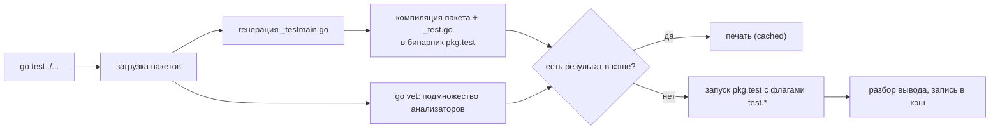
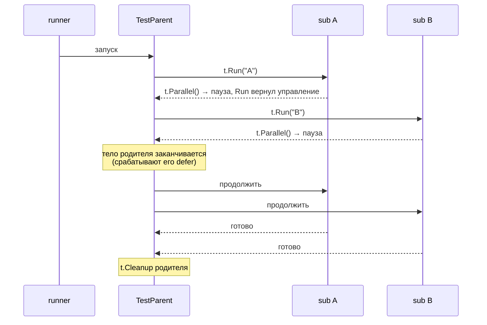
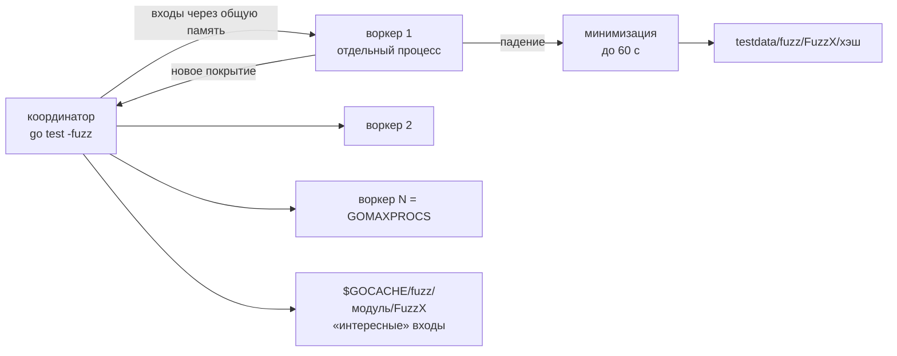
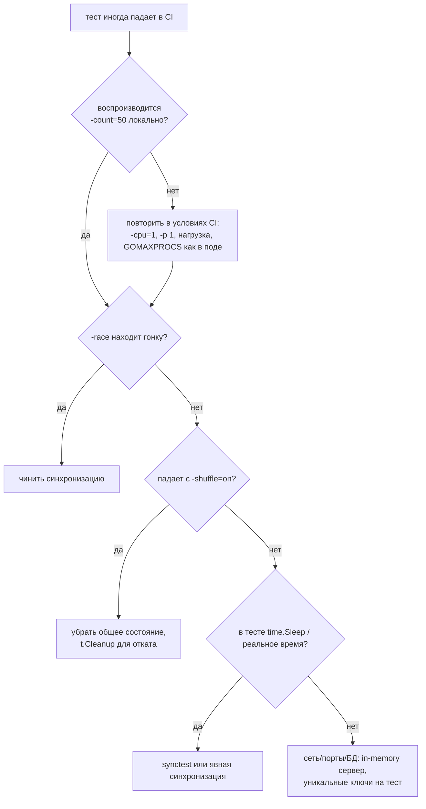

# Go Testing: Deep Dive для Senior Go-разработчика

> Актуально для **Go 1.27** (релиз — август 2026; последний патч в локальном репозитории на момент написания — go1.27.1).
> Факты сверены с исходниками ветки `go1.27.0`: `src/testing/*.go`, `src/testing/synctest/synctest.go`, `src/runtime/synctest.go`, `src/cmd/go/internal/test/test.go`, `src/cmd/go/internal/load/test.go`, `src/internal/fuzz/`, `src/cmd/compile/internal/bloop/bloop.go`, `src/net/http/httptest/server.go`, а также с файлами `api/go1.*.txt`, где записано, в какой версии появился каждый публичный символ.
> Все выводы команд и бенчмарки — **реальные прогоны** на `go1.27.0 darwin/arm64, Apple M3 Pro, 11 ядер, GOMAXPROCS=11`; для сравнения версий — `go1.24.4` и `go1.25.3`.
> Бенчмарки запускались одновременно с другими тяжёлыми процессами на той же машине: **B/op и allocs/op надёжны, ns/op шумные** (разброс до ±21 % видно в выводе benchstat ниже). Каждый прогон одиночный, если не сказано иное.
> Места, где факт не удалось проверить по первоисточнику или запуском, помечены **⚠️ не проверено**.

## Оглавление

- [Словарь терминов](#словарь-терминов)
- [TL;DR](#tldr)
- [1. Модель: что такое тест в Go](#1-модель-что-такое-тест-в-go)
- [2. Как работает go test изнутри](#2-как-работает-go-test-изнутри)
- [3. Кэш результатов тестов](#3-кэш-результатов-тестов)
- [4. API testing.T: подтесты, хелперы, очистка](#4-api-testingt-подтесты-хелперы-очистка)
- [5. Параллельные тесты](#5-параллельные-тесты)
- [6. TestMain и общая инициализация](#6-testmain-и-общая-инициализация)
- [7. Табличные тесты, golden-файлы, example-тесты](#7-табличные-тесты-golden-файлы-example-тесты)
- [8. Конкурентный код и время: synctest](#8-конкурентный-код-и-время-synctest)
- [9. HTTP, файлы, ввод-вывод и логи](#9-http-файлы-ввод-вывод-и-логи)
- [10. Моки, фейки и testify](#10-моки-фейки-и-testify)
- [11. Интеграционные тесты](#11-интеграционные-тесты)
- [12. Race detector в тестах](#12-race-detector-в-тестах)
- [13. Утечки горутин](#13-утечки-горутин)
- [14. Покрытие кода](#14-покрытие-кода)
- [15. Фаззинг](#15-фаззинг)
- [16. Бенчмарки](#16-бенчмарки)
- [17. Flaky-тесты](#17-flaky-тесты)
- [18. Настройки и параметры](#18-настройки-и-параметры)
- [19. Production: CI, контейнеры, Kubernetes](#19-production-ci-контейнеры-kubernetes)
- [20. Наблюдаемость и диагностика](#20-наблюдаемость-и-диагностика)
- [21. Грабли, заблуждения и советы: сводка](#21-грабли-заблуждения-и-советы-сводка)
- [22. Сравнение с другими платформами](#22-сравнение-с-другими-платформами)
- [23. Вопросы для собеседования](#23-вопросы-для-собеседования)
- [24. Чеклист и шпаргалка](#24-чеклист-и-шпаргалка)

## Словарь терминов

| Термин | Что это простыми словами |
|---|---|
| **Тестовый бинарник** (`pkg.test`) | Обычная Go-программа, которую `go test` собирает из вашего пакета и его `_test.go`-файлов, а потом запускает. Тесты — это просто функции внутри неё. |
| **testmain** | Сгенерированный файл `_testmain.go` с функцией `main`, который регистрирует все ваши `Test*`, `Benchmark*`, `Fuzz*`, `Example*` и запускает их. |
| **Подтест** (subtest) | Тест внутри теста, созданный через `t.Run("имя", ...)`. Имеет собственное имя `TestX/имя`, свой статус и может запускаться отдельно через `-run`. |
| **Табличный тест** (table-driven test) | Приём: входы и ожидаемые выходы складываются в слайс структур, а один цикл прогоняет их все. |
| **Хелпер** | Вспомогательная функция для теста. `t.Helper()` говорит `testing`, что номер строки в сообщении об ошибке надо брать у вызывающего кода. |
| **Cleanup** | Функция, зарегистрированная через `t.Cleanup`, которая выполнится после теста (и всех его подтестов). Порядок — обратный регистрации (LIFO, «последним пришёл — первым ушёл»). |
| **Golden-файл** | Файл с эталонным выводом (`testdata/*.golden`). Тест сравнивает результат с ним; флаг `-update` перезаписывает эталон. |
| **Example-тест** | Функция `ExampleXxx` с комментарием `// Output:`. Это и документация на pkg.go.dev, и тест: `go test` сравнивает напечатанное с комментарием. |
| **Фейк** (fake) | Упрощённая, но работающая реализация зависимости (например, хранилище в `map` вместо PostgreSQL). |
| **Мок** (mock) | Объект, который проверяет, *как* его вызвали: какие методы, с какими аргументами, сколько раз. Обычно генерируется (gomock, mockery). |
| **Стаб** (stub) | Заглушка, которая просто возвращает заранее заданные значения и ничего не проверяет. |
| **Пузырь** (bubble) | Изолированная группа горутин в `testing/synctest` со своими фейковыми часами. |
| **Durably blocked** («надёжно заблокирована») | Горутина в пузыре, которую может разбудить только другая горутина того же пузыря (например, ждёт канал, созданный в пузыре). Время в пузыре двигается, только когда *все* его горутины в таком состоянии. |
| **Фейковое время** | Время внутри пузыря: стартует с 2000-01-01 00:00 UTC и прыгает вперёд мгновенно, когда все ждут таймера. |
| **Race detector** | Режим `-race`: компилятор вставляет проверки каждого обращения к памяти, и рантайм ловит одновременный доступ из разных горутин без синхронизации (гонку данных). |
| **Покрытие** (coverage) | Доля операторов кода, которые выполнились во время тестов. |
| **Фаззинг** (fuzzing) | Автоматическая генерация «случайных», но умных входов, которые ищут падения. Go-фаззер — *coverage-guided*: сохраняет входы, открывшие новый путь в коде, и мутирует их дальше. |
| **Корпус** (corpus) | Набор входов для фаззера: seed-входы (`f.Add`, `testdata/fuzz/`) плюс найденные «интересные» входы в кэше. |
| **Бенчмарк** | Функция `BenchmarkXxx(b *testing.B)`, которая измеряет время и аллокации на операцию. |
| **DCE** (dead code elimination) | Оптимизация компилятора: удаление кода, результат которого никому не нужен. Главный враг наивных бенчмарков. |
| **Flaky-тест** («мигающий») | Тест, который то проходит, то падает без изменений в коде. |
| **Build tag** (тег сборки) | Строка `//go:build integration` в начале файла: файл компилируется, только если тег включён (`-tags integration`). |
| **testcontainers** | Библиотека, которая из теста поднимает Docker-контейнеры (PostgreSQL, Kafka, Redis) и удаляет их после. |
| **Утечка горутины** (goroutine leak) | Горутина, которая никогда не завершится, потому что ждёт то, что уже никогда не произойдёт. |

## TL;DR

1. `go test` — это **сборка отдельной программы**: из ваших `_test.go` генерируется `_testmain.go` с функцией `main`, вызывающей `testing.MainStart(...)` и `m.Run()` (`src/cmd/go/internal/load/test.go`, шаблон `testmainTmpl`). §2.
2. Перед запуском `go test` **автоматически гоняет подмножество `go vet`**: в Go 1.27 это `atomic`, `bools`, `buildtag`, `directive`, `errorsas`, `ifaceassert`, `nilfunc`, `printf`, `slog`, `stdversion` (добавлен в 1.27), `stringintconv`, `tests` (с 1.24). Ошибка vet = тест не собрался. `loopclosure`, `copylocks`, `lostcancel`, `testinggoroutine` **не входят** — нужен отдельный `go vet`. §2.3.
3. Результаты успешных тестов **кэшируются** только в режиме списка пакетов (`go test ./...`) и только с «кэшируемыми» флагами. Кэш учитывает прочитанные переменные окружения и файлы; файл моложе **2 секунд** (`modTimeCutoff`) отключает кэш. Идиоматичный способ выключить кэш — `-count=1`. §3.
4. `t.Cleanup` выполняется в порядке LIFO **после всех подтестов**, а `defer` в родителе параллельных подтестов срабатывает **до** их запуска — классическая причина «sql: database is closed». §4.4, §5.3.
5. `t.Context()` (Go 1.24) отменяется **непосредственно перед** вызовом cleanup-функций — внутри cleanup он уже `context canceled`. §4.5.
6. `t.Fatal` из чужой горутины не останавливает тест (проверено: код после `wg.Wait()` выполнился). `go vet` (анализатор `testinggoroutine`) ловит это для `go func(){}`, но **не ловит для `wg.Go(func(){})`** (Go 1.27). §4.6.
7. До Go 1.22 переменная цикла была общей: табличный тест с `t.Parallel()` **проходил зелёным, проверив трижды последний случай**. С `go 1.22` в `go.mod` каждая итерация получает свою копию. §5.2.
8. `testing/synctest` стабилен с **Go 1.25** (`synctest.Test`), экспериментальный `synctest.Run` удалён в **1.26**, `synctest.Sleep` добавлен в **1.27**. Внутри пузыря 30 минут таймеров проходят за 0 мс реального времени. §8.
9. В Go 1.27 появился `httptest.NewTestServer(t, h)`: сервер на **in-memory сети**, сам закрывается через `t.Cleanup`, превращает панику обработчика в провал теста и работает внутри `synctest`. §9.1.
10. `assert` из testify **не останавливает** тест: следующая строка может разыменовать `nil` и уронить **весь тестовый бинарник** — оставшиеся тесты пакета не выполнятся. Для предусловий — `require`. §10.3.
11. `-race` превращает гонку в провал теста: `testing.go:1865: race detected during execution of test`. Без `-race` тот же тест проходит. §12.
12. Покрытие интеграционных прогонов: `go build -cover` + `GOCOVERDIR` + `go tool covdata`; данные пишутся даже при `os.Exit(1)`. Юнит- и интеграционное покрытие сливаются `go tool covdata merge`. §14.
13. Фаззер нашёл переполнение `int64` в парсере денежной суммы за **0,23 с**; упавший вход сохраняется в `testdata/fuzz/FuzzXxx/` и становится обычным регрессионным тестом. §15.
14. Бенчмарк с `for i := 0; i < b.N; i++ { Fee(x) }` показал **0,27 ns/op** — компилятор выкинул вызов. `for b.Loop()` (Go 1.24) держит результат живым; с **Go 1.26** это делается через `runtime.KeepAlive`, а не запретом инлайнинга, как в 1.24–1.25. §16.
15. Функция бенчмарка с `b.N` вызывается **несколько раз** (b.N = 1, 100, 10⁴, 10⁶, 10⁸, 10⁹ — реальный лог), с `b.Loop` — **один раз**. Дорогой setup в `b.N`-бенчмарке повторяется на каждом вызове. §16.2.
16. Порядок тестов в Go детерминирован, поэтому зависимость тестов друг от друга незаметна. `-shuffle=on` ловит её: из 6 прогонов 3 упали; сид печатается и воспроизводит падение. §17.

---

## 1. Модель: что такое тест в Go

### 1.1. Из чего состоит тест

Тест в Go — это обычная функция в файле с суффиксом `_test.go`. Такие файлы не попадают в обычную сборку (`go build`), только в `go test`.

| Вид | Сигнатура | Для чего | Флаг запуска |
|---|---|---|---|
| Тест | `func TestXxx(t *testing.T)` | проверка поведения | по умолчанию, `-run` |
| Бенчмарк | `func BenchmarkXxx(b *testing.B)` | измерение скорости и аллокаций | `-bench` |
| Фазз-тест | `func FuzzXxx(f *testing.F)` | поиск падений на сгенерированных входах | `-fuzz` (без флага прогоняется только корпус) |
| Пример | `func ExampleXxx()` с `// Output:` | документация + проверка вывода | по умолчанию, `-run` |
| Точка входа | `func TestMain(m *testing.M)` | общая подготовка для всего пакета | — |

Все `*testing.T`, `*testing.B`, `*testing.F` реализуют интерфейс `testing.TB`, поэтому хелперы пишут один раз: `func newDB(tb testing.TB) *sql.DB`.

### 1.2. Внутренний и внешний тестовый пакет

```text
price/
├── price.go            package price
├── price_test.go       package price        ← «белый ящик»: видит неэкспортируемое
└── api_test.go         package price_test   ← «чёрный ящик»: только публичный API
```

- `package price` в тесте — доступ ко всему, включая приватные функции.
- `package price_test` — отдельный пакет; импортирует `price` как обычный клиент. Так тестируют публичный API и разрывают циклы импорта (например, когда тест пакета `a` использует пакет `b`, который сам импортирует `a`).

Оба варианта могут жить в одной директории; `go test` соберёт их в один бинарник (в сгенерированном `_testmain.go` это `_test` и `_xtest`, §2.1).

### 1.3. Почему так спроектировано

Go сознательно не стал делать фреймворк с аннотациями, DSL для ассертов и магией (как JUnit или pytest). Тест — это код на Go, ошибки — это `t.Errorf` с обычным `fmt`. Цена: больше «ручного» кода в сравнениях (`if got != want { t.Errorf(...) }`). Выигрыш: нечему ломаться, нечего изучать, отладчик и профайлер работают как с обычной программой.

> **Заблуждение:** «Без testify в Go нельзя нормально писать тесты». На самом деле стандартный `testing` + `cmp.Diff` из `github.com/google/go-cmp` или `reflect.DeepEqual` покрывают сравнения; сама команда Go в стандартной библиотеке testify не использует. testify — удобство, а не необходимость (§10.3).

### Простыми словами

Тест — это функция с именем `TestЧтоТо` в файле `_test.go`. Внутри вы вызываете свой код и, если результат неправильный, говорите об этом через `t.Errorf` или `t.Fatalf`. Никакой магии: это просто Go-код, который запускает специальная программа.

### Что важно для Senior

- Выбирайте `package x_test` для тестов публичного контракта, `package x` — для точечных тестов внутренностей; смешивать в одной директории нормально.
- `testing.TB` в сигнатурах хелперов позволяет переиспользовать их в тестах, бенчмарках и фаззинге.
- Отсутствие фреймворка — осознанное решение: тестовый код подчиняется тем же правилам ревью и рефакторинга, что и продовый.

---

## 2. Как работает go test изнутри

### 2.1. Сгенерированный main

`go test` не «запускает тесты» сам. Он **собирает программу**. Для пакета `example.com/basic/price` с двумя тестами сгенерированный файл выглядит так (реальный вывод, найден через `go test -work`, пустые строки убраны):

```go
// Code generated by 'go test'. DO NOT EDIT.
package main
import (
	"os"
	"testing"
	"testing/internal/testdeps"
	_test "example.com/basic/price"
)
var tests = []testing.InternalTest{
	{"TestDiscount", _test.TestDiscount},
	{"TestCurrency", _test.TestCurrency},
}
var benchmarks = []testing.InternalBenchmark{
}
var fuzzTargets = []testing.InternalFuzzTarget{
}
var examples = []testing.InternalExample{
}
func init() {
	testdeps.ModulePath = "example.com/basic"
	testdeps.ImportPath = "example.com/basic/price"
}
func main() {
	m := testing.MainStart(testdeps.TestDeps{}, tests, benchmarks, fuzzTargets, examples)
	os.Exit(m.Run())
}
```

Шаблон — `testmainTmpl` в `src/cmd/go/internal/load/test.go`. Если в пакете есть `TestMain`, шаблон вместо `os.Exit(m.Run())` вызывает вашу функцию, а код выхода достаёт из поля `m.exitCode` через `reflect` — поэтому с Go 1.15 вызывать `os.Exit` в `TestMain` не обязательно (§6).

Поиск функций идёт **по имени и сигнатуре** на этапе генерации: `go test` разбирает AST ваших `_test.go`. Функция `Testdiscount` (маленькая буква после `Test`) тестом не считается — и анализатор `tests` в vet об этом предупредит.

### 2.2. Конвейер



- Каждый пакет — **отдельный бинарник и отдельный процесс**. Глобальные переменные разных пакетов не пересекаются; внутри пакета — общие для всех тестов (§17).
- Пакеты тестируются параллельно: `-p n`, по умолчанию `GOMAXPROCS` (`go help build`). Внутри пакета тесты идут последовательно, пока не вызван `t.Parallel()` (§5).
- Флаги вида `-run`, `-v`, `-count` `go test` переписывает в `-test.run`, `-test.v` и т.д. и передаёт бинарнику. Бинарник можно собрать (`go test -c -o price.test`) и запускать сам: `./price.test -test.run TestDiscount -test.v`. Так удобно гонять тесты под отладчиком или на другой машине.
- **Режим директории** (`go test` без аргументов) и **режим списка пакетов** (`go test .`, `go test ./...`) ведут себя по-разному: в первом кэш выключен и вывод печатается всегда (§3).

### 2.3. Какой vet запускается автоматически

Список — `defaultVetFlags` в `src/cmd/go/internal/test/test.go`. Сравнение версий сделано по истории файла:

| Анализатор | Что ловит | В наборе `go test` с |
|---|---|---|
| `atomic`, `bools`, `buildtag`, `directive`, `errorsas`, `ifaceassert`, `nilfunc`, `printf`, `stringintconv` | классические ошибки (`x = atomic.AddInt64(&x, 1)`, неверный формат `%s` для `int`, `errors.As` с не-указателем) | давно (`errorsas` — 1.13, `ifaceassert`/`stringintconv` — 1.15) |
| `slog` | несогласованные пары ключ-значение в `slog.Info("msg", "k")` | 1.21 |
| `tests` | неправильные сигнатуры `Test*`/`Example*`/`Fuzz*` | 1.24 |
| `stdversion` | использование API новее, чем `go`-версия в `go.mod` | **1.27** (коммит `5262546d82`) |

Ошибка vet ломает сборку тестов:

```go
func TestOrderLog(t *testing.T) {
	id := 42
	t.Logf("order %s processed", id)
}
```

```text
# example.com/vetm
# [example.com/vetm]
./log_test.go:7:16: (*testing.common).Logf format %s has arg id of wrong type int
FAIL	example.com/vetm [build failed]
FAIL
```

С `-vet=off` тот же пакет проходит. `-vet=off` в CI отключать не стоит: это бесплатные проверки.

> **Заблуждение:** «`go test` прогоняет `go vet`, значит отдельный `go vet ./...` в CI не нужен». На самом деле в наборе `go test` нет `loopclosure`, `copylocks`, `lostcancel`, `testinggoroutine`, `waitgroup`, `httpresponse`, `unusedresult` и других (в `test.go` они закомментированы). Набор специально узкий, чтобы vet в `go test` не давал ложных срабатываний. Запускайте полный `go vet ./...` (или golangci-lint) отдельным шагом.

### Простыми словами

`go test` пишет за вас маленькую программу с функцией `main`, вставляет в неё список ваших тестов, компилирует и запускает. Перед этим он быстро проверяет код несколькими проверками `go vet` и, если находит явную ошибку, даже не запускает тесты.

### Что важно для Senior

- Тестовый бинарник — обычная программа: его можно собрать `-c`, запускать с `-test.*`, профилировать и отлаживать (`dlv test`).
- Один пакет — один процесс: изоляция между пакетами полная, внутри пакета — никакой.
- Встроенный vet — минимальный; полный `go vet ./...` в CI обязателен.
- С Go 1.27 `stdversion` в `go test` ловит использование API новее версии из `go.mod`.

---

## 3. Кэш результатов тестов

### 3.1. Правила

Из документации в `src/cmd/go/internal/test/test.go`:

- кэш работает **только в режиме списка пакетов** (`go test ./...`, `go test .`), не в режиме директории;
- кэшируются **только успешные** результаты;
- все флаги должны быть из «кэшируемого» набора: `-benchtime`, `-coverprofile`, `-cpu`, `-failfast`, `-fullpath`, `-list`, `-outputdir`, `-parallel`, `-run`, `-short`, `-skip`, `-timeout`, `-v`. Любой другой тестовый флаг (`-count=1`, `-benchmem`, `-shuffle`) — кэш не используется. Флаги сборки (`-race`, `-tags`, `-gcflags`) кэш не выключают, а дают другой бинарник и, значит, отдельную запись в кэше;
- тесты, которые **открывали файлы внутри модуля или читали переменные окружения**, совпадут с кэшем, только если эти файлы и переменные не менялись. Отслеживание делает `internal/testlog`: его интерфейс — `Getenv`, `Stat`, `Open`, `Chdir`; пакет `os` сообщает туда о прочитанных переменных и открытых файлах, а `go test` хэширует этот лог;
- результат из кэша считается выполненным «за 0 секунд», поэтому `-timeout` на него не влияет.

### 3.2. Как это выглядит

```text
--- 1
ok  	example.com/basic/price	(cached)
--- 2 same
ok  	example.com/basic/price	(cached)
--- 3 env changed                    ← SHOP_CURRENCY=USD go test ./price
ok  	example.com/basic/price	0.294s
--- 4 -count=1
ok  	example.com/basic/price	0.290s
--- 7 debug                          ← GODEBUG=gocachetest=1 go test -count=1 ./price
testcache: caching disabled for test argument: -test.count=1
--- 8 dir mode                       ← cd price && go test (дважды)
PASS
ok  	example.com/basic/price	0.302s
PASS
ok  	example.com/basic/price	0.295s
```

Тест `TestCurrency` читает `SHOP_CURRENCY` через `os.Getenv`; смена переменной инвалидирует кэш автоматически. В режиме директории кэш не используется вовсе.

**Грабли: «тест не кэшируется, хотя ничего не менялось»**

Тест читает `testdata/rate.json`. Сразу после изменения файла два запуска подряд оба выполняются по-настоящему:

```text
ok  	example.com/basic/price	0.510s
ok  	example.com/basic/price	0.303s      ← ожидали (cached)
```

Почему так: в `hashOpen` (`src/cmd/go/internal/test/test.go`) стоит `const modTimeCutoff = 2 * time.Second`: если прочитанный тестом файл изменён меньше 2 секунд назад, результат не кэшируется (`errFileTooNew`) — точности mtime файловой системы может не хватить, чтобы заметить следующую запись. После паузы 2,5 с прогон стал `(cached)`. Как заметить: `GODEBUG=gocachetest=1` печатает причину. Как исправить: ничего не нужно — это защита; просто не удивляйтесь в скриптах «правка → тест → тест».

> **Совет.** Выключайте кэш через `-count=1` — когда тест зависит от внешнего мира, который `testlog` не видит (база данных, сеть, файлы вне модуля, время). Не нужно для чистых юнит-тестов: кэш на больших монорепозиториях экономит минуты CI.

> **Заблуждение:** «Кэш тестов надо чистить `go clean -cache` после каждого изменения». На самом деле ключ кэша включает хэш бинарника (код пакета и всех зависимостей), флаги, прочитанные env и файлы. Изменение кода автоматически даёт новый ключ. `go clean -testcache` нужен, только если тест зависит от того, что кэш не видит.

### Простыми словами

Если вы ничего не меняли и тест уже проходил, `go test ./...` не будет запускать его снова и напишет `(cached)`. Он сам замечает изменения кода, переменных окружения и файлов, которые тест читал. Чтобы заставить тест выполниться заново, добавьте `-count=1`.

### Что важно для Senior

- Кэш — функция от бинарника, флагов, env и файлов внутри модуля; БД, сеть и файлы вне модуля он не видит — интеграционные тесты запускайте с `-count=1`.
- `GODEBUG=gocachetest=1` объясняет, почему кэш не сработал.
- Файлы моложе 2 с отключают кэш — это защита от недостаточной точности mtime, а не баг.
- В CI кэш между запусками переносят, сохраняя `$(go env GOCACHE)`.

---

## 4. API testing.T: подтесты, хелперы, очистка

### 4.1. Какие методы есть и с какой версии

Версии взяты из `api/go1.*.txt` в репозитории Go:

| Метод | Версия | Что делает |
|---|---|---|
| `t.Run(name, f)` | 1.7 | подтест; блокирует, пока `f` не вернётся или не вызовет `t.Parallel()` |
| `t.Helper()` | 1.9 | строку ошибки брать у вызывающего |
| `t.Cleanup(f)` | 1.14 | отложенная очистка, LIFO, после подтестов |
| `t.TempDir()` | 1.15 | временная директория, удаляется автоматически |
| `t.Deadline()` | 1.15 | когда сработает `-timeout` |
| `t.Setenv(k, v)` | 1.17 | переменная окружения с откатом; несовместим с `t.Parallel` |
| `testing.Testing()` | 1.21 | `true`, если код запущен из тестового бинарника |
| `t.Context()` | 1.24 | контекст, отменяемый перед cleanup |
| `t.Chdir(dir)` | 1.24 | смена рабочей директории с откатом; несовместим с `t.Parallel` |
| `b.Loop()` | 1.24 | новый цикл бенчмарка (§16) |
| `t.Attr(k, v)` | 1.25 | метаданные теста в выводе и JSON |
| `t.Output()` | 1.25 | `io.Writer` в вывод теста с отступом, без номера строки |
| `t.ArtifactDir()` | 1.26 | директория для артефактов (скриншоты, дампы), сохраняется с `-artifacts` |
| `synctest.Test`, `synctest.Wait` | 1.25 | §8 |
| `synctest.Sleep` | 1.27 | §8 |
| `httptest.NewTestServer` | 1.27 | §9.1 |

### 4.2. Подтесты и имена

`t.Run` создаёт подтест с именем `Родитель/имя`. Пробелы в имени заменяются на `_`: подтест `t.Run("SELECT 1", ...)` в выводе называется `TestQueriesDefer/SELECT_1`. Фильтр `-run` разбивается по `/` на уровни: `-run 'TestStatusText/Not_Found'` запустит один случай. Это главное практическое преимущество подтестов перед циклом с `t.Errorf`: можно перезапустить один упавший случай.

### 4.3. t.Helper

```go
func assertStatus(t *testing.T, got, want int) {
	t.Helper()
	if got != want {
		t.Errorf("status = %d, want %d", got, want)
	}
}

func assertStatusNoHelper(t *testing.T, got, want int) {
	if got != want {
		t.Errorf("status = %d, want %d", got, want)
	}
}

func TestHelper(t *testing.T) {
	assertStatus(t, 500, 200)         // строка 32
	assertStatusNoHelper(t, 500, 200) // строка 33
}
```

```text
=== RUN   TestHelper
    api_test.go:32: status = 500, want 200
    api_test.go:27: status = 500, want 200
--- FAIL: TestHelper (0.00s)
```

С `t.Helper()` указана строка вызова в тесте (32), без него — строка внутри хелпера (27), и непонятно, какой из сотни вызовов упал. Как это работает: `testing` при выводе идёт вверх по стеку (`runtime.Callers`) и пропускает кадры функций, отмеченных `Helper()`.

### 4.4. Cleanup: порядок и отношения с подтестами

```go
func TestCleanupOrder(t *testing.T) {
	ctx := t.Context()
	t.Cleanup(func() { t.Log("cleanup 1: close DB pool") })
	t.Cleanup(func() {
		t.Log("cleanup 2: ctx.Err() =", ctx.Err(), "cause =", context.Cause(ctx))
	})
	t.Log("test body: ctx.Err() =", ctx.Err())
}
```

```text
=== RUN   TestCleanupOrder
    api_test.go:15: test body: ctx.Err() = <nil>
    api_test.go:13: cleanup 2: ctx.Err() = context canceled cause = context canceled
    api_test.go:11: cleanup 1: close DB pool
--- PASS: TestCleanupOrder (0.00s)
```

Что видно:
- порядок обратный регистрации (LIFO) — как у `defer`: сначала закрываем то, что открыли последним;
- `t.Context()` уже отменён, когда работают cleanup-функции (§4.5).

Чем `t.Cleanup` лучше `defer`:
1. его можно зарегистрировать **внутри хелпера**: `newTestDB(t)` сам вызывает `t.Cleanup(db.Close)`, и тесту не нужно помнить про закрытие;
2. он выполняется **после всех подтестов**, включая параллельные. `defer` в теле родителя срабатывает раньше — это реальные грабли, разобранные в §5.3.

### 4.5. t.Context

`t.Context()` (Go 1.24) возвращает контекст, который отменяется **непосредственно перед** вызовом cleanup-функций (видно в выводе выше). Зачем: фоновые горутины, запущенные тестом с этим контекстом, получают сигнал остановиться до того, как cleanup начнёт закрывать ресурсы. Раньше то же самое писали руками: `ctx, cancel := context.WithCancel(context.Background()); t.Cleanup(cancel)`.

**Грабли: использовать `t.Context()` внутри cleanup**

В cleanup контекст уже отменён: `db.ExecContext(t.Context(), "DROP TABLE ...")` в cleanup сразу вернёт `context canceled`. Как исправить: в cleanup используйте `context.Background()` или `context.WithoutCancel(ctx)`. Как заметить: ошибки `context canceled` в логах cleanup.

### 4.6. Fatal из чужой горутины

```go
func TestWorkersFatalInGoroutine(t *testing.T) {
	var wg sync.WaitGroup
	for id := range 4 {
		wg.Go(func() {
			if err := process(id); err != nil { // id == 2 → ошибка Kafka
				t.Fatalf("worker %d: %v", id, err)
			}
		})
	}
	wg.Wait()
	t.Log("all workers finished") // выполнится, хотя Fatalf «должен был» остановить тест
}
```

```text
=== RUN   TestWorkersFatalInGoroutine
    worker_test.go:21: worker 2: kafka: broker not available
    worker_test.go:26: all workers finished
--- FAIL: TestWorkersFatalInGoroutine (0.00s)
```

Почему так: `t.FailNow` (его вызывает `Fatal`) помечает тест проваленным и вызывает `runtime.Goexit()` — завершает **текущую горутину**. Если это не горутина теста, тест продолжает выполняться. В худшем случае горутина теста к этому времени уже закончилась, и вызов `Fatal` после завершения теста вызывает панику: в `testing.go` это `"Fail in goroutine after " + c.name + " has completed"` (для `Log` — `"Log in goroutine after ... has completed"`).

Как заметить: `go vet` с анализатором `testinggoroutine` — но он **не входит** в набор `go test` (§2.3) и, как показал прогон на Go 1.27, видит только оператор `go`:

```text
$ go vet .        # вариант с go func() { ... t.Fatalf ... }()
old_test.go:15:5: call to (*testing.T).Fatalf from a non-test goroutine
$ go vet .        # вариант с wg.Go(func() { ... t.Fatalf ... })
(пусто)
```

Как исправить: в горутинах используйте `t.Error` (безопасен из любой горутины) и `return`, или собирайте ошибки через `errgroup` и проверяйте в горутине теста.

### 4.7. TempDir, Setenv, Chdir, Attr, Output, ArtifactDir

```go
func TestTempDirChdir(t *testing.T) {
	dir := t.TempDir()
	t.Chdir(dir)
	wd, _ := os.Getwd()
	t.Log("wd:", wd)
	t.Attr("ticket", "PAY-1234")
	t.Output().Write([]byte("raw line via t.Output()\n"))
	t.Log("artifacts:", t.ArtifactDir())
}
```

```text
=== RUN   TestTempDirChdir
    api_test.go:45: wd: /var/folders/x3/.../T/TestTempDirChdir1677043075/001
=== ATTR  TestTempDirChdir ticket PAY-1234
    raw line via t.Output()
    api_test.go:48: artifacts: /var/folders/x3/.../T/TestTempDirChdir1677043075/002
--- PASS: TestTempDirChdir (0.00s)
```

- `t.TempDir()` — каждый вызов даёт новую поддиректорию (`001`, `002`), всё удаляется после теста.
- `t.Attr` печатается строкой `=== ATTR` и в `-json` превращается в отдельное событие `{"Action":"attr","Key":"ticket","Value":"PAY-1234"}` — удобно связывать тест с тикетом или ID флаки-трекера.
- `t.ArtifactDir()` без флага `-artifacts` возвращает временную директорию, которая удалится. С `-artifacts -outputdir out` файлы сохраняются в `out/_artifacts/<тест>/<случайное>`. Директория `-outputdir` должна существовать, иначе: `testing: mkdir .../out/_artifacts: no such file or directory`.

### Простыми словами

`t.Run` делает тест внутри теста, чтобы каждый случай имел имя и запускался отдельно. `t.Helper` делает сообщения об ошибках понятными. `t.Cleanup` — это «уберись за мной», который сработает после теста и всех его подтестов. `t.Fatal` останавливает только ту горутину, в которой вызван, поэтому из своих горутин его вызывать нельзя.

### Что важно для Senior

- Ресурсы в хелперах закрывайте через `t.Cleanup`, а не через `defer` в тесте.
- `t.Context()` отменяется перед cleanup — в cleanup нужен отдельный контекст.
- `t.Fatal` в горутине — ошибка; vet ловит её только для `go`-оператора и только при явном запуске `go vet`.
- `t.Attr` и `-json` позволяют связывать тесты с внешними системами без парсинга логов.

---

## 5. Параллельные тесты

### 5.1. Как работает t.Parallel



- `t.Parallel()` ставит тест на паузу. Параллельные тесты **верхнего уровня** продолжаются после того, как все последовательные тесты пакета завершились; параллельные **подтесты** — после того, как тело родителя вернулось.
- Одновременно работают не больше `-parallel n` тестов (по умолчанию `GOMAXPROCS`, флаг `test.parallel` в `testing.go`). Это лимит внутри одного бинарника; между пакетами работает `-p`.
- `t.Parallel()` несовместим с `t.Setenv` и `t.Chdir` (они меняют глобальное состояние процесса) и запрещён внутри `synctest`.

```text
--- FAIL: TestSetenvParallel (0.00s)
panic: testing: test using t.Setenv, t.Chdir, or cryptotest.SetGlobalRandom can not use t.Parallel [recovered, repanicked]
```

### 5.2. Переменная цикла и t.Parallel

**Грабли: зелёный тест, который проверяет не то**

```go
// go.mod: go 1.21
for _, tc := range cases { // 200 OK, 404 Not Found, 503 Service Unavailable
	t.Run(http.StatusText(tc.code), func(t *testing.T) {
		t.Parallel()
		if got := http.StatusText(tc.code); got != tc.want {
			t.Errorf("code %d: got %q, want %q", tc.code, got, tc.want)
		}
		t.Logf("checked code %d", tc.code)
	})
}
```

```text
=== NAME  TestStatusText/OK
    status_test.go:23: checked code 503
=== NAME  TestStatusText/Service_Unavailable
    status_test.go:23: checked code 503
=== NAME  TestStatusText/Not_Found
    status_test.go:23: checked code 503
--- PASS: TestStatusText (0.00s)
```

Тест **прошёл**, проверив три раза последний случай. Почему: до Go 1.22 `tc` — одна переменная на весь цикл; параллельные подтесты стартуют после окончания цикла и видят её последнее значение. С `go 1.22` в `go.mod` (семантика определяется именно версией в `go.mod`, а не тулчейном — прогон шёл на go1.27.0) вывод стал правильным:

```text
    status_test.go:23: checked code 200
    status_test.go:23: checked code 503
    status_test.go:23: checked code 404
```

Как заметить: `go vet` (анализатор `loopclosure`) — но, опять же, не в наборе `go test`:

```text
status_test.go:20:30: loop variable tc captured by func literal
```

Как исправить: поднять `go` в `go.mod` до 1.22+ (рекомендуется) или старым способом `tc := tc` в начале итерации.

> **Совет устарел.** `tc := tc` перед `t.Run` нужен только для модулей с `go` < 1.22. В новых модулях эта строка лишняя; `go fix` удаляет её (в набор `go fix` Go 1.27 входит модернизатор `forvar` — `src/cmd/vendor/golang.org/x/tools/go/analysis/passes/modernize/forvar.go`).

### 5.3. defer в родителе параллельных подтестов

**Грабли: «sql: database is closed» только в параллельных тестах**

```go
func TestQueriesDefer(t *testing.T) {
	db := &pool{}
	defer db.closed.Store(true) // закроется ДО параллельных подтестов
	for _, q := range []string{"SELECT 1", "SELECT 2"} {
		t.Run(q, func(t *testing.T) {
			t.Parallel()
			if err := db.Query(q); err != nil {
				t.Error(err)
			}
		})
	}
}

func TestQueriesCleanup(t *testing.T) {
	db := &pool{}
	t.Cleanup(func() { db.closed.Store(true) }) // после всех подтестов
	// ... тот же цикл ...
}
```

```text
=== NAME  TestQueriesDefer/SELECT_1
    db_test.go:25: sql: database is closed
=== NAME  TestQueriesDefer/SELECT_2
    db_test.go:25: sql: database is closed
--- FAIL: TestQueriesDefer (0.00s)
--- PASS: TestQueriesCleanup (0.00s)
```

Почему: по схеме из §5.1 параллельные подтесты продолжаются только после того, как тело родителя вернулось, а `defer` срабатывает именно в этот момент. `t.Cleanup` родителя выполняется после завершения всех подтестов. `go vet` это не ловит. Как исправить: `t.Cleanup` вместо `defer`, либо обернуть параллельные подтесты в синхронный `t.Run("group", ...)`.

### Простыми словами

`t.Parallel()` говорит: «этот тест можно запускать одновременно с другими такими же». Go откладывает такие тесты и запускает их пачкой. Из-за этого `defer` в родительском тесте срабатывает раньше, чем параллельные подтесты успели поработать, — используйте `t.Cleanup`.

### Что важно для Senior

- `-parallel` ограничивает параллелизм внутри пакета, `-p` — между пакетами; в контейнере по умолчанию оба равны `GOMAXPROCS`, который с Go 1.25 учитывает лимит CPU cgroup.
- `t.Parallel()` в табличных тестах безопасен только при `go ≥ 1.22` в `go.mod`.
- `defer` + параллельные подтесты = ресурс закрыт до использования; правило: в тестах ресурсы закрывает только `t.Cleanup`.
- Параллельные тесты не должны трогать глобальное состояние: env, cwd, глобальные переменные пакета, `http.DefaultServeMux`.

---

## 6. TestMain и общая инициализация

`func TestMain(m *testing.M)` — необязательная точка входа пакета. Если она есть, сгенерированный `main` (§2.1) вызывает её вместо `m.Run()`. Она нужна, когда подготовка дорогая и общая для всех тестов пакета: поднять контейнер PostgreSQL один раз, а не в каждом тесте; применить миграции; включить goleak (§13).

```go
func TestMain(m *testing.M) {
	flag.Parse() // нужен, только если TestMain сам читает флаги
	if testing.Short() {
		os.Exit(m.Run())
	}
	stop := startPostgresContainer() // один контейнер на пакет
	code := m.Run()
	stop()
	os.Exit(code)
}
```

- С **Go 1.15** `TestMain` может просто вернуться — код выхода `go test` возьмёт из `m.Run()` (коммит `2f54081adf` «testing: do not require os.Exit in TestMain»; в шаблоне это чтение поля `exitCode` через `reflect`). `os.Exit` по-прежнему нужен, если вы хотите выполнить код *после* `m.Run()` и вернуть его результат.
- **`defer` и `os.Exit` не дружат**: `os.Exit` не выполняет отложенные вызовы. Если остановка контейнера в `defer`, а в конце `os.Exit(m.Run())`, контейнер не остановится. Делайте очистку явно до `os.Exit`, как в примере.

**Грабли: `testing.Short()` до разбора флагов**

```go
func TestMain(m *testing.M) {
	if testing.Short() { // flag.Parse ещё не вызван
		log.Println("short mode: skip containers")
	}
	m.Run()
}
```

```text
panic: testing: Short called before Parse
```

Почему: когда вызывается `TestMain`, флаги ещё не разобраны (комментарий в `testing.go`: «When TestMain is called, flag.Parse has not been run»), а `testing.Short()` специально проверяет `flag.Parsed()`. Как исправить: вызвать `flag.Parse()` в начале `TestMain`. Как заметить: паника при первом же запуске.

> **Совет.** Делайте дорогой ресурс общим через `TestMain` или `sync.OnceValue` в хелпере — когда десятки тестов пакета используют одну БД. Эффект: один контейнер вместо N (запуск контейнера PostgreSQL обычно занимает секунды — **⚠️ не проверено** на этой машине, Docker недоступен). Не нужно, если тестов мало или им нужна полностью чистая БД — тогда изолируйте данными (отдельная схема или транзакция с откатом на тест).

### Простыми словами

`TestMain` — это «функция `main` для тестов пакета». В ней можно один раз всё подготовить, запустить все тесты через `m.Run()` и потом прибраться. Флаги в ней надо разбирать самому через `flag.Parse()`.

### Что важно для Senior

- `TestMain` — место для подготовки уровня пакета; уровень теста — хелперы с `t.Cleanup`.
- `os.Exit` пропускает `defer`; очищайте явно.
- В `TestMain` нельзя использовать `testing.Short()`/`testing.Verbose()` до `flag.Parse()`.
- Общий ресурс делает тесты зависимыми друг от друга через данные — изолируйте данные (схема, транзакция, уникальные ключи) и гоняйте `-shuffle=on` (§17).

---

## 7. Табличные тесты, golden-файлы, example-тесты

### 7.1. Табличный тест

```go
func TestCheckout(t *testing.T) {
	tests := []struct {
		name   string
		amount int64
		promo  string
		want   int64
	}{
		{"без промокода", 10000, "", 10000},
		{"VIP минус 10%", 10000, "VIP", 9000},
		{"чёрная пятница", 10000, "BLACKFRIDAY", 7000},
	}
	for _, tt := range tests {
		t.Run(tt.name, func(t *testing.T) {
			got, err := Checkout(tt.amount, tt.promo)
			if err != nil {
				t.Fatalf("unexpected error: %v", err)
			}
			if got != tt.want {
				t.Errorf("Checkout(%d, %q) = %d, want %d", tt.amount, tt.promo, got, tt.want)
			}
		})
	}
}
```

```text
$ go test -count=1 -v .
--- PASS: TestCheckout (0.00s)
    --- PASS: TestCheckout/без_промокода (0.00s)
    --- PASS: TestCheckout/VIP_минус_10% (0.00s)
    --- PASS: TestCheckout/чёрная_пятница (0.00s)
$ go test -count=1 -v -run 'TestCheckout/VIP' .
--- PASS: TestCheckout (0.00s)
    --- PASS: TestCheckout/VIP_минус_10% (0.00s)
```

Почему этот приём стал стандартом: добавить случай — одна строка; каждый случай — отдельный подтест с именем; сообщение об ошибке содержит входы. Хорошее сообщение — `Функция(входы) = получили, want ожидали`; плохое — `wrong result`.

### 7.2. Golden-файлы

Когда ожидаемый результат большой (JSON-ответ, сгенерированный SQL, HTML), его хранят в файле:

```go
var update = flag.Bool("update", false, "перезаписать golden-файлы")

func TestBalanceHandler(t *testing.T) {
	// ... rec := httptest.NewRecorder(); mux.ServeHTTP(rec, req) ...
	golden := filepath.Join("testdata", t.Name()+".golden")
	if *update {
		os.WriteFile(golden, rec.Body.Bytes(), 0o644)
	}
	want, err := os.ReadFile(golden)
	if err != nil {
		t.Fatal(err)
	}
	if !bytes.Equal(rec.Body.Bytes(), want) {
		t.Errorf("body mismatch:\n got: %s\nwant: %s", rec.Body.Bytes(), want)
	}
}
```

```text
$ go test -count=1 .
--- FAIL: TestBalanceHandler (0.00s)
    handler_test.go:37: open testdata/TestBalanceHandler.golden: no such file or directory
$ go test -count=1 -run Balance . -update
ok  	example.com/web	0.328s
$ cat testdata/TestBalanceHandler.golden
{"user_id":"u42","amount":12500}
```

- Директорию `testdata` инструмент `go` игнорирует как пакет — это стандартное место для фикстур.
- Флаг `-update` объявлен в тестовом файле; `go test` передаёт неизвестные ему флаги в бинарник.
- Изменения golden-файлов обязательно смотрят на ревью: `-update` принимает *любой* вывод, включая неправильный.

### 7.3. Example-тесты

```go
func ExampleFormatAmount() {
	fmt.Println(FormatAmount(1250050))
	fmt.Println(FormatAmount(99))
	// Output:
	// 12500.50 ₸
	// 0.99 ₸
}

func ExampleFormatAmount_wrong() {
	fmt.Println(FormatAmount(100))
	// Output: 1 ₸
}
```

```text
--- FAIL: ExampleFormatAmount_wrong (0.00s)
got:
1.00 ₸
want:
1 ₸
```

- Пример без комментария `// Output:` компилируется, но **не запускается**.
- `// Unordered output:` — сравнение без учёта порядка строк (для обхода `map`).
- Пробелы в начале и конце вывода обрезаются перед сравнением.
- Имена `ExampleFormatAmount`, `ExampleType_Method`, `Example_suffix` определяют, где пример появится в документации на pkg.go.dev.

### Простыми словами

Табличный тест — это список случаев «вход → ожидаемый выход» и один цикл, который проверяет каждый. Golden-файл — эталонный ответ, лежащий в файле, чтобы не писать большой JSON прямо в коде. Example — пример использования, который одновременно и документация, и тест.

### Что важно для Senior

- Имя подтеста — часть интерфейса: по нему фильтруют `-run` и ищут в CI.
- Сообщение об ошибке должно содержать вход, полученное и ожидаемое — читающий лог CI не видит код.
- Golden-файлы + `-update` — мощно, но изменения эталонов требуют ревью.
- Examples — единственный тип тестов, который сразу видят пользователи библиотеки.

---

## 8. Конкурентный код и время: synctest

### 8.1. Проблема

Код с таймерами, тикерами и таймаутами традиционно тестируют `time.Sleep`: «подождём 100 мс, наверное, фоновая горутина успеет». Это и медленно (тесты ждут реальное время), и ненадёжно (на загруженном CI не успеет). `testing/synctest` решает обе проблемы.

### 8.2. История версий

| Версия | Что произошло | Источник |
|---|---|---|
| 1.24 | экспериментальный пакет за `GOEXPERIMENT=synctest`, функция `synctest.Run` | коммит `76e4efdc77` |
| 1.25 | стабильный API: `synctest.Test(t, f)` и `synctest.Wait()` | `api/go1.25.txt`, коммит `49a660e22c` |
| 1.26 | `synctest.Run` удалён, `GOEXPERIMENT=synctest` удалён | коммиты `c2fb15164b`, `4c0fd3a2b4` |
| 1.27 | добавлен `synctest.Sleep(d)` = `time.Sleep(d)` + `synctest.Wait()` | `api/go1.27.txt` |

### 8.3. Модель: пузырь и фейковые часы

```text
synctest.Test(t, f)
┌──────────────────────── пузырь (bubble) ─────────────────────────┐
│ часы: 2000-01-01 00:00:00 UTC (synctestBaseTime в runtime)        │
│                                                                   │
│  горутина f ──go──► горутина A ──go──► горутина B                 │
│      │                   │                  │                     │
│   time.Sleep(1h)    <-ch (ch создан       sync.Mutex.Lock()       │
│   (durably           в пузыре)            (НЕ durably blocked:    │
│    blocked)          (durably blocked)     разблокировать может   │
│                                            кто угодно снаружи)    │
└───────────────────────────────────────────────────────────────────┘
Правило: когда ВСЕ горутины пузыря durably blocked:
  1) если кто-то вызвал Wait — Wait возвращается;
  2) иначе часы прыгают к ближайшему таймеру;
  3) если таймеров нет — deadlock, Test паникует.
```

Что считается durably blocking (из документации пакета, `src/testing/synctest/synctest.go`): отправка или получение по каналу, **созданному в пузыре**; `select`, где все каналы из пузыря; `sync.Cond.Wait`; `sync.WaitGroup.Wait`, если `Add` вызван в пузыре; `time.Sleep`. **Не** считаются: `sync.Mutex`/`RWMutex`, сетевой ввод-вывод, системные вызовы — их может разблокировать событие снаружи пузыря.

Как это устроено в рантайме (`src/runtime/synctest.go`): у пузыря есть структура `synctestBubble` со счётчиками `total` (все горутины) и `running` (не durably blocked) и собственной кучей таймеров `timers`. Каждое изменение статуса горутины проходит через `changegstatus`: при парковке с причиной из списка `isIdleInSynctest()` счётчик `running` уменьшается. Когда `running == 0 && active == 0`, `maybeWakeLocked` будит горутину, вызвавшую `Wait`, или «корневую» горутину. Та в цикле продвигает `bubble.now` к времени ближайшего таймера (`bubble.timers.wakeTime()`) и запускает таймеры. Если таймеров нет, а горутины остались — паника `deadlock: all goroutines in bubble are blocked` или `deadlock: main bubble goroutine has exited but blocked goroutines remain`.

Почему так спроектировано, а не через интерфейс «часы» (`Clock`), который передаётся в код: интерфейс требует менять продовый код и не покрывает чужие библиотеки (`net/http`, `context.WithTimeout` пользуются пакетом `time` напрямую). Пузырь подменяет время для всего, что работает внутри, без изменения кода. Цена: нельзя использовать реальную сеть и внешние процессы; горутины, заблокированные на мьютексе, ломают модель (§8.5).

### 8.4. Пример: кэш сессий с TTL

Тестируемый код — кэш токенов, где фоновая горутина раз в `sweep` удаляет устаревшие записи (обычный `time.NewTicker` и `select`).

```go
func TestTTLSynctest(t *testing.T) {
	synctest.Test(t, func(t *testing.T) {
		start := time.Now()
		c := NewTTLCache(time.Minute)
		defer c.Close()
		c.Put("session-1", 30*time.Minute)

		synctest.Sleep(29 * time.Minute)
		if n := c.Len(); n != 1 {
			t.Fatalf("after 29m: Len = %d, want 1", n)
		}
		synctest.Sleep(2 * time.Minute)
		if n := c.Len(); n != 0 {
			t.Fatalf("after 31m: Len = %d, want 0", n)
		}
		t.Logf("fake start=%s, elapsed fake=%s", start.UTC().Format(time.RFC3339), time.Since(start))
	})
}

func TestContextTimeoutSynctest(t *testing.T) {
	synctest.Test(t, func(t *testing.T) {
		ctx, cancel := context.WithTimeout(t.Context(), 5*time.Second)
		defer cancel()
		synctest.Sleep(5*time.Second - time.Nanosecond)
		if ctx.Err() != nil {
			t.Fatal("canceled too early")
		}
		synctest.Sleep(time.Nanosecond)
		if ctx.Err() != context.DeadlineExceeded {
			t.Fatalf("Err = %v", ctx.Err())
		}
	})
}
```

```text
=== RUN   TestTTLRealTime
--- PASS: TestTTLRealTime (0.10s)
=== RUN   TestTTLSynctest
    ttl_test.go:38: fake start=2000-01-01T00:00:00Z, elapsed fake=31m0s
--- PASS: TestTTLSynctest (0.00s)
=== RUN   TestContextTimeoutSynctest
--- PASS: TestContextTimeoutSynctest (0.00s)
```

31 минута фейкового времени — 0,00 с реального; тест на реальных часах (`TestTTLRealTime`, `time.Sleep(100ms)`) занял 0,10 с и зависит от скорости машины. Проверка «отменился ровно через 5 с, а не на наносекунду раньше» с реальными часами невозможна в принципе.

Зачем `synctest.Sleep`, а не `time.Sleep`: если тест и фоновая горутина спят одинаковое время, неизвестно, кто проснётся первым. `Sleep` после сна ещё и дожидается, пока все остальные горутины пузыря «успокоятся» (`Wait`). До Go 1.27 то же самое писали двумя строками.

### 8.5. Грабли synctest

**Грабли: забытый `close` — пузырь ловит deadlock**

```go
synctest.Test(t, func(t *testing.T) {
	jobs := make(chan string)
	go func() {
		for j := range jobs { // никто не закроет jobs
			_ = j
		}
	}()
	jobs <- "email:welcome"
	// забыли close(jobs)
})
```

```text
--- FAIL: TestDeadlockInBubble (0.00s)
panic: deadlock: main bubble goroutine has exited but blocked goroutines remain [recovered, repanicked]
...
goroutine 39 [chan receive (durable), synctest bubble 1]:
example.com/st.TestDeadlockInBubble.func1.1()
	.../dead_test.go:14 +0x38
```

Это полезные грабли: без пузыря горутина тихо утекла бы. Дамп показывает статус `chan receive (durable), synctest bubble 1` и точную строку.

**Грабли: мьютекс внутри пузыря — тест висит до `-timeout`**

```go
var mu sync.Mutex

synctest.Test(t, func(t *testing.T) {
	mu.Lock()
	go func() {
		mu.Lock() // НЕ durably blocking: Wait не дождётся
		mu.Unlock()
	}()
	go func() {
		time.Sleep(time.Second)
		mu.Unlock()
	}()
	synctest.Wait()
})
```

```text
=== RUN   TestMutexNotDurable
panic: test timed out after 15s
	running tests:
		TestMutexNotDurable (15s)
```

Почему: горутина на `mu.Lock()` не durably blocked, значит пузырь никогда не считается «весь заблокирован»; часы не двигаются, горутина со `Sleep(1s)` не просыпается и не отпускает мьютекс; `Wait` ждёт вечно. Как заметить: тест висит до `-timeout`, в дампе — горутина в `sync.Mutex.Lock`. Как исправить: не держать мьютекс, пока ждёте времени; заменить ожидание мьютекса каналом; короткие критические секции (lock → работа → unlock без сна внутри) проблем не создают.

Ещё ограничения из документации: нельзя вызывать `t.Run`, `t.Parallel`, `t.Deadline` внутри пузыря; канал или таймер из пузыря нельзя трогать снаружи (паника); `sync.WaitGroup`, объявленная как переменная пакета (`var wg sync.WaitGroup`), не связывается с пузырём.

> **Совет.** Используйте `synctest` для любого кода с таймаутами, ретраями с backoff, TTL, тикерами и `context.WithTimeout` — вместо `time.Sleep` в тестах. Эффект: тест на 31 минуту логики выполняется за 0,00 с и детерминирован. Не подходит для кода с реальной сетью и внешними процессами — для HTTP используйте in-memory `httptest.NewTestServer` (§9.1), для БД — фейк.

### Простыми словами

`synctest.Test` запускает тест в «пузыре» со своими часами. Когда все горутины внутри чего-то ждут, часы мгновенно перематываются к ближайшему будильнику. Поэтому тест «подождать 30 минут» выполняется мгновенно и всегда одинаково. Но мьютексы и сеть пузырь не понимает — с ними он может зависнуть.

### Что важно для Senior

- Стабильный API — `synctest.Test` (1.25+); статьи и примеры с `synctest.Run` устарели (удалён в 1.26).
- Время двигается только когда все горутины пузыря durably blocked; мьютекс, сеть, syscall — не в счёт.
- Пузырь заодно ловит утечки горутин и deadlock'и с точной строкой.
- Тестируемый код не нужно менять: не нужен интерфейс `Clock`.

---

## 9. HTTP, файлы, ввод-вывод и логи

### 9.1. net/http/httptest

Три инструмента:

| Инструмент | Что это | Когда |
|---|---|---|
| `httptest.NewRequest` + `httptest.NewRecorder` | вызвать обработчик напрямую, без сети | юнит-тест одного хендлера или middleware |
| `httptest.NewServer(h)` | настоящий HTTP-сервер на `127.0.0.1:случайный_порт` | тест клиента, которому нужен URL |
| `httptest.NewTestServer(t, h)` (**Go 1.27**) | сервер на **in-memory сети**, закрывается через `t.Cleanup` | новый код: всё, где раньше был `NewServer` |

Юнит-тест хендлера:

```go
func TestBalanceHandler(t *testing.T) {
	mux := http.NewServeMux()
	mux.HandleFunc("GET /balance/{id}", BalanceHandler)

	req := httptest.NewRequest(http.MethodGet, "/balance/u42", nil)
	rec := httptest.NewRecorder()
	mux.ServeHTTP(rec, req)

	res := rec.Result()
	if res.StatusCode != http.StatusOK {
		t.Fatalf("status = %d", res.StatusCode)
	}
	if ct := res.Header.Get("Content-Type"); ct != "application/json" {
		t.Errorf("Content-Type = %q", ct)
	}
	// ... сравнение тела с golden-файлом (§7.2)
}
```

**Грабли: `rec.Header()` показывает заголовок, которого клиент не получит**

```go
h := http.HandlerFunc(func(w http.ResponseWriter, r *http.Request) {
	w.WriteHeader(http.StatusCreated)
	w.Header().Set("X-Request-Id", "abc") // слишком поздно
})
rec := httptest.NewRecorder()
h.ServeHTTP(rec, httptest.NewRequest("POST", "/orders", nil))
t.Logf("rec.Header()=%q  rec.Result().Header=%q",
	rec.Header().Get("X-Request-Id"), rec.Result().Header.Get("X-Request-Id"))
```

```text
handler_test.go:52: rec.Header()="abc"  rec.Result().Header=""
```

Почему: `rec.Header()` — это та же изменяемая `map`, которую видит обработчик (`w.Header()`); она отражает и изменения *после* `WriteHeader`. `rec.Result()` возвращает снимок заголовков на момент `WriteHeader` — то, что реально ушло бы клиенту. Как заметить: тест проходит, а в production заголовка нет. Как исправить: в тестах проверяйте `rec.Result().Header`, а не `rec.Header()`.

`NewTestServer` (Go 1.27, `src/net/http/httptest/server.go`):
- не открывает порт: сервер и клиент общаются через fake listener (`nettest.Listener`) — нет исчерпания портов и сетевых случайностей на CI;
- `srv.Client()` отправляет **любой** URL на этот сервер (`http://payments.internal/ping` тоже) — удобно для кода, где адрес апстрима зашит в конфиг;
- паника в обработчике превращается в `t.Errorf("httptest: panic in server handler: ...")` со стеком, а не в строку в stderr;
- работает внутри `synctest`:

```go
func TestHTTPInBubble(t *testing.T) {
	synctest.Test(t, func(t *testing.T) {
		srv := httptest.NewTestServer(t, http.HandlerFunc(func(w http.ResponseWriter, r *http.Request) {
			time.Sleep(3 * time.Second) // медленный апстрим
			io.WriteString(w, "pong")
		}))
		client := srv.Client()
		client.Timeout = time.Second
		start := time.Now()
		_, err := client.Get("http://payments.internal/ping")
		t.Logf("err after fake %s: %v", time.Since(start), err)
		if err == nil {
			t.Fatal("want timeout")
		}
	})
}
```

```text
=== RUN   TestHTTPInBubble
    ttl_test.go:67: err after fake 1s: Get "http://payments.internal/ping": context deadline exceeded
--- PASS: TestHTTPInBubble (0.00s)
```

Таймаут клиента 1 с против ответа через 3 с проверен за 0,00 с реального времени и ровно в 1 с фейкового. С реальным `NewServer` такой тест в пузыре невозможен: настоящий сокет не durably blocking.

> **Совет.** Для нового кода на Go 1.27 используйте `httptest.NewTestServer(t, h)` вместо `httptest.NewServer(h)` + `defer srv.Close()`. Эффект: нет портов, нет забытых `Close`, паника хендлера видна как провал теста, работает с `synctest`. Не подходит, если нужен реальный TCP (тест прокси, проверка `Listener`) — тогда `srv.Start()`.

### 9.2. testing/fstest, testing/iotest

`fstest.MapFS` (Go 1.16) — файловая система в памяти для кода, который принимает `fs.FS`; `fstest.TestFS` проверяет, что ваша реализация `fs.FS` соблюдает контракт.

```go
fsys := fstest.MapFS{
	"welcome.tmpl": {Data: []byte("Привет, {{.Name}}")},
	"reset.tmpl":   {Data: []byte("Сброс пароля")},
	"readme.md":    {Data: []byte("not a template")},
}
got, err := LoadTemplates(fsys) // читает *.tmpl
// ... проверка len(got) == 2
if err := fstest.TestFS(fsys, "welcome.tmpl", "reset.tmpl"); err != nil {
	t.Fatal(err)
}
```

`iotest` ловит код, который считает, что один `Read` прочитает всё:

**Грабли: один `Read` вместо `io.ReadFull`**

```go
func ReadMagic(r io.Reader) (string, error) {
	buf := make([]byte, 4)
	n, err := r.Read(buf) // Read вправе вернуть меньше
	if err != nil {
		return "", err
	}
	if n < 4 {
		return "", errors.New("short header")
	}
	return string(buf), nil
}
```

```text
io_test.go:16: buggy: "", short header
io_test.go:16: fixed: "PGDM", <nil>
```

`iotest.OneByteReader` отдаёт по одному байту за вызов — так ведут себя сетевые соединения и пайпы под нагрузкой. С `strings.Reader` баг не проявляется никогда, в production — иногда. Исправление: `io.ReadFull(r, buf)`. Другие обёртки: `iotest.HalfReader`, `iotest.DataErrReader` (возвращает `io.EOF` вместе с последними данными), `iotest.ErrReader(err)`, `iotest.TimeoutReader`.

### 9.3. testing/slogtest

`slogtest.TestHandler` (1.21) и `slogtest.Run` (1.22) проверяют, что ваш `slog.Handler` соблюдает контракт: группы, `WithAttrs`, пустые атрибуты, время.

**Грабли: slogtest зелёный, а номер карты утёк в лог**

```go
// redactHandler скрывает поле "card" — но забывает про WithAttrs/WithGroup.
type redactHandler struct{ slog.Handler }

func (h redactHandler) Handle(ctx context.Context, r slog.Record) error {
	nr := slog.NewRecord(r.Time, r.Level, r.Message, r.PC)
	r.Attrs(func(a slog.Attr) bool {
		if a.Key == "card" {
			a.Value = slog.StringValue("****")
		}
		nr.AddAttrs(a)
		return true
	})
	return h.Handler.Handle(ctx, nr)
}
```

`slogtest.TestHandler(redactHandler{...}, results)` — **проходит** (`ok example.com/web`). А вот что реально пишется в лог:

```text
{"level":"INFO","msg":"pay","card":"****"}
{"level":"INFO","msg":"pay via With","card":"4400 1234 5678 9012"}
```

Почему: встроенный `slog.Handler` отдаёт свои `WithAttrs`/`WithGroup`, которые возвращают **исходный** JSON-хендлер без обёртки; атрибуты из `logger.With(...)` идут мимо `Handle` обёртки. `slogtest` проверяет только формальный контракт хендлера, а не вашу бизнес-логику. Как исправить: реализовать `WithAttrs`/`WithGroup`, возвращающие обёрнутый хендлер, и написать отдельный тест на редактирование через `With`. Как заметить: только тестом на ваш сценарий.

### Простыми словами

`httptest` позволяет проверить HTTP-обработчик без настоящей сети: подсунуть запрос и посмотреть ответ. `fstest` — файловая система в памяти. `iotest` — «вредные» читатели, которые отдают данные по байту и находят код, рассчитывающий на удачу. `slogtest` проверяет, что ваш логгер правильно реализует интерфейс, но не то, что он делает именно то, что вам нужно.

### Что важно для Senior

- В тестах хендлеров проверяйте `rec.Result()`, а не поля `ResponseRecorder` напрямую.
- Go 1.27: `httptest.NewTestServer` — in-memory сеть, авто-cleanup, совместимость с `synctest`.
- Любой парсер поверх `io.Reader` гоняйте через `iotest.OneByteReader`.
- Контрактные тесты (`slogtest`, `fstest.TestFS`) не заменяют тестов вашей логики.

---

## 10. Моки, фейки и testify

### 10.1. Интерфейс на стороне потребителя

Чтобы подменить зависимость, сервис должен зависеть от интерфейса. В Go интерфейс принято объявлять **там, где его используют**, и только с нужными методами:

```go
// package order
type Store interface {
	Get(ctx context.Context, id string) (*Order, error)
	Save(ctx context.Context, o *Order) error
}

type Service struct{ store Store }

func (s *Service) Refund(ctx context.Context, id string) (*Order, error) {
	o, err := s.store.Get(ctx, id)
	if err != nil {
		return nil, fmt.Errorf("refund %s: %w", id, err)
	}
	o.Amount = 0
	if err := s.store.Save(ctx, o); err != nil {
		return nil, fmt.Errorf("refund %s: save: %w", id, err)
	}
	return o, nil
}
```

Почему так: интерфейсы в Go реализуются неявно, поэтому пакет PostgreSQL-хранилища не обязан о нём знать; интерфейс из двух методов легко подменить; продовая структура может иметь хоть 40 методов.

### 10.2. Фейк против мока

| | Ручной фейк | Сгенерированный мок (gomock, mockery) |
|---|---|---|
| Что проверяет | **состояние**: что в итоге лежит в хранилище | **взаимодействие**: какие методы вызваны, с какими аргументами, сколько раз |
| Хрупкость | низкая: рефакторинг вызовов тест не ломает | высокая: сменили порядок или число вызовов — тест упал |
| Цена написания | код фейка (обычно `map` + мьютекс) | генерация + ожидания в каждом тесте |
| Когда лучше | хранилища, кэши, очереди | проверка ошибочных путей («Save вернул ошибку»), побочные эффекты (отправлено ли письмо) |

Фейк:

```go
type fakeStore struct{ orders map[string]*Order }

func (f *fakeStore) Get(_ context.Context, id string) (*Order, error) {
	o, ok := f.orders[id]
	if !ok {
		return nil, ErrNotFound
	}
	return o, nil
}

func (f *fakeStore) Save(_ context.Context, o *Order) error {
	f.orders[o.ID] = o
	return nil
}
```

Мок через `go.uber.org/mock` (v0.6.0; оригинальный `github.com/golang/mock` архивирован — **⚠️ не проверено** по первоисточнику в этой сессии, только по общему знанию), генерация из директивы `//go:generate mockgen -source=service.go -destination=mock_store_test.go -package=order`:

```go
func TestRefundSaveFails(t *testing.T) {
	ctrl := gomock.NewController(t)
	st := NewMockStore(ctrl)
	st.EXPECT().Get(gomock.Any(), "o1").Return(&Order{ID: "o1", Amount: 5000}, nil)
	st.EXPECT().Save(gomock.Any(), gomock.Any()).Return(errors.New("pq: connection reset"))

	if _, err := NewService(st).Refund(t.Context(), "o1"); err == nil {
		t.Fatal("want error")
	}
}

func TestRefundMockMissingCall(t *testing.T) {
	ctrl := gomock.NewController(t)
	st := NewMockStore(ctrl)
	st.EXPECT().Get(gomock.Any(), "o1").Return(&Order{ID: "o1"}, nil).Times(2)
	st.EXPECT().Save(gomock.Any(), gomock.Any()).Return(nil)
	_, _ = NewService(st).Refund(t.Context(), "o1")
}
```

```text
--- FAIL: TestRefundMockMissingCall (0.00s)
    controller.go:97: missing call(s) to *order.MockStore.Get(is anything, is equal to o1 (string)) .../mock_test.go:26
    controller.go:97: aborting test due to missing call(s)
```

`gomock.NewController(t)` сам регистрирует `t.Cleanup` с проверкой ожиданий (`controller.go`, строка 96–97 в v0.6.0) — поэтому `ctrl.Finish()` вызывать не нужно, а сообщение об ошибке приходит из `controller.go:97`.

### 10.3. testify: assert против require

**Грабли: `assert` + `nil` = упавший бинарник**

```go
func TestRefundNotFoundAssert(t *testing.T) {
	st := &fakeStore{orders: map[string]*Order{}}
	o, err := NewService(st).Refund(t.Context(), "missing")
	assert.NoError(t, err)           // assert не останавливает тест
	assert.Equal(t, "missing", o.ID) // o == nil → panic
}
```

```text
--- FAIL: TestRefundNotFoundAssert (0.00s)
    fake_test.go:39:
        	Error:      	Received unexpected error:
        	            	refund missing: order not found
panic: runtime error: invalid memory address or nil pointer dereference [recovered, repanicked]
[signal SIGSEGV: segmentation violation code=0x2 addr=0x0 pc=0x1042a2d74]
...
FAIL	example.com/ext/order	0.509s
```

Почему: `assert.*` вызывает `t.Errorf` и возвращает `false` — тест продолжается. `require.*` вызывает `t.FailNow` — тест останавливается. Паника в тесте роняет **весь процесс тестового бинарника**: тест `TestRefundNotFoundRequire`, стоявший в том же файле следом, не был выполнен вообще. Как заметить: в выводе `panic`, а итоговый список тестов короче ожидаемого. Как исправить: предусловия (ошибка `nil`, объект не `nil`, длина слайса) — `require`; независимые проверки полей — `assert`, чтобы увидеть все расхождения разом.

Правило в одну строку: **`require` для того, без чего следующие строки бессмысленны, `assert` для всего остального**. То же самое в стандартном `testing`: `t.Fatalf` против `t.Errorf`.

> **Заблуждение:** «Моки делают тесты надёжнее, потому что изолируют код». На самом деле мок фиксирует *реализацию* (какие вызовы в каком порядке), и при рефакторинге тесты падают, хотя поведение не изменилось. Фейк фиксирует *поведение*. Тесты с фейками ломаются реже, а находят столько же.

### Простыми словами

Чтобы протестировать сервис без настоящей базы, ему подсовывают подделку. Фейк — простая рабочая версия (хранит всё в `map`). Мок — подделка-шпион, которая проверяет, какие методы и как вызывали. В testify `require` останавливает тест при ошибке, а `assert` — нет; если дальше код полезет в `nil`, упадут все тесты пакета.

### Что важно для Senior

- Интерфейс объявляется у потребителя и содержит минимум методов.
- По умолчанию — фейки; моки — для ошибочных путей и проверки побочных эффектов.
- Паника в тесте убивает весь тестовый бинарник; `require` для предусловий.
- Сгенерированные моки держите в `_test.go` (`-destination=mock_store_test.go`), чтобы они не попали в продовый пакет.

---

## 11. Интеграционные тесты

### 11.1. Как отделять от юнит-тестов

| Способ | Как | Плюс | Минус |
|---|---|---|---|
| `testing.Short()` | `if testing.Short() { t.Skip(...) }`, запуск юнитов `go test -short ./...` | один набор файлов | по умолчанию (без `-short`) интеграционные **запускаются** |
| Build tag | `//go:build integration` первой строкой файла, запуск `go test -tags integration ./...` | по умолчанию **не компилируются** | IDE и `go vet` без тега не видят файл |
| Отдельная директория | `test/integration/...` | наглядно | тесты не видят неэкспортируемое |

Реальный вывод с build tag:

```text
$ go test -count=1 ./pgstore            # без тега файл не компилируется
?   	example.com/ext/pgstore	[no test files]
$ go vet -tags integration ./pgstore && echo vet ok
vet ok
```

> **Совет.** Используйте build tag для тестов, требующих Docker или внешних сервисов, и `testing.Short()` — для медленных, но самодостаточных тестов. Не забудьте добавить `-tags integration` в `go vet` и в настройки IDE (gopls `buildFlags`), иначе в этих файлах не работают подсказки и проверки.

### 11.2. testcontainers-go: PostgreSQL из теста

Код собран и прошёл `go vet` с `testcontainers-go v0.44.0`, `modules/postgres v0.44.0`, `pgx/v5 v5.11.0`:

```go
//go:build integration

package pgstore

func startPostgres(t *testing.T) *sql.DB {
	t.Helper()
	ctx := t.Context()
	ctr, err := postgres.Run(ctx, "postgres:17-alpine",
		postgres.WithDatabase("shop"),
		postgres.WithUsername("shop"),
		postgres.WithPassword("secret"),
		testcontainers.WithWaitStrategy(
			wait.ForLog("database system is ready to accept connections").
				WithOccurrence(2).WithStartupTimeout(30*time.Second)),
	)
	testcontainers.CleanupContainer(t, ctr) // регистрирует t.Cleanup; безопасен при ctr == nil
	if err != nil {
		t.Fatalf("start postgres: %v", err)
	}
	dsn, err := ctr.ConnectionString(ctx, "sslmode=disable")
	if err != nil {
		t.Fatal(err)
	}
	db, err := sql.Open("pgx", dsn)
	if err != nil {
		t.Fatal(err)
	}
	t.Cleanup(func() { db.Close() })
	return db
}

func TestOrdersTable(t *testing.T) {
	if testing.Short() {
		t.Skip("integration test")
	}
	db := startPostgres(t)
	// CREATE TABLE orders ..., INSERT, SELECT ...
}
```

Почему `WithOccurrence(2)`: образ PostgreSQL при первом старте запускает сервер, выполняет init-скрипты, перезапускается — строка «ready to accept connections» появляется дважды, и только второй раз означает настоящую готовность (это поведение официального образа — **⚠️ не проверено** запуском в этой сессии).

Запуск на машине без Docker даёт реальную ошибку:

```text
--- FAIL: TestOrdersTable (0.00s)
    store_integration_test.go:48: start postgres: run postgres: generic container: get provider: rootless Docker not found, failed to create Docker provider
```

**⚠️ не проверено:** успешный прогон с контейнером, время старта контейнера и аналогичные модули для Kafka (`modules/kafka`) и Redis (`modules/redis`) — Docker-демон на машине не был запущен. Код выше только скомпилирован и проверен `go vet`.

Важные моменты для контейнеров в тестах:
- контекст — `t.Context()`: если тест прервался, запуск контейнера отменится;
- очистка — `testcontainers.CleanupContainer(t, ctr)` **до** проверки ошибки: контейнер мог частично стартовать (так велит doc-комментарий функции в `testing.go` библиотеки: «This should be the first call ... before any error check. If container is nil, it's a no-op»);
- для случая, когда тестовый процесс убит (например, по `-timeout`) и `t.Cleanup` не успел, в библиотеке есть служебный контейнер-«жнец» Ryuk (`reaper.go`), удаляющий контейнеры сессии; поведение при убитом процессе — **⚠️ не проверено** запуском;
- один контейнер на пакет (`TestMain` или `sync.OnceValue`), а изоляция тестов — через схемы, транзакции или уникальные ID.

### Простыми словами

Интеграционный тест проверяет код вместе с настоящей базой, очередью или кэшем. Библиотека testcontainers сама поднимает их в Docker прямо из теста и удаляет после. Чтобы такие медленные тесты не запускались каждый раз, их помечают тегом сборки `//go:build integration` и запускают отдельно.

### Что важно для Senior

- Build tag — интеграционные тесты не компилируются по умолчанию; `-short` — компилируются, но пропускаются.
- Контейнер — общий на пакет, данные — изолированы на тест.
- Cleanup контейнера регистрируйте до проверки ошибки старта.
- Интеграционные тесты гоняйте с `-count=1`: кэш не видит состояние Docker (§3).

---

## 12. Race detector в тестах

### 12.1. Как работает

`-race` — флаг сборки: компилятор вставляет вызов в рантайм-библиотеку ThreadSanitizer (TSan) перед каждым чтением и записью памяти, а примитивы синхронизации (каналы, мьютексы, `WaitGroup`, атомики) сообщают ему о связях happens-before. Если два обращения к одному адресу, хотя бы одно из которых запись, не упорядочены такой связью — это гонка данных.

Главное ограничение: race detector находит **только гонки, которые реально произошли во время прогона**. Он не анализирует код статически. Поэтому тесты должны действительно выполнять конкурентные пути.

### 12.2. Пример: счётчик сообщений Kafka

```go
type Counter struct{ n map[string]int }

func (c *Counter) Inc(topic string) { c.n[topic]++ }

func TestCounterConcurrent(t *testing.T) {
	c := New()
	var wg sync.WaitGroup
	for range 2 {
		wg.Go(func() { c.Inc("orders") })
	}
	wg.Wait()
}
```

```text
--- без -race
ok  	example.com/ext/metrics	0.519s
--- с -race
==================
WARNING: DATA RACE
Read at 0x00c0000ae600 by goroutine 10:
  runtime.mapaccess1_faststr()
      .../src/internal/runtime/maps/runtime_faststr.go:114 +0x4c
...
Previous write at 0x00c0000ae600 by goroutine 9:
  runtime.mapaccess2_faststr()
      .../src/internal/runtime/maps/runtime_faststr.go:120 +0x2bc
  example.com/ext/metrics.(*Counter).Inc()
      .../ext/metrics/metrics.go:10 +0x84
...
--- FAIL: TestCounterConcurrent (0.00s)
    testing.go:1865: race detected during execution of test
FAIL
```

Без `-race` тест проходит: две горутины на `map` редко ловят `fatal error: concurrent map writes` на таком маленьком объёме. С `-race` гонка видна всегда, а `testing` превращает её в провал теста (`c.Errorf("race detected during execution of test")`, `testing.go:1865`): после каждого теста он сравнивает счётчик гонок рантайма (`checkRaces`).

### 12.3. Цена

На этой машине прогон крошечного пакета: 0,29 с без `-race` и 1,52 с с ним (включая сборку инструментированного бинарника — одиночный прогон). Официальная статья о race detector указывает замедление в 2–20 раз и рост памяти в 5–10 раз — **⚠️ не проверено** замером в этой сессии.

> **Совет.** Гоняйте `go test -race ./...` в CI на каждый PR — когда в коде есть горутины (то есть почти всегда в сервисах). Для сложных гонок добавьте `-count=N` и `-cpu=1,4`: разные `GOMAXPROCS` дают разное расписание горутин. Не нужно гонять `-race` в бенчмарках: цифры станут бессмысленными.

> **Заблуждение:** «Если тесты проходят с `-race`, гонок в коде нет». На самом деле `-race` подтверждает только отсутствие гонок на путях, выполненных тестами, и при том расписании горутин, которое случилось. Гонка в редкой ветке (ретрай, отмена контекста) останется незамеченной, если её не покрывает тест.

### Простыми словами

Гонка данных — когда две горутины одновременно трогают одну переменную и хотя бы одна пишет. `-race` следит за каждым обращением к памяти во время тестов и, если видит такое, валит тест с подробным отчётом: кто читал, кто писал и где. Но видит он только то, что реально выполнилось.

### Что важно для Senior

- `-race` — динамический анализ: качество зависит от покрытия конкурентных путей тестами.
- `testing` проверяет счётчик гонок после каждого теста: гонка, случившаяся в фоне, валит *текущий* тест, даже если её вызвал предыдущий.
- В CI `-race` обязателен; бенчмарки — без него.
- `synctest` (§8) делает расписание детерминированным, но не заменяет `-race`: пузырь не проверяет обращения к памяти.

---

## 13. Утечки горутин

### 13.1. Почему это проблема в тестах

Утёкшая горутина в тесте — почти всегда утечка и в production: тот же код в сервисе будет копить горутины с каждым запросом. Тест — самое дешёвое место её поймать.

Тестируемый код — поллер очереди, который пишет результаты в канал без буфера:

```go
func StartPoller(interval time.Duration) <-chan int {
	out := make(chan int)
	go func() {
		for i := 0; ; i++ {
			time.Sleep(interval)
			out <- i // если читатель ушёл — висим здесь навсегда
		}
	}()
	return out
}

func TestPollerFirstValue(t *testing.T) {
	ch := StartPoller(time.Millisecond)
	if v := <-ch; v != 0 {
		t.Fatalf("got %d", v)
	}
	// Читатель ушёл, горутина поллера осталась.
}
```

### 13.2. goleak

`go.uber.org/goleak` v1.3.0 после тестов смотрит список горутин и падает, если есть лишние:

```go
func TestMain(m *testing.M) {
	goleak.VerifyTestMain(m)
}
```

```text
PASS
goleak: Errors on successful test run: found unexpected goroutines:
[Goroutine 6 in state chan send, with example.com/ext/leak.StartPoller.func1 on top of the stack:
example.com/ext/leak.StartPoller.func1()
	.../ext/leak/consumer.go:12 +0x44
created by example.com/ext/leak.StartPoller in goroutine 5
	.../ext/leak/consumer.go:9 +0x7c
]
FAIL	example.com/ext/leak	0.934s
```

Тест прошёл (`PASS`), но пакет — `FAIL`. Для проверки отдельного теста есть `defer goleak.VerifyNone(t)`; для горутин сторонних библиотек, которые живут весь процесс, — `goleak.IgnoreTopFunction(...)`.

### 13.3. Профиль goroutineleak (рантайм Go)

В рантайме есть профиль `goroutineleak` (`runtime/pprof`): специальный проход GC находит горутины, заблокированные на объектах синхронизации (каналах, мьютексах), **до которых больше никто не может дотянуться** — значит, их никто никогда не разбудит. Появился в Go 1.26 за `GOEXPERIMENT=goroutineleakprofile` (коммит `8c68a1c1ab`), в Go 1.27 эксперимент удалён и профиль доступен всегда (коммит `afcf04cb64`). Отдельного флага `go test` для него нет (в списке флагов `testing.go` его нет), поэтому вызываем из `TestMain`:

```go
func TestMain(m *testing.M) {
	code := m.Run()
	time.Sleep(20 * time.Millisecond) // дать поллеру дойти до блокировки
	pprof.Lookup("goroutineleak").WriteTo(os.Stdout, 1)
	os.Exit(code)
}
```

```text
=== RUN   TestPollerFirstValue
--- PASS: TestPollerFirstValue (0.00s)
PASS
goroutineleak profile: total 1
1 @ 0x102bf0428 0x102b837e4 0x102b833f8 0x102c96db4 0x102bf6cc4
#	0x102c96db3	example.com/ext/leak.StartPoller.func1+0x43	.../ext/leak/consumer.go:12
```

**Грабли: профиль показал `total 0`, хотя утечка есть**

Первый прогон без паузы перед `WriteTo` дал `goroutineleak profile: total 0`. Почему: в этот момент горутина поллера была в `time.Sleep`, а не на отправке в канал. Спящая горутина проснётся по таймеру — это не утечка с точки зрения GC. Утечкой она становится, только когда заблокируется на `out <- i`, а до `out` уже никто не может дотянуться. `WriteTo` сам запускает GC с поиском утечек (`runtime_goroutineLeakGC()` в `pprof.go`), отдельный `runtime.GC()` не нужен. Как заметить: сравнивайте с goleak. Как исправить: давать фоновым горутинам «дойти» до блокировки или использовать `synctest`, где пузырь сам находит такие горутины (§8.5).

| | goleak | профиль `goroutineleak` |
|---|---|---|
| Что считает утечкой | любую лишнюю горутину в конце | горутину, заблокированную на недостижимом объекте синхронизации |
| Ложные срабатывания | фоновые горутины библиотек (нужны `Ignore*`) | почти нет |
| Пропуски | почти нет | спящие, ждущие сеть, ждущие достижимый канал |
| Где работает | только в тестах | и в тестах, и в production через `net/http/pprof` |
| Зависимость | внешняя библиотека | стандартный рантайм (Go 1.27) |

### Простыми словами

Утечка горутины — когда горутина ждёт то, что никогда не случится, и живёт вечно. goleak после тестов проверяет: «не осталось ли лишних горутин?». В рантайме Go 1.27 есть свой детектор — профиль `goroutineleak`; он находит горутины, которых никто уже не сможет разбудить, но не замечает тех, что пока спят.

### Что важно для Senior

- `goleak.VerifyTestMain(m)` в каждом пакете с горутинами — дешёвая страховка.
- Профиль `goroutineleak` точнее (почти без ложных срабатываний), но видит только «окончательно» заблокированные горутины.
- Тот же профиль доступен в production через `/debug/pprof/goroutineleak` (`net/http/pprof`) — **⚠️ не проверено** запуском HTTP-эндпоинта в этой сессии; имя взято из коммита `8c68a1c1ab` «runtime,net/http/pprof: goroutine leak detection».
- `synctest` ловит утечки внутри пузыря как deadlock.

---

## 14. Покрытие кода

### 14.1. Режимы

| Команда | Что меряет |
|---|---|
| `go test -cover ./...` | процент операторов **пакета**, покрытых **его же** тестами |
| `go test -coverprofile=c.out ./...` | то же + файл профиля для `go tool cover -func` / `-html` |
| `go test -coverpkg=./... ./...` | покрытие **всех пакетов модуля** тестами каждого пакета |
| `-covermode=set\|count\|atomic` | был ли выполнен оператор / сколько раз / сколько раз, безопасно для горутин (`atomic` — по умолчанию при `-race`) |
| `go build -cover` + `GOCOVERDIR` | покрытие **запущенного бинарника** (Go 1.20) — интеграционные и e2e-прогоны |

### 14.2. Разница -cover и -coverpkg

Модуль: `price` (скидки), `api` (использует `price`), `cmd/pricer` (main).

```text
--- -cover
ok  	example.com/basic/api	0.503s	coverage: 80.0% of statements
	example.com/basic/cmd/pricer		coverage: 0.0% of statements
ok  	example.com/basic/price	0.502s	coverage: 62.5% of statements
--- -coverpkg=./...
ok  	example.com/basic/api	0.507s	coverage: 36.8% of statements in ./...
	example.com/basic/cmd/pricer		coverage: 0.0% of statements
ok  	example.com/basic/price	0.504s	coverage: 26.3% of statements in ./...
$ go tool cover -func=cover.out
example.com/basic/api/api.go:6:			Checkout	80.0%
example.com/basic/cmd/pricer/main.go:11:	main		0.0%
example.com/basic/price/price.go:11:		Discount	60.0%
example.com/basic/price/price.go:22:		Currency	66.7%
total:						(statements)	47.4%
```

С `-coverpkg=./...` процент у каждого пакета считается от **всех** операторов модуля, поэтому он меньше; в профиле код `price`, выполненный тестами `api`, засчитывается. Итоговый `total` по профилю — 47,4 %.

> **Заблуждение:** «80 % покрытия значит, что 80 % кода проверено». На самом деле покрытие показывает только, что строка **выполнилась**, а не что её результат проверили. Тест без единой проверки (`Checkout(10000, "VIP")` без `if`) даёт то же покрытие. Покрытие полезно, чтобы найти **непокрытые** места, а не как доказательство качества.

### 14.3. Покрытие бинарника: интеграционные прогоны

```text
$ go build -cover -coverpkg=./... -o pricer ./cmd/pricer
$ GOCOVERDIR=covdata ./pricer 10000 BLACKFRIDAY
total: 7000
$ GOCOVERDIR=covdata ./pricer -5 VIP
error: price: negative amount
$ ls covdata
covcounters.dc9e1798142210238f831ad995841180.43323.1792700291517475000
covcounters.dc9e1798142210238f831ad995841180.43331.1792700291523295000
covmeta.dc9e1798142210238f831ad995841180
$ go tool covdata percent -i=covdata
	example.com/basic/api		coverage: 100.0% of statements
	example.com/basic/cmd/pricer		coverage: 100.0% of statements
	example.com/basic/price		coverage: 50.0% of statements
$ ./pricer 100 X        # без GOCOVERDIR
warning: GOCOVERDIR not set, no coverage data emitted
total: 100
```

- Каждый запуск пишет свой файл счётчиков (`covcounters.<хэш>.<pid>.<время>`), метаданные — один раз (`covmeta`).
- Второй запуск завершился `os.Exit(1)`, но его счётчики записаны: инструментированный бинарник перехватывает выход.
- Без `GOCOVERDIR` бинарник работает как обычно и печатает предупреждение в stderr.

Слияние юнит-тестов и интеграционного прогона:

```text
$ go test -cover -coverpkg=./... ./api ./price -args -test.gocoverdir=covunit
$ go tool covdata merge -i=covdata,covunit -o=covall
$ go tool covdata percent -i=covall
	example.com/basic/api		coverage: 100.0% of statements
	example.com/basic/cmd/pricer		coverage: 100.0% of statements
	example.com/basic/price		coverage: 75.0% of statements
```

`price` — 62,5 % от юнит-тестов и 50 % от бинарника, вместе — 75 %: они покрыли разные ветки.

> **Совет.** Собирайте сервис с `-cover` для e2e-тестов в CI (docker-compose или кластер), монтируйте том в `GOCOVERDIR`, после прогона сливайте с юнит-покрытием. Эффект: видно, какие обработчики вообще не вызываются ни одним тестом. Не используйте `-cover`-бинарник в production: счётчики — лишняя работа на каждом операторе, а без `GOCOVERDIR` данные не пишутся.

### Простыми словами

Покрытие показывает, какие строки кода выполнились во время тестов. `-cover` считает по каждому пакету отдельно, `-coverpkg=./...` — по всему проекту сразу. Можно даже собрать программу «со счётчиками», запустить её как обычно и потом посмотреть, какой код работал.

### Что важно для Senior

- `-coverpkg=./...` нужен, чтобы засчитать код, выполненный тестами других пакетов.
- Покрытие интеграционных и e2e-тестов — `go build -cover` + `GOCOVERDIR` + `go tool covdata merge`.
- Порог покрытия в CI — сигнал, а не цель; смотрите на непокрытые ветки обработки ошибок.
- `-covermode=atomic` нужен, когда счётчики увеличиваются из нескольких горутин (по умолчанию при `-race`).

---

## 15. Фаззинг

### 15.1. Как устроен

Фаззинг встроен в `go test` с **Go 1.18**. Фазз-тест:

```go
func FuzzParseAmount(f *testing.F) {
	for _, s := range []string{"12500.50", "0.99", "100", "7.5"} {
		f.Add(s) // seed-корпус
	}
	f.Fuzz(func(t *testing.T, s string) {
		v, err := ParseAmount(s)
		if err != nil {
			return // некорректный ввод — не баг
		}
		back := FormatAmount(v)
		v2, err := ParseAmount(back)
		if err != nil || v2 != v {
			t.Fatalf("round trip: %q -> %d -> %q -> %d, %v", s, v, back, v2, err)
		}
	})
}
```



- **Координатор** — процесс `go test`; **воркеры** — отдельные процессы тестового бинарника с флагом `-test.fuzzworker`, их число — `GOMAXPROCS` (`-parallel`), обмен через общую память (`internal/fuzz/mem.go`). Отдельные процессы нужны, чтобы падение (`panic`, `os.Exit`, OOM) во входе не убивало сам фаззер.
- **Coverage-guided**: пакеты собираются с инструментацией `-d=libfuzzer` (`cmd/go/internal/work/init.go`) — компилятор вставляет 8-битные счётчики в ветки. Вход, давший новое покрытие, сохраняется как «интересный» и мутируется дальше. Инструментация есть только на `amd64`, `arm64`, `loong64` (`internal/platform/supported.go`, `FuzzInstrumented`); на других архитектурах фаззинг работает вслепую.
- **Типы аргументов** ограничены (`supportedTypes` в `testing/fuzz.go`): `[]byte`, `string`, `bool`, `byte`, `rune`, `float32/64`, `int`, `int8..int64`, `uint`, `uint8..uint64`. Структуры — нет: собирайте их из байтов внутри функции.
- **Минимизация**: найдя падение, фаззер до 60 с (`-fuzzminimizetime`, по умолчанию `60*time.Second` в `testing/fuzz.go`) уменьшает вход, сохраняя падение.
- `-fuzz` работает с **одним пакетом и одним фазз-тестом** за раз (`cannot use -fuzz flag with multiple packages`, `will not fuzz, -fuzz matches more than one fuzz test`).

### 15.2. Что нашёл на реальном парсере

Парсер денежной суммы `"12500.50"` → 1250050 тиын, проверка «разобрать → отформатировать → разобрать».

```text
$ go test -count=1 .
ok  	example.com/fz	0.506s
$ go test -fuzz=FuzzParseAmount -fuzztime=60s .
fuzz: elapsed: 0s, gathering baseline coverage: 0/4 completed
fuzz: elapsed: 0s, gathering baseline coverage: 4/4 completed, now fuzzing with 11 workers
fuzz: elapsed: 0s, execs: 46936 (210422/sec), new interesting: 4 (total: 8)
--- FAIL: FuzzParseAmount (0.23s)
    --- FAIL: FuzzParseAmount (0.00s)
        amount_test.go:17: round trip: "277000000000000000" -> -9193488147419103232 -> "-91934881474191032.-3-2" -> 0, too many decimals

    Failing input written to testdata/fuzz/FuzzParseAmount/f7ddd0ec3b9b3f33
    To re-run:
    go test -run=FuzzParseAmount/f7ddd0ec3b9b3f33
FAIL
$ cat testdata/fuzz/FuzzParseAmount/f7ddd0ec3b9b3f33
go test fuzz v1
string("277000000000000000")
```

Обычные тесты с seed-корпусом прошли; фаззер за **0,23 с** нашёл переполнение `int64` в `w*100 + f`. После исправления переполнения следующий запуск за 0,13 с нашёл второй баг — `strconv.ParseInt` принимает знак в дробной части:

```text
amount_test.go:17: round trip: "0.-1" -> -1 -> "0.0-1" -> 0, too many decimals
```

Найденный вход сохраняется в `testdata/fuzz/FuzzParseAmount/` и **становится обычным регрессионным тестом**: без `-fuzz` `go test` прогоняет seed-корпус и всё содержимое `testdata/fuzz`:

```text
$ go test -count=1 .
--- FAIL: FuzzParseAmount (0.00s)
    --- FAIL: FuzzParseAmount/f7ddd0ec3b9b3f33 (0.00s)
        amount_test.go:17: round trip: "277000000000000000" -> ...
```

Сгенерированные «интересные» входы (не падения) лежат в кэше `$(go env GOCACHE)/fuzz/example.com/fz/FuzzParseAmount` — после двух прогонов там было 5 файлов, 20 КБ. Их можно не коммитить; `testdata/fuzz` — коммитить обязательно.

> **Совет.** Фаззьте парсеры, декодеры протоколов, валидацию входных данных, сериализацию «туда-обратно» — везде, где вход приходит снаружи. Хорошее свойство для проверки: round trip, «не паникует», «результат совпадает с эталонной реализацией». Эффект на примере: два бага за 0,4 с суммарно, которые не поймали четыре написанных вручную случая. Не нужно для кода без внешних входов (бизнес-правила с тремя ветками лучше проверить табличным тестом).

> **Заблуждение:** «Фазз-тесты запускаются только с `-fuzz`, в CI они бесполезны без долгого прогона». На самом деле обычный `go test` прогоняет seed-корпус и `testdata/fuzz/` как подтесты — найденные когда-то падения проверяются в каждом CI. Долгий фаззинг (`-fuzztime=10m`) имеет смысл отдельной ночной задачей.

### Простыми словами

Фаззер — это машина, которая сама придумывает входные данные для функции, следит, какие из них открывают новые ветки кода, и меняет их дальше, пока что-нибудь не сломается. Упавший вход сохраняется в файл и с тех пор проверяется каждым `go test`.

### Что важно для Senior

- Свойство важнее входа: проверяйте инварианты (round trip, отсутствие паники), а не конкретные значения.
- `testdata/fuzz/` — в git; `$GOCACHE/fuzz` — локальный кэш.
- Воркеры — отдельные процессы; `-parallel` ограничивает их число, в контейнере — по `GOMAXPROCS`.
- Coverage-guided только на `amd64`/`arm64`/`loong64`.

---

## 16. Бенчмарки

### 16.1. Главная ловушка — компилятор выкинул код

```go
// Fee — комиссия 1.5% + 50 тиын.
func Fee(amount int64) int64 { return amount*15/1000 + 50 }

var amount int64 = 1250050

func BenchmarkFeeBN(b *testing.B) {
	for i := 0; i < b.N; i++ {
		Fee(amount) // результат выброшен
	}
}

func BenchmarkFeeLoop(b *testing.B) {
	for b.Loop() {
		Fee(amount)
	}
}
```

```text
== go1.24.4
BenchmarkFeeBN-11      	1000000000	         0.2726 ns/op	       0 B/op	       0 allocs/op
BenchmarkFeeLoop-11    	1000000000	         1.000 ns/op	       0 B/op	       0 allocs/op
./fee_test.go:14:2: skip inlining within testing.B.loop for for loop
== go1.27.0
BenchmarkFeeBN-11      	1000000000	         0.2745 ns/op	       0 B/op	       0 allocs/op
BenchmarkFeeLoop-11    	628668186	         1.929 ns/op	       0 B/op	       0 allocs/op
./fee_test.go:15:6: function result will be kept alive
./fee_test.go:15:6: inlining call to Fee
```

0,27 ns — это примерно один такт на итерацию: `Fee` встроилась, а её результат никому не нужен, поэтому компилятор удалил вычисление (DCE). Бенчмарк измеряет пустой цикл. `b.Loop()` держит результат «живым».

Как это устроено по версиям (сверено по исходникам компилятора):

| Версия | Как `b.Loop` защищает от DCE | Источник |
|---|---|---|
| 1.24–1.25 | **запрещает инлайнинг и девиртуализацию** внутри тела цикла (`skip inlining within testing.B.loop` в `-m=2`) | `isTestingBLoop` в `inline/interleaved/interleaved.go` |
| 1.26+ | инлайнинг разрешён, а аргументы, результаты вызовов и присвоенные переменные оборачиваются в `runtime.KeepAlive` (`function result will be kept alive` в `-m`) | пакет `cmd/compile/internal/bloop`, коммит `22f24f90b5` (go1.26) |

Правило из документации `B.Loop` (`benchmark.go`): защита действует только для операторов **синтаксически внутри** фигурных скобок, и условие должно быть написано **ровно** `b.Loop()`.

Разница 1,0 ns (1.24) и 1,9 ns (1.27) на одном прогоне не означает, что новая схема медленнее. Повтор с `-count=8` и benchstat:

```text
           │   go1.24.4   │              go1.27.0              │
           │    sec/op    │   sec/op     vs base               │
FeeLoop-11   1.646n ± 21%   1.940n ± 6%  +17.89% (p=0.000 n=8)
```

Разброс ±21 % у базовой линии — машина была нагружена другими процессами; на таких наносекундах вывод о разнице версий делать нельзя. Вывод, который можно сделать: ни одна версия не выкинула вызов, а `b.N`-вариант без «стока» (sink) — выкинул в обеих.

**Цена самого `b.Loop` на наносекундных операциях.** Иногда пишут, что `KeepAlive` в `b.Loop` мешает девиртуализации интерфейсных вызовов. В простом случае это не так — проверено на Go 1.27:

```go
var c FeeCalc = Flat{Percent: 15} // интерфейс с одной реализацией
for i := 0; i < b.N; i++ { sink = c.Fee(amount) } // BenchmarkIfaceBN
for b.Loop() { sink = c.Fee(amount) }             // BenchmarkIfaceLoop
```

```text
./fee_test.go:11:15: devirtualizing c.Fee to Flat
./fee_test.go:18:15: devirtualizing c.Fee to Flat
./fee_test.go:11:15: inlining call to Flat.Fee
./fee_test.go:18:15: inlining call to Flat.Fee
BenchmarkIfaceBN-11      	1000000000	         0.5327 ns/op	       0 B/op	       0 allocs/op
BenchmarkIfaceBN-11      	1000000000	         0.5328 ns/op	       0 B/op	       0 allocs/op
BenchmarkIfaceBN-11      	1000000000	         0.5354 ns/op	       0 B/op	       0 allocs/op
BenchmarkIfaceLoop-11    	680653467	         1.828 ns/op	       0 B/op	       0 allocs/op
BenchmarkIfaceLoop-11    	656687299	         1.818 ns/op	       0 B/op	       0 allocs/op
BenchmarkIfaceLoop-11    	675793318	         1.878 ns/op	       0 B/op	       0 allocs/op
```

Девиртуализация и инлайнинг сработали в обоих циклах. Но `b.Loop` стабильно добавляет около 1,3 ns на итерацию (условие цикла и удержание значений живыми). Для операций от ~10 ns это шум (Luhn: 10,08 ns с `b.N` и стоком против 10,29 ns с `b.Loop`), для операций в 1–2 ns — заметная доля. Влияние `KeepAlive` на девиртуализацию в более сложных случаях (несколько реализаций, PGO) — **⚠️ не проверено**. Как проверить свой случай: `go test -gcflags=-m -run xxx` и поиск строки `devirtualizing`.

### 16.2. b.N вызывает функцию много раз, b.Loop — один

```go
func BenchmarkCallsBN(b *testing.B) {
	callsBN++
	b.Logf("call #%d with b.N=%d", callsBN, b.N)
	for i := 0; i < b.N; i++ {
		sinkI = Fee(amount)
	}
}

func BenchmarkCallsLoop(b *testing.B) {
	callsLoop++
	for b.Loop() {
		sinkI = Fee(amount)
	}
	b.Logf("call #%d, total b.N=%d", callsLoop, b.N)
}
```

```text
BenchmarkCallsBN-11      	1000000000	         0.5364 ns/op
--- BENCH: BenchmarkCallsBN-11
    calls_test.go:9: call #1 with b.N=1
    calls_test.go:9: call #2 with b.N=100
    calls_test.go:9: call #3 with b.N=10000
    calls_test.go:9: call #4 with b.N=1000000
    calls_test.go:9: call #5 with b.N=100000000
    calls_test.go:9: call #6 with b.N=1000000000
BenchmarkCallsLoop-11    	631339011	         1.900 ns/op
--- BENCH: BenchmarkCallsLoop-11
    calls_test.go:20: call #1, total b.N=631339011
```

С `b.N` фреймворк подбирает число итераций, **заново вызывая всю функцию** с растущим `b.N`, пока прогон не займёт `-benchtime` (по умолчанию 1 с). Значит, setup до цикла (загрузка фикстур, подключение к Redis) выполняется 6 раз. С `b.Loop` функция вызывается один раз: `Loop` сам решает, когда остановиться, сбрасывает таймер при первом вызове и останавливает его при выходе (из документации `B.Loop`).

Обратите внимание: с глобальным стоком `sinkI = Fee(amount)` вариант `b.N` дал 0,54 ns, а `b.Loop` — 1,90 ns. Это не DCE, а собственная цена `b.Loop` на крошечной операции (подробнее — в конце §16.1). `b.Loop` надёжнее ручного «стока»: сток легко забыть или поставить так, что компилятор всё равно упростит вычисление.

**Грабли: дорогой setup без `b.ResetTimer()` в `b.N`-бенчмарке**

```go
func BenchmarkBatchNoReset(b *testing.B) {
	cards := make([]string, 0, 10000)
	for range 10000 {
		cards = append(cards, strings.Repeat("4", 16))
	}
	time.Sleep(50 * time.Millisecond) // имитация загрузки фикстур из БД
	for i := 0; i < b.N; i++ {
		sink = Luhn(cards[i%len(cards)])
	}
}
// BenchmarkBatchReset — то же, но с b.ResetTimer() перед циклом
```

```text
BenchmarkBatchNoReset-11    	110506647	        11.75 ns/op	       0 B/op	       0 allocs/op
BenchmarkBatchReset-11      	100000000	        10.31 ns/op	       0 B/op	       0 allocs/op
```

Без `ResetTimer` 50 мс подготовки попали в замер и размазались по итерациям: +14 % на одиночном прогоне. На больших `b.N` эффект меньше, на тяжёлых операциях с малым `b.N` — разрушителен. Как исправить: `b.ResetTimer()` после подготовки или перейти на `b.Loop` (сбрасывает таймер сам). `go vet` это не ловит.

### 16.3. Свои метрики и сравнение

```go
func BenchmarkLuhnReport(b *testing.B) {
	for b.Loop() {
		Luhn(card)
	}
	b.ReportMetric(float64(len(card)*b.N)/b.Elapsed().Seconds()/1e6, "Mdigits/s")
}
```

```text
BenchmarkLuhnReport-11      	100000000	        11.10 ns/op	      1442 Mdigits/s	       0 B/op	       0 allocs/op
```

`b.ReportMetric` (1.13) добавляет колонку; `b.Elapsed()` (1.20) — измеренное время. После `b.Loop()` в `b.N` лежит итоговое число итераций.

Сравнивать версии кода нужно статистически: несколько прогонов и `benchstat` (`golang.org/x/perf/cmd/benchstat`):

```text
go test -run='^$' -bench=. -benchmem -count=10 > old.txt
# изменения
go test -run='^$' -bench=. -benchmem -count=10 > new.txt
benchstat old.txt new.txt
```

benchstat показывает медиану, доверительный интервал (`± 21%`) и p-value; при `p > 0.05` пишет `~` — разницы нет. Пример его вывода — выше в §16.1.

> **Совет.** Для новых бенчмарков пишите `for b.Loop()` — с Go 1.24. Эффект: нет DCE, нет повторного setup, не нужен `ResetTimer`. Не переписывайте массово старые `b.N`-бенчмарки ради этого: если в них есть сток и `ResetTimer`, они корректны, а смена формы цикла меняет цифры и ломает сравнение с историей.

> **Заблуждение:** «`-benchtime=10s` даёт точный результат». На самом деле длинный прогон усредняет шум внутри одного запуска, но не показывает разброс между запусками (тепловой троттлинг, соседние процессы). Надёжнее `-count=10` и benchstat. Число аллокаций (`-benchmem`) от шума не зависит — его можно сравнивать и по одному прогону.

### Простыми словами

Бенчмарк много раз вызывает код и считает среднее время. Опасность: компилятор видит, что результат никому не нужен, и вообще убирает код — бенчмарк измеряет пустоту. `for b.Loop()` (Go 1.24+) не даёт так сделать и к тому же запускает подготовку один раз. Сравнивать «до/после» нужно несколькими прогонами через benchstat.

### Что важно для Senior

- 0,3 ns/op — почти всегда DCE; проверяйте `-gcflags=-m`.
- `b.Loop`: 1.24–1.25 — без инлайнинга в теле, 1.26+ — `KeepAlive`; цифры бенчмарков между этими версиями сравнивать осторожно.
- Функция `b.N`-бенчмарка вызывается многократно — setup повторяется.
- `-benchmem` + allocs/op — самая устойчивая к шуму метрика; ns/op — только через `-count` и benchstat.
- Бенчмарк в CI на общих раннерах шумит; регрессии по времени надёжнее ловить на выделенных машинах.

---

## 17. Flaky-тесты

### 17.1. Частые причины

| Причина | Симптом | Как воспроизвести | Как исправить |
|---|---|---|---|
| Зависимость от порядка тестов (общий глобальный стейт) | падает при запуске одного теста или в другом порядке | `-shuffle=on`, `-run 'TestB$'` | изолировать состояние, `t.Cleanup` для отката |
| `time.Sleep` вместо синхронизации | падает на загруженном CI | `-count=100 -cpu=1,4`, параллельная нагрузка | `synctest`, каналы, `Eventually` с таймаутом |
| Гонка данных | случайные неверные значения, редкие паники | `-race -count=50` | синхронизация |
| Порядок обхода `map` | «иногда» другой порядок в выводе | `-count=20` | сортировать перед сравнением, `// Unordered output:` |
| Реальная сеть, порты, DNS | `connection refused`, `address already in use` | параллельные пакеты | `httptest.NewTestServer` (in-memory), фейки |
| Время «сейчас» | падает около полуночи, конца месяца, при смене часового пояса | — | инжектировать время или `synctest` (часы с 2000-01-01) |
| Общие внешние ресурсы (БД, топик Kafka) | конфликты ключей между пакетами | `-p 8` | уникальные имена на тест (`t.Name()`), отдельные схемы |

### 17.2. -shuffle ловит зависимость от порядка

```go
var sessions = map[string]string{} // общее состояние между тестами

func TestLogin(t *testing.T) { sessions["u1"] = "token-abc" }

func TestProfileNeedsSession(t *testing.T) {
	if sessions["u1"] == "" {
		t.Fatal("no session for u1: тест зависит от TestLogin")
	}
}
```

Шесть прогонов `go test -count=1 -short -shuffle=on .`:

```text
-test.shuffle 1792700034869617000 FAIL	example.com/flaky	0.500s
ok  	example.com/flaky	0.303s
ok  	example.com/flaky	0.289s
-test.shuffle 1792700036202054000 FAIL	example.com/flaky	0.291s
-test.shuffle 1792700036664223000 FAIL	example.com/flaky	0.303s
ok  	example.com/flaky	0.378s
```

Без `-shuffle` порядок тестов — порядок объявления в файлах, и тест всегда зелёный. Сид печатается в выводе и воспроизводит падение точно:

```text
$ go test -count=1 -short -shuffle=1792700034869617000 -v .
-test.shuffle 1792700034869617000
=== RUN   TestProfileNeedsSession
    cache_test.go:17: no session for u1: тест зависит от TestLogin
--- FAIL: TestProfileNeedsSession (0.00s)
...
```

### 17.3. Зависший тест и -timeout

```go
func TestHang(t *testing.T) {
	ch := make(chan struct{})
	<-ch // забыли закрыть канал
}
```

```text
$ go test -count=1 -run Hang -timeout=2s .
panic: test timed out after 2s
	running tests:
		TestHang (2s)

goroutine 2 [running]:
testing.(*M).startAlarm.func1()
	.../src/testing/testing.go:2959 +0x2c4
...
goroutine 1 [chan receive]:
testing.(*T).Run(...)
```

`-timeout` по умолчанию **10 минут** (документация `go test`). По истечении бинарник паникует и печатает стеки **всех** горутин — это главный инструмент диагностики зависаний: ищите горутины в `chan receive`, `select`, `sync.Mutex.Lock`. `go test` дополнительно ставит «запасной будильник» = таймаут + 1 минута на случай, если сам бинарник завис так, что паника не сработала (`test.go`, комментарий про kill timeout).

**Грабли: тест на реальном времени «вроде стабильный»**

Тест TTL-кэша на реальных часах (`time.Sleep(62ms)` при TTL 50 мс и чистке раз в 10 мс) в этой сессии прошёл 200 из 200 раз с `-count=200` и 200 из 200 с `-race -cpu=1`. Это не доказательство стабильности: запас 12 мс исчезает на перегруженном CI-раннере, где горутину могут не запланировать десятки миллисекунд. Вариант с `synctest` прошёл `-count=200 -race -cpu=1` за 1,4 с и не зависит от нагрузки в принципе. Само падение реального варианта в этой сессии **⚠️ не воспроизведено**.

> **Совет.** Добавьте в CI ночную задачу `go test -race -shuffle=on -count=20 ./...` — когда тестов сотни и flaky-падения «случаются иногда». Эффект: зависимость от порядка и гонки проявляются за одну ночь, а не за месяц. `gotestsum --rerun-fails` перезапускает упавшие тесты и отмечает их как flaky — используйте для отчёта, а не чтобы прятать проблему.

### Простыми словами

Flaky-тест то проходит, то падает без изменений в коде. Обычно виноваты общее состояние между тестами, ожидание через `Sleep`, гонки или реальная сеть. `-shuffle=on` перемешивает порядок тестов, `-count=N` повторяет их, `-race` ищет гонки — так flaky-тест превращается в стабильно падающий, а такой уже можно починить.

### Что важно для Senior

- Детерминированный порядок тестов скрывает зависимости; `-shuffle=on` в CI хотя бы периодически.
- Сид из вывода `-shuffle` — способ воспроизвести падение.
- Дамп горутин при `-timeout` — первое, что читают при зависшем тесте.
- `time.Sleep` в тесте — запах; замена — `synctest` или явная синхронизация.

---

## 18. Настройки и параметры

### 18.1. Флаги go test

| Флаг | По умолчанию | Что делает | Версия / заметки |
|---|---|---|---|
| `-run regexp` | все | фильтр тестов и примеров; `/` разделяет уровни подтестов | |
| `-skip regexp` | — | исключить тесты | 1.20 |
| `-count n` | 1 | повторить n раз; `-count=1` — идиома отключения кэша | |
| `-v` | выкл. | печатать всё, включая `t.Log` прошедших тестов | кэшируемый |
| `-short` | выкл. | `testing.Short()` = true | кэшируемый |
| `-timeout d` | 10m | паника и дамп горутин по истечении | `0` — без лимита |
| `-failfast` | выкл. | не запускать новые тесты после первого падения | 1.10; с **1.23** — и новые пакеты тоже (коммит `806aeb1e76` «cmd/go: fail fast across packages») |
| `-shuffle off\|on\|N` | off | перемешать порядок тестов и бенчмарков; печатает сид | 1.17 |
| `-parallel n` | GOMAXPROCS | максимум одновременных `t.Parallel()`-тестов в одном бинарнике; число воркеров фаззера | |
| `-p n` | GOMAXPROCS | сколько пакетов (бинарников) собирать и тестировать одновременно | флаг сборки |
| `-cpu 1,2,4` | GOMAXPROCS | прогнать тесты с каждым значением GOMAXPROCS | не для `-fuzz` |
| `-race` | выкл. | race detector | флаг сборки |
| `-cover`, `-coverprofile f`, `-coverpkg p`, `-covermode m` | выкл. | покрытие (§14) | `atomic` по умолчанию при `-race` |
| `-json` | выкл. | поток событий JSON (`test2json`) | |
| `-vet list\|off` | набор из §2.3 | какие анализаторы vet запускать | |
| `-bench regexp`, `-benchtime d\|Nx`, `-benchmem` | выкл., 1s | бенчмарки | |
| `-fuzz regexp`, `-fuzztime d\|Nx`, `-fuzzminimizetime d` | выкл., ∞, 60s | фаззинг | 1.18 |
| `-cpuprofile`, `-memprofile`, `-blockprofile`, `-mutexprofile`, `-trace` | — | профили всего прогона тестов пакета | |
| `-outputdir dir` | cwd пакета | куда класть профили и `_artifacts` | директория должна существовать |
| `-artifacts` | выкл. | сохранять `t.ArtifactDir()` | 1.26 |
| `-fullpath` | выкл. | полные пути в сообщениях об ошибках | 1.21 |
| `-list regexp` | — | вывести имена тестов и выйти | |
| `-c`, `-o file` | — | только собрать бинарник | |
| `-args ...` | — | всё дальнейшее — в бинарник как есть | |

### 18.2. Переменные окружения и GODEBUG

| Переменная | Эффект |
|---|---|
| `GOFLAGS=-count=1 -race` | флаги по умолчанию для всех команд `go` |
| `GOCOVERDIR=dir` | куда `-cover`-бинарник пишет счётчики (§14.3) |
| `GODEBUG=gocachetest=1` | печатать решения кэша тестов (`src/cmd/go/internal/cache/cache.go`) |
| `GODEBUG=gocachehash=1` | печатать, из чего считается хэш (очень подробно) |
| `GOMAXPROCS=n` | влияет на `-parallel`, `-p`, число воркеров фаззера |
| `GORACE="halt_on_error=1 log_path=..."` | настройки race detector — **⚠️ не проверено** в этой сессии |

### 18.3. Сценарии

| Сценарий | Команда | Почему |
|---|---|---|
| Локально, быстро | `go test ./...` | кэш, только изменённое |
| PR в CI | `go vet ./... && go test -race -shuffle=on ./...` | полный vet, гонки, зависимость от порядка |
| Интеграционные | `go test -tags integration -count=1 -p 4 ./...` | кэш не видит Docker; ограничить параллельные контейнеры |
| Ночная задача | `go test -race -shuffle=on -count=20 ./...` + фаззинг `-fuzztime=10m` по целям | ловля редких flaky и багов |
| Отладка зависания | `go test -run TestX -timeout 30s -v` | дамп горутин быстро |
| Бенчмарк «до/после» | `go test -run '^$' -bench X -benchmem -count=10 > a.txt` + `benchstat` | статистика вместо одного прогона |

### Простыми словами

У `go test` много флагов, но в работе нужны примерно десять: `-run` чтобы выбрать тест, `-v` чтобы видеть логи, `-count=1` чтобы не брать результат из кэша, `-race` чтобы ловить гонки, `-shuffle=on` чтобы ловить зависимость от порядка, `-timeout` чтобы зависшие тесты не висели вечно.

### Что важно для Senior

- `-parallel` и `-p` — разные уровни параллелизма; оба по умолчанию от `GOMAXPROCS`.
- `-failfast` с Go 1.23 не запускает и новые пакеты после первого падения; уже запущенные параллельно (`-p`) бинарники других пакетов при этом доработают — **⚠️ не проверено** запуском, вывод сделан по коду (`testShouldFailFast` проверяется перед запуском пакета).
- `GOFLAGS` удобно задавать в CI, но он меняет и локальные команды разработчика, если попал в `go env -w`.

---

## 19. Production: CI, контейнеры, Kubernetes

Тесты не работают в production, но работают в контейнерах CI — часто на подах Kubernetes (GitLab Runner с Kubernetes executor, Tekton, ARC для GitHub Actions). Там важны три вещи.

### 19.1. CPU-лимиты и параллелизм

С **Go 1.25** `GOMAXPROCS` по умолчанию учитывает лимит CPU cgroup (`GODEBUG=containermaxprocs=1` по умолчанию, `doc/godebug.md`; реализация — `src/runtime/cgroup_linux.go`). Значит, в поде с `limits.cpu: 2` на 64-ядерной ноде:
- `-p` (пакеты) = 2, `-parallel` = 2, воркеров фаззера = 2;
- до Go 1.25 было 64 — и тесты дрались за 2 ядра с троттлингом CFS, а таймаутные тесты на реальном времени падали.

Проверить, что видит Go в поде: напечатайте `runtime.GOMAXPROCS(0)` в `TestMain` и запустите с `-v`. Поведение под реальными cgroup-лимитами в этой сессии **⚠️ не проверено** (macOS).

### 19.2. Память и -race

Race detector увеличивает потребление памяти в разы (§12.3). Под `limits.memory` поды CI с `-race` получают OOMKill, который выглядит как «тест упал без вывода» (`signal: killed`). Ставьте лимит с запасом и/или ограничивайте `-p`.

### 19.3. Контейнеры для интеграционных тестов

testcontainers в Kubernetes требует доступ к Docker API: Docker-in-Docker sidecar, удалённый Docker-хост или облачный сервис testcontainers. Альтернатива — `services:` в CI (GitLab, GitHub Actions) и тесты, читающие DSN из переменной окружения. Конфигурации **⚠️ не проверены** в этой сессии.

### 19.4. Пример шага CI

```yaml
# GitHub Actions; ⚠️ не запускался в этой сессии — шаблон
- uses: actions/setup-go@v5
  with:
    go-version: '1.27.x'
    cache: true            # кэширует GOCACHE и GOMODCACHE, в том числе кэш тестов
- run: go vet ./...
- run: go test -race -shuffle=on -timeout=15m -json ./... > test.json
- run: go run gotest.tools/gotestsum@v1.13.0 --raw-command --junitfile junit.xml -- cat test.json
  if: always()
```

Почему так:
- `go vet ./...` отдельно — встроенный набор узкий (§2.3);
- `-shuffle=on` печатает сид в лог — падение можно воспроизвести локально;
- `-timeout` меньше таймаута CI-задачи — чтобы получить дамп горутин, а не молчаливое убийство задачи;
- `-json` + gotestsum — JUnit-отчёт для UI CI; `t.Attr` из Go 1.25 попадают в JSON отдельными событиями.

### Простыми словами

В CI тесты работают в контейнере с ограничением по процессору и памяти. С Go 1.25 Go сам видит лимит процессора и запускает столько тестов одновременно, сколько ядер реально доступно. С `-race` тестам нужно намного больше памяти — иначе контейнер убьют.

### Что важно для Senior

- Go ≥ 1.25 в CI-подах: параллелизм тестов автоматически соответствует CPU-лимиту.
- `-race` + memory limit — частая причина «тихих» падений (`signal: killed`).
- `-timeout` теста < таймаута задачи CI, чтобы увидеть дамп горутин.
- Кэш тестов в CI работает, только если переносится `GOCACHE` между запусками.

---

## 20. Наблюдаемость и диагностика

### 20.1. Профили из тестов

Тест или бенчмарк можно профилировать без изменения кода:

```text
go test -run '^$' -bench BenchmarkCheckout -cpuprofile cpu.out -memprofile mem.out ./api
go tool pprof -top api.test cpu.out
go test -run TestImport -trace trace.out ./importer && go tool trace trace.out
go test -run TestPool -mutexprofile mutex.out -blockprofile block.out ./pool
```

`-cpuprofile` и другие профили охватывают **весь прогон пакета**, поэтому сужайте его `-run`/`-bench`. `go test` с профилем оставляет бинарник `pkg.test` в текущей директории — он нужен `pprof` для символов.

### 20.2. JSON-вывод

```text
{"Time":"2026-10-23T01:20:30.843482+05:00","Action":"start","Package":"example.com/flaky"}
{"Time":"2026-10-23T01:20:31.353655+05:00","Action":"run","Package":"example.com/flaky","Test":"TestLogin"}
{"Time":"2026-10-23T01:20:31.353782+05:00","Action":"output","Package":"example.com/flaky","Test":"TestLogin","Output":"=== RUN   TestLogin\n","OutputType":"frame"}
```

Типы событий: `start`, `run`, `pause`, `cont`, `output`, `pass`, `fail`, `skip`, `bench` и `attr` (для `t.Attr`, видно в §4.7). Поле `Elapsed` у `pass`/`fail` — время теста; по нему строят отчёт «самые медленные тесты». gotestsum превращает поток в читаемый вывод и JUnit:

```text
=== Failed
=== FAIL: . TestProfileNeedsSession (0.00s)
    cache_test.go:17: no session for u1: тест зависит от TestLogin

DONE 3 tests, 1 skipped, 1 failure in 0.303s
```

### 20.3. Симптом → инструмент

| Симптом | Инструмент | Что искать |
|---|---|---|
| Тест висит | `-timeout 30s` | дамп горутин: `chan receive`, `select`, `sync.Mutex.Lock`, `[... (durable), synctest bubble N]` |
| Иногда падает | `-count=100`, `-shuffle=on`, `-race`, `-cpu=1,4` | сид shuffle, отчёт DATA RACE |
| «Тест не перезапускается» | `GODEBUG=gocachetest=1` | `(cached)` и причина |
| Медленный набор тестов | `-json` + сортировка по `Elapsed`; `-cpuprofile` | тесты с `time.Sleep`, контейнер на тест |
| Утечки горутин | goleak, профиль `goroutineleak` | стек горутины и строка блокировки |
| Падение без вывода в CI | лог CI-пода | `signal: killed` (OOM), таймаут задачи |
| Бенчмарк «слишком быстрый» | `-gcflags=-m` | вызов выкинут (DCE) — `b.Loop` |
| Покрытие «странное» | `go tool cover -html` | `-coverpkg` не задан, код другого пакета не засчитан |

### 20.4. Алгоритм: flaky-тест в CI



### Простыми словами

Тесты можно профилировать так же, как программу: добавить флаг `-cpuprofile` и открыть результат в `pprof`. `-json` выдаёт события в машиночитаемом виде для отчётов CI. При зависании тест через `-timeout` печатает, где стоит каждая горутина, — это первое, что нужно читать.

### Что важно для Senior

- Профили `go test` — самый быстрый путь от бенчмарка к горячему месту.
- `-json` + `Elapsed` — данные для борьбы с медленными тестами.
- Дамп горутин по `-timeout` и стек из `synctest` — основной инструмент для зависаний.
- Flaky расследуется по алгоритму: race → порядок → время → внешние ресурсы.

---

## 21. Грабли, заблуждения и советы: сводка

### 21.1. Грабли

| Ситуация | Что происходит | Как заметить | Как исправить | § |
|---|---|---|---|---|
| Тест читает файл, изменённый < 2 с назад | результат не кэшируется | `GODEBUG=gocachetest=1` | ничего, это защита | §3.2 |
| `t.Context()` в cleanup | уже `context canceled` | ошибки в cleanup | `context.Background()` / `WithoutCancel` | §4.5 |
| `t.Fatal` в своей горутине | тест продолжается | `go vet` (только для `go func`, не для `wg.Go`) | `t.Error` + `return`, errgroup | §4.6 |
| `t.Parallel` + `t.Setenv`/`t.Chdir` | паника | первый же запуск | не совмещать | §5.1 |
| Переменная цикла + `t.Parallel`, `go` < 1.22 | зелёный тест проверяет последний случай | `go vet` (`loopclosure`) | `go 1.22+` в `go.mod` | §5.2 |
| `defer` в родителе параллельных подтестов | ресурс закрыт до запуска подтестов | падения только в параллельных | `t.Cleanup` | §5.3 |
| `testing.Short()` в `TestMain` до `flag.Parse` | паника `Short called before Parse` | первый запуск | `flag.Parse()` | §6 |
| `os.Exit` в `TestMain` + `defer` | очистка не выполняется | висящие контейнеры | явная очистка до `os.Exit` | §6 |
| Мьютекс внутри `synctest` | тест висит до `-timeout` | дамп: `sync.Mutex.Lock` | не ждать времени под мьютексом | §8.5 |
| `rec.Header()` вместо `rec.Result().Header` | тест видит заголовок, которого нет у клиента | тест зелёный, в prod пусто | `rec.Result()` | §9.1 |
| Один `Read` вместо `io.ReadFull` | работает на `strings.Reader`, ломается на сети | `iotest.OneByteReader` | `io.ReadFull` | §9.2 |
| slog-обёртка без `WithAttrs` | данные мимо обёртки (утечка ПДн) | тест на `logger.With` | реализовать `WithAttrs`/`WithGroup` | §9.3 |
| `assert` перед разыменованием | паника роняет весь бинарник | `panic` в выводе, тесты пропали | `require` для предусловий | §10.3 |
| Профиль `goroutineleak` сразу после тестов | `total 0` для спящей горутины | сравнение с goleak | дать дойти до блокировки, `synctest` | §13.3 |
| `b.N`-цикл без использования результата | 0,27 ns/op — код выкинут | подозрительно малое время, `-m` | `b.Loop` | §16.1 |
| Setup в `b.N`-бенчмарке без `ResetTimer` | setup в замере, setup повторяется | `b.Logf` с номером вызова | `b.ResetTimer` / `b.Loop` | §16.2 |
| Глобальное состояние между тестами | падает при другом порядке | `-shuffle=on` | изоляция + `t.Cleanup` | §17.2 |

### 21.2. Заблуждения

| Думают | На самом деле | Было верно до | § |
|---|---|---|---|
| без testify тесты не написать | стандартного `testing` + go-cmp достаточно | — | §1.3 |
| `go test` гоняет весь `go vet` | только узкий набор; `loopclosure`, `copylocks`, `lostcancel` — нет | — | §2.3 |
| кэш тестов надо чистить после изменений | ключ включает код, флаги, env и файлы | — | §3.2 |
| `tc := tc` обязателен в табличных тестах | только при `go` < 1.22 в `go.mod` | Go 1.21 | §5.2 |
| `os.Exit(m.Run())` обязателен в `TestMain` | можно просто вернуться | Go 1.14 | §6 |
| моки надёжнее фейков | моки фиксируют реализацию и хрупки | — | §10.3 |
| `-race` зелёный → гонок нет | только на выполненных путях | — | §12.3 |
| 80 % покрытия = 80 % проверено | покрытие = выполнено, не проверено | — | §14.2 |
| фазз-тесты бесполезны без `-fuzz` | `go test` прогоняет корпус и `testdata/fuzz` | — | §15.2 |
| `-benchtime=10s` точнее `-count=10` | разброс между запусками виден только с `-count` + benchstat | — | §16.3 |
| `synctest.Run` — API пакета | удалён в 1.26, стабильный — `synctest.Test` | Go 1.25 (как эксперимент) | §8.2 |

### 21.3. Советы

| Действие | Когда | Эффект (измерено) | Когда не нужно | § |
|---|---|---|---|---|
| `-count=1` | тест зависит от БД/сети/файлов вне модуля | честный прогон | чистые юнит-тесты | §3.2 |
| ресурсы через `t.Cleanup` в хелперах | всегда | нет утечек, работает с параллельными подтестами | — | §4.4 |
| `synctest` вместо `time.Sleep` | таймауты, TTL, ретраи | 31 мин логики за 0,00 с | реальная сеть, внешние процессы | §8.5 |
| `httptest.NewTestServer` | Go 1.27, HTTP-тесты | нет портов, авто-cleanup, работает в пузыре | нужен реальный TCP | §9.1 |
| фейки по умолчанию, моки для ошибочных путей | тесты сервисов | меньше хрупкости | — | §10.2 |
| build tag для интеграционных | нужен Docker/внешние сервисы | по умолчанию не компилируются | самодостаточные медленные тесты — `-short` | §11.1 |
| `-race` в CI | код с горутинами | гонка = провал теста | бенчмарки | §12.3 |
| `goleak.VerifyTestMain` | пакеты с горутинами | утечка = провал пакета | — | §13.2 |
| `go build -cover` + `GOCOVERDIR` для e2e | есть e2e/интеграционные прогоны | видно неиспользуемые обработчики | production-сборки | §14.3 |
| фаззинг парсеров | внешний вход | 2 бага за 0,4 с | бизнес-правила с 3 ветками | §15.2 |
| `for b.Loop()` | новые бенчмарки, Go 1.24+ | нет DCE, setup один раз | переписывать корректные старые | §16.3 |
| ночной `-race -shuffle=on -count=20` | сотни тестов, редкие flaky | flaky проявляются быстро | маленький проект | §17.3 |

---

## 22. Сравнение с другими платформами

| | Go `testing` | JUnit 5 (JVM) | pytest (Python) |
|---|---|---|---|
| Обнаружение тестов | по имени и сигнатуре функции | аннотация `@Test` | по имени (`test_*`) |
| Ассерты | `if` + `t.Errorf`; testify — библиотека | `Assertions.*` | `assert` с переписыванием AST |
| Фикстуры | хелперы + `t.Cleanup`, `TestMain` | `@BeforeEach`, `@BeforeAll`, extensions | `@pytest.fixture` с областями |
| Параметризация | табличные тесты + `t.Run` | `@ParameterizedTest` | `@pytest.mark.parametrize` |
| Параллельность | `t.Parallel()`, `-parallel`, процессы на пакет | конфигурация JUnit Platform | плагин `pytest-xdist` |
| Фаззинг | встроен (1.18) | внешние (Jazzer) | внешние (Hypothesis — property-based) |
| Бенчмарки | встроены | JMH — отдельный инструмент | `pytest-benchmark` |
| Race detector | встроен (`-race`) | нет аналога «из коробки» | — |
| Фейковое время | `testing/synctest` (1.25) | `Clock`-инъекция, библиотеки | `freezegun` |
| Покрытие | встроено, в т.ч. для бинарников | JaCoCo | `coverage.py` |

Строки «JUnit/pytest» — по общему знанию, **⚠️ не проверено** по документации в этой сессии.

Ключевые мысли для разговора с коллегами:
- В Go почти всё встроено в один инструмент: тесты, бенчмарки, фаззинг, покрытие, race detector. В JVM это 4–5 отдельных инструментов.
- Нет DI-контейнера и аннотаций — фикстуры это обычные функции; `t.Cleanup` заменяет `@AfterEach`.
- `synctest` подменяет время без изменения кода — в JVM обычно требуется передавать `Clock` в продовый код.

### Что важно для Senior

- Встроенность инструментов — аргумент в пользу единообразия CI: одна команда `go test` с флагами вместо набора плагинов.
- Отсутствие аннотаций и DI-фикстур переносит сложность в хелперы — их нужно проектировать так же тщательно, как продовый API.
- Разница процессной модели: в Go каждый пакет — отдельный процесс, в JUnit обычно одна JVM на модуль; глобальное состояние в Go изолировано между пакетами «бесплатно».

---

## 23. Вопросы для собеседования

### 🟢 Middle

**1. Как `go test` находит и запускает тесты?**
Разбирает `_test.go`, ищет функции `TestXxx(*testing.T)`, `BenchmarkXxx`, `FuzzXxx`, `ExampleXxx` по имени и сигнатуре, генерирует `_testmain.go` со списком и `main`, компилирует пакет с тестами в бинарник и запускает его. Почему так: тесты — обычный Go-код, без рефлексии и аннотаций. Как видно: `go test -c` даёт бинарник `pkg.test`, `go test -work` оставляет сгенерированный файл (§2.1).

**2. Чем `t.Error` отличается от `t.Fatal`?**
`Error` помечает тест проваленным и продолжает; `Fatal` = `Error` + `FailNow`, который вызывает `runtime.Goexit()` и завершает текущую горутину. Поэтому `Fatal` допустим только в горутине теста (§4.6).

**3. Что такое табличный тест и зачем `t.Run` внутри?**
Слайс случаев + цикл. `t.Run` даёт каждому случаю имя (для `-run TestX/случай`), отдельный статус и возможность `t.Parallel()` (§7.1).

**4. Зачем `t.Helper()`?**
Чтобы номер строки в сообщении об ошибке указывал на место вызова хелпера, а не на строку внутри него (§4.3).

**5. Почему тест показывает `(cached)` и как это отключить?**
Режим списка пакетов кэширует успешные результаты; ключ — бинарник, флаги, прочитанные env и файлы. Отключить — `-count=1`. Диагностика — `GODEBUG=gocachetest=1` (§3).

**6. Чем `package foo` отличается от `package foo_test` в тестовом файле?**
Первый — «белый ящик», видит неэкспортируемое; второй — отдельный пакет, тестирует публичный API и позволяет разорвать циклы импорта (§1.2).

**7. Как отделить интеграционные тесты от юнит-тестов?**
Build tag `//go:build integration` (не компилируются по умолчанию) или `testing.Short()` + `-short` (компилируются, пропускаются). Плюсы и минусы — §11.1.

**8. Что такое example-тест?**
`ExampleXxx` с `// Output:` — документация на pkg.go.dev и тест одновременно; без `// Output:` не запускается (§7.3).

**9. Что делает `-race` и почему он не гарантирует отсутствие гонок?**
Инструментирует обращения к памяти (ThreadSanitizer) и ловит неупорядоченные доступы во время выполнения. Только на выполненных путях и при случившемся расписании (§12).

### 🟡 Senior

**10. ⚠️ Табличный тест с `t.Parallel()` проходит. Может ли он проверять не то?**
Да, если `go` в `go.mod` < 1.22: переменная цикла общая, подтесты стартуют после цикла и видят последний элемент — все проверки зелёные, но проверен один случай. С 1.22 у каждой итерации своя переменная. Ловит `go vet` (`loopclosure`), но не встроенный в `go test` набор (§5.2).

**11. ⚠️ Почему в параллельных подтестах «sql: database is closed»?**
`defer db.Close()` в родителе выполняется, когда тело родителя вернулось, а параллельные подтесты продолжаются именно после этого. `t.Cleanup` выполняется после завершения всех подтестов (§5.3).

**12. Что делает `t.Context()` и когда он отменяется?**
Контекст теста (Go 1.24), отменяется непосредственно перед cleanup-функциями — фоновые горутины успевают остановиться до закрытия ресурсов. В самих cleanup он уже отменён (§4.5).

**13. Как тестировать код с таймаутами и тикерами без `time.Sleep`?**
`testing/synctest` (1.25): пузырь с фейковыми часами; время прыгает, когда все горутины пузыря durably blocked. 30 минут логики — 0 мс. Ограничения: мьютексы и сеть не durably blocking (§8).

**14. ⚠️ Почему тест в `synctest` висит до таймаута?**
Чаще всего горутина ждёт `sync.Mutex` или сеть: такие блокировки не считаются durable, пузырь не «засыпает», часы не двигаются, `Wait` не возвращается (§8.5).

**15. Чем фейк отличается от мока, что выбрать?**
Фейк проверяет состояние и устойчив к рефакторингу; мок проверяет взаимодействие и хрупок. По умолчанию — фейк; мок — для ошибочных путей и побочных эффектов (§10.2).

**16. ⚠️ Чем опасен `assert` из testify?**
Не останавливает тест: следующая строка может разыменовать `nil`, паника уронит весь тестовый бинарник, оставшиеся тесты пакета не выполнятся. Предусловия — `require` (§10.3).

**17. Чем `-cover` отличается от `-coverpkg=./...`?**
`-cover` считает покрытие пакета только его тестами; `-coverpkg` инструментирует указанные пакеты и засчитывает код, выполненный тестами других пакетов (§14.2).

**18. Как измерить покрытие e2e-тестов?**
`go build -cover`, запуск с `GOCOVERDIR`, `go tool covdata percent`/`textfmt`, слияние с юнит-покрытием через `go tool covdata merge` и `-test.gocoverdir`. Счётчики пишутся даже при `os.Exit(1)` (§14.3).

**19. Как устроен Go-фаззер?**
Координатор + N воркеров-процессов (по `GOMAXPROCS`) с общей памятью; coverage-guided через 8-битные счётчики (`-d=libfuzzer`) на amd64/arm64/loong64; минимизация до 60 с; падения — в `testdata/fuzz`, интересные входы — в `$GOCACHE/fuzz` (§15.1).

**20. ⚠️ Бенчмарк показал 0,3 ns/op. Что не так?**
Почти наверняка компилятор выкинул вызов: результат не используется (DCE). Проверка — `-gcflags=-m`; исправление — `for b.Loop()` или сток в глобальную переменную (§16.1).

**21. Чем `b.Loop` отличается от `b.N`?**
`b.Loop` (1.24): функция вызывается один раз, таймер сбрасывается/останавливается автоматически, результаты в теле держатся живыми. С `b.N` функция вызывается многократно с растущим N — setup повторяется (§16.2).

**22. Как сравнить производительность до и после изменения?**
`-count=10 -benchmem` для обеих версий, `benchstat old.txt new.txt`; смотреть p-value и доверительный интервал; allocs/op устойчивы к шуму (§16.3).

### 🔴 Staff

**23. Как `synctest` реализован в рантайме?**
`synctestBubble` в `src/runtime/synctest.go`: счётчики `total`/`running`/`active`, собственная куча таймеров, фейковое `now` (старт 2000-01-01). `changegstatus` при каждой смене статуса горутины пересчитывает `running` по `waitreason.isIdleInSynctest()`. Когда `running == 0 && active == 0`, будится `Wait` или корень, который двигает `now` к ближайшему таймеру; нет таймеров — паника deadlock (§8.3).

**24. ⚠️ Почему `b.Loop` в Go 1.24 и 1.26 даёт разные цифры на одном коде?**
В 1.24–1.25 компилятор запрещал инлайнинг и девиртуализацию в теле `b.Loop`; с 1.26 (пакет `cmd/compile/internal/bloop`) инлайнинг разрешён, а значения держатся через `runtime.KeepAlive`. Сравнивать абсолютные цифры между этими версиями нужно осторожно (§16.1).

**25. Какие проверки vet выполняет `go test` и почему не все?**
Узкий набор без ложных срабатываний (в 1.27 — 12 анализаторов, `stdversion` добавлен в 1.27). Остальные (`loopclosure`, `copylocks`, `lostcancel`, `testinggoroutine`) могут давать ложные срабатывания и не должны ломать `go test`; для них — отдельный `go vet ./...` (§2.3).

**26. Как найти утечку горутин в тестах и в production одним механизмом?**
Профиль `goroutineleak` (Go 1.26 эксперимент, 1.27 — всегда): GC находит горутины, заблокированные на недостижимых объектах синхронизации. В тестах — `pprof.Lookup("goroutineleak")` в `TestMain`, в production — через `net/http/pprof`. Не видит спящие горутины и ждущие достижимых каналов; goleak дополняет (§13).

**27. Как организовать тесты монорепозитория на 500 пакетов в Kubernetes CI?**
Кэш тестов с переносом `GOCACHE`; `-p` и `-parallel` под CPU-лимит (Go ≥ 1.25 сам учитывает cgroup); `-race` с запасом памяти; интеграционные — по тегу, отдельной задачей, `-count=1`; `-shuffle=on` и `-timeout` меньше таймаута задачи; JSON → JUnit (§19).

**28. ⚠️ Как `go test` решает, что результат можно взять из кэша, если тест читает файл?**
`internal/testlog` записывает `Getenv`/`Stat`/`Open`/`Chdir`, `go test` хэширует содержимое и mtime файлов и значения env; файл моложе 2 секунд (`modTimeCutoff`) делает результат некэшируемым. Файлы вне модуля и сеть не отслеживаются (§3).

---

## 24. Чеклист и шпаргалка

### 24.1. Чеклист здоровья тестов сервиса

**Конфигурация**
- [ ] `go` в `go.mod` ≥ 1.22 (переменные цикла в табличных тестах).
- [ ] В CI: `go vet ./...` отдельным шагом, `go test -race -shuffle=on -timeout=…`.
- [ ] Интеграционные тесты за build tag и с `-count=1`.
- [ ] `-timeout` теста меньше таймаута задачи CI.
- [ ] Память CI-пода рассчитана на `-race`.

**Код тестов**
- [ ] Ресурсы закрываются через `t.Cleanup` в хелперах, не `defer` в тестах с параллельными подтестами.
- [ ] Нет `t.Fatal` в горутинах.
- [ ] Нет `time.Sleep` для синхронизации — `synctest` или каналы.
- [ ] `require` для предусловий, `assert` — для независимых проверок.
- [ ] HTTP-тесты проверяют `rec.Result()`; на Go 1.27 — `httptest.NewTestServer`.
- [ ] Парсеры покрыты фазз-тестами, `testdata/fuzz` в git.
- [ ] Бенчмарки на `b.Loop`, сравнение через benchstat.

**Наблюдаемость**
- [ ] `goleak.VerifyTestMain` в пакетах с горутинами.
- [ ] JSON-вывод тестов → JUnit-отчёт; время тестов отслеживается.
- [ ] Покрытие e2e через `GOCOVERDIR` слито с юнит-покрытием.

### 24.2. Команды

| Задача | Команда |
|---|---|
| один подтест | `go test -run 'TestCheckout/VIP' -v ./api` |
| без кэша | `go test -count=1 ./...` |
| почему не кэшируется | `GODEBUG=gocachetest=1 go test ./pkg` |
| гонки + порядок | `go test -race -shuffle=on ./...` |
| воспроизвести порядок | `go test -shuffle=<сид из лога> ./pkg` |
| поймать зависание | `go test -run TestX -timeout 30s ./pkg` |
| покрытие всего модуля | `go test -coverpkg=./... -coverprofile=c.out ./... && go tool cover -func=c.out` |
| покрытие бинарника | `go build -cover -o app . && GOCOVERDIR=cov ./app && go tool covdata percent -i=cov` |
| фаззинг | `go test -fuzz=FuzzParseAmount -fuzztime=60s ./pkg` |
| бенчмарк | `go test -run '^$' -bench X -benchmem -count=10 ./pkg > new.txt && benchstat old.txt new.txt` |
| профиль бенчмарка | `go test -run '^$' -bench X -cpuprofile cpu.out ./pkg && go tool pprof -top pkg.test cpu.out` |
| бинарник тестов | `go test -c -o pkg.test ./pkg && ./pkg.test -test.run TestX -test.v` |

### 24.3. Ключевые константы и места в исходниках

| Что | Значение | Файл |
|---|---|---|
| порог «слишком свежего» файла для кэша | 2 с (`modTimeCutoff`) | `src/cmd/go/internal/test/test.go` |
| кэшируемые флаги | `-benchtime -coverprofile -cpu -failfast -fullpath -list -outputdir -parallel -run -short -skip -timeout -v` | там же |
| набор vet по умолчанию | `defaultVetFlags` | там же |
| `-timeout` по умолчанию | 10m | там же (документация) |
| `-parallel` по умолчанию | `runtime.GOMAXPROCS(0)` | `src/testing/testing.go` |
| `-benchtime` по умолчанию | 1 с | `src/testing/benchmark.go` |
| минимизация фаззера | 60 с | `src/testing/fuzz.go` |
| типы аргументов фаззинга | `supportedTypes` | `src/testing/fuzz.go` |
| архитектуры с coverage-guided фаззингом | amd64, arm64, loong64 | `src/internal/platform/supported.go` |
| стартовое время пузыря synctest | 946684800000000000 ns (2000-01-01 UTC) | `src/runtime/synctest.go` |
| шаблон testmain | `testmainTmpl` | `src/cmd/go/internal/load/test.go` |
| защита `b.Loop` от DCE (1.26+) | `bloop.Walk` | `src/cmd/compile/internal/bloop/bloop.go` |

### 24.4. Первоисточники

- Документация пакета: `go doc testing`, `go doc testing/synctest`, `go help test`, `go help testflag` (исходники — `src/testing/`, `src/cmd/go/internal/test/test.go`).
- Release notes: https://go.dev/doc/go1.24 (`t.Context`, `b.Loop`), https://go.dev/doc/go1.25 (`synctest`, `t.Attr`, `t.Output`), https://go.dev/doc/go1.26 (`t.ArtifactDir`), https://go.dev/doc/go1.27 (`synctest.Sleep`, `httptest.NewTestServer`) — в этой сессии версии сверены по `api/go1.*.txt` и истории git, страницы release notes не открывались.
- Proposals (номера — из `api/go1.*.txt`): `b.Loop` — go.dev/issue/61515; `t.Context` — go.dev/issue/36532; `t.Chdir` — go.dev/issue/62516; `synctest` — go.dev/issue/67434; `t.Attr` — go.dev/issue/43936; `t.Output` — go.dev/issue/59928; `t.ArtifactDir` — go.dev/issue/71287; `synctest.Sleep` — go.dev/issue/77169; `httptest.NewTestServer` — go.dev/issue/76608.
- Документация по фаззингу: https://go.dev/doc/security/fuzz/ — **⚠️ не открывалось** в этой сессии.
- Статья о race detector: https://go.dev/doc/articles/race_detector — **⚠️ не открывалась** в этой сессии.
- Исходники: `src/runtime/synctest.go`, `src/internal/fuzz/`, `src/cmd/compile/internal/bloop/bloop.go`, `src/net/http/httptest/server.go`, `src/runtime/pprof/pprof.go` (профиль `goroutineleak`).
- Библиотеки (проверены запуском): `go.uber.org/goleak` v1.3.0, `github.com/stretchr/testify` v1.12.1, `go.uber.org/mock` v0.6.0, `github.com/testcontainers/testcontainers-go` v0.44.0 (только компиляция), `gotest.tools/gotestsum` v1.13.0, `golang.org/x/perf/cmd/benchstat`.
